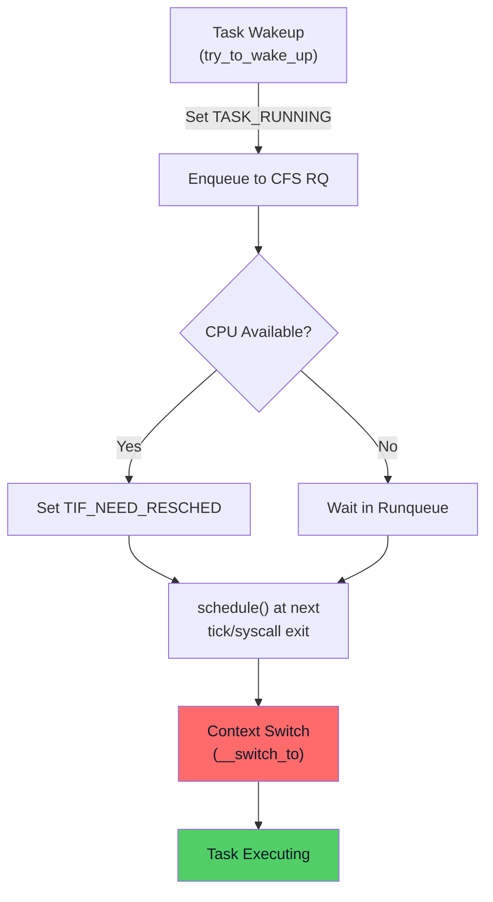
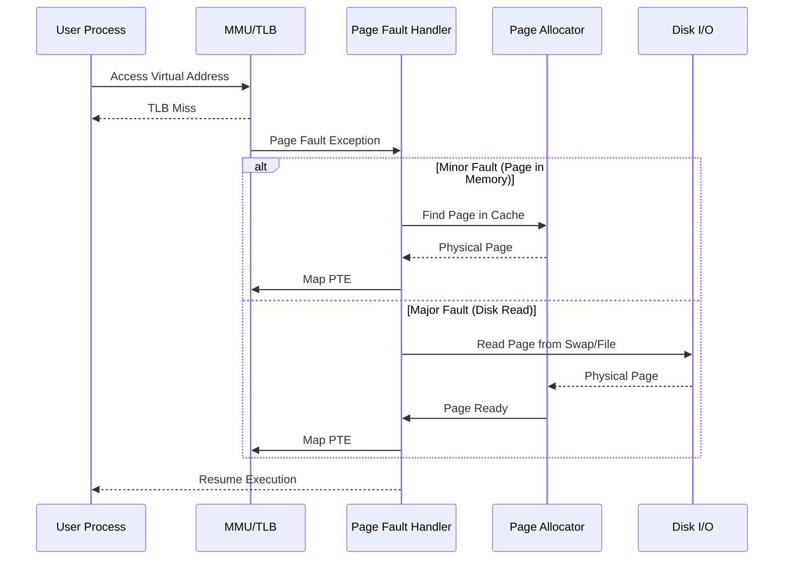
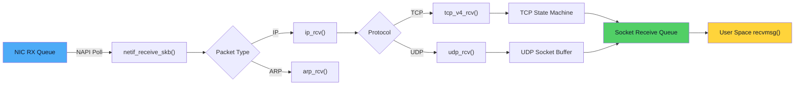
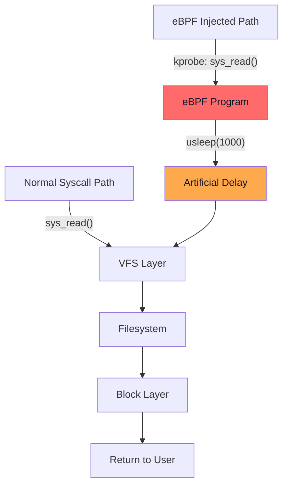
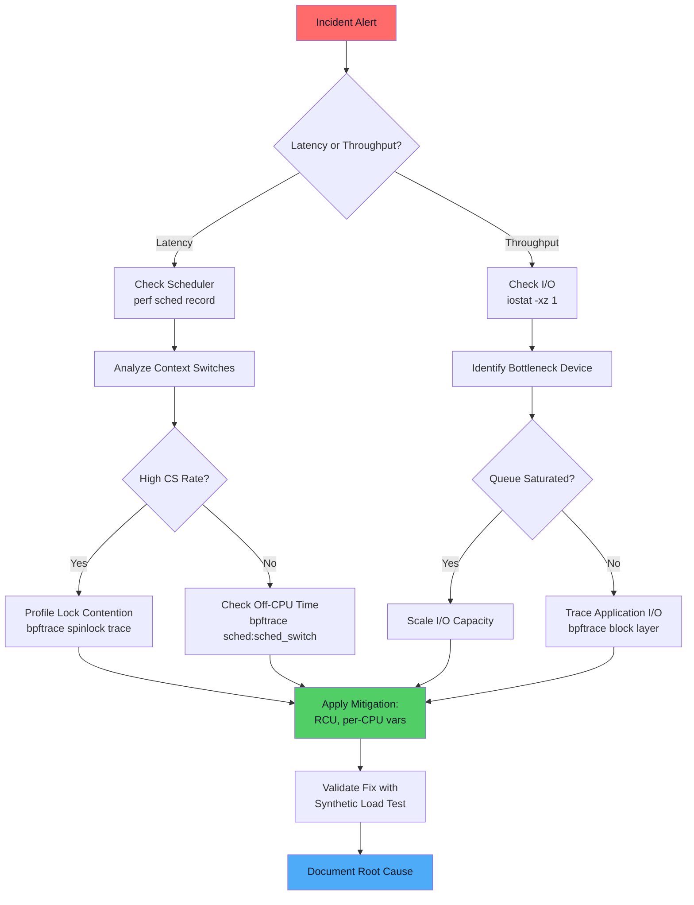

# Operational Verification Labs: Linux Kernel Internals
=====================================================

## Objective and Environment Setup

This lab provides production-grade diagnostic verification of Linux kernel subsystems using native introspection tools. You will work directly with kernel interfaces, tracepoints, and eBPF to understand scheduling, memory management, network stack behavior, and fault recovery at the architectural level.

**Target Audience:** Systems engineers, SRE practitioners, kernel developers, and infrastructure architects requiring deep visibility into kernel behavior.

**Prerequisites:**
- Linux kernel 5.10+ (eBPF CO-RE support)
- Root or CAP_BPF/CAP_PERFMON capabilities
- 4+ CPU cores, 8GB RAM for saturation tests

### Environment Preparation

```bash
# Install diagnostic toolchain
sudo apt-get update
sudo apt-get install -y \
    linux-tools-common \
    linux-tools-$(uname -r) \
    bpftrace \
    bpfcc-tools \
    trace-cmd \
    sysstat \
    numactl \
    stress-ng

# Verify kernel tracepoint availability
sudo perf list tracepoint | grep -E "sched:|syscalls:|net:"

# Enable necessary kernel features
sudo sysctl kernel.perf_event_paranoid=-1
sudo sysctl kernel.kptr_restrict=0

# Verify eBPF functionality
sudo bpftrace -e 'BEGIN { printf("eBPF operational\n"); exit(); }'
```

**Why these tools:**
- `perf`: Hardware PMU and software event sampling via kernel perf_event subsystem
- `bpftrace`/`bpfcc-tools`: Dynamic kernel instrumentation using eBPF virtual machine
- `trace-cmd`: Ftrace frontend for function-level kernel tracing
- `stress-ng`: Reproducible load generation across kernel subsystems

---

## Exercise 1: Process Scheduler Deep Inspection

The Linux Completely Fair Scheduler (CFS) maintains per-CPU run queues and schedules tasks based on virtual runtime (`vruntime`). This exercise reveals scheduler state, load balancing behavior, and preemption latency.

### Task 1.1: Real-time Scheduler State Analysis

```bash
# Capture scheduler statistics per CPU
perf stat -a -e 'sched:sched_switch,sched:sched_wakeup,sched:sched_migrate_task' \
    sleep 5

# Live tracing of context switches with stack traces
sudo bpftrace -e '
tracepoint:sched:sched_switch {
    @prev_comm[args->prev_comm] = count();
    @next_comm[args->next_comm] = count();
}
interval:s:5 { exit(); }'
```

**Architecture Context:** The `sched_switch` tracepoint fires during `__schedule()` when the kernel selects a new task. `prev_task` moves to a wait queue or remains runnable; `next_task` receives CPU time. Context switch overhead includes saving/restoring registers, updating page tables (if different `mm_struct`), and flushing TLBs.

### Task 1.2: CFS Load Balancing Observation

```bash
# Trace load balancing decisions across NUMA nodes
sudo bpftrace -e '
tracepoint:sched:sched_migrate_task {
    printf("%s migrated PID %d from CPU %d -> %d\n",
        comm, args->pid, args->orig_cpu, args->dest_cpu);
}'

# Inspect per-CPU runqueue statistics
cat /proc/sched_debug | grep -A 20 "cpu#"
```

**Expected Output Analysis:**
- `.nr_running`: Tasks in this CPU's CFS runqueue
- `.load`: Aggregate weight (`p->se.load.weight` sum)
- `.exec_clock`: Total runtime on this CPU
- Imbalanced loads trigger `load_balance()` at tick boundaries or idle entry

### Task 1.3: Scheduler Latency Under Contention

```bash
# Generate CPU contention
stress-ng --cpu $(nproc) --timeout 30s &

# Measure wakeup-to-schedule latency
sudo bpftrace -e '
tracepoint:sched:sched_wakeup {
    @wakeup_ts[args->pid] = nsecs;
}

tracepoint:sched:sched_switch /args->next_pid in @wakeup_ts/ {
    $latency_ns = nsecs - @wakeup_ts[args->next_pid];
    @latency_us = hist($latency_ns / 1000);
    delete(@wakeup_ts[args->next_pid]);
}

interval:s:5 { print(@latency_us); clear(@wakeup_ts); exit(); }'
```

**Interpretation:**
- **p50 < 10µs:** Healthy scheduler with available CPU cycles
- **p99 > 100µs:** Scheduler queue depth saturation or lock contention in `__schedule()`
- **Tail latency spikes:** NUMA migrations, CPU frequency scaling transitions, or interrupt storms



---

## Exercise 2: Memory Management and Page Fault Analysis

Linux uses demand paging with a multi-level page table hierarchy (PGD→PUD→PMD→PTE on x86-64). Page faults trigger `handle_mm_fault()` to allocate physical frames or swap in pages.

### Task 2.1: Page Fault Classification

```bash
# Trace page fault types and latency
sudo bpftrace -e '
tracepoint:exceptions:page_fault_user {
    @faults[args->address >> 12] = count();
}

kprobe:handle_mm_fault {
    @fault_start[tid] = nsecs;
}

kretprobe:handle_mm_fault /@fault_start[tid]/ {
    $duration_us = (nsecs - @fault_start[tid]) / 1000;
    @fault_latency = hist($duration_us);
    delete(@fault_start[tid]);
}

interval:s:10 { exit(); }'
```

**Page Fault Categories:**
1. **Minor Fault:** Page in page cache but not mapped (file-backed or COW)
2. **Major Fault:** Page requires disk I/O (swap-in or first file access)
3. **COW Fault:** Write to shared page triggers copy (e.g., post-fork)

### Task 2.2: Memory Pressure and Reclaim

```bash
# Monitor slab allocator and page reclaim
sudo bpftrace -e '
tracepoint:vmscan:mm_vmscan_direct_reclaim_begin {
    printf("Direct reclaim: %d pages order %d\n",
        args->nr_reclaimed, args->order);
    @reclaim = count();
}

tracepoint:kmem:mm_page_alloc {
    @alloc_order[args->order] = count();
}'

# Induce memory pressure
stress-ng --vm 4 --vm-bytes 90% --timeout 30s &

# Observe OOM killer behavior
dmesg -w | grep -E "oom_reaper|Out of memory"
```

**Reclaim Path:**
```
Allocation Failure → try_to_free_pages() → shrink_zone()
    → shrink_lruvec() → shrink_list(ACTIVE/INACTIVE)
    → pageout() → write to swap
```

**Critical Metrics:**
```bash
# Real-time memory statistics
vmstat 1 | awk 'NR==1 || /[0-9]/ {print}'

# Columns: si (swap-in), so (swap-out), bi (block-in), bo (block-out)
```

### Task 2.3: Huge Page Utilization

```bash
# Enable transparent huge pages
echo always | sudo tee /sys/kernel/mm/transparent_hugepage/enabled

# Monitor THP allocation success
grep -E "thp_fault|thp_collapse" /proc/vmstat

# Trace THP allocation paths
sudo bpftrace -e '
kprobe:__do_huge_pmd_anonymous_page {
    @thp_alloc = count();
}

kprobe:collapse_huge_page {
    @thp_collapse = count();
}'
```

**Huge Page Benefits:**
- 2MB pages reduce TLB pressure (512x fewer entries vs 4KB)
- Lower page table depth (3 levels vs 4 on x86-64)
- **Trade-off:** Internal fragmentation, compaction overhead



---

## Exercise 3: Network Stack Observability

The Linux network stack processes packets through layers: **NIC → Softirq → Protocol Stack → Socket Buffer**. This exercise traces packet flow, measures latency, and identifies bottlenecks.

### Task 3.1: Packet Receive Path Instrumentation

```bash
# Trace packet processing from NIC to socket
sudo bpftrace -e '
tracepoint:net:netif_receive_skb {
    @packets_dev[str(args->name)] = count();
}

kprobe:tcp_v4_rcv {
    @tcp_receive = count();
}

kprobe:__skb_recv_datagram {
    @socket_receive = count();
}

interval:s:5 { exit(); }'
```

**Packet Path:**
1. **Hardware Interrupt:** NIC DMA transfer → raises IRQ
2. **NET_RX_SOFTIRQ:** `net_rx_action()` polls NAPI queue
3. **Protocol Demux:** `ip_rcv()` → `tcp_v4_rcv()` → socket delivery
4. **Socket Buffer:** `sk->sk_receive_queue` holds data for `recvmsg()`

### Task 3.2: TCP Connection Latency Analysis

```bash
# Measure TCP handshake duration
sudo bpftrace -e '
kprobe:tcp_v4_connect {
    @connect_start[tid] = nsecs;
}

kretprobe:tcp_v4_connect /@connect_start[tid]/ {
    $duration_us = (nsecs - @connect_start[tid]) / 1000;
    @connect_latency = hist($duration_us);
    delete(@connect_start[tid]);
}

interval:s:10 { exit(); }'

# Generate TCP connections
for i in {1..1000}; do
    curl -so /dev/null http://example.com &
done
wait
```

**TCP State Machine:**
```
CLOSED → SYN_SENT → (SYN-ACK) → ESTABLISHED
    tcp_v4_connect() → tcp_transmit_skb(SYN) → tcp_rcv_state_process()
```

### Task 3.3: Network Saturation and Drop Detection

```bash
# Monitor interface statistics
watch -n 1 'ip -s link show eth0'

# Key metrics:
# - RX-DRP: Dropped at NIC ring buffer (ring too small)
# - RX-OVR: Overruns during DMA
# - TX-ERR: Transmission failures

# Trace packet drops in kernel
sudo bpftrace -e '
tracepoint:skb:kfree_skb {
    @drop_location[kstack] = count();
}

interval:s:5 { print(@drop_location); exit(); }'

# Generate saturation
iperf3 -c <target> -t 30 -P 10
```

**Drop Causes:**
- **Backlog Full:** `netdev_max_backlog` exceeded in `enqueue_to_backlog()`
- **Socket Buffer Full:** `sk->sk_rcvbuf` limit reached
- **Congestion Control:** TCP drops in `tcp_collapse()` under memory pressure



---

## Exercise 4: Block I/O and Filesystem Tracing

Block I/O goes through the **VFS → Filesystem → Block Layer → I/O Scheduler → Driver** pipeline. This exercise measures I/O latency, identifies bottlenecks, and traces filesystem operations.

### Task 4.1: Block I/O Latency Breakdown

```bash
# Trace block I/O request lifecycle
sudo bpftrace -e '
tracepoint:block:block_rq_issue {
    @start[args->dev, args->sector] = nsecs;
}

tracepoint:block:block_rq_complete /@start[args->dev, args->sector]/ {
    $latency_us = (nsecs - @start[args->dev, args->sector]) / 1000;
    @io_latency = hist($latency_us);
    delete(@start[args->dev, args->sector]);
}

interval:s:10 { exit(); }'

# Generate I/O load
fio --name=randread --ioengine=libaio --rw=randread --bs=4k \
    --size=1G --numjobs=4 --runtime=30 --time_based
```

**I/O Latency Components:**
1. **Queue Time:** Wait in I/O scheduler (`block_rq_issue - block_rq_insert`)
2. **Device Time:** Hardware processing (`block_rq_complete - block_rq_issue`)
3. **Completion Time:** Interrupt → softirq → bio completion

### Task 4.2: Filesystem Operation Tracing

```bash
# Trace ext4 operations
sudo bpftrace -e '
kprobe:ext4_file_write_iter {
    @writes = count();
}

kprobe:ext4_readpages {
    @reads = count();
}

kprobe:ext4_sync_file {
    @fsyncs = count();
}

interval:s:5 { exit(); }'

# Monitor page cache hit rate
cachestat 1 5
```

**Page Cache Mechanics:**
- **Write Path:** `generic_perform_write()` → dirty page → writeback thread (`flush-*)
- **Read Path:** `generic_file_read_iter()` → `find_get_page()` (cache hit) or `readpages()` (miss)

### Task 4.3: I/O Scheduler Analysis

```bash
# Check active I/O scheduler
cat /sys/block/sda/queue/scheduler

# Trace I/O scheduler decisions (mq-deadline)
sudo bpftrace -e '
kprobe:dd_insert_requests {
    @insert = count();
}

kprobe:dd_dispatch_request {
    @dispatch = count();
}'

# Compare schedulers under contention
echo none | sudo tee /sys/block/sda/queue/scheduler  # No scheduling
fio --name=mixed --rw=randrw --runtime=30

echo mq-deadline | sudo tee /sys/block/sda/queue/scheduler
fio --name=mixed --rw=randrw --runtime=30
```

**Scheduler Trade-offs:**
- **none:** Minimal overhead, poor fairness under contention
- **mq-deadline:** Prevents starvation, adds ~10µs overhead
- **bfq:** Proportional I/O bandwidth sharing, higher CPU cost

---

## Exercise 5: eBPF-Based Fault Injection and Recovery

Fault injection using eBPF allows non-invasive error simulation in production-like environments. This exercise demonstrates packet loss injection, memory allocation failures, and observing kernel recovery mechanisms.

### Task 5.1: Network Packet Drop Injection

```bash
# Inject 10% packet drops on tcp_v4_rcv
sudo bpftrace -e '
kprobe:tcp_v4_rcv {
    if (rand % 100 < 10) {
        override(0);  // Drop packet
        @drops = count();
    }
}' &

# Measure impact on TCP throughput
iperf3 -c localhost -t 30

# Kill bpftrace process
sudo pkill bpftrace
```

**Expected Behavior:**
- TCP retransmits after RTO expiry (initially 200-1000ms)
- Congestion window (cwnd) resets to 1 MSS
- Exponential backoff if drops persist

### Task 5.2: Memory Allocation Failure Injection

```bash
# Force kmalloc failures using BPF error injection
sudo bpftrace -e '
kprobe:should_failslab {
    override(1);  // Force slab allocation failure
    @inject_failures = count();
}' &

# Attempt allocations and observe fallback
stress-ng --malloc 4 --malloc-bytes 1M --timeout 10s

# Check kernel logs for allocation failures
dmesg | tail -20
```

**Recovery Mechanisms:**
- **SLAB Fallback:** Try different cache or use emergency reserves
- **GFP_ATOMIC Paths:** Return NULL immediately (no sleep allowed)
- **GFP_KERNEL Paths:** Trigger direct reclaim or OOM killer

### Task 5.3: Syscall Latency Injection

```bash
# Add artificial delay to read() syscalls
sudo bpftrace -e '
tracepoint:syscalls:sys_enter_read {
    usleep(1000);  // 1ms delay
    @delayed_reads = count();
}'

# Measure application impact
time dd if=/dev/zero of=/dev/null bs=4k count=10000
```

**Use Case:** Simulate slow disk, network latency, or contended locks to test application resilience.



---

## Exercise 6: Kernel Lock Contention Analysis

Lock contention in kernel spinlocks or mutexes directly impacts scalability. This exercise identifies hot locks and quantifies contention severity.

### Task 6.1: Spinlock Contention Profiling

```bash
# Trace spinlock acquisition attempts
sudo bpftrace -e '
kprobe:__raw_spin_lock {
    @lock_addr[arg0] = count();
}

kprobe:__raw_spin_lock_irqsave {
    @lock_irq_addr[arg0] = count();
}

interval:s:5 {
    print(@lock_addr);
    print(@lock_irq_addr);
    exit();
}'

# Resolve top lock addresses to symbols
sudo perf probe -L __raw_spin_lock
```

**High-Contention Locks:**
- `tasklist_lock`: Process creation/exit
- `zone->lock`: Memory allocator
- `q->lock`: Block I/O scheduler queue

### Task 6.2: Mutex Contention and Wait Time

```bash
# Measure mutex wait time
sudo bpftrace -e '
kprobe:mutex_lock {
    @wait_start[tid] = nsecs;
}

kretprobe:mutex_lock /@wait_start[tid]/ {
    $wait_us = (nsecs - @wait_start[tid]) / 1000;
    @mutex_wait = hist($wait_us);
    delete(@wait_start[tid]);
}

interval:s:10 { exit(); }'
```

**Mitigation Strategies:**
- **RCU (Read-Copy-Update):** Lock-free reads for read-heavy workloads
- **Per-CPU Variables:** Eliminate cache-line bouncing
- **Lockless Algorithms:** Atomic operations and CAS loops

---

## Diagnostic Reference and Production Checklist

### Critical Kernel Metrics

| Subsystem | Metric | Healthy Baseline | Investigation Trigger |
|-----------|--------|------------------|----------------------|
| **Scheduler** | Context switches/sec | < 10k/core | > 50k/core sustained |
| **Scheduler** | Runqueue depth | < 2 per CPU | > 5 per CPU |
| **Memory** | Page faults/sec | < 1k/sec | > 10k/sec with swap activity |
| **Memory** | Direct reclaim events | 0 under normal load | Any occurrence |
| **Network** | RX packet drops | 0 | > 0.1% of rx_packets |
| **Network** | TCP retransmit rate | < 1% | > 3% sustained |
| **Block I/O** | Queue depth | < disk_queue_depth/2 | Saturated queue |
| **Block I/O** | I/O await time | < 10ms (SSD), < 20ms (HDD) | > 50ms |

### Advanced Tracing Patterns

```bash
# Aggregate system-wide syscall latency
sudo bpftrace -e '
tracepoint:raw_syscalls:sys_enter {
    @start[tid] = nsecs;
}

tracepoint:raw_syscalls:sys_exit /@start[tid]/ {
    $syscall = args->id;
    $latency_us = (nsecs - @start[tid]) / 1000;
    @syscall_latency[$syscall] = hist($latency_us);
    delete(@start[tid]);
}'

# Off-CPU time analysis (blocked time)
sudo bpftrace -e '
tracepoint:sched:sched_switch {
    if (args->prev_state == 1) {  // TASK_INTERRUPTIBLE
        @blocked_start[args->prev_pid] = nsecs;
    }
    if (@blocked_start[args->next_pid]) {
        $blocked_us = (nsecs - @blocked_start[args->next_pid]) / 1000;
        @offcpu[args->next_comm] = hist($blocked_us);
        delete(@blocked_start[args->next_pid]);
    }
}'
```

### Kernel Compilation for Advanced Debugging

```bash
# Build kernel with debug symbols and tracepoints
git clone --depth 1 --branch v6.1 \
    https://github.com/torvalds/linux.git
cd linux
make defconfig
scripts/config --enable DEBUG_INFO
scripts/config --enable FTRACE
scripts/config --enable BPF_SYSCALL
make -j$(nproc)
sudo make modules_install install
```

---

## Production Incident Response Workflow



---

## Further Study and References

**Core Kernel Documentation:**
- `Documentation/trace/ftrace.txt`: Kernel function tracing
- `Documentation/bpf/`: eBPF subsystem architecture
- `Documentation/scheduler/sched-design-CFS.txt`: CFS internals

**Authoritative Resources:**
- *Linux Kernel Development* (3rd ed.), Robert Love
- *BPF Performance Tools*, Brendan Gregg (Addison-Wesley, 2019)
- *Understanding the Linux Kernel* (3rd ed.), Bovet & Cesati

**Production Tooling:**
- [bcc tools](https://github.com/iovisor/bcc): Production eBPF utilities
- [perf-tools](https://github.com/brendangregg/perf-tools): Ftrace wrappers
- [Linux Performance](https://www.brendangregg.com/linuxperf.html): Comprehensive methodology guide

This lab provides empirical, tool-driven verification of kernel behavior using production-grade observability. Master these techniques to diagnose performance degradation, validate capacity planning assumptions, and build kernel-aware distributed systems.
