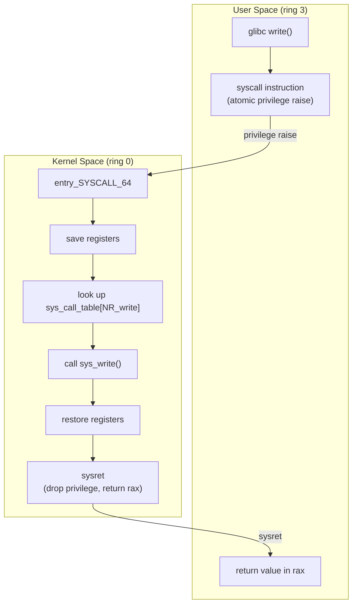
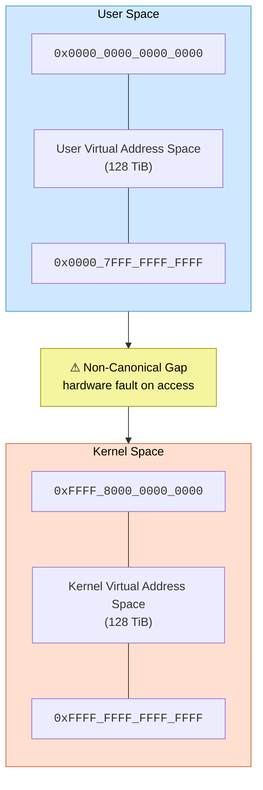
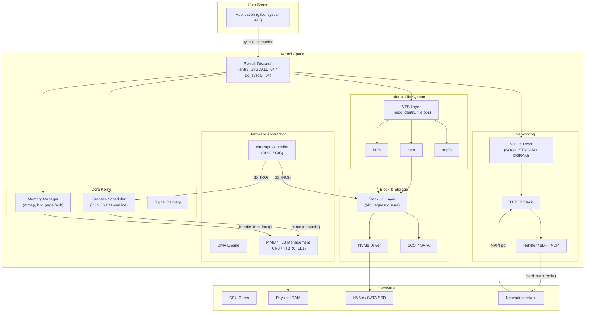
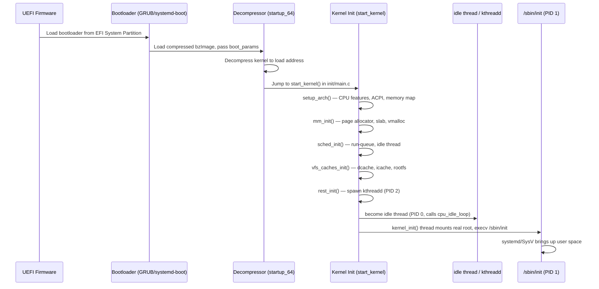

# Lesson 1: Foundations & Kernel/System Invariants

## Curriculum Roadmap

This lesson establishes the theoretical foundation for a rigorous exploration of the Linux kernel. Rather than cataloguing features, we derive the kernel's design from first principles: what problem must be solved, what hardware constraints exist, and why the chosen abstractions are the only viable solutions under those constraints. By the end of this lesson you will understand the kernel's execution model, privilege boundaries, memory protection invariants, and subsystem decomposition at an architectural level sufficient to read, modify, and reason about kernel code.

---

## 1. First-Principles Problem Space & Execution Boundaries

### 1.1 The Core Problem: Sharing Physical Resources Safely

A modern computer has one (or a small number of) CPUs, a finite physical address space, and a fixed set of I/O devices. Multiple mutually-distrusting programs must run concurrently and share these resources. The kernel is the software layer that makes this possible without letting any program corrupt another's state or monopolize hardware indefinitely.

Three irreducible sub-problems follow from this statement:

1. **Isolation** — a bug or exploit in one program must not affect another's memory, file descriptors, or CPU time.
2. **Multiplexing** — the illusion of exclusive access (to CPU, memory, and devices) must be provided to every program simultaneously.
3. **Mediation** — every access to a shared resource must pass through a trusted arbiter so that policy (permissions, quotas, namespaces) can be enforced.

Every subsystem in the kernel—the memory manager, the scheduler, the VFS, the network stack—exists solely to serve one or more of these three goals.

### 1.2 Hardware Enforcement: Privilege Rings and the System Call Boundary

The kernel's isolation guarantee is worthless if it is enforced only by software convention. x86-64 provides four privilege levels (rings 0–3); Linux uses only ring 0 (kernel mode) and ring 3 (user mode). ARM64 uses Exception Levels EL0 (user) and EL1 (kernel), with EL2 for hypervisors and EL3 for secure firmware.

The CPU enforces two categories of protection in hardware:

- **Memory protection**: The Memory Management Unit (MMU) translates virtual addresses through page tables. Each page-table entry carries permission bits (`U/S`, `R/W`, `NX`). An attempt by ring-3 code to access a kernel-mapped page triggers a General Protection Fault or Page Fault immediately—the CPU does not ask the kernel first.
- **Instruction privilege**: Certain instructions (`cli`, `hlt`, `in`, `out`, `lgdt`, `lidt`, `wrmsr`…) are privileged. Executing them from ring 3 raises a #GP fault. The kernel field-handles the fault and delivers `SIGILL` to the offending process.

The only legitimate path from user space into kernel code is a controlled gate: `syscall`/`sysenter` on x86-64, `svc` on ARM64. These instructions atomically switch the stack pointer to the kernel stack stored in the CPU's TSS (Task State Segment on x86-64) or `sp_el1` (ARM64), load a known code address (the system call entry stub), and raise the privilege level. This is the **syscall boundary**—a one-way valve with a single entry point per CPU.



The entry stub `entry_SYSCALL_64` lives in `arch/x86/entry/entry_64.S`. It is hand-written assembly because saving the full register file and switching stacks correctly before touching any C code is mandatory—a single clobber of a register before it is saved would be an exploitable kernel information leak.

### 1.3 Address Space Layout

The 64-bit virtual address space (48 bits implemented on most x86-64 hardware, 52 bits with 5-level paging) is split at a canonical boundary:



Specific kernel regions within the kernel half (from `Documentation/x86/x86_64/mm.rst`):

| Virtual Address Range | Contents |
|---|---|
| `0xffff888000000000` – `0xffffc87fffffffff` | Direct physical memory map (physmap) |
| `0xffffc90000000000` – `0xffffe8ffffffffff` | `vmalloc` / `ioremap` space |
| `0xffff_ffff_8000_0000` – `0xffff_ffff_ffff_ffff` | Kernel text, data, BSS (loaded here by KASLR) |

Every process shares the kernel half of its page tables (via the `pgd` entries pointing to kernel page-table pages). This is what enables a system call to transition from user to kernel mode without a full CR3 (page-table base register) switch—though Meltdown mitigations (KPTI) deliberately broke this sharing and now require a CR3 switch on every syscall entry and exit.

### 1.4 The Execution Contexts

Kernel code does not run in a single uniform context. There are four distinct execution contexts, each with different preemption and sleeping rules:

| Context | May sleep? | Preemptible? | Example |
|---|---|---|---|
| Process context (syscall / kernel thread) | Yes | Yes (CONFIG_PREEMPT) | `sys_read()`, `kworker` |
| Softirq / tasklet | No | No (on same CPU) | TCP receive, block I/O completion |
| Hardirq (interrupt handler) | No | No | NIC interrupt, timer interrupt |
| NMI | No | No | Watchdog, MCE handler |

This distinction is not stylistic—it determines which synchronization primitives are legal. A `mutex_lock()` in a hardirq handler will deadlock the system because mutexes may sleep and interrupt handlers cannot be descheduled. The correct primitive in that context is a `spin_lock_irqsave()`.

---

## 2. Fundamental System Guarantees & Non-Negotiable Invariants

Calling these "guarantees" is precise: they are properties the kernel must uphold unconditionally, because violating any one of them breaks the entire trust model.

### 2.1 Memory Isolation Invariant

**Invariant**: No user-space virtual address in process A may map to the same physical page as any virtual address in process B, unless both processes have explicitly established a shared mapping (`mmap(MAP_SHARED)`, POSIX shared memory, etc.).

**Mechanism**: Each process has a distinct `mm_struct` containing a pointer to its top-level page-table page (PGD). On context switch, the kernel writes this PGD's physical address into CR3 (x86-64) or `TTBR0_EL1` (ARM64). The CPU's MMU then uses only that process's page tables for all address translations. Because the PGD is different, there is no path from one process's virtual addresses to another's physical pages.

**Why it cannot be relaxed**: If this invariant could be violated by user space, process A could read process B's private keys, passwords, and code. The hardware MMU exists specifically to enforce this in silicon.

### 2.2 Kernel Integrity Invariant

**Invariant**: User-space code cannot read or write kernel virtual addresses, and cannot modify kernel page-table entries.

**Mechanism**: Every kernel page-table entry has the Supervisor bit set (`U/S = 0` on x86). The CPU refuses ring-3 accesses to such pages unconditionally. SMEP (Supervisor Mode Execution Prevention) additionally prevents the kernel from accidentally executing a user-space page, closing a class of privilege-escalation exploits. SMAP (Supervisor Mode Access Prevention) prevents the kernel from directly dereferencing a user-space pointer without an explicit `copy_from_user()` / `copy_to_user()` call that sets the AC flag in RFLAGS, limiting exploitation of kernel pointer-dereference bugs.

### 2.3 Preemption and Scheduling Fairness Invariant

**Invariant**: No single task may hold the CPU indefinitely. The scheduler will preempt it.

**Mechanism**: The hardware timer (HPET, local APIC timer) fires a periodic interrupt (or one-shot tick in `CONFIG_NO_HZ`). The interrupt handler calls `scheduler_tick()`, which decrements the current task's remaining timeslice. When the timeslice expires, `TIF_NEED_RESCHED` is set in the thread-info flags. On return from every interrupt and system call, the kernel checks this flag and calls `schedule()` if set.

With `CONFIG_PREEMPT` (voluntary + forced preemption, the default for most desktop/server kernels since 5.x unified preemption model), the kernel may also be preempted while executing inside a system call, as long as `preempt_count() == 0` (i.e., no spinlock is held, no hardirq is active, no `preempt_disable()` region is in effect).

### 2.4 Reference Counting & Lifetime Invariant

**Invariant**: No kernel object (task, file, inode, socket, …) may be freed while a valid reference to it exists anywhere in the system.

**Mechanism**: Nearly every major kernel object embeds a `struct kref` or an atomic reference counter. The rule is: before passing a pointer to an object to another context (another CPU, a callback, a data structure), increment the refcount. After the other context is done, decrement and check: if the count reaches zero, call the destructor.

```c
/* Correct pattern for getting a reference to a task */
struct task_struct *t;
rcu_read_lock();
t = find_task_by_vpid(pid);
if (t)
    get_task_struct(t);   /* increments task->usage via kref */
rcu_read_unlock();

/* t is now safe to use outside the RCU read-side critical section */
do_something_with(t);
put_task_struct(t);       /* decrement; frees if zero */
```

Violating this invariant produces use-after-free bugs, the most common class of Linux kernel CVEs.

### 2.5 Interrupt Latency Bound (Real-Time Invariant)

**Invariant** (strengthened with `CONFIG_PREEMPT_RT`): The maximum latency between a hardware interrupt assertion and the execution of its top-half handler is bounded by a small constant (target: < 100 µs for PREEMPT_RT; ≫ this for vanilla kernels under heavy load).

**Mechanism**: The RT patchset converts all spinlocks to sleeping locks (rt_mutex), makes softirqs and interrupt threads preemptible, and serializes high-priority tasks ahead of kernel code holding locks. This is essential for audio, industrial control, and robotics applications.

---

## 3. High-Level Process & Subsystem Architecture

### 3.1 Architectural Decomposition

The Linux kernel is a monolithic kernel, meaning all subsystems execute in a single shared address space at ring 0. This is in contrast to microkernels (Mach, L4, seL4), where most services run as user-space servers communicating via IPC. The monolithic design provides lower inter-subsystem call latency (a direct C function call vs. an IPC round-trip) at the cost of a larger kernel Trusted Computing Base.

The major subsystems and their responsibilities:

| Subsystem | Primary Files | Core Responsibility |
|---|---|---|
| Process Scheduler | `kernel/sched/` | CPU time multiplexing, load balancing, latency control |
| Memory Manager | `mm/` | Virtual memory, page allocation, reclaim, OOM killer |
| Virtual File System | `fs/` | Unified file abstraction over all filesystem types |
| Network Stack | `net/` | Protocol processing (TCP/IP, UDP, Netfilter), socket API |
| Block Layer | `block/` | I/O scheduling, request merging, device abstraction |
| Device Drivers | `drivers/` | Hardware abstraction for every device class |
| Security Subsystem | `security/` | LSM hooks (SELinux, AppArmor, BPF LSM) |
| eBPF Runtime | `kernel/bpf/` | Safe user-defined programs running in kernel context |

### 3.2 System Architecture Diagram



### 3.3 The Boot Sequence: From Power-On to `init`

Understanding the boot sequence grounds every abstract concept in a concrete execution timeline.



`start_kernel()` in `init/main.c` is the first C function executed. Its call sequence is deterministic and well-ordered because subsystems have dependencies: the page allocator must be online before slab, slab before VFS, VFS before rootfs, rootfs before `init`. Incorrect ordering causes a boot panic.

### 3.4 Key Data Structures

The kernel's correctness rests on a small number of central data structures. These are worth understanding at the type level before diving into any subsystem.

**`struct task_struct`** (`include/linux/sched.h`) — the process descriptor. Everything the scheduler, memory manager, and signal subsystem need to know about a process or thread lives here. It is large (~10 KB on x86-64 with all options enabled). Critical fields:

```c
struct task_struct {
    /*
     * -1: unrunnable, 0: runnable, >0: stopped.
     * Accessed with READ_ONCE/WRITE_ONCE to prevent compiler
     * from caching across context boundaries.
     */
    volatile long           state;

    /* Architecture-specific CPU state saved on context switch */
    struct thread_struct    thread;

    /* Virtual memory descriptor — shared between threads in a thread group */
    struct mm_struct        *mm;
    struct mm_struct        *active_mm;  /* borrowed mm for kernel threads */

    /* Scheduler fields */
    int                     prio;
    int                     static_prio;
    int                     normal_prio;
    unsigned int            rt_priority;
    const struct sched_class *sched_class;
    struct sched_entity     se;        /* CFS scheduling entity */

    /* Process identity */
    pid_t                   pid;       /* thread ID (kernel view) */
    pid_t                   tgid;      /* thread-group ID == userspace PID */
    struct task_struct      *real_parent;
    struct task_struct      *parent;

    /* File system state */
    struct fs_struct        *fs;
    struct files_struct     *files;

    /* Signal handling */
    struct signal_struct    *signal;
    struct sighand_struct   *sighand;

    /* Security */
    const struct cred       *cred;
    /* ... ~300 more fields ... */
};
```

**`struct mm_struct`** (`include/linux/mm_types.h`) — the virtual address space of a process. Contains the pointer to the page-table root, the list of `struct vm_area_struct` (VMA) regions, the `mmap_lock` (a read-write semaphore protecting the VMA tree), and accounting fields.

**`struct page`** (`include/linux/mm_types.h`) — represents one physical page frame. The kernel maintains an array of these (`mem_map[]`) indexed by Page Frame Number (PFN). Its `flags` field encodes page state (dirty, locked, referenced, slab, …) in a single atomic word. This structure must be as small as possible because there is one per physical page—64 bytes × 1 million pages = 64 MB just for the `page` array on a 4 GiB machine.

**`struct file`** / **`struct inode`** / **`struct dentry`** — the VFS triumvirate. An `inode` represents a file's metadata and data (independent of name). A `dentry` caches the mapping from a name component to an inode. A `file` is an open file description—the kernel object behind a file descriptor—holding the current offset and the `file_operations` vtable pointer.

---

## 4. Concurrency Model & Synchronization Primitives

Kernel code runs on dozens to thousands of CPUs simultaneously. The concurrency model is not optional reading—a module that ignores it will corrupt kernel data structures under load.

### 4.1 Sources of Concurrency

1. **SMP (Symmetric Multiprocessing)**: Multiple CPUs execute kernel code simultaneously. A data structure modified on CPU 0 may be read on CPU 1 at exactly the same time.
2. **Interrupts**: An interrupt can preempt any kernel code at any point unless interrupts are explicitly disabled (`local_irq_disable()` or `spin_lock_irqsave()`).
3. **Kernel preemption**: With `CONFIG_PREEMPT`, any kernel code path not holding a spinlock or inside a `preempt_disable()` region can be preempted and rescheduled on a different CPU.
4. **RCU (Read-Copy-Update)**: A lock-free synchronization mechanism for read-mostly data structures. Readers hold no lock and are never blocked; writers make changes on a copy and publish atomically.

### 4.2 Spinlocks

Spinlocks are the kernel's most primitive mutual exclusion mechanism. They busy-wait (spin) rather than sleep, making them appropriate only when the critical section is very short (a few instructions) and sleeping is prohibited (hardirq context, inside `preempt_disable()`).

```c
#include <linux/spinlock.h>

static DEFINE_SPINLOCK(my_lock);
static LIST_HEAD(my_list);

/* Safe to call from process context or softirq */
void list_add_item(struct my_item *item)
{
    unsigned long flags;

    /*
     * spin_lock_irqsave disables local interrupts AND acquires the lock.
     * Required if the list is also accessed from a hardirq handler.
     * flags saves the previous RFLAGS.IF state so we restore it correctly
     * even if called with interrupts already disabled.
     */
    spin_lock_irqsave(&my_lock, flags);
    list_add_tail(&item->list, &my_list);
    spin_unlock_irqrestore(&my_lock, flags);
}
```

A spinlock held across a sleep (e.g., calling `kmalloc(GFP_KERNEL)` while holding a spinlock) is a kernel BUG—it will trigger `might_sleep()` assertions in debug kernels.

### 4.3 RCU: The Kernel's Most Powerful Synchronization Primitive

RCU is used for the most performance-critical read-mostly structures in the kernel: the routing table, the process list, the dentry cache, network interface list, and many more.

The contract:
- **Readers**: wrap access in `rcu_read_lock()` / `rcu_read_unlock()`, which on non-preemptible kernels is simply a `preempt_disable()` / `preempt_enable()` pair—zero memory barriers, zero cache-line bouncing.
- **Writers**: take a conventional lock (spinlock or mutex) among themselves, modify a copy of the data, publish it with `rcu_assign_pointer()` (which includes the necessary memory barrier), then call `synchronize_rcu()` or `call_rcu()` to defer freeing the old version until all pre-existing RCU read-side critical sections have completed.

```c
#include <linux/rcupdate.h>
#include <linux/slab.h>

struct config_entry {
    int value;
    struct rcu_head rcu;   /* must be embedded for call_rcu() */
};

/* Protected by rcu_assign_pointer / rcu_dereference */
static struct config_entry __rcu *global_config;

/* Reader — called very frequently, must be fast */
int read_config_value(void)
{
    struct config_entry *entry;
    int val;

    rcu_read_lock();
    entry = rcu_dereference(global_config);
    val = entry ? entry->value : -1;
    rcu_read_unlock();
    return val;
}

static void config_entry_free(struct rcu_head *head)
{
    struct config_entry *e = container_of(head, struct config_entry, rcu);
    kfree(e);
}

/* Writer — called rarely */
int update_config_value(int new_val)
{
    struct config_entry *new_entry, *old_entry;

    new_entry = kmalloc(sizeof(*new_entry), GFP_KERNEL);
    if (!new_entry)
        return -ENOMEM;
    new_entry->value = new_val;

    /*
     * rcu_assign_pointer issues a memory barrier before the pointer store,
     * guaranteeing that all writes to new_entry are visible to readers
     * before the pointer itself becomes visible.
     */
    old_entry = rcu_replace_pointer(global_config, new_entry,
                                    lockdep_is_held(&config_lock));

    /* Schedule old_entry to be freed after all ongoing RCU read sides complete */
    if (old_entry)
        call_rcu(&old_entry->rcu, config_entry_free);

    return 0;
}
```

### 4.4 Memory Barriers

The CPU and compiler are free to reorder memory accesses for performance. The kernel uses memory barriers to impose ordering constraints. The key barriers in order of increasing strength:

| Barrier | Meaning |
|---|---|
| `barrier()` | Compiler fence only; no CPU instruction emitted |
| `smp_rmb()` | Read memory barrier: all prior reads complete before subsequent reads |
| `smp_wmb()` | Write memory barrier: all prior writes complete before subsequent writes |
| `smp_mb()` | Full memory barrier: all prior accesses complete before subsequent accesses |
| `dma_rmb()` / `dma_wmb()` | Barriers that also constrain DMA-visible writes |

---

## 5. The Syscall Path: End-to-End Trace

Tracing a single system call from user space to hardware and back is the best way to cement the architectural concepts above.

### 5.1 `write(2)` to an ext4 File: Full Call Chain

```mermaid
flowchart TD
    subgraph user_space ["User Space"]
        A["write(fd, buf, count)"]
        B["glibc write() wrapper"]
        C["syscall instruction\n(NR_write = 1, x86-64)"]
    end

    subgraph kernel_entry ["Kernel Entry · arch/x86/entry/entry_64.S"]
        D["entry_SYSCALL_64"]
        D1["swapgs\n(switch GS base to kernel percpu area)"]
        D2["save user RSP →\nmov %rsp, %gs:pcpu_rsp"]
        D3["switch to kernel stack\nmov $KERNEL_STACK, %rsp"]
        D4["pushq registers"]
        D5["call do_syscall_64"]
    end

    subgraph dispatch ["Syscall Dispatch · arch/x86/kernel/syscall_c64.c"]
        E["do_syscall_64"]
        F["sys_call_table[1]\n→ __x64_sys_write()"]
    end

    subgraph vfs_layer ["VFS Layer · fs/read_write.c"]
        G["__x64_sys_write() / ksys_write()"]
        H["fdget_pos(fd)\n→ struct fd (file + flags)"]
        I["vfs_write(file, buf, count, &pos)"]
        J["file->f_op->write_iter\n→ ext4_file_write_iter"]
    end

    subgraph ext4_layer ["ext4 Write Path · fs/ext4/file.c"]
        K["ext4_file_write_iter()"]
        L["generic_file_write_iter()"]
        M["iov_iter_fault_in_readable()\n(fault in user pages)"]
        N["ext4_buffered_write_iter()"]
        O["generic_perform_write()"]
        P["ext4_write_begin()\n(jbd2 journal transaction start)"]
        Q["copy_page_from_iter_atomic()\n(copy user data → page cache)"]
        R["ext4_write_end()\n(mark page dirty, journal commit)"]
    end

    subgraph writeback ["Writeback · async via pdflush / writeback threads"]
        S["ext4_writepages()"]
        T["mpage_prepare_extent_to_map()"]
        U["submit_bio()\n(submit to block layer)"]
        V["nvme_queue_rq()\n(NVMe driver)"]
        W["nvme_submit_cmd()\n(ring doorbell register on PCIe device)"]
    end

    A --> B --> C --> D
    D --> D1 --> D2 --> D3 --> D4 --> D5 --> E
    E --> F --> G
    G --> H --> I --> J --> K
    K --> L
    L --> M --> N
    N --> O
    O --> P --> Q --> R
    R -.->|"async writeback"| S
    S --> T --> U --> V --> W
```



The user's `write()` call returns as soon as the data is copied to the page cache. The actual disk write happens asynchronously. The kernel's `fsync(2)` call is the mechanism to force synchronous commit through the journal to stable storage.

---

## 6. Lab: Instrumentation with eBPF and `bpftrace`

The following lab exercises use `bpftrace` (which uses the eBPF runtime in the kernel) to observe kernel internals without modifying kernel source or rebooting. All commands require `root` or `CAP_BPF` + `CAP_PERFMON`.

### Lab 6.1: Observe System Call Latency

Measure the latency of every `read` system call system-wide and display a histogram:

```bash
# bpftrace -e '
# tracepoint:syscalls:sys_enter_read { @start[tid] = nsecs; }
# tracepoint:syscalls:sys_exit_read  /@start[tid]/  {
#   @latency_ns = hist(nsecs - @start[tid]);
#   delete(@start[tid]);
# }
# interval:s:5 { print(@latency_ns); clear(@latency_ns); exit(); }
# '
```

### Lab 6.2: Trace Page Fault Sources

Identify which executables are generating the most page faults (useful for detecting excessive memory pressure):

```bash
# bpftrace -e '
# tracepoint:exceptions:page_fault_user {
#   @faults[comm] = count();
# }
# interval:s:5 { print(@faults); clear(@faults); }
# '
```

### Lab 6.3: Inspect Scheduler Context Switches

Trace context switches and show (prev → next) task pairs with CPU number:

```bash
# bpftrace -e '
# tracepoint:sched:sched_switch {
#   printf("cpu=%d %s (%d) -> %s (%d)\n",
#     cpu,
#     args->prev_comm, args->prev_pid,
#     args->next_comm, args->next_pid);
# }
# '
```

These three one-liners demonstrate that every architectural concept described above—syscall boundaries, page fault handling, scheduler preemption—is directly observable at runtime through the eBPF framework without any kernel modification.

---

## Summary of Invariants

| # | Invariant | Enforcing Mechanism | Violation Consequence |
|---|---|---|---|
| 1 | Memory isolation between processes | Per-process page tables, CR3/TTBR0 switch | Information disclosure, arbitrary code execution |
| 2 | Kernel address space inaccessible from user space | Supervisor page bits, SMEP, SMAP, KPTI | Kernel read/write → full system compromise |
| 3 | No unbounded CPU monopolization | Hardware timer interrupt, TIF_NEED_RESCHED | System hang, denial of service |
| 4 | Objects not freed while referenced | kref / refcount_t, RCU grace periods | Use-after-free → kernel memory corruption |
| 5 | Bounded interrupt latency (RT variant) | PREEMPT_RT sleeping locks, irq threading | Missed real-time deadlines |
| 6 | Syscall as single controlled kernel entry | SYSCALL/SVC gate, entry stub, ring switch | No user-controlled kernel entry exists outside this path |

---

## Further Reading

- **Love, Robert.** *Linux Kernel Development*, 3rd ed. Addison-Wesley, 2010. — The clearest single-volume treatment of core kernel subsystems.
- **Corbet, Jonathan; Rubini, Alessandro; Kroah-Hartman, Greg.** *Linux Device Drivers*, 3rd ed. O'Reilly, 2005. — Free at lwn.net/Kernel/LDD3/. Foundational for driver and module development.
- **Bovet, Daniel P.; Cesati, Marco.** *Understanding the Linux Kernel*, 3rd ed. O'Reilly, 2005. — Deep architectural analysis; covers x86 internals extensively.
- **McKenney, Paul E.** *Is Parallel Programming Hard, And, If So, What Can You Do About It?* (perfbook). — The definitive reference on RCU and Linux concurrency primitives. Available at kernel.org/pub/linux/kernel/people/paulmck/perfbook/.
- **kernel.org/doc/html/latest/** — The official kernel documentation tree, including `Documentation/x86/x86_64/mm.rst`, `Documentation/core-api/`, and `Documentation/scheduler/`.

---

*Next lesson: Memory Management in Depth — the buddy allocator, the slab/SLUB allocator, page reclaim and the LRU lists, `mmap()` internals, and the OOM killer's decision algorithm.*
