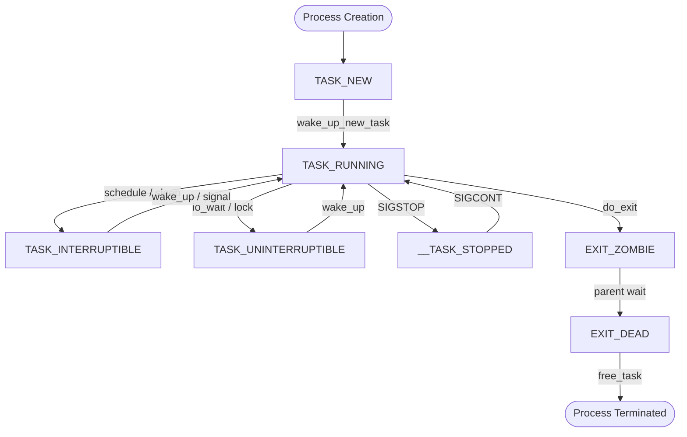
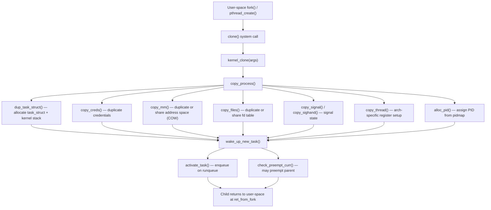
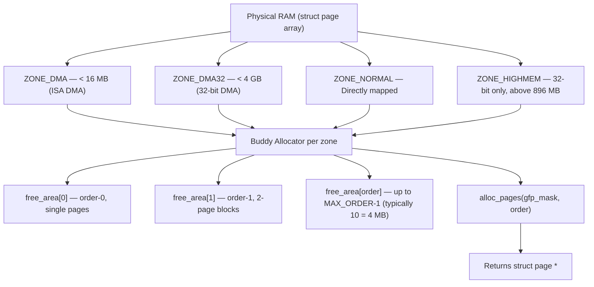
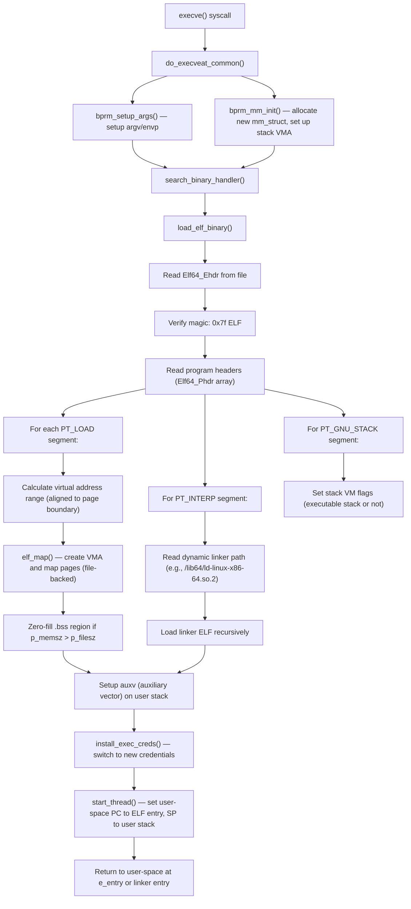
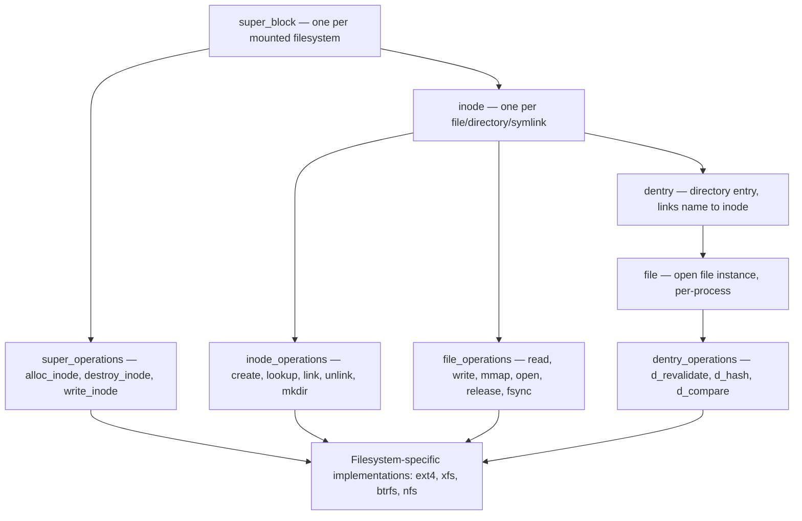
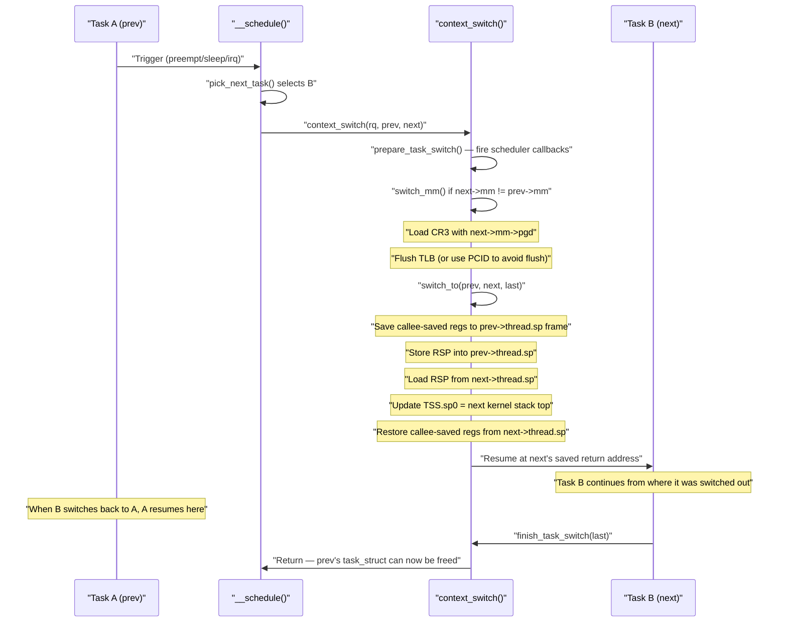

# Lesson 2: Core Architecture & Memory/Execution Models

## 1. The Task Abstraction: Unifying Processes and Threads

The Linux kernel does not distinguish between processes and threads at the scheduler level. Both are represented by `task_struct` — the kernel's central data structure for any schedulable entity. The distinction between "process" and "thread" is a matter of resource sharing, not a structural difference. When `clone()` is called with `CLONE_VM | CLONE_FILES | CLONE_SIGHAND`, the resulting task shares its memory space, file descriptor table, and signal handlers with its parent — what user space calls a "thread." When those flags are absent, the kernel copies (with copy-on-write) or creates fresh resources — what user space calls a "process." The scheduler treats all tasks identically regardless of how they were created.

`task_struct`, defined in `include/linux/sched.h`, is roughly 9,000 bytes on x86_64 and contains every piece of state the kernel needs to manage a task: its PID and thread group ID, credentials, open files, signal handlers, scheduling entities, memory descriptor, CPU affinity, namespace pointers, cgroup membership, and the architecture-specific `thread_struct` that holds saved register state across context switches.

```c
// Simplified view of task_struct key fields (include/linux/sched.h)
struct task_struct {
    struct thread_info        thread_info;     // Low-level arch state
    unsigned int              cpu;             // CPU currently running on
    volatile long             state;           // TASK_RUNNING, TASK_INTERRUPTIBLE, etc.
    void                      *stack;           // Kernel stack pointer

    // Identifiers
    pid_t                     pid;             // Process/task ID
    pid_t                     tgid;            // Thread group leader's PID
    struct task_struct        *group_leader;   // Points to thread group leader

    // Credentials
    const struct cred         *real_cred;
    const struct cred         *cred;            // Effective credentials

    // Memory
    struct mm_struct          *mm;              // Address space (NULL for kernel threads)
    struct mm_struct          *active_mm;       // For kernel threads: borrowed mm

    // Files
    struct files_struct       *files;           // File descriptor table

    // Signals
    struct signal_struct      *signal;          // Shared signal handler table
    struct sighand_struct     *sighand;          // Signal disposition

    // Scheduling
    struct sched_entity       se;               // CFS/EEVDF scheduling entity
    struct sched_rt_entity    rt;               // Real-time scheduling entity
    struct sched_dl_entity    dl;               // Deadline scheduling entity
    int                       policy;            // SCHED_NORMAL, SCHED_FIFO, SCHED_RR, SCHED_DEADLINE
    int                       prio;              // Static priority (nice + 120 for normal)
    int                       static_prio;      // 120 + nice value
    struct rq                 *rq;              // Runqueue assigned to this task

    // CPU context (architecture-specific, e.g., x86 thread_struct)
    struct thread_struct      thread;

    // Parentage
    struct task_struct        *parent;
    struct list_head          children;
    struct list_head          sibling;

    // Namespaces and cgroups
    struct nsproxy            *nsproxy;
    struct css_set            *cgroups;

    // Exit state
    int                       exit_state;       // EXIT_ZOMBIE, EXIT_DEAD
    int                       exit_code;
};
```

### Task States

The `state` field drives the scheduler's decision to enqueue or skip a task. The critical states:

- `TASK_RUNNING` (0): The task is runnable — either executing on a CPU or waiting in a runqueue.
- `TASK_INTERRUPTIBLE` (1): The task is sleeping and will wake on a signal or a `wake_up()` call. Most sleeping kernel code uses this state.
- `TASK_UNINTERRUPTIBLE` (2): The task is sleeping and will **not** wake on signals. Used for operations that must complete regardless of signal delivery (e.g., waiting for a disk I/O completion). This is the state behind the dreaded "D" flag in `ps` output.
- `__TASK_STOPPED` (4): Stopped by a job control signal (SIGSTOP, SIGTSTP) or a debugger.
- `EXIT_ZOMBIE` (16): The task has called `do_exit()` but its parent has not yet reaped it via `wait()`. Its `task_struct` persists solely so the parent can collect the exit status.
- `EXIT_DEAD` (32): The task is being torn down — `task_struct` is about to be freed.



### Thread Groups and Process Groups

A thread group is the set of tasks sharing a `tgid`. The `group_leader` field points to the task that called the original `fork()` — the "main thread." The PID returned to user space by `getpid()` is actually the `tgid`, not the per-thread `pid`. Within the kernel, `task_pid_nr()` returns the per-thread `pid`.

Process groups and sessions extend the hierarchy further: a process group leader's PID becomes the PGID, and a session leader's PID becomes the SID. These relationships enable job control (SIGTTIN, SIGTTOU) and terminal session management.

## 2. Process Creation: From `fork()` to `wake_up_new_task()`

The user-space `fork()` library call issues the `clone()` system call (not a `fork` syscall directly — since kernel 2.5.32, `fork()` and `vfork()` are wrappers around `clone()` with different flag sets). The kernel entry point is `kernel_clone()`, which replaced the older `do_fork()` in kernel 5.9.

The path through the kernel is:



### `copy_process()` — The Core

`copy_process()` is where the heavy lifting happens. It allocates a new `task_struct`, copies or shares resources based on clone flags, and sets up the new task's execution context. The following is a simplified but structurally accurate representation of the key operations:

```c
// Simplified representation of copy_process() flow (kernel/fork.c)
static struct task_struct *copy_process(struct pid *pid,
                                         int trace,
                                         int node,
                                         struct kernel_clone_args *args)
{
    struct task_struct *p;
    u64 clone_flags = args->flags;
    int retval;

    // 1. Allocate task_struct and kernel stack from slab cache
    p = dup_task_struct(current, node);
    if (!p)
        return ERR_PTR(-ENOMEM);

    // 2. Copy and adjust credentials
    retval = copy_creds(p, clone_flags);
    if (retval < 0)
        goto bad;

    // 3. Initialize scheduling entity, set priority, policy
    p->prio = current->prio;
    p->static_prio = current->static_prio;

    // 4. Copy or share subsystems based on clone flags
    retval = copy_mm(clone_flags, p);       // Memory descriptor (COW or share)
    if (retval)
        goto bad;

    retval = copy_files(clone_flags, p);    // File descriptor table
    if (retval)
        goto bad;

    retval = copy_signal(clone_flags, p);   // Signal shared state
    if (retval)
        goto bad;

    retval = copy_sighand(clone_flags, p);  // Signal handlers
    if (retval)
        goto bad;

    // 5. Architecture-specific: set up initial register state
    // For x86_64, this sets child's RAX=0 (fork return value),
    // sets IP to ret_from_fork, sets SP to child's kernel stack top
    retval = copy_thread(p, args);
    if (retval)
        goto bad;

    // 6. Allocate PID (or reuse if CLONE_THREAD shares tgid)
    p->pid = alloc_pid(p, args);
    if (IS_ERR(p->pid)) {
        retval = PTR_ERR(p->pid);
        goto bad;
    }

    // 7. Attach to parent, set thread group membership
    if (clone_flags & CLONE_THREAD) {
        p->tgid = current->tgid;
        p->group_leader = current->group_leader;
    } else {
        p->tgid = p->pid;
        p->group_leader = p;
    }

    return p;

bad:
    // Cleanup allocated resources
    ...
}
```

### Copy-on-Write: How `copy_mm()` Avoids Duplication

When `CLONE_VM` is **not** set (the `fork()` case), `copy_mm()` calls `dup_mm()`, which creates a new `mm_struct` and duplicates the parent's VMAs. However, it does **not** copy page contents. Instead, both parent and child page table entries (PTEs) are marked read-only. When either side writes to a shared page, the MMU raises a page fault. The page fault handler (`do_wp_page()` in `mm/memory.c`) allocates a new physical page, copies the data, updates the faulting side's PTE to point to the new page, and resumes execution. The other side's PTE remains pointing to the original page.

This makes `fork()` on large processes O(number-of-VMAs) rather than O(address-space-size) in the common case where the child only touches a small fraction of the inherited address space.

```c
// User-space demonstration of COW behavior
#include <stdio.h>
#include <stdlib.h>
#include <unistd.h>
#include <sys/wait.h>

int main(void)
{
    // Allocated page is initially private to parent
    int *shared_val = malloc(sizeof(int));
    *shared_val = 100;

    pid_t pid = fork();
    if (pid == 0) {
        // Child: writing triggers COW — kernel allocates a new physical page
        *shared_val = 200;
        printf("child:  *shared_val = %d\n", *shared_val);  // 200
        printf("child:  ptr = %p\n", shared_val);            // Same VA as parent
        _exit(0);
    } else {
        wait(NULL);
        // Parent: value unchanged because child's write went to a different
        // physical page — the virtual address is identical but the PTE
        // now maps to a different PFN.
        printf("parent: *shared_val = %d\n", *shared_val);  // 100
        printf("parent: ptr = %p\n", shared_val);           // Same VA as child
    }

    free(shared_val);
    return 0;
}
```

### `wake_up_new_task()`

After `copy_process()` returns successfully, `kernel_clone()` calls `wake_up_new_task()`, which:

1. Sets the child's state to `TASK_RUNNING`.
2. Locks the target runqueue (the CPU the child is assigned to, which may differ from the parent's CPU based on scheduling domain balancing).
3. Calls `activate_task()` to enqueue the child's `sched_entity` into the runqueue's CFS/EEVDF tree.
4. Calls `check_preempt_curr()` — on the child's CPU, which may trigger a reschedule if the child has a higher priority than the currently running task. This is why a freshly forked process can sometimes run before its parent returns from `fork()`.

## 3. The Scheduler: CFS, EEVDF, and Scheduling Classes

The Linux scheduler is organized as a hierarchy of scheduling classes, each with a `pick_next_task()` and `enqueue_task()` implementation. The classes are tried in priority order:

```mermaid
flowchart TD
    A["pick_next_task()"] --> B["stop_sched_class"]
    B -->| "has task" | Z["Return task"]
    B -->| "no task" | C["dl_sched_class — SCHED_DEADLINE"]
    C -->| "has task" | Z
    C -->| "no task" | D["rt_sched_class — SCHED_FIFO / SCHED_RR"]
    D -->| "has task" | Z
    D -->| "no task" | E["fair_sched_class — SCHED_NORMAL / SCHED_BATCH"]
    E -->| "has task" | Z
    E -->| "no task" | F["idle_sched_class"]
    F --> Z
```

The `stop` class handles migration and per-CPU kthreads that must run immediately. The `dl` (deadline) class implements Earliest Deadline First with Constant Bandwidth Server for real-time tasks with explicit deadlines. The `rt` class implements POSIX SCHED_FIFO and SCHED_RR. The `fair` class is what most tasks live in, and it implements either CFS (Completely Fair Scheduler) or EEVDF (Earliest Eligible Virtual Deadline First), depending on kernel version.

### CFS: vruntime and the Red-Black Tree

CFS, introduced in kernel 2.6.23, aims to provide fair CPU distribution by tracking each task's `vruntime` — the virtual time the task has consumed, weighted by its priority. A task with a lower nice value (higher priority) accumulates vruntime more slowly, so it stays at the leftmost position of the red-black tree longer and gets picked more frequently.

The core per-CPU runqueue for the fair class:

```c
// Simplified view of cfs_rq (include/linux/sched.h)
struct cfs_rq {
    struct load_weight    load;              // Total weight of queued tasks
    unsigned int          nr_running;         // Number of runnable entities
    u64                   min_vruntime;       // Monotonically increasing floor for new tasks
    struct rb_root_cached  tasks_timeline;    // Red-black tree root (cached leftmost)
    struct sched_entity    *curr;            // Currently executing entity
    // ... per-CPU bandwidth throttling, NUMA balancing, etc.
};
```

The `sched_entity` embedded in each `task_struct`:

```c
// Simplified view of sched_entity (include/linux/sched.h)
struct sched_entity {
    struct load_weight    load;             // Weight derived from nice value
    struct rb_node        run_node;          // Node in the red-black tree
    unsigned int          on_rq;            // Is this entity enqueued?
    u64                   exec_start;        // Last time exec accounting started
    u64                   sum_exec_runtime;  // Total CPU time consumed (ns)
    u64                   vruntime;          // Virtual runtime — the tree key
    u64                   prev_sum_exec_runtime;
    struct sched_entity   *parent;          // Parent in cgroup hierarchy
    struct cfs_rq         *cfs_rq;          // Runqueue this entity is on
    struct cfs_rq         *my_q;            // Sub-runqueue if this is a group entity
};
```

CFS selects the next task by finding the leftmost node in the red-black tree — the entity with the smallest `vruntime`. The `min_vruntime` field is a monotonically increasing value that tracks the system's progress. New tasks and tasks waking from sleep have their `vruntime` set to `max(curr_vruntime, min_vruntime - sched_latency)` to prevent a sleeping task from monopolizing the CPU immediately after waking.

### EEVDF: The Successor (Kernel 6.6+)

EEVDF (Earliest Eligible Virtual Deadline First) replaced CFS starting in kernel 6.6 (merged for 6.6-rc1, October 2023). EEVDF retains `vruntime` for computing eligibility but adds two concepts:

- **Eligibility**: A task is eligible when its `vruntime` is less than or equal to the runqueue's `min_vruntime`. Ineligible tasks cannot be scheduled — this prevents a task that slept briefly from immediately grabbing the CPU ahead of tasks that have been running.
- **Deadline**: Each task is assigned a virtual deadline computed as `eligibility_time + time_slice`. The scheduler picks the eligible task with the earliest deadline, which provides latency guarantees that CFS could not offer.

EEVDF eliminates the need for the `min_vruntime` floor hack that CFS used for sleeping tasks, because eligibility handling is built into the core algorithm. The red-black tree (or in some kernel configs, an augmented tree) is now keyed by deadline rather than by vruntime.

```c
// EEVDF key additions to sched_entity (kernel 6.6+)
struct sched_entity {
    // ... existing CFS fields ...
    u64                   deadline;        // Virtual deadline
    u64                   min_vruntime;    // Cached min_vruntime at enqueue
    // ...
};

// Simplified EEVDF pick_next_entity logic
static struct sched_entity *pick_eevdf(struct cfs_rq *cfs_rq)
{
    struct sched_entity *curr = cfs_rq->curr;
    struct sched_entity *best = NULL;
    u64 best_deadline = U64_MAX;

    // Find the eligible entity with the earliest deadline
    rbtree_for_each_entity(se, cfs_rq) {
        if (!entity_eligible(cfs_rq, se))
            continue;

        if (se->deadline < best_deadline) {
            best = se;
            best_deadline = se->deadline;
        }
    }

    return best ?: __pick_first_entity(cfs_rq);
}
```

### The Core Scheduling Loop: `__schedule()`

The scheduler's entry point is `__schedule()`, called either explicitly (via `schedule()`) or implicitly (via a preemption point). A preemption point is reached when a task calls `cond_resched()`, when a higher-priority task wakes up and `check_preempt_curr()` sets `TIF_NEED_RESCHED`, or when the scheduler tick fires and the current task has exhausted its time slice.

```c
// Simplified representation of __schedule() (kernel/sched/core.c)
static void __sched notrace __schedule(unsigned int sched_mode)
{
    struct task_struct *prev, *next;
    struct rq *rq;
    struct rq_flags rf;

    // 1. Lock the current CPU's runqueue
    rq = cpu_rq(smp_processor_id());
    rq_lock(rq, &rf);

    prev = rq->curr;

    // 2. If the task is going to sleep, dequeue it
    if (!(sched_mode & SM_MASK_PREEMPT) && prev->state) {
        // Task is blocking — remove from runqueue
        if (prev->preempt_count == 0) {
            deactivate_task(rq, prev, DEQUEUE_SLEEP);
            prev->on_rq = 0;
        } else {
            // Preempted while holding a lock — keep it runnable
            prev->state = TASK_RUNNING;
        }
    }

    // 3. Select the next task from scheduling classes
    next = pick_next_task(rq, prev, &rf);
    clear_tsk_need_resched(prev);
    clear_preempt_need_resched();
    rq->last_seen_need_resched_ns = 0;

    // 4. If a different task was selected, switch
    if (next != prev) {
        rq->nr_switches++;
        // context_switch handles mm switching and register save/restore
        context_switch(rq, prev, next, &rf);
    } else {
        // Same task continues — unlock and return
        rq->clock_update_flags |= RQF_ACTSKIP;
        rq_unlock_irqrestore(rq, &rf);
    }
}

// Public entry points
asmlinkage __visible void __sched schedule(void)
{
    // SM_NONE = voluntary scheduling (task going to sleep)
    __schedule(SM_NONE);
}

void __sched preempt_schedule_common(void)
{
    // SM_PREEMPT = involuntary scheduling (higher priority task woke up)
    __schedule(SM_PREEMPT);
}
```

The `context_switch()` function performs two critical operations: switching the address space (if the new task belongs to a different `mm_struct`) via `switch_mm()`, and switching the CPU register state and kernel stack via `switch_to()`, which is architecture-specific assembly.

## 4. Memory Management: Physical, Virtual, and the Page Cache

### Physical Memory: Zones and the Buddy Allocator

The kernel divides physical memory into zones based on address constraints:



Each zone has an array of `free_area` structures, one per buddy allocator order (0 through `MAX_ORDER-1`, typically 9 or 10). Order N holds blocks of 2^N contiguous pages. When `alloc_pages()` requests an order-N block and the free list is empty, the allocator splits an order-(N+1) block into two order-N "buddies," returns one, and puts the other on the order-N free list. Freeing a block checks if its buddy (the adjacent block at the same order) is also free; if so, they are coalesced into an order-(N+1) block, and the process recurses upward.

The `struct page` structure (one per physical page frame, stored in the `vmemmap` array on x86_64) tracks page state:

```c
// Simplified struct page (include/linux/mm_types.h)
struct page {
    unsigned long flags;       // PG_locked, PG_referenced, PG_dirty, PG_uptodate, PG_lru, etc.
    union {
        struct {
            struct address_space *mapping;  // Page cache owner (low bit = swap)
            pgoff_t index;                  // Offset within the address_space
        };
        struct { ... };  // Other uses (slab, page tables, etc.)
    };
    union {
        atomic_t _mapcount;   // Number of PTEs mapping this page
        unsigned int active;   // SLUB allocation state
    };
    atomic_t _refcount;        // Overall reference count
    // ... compound_head, private, lru list pointers, etc.
} __attribute__((aligned(8)));
```

The real `alloc_pages()` is a macro that calls `__alloc_pages_nodemask()`:

```c
// Real kernel API — allocate 2^order contiguous pages
struct page *alloc_pages(gfp_t gfp_mask, unsigned int order);

// GFP flags control allocation behavior:
// GFP_KERNEL  — can sleep, can trigger I/O, can use emergency reserves
// GFP_ATOMIC  — cannot sleep, used in interrupt/softirq context
// GFP_USER    — user-space allocation, may trigger swapping
// GFP_DMA     — must come from ZONE_DMA
// __GFP_HIGH  — can use emergency memory reserves
// __GFP_NOWARN — suppress allocation failure warnings

// Example: allocate 8 pages (order 3) with GFP_KERNEL
struct page *pages = alloc_pages(GFP_KERNEL, 3);
if (!pages) {
    printk(KERN_ERR "allocation failed\n");
    return -ENOMEM;
}

// Get a kernel virtual address for the allocated pages
void *vaddr = page_address(pages);

// Free
__free_pages(pages, 3);
```

### SLUB: Small Object Allocation

The buddy allocator works in page-sized granularity. For smaller allocations (e.g., `task_struct` at ~9 KB, `inode` structures, network buffers), the kernel uses the SLUB allocator (the default since kernel 2.6.23, replacing SLAB). SLUB maintains per-CPU partial slab pages with pre-allocated objects of fixed sizes.

```c
// Real kernel API for small allocations
void *kmalloc(size_t size, gfp_t flags);
void *kmem_cache_alloc(struct kmem_cache *s, gfp_t gfpflags);

// kmalloc example: allocate a 128-byte buffer
char *buf = kmalloc(128, GFP_KERNEL);
if (!buf)
    return -ENOMEM;

// Dedicated slab cache for fixed-size, frequently allocated objects
struct kmem_cache *task_struct_cachep;

// Initialized during boot:
// task_struct_cachep = kmem_cache_create("task_struct",
//     sizeof(struct task_struct), ARCH_MIN_TASKALIGN,
//     SLAB_PANIC | SLAB_ACCOUNT, NULL);

// Allocate a task_struct from the dedicated cache
struct task_struct *p = kmem_cache_alloc(task_struct_cachep, GFP_KERNEL);
```

### Virtual Memory: `mm_struct`, VMAs, and Page Tables

Each user-space process has a `mm_struct` that describes its address space. Kernel threads have `mm == NULL` and temporarily borrow a previous process's `mm` via `active_mm` to avoid TLB flushes when they need to access user-space page tables (e.g., for `vmalloc` lazy mapping).

```c
// Simplified mm_struct (include/linux/mm_types.h)
struct mm_struct {
    struct maple_tree mm_mt;          // Maple tree of VMAs (kernel 6.1+)
    pgd_t              *pgd;           // Page Global Directory (physical address)
    atomic_t            mm_users;      // Threads using this mm (refcount for mm)
    atomic_t            mm_count;      // True reference count
    int                 map_count;     // Number of VMAs
    spinlock_t          page_table_lock; // Protects page tables and most VMA state
    struct list_head    mmlist;        // List of all mm_structs
    unsigned long       total_vm;      // Total pages mapped
    unsigned long       locked_vm;     // mlock()ed pages
    unsigned long       pinned_vm;     // Page table pinned pages
    unsigned long       data_vm;       // Data segment pages
    unsigned long       exec_vm;       // Executable pages
    unsigned long       stack_vm;      // Stack pages
    unsigned long       start_code, end_code;
    unsigned long       start_data, end_data;
    unsigned long       start_brk, brk;
    unsigned long       start_stack;
    unsigned long       arg_start, arg_end;
    unsigned long       env_start, env_end;
    // ... RSS stats, MMU notifier, NUMA balancing, etc.
};
```

Virtual memory areas (VMAs) describe contiguous regions of a process's virtual address space with the same permissions and backing:

```c
// Simplified vm_area_struct (include/linux/mm_types.h)
struct vm_area_struct {
    unsigned long           vm_start;    // Start address (inclusive)
    unsigned long           vm_end;      // End address (exclusive)
    struct mm_struct        *vm_mm;      // Owning mm
    pgprot_t                vm_page_prot; // Access permissions (RWX bits)
    unsigned long           vm_flags;    // VM_READ, VM_WRITE, VM_EXEC, VM_SHARED, etc.
    struct vm_area_struct   *vm_next;    // Next VMA in address order (legacy list)
    struct vm_area_struct   *vm_prev;    // Previous VMA
    const struct vm_operations_struct *vm_ops; // fault(), open(), close(), etc.
    unsigned long           vm_pgoff;    // File offset in pages (if file-backed)
    struct file             *vm_file;     // Backing file (NULL if anonymous)
    void                    *vm_private_data;
    struct mempolicy        *vm_policy;   // NUMA policy
    struct vm_userfaultfd_ctx vm_userfaultfd_ctx;
};
```

Since kernel 6.1, VMAs are managed through a maple tree (`mm_mt`), which provides RCU-safe concurrent reads without locking, O(log N) insert/delete, and efficient range queries. This replaced the red-black tree used in kernels 5.x and earlier, which required a spinlock for every VMA lookup.

### x86_64 Page Tables: Four Levels

The x86_64 paging hardware walks four levels of page tables to translate a virtual address to a physical one. With 5-level paging (LA57, enabled in kernel 5.14+), a fifth level (P4D) is added:

```mermaid
flowchart LR
    A["CR3 Register"] -->| "points to" | B["PGD — 512 entries, 9 bits" ]
    B -->| "entry selects" | C["PUD — 512 entries, 9 bits" ]
    C -->| "entry selects" | D["PMD — 512 entries, 9 bits" ]
    D -->| "entry selects" | E["PTE — 512 entries, 9 bits" ]
    E -->| "entry selects" | F["Physical Page 4 KB" ]
    F -->| "12-bit offset" | G["Final byte" ]
```

Each level uses 9 bits of the virtual address as an index (512 entries per table page). The remaining 12 bits select the byte within the 4 KB page. With 4-level paging, this yields 48-bit virtual addresses (256 TB). With 5-level paging (LA57), the address space extends to 57 bits (128 PB). The TLB caches recent translations to avoid the costly 4-step (or 5-step) memory walk on every access.

### The Page Cache: `address_space` and I/O Buffering

The page cache is the kernel's primary mechanism for caching file data in RAM. The core data structure is `address_space`, embedded in each `struct inode`:

```c
// Simplified address_space (include/linux/fs.h)
struct address_space {
    struct inode           *host;          // Owning inode
    struct xarray          i_pages;        // XArray of struct page * (by page index)
    struct rw_semaphore    i_mmap_rwsem;   // Protects mapping tree
    unsigned long          nrpages;        // Total cached pages
    pgoff_t                writeback_index;// Start of writeback
    const struct address_space_operations *a_ops;  // readpage, writepage, etc.
    spinlock_t             private_lock;
    struct list_head        private_list;  // Private address_space data
    struct inode           *assoc_mapping;
};
```

When a process reads a file via `read()` or `mmap()`, the VFS layer calls `address_space_operations.readpage()` or `filemap_fault()`, which check the page cache first. If the page is present (`find_get_page()`), data is served from RAM. If not, a new `struct page` is allocated, added to the page cache (`add_to_page_cache_lru()`), and the filesystem's `readpage()` implementation issues a disk I/O to fill it. Subsequent reads of the same page hit the cache.

The older `buffer_head` mechanism (introduced in early Linux) maps individual disk blocks to portions of a page. It is still used by some filesystems (ext4 for metadata blocks) but is deprecated for general file I/O in favor of the page cache and `iomap` framework. A `buffer_head` tracks the mapping between a disk block and a page-offset region:

```c
// Simplified buffer_head (include/linux/buffer_head.h) — still present but legacy
struct buffer_head {
    unsigned long         b_state;         // BH_Uptodate, BH_Dirty, BH_Lock, etc.
    struct buffer_head    *b_this_page;    // Circular list of buffer_heads on this page
    struct page           *b_page;         // Underlying page in page cache
    sector_t              b_blocknr;       // Disk block number
    size_t                b_size;          // Block size
    char                  *b_data;         // Pointer to data within b_page
    struct block_device   *b_bdev;          // Block device
    bh_end_io_t           *b_end_io;        // I/O completion callback
    void                  *b_private;
    struct list_head      b_assoc_buffers;  // Assoc mapping list
};
```

## 5. Data Structures and Binary Layouts: ELF and VFS

### ELF: The Executable Format

The Executable and Linkable Format (ELF) is the standard binary format on Linux. The kernel's `binfmt_elf.c` handler is responsible for loading ELF binaries during `execve()`. The key structures:

```c
// ELF header (uapi/linux/elf.h)
typedef struct {
    unsigned char e_ident[16];  // Magic: 0x7f 'E' 'L' 'F', class, endianness, version
    Elf64_Half    e_type;        // ET_EXEC (2) or ET_DYN (3, PIE)
    Elf64_Half    e_machine;     // EM_X86_64 (62), EM_AARCH64 (183), etc.
    Elf64_Word    e_version;     // EV_CURRENT (1)
    Elf64_Addr    e_entry;       // Virtual address of program entry point
    Elf64_Off     e_phoff;       // File offset to program header table
    Elf64_Off     e_shoff;       // File offset to section header table
    Elf64_Word    e_flags;       // Architecture-specific flags
    Elf64_Half    e_ehsize;      // ELF header size (64 bytes for Elf64)
    Elf64_Half    e_phentsize;   // Program header entry size
    Elf64_Half    e_phnum;       // Number of program headers
    Elf64_Half    e_shentsize;   // Section header entry size
    Elf64_Half    e_shnum;       // Number of section headers
    Elf64_Half    e_shstrndx;    // Index of section name string table
} Elf64_Ehdr;

// Program header (describes loadable segments)
typedef struct {
    Elf64_Word    p_type;    // PT_LOAD (1), PT_DYNAMIC (2), PT_INTERP (3), PT_GNU_STACK (0x6474e551)
    Elf64_Word    p_flags;   // PF_R (4), PF_W (2), PF_X (1)
    Elf64_Off     p_offset;  // File offset of segment
    Elf64_Addr    p_vaddr;   // Virtual address to map to
    Elf64_Addr    p_paddr;   // Physical address (usually same as vaddr)
    Elf64_Xword   p_filesz;  // Size of segment in file
    Elf64_Xword   p_memsz;   // Size of segment in memory (p_filesz < p_memsz means .bss)
    Elf64_Xword   p_align;   // Alignment (page size for PT_LOAD)
} Elf64_Phdr;
```

The `load_elf_binary()` function processes the ELF file during `execve()`:



```c
// User-space program: parse ELF header and list program headers
// Compile: gcc -o elf_parse elf_parse.c
#include <stdio.h>
#include <stdlib.h>
#include <fcntl.h>
#include <unistd.h>
#include <elf.h>
#include <string.h>

static void print_ptype(Elf64_Word p_type)
{
    const char *type;
    switch (p_type) {
        case PT_NULL:    type = "PT_NULL"; break;
        case PT_LOAD:    type = "PT_LOAD"; break;
        case PT_DYNAMIC: type = "PT_DYNAMIC"; break;
        case PT_INTERP:  type = "PT_INTERP"; break;
        case PT_NOTE:    type = "PT_NOTE"; break;
        case PT_SHLIB:   type = "PT_SHLIB"; break;
        case PT_PHDR:    type = "PT_PHDR"; break;
        case PT_GNU_STACK: type = "PT_GNU_STACK"; break;
        case PT_GNU_RELRO: type = "PT_GNU_RELRO"; break;
        default:
            if (p_type >= PT_LOOS && p_type <= PT_HIOS)
                type = "OS-specific";
            else if (p_type >= PT_LOPROC && p_type <= PT_HIPROC)
                type = "PROC-specific";
            else
                type = "unknown";
    }
    printf("  %-14s", type);
}

int main(int argc, char **argv)
{
    if (argc < 2) {
        fprintf(stderr, "usage: %s <elf-file>\n", argv[0]);
        return 1;
    }

    int fd = open(argv[1], O_RDONLY);
    if (fd < 0) {
        perror("open");
        return 1;
    }

    Elf64_Ehdr ehdr;
    if (read(fd, &ehdr, sizeof(ehdr)) != sizeof(ehdr)) {
        perror("read ehdr");
        close(fd);
        return 1;
    }

    // Validate ELF magic
    if (memcmp(ehdr.e_ident, ELFMAG, SELFMAG) != 0) {
        fprintf(stderr, "not an ELF file\n");
        close(fd);
        return 1;
    }

    if (ehdr.e_ident[EI_CLASS] != ELFCLASS64) {
        fprintf(stderr, "not ELF64\n");
        close(fd);
        return 1;
    }

    printf("ELF64 binary: %s\n", argv[1]);
    printf("  entry point : 0x%016lx\n", (unsigned long)ehdr.e_entry);
    printf("  phnum       : %u\n", ehdr.e_phnum);
    printf("  phoff       : %lu bytes\n", ehdr.e_phoff);
    printf("\nProgram Headers:\n");
    printf("  %-14s %-10s %-18s %-18s %-10s %s\n",
           "Type", "Flags", "Vaddr", "Filesz", "Memsz", "Align");

    // Seek to program header table
    lseek(fd, ehdr.e_phoff, SEEK_SET);

    for (int i = 0; i < ehdr.e_phnum; i++) {
        Elf64_Phdr phdr;
        if (read(fd, &phdr, sizeof(phdr)) != sizeof(phdr)) {
            perror("read phdr");
            break;
        }

        char flags[4] = {0};
        flags[0] = (phdr.p_flags & PF_R) ? 'R' : '-';
        flags[1] = (phdr.p_flags & PF_W) ? 'W' : '-';
        flags[2] = (phdr.p_flags & PF_X) ? 'X' : '-';

        print_ptype(phdr.p_type);
        printf(" %-10s 0x%016lx 0x%016lx %-10lu %-10lu %lu\n",
               flags,
               (unsigned long)phdr.p_vaddr,
               (unsigned long)phdr.p_offset,
               (unsigned long)phdr.p_filesz,
               (unsigned long)phdr.p_memsz,
               (unsigned long)phdr.p_align);
    }

    close(fd);
    return 0;
}
```

### VFS: The Virtual File System Switch

The VFS layer abstracts filesystem-specific operations behind a uniform interface. The key data structures form a hierarchy:



- `struct super_block` represents a mounted filesystem instance. It contains the filesystem's block device, mount options, the root dentry, and the `super_operations` vtable.
- `struct inode` represents a file system object (file, directory, symlink, device node). It holds metadata (size, timestamps, permissions, link count) and is identified by an `(super_block, inode_number)` pair. The inode contains the `address_space` for page cache operations.
- `struct dentry` represents the link between a name and an inode in the directory tree. The dcache is a global hash table of dentries that caches path-to-inode lookups.
- `struct file` represents an **open** file instance — a particular process's handle to an inode, with its own file position, access mode, and reference count. Multiple `file` objects can reference the same `inode`.

```c
// Simplified inode structure (include/linux/fs.h)
struct inode {
    umode_t                 i_mode;        // File type and permissions
    unsigned short          i_opflags;
    kuid_t                  i_uid;
    kgid_t                  i_gid;
    unsigned int            i_flags;
    unsigned long           i_ino;         // Inode number (filesystem-specific)
    const struct inode_operations *i_op;   // create, lookup, link, mkdir, etc.
    struct super_block      *i_sb;         // Owning superblock
    struct address_space    i_data;        // Page cache for this inode's data
    unsigned int            i_nlink;      // Hard link count
    loff_t                  i_size;       // File size in bytes
    struct timespec64       i_atime;      // Access time
    struct timespec64       i_mtime;      // Modification time
    struct timespec64       i_ctime;      // Change time
    const struct file_operations *i_fop;  // read, write, mmap, etc.
    void                    *i_private;   // Filesystem-specific data
    struct list_head        i_lru;        // LRU list for inode reclaim
    atomic_long_t           i_refcount;   // Reference count
};
```

The inode lookup path uses `iget5_locked()` (or the newer `inode_insert5()` / `iget5_locked` depending on kernel version), which checks the inode cache (a hash table on the super_block indexed by inode number). If the inode is cached, its reference count is incremented. If not, a new `struct inode` is allocated, and the filesystem's `super_operations.alloc_inode()` is called to create the filesystem-specific inode wrapper (e.g., `ext4_inode_info`). The inode is then read from disk by the filesystem's `read_inode` or `get_inode` method.

```c
// Simplified representation of how VFS reads an inode from disk
struct inode *vfs_iget(struct super_block *sb, unsigned long ino)
{
    struct inode *inode;
    int ret;

    // Check inode cache first — returns existing inode if found
    inode = iget5_locked(sb, ino, vfs_test_inode, vfs_set_inode, &ino);
    if (!inode)
        return ERR_PTR(-ENOMEM);

    if (inode->i_state & I_NEW) {
        // Cache miss — filesystem must populate from disk
        // The filesystem's super_operations.alloc_inode already ran
        // Now call the filesystem-specific read operation
        ret = sb->s_op->read_inode(inode);  // e.g., ext4_read_inode()
        if (ret < 0) {
            iget_failed(inode);
            return ERR_PTR(ret);
        }
        // Mark as up-to-date and unlock
        unlock_new_inode(inode);
    }

    return inode;
}
```

## 6. The Context Switch

The context switch is the most performance-critical path in the kernel — it runs on every scheduling decision and determines how quickly the system can respond to events. The switch involves three distinct operations: address space switch, register state save/restore, and CPU-level state updates.



On x86_64, the address space switch (`switch_mm`) loads a new CR3 value pointing to the next task's PGD. Modern kernels use PCID (Process Context Identifiers, Intel's term for ASID) to tag TLB entries with a per-process ID, avoiding a full TLB flush on every context switch. Without PCID, each context switch flushes the entire TLB, causing immediate page faults on resume.

The register state switch (`switch_to`) is implemented in assembly (`arch/x86/kernel/process_64.c` calls `__switch_to_asm` in `arch/x86/entry/entry_64.S`). It saves the callee-saved registers (RBX, RBP, R12-R15) to the current kernel stack, stores the current RSP into `prev->thread.sp`, loads RSP from `next->thread.sp`, restores the callee-saved registers, and updates the TSS (Task State Segment) with the next task's kernel stack pointer so that interrupts and exceptions on kernel entry use the correct stack.

The three-parameter form `switch_to(prev, next, last)` is a macro trick: the `last` variable captures the identity of the task that was running **before** the switch back to this CPU. This is necessary because by the time `switch_to` returns control to the current task, the `prev` register has been overwritten. The `last` value is what `finish_task_switch()` needs to clean up the task that was switched away from.

```c
// The __schedule() context_switch call (kernel/sched/core.c)
static __always_inline struct rq *
context_switch(struct rq *rq, struct task_struct *prev,
               struct task_struct *next, struct rq_flags *rf)
{
    struct mm_struct *mm, *oldmm;

    prepare_task_switch(rq, prev, next);

    mm = next->mm;
    oldmm = prev->active_mm;

    // Kernel threads have mm == NULL. They borrow prev's active_mm
    // to avoid a TLB flush — the kernel doesn't need user pages.
    if (!mm) {
        next->active_mm = oldmm;
        mmgrab(oldmm);                    // Increment mm_count (not mm_users)
        enter_lazy_tlb(oldmm, next);
    } else {
        // Real address space switch — load new CR3
        switch_mm_irqs_off(oldmm, mm, next);
    }

    if (!prev->mm) {
        prev->active_mm = NULL;
        mmdrop(oldmm);                    // Decrement mm_count of borrowed mm
    }

    // Architecture-specific register switch
    // This is where the actual CPU state transfer happens
    // 'last' will be set to prev when we eventually return
    switch_to(prev, next, prev);
    barrier();  // Compiler barrier — switch_to is not a normal return

    return finish_task_switch(prev);
}
```

### The Full Lifecycle: Putting It Together

The complete execution lifecycle of a process from creation through scheduling to its first user-space instruction:

1. **`fork()` / `clone()` syscall** enters the kernel via the syscall handler. On x86_64, the CPU transitions to ring 0, saves user registers to the kernel stack, and dispatches to `sys_clone()` → `kernel_clone()`.

2. **`copy_process()`** allocates a new `task_struct` via `dup_task_struct()` — this calls `kmem_cache_alloc(task_struct_cachep, GFP_KERNEL)` and `alloc_thread_stack_node()` for the kernel stack. It copies the parent's `task_struct` fields, then selectively copies or shares resources based on clone flags. `copy_thread()` sets up the child's `thread_struct` so that when the child is first scheduled, it returns to `ret_from_fork` in assembly, which restores user-space registers (with RAX=0 for the fork return value).

3. **`alloc_pid()`** assigns a PID by scanning the per-namespace pidmap. If `CLONE_THREAD` is set, the PID is allocated but the TGID is inherited from the thread group leader.

4. **`wake_up_new_task()`** sets the child's state to `TASK_RUNNING` and enqueues it on a runqueue. The runqueue is chosen based on the parent's CPU (and NUMA topology), subject to scheduling domain constraints. `check_preempt_curr()` may set `TIF_NEED_RESCHED` on the target CPU if the child's priority is higher than the current task.

5. **`__schedule()`** is eventually called (either by the parent calling `schedule()` or by a preemption tick on the target CPU). `pick_next_task()` traverses scheduling classes. In the fair class, it selects the leftmost (CFS) or earliest-deadline-eligible (EEVDF) entity in the red-black tree.

6. **`context_switch()`** performs the address space switch (loading the child's PGD into CR3 if it's a process, not a thread) and the register switch via `switch_to()`.

7. **`ret_from_fork`** (architecture-specific assembly) is where the child task first executes in kernel mode. It calls `schedule_tail()` to finish runqueue accounting, then returns to user space via the `iret` or `sysret` instruction, loading the child's user-space registers (including RAX=0 for the fork return value) and jumping to the instruction after the original `fork()` call in the child's copy of the program.

This completes Lesson 2. The next lesson covers device drivers, interrupt handling, and the kernel's I/O subsystem.
