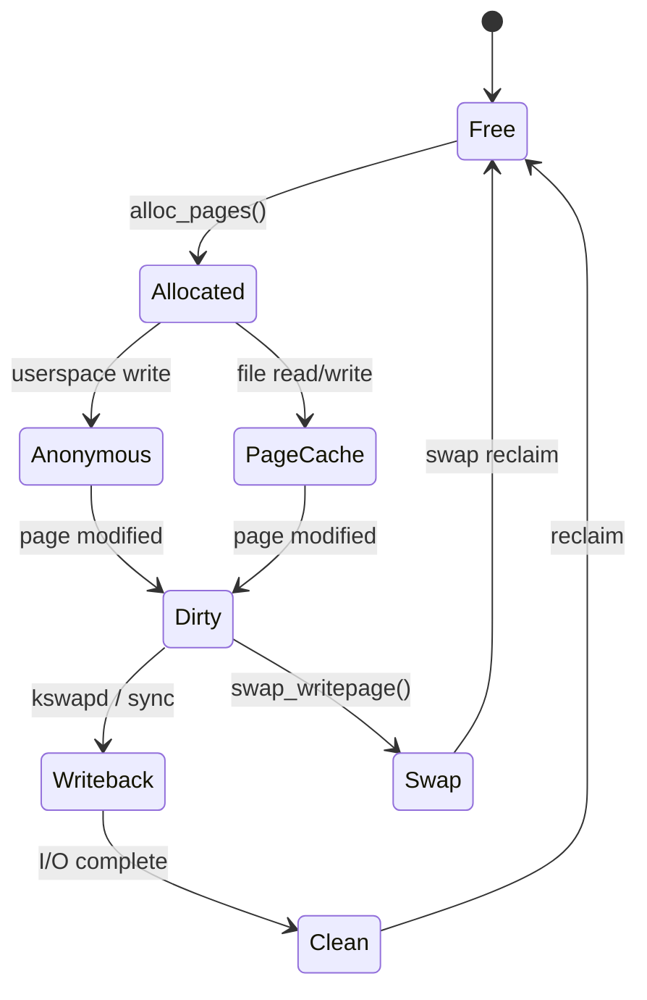
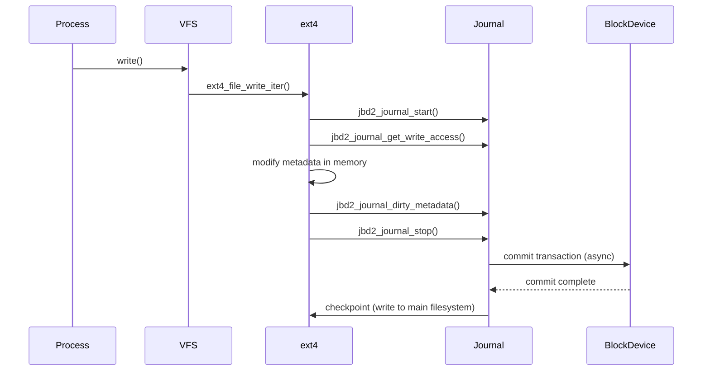
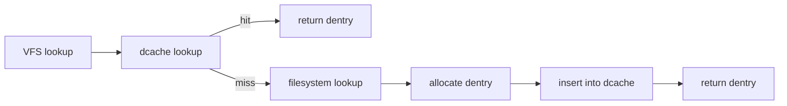

# Lesson 3: Advanced Internal Mechanics, Concurrency & Recovery

## 1. Concurrency Control: Locks, Lockless Structures & Conflict Resolution

The Linux kernel operates in a massively concurrent environment where thousands of threads, interrupt handlers, and deferred work contexts contend for shared state. The concurrency primitives form a hierarchy optimized for different critical section characteristics: duration, interrupt context, and cache coherence patterns.

### Mutex: Sleepable Locks for Long Critical Sections

A mutex (`struct mutex`) is a sleeping lock that blocks the calling thread if contention occurs. The blocked thread is removed from the runqueue and awakened when the lock becomes available. Mutexes are appropriate when the critical section may perform operations that sleep—disk I/O, memory allocation with `GFP_KERNEL`, or waiting on other synchronization primitives.

The implementation uses an atomic counter for the fast path (uncontended case) and a waitqueue for sleeping threads. The OSXF (Owner, Sequence, Flags, Tail) encoding optimizes the common case where the lock is free:

```c
struct mutex {
    atomic_long_t owner;     /* Owner task, sequence, flags */
    raw_spinlock_t wait_lock; /* Protects wait_list */
    struct list_head wait_list;
};

void mutex_lock(struct mutex *lock) {
    if (likely(atomic_long_try_cmpxchg_acquire(&lock->owner, 
                                                &zero, current)))
        return;  /* Fast path: acquired */
    __mutex_lock_slowpath(lock);  /* Contended path */
}
```

The slowpath enqueues the current thread on the waitqueue and schedules another thread, minimizing cache bouncing.

### Spinlocks: Busy-Wait for Short Critical Sections

A spinlock (`spinlock_t`) busy-waits in a tight loop while the lock is held. The spinning thread consumes CPU cycles but avoids context switch overhead. Spinlocks must protect only short, non-sleeping critical sections—typically a few dozen instructions. Holding a spinlock disables preemption on the local CPU to prevent deadlock where the lock holder is preempted and the spinning thread waits indefinitely.

The `spin_lock_irqsave` variant also disables local interrupts, preventing an interrupt handler from deadlocking on a spinlock held by the interrupted context:

```c
unsigned long flags;
spin_lock_irqsave(&my_lock, flags);
/* Critical section: no sleeping, no long operations */
spin_unlock_irqrestore(&my_lock, flags);
```

On SMP systems, spinlocks use atomic exchange or compare-and-swap instructions to acquire the lock. The ticket spinlock implementation provides fairness by issuing a "ticket" (sequence number) to each contending thread and serving tickets in order, preventing starvation.

### Read-Write Locks and Seqlocks

Read-write semaphores (`struct rw_semaphore`) allow multiple concurrent readers or one exclusive writer. Readers acquire the lock in shared mode; writers acquire it exclusively. This is efficient for data structures with high read-to-write ratios, though writer starvation can occur if readers continuously arrive.

The seqlock (`struct seqlock_t`) eliminates read-side locking entirely for small data structures. Writers increment a sequence counter before and after modifying the data. Readers capture the sequence number, read the data, then verify the sequence is unchanged and even (indicating no concurrent write):

```c
struct seqlock_t {
    seqcount_t seqcount;
    spinlock_t lock;
};

unsigned int seq;
do {
    seq = read_seqbegin(&my_seqlock);
    /* Read shared data */
    value = shared_data;
} while (read_seqretry(&my_seqlock, seq));
```

If the sequence changed (write occurred), the reader retries. Writers hold the spinlock to serialize with other writers. Seqlocks are ideal for frequently read, infrequently modified data like the kernel's timekeeping structures (`tk_core`).

### RCU: Read-Copy-Update for Lock-Free Reads

Read-Copy-Update (RCU) enables completely lock-free reads for pointer-based data structures. Readers access data without any synchronization. Writers create a modified copy, atomically update the pointer, then defer freeing the old version until all pre-existing readers complete their read-side critical sections.

RCU read-side critical sections are delineated by `rcu_read_lock()` and `rcu_read_unlock()`. Within these sections, preemption may be disabled (depending on the RCU flavor), and the reader must not block. Writers use `synchronize_rcu()` to wait for a grace period—the time when all CPUs have passed through a quiescent state (context switch or idle), guaranteeing no references to the old data remain:

```c
struct foo *global_ptr;

/* Reader */
rcu_read_lock();
struct foo *p = rcu_dereference(global_ptr);
if (p)
    use(p->data);
rcu_read_unlock();

/* Writer */
struct foo *new_foo = kmalloc(sizeof(*new_foo), GFP_KERNEL);
new_foo->data = 42;
struct foo *old_foo = rcu_dereference_protected(global_ptr, 
                                                 lockdep_is_held(&update_lock));
rcu_assign_pointer(global_ptr, new_foo);
synchronize_rcu();
kfree(old_foo);
```

`rcu_assign_pointer` ensures the new object is fully initialized (memory barrier) before the pointer is visible. `rcu_dereference` loads the pointer with a data dependency barrier, preventing speculative loads from accessing stale data.

RCU powers the kernel's most performance-critical data structures: the file descriptor table, routing tables, and the dcache. The dcache (directory entry cache) alone has billions of RCU-protected lookups per second on busy servers.

### Lockless Data Structures: Compare-and-Swap Queues

Lockless queues and stacks use atomic compare-and-swap (CAS) operations to modify pointers without locks. The `llist` (lockless list) provides single-producer, single-consumer queues:

```c
struct llist_node {
    struct llist_node *next;
};

bool llist_add(struct llist_node *new, struct llist_head *head) {
    new->next = READ_ONCE(head->first);
    return cmpxchg(&head->first, new->next, new) == new->next;
}
```

The CAS succeeds if `head->first` still equals `new->next` (no concurrent modification), atomically updating the head. If it fails, the operation retries. The ABA problem—where a pointer is changed to B, then back to A, causing a CAS to succeed incorrectly—is mitigated by generation counters or by RCU-style deferred reclamation.

### CFS and vruntime: Priority-Normalized Scheduling

The Completely Fair Scheduler (CFS) maintains a red-black tree of runnable tasks, keyed by `vruntime` (virtual runtime). Each task accumulates `vruntime` proportional to its CPU time, weighted inversely by its nice value. A task with nice -20 accumulates `vruntime` much slower than a task with nice 19, receiving proportionally more CPU time:

```c
vruntime_delta = delta_exec * (NICE_0_LOAD / se->load.weight);
se->vruntime += vruntime_delta;
```

The scheduler always picks the leftmost node in the red-black tree (minimum `vruntime`). When a task is preempted or voluntarily yields, it is re-inserted at its new `vruntime` position. This guarantees fairness: all tasks converge to the same `vruntime` over time, receiving CPU time proportional to their weight.

CFS periodically rebalances tasks across CPUs, migrating tasks from heavily loaded CPUs to idle ones. The rebalancing algorithm uses lockless access to CPU runqueue statistics, falling back to locks only when migrating tasks.

## 2. State Reconciliation & Recovery State Machines

Every kernel subsystem maintains state machines that must recover from failures without corrupting persistent or in-memory state. The complexity stems from asynchronous operations (I/O), concurrency, and the need to maintain consistency across crashes.

### Memory Management: Page States and Reclaim

The memory management subsystem tracks each physical page in a `struct page`, encoding its state in atomic flags: `PG_locked`, `PG_dirty`, `PG_writeback`, `PG_lru`, `PG_active`, `PG_swapcache`, etc. A page transitions through states as it is allocated, mapped to userspace, dirtied, written back, and eventually freed.



Under memory pressure, the `kswapd` daemon wakes and scans LRU (Least Recently Used) lists to evict pages. The kernel maintains two LRU lists per memory zone: active and inactive. Pages move from active to inactive when not recently accessed, and from inactive to free when reclaimed. Dirty pages are written back before eviction.

The page reclaim algorithm uses a multi-pass approach:
1. **Direct reclaim**: When a process cannot allocate memory, it synchronously scans LRU lists to free pages.
2. **kswapd reclaim**: The `kswapd` daemon asynchronously reclaims pages to refill the free list before allocations block.
3. **OOM killer**: If reclaim fails to free sufficient memory, the OOM (Out of Memory) killer selects and terminates a process.

The OOM killer scores each process based on memory usage, runtime, and `oom_score_adj` (user-configurable). The scoring heuristic prioritizes killing memory-heavy, short-lived processes:

```c
oom_score = (rss + swap_usage) * 1000 / total_memory + oom_score_adj;
```

The process with the highest score is sent `SIGKILL`. Processes can set `oom_score_adj` to -1000 (unkillable, for critical daemons) or 1000 (kill first).

### Filesystem Journaling: Metadata Consistency

Filesystems like ext4, XFS, and F2FS use journaling to ensure metadata consistency across crashes. A journal is a circular log that records metadata changes before applying them to the main filesystem. Each transaction is assigned a sequence number and committed atomically.

The ext4 journal operates in three modes:
- **journal**: Both data and metadata are journaled (slowest, most durable).
- **ordered**: Metadata is journaled; data is written before metadata commits (default).
- **writeback**: Metadata is journaled; data writes are unordered (fastest, least durable).

After a crash, the filesystem replays the journal during mount, reapplying committed transactions that were not yet checkpointed to the main filesystem. Uncommitted transactions are discarded.



The journal uses checksums and sequence numbers to detect torn writes (partial commits due to power loss). Each transaction has a commit block with a checksum of all blocks in the transaction; if the checksum does not match, the transaction is incomplete and discarded during replay.

### Network Stack: TCP Retransmission and Congestion Control

TCP maintains a retransmission timer for each outstanding (unacknowledged) segment. The retransmission timeout (RTO) is calculated using an exponentially weighted moving average of the round-trip time (RTT):

```c
srtt_new = (7 * srtt_old + rtt) / 8
rttvar_new = (3 * rttvar_old + |srtt_new - rtt|) / 4
rto = srtt_new + 4 * rttvar_new
```

If an acknowledgment is not received within the RTO, TCP retransmits the segment and doubles the RTO (exponential backoff). After multiple retransmissions, TCP may reset the connection.

Congestion control algorithms (CUBIC is the default; BBR is modern alternative) adjust the congestion window (`cwnd`) to avoid overwhelming the network. CUBIC uses a cubic function to grow `cwnd` after a loss event, aggressively probing for available bandwidth when far from the previous loss point, and cautiously when near it:

```c
W_cubic(t) = C * (t - K)^3 + W_max
```

where `W_max` is the window size at the last loss, `K` is the time to grow back to `W_max`, and `C` is a scaling constant.

The kernel also implements fast retransmit and fast recovery. If three duplicate ACKs are received (indicating a lost segment, not congestion), TCP retransmits the segment immediately without waiting for the RTO and reduces `cwnd` by half (multiplicative decrease), then enters fast recovery, incrementing `cwnd` for each duplicate ACK until the lost segment is acknowledged.

## 3. Resource Accounting, Eviction & Cleanup Engines

The kernel provides fine-grained resource accounting and isolation through cgroups (control groups), a hierarchical framework for tracking and limiting resource usage per process group.

### Cgroup Memory Controller

Each cgroup has a memory controller that tracks:
- **RSS (Resident Set Size)**: Anonymous memory (stack, heap).
- **Page cache**: File-backed memory.
- **Swap usage**: Pages swapped to disk.
- **Kernel memory**: Slab objects, kernel stacks.

The controller enforces a hard limit (`memory.limit_in_bytes`) and a soft limit (`memory.soft_limit_in_bytes`). When a cgroup exceeds its hard limit, allocations block until memory is reclaimed (synchronous reclaim) or the OOM killer is invoked within the cgroup. Soft limits are enforced only under global memory pressure.

```bash
# Set memory limit for a cgroup
echo 512M > /sys/fs/cgroup/memory/myapp/memory.limit_in_bytes

# Monitor usage
cat /sys/fs/cgroup/memory/myapp/memory.usage_in_bytes
cat /sys/fs/cgroup/memory/myapp/memory.stat
```

The `memory.stat` file exposes counters like `cache`, `rss`, `swap`, `pgfault`, `pgmajfault`, and `oom_kill`. The per-cgroup OOM killer adjusts scores based on cgroup limits, prioritizing processes in cgroups that exceed their quota.

### Slab Allocator: Object Caching for Small Allocations

The slab allocator caches frequently allocated kernel objects (inodes, dentries, task structs) to avoid repeated calls to the page allocator. Each object type has a dedicated cache (slab), and objects are allocated from pre-allocated pages.

The SLUB (Unqueued Slab Allocator) is the default implementation. It organizes pages into per-CPU freelists for fast, lock-free allocation. When a freelist is exhausted, a new page is allocated from the page allocator and added to the cache.

```c
struct kmem_cache *inode_cachep;

inode_cachep = kmem_cache_create("inode_cache", 
                                  sizeof(struct ext4_inode_info),
                                  0, SLAB_RECLAIM_ACCOUNT, NULL);

struct ext4_inode_info *ei = kmem_cache_alloc(inode_cachep, GFP_KERNEL);
```

The `SLAB_RECLAIM_ACCOUNT` flag allows the kernel to reclaim slab objects under memory pressure. The shrinker API (`register_shrinker`) enables each subsystem to release cached objects when memory is low.

### Dcache and Icache: Directory and Inode Caching

The dcache (directory entry cache) caches `struct dentry` objects, representing directory entries (filenames and their inodes). The icache caches `struct inode` objects, representing filesystem metadata.

Both caches are hash tables protected by RCU and fine-grained locking. Negative dentries (lookups that failed, indicating a file does not exist) are also cached to avoid repeated stat() calls. The dcache and icache are shrunk under memory pressure by the shrinker API, which removes least-recently-used entries.



Dentries have a reference count (`d_count`). When a dentry's reference count drops to zero, it becomes a candidate for eviction. However, the kernel retains zero-refcount dentries in the LRU list to speed up future lookups.

### Buddy Allocator: Contiguous Physical Memory

The buddy allocator manages free physical pages in power-of-two blocks. When a block is freed, the allocator checks if its "buddy" (the adjacent block of the same size) is also free. If so, the blocks are coalesced into a larger block. This reduces fragmentation and enables larger contiguous allocations.

```c
struct page *page = alloc_pages(GFP_KERNEL, order); /* 2^order pages */
__free_pages(page, order);
```

The buddy allocator maintains a free list per order (0 to `MAX_ORDER - 1`, typically 11). An allocation of order `n` first searches the order `n` free list. If empty, it splits a block from order `n+1`, placing one half on the order `n` free list and allocating the other.

### Compaction and Defragmentation

Over time, memory becomes fragmented with free pages interspersed among allocated pages, preventing large contiguous allocations. The kernel's memory compaction algorithm migrates movable pages to create contiguous free regions.

Compaction scans from the low and high ends of a zone, migrating pages from the low end to the high end, and merging freed pages into larger blocks. Unmovable pages (kernel allocations, pinned pages) cannot be migrated and limit compaction effectiveness.

## 4. Production Failure Domains & Byzantine Edge Cases

The kernel distinguishes between recoverable errors, warnings, and fatal failures. The failure handling infrastructure balances debuggability, system stability, and data integrity.

### Kernel Panics: Non-Recoverable Failures

A kernel panic is a fatal error that halts the system. Panics occur when the kernel detects irrecoverable corruption or a condition that violates critical invariants. Common panic triggers include:

- **Double fault**: A page fault occurs while handling another exception, indicating stack corruption or invalid exception handler.
- **Page fault in kernel mode without valid exception handler**: The kernel accessed an invalid address, and no fixup handler is registered (used for copy_from_user).
- **BUG() or BUG_ON()**: An assertion failure indicating a logic error.

```c
if (unlikely(ptr == NULL))
    BUG(); /* Should never happen; critical invariant violated */
```

The panic handler prints a register dump, stack trace, and modules list, then halts or reboots (depending on `panic=` kernel parameter). On some architectures, the kernel can dump memory to a crash kernel (kdump) for post-mortem analysis.

### Oops: Recoverable Kernel Errors

An oops is a less severe failure that prints a stack trace and register dump but attempts to continue running. Oopses typically result from null pointer dereferences or invalid memory accesses in kernel modules. The kernel marks the affected process as tainted and may kill it, but the system remains operational.

```c
/* Accessing user memory without proper checks */
if (get_user(value, user_ptr)) {
    /* -EFAULT returned, no oops */
}

/* Direct dereference: would oops if user_ptr is invalid */
value = *user_ptr; /* BAD */
```

The kernel provides `get_user` and `copy_from_user` to safely access userspace memory, returning an error code instead of triggering an oops.

### Warnings: Debugging Assertions

`WARN_ON()` and `WARN_ON_ONCE()` print a stack trace but continue execution. These are used for conditions that should not occur but are not severe enough to halt the system:

```c
if (WARN_ON(refcount == 0))
    return -EINVAL;
```

Warnings help developers identify bugs in non-critical paths without destabilizing production systems. `WARN_ON_ONCE()` fires only once per boot, preventing log spam.

### OOM Panic Modes

The kernel provides several `panic_on_oom` flags to customize behavior when memory is exhausted:

- **`vm.panic_on_oom = 0`** (default): Invoke the OOM killer to terminate a process.
- **`vm.panic_on_oom = 1`**: Panic if OOM is triggered outside a memory cgroup (global OOM).
- **`vm.panic_on_oom = 2`**: Always panic on OOM, even within a cgroup.

These flags are useful in embedded systems or high-availability environments where a controlled crash and restart is preferable to unpredictable behavior after an OOM event.

### Deadlock Detection: Lockdep

Lockdep is a runtime lock validator that detects potential deadlocks by tracking lock acquisition order. It builds a directed graph of lock dependencies and checks for cycles (circular dependencies). If a cycle is detected, Lockdep prints a warning with the call stack of each lock acquisition in the cycle.

```c
spin_lock(&lock_a);
spin_lock(&lock_b); /* OK if always acquired in this order */
spin_unlock(&lock_b);
spin_unlock(&lock_a);

/* Elsewhere */
spin_lock(&lock_b);
spin_lock(&lock_a); /* Lockdep detects potential deadlock: AB-BA */
spin_unlock(&lock_a);
spin_unlock(&lock_b);
```

Lockdep has no false positives (if it reports a deadlock, it is a real potential deadlock) but may have false negatives (not all deadlocks are detected). It is enabled with `CONFIG_PROVE_LOCKING` and incurs significant runtime overhead, so it is used only in development kernels.

### Soft Lockups and Hard Lockups

A **soft lockup** occurs when a CPU spins for more than `watchdog_thresh` seconds without scheduling. This indicates a bug in a spinlock-protected critical section or a missing `cond_resched()` call in a long-running loop. The watchdog prints a stack trace and continues.

A **hard lockup** occurs when a CPU is stuck with interrupts disabled. The NMI (Non-Maskable Interrupt) watchdog detects this and prints a stack trace. Hard lockups usually indicate a bug in an interrupt handler or a spinlock held with `spin_lock_irqsave()`.

```bash
# Enable watchdog
echo 10 > /proc/sys/kernel/watchdog_thresh
```

Both watchdogs can trigger a panic if configured with `kernel.softlockup_panic` or `kernel.hardlockup_panic`.

### RCU Stalls

An RCU stall occurs when a CPU remains in an RCU read-side critical section for too long (typically 21 seconds), preventing the grace period from completing. This can happen if a reader loops without calling `cond_resched()` or if preemption is disabled for an extended period.

The RCU stall detector prints a warning with the call stack of the stalled CPU. RCU stalls do not cause data corruption but can lead to memory leaks (old data is never freed) and system slowdowns.

### Race Conditions and Data Corruption

Data races occur when multiple threads access shared memory without proper synchronization, and at least one access is a write. The kernel provides several tools to detect data races:

- **KCSAN (Kernel Concurrency Sanitizer)**: A dynamic data race detector that instruments memory accesses and detects unsynchronized conflicting accesses.
- **Sparse**: A static analysis tool that checks for missing annotations like `__rcu` and `__kernel`.

```c
/* Data race: multiple CPUs may read/write counter without locking */
static int counter; /* BAD */

/* Fixed with atomic */
static atomic_t counter; /* OK */
```

Atomic variables guarantee memory ordering and prevent torn reads/writes, ensuring that a read always sees a fully updated value.

---

This lesson covered the kernel's concurrency primitives (mutexes, spinlocks, RCU), state machines for memory, filesystems, and networking, resource accounting with cgroups, and failure modes (panics, oopses, warnings, deadlocks, stalls). Mastery of these topics is essential for understanding kernel internals, debugging production issues, and contributing to kernel development.
