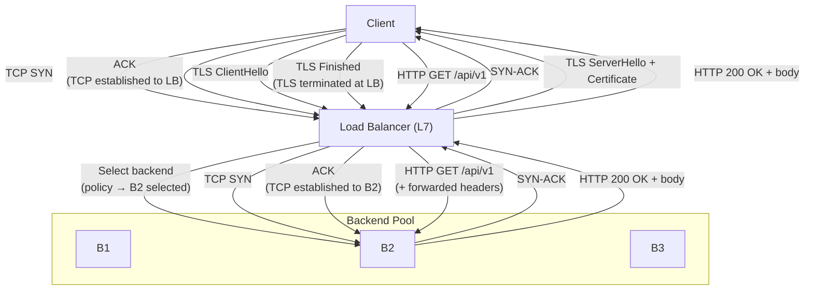
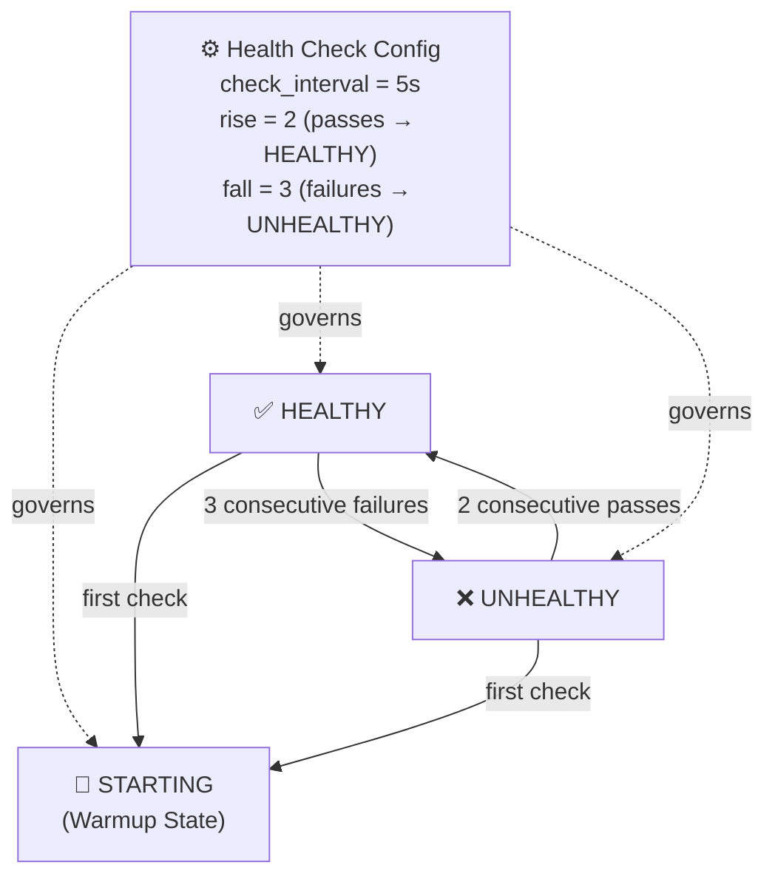

# Lesson 1: Fundamental Concepts, Responsibilities, Architecture Placement

## 1. First-Principles Intuition & Invariants

The fundamental problem a load balancer solves is deceptively simple to state and genuinely difficult to solve at scale: a single server can only process a bounded number of concurrent connections before its CPU, memory, file descriptor table, or network interface saturates. The classical response to this constraint is vertical scaling — replace the machine with a larger one. But vertical scaling has a hard ceiling, both physical and economic. The alternative is horizontal scaling: deploy many servers, each handling a fraction of the total demand. The moment you do that, you need a component that decides which fraction each server handles. That component is the load balancer.

Understanding load balancers from first principles means understanding them as *dispatchers operating on a stream of discrete work units*. Each work unit is a client connection or an application-level request, and the dispatcher applies a policy to route that unit to one member of a pool of backend servers. The dispatcher must do this continuously, at high throughput, with latency measured in microseconds, without itself becoming the bottleneck it was designed to prevent. This creates the central tension in load balancer design: the dispatcher sits in the critical path of every request, so its per-connection overhead must be vanishingly small even as the complexity of its routing logic grows.

Three invariants govern every load balancer's operational contract, regardless of its implementation or layer of operation.

The first is *traffic distribution* — the load balancer must spread requests across the available backend pool such that no single server becomes a hotspot while others sit idle. At its most naive, this is round-robin scheduling. At its most sophisticated, it involves continuous measurement of backend latency, connection queue depth, CPU utilization, and application-level health signals, combined to produce a real-time model of each server's remaining capacity. The distribution policy is not merely a performance concern; it is a correctness concern for stateful protocols where request affinity (session stickiness) must be preserved.

The second invariant is *high availability*. A pool of backends is only useful if the load balancer continuously monitors which members are healthy. Health checking is not optional plumbing — it is the mechanism by which the system detects and routes around failure without human intervention. When a backend server crashes, its OS closes all TCP sockets and the kernel sends RSTs. The load balancer's connection tracking detects this immediately for active connections. But a server that has silently stopped serving application-layer requests while keeping TCP connections open — the pathological "zombie backend" — is only detectable through active probing. This is why health checks exist as a first-class primitive rather than an afterthought.

The third invariant is *horizontal scalability* of the backend tier. The load balancer is the architectural seam that decouples the client-facing address space from the backend address space. Clients connect to a stable virtual IP (VIP) or DNS name owned by the load balancer. Backends can be added to or removed from the pool without any client reconfiguration. This decoupling is what makes autoscaling possible: an orchestration system can provision new backend instances, register them with the load balancer's pool, and begin serving traffic — all without touching the clients.

### The OSI Layer Divide and Why It Matters

Load balancers operate at two meaningful positions in the OSI stack, and the distinction between them has deep architectural consequences that every infrastructure engineer must internalize.

A *Layer 4 load balancer* operates on TCP/UDP transport-layer metadata. It sees source and destination IP addresses, source and destination ports, and TCP flags. It does not inspect the payload beyond what is necessary to maintain connection state. When a new TCP SYN arrives, the L4 load balancer selects a backend based on a configured policy (consistent hash of the 4-tuple, round-robin over backends, etc.), rewrites the destination IP and port in the IP header using network address translation (NAT), and forwards the packet. All subsequent packets in that TCP flow are steered to the same backend by consulting the connection tracking table that maps the original 4-tuple to the selected backend. This happens at packet-processing speed. Modern Linux-kernel-based L4 load balancers, such as IPVS (IP Virtual Server) built into the kernel's netfilter subsystem, handle millions of packets per second with per-packet overhead in the range of a few hundred nanoseconds.

The critical property of L4 operation is that the load balancer does not terminate the TCP connection. The client's TCP session is established directly with the backend server (after NAT). The load balancer is invisible to both endpoints at the application layer. This is both its strength and its limitation. Because the load balancer never parses HTTP headers, it cannot make routing decisions based on URL paths, hostnames, or cookies. It cannot perform TLS termination. It cannot insert `X-Forwarded-For` headers. What it gains in return is extreme throughput and minimal latency overhead.

A *Layer 7 load balancer* operates as a full application-layer proxy. It terminates the client's TCP (and TLS) connection, parses the application protocol — most commonly HTTP/1.1, HTTP/2, or gRPC — and then opens a separate TCP connection to the selected backend server on behalf of the client. This two-connection model means the load balancer sits in the data path as a first-class participant, not merely as a packet forwarder. It can inspect every header, the request path, the HTTP method, and the cookie jar. It can route `/api/v2/` requests to one backend pool and `/static/` requests to a CDN origin. It can inject tracing headers, enforce authentication, strip sensitive headers before forwarding to backends, and implement circuit-breaking logic by watching upstream response codes.

The cost of this power is latency and resource consumption. Parsing HTTP/2 frames or gRPC envelopes takes CPU time. Maintaining two full TCP connections per client request (and the associated kernel socket buffers) consumes memory. TLS handshake offload requires cryptographic compute. For high-frequency, low-latency internal service mesh traffic, these costs are non-trivial. For north-south traffic at the edge of a cloud environment — where request rates are lower, payloads are larger, and routing intelligence is more valuable — L7 is the appropriate tool.

The practitioner's rule of thumb is to use L4 for internal high-throughput paths and for protocols that are not HTTP (database wire protocols, game server UDP traffic, raw TCP streams), and to use L7 at the ingress layer where HTTP routing, TLS termination, and observability matter.

### The Reverse Proxy Relationship

The term "reverse proxy" is often used interchangeably with "load balancer," and the conflation is understandable but imprecise. A reverse proxy is a server that accepts connections on behalf of one or more backend servers, forwards requests to them, and returns the backend's response to the client. Every L7 load balancer is a reverse proxy, but not every reverse proxy is a load balancer — a single-backend reverse proxy performs TLS termination and header manipulation without distributing any load.

The two concepts share the same connection topology (client → proxy → backend) and many of the same mechanisms (connection pooling, header rewriting, health checking). They differ in emphasis: load balancing is about *distribution policy across a pool*, while reverse proxying is about *protocol mediation between a client and a server*. In production systems, the distinction is academic because every serious deployment combines both: Nginx, HAProxy, Envoy, and AWS ALB are simultaneously reverse proxies and load balancers, exercising protocol-level mediation *and* pool-based distribution at the same time.

---

## 2. Core Architecture & Mechanics

### The Request Lifecycle from TCP SYN to Backend Response

To understand the internal mechanics of a load balancer, it is most instructive to trace a single HTTP request from the moment a client's kernel sends a TCP SYN to the moment the client receives the final byte of the response body. The trace reveals the data structures and decision points that make the system work.



When the client's SYN arrives at the load balancer's NIC, the kernel's network stack processes it through the socket receive path. The load balancer process (or kernel module) has a listening socket bound to the VIP. The kernel completes the TCP three-way handshake and delivers the new socket file descriptor to the load balancer's accept loop. At this point, the load balancer owns a fully established TCP connection with the client but has not yet made any routing decision — it cannot, because HTTP routing requires reading the request headers, and those have not arrived yet.

The load balancer's I/O layer (typically epoll on Linux) waits for the first readable bytes on this socket. When the client sends its TLS `ClientHello`, the TLS engine processes the handshake, negotiates cipher suites, and completes the TLS session. All subsequent reads from this socket return plaintext. The load balancer's HTTP parser then reads the request line and headers. The critical headers for routing decisions — `Host`, `:authority` in HTTP/2, `Cookie`, `X-Custom-Route-Key` — are extracted and evaluated against the routing table.

### The Routing Table and Policy Engines

The routing table is the core data structure of an L7 load balancer. In Nginx terminology these are `upstream` blocks with `server` directives and routing `location` blocks. In HAProxy they are `backend` sections and ACL-based `use_backend` rules. In Envoy they are `RouteConfiguration` objects populated by the xDS (discovery service) control plane. Despite differing syntax, all of them reduce to the same abstract structure: a set of match predicates over request attributes, ordered by priority, each associated with a named backend pool.

```text
RouteTable {
  entry[0]: match(host="api.example.com", path_prefix="/v2/")
            → pool: api-v2-backends (round-robin, 3 members)
  entry[1]: match(host="api.example.com", path_prefix="/v1/")
            → pool: api-v1-backends (least-connections, 5 members)
  entry[2]: match(host="static.example.com")
            → pool: cdn-origin-backends (ip-hash, 2 members)
  default:  → pool: catch-all-backends
}
```

Route lookup is a longest-prefix or first-match operation, and in high-performance implementations it is backed by a trie or radix tree structure rather than a linear scan. The match against the first entry must be completed within nanoseconds to avoid introducing measurable latency at scale.

Once the route is resolved to a backend pool, the pool's load-balancing algorithm selects a specific backend member. The selection algorithms available to practitioners span a wide range of sophistication.

Round-robin is the simplest: maintain a cursor over an ordered list of backends and advance it modulo the pool size on each selection. It distributes requests evenly by count but not by cost — if requests vary significantly in processing time, some backends will accumulate backlog while others finish quickly. Weighted round-robin assigns a weight to each backend proportional to its capacity and distributes proportionally.

Least-connections selects the backend with the fewest active connections at the moment of selection. This is a better proxy for backend load than round-robin when request durations are heterogeneous, but it requires maintaining an atomic counter per backend and reading it on every selection. At very high request rates, contention on that counter becomes a bottleneck. Lock-free atomic increment/decrement operations and per-CPU sharding mitigate this.

Consistent hashing computes a hash of a request attribute — typically the client IP address, a session cookie, or a user ID header — and maps the hash to a backend via a hash ring. This provides affinity: requests from the same client consistently land on the same backend, which is essential for session-state caching. The hash ring construction ensures that adding or removing a backend rebalances only `1/N` of the keys rather than rehashing everything, which makes pool membership changes less disruptive.

The power-of-two-choices algorithm is a probabilistic approach that selects two backends at random and routes the request to whichever has fewer active connections. Despite its simplicity, it achieves near-optimal load distribution with O(1) selection cost and no contention, making it attractive for very high-throughput deployments. This is the algorithm behind Twitter's Finagle and many internal Google load balancers.

### Health Checking: The Liveness Subsystem

The health-checking subsystem runs as a parallel, out-of-band process alongside the request-forwarding path. It continuously probes each backend member at a configured interval and updates the pool's membership based on the results. Backends that fail `N` consecutive checks are marked unhealthy and removed from rotation. Backends that subsequently pass `M` consecutive checks are re-added.

The simplest health check is a TCP connect: open a connection to the backend's IP and port and immediately close it. This verifies that the backend's OS is running and the port is accepting connections, but it says nothing about whether the application is functional. A backend whose HTTP server has deadlocked will pass a TCP check while returning 503 to every real request.

An HTTP health check sends an actual HTTP GET to a designated health endpoint (conventionally `/healthz` or `/health`) and validates that the response code is in the 2xx range and optionally that the response body matches an expected pattern. This is strictly more informative because it exercises the application's request path.

For databases and other stateful services, the health check may need to execute a lightweight query (e.g., `SELECT 1` for PostgreSQL) to confirm that the service is not just accepting connections but is actually processing queries. HAProxy supports this natively through its `option pgsql-check` and `option mysql-check` directives.

The state machine governing a backend member's health transitions is straightforward but its parameters require careful tuning:



The `rise` and `fall` thresholds exist to prevent flapping: a backend that oscillates between passing and failing checks should not be continuously added to and removed from the pool, as that would create request-distribution instability. The `fall` threshold of 3 means a backend must fail three consecutive checks before being removed, providing hysteresis against transient failures.

### Connection Pooling to Backends

A detail that is often underappreciated is that an L7 load balancer does not open a new TCP connection to a backend server for every incoming client request. Doing so would impose a full TCP three-way handshake (and potentially a TLS handshake) on the latency of every request, adding one to three round trips to backend latency. Instead, load balancers maintain a *connection pool* per backend server: a set of pre-established, idle TCP connections that are leased to in-flight requests and returned to the pool when the request completes.

Connection pooling is what makes HTTP/1.1 keep-alive and HTTP/2 multiplexing worth having. In an HTTP/2 pool, a single TCP connection can carry many concurrent streams multiplexed over the same socket, reducing the number of connections that must be maintained. The load balancer's backend connection pool tracks per-backend connection counts, idle connection timeouts, maximum pool size, and connection age limits (to prevent long-lived connections from accumulating stale state).

---

## 3. High-Performance Optimization & Failure Modes

### Scaling the Dispatcher Itself

The load balancer is itself a potential single point of failure and a throughput ceiling. Production deployments eliminate both risks through two complementary techniques.

The first is *active-passive high availability*. Two load balancer instances share a VIP using VRRP (Virtual Router Redundancy Protocol). The active instance holds the VIP and processes all traffic. The passive instance sends no traffic but continuously monitors the active's health via heartbeat. When the heartbeat fails, the passive instance sends a gratuitous ARP to claim the VIP MAC address binding on the LAN and begins processing traffic. The failover time is typically under one second. Tools like `keepalived` implement this on Linux with minimal configuration.

The second technique is *ECMP (Equal-Cost Multi-Path) routing* at the network layer, used by hyperscale operators. Multiple load balancer instances are assigned the same VIP and advertised to the upstream router via BGP with equal cost. The router hashes each incoming flow's 5-tuple (src IP, dst IP, src port, dst port, protocol) to select which load balancer instance receives that flow. This distributes load across the entire load balancer tier without requiring any single coordinator. Adding a new load balancer instance is as simple as bringing it up and having it advertise the VIP via BGP — no configuration changes are needed elsewhere. Google's Maglev and Meta's Katran both use this architecture.

### The Thundering Herd and Connection Storms

When a backend server crashes and is removed from the pool, all its in-flight connections are aborted and the load balancer redistributes its share of traffic to the remaining members. If the remaining members are already running near capacity, this redistribution can overload them too, causing cascading failures. This is the *thundering herd* failure mode in load-balanced systems.

The mitigation is *slow start* (or *gradual ramp-up*) for newly added backends. When a backend passes its health checks and is re-added to the pool, it is not immediately given a full share of traffic. Instead, its weight in the pool starts at a low value and ramps up linearly over a configured window (typically 30 to 120 seconds). HAProxy calls this `slowstart`. This prevents a freshly started backend — whose JVM heap is cold, whose database connection pool is empty, whose caches are cold — from being immediately overwhelmed.

Slow start also matters when deploying new backend versions. A rolling deployment will add new backend instances one at a time. Without slow start, the first real request each new instance receives may hit an empty connection pool and cold caches simultaneously, producing an artificially high latency spike that health checks may misinterpret as a failure, triggering premature removal.

### Head-of-Line Blocking at L7

HTTP/1.1 pipelining allows multiple requests to be sent on a single TCP connection without waiting for each response, but the server must respond in order. A slow response on the first request blocks all subsequent responses on that connection — this is head-of-line (HOL) blocking. When an L7 load balancer multiplexes many client requests over a small pool of backend connections, HOL blocking on those backend connections can cause latency spikes that are entirely invisible from the client's perspective until a timeout fires.

HTTP/2 solves HOL blocking at the application layer by multiplexing independent streams over a single TCP connection with independent flow-control windows. However, TCP itself has HOL blocking: a lost packet stalls the entire TCP connection's receive window until the retransmission arrives, blocking all HTTP/2 streams on that connection simultaneously. HTTP/3 (QUIC) eliminates this by multiplexing independent streams over UDP with per-stream loss recovery.

For practitioners running HAProxy or Nginx as an L7 load balancer, the actionable implication is to use HTTP/2 for backend connections wherever the backend supports it, limit the number of concurrent streams per backend connection to prevent any single slow response from starving the connection, and configure timeouts aggressively: `timeout connect`, `timeout server`, and `timeout tunnel` should all be set to values that reflect the application's actual response time distribution at the 99th percentile, not the worst case.

### Practical Diagnostic Workflow

When a load balancer deployment exhibits degraded behavior — elevated latency, elevated error rates, or unequal backend utilization — the diagnostic workflow follows a consistent pattern grounded in the components described above.

The first instrument is the load balancer's own stats interface. HAProxy exposes a Unix socket that accepts plain-text commands:

```bash
echo "show stat" | socat stdio /var/run/haproxy/admin.sock \
  | cut -d',' -f1,2,18,19,48 \
  | column -t -s','
```

This command extracts the proxy name, server name, current session count (`scur`), session rate (`rate`), and health check status (`status`) for every backend member. Unequal `scur` values across backends that should be receiving equal load immediately points to a misconfigured weight, a health-check flapping backend being repeatedly removed and re-added, or a connection-draining event in progress.

The second instrument is `ss` (socket statistics), which interrogates the kernel's TCP connection table directly:

```bash
ss -tnp state established '( dport = :8080 or sport = :8080 )' \
  | awk '{print $5}' \
  | cut -d: -f1 \
  | sort | uniq -c | sort -rn
```

This shows the distribution of established connections by remote IP on port 8080, letting you verify that the load balancer is spreading connections across the expected set of backend IPs. A backend IP missing from this output entirely means either all its connections are in a different state (e.g., TIME_WAIT drain) or the load balancer's health check has removed it.

The third instrument is `curl` with verbose timing output, used to measure the precise contribution of each phase of the request lifecycle:

```bash
curl -w "\
    dns_resolution:  %{time_namelookup}s\n\
    tcp_connect:     %{time_connect}s\n\
    tls_handshake:   %{time_appconnect}s\n\
    ttfb:            %{time_starttransfer}s\n\
    total:           %{time_total}s\n" \
  -o /dev/null -s https://api.example.com/healthz
```

The gap between `tls_handshake` and `ttfb` is the time spent waiting for the backend to respond after the load balancer has forwarded the request. If this value is large, the problem is in the backend pool, not in the load balancer's routing logic or the client's network path.

### Misconfiguration Failure Modes

The most common misconfiguration in L4 load balancer deployments is the *asymmetric routing* problem. When a load balancer uses Direct Server Return (DSR) — a mode where packets are forwarded to backends but backends reply directly to clients, bypassing the load balancer — the backend servers must have the VIP configured as a loopback address (not on a routable interface). If a backend advertises the VIP on a routable interface, return packets will be routed back through the network to the load balancer, the load balancer's connection tracking table will not recognize them as belonging to an existing session (because they arrived on the wrong interface), and the connection will be reset.

The most common misconfiguration in L7 deployments is *timeout asymmetry* between the client-facing and backend-facing sides of the proxy. If the backend server has a `keepalive_timeout` of 60 seconds and the load balancer's `timeout server` is 30 seconds, the load balancer will close backend connections that the backend believes are still active. The next request that attempts to reuse that connection will receive a TCP RST, causing a request error. The fix is to ensure the load balancer's backend-side idle timeout is *shorter* than the backend server's keepalive timeout, so the load balancer is always the one to close idle connections before the backend does.

Another subtle failure mode specific to consistent-hash routing is *cache invalidation on pool membership change*. Because consistent hashing guarantees only that adding or removing a backend rebalances `1/N` of the keys, removing a backend forces `1/N` of your session-affinity clients to a new backend, invalidating their session state. For applications that store session state only in-process (rather than in an external store like Redis), this means those clients must re-authenticate. The architectural lesson is that consistent-hash affinity is a performance optimization, not a correctness mechanism. Persistent session state must live in a shared external store that any backend can access, so that affinity failures are performance events rather than correctness failures.

Understanding these mechanics — the routing table lookup, the health check state machine, the connection pool, the ECMP distribution tier — gives you the vocabulary and the diagnostic instruments to reason precisely about why a load-balanced system is behaving as it is, and to change that behavior with targeted, minimal interventions rather than broad configuration experiments.
