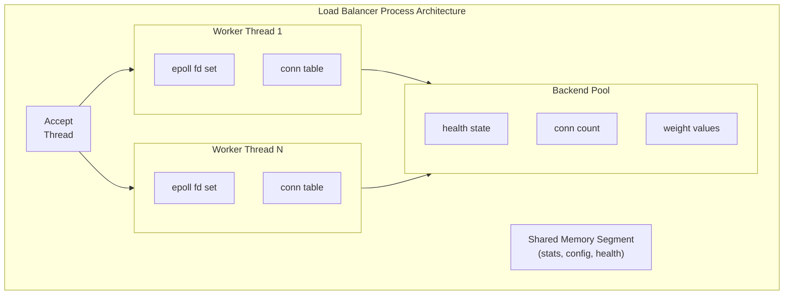
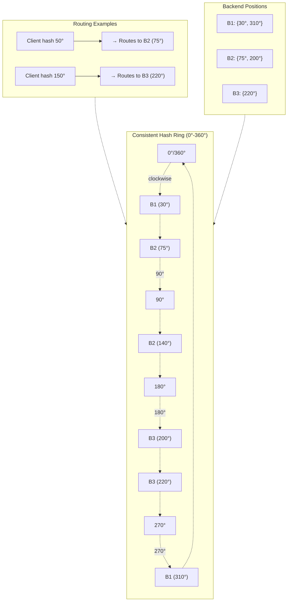

# Lesson 4: Production Deployment Patterns, Observability, Security Considerations

## 1. First-Principles Intuition & Invariants

Load balancers in production environments exist at the precise intersection of distributed systems theory and operational necessity. When a system grows beyond a single compute node, the fundamental problem shifts from vertical scaling—adding more CPU cores, memory, or disk bandwidth to one machine—to horizontal scaling, where the aggregate capacity of multiple independent nodes must be presented as a unified service endpoint. The load balancer emerges as the critical control plane component that enforces this abstraction, transforming a heterogeneous pool of backend servers into a single logical service with stable network identity.

At its core, a load balancer implements a stateful routing decision engine. Every incoming connection or request packet triggers a selection algorithm that maps the client flow to a specific backend target. This mapping must satisfy several invariants simultaneously: traffic distribution should approximate the capacity ratio of backend nodes to prevent hotspotting, existing connection state must be preserved during the lifetime of long-lived flows, and the system must gracefully handle backend failures without exposing errors to clients. These requirements create fundamental tension between algorithmic simplicity, performance efficiency, and operational correctness.

The architectural divide between hardware and software load balancers originates from historical constraints in network equipment evolution. Hardware appliances from vendors like F5, Citrix, and A10 Networks emerged in the late 1990s when general-purpose CPU performance could not sustain line-rate packet processing at multi-gigabit speeds. These devices employed application-specific integrated circuits (ASICs) and network processors (NPUs) to perform packet parsing, connection table lookups, and traffic manipulation in dedicated silicon pipelines. A typical hardware load balancer maintains connection state in content-addressable memory (CAM) or ternary CAM (TCAM) structures that enable constant-time lookups regardless of table size, achieving sub-microsecond forwarding latency for millions of concurrent flows.

Modern software load balancers like HAProxy, NGINX, and Envoy run on commodity x86_64 servers and leverage dramatic improvements in CPU performance, memory bandwidth, and kernel networking stacks. The Linux networking subsystem has evolved sophisticated zero-copy mechanisms through `sendfile`, `splice`, and more recently `io_uring`, allowing userspace proxies to forward packets with minimal CPU overhead. Software load balancers gain operational flexibility—they can be deployed as containers, updated through standard CI/CD pipelines, and scaled horizontally by adding more instances—at the cost of higher per-packet CPU consumption compared to dedicated hardware. The critical inflection point occurs around 10-40 Gbps of sustained throughput per node, where software implementations achieve cost efficiency superior to hardware appliances when factoring in operational agility and cloud infrastructure pricing models.

Cloud-native load balancing introduces a third architectural category that abstracts the physical implementation entirely. Amazon's Elastic Load Balancing (ELB), Google Cloud Load Balancing, and Azure Load Balancer present managed services where the provider operates distributed fleets of load balancer nodes, automatically scaling capacity based on traffic volume and providing geographic distribution without customer intervention. These services implement multiple tiers of load balancing simultaneously: DNS-based geographic steering directs clients to regional entry points, anycast IP routing distributes packets across edge locations, and backend connection pools multiplex thousands of client connections onto a smaller set of persistent backend connections.

The distinction between Layer 4 and Layer 7 load balancing fundamentally determines the scope of visibility and control the load balancer has over traffic. A Layer 4 load balancer operating at the TCP or UDP transport layer sees only IP addresses, port numbers, and connection state. It makes routing decisions by examining the connection 4-tuple (source IP, source port, destination IP, destination port) and maintains a connection table mapping client flows to backend servers. Once the initial routing decision is made, all subsequent packets in that TCP connection follow the same path, ensuring in-order delivery and preserving session state. This mode requires minimal packet inspection and achieves the highest throughput, but it cannot make intelligent routing decisions based on application-level attributes like HTTP headers, URL paths, or request methods.

Layer 7 load balancing terminates the client TCP connection at the load balancer itself, parses the application protocol—typically HTTP/HTTPS, but also protocols like gRPC, MQTT, or AMQP—and makes routing decisions based on message content. An Application Load Balancer (ALB) can route requests to different backend services based on the URL path, direct API versioned traffic using custom headers, or implement sophisticated traffic shaping by inspecting request bodies. This deep packet inspection comes at the cost of increased latency and CPU consumption. The load balancer must buffer the entire request, parse protocol framing, and often reassemble chunked or compressed payloads before making routing decisions. For HTTPS traffic, Layer 7 load balancing requires SSL/TLS termination at the load balancer, which imposes significant cryptographic computation overhead.

DNS-based load balancing represents the simplest form of traffic distribution, operating by returning different IP addresses for the same domain name in DNS responses. Authoritative nameservers implement round-robin, weighted, or geolocation-aware response sets, causing different clients to resolve the service hostname to different backend IPs. This approach achieves massive scale with minimal infrastructure—DNS queries are lightweight, and caching at recursive resolvers reduces load on authoritative servers. However, DNS-based load balancing suffers from critical limitations in failure handling and traffic granularity. DNS responses are heavily cached by clients and recursive resolvers, with typical TTL values ranging from 60 seconds to several hours. When a backend becomes unhealthy, clients with cached DNS entries continue attempting connections until the TTL expires, resulting in user-visible errors. Additionally, DNS load balancing operates at coarse client IP granularity, making it unsuitable for per-request routing decisions or sticky session requirements.

The observability surface of production load balancers spans multiple dimensions of system health. Latency metrics must be decomposed into constituent phases: time spent in the load balancer's accept queue, SSL handshake duration, backend connection establishment time, time-to-first-byte from the backend, and response body transfer time. Each component reveals different failure modes—high accept queue latency indicates frontend capacity exhaustion, slow backend connection times suggest network congestion or backend listener backlog saturation, and elongated time-to-first-byte points to application processing bottlenecks. Modern observability practices mandate percentile-based latency reporting rather than averages, since tail latencies at p95, p99, and p99.9 expose the experience of users affected by pathological edge cases or transient overload conditions.

Error rate metrics require careful semantic definition. A Layer 4 load balancer tracking TCP connection failures sees errors as SYN retransmissions, connection timeouts, or RST packets from backends. A Layer 7 load balancer distinguishes between 4xx client errors, which typically indicate malformed requests or authorization failures that should not be attributed to backend health, and 5xx server errors, which signal genuine service degradation. The critical operational metric is the 5xx error rate normalized by request volume, often expressed as errors per million requests (EPMR) or as an availability percentage using the formula $\text{Availability} = 1 - \frac{\text{5xx count}}{\text{total requests}}$. Transient error spikes during deployments or backend restarts are expected operational noise, but sustained error rates above thresholds—commonly 0.1% to 1% depending on SLA requirements—trigger automatic failover or rollback procedures.

Backend saturation metrics expose the utilization state of the upstream service pool. Active connection counts reveal how many concurrent flows each backend is servicing, while connection queue depth indicates whether backends can accept new connections immediately or must buffer incoming requests. Request concurrency at Layer 7 provides finer granularity, showing how many in-flight HTTP requests each backend is processing. When backends implement connection limits or request rate limits, the load balancer must track rejections and implement backpressure mechanisms to prevent cascading overload. The ratio of new connection attempts to successful establishments—the connection acceptance rate—serves as a leading indicator of backend capacity exhaustion before error rates spike.

Security considerations in load balancer deployments begin with SSL/TLS termination architecture. Offloading cryptographic operations to the load balancer centralizes certificate management, enables protocol version enforcement, and allows inspection of encrypted traffic for application-layer routing or security scanning. However, termination creates a trust boundary where traffic flows unencrypted between the load balancer and backend services. In high-security environments, end-to-end encryption requires re-encryption after termination, where the load balancer establishes a second TLS session with backend servers using internal certificates. This pattern, known as SSL bridging, doubles the cryptographic overhead but ensures plaintext never traverses network links, protecting against compromise of internal network infrastructure.

The cryptographic configuration of load balancers directly impacts both security posture and performance characteristics. Modern deployments must disable legacy protocols—SSLv3, TLS 1.0, and TLS 1.1—to prevent downgrade attacks and protocol-level vulnerabilities. Cipher suite selection balances security and performance by preferring authenticated encryption with associated data (AEAD) ciphers like AES-GCM and ChaCha20-Poly1305, which provide both confidentiality and integrity in a single cryptographic primitive. Elliptic curve Diffie-Hellman ephemeral (ECDHE) key exchange provides forward secrecy, ensuring that compromise of the server's private key does not expose previously captured traffic. Hardware acceleration through AES-NI CPU instructions or dedicated cryptographic offload cards like Intel QuickAssist dramatically reduces the CPU cost of encryption, enabling 10-100 Gbps of encrypted throughput per node.

Distributed denial-of-service (DDoS) mitigation at the load balancer layer implements multiple defense mechanisms operating at different protocol layers. SYN flood protection uses SYN cookies to validate client TCP handshakes without maintaining connection state, preventing memory exhaustion attacks that attempt to fill the load balancer's connection table. Rate limiting restricts request volume from individual client IPs or IP ranges, preventing application-layer floods that send valid HTTP requests at overwhelming rates. Connection limiting caps the number of concurrent connections per client, mitigating slowloris-style attacks that hold connections open indefinitely with slow request transmission. Geographic filtering blocks traffic from regions where the service has no legitimate user base, reducing attack surface without impacting real users.

Layer 7 DDoS attacks require application-aware mitigation strategies. HTTP flood attacks send legitimate-appearing GET or POST requests at high rates, consuming backend application resources rather than network bandwidth. Mitigation requires distinguishing between legitimate flash traffic—sudden load spikes from viral content or marketing campaigns—and malicious floods that exhibit statistically anomalous patterns. Machine learning models trained on historical traffic patterns can identify suspicious request distributions, detecting attacks based on URL entropy, header field uniformity, or temporal request patterns that deviate from normal user behavior. Challenge-response mechanisms like JavaScript challenges or CAPTCHA insertion verify that clients are real browsers rather than scripted bots, though these impose user experience friction and must be applied judiciously.

## 2. Core Architecture & Mechanics

The internal architecture of a high-performance software load balancer revolves around event-driven I/O multiplexing and connection state management. When a client initiates a TCP connection, the kernel places the incoming SYN packet into the load balancer's listen socket backlog. The load balancer application, typically implementing an event loop using `epoll` on Linux or `kqueue` on BSD systems, receives notification of the pending connection through a file descriptor ready event. The application invokes `accept()` to extract the new connection from the kernel's queue, obtaining a file descriptor representing the client socket.

The connection state table forms the central data structure mapping client connections to selected backends. For Layer 4 load balancing, this table stores the connection 4-tuple as the key and the chosen backend IP and port as the value. Hash tables using the connection 4-tuple as input provide O(1) lookup performance, critical for maintaining line-rate packet forwarding. The hashing function must distribute connections uniformly across the hash table buckets to prevent clustering, typically using cryptographic hashes like SipHash or xxHash that resist adversarial input patterns designed to cause hash collisions. When operating in DSR (Direct Server Return) mode where backend responses bypass the load balancer, the connection table must still track flow state to handle connection teardown and detect stale entries.

Backend health checking implements active monitoring through synthetic probes sent at regular intervals. The load balancer establishes test connections to each backend, sending protocol-specific health check requests and validating responses. For HTTP services, health checks issue GET requests to designated health endpoints, expecting 200 OK responses within configured timeout windows. For TCP services without application protocol support, successful connection establishment suffices as a liveness indicator. The health check subsystem maintains per-backend state machines tracking consecutive success and failure counts, transitioning backends between healthy, degraded, and failed states based on configurable thresholds. A common pattern requires three consecutive failures before marking a backend unhealthy to avoid false positives from transient network glitches, but only a single success to restore a backend to rotation, prioritizing service capacity recovery.

The load balancing algorithm selection fundamentally determines traffic distribution characteristics. Round-robin cycling through the backend list achieves perfect uniformity when backends have identical capacity and request processing times are homogeneous. The algorithm maintains a simple index variable incremented with each new connection, wrapping to zero after reaching the list end. Weighted round-robin extends this by assigning integer weights to backends proportional to their capacity, scheduling each backend a number of times equal to its weight before advancing. A backend with weight 2 receives twice the traffic of a weight 1 backend, enabling heterogeneous hardware deployment where newer servers with higher specifications handle proportionally more load.

Least-connections algorithms track active connection counts per backend and route new connections to the backend with the fewest active flows. This approach adapts to heterogeneous request processing times by naturally routing fewer long-lived connections to backends that are busy servicing existing flows. The implementation requires atomic updates to backend connection counters, typically using atomic compare-and-swap operations or per-worker thread connection tracking with periodic aggregation to avoid lock contention. Weighted least-connections normalizes connection counts by backend capacity weights, calculating an effective load score as $\text{score} = \frac{\text{active connections}}{\text{weight}}$ and selecting the backend with the minimum score.

Consistent hashing provides session affinity by deterministically mapping client identifiers—typically IP addresses or session cookies—to backends using a hash ring data structure. The hash space, typically $[0, 2^{32})$ for 32-bit hashes, is conceptually arranged in a circle. Each backend is assigned multiple positions on the ring by hashing the backend identifier concatenated with a sequence number. When routing a request, the load balancer hashes the client identifier, locates the position on the ring, and selects the next backend encountered when traversing clockwise. This algorithm ensures that each client consistently reaches the same backend across requests, preserving session state without requiring state synchronization. When backends are added or removed, only a fraction of keys are remapped—specifically $K/N$ keys where $K$ is total keys and $N$ is the number of backends—minimizing session disruption during topology changes.

Amazon's Elastic Load Balancing architecture implements a multi-tier distributed system where DNS resolution returns IP addresses of regional load balancer nodes rather than backend servers directly. When a client resolves an ELB DNS name like `myapp-123456.us-east-1.elb.amazonaws.com`, Route 53 returns multiple IP addresses corresponding to ELB nodes distributed across availability zones. These nodes are themselves horizontally scaled based on traffic volume, with AWS automatically provisioning additional nodes during load spikes. Each ELB node maintains its own connection table and backend health state, making independent routing decisions. This architecture achieves fault isolation—failure of individual ELB nodes impacts only a fraction of client connections—and enables seamless scaling without client-visible disruption.

Application Load Balancers extend the ELB architecture with Layer 7 routing capabilities. ALB nodes terminate client TLS connections, parse HTTP/1.1 or HTTP/2 requests, and route based on URL paths, HTTP methods, headers, or query parameters. The routing rules form a priority-ordered list evaluated sequentially until a match occurs. A typical configuration might route `/api/*` paths to a microservices backend pool, `/static/*` to a CDN origin, and all other traffic to a default web server pool. Host-based routing allows a single ALB to serve multiple domain names, routing based on the HTTP Host header to different backend target groups. This multiplexing reduces operational complexity and cost by consolidating multiple services behind a single load balancer endpoint.

Google Cloud Load Balancing implements globally distributed Anycast architecture where the same IP address is advertised from multiple geographic locations simultaneously. BGP routing directs client packets to the nearest Google edge location based on network topology. Upon reaching the edge, traffic is processed by local load balancer nodes that implement HTTP(S) load balancing with global backend selection. Backends are organized into instance groups across multiple regions, and the load balancer can route requests to any available backend globally based on capacity, latency, and failover policies. This architecture enables true global load distribution without DNS-based geographic steering, achieving optimal client latency by routing each request to the geographically nearest healthy backend.

Cross-region failover in cloud load balancers requires careful consideration of data consistency and session state. When a request is initially routed to a backend in us-east-1 but subsequent requests failover to eu-west-1, any session state stored locally in the original region becomes inaccessible. Solutions include session replication to distributed caches like Redis or Memcached deployed cross-region, token-based stateless authentication where all necessary state is encoded in cryptographically signed JWTs carried by clients, or sticky routing policies that preferentially route clients to their original region while allowing failover only during complete regional outages.

SSL termination at load balancers requires provisioning private keys and certificate chains in the load balancer configuration. For cloud-native deployments, certificate management integrates with services like AWS Certificate Manager or Let's Encrypt, enabling automatic certificate provisioning and rotation. The load balancer presents the certificate during TLS handshakes, negotiating protocol version and cipher suite with clients. Modern implementations support Server Name Indication (SNI), allowing multiple certificates to be hosted on a single IP address by inspecting the hostname the client requests during the TLS ClientHello message before selecting the appropriate certificate.

The cryptographic handshake for TLS 1.3, the current recommended protocol version, completes in a single round trip compared to two round trips in TLS 1.2. The client sends a ClientHello containing supported cipher suites and key share parameters for elliptic curve Diffie-Hellman exchange. The server responds with ServerHello selecting the cipher and key share, followed immediately by encrypted handshake messages including the certificate chain and finished message. The client validates the certificate, derives session keys from the ECDH shared secret, and sends its encrypted Finished message. All subsequent application data flows using symmetric encryption with the derived keys. This reduced handshake latency significantly improves page load times for HTTPS services, especially for clients with high network latency.

Session resumption mechanisms avoid repeating full handshakes for clients reconnecting to the same service. TLS session tickets encrypt session state using a secret key known only to the server, returning the encrypted ticket to the client during the initial handshake. On reconnection, the client presents the ticket, and the server decrypts it to restore session keys without performing public key cryptography. For load-balanced deployments, session ticket encryption keys must be synchronized across all load balancer nodes, either through shared storage or periodic key distribution protocols. Key rotation policies balance security—limiting the lifetime of compromised keys—against operational complexity of distributing new keys to potentially thousands of load balancer instances.

## 3. High-Performance Optimization & Failure Modes

Achieving line-rate packet forwarding at 10 Gbps and beyond requires eliminating all sources of memory allocation, lock contention, and system call overhead from the critical packet processing path. Pre-allocated connection table structures using fixed-size memory pools avoid dynamic allocation during packet processing. Lock-free data structures using atomic operations enable concurrent access from multiple worker threads without serialization overhead. Batch system call interfaces like `recvmmsg` and `sendmmsg` allow processing multiple packets per system call, amortizing kernel transition costs across larger batches.

CPU cache efficiency dominates performance at high packet rates. Modern x86_64 processors feature 32-64 KB L1 caches per core with access latencies of 3-5 cycles, while main memory access incurs 200-300 cycle penalties. Connection table implementations must optimize for cache line utilization by packing frequently accessed fields—connection state, backend ID, timestamp—into contiguous memory. Hash table bucket sizes aligned to 64-byte cache line boundaries prevent false sharing where multiple threads access different fields within the same cache line, causing unnecessary cache coherence traffic. NUMA (non-uniform memory access) architectures require pinning worker threads to specific CPU sockets and allocating connection tables from local memory banks to avoid cross-socket memory access latency.

Network interface card (NIC) offload features significantly reduce CPU load for packet processing. TCP segmentation offload (TSO) allows the network stack to send large buffers to the NIC, which autonomously segments them into MTU-sized packets and computes TCP checksums in hardware. Receive-side scaling (RSS) distributes incoming packets across multiple NIC queues based on connection hash, enabling parallel processing across multiple CPU cores without software-based packet steering. Large receive offload (LRO) aggregates multiple received packets into larger buffers before delivering to the kernel, reducing interrupt rates and per-packet processing overhead. Modern NICs support 16-128 queue pairs, enabling each CPU core to have dedicated transmit and receive queues for lockless operation.

Kernel bypass technologies like DPDK (Data Plane Development Kit) eliminate the Linux networking stack entirely, allowing userspace applications to directly access NIC memory regions through memory-mapped I/O. DPDK applications poll NIC descriptor rings in tight loops rather than relying on interrupts, achieving packet processing latencies under one microsecond at millions of packets per second. This approach trades CPU efficiency—polling continuously consumes CPU cycles even during idle periods—for deterministic low latency and maximum throughput. DPDK-based load balancers typically implement custom TCP/IP stacks optimized for the proxy use case, avoiding the generality and overhead of the kernel network stack.

Connection draining during load balancer deployments or backend maintenance requires graceful termination of existing flows before removing nodes from service. The procedure begins by marking the target load balancer node or backend server as draining in health check systems, preventing new connections from being routed to it. Existing connections continue processing until completion or a maximum drain timeout expires, typically 30-300 seconds depending on expected request durations. For long-lived WebSocket or gRPC streaming connections, the load balancer sends protocol-specific shutdown signals—HTTP/2 GOAWAY frames or WebSocket close frames—requesting clients to reconnect. Once the drain period elapses, any remaining connections are forcibly closed and the node is removed from service.

Capacity planning for load balancer deployments must account for peak traffic scenarios and failure domain constraints. The architecture should sustain full traffic load with one or more load balancer nodes failed, following N+1 or N+2 redundancy models. For cloud-native deployments using managed load balancers, automatic scaling provisions additional capacity dynamically, but scaling latency—typically 3-7 minutes for new nodes to initialize and pass health checks—creates vulnerability windows during flash traffic events. Pre-warming load balancer capacity before anticipated traffic spikes, such as product launches or major content releases, eliminates scaling latency risk.

Backend connection pooling optimizes the load balancer's resource consumption when serving many concurrent clients. Rather than establishing a new backend connection for each client request—incurring TCP handshake and TLS negotiation latency—the load balancer maintains persistent connection pools to each backend. Client requests are multiplexed onto pooled connections using HTTP/1.1 keep-alive or HTTP/2 stream multiplexing. Connection pool sizing requires balancing resource consumption against connection establishment latency. Too few pooled connections cause queueing delays when all connections are busy serving requests, while excessive connections consume backend file descriptors and memory without performance benefit. Dynamic pool sizing adjusts connection counts based on observed request concurrency, growing pools during load spikes and shrinking during idle periods.

HTTP/2 and HTTP/3 protocol support in load balancers enables significant performance improvements for web applications. HTTP/2 multiplexes multiple request streams over a single TCP connection, eliminating head-of-line blocking that plagues HTTP/1.1 pipelining. The load balancer terminates HTTP/2 on the client side, potentially downgrading to HTTP/1.1 for backend communication if backends lack HTTP/2 support, or maintaining HTTP/2 end-to-end for optimal performance. HTTP/3 transitions transport from TCP to QUIC, a UDP-based protocol with integrated TLS 1.3 and connection migration support. QUIC eliminates TCP handshake latency by combining transport and cryptographic negotiation into a single round trip, and allows connections to survive client IP address changes during mobile network transitions.

Rate limiting implementations require distributed state when operating across multiple load balancer nodes. Token bucket algorithms allow burst traffic up to a bucket capacity while enforcing average rate limits over time. Each client identifier—typically source IP or API key—has an associated bucket that refills tokens at a fixed rate. Requests consume tokens, and when the bucket is empty, requests are rejected with HTTP 429 responses. For single-node deployments, token buckets reside in local memory. For distributed deployments, shared state in Redis or Memcached enables consistent rate limiting across all load balancer nodes, though this introduces latency and creates a centralized failure point. Approximate rate limiting using probabilistic data structures like counting Bloom filters trades perfect accuracy for reduced coordination overhead.

Observability instrumentation in production load balancers exports metrics through time-series monitoring systems like Prometheus, CloudWatch, or Datadog. Key metrics include requests per second segmented by HTTP status code, latency histograms bucketed into percentiles, active connection counts, backend health status, and SSL handshake durations. Metrics are typically aggregated at 10-60 second intervals and retained for 7-30 days, enabling both real-time alerting and historical trend analysis. Tracing instrumentation using OpenTelemetry or AWS X-Ray propagates distributed trace contexts through load balancers to backends, allowing end-to-end request latency decomposition across service boundaries.

Logging at scale requires careful consideration of volume and performance impact. Full request logging—capturing every HTTP request with headers, URL, status code, and latency—generates immense data volume at high traffic rates. A service processing 100,000 requests per second with 500-byte log entries produces 50 MB/s or 4.3 TB/day of logs. Sampling strategies log only a fraction of requests, either uniformly at a fixed rate or adaptively by logging all errors and slow requests while sampling successful fast requests. Structured logging in JSON format enables efficient parsing and indexing in log aggregation systems like Elasticsearch or Splunk. High-throughput load balancers buffer logs in memory and flush asynchronously to avoid blocking request processing on disk I/O.

Security hardening begins with minimizing the attack surface by disabling unnecessary protocols and features. Disable SSLv3, TLS 1.0, and TLS 1.1 to prevent protocol downgrade attacks. Configure cipher suites to prefer AEAD algorithms and disable weak ciphers like RC4 or 3DES. Implement HTTP security headers including Strict-Transport-Security to enforce HTTPS, Content-Security-Policy to prevent XSS, and X-Frame-Options to mitigate clickjacking. Configure request size limits to prevent memory exhaustion from maliciously large requests or headers.

DDoS mitigation at the load balancer implements multi-layer defense in depth. At the network layer, SYN flood protection using SYN cookies validates client TCP handshakes without state, and connection rate limits restrict new connection rates per source IP. At the transport layer, connection timeouts aggressively close idle or slow connections, and concurrent connection limits per IP prevent resource exhaustion. At the application layer, request rate limits restrict requests per second per IP or per API key, and request complexity analysis rejects malformed or suspicious requests before reaching backends.

Geographic IP blocking implements coarse-grained access control by mapping source IPs to geographic locations and applying allow or deny rules. MaxMind GeoIP2 databases provide IP-to-country and IP-to-city mappings updated monthly to account for IP allocation changes. Load balancers query these databases for each connection, checking the source IP against configured rules. This approach effectively blocks traffic from regions where the service has no legitimate users, but it cannot distinguish between legitimate and malicious users within allowed regions, and VPN or proxy usage allows attackers to circumvent geographic restrictions.

WAF (Web Application Firewall) integration at the load balancer inspects HTTP traffic for common attack patterns. Signature-based detection matches request URLs, headers, and bodies against patterns for SQL injection, XSS, directory traversal, and remote code execution attempts. Rule sets like OWASP ModSecurity Core Rule Set provide regularly updated pattern databases covering known vulnerabilities. Behavioral analysis detects anomalies by comparing request distributions against baseline traffic profiles, identifying bot traffic through user-agent analysis, and detecting credential stuffing through unusual authentication attempt patterns. False positive tuning remains a significant operational challenge, requiring careful rule customization to avoid blocking legitimate traffic.

Certificate pinning in high-security deployments embeds expected certificate fingerprints in client applications, preventing man-in-the-middle attacks even if an attacker compromises certificate authorities. The client validates that the server's certificate chain includes a pinned certificate or public key, rejecting connections otherwise. This defense prevents attacks using fraudulently issued certificates from compromised or coerced CAs. Certificate pinning creates operational complexity during certificate rotation—clients must update pinned values before certificate expiration—and catastrophic failure modes if certificates are rotated without client updates, bricking applications until updates deploy.

Mutual TLS authentication extends standard TLS by requiring clients to present certificates in addition to server authentication. The load balancer validates client certificates against a trusted CA bundle, extracting client identity from certificate subject fields. This approach provides strong authentication for machine-to-machine communication in microservices architectures, API gateways serving mobile apps, and B2B integrations where client devices can be provisioned with certificates. Mutual TLS eliminates the need for API keys or OAuth tokens for authentication, though authorization decisions still require mapping certificate identity to permission models.

Failure mode analysis for load balancer architectures must consider both fail-open and fail-closed scenarios. In fail-open mode, when health checks fail to reach backends, the load balancer continues routing traffic, accepting that some requests may fail but preserving partial availability. This mode prioritizes availability over correctness, suitable for services where some errors are tolerable. In fail-closed mode, backends with failed health checks are immediately removed from rotation, refusing to route traffic that might fail. This mode prioritizes correctness, suitable for financial transactions or data mutations where partial execution is dangerous. Configuration depends on service SLA requirements and the relative cost of false positives versus false negatives in health checking.

Split-brain scenarios during network partitions can cause multiple load balancer nodes to independently manage the same backend pool with inconsistent health state. One load balancer node may mark a backend unhealthy due to network partition, while other nodes continue routing traffic successfully. Distributed consensus using Raft or Paxos algorithms ensures all load balancer nodes agree on backend health state, but this introduces coordination overhead and complexity. Simpler architectures accept eventual consistency in health state, tolerating brief periods where some load balancer nodes route traffic differently, relying on client retries to mask transient failures.

Connection timeout tuning balances resource consumption against long-lived connection support. Aggressive timeouts—5-30 seconds for idle connections—free resources quickly but break legitimate slow clients or long-polling applications. Generous timeouts—300-3600 seconds—accommodate diverse client behaviors but allow slowloris attacks to exhaust connection tables with minimal attacker resources. Differentiated timeout policies apply short timeouts to initial handshake phases where legitimate clients respond quickly, and longer timeouts to established connections processing active requests. WebSocket and gRPC streaming connections require effectively infinite timeouts with application-level keepalive mechanisms detecting failed connections.

The economic tradeoffs between hardware appliances, software load balancers, and cloud-native services depend on scale, operational maturity, and traffic predictability. Hardware appliances require large capital expenditure and multi-year depreciation cycles but provide deterministic performance and vendor support. Software load balancers on dedicated servers reduce capital cost through commodity hardware but increase operational overhead for maintenance, updates, and capacity planning. Cloud-native managed load balancers eliminate operational burden entirely through pay-per-use pricing and automatic scaling, but per-GB data transfer costs can exceed self-hosted alternatives at very high scale. The breakeven point for self-hosted versus managed load balancing typically occurs around 10-100 Gbps sustained throughput, depending on architecture complexity and available engineering resources.
