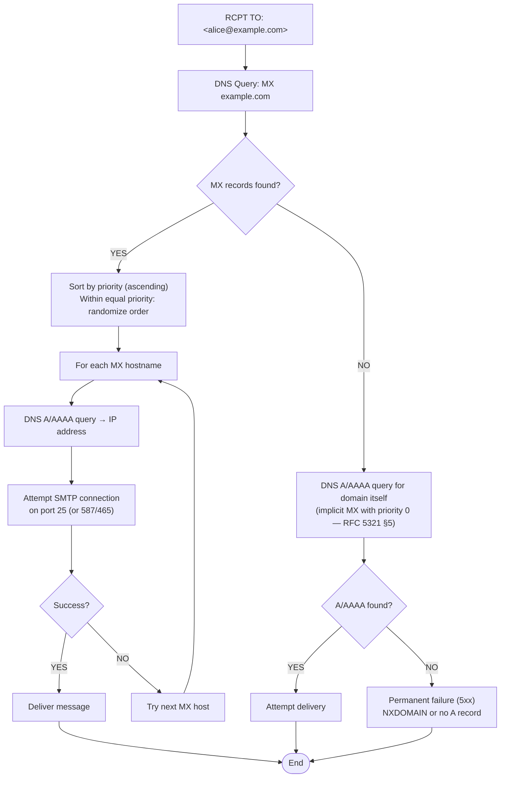

# Lesson 2: Message Structure and Addressing

## 1. First-Principles Intuition & Invariants

Electronic mail predates the web by more than a decade, and the design decisions baked into RFC 822 in 1982 — later revised and clarified by RFC 2822 and finally by the authoritative RFC 5322 in 2008 — still govern every byte that leaves your MTA today. Understanding why the format is what it is requires understanding the constraints its designers were working under: unreliable store-and-forward relays, heterogeneous line-ending conventions across operating systems, and the need for a human-readable format that could simultaneously be machine-parsed with zero ambiguity. The result is a header-plus-body structure that looks deceptively simple but carries precisely specified semantics at every field boundary.

The fundamental invariant of RFC 5322 is that a message is a sequence of US-ASCII lines, each terminated by a CRLF (`\r\n`), divided into exactly two parts by the first occurrence of an empty line — a bare CRLF sequence with no intervening characters. Everything before that empty line is the **header section**; everything after is the **body**. This two-part contract is non-negotiable. Any SMTP relay, any MDA, any spam filter that breaks it has violated the protocol. This simplicity is deceptive: the header section is a structured key-value store with its own folding, encoding, and ordering semantics, and the body carries arbitrarily complex content through a layered MIME encoding scheme grafted onto the original design by RFC 2045 through 2049.

Headers are name-value pairs delimited by a colon. The field name is a printable ASCII string with no whitespace; the field value extends from the first non-whitespace character after the colon to the end of the line, with the possibility of **folding**: a long header value may be split across multiple physical lines by inserting a CRLF followed by at least one whitespace character (a space or horizontal tab). The receiving parser must **unfold** these lines by stripping the CRLF-whitespace sequence before interpreting the value. This means that a 998-character practical limit on a single physical line does not constrain semantic header length — a `Received` trace header accumulating relay hops can legitimately span many folded lines.

The ordering of header fields is semantically significant for a small but critical subset. The `Received` headers, added by each relay in first-in-last-out prepend order, tell you the routing history of the message in reverse chronological sequence: the topmost `Received` header was written by the final delivery MTA, and the bottommost was written by the originating server. This prepend-ordering invariant is how forensic analysis works: you read the chain from bottom to top to reconstruct the message's path across the internet. Any relay that appends rather than prepends a `Received` header is broken.

The distinction between the **envelope** and the **message** is the most important conceptual split in all of email infrastructure, and confusing the two is the root cause of a remarkable number of operational bugs. The SMTP envelope consists of the `MAIL FROM` command argument and one or more `RCPT TO` command arguments, transmitted as SMTP protocol verbs before the message data phase. These addresses live in the SMTP session layer and determine actual routing. The `From:`, `To:`, `Cc:`, and `Bcc:` headers inside the RFC 5322 message are display metadata for mail clients. They influence nothing about routing. An MTA that uses `To:` headers to decide where to deliver mail is architecturally confused. The practical consequence is that a message can carry a `From:` header claiming to be from `ceo@example.com` while the SMTP `MAIL FROM` envelope sender is `bounce-handler@thirdparty.com` — this is how mailing lists, forwarding services, and mass mailers operate legitimately, and also how phishing operates illegitimately, which is precisely why SPF, DKIM, and DMARC exist as a separate authentication layer.

Address syntax under RFC 5322 defines two forms: the **addr-spec** (`user@domain`) and the **mailbox** form (`Display Name <user@domain>`). The addr-spec is the canonical identity; the display name is advisory and must be treated as untrusted user-controlled text by any client rendering it. The local part of an addr-spec (the portion left of the `@`) is case-sensitive by specification, though virtually every deployed MTA treats it as case-insensitive in practice. The domain part is explicitly case-insensitive. These rules have security consequences: a mail system that case-folds the local part to lowercase for identity comparison is deviating from the standard, and an adversary who can register `Admin@example.com` as a distinct account from `admin@example.com` on a system that respects case sensitivity gains a spoofing primitive.

---

## 2. Core Architecture & Mechanics

### RFC 5322 Header Anatomy

Consider a complete, real message header as it appears at the wire level, before any client rendering:

```text
Received: from smtp.sender.com (smtp.sender.com [203.0.113.42])
        by mx1.example.com (Postfix) with ESMTPS id 4A3B2C1D2E
        for <alice@example.com>; Thu, 12 Jun 2025 14:23:11 +0000 (UTC)
DKIM-Signature: v=1; a=rsa-sha256; c=relaxed/relaxed; d=sender.com;
        s=default; h=from:to:subject:date:message-id;
        bh=47DEQpj8HBSa+/TImW+5JCeuQeRkm5NMpJWZG3hSuFU=;
        b=abc123...
Message-ID: <20250612142311.4A3B2C@smtp.sender.com>
Date: Thu, 12 Jun 2025 14:23:11 +0000
From: Bob Smith <bob@sender.com>
To: Alice Jones <alice@example.com>
Subject: Re: Infrastructure Review
MIME-Version: 1.0
Content-Type: multipart/mixed; boundary="===============1234567890=="
```

Every field here carries load-bearing semantics. The `Message-ID` is a globally unique identifier generated by the originating MTA, structured as a local part and a domain in angle brackets. MTAs use it for loop detection and for threading in mail clients. A broken MTA that emits duplicate `Message-ID` values or omits the field entirely causes threading failures and confuses deduplication logic in mail stores. The `Date` header is the author's claimed send time, expressed in RFC 5322 date-time syntax. It is not the delivery time — that is approximated by the timestamp in the topmost `Received` header.

The `MIME-Version: 1.0` field is mandatory when MIME encoding is used and signals to the parser that the body must be interpreted under the MIME framework. Its absence means the body is treated as plain US-ASCII text. The `Content-Type` header then specifies the top-level MIME type, and for multipart messages, it carries a `boundary` parameter that is the separator string the parser uses to split the body into parts.

### MIME Multipart Structure

MIME's multipart encoding solves a problem the original RFC 822 design could not: how to send structured content — attachments, HTML alternatives, embedded images — through a channel that only understands flat ASCII text. The mechanism is elegant. The body of a multipart message is a sequence of **parts** separated by boundary markers, each part itself a complete mini-message with its own headers and body. This nesting can be recursive: a `multipart/mixed` part can contain a `multipart/alternative` part, which in turn contains a `text/plain` and a `text/html` rendition of the same content.

The boundary string is chosen by the sender to be a sequence of characters guaranteed not to appear as a line start in any of the enclosed parts. The boundary marker line takes the form `--<boundary>`, and the terminal boundary marker takes the form `--<boundary>--`. The structure for a message with a plain-text body and a PDF attachment looks like this at the wire level:

```text
MIME-Version: 1.0
Content-Type: multipart/mixed; boundary="==BOUNDARY_ABC=="

--==BOUNDARY_ABC==
Content-Type: text/plain; charset=UTF-8
Content-Transfer-Encoding: quoted-printable

Please find the infrastructure report attached.

--==BOUNDARY_ABC==
Content-Type: application/pdf; name="report.pdf"
Content-Transfer-Encoding: base64
Content-Disposition: attachment; filename="report.pdf"

JVBERi0xLjQKJeLjz9MKMSAwIG9iago8PAovVHlwZSAvQ2F0YWxvZwovUGFnZXMgMiAwIFIKPj4K
...

--==BOUNDARY_ABC==--
```

The `Content-Transfer-Encoding` header governs how binary or non-ASCII data is encoded into the 7-bit ASCII transport layer. `base64` encodes arbitrary binary as 76-character lines of base64 alphabet characters, inflating the data size by approximately 33%. `quoted-printable` is preferred for text bodies that are mostly ASCII with occasional non-ASCII characters: printable ASCII bytes pass through literally, while other bytes are encoded as `=XX` where XX is the uppercase hexadecimal octet value. This keeps the content human-readable in transit. `7bit` and `8bit` encodings are used when the content is already ASCII-safe or when the SMTP path has negotiated 8BITMIME support via the SMTP `EHLO` extension.

The `Content-Disposition` header governs client presentation behavior: `inline` means the client should attempt to render the part inline in the message view; `attachment` means the client should offer it as a downloadable file. The `filename` parameter provides the suggested filename. This parameter is a classic attack vector: a filename like `report.pdf.exe` on Windows systems, or a filename with null bytes, or a filename using Unicode right-to-left override characters to reverse the displayed extension, have all been used in phishing campaigns. A production mail gateway must normalize filenames aggressively.

The canonical multipart type hierarchy for a modern HTML email with an attachment is `multipart/mixed` at the outer level, containing a `multipart/alternative` part (which holds both `text/plain` and `text/html` alternatives) and an attachment part. The `multipart/alternative` semantics specify that parts are ordered from least preferred to most preferred, and the client should render the last part it understands. This is why `text/plain` precedes `text/html` in a well-formed alternative container.

```text
multipart/mixed
├── multipart/alternative
│   ├── text/plain; charset=UTF-8
│   └── text/html; charset=UTF-8
└── application/pdf (attachment)
```

### Address Resolution and DNS MX Logic

When your MTA has a message to deliver to `alice@example.com`, it must resolve the destination to a socket address. The process is specified in RFC 5321 and involves a precise decision tree that many production operators get wrong in subtle ways.

The first step is extracting the domain from the envelope recipient address (`example.com`). The MTA then queries DNS for `MX` records for that domain. An MX record maps a domain to a mail exchanger hostname with an associated integer priority value. Lower priority values indicate higher preference — a record with priority 10 is preferred over one with priority 20. When multiple MX records share the same priority value, the MTA must randomize the selection among equally-preferred records, distributing load across the pool.

The resolution flow can be visualized as:



The fallback to the A record when no MX exists is a critical invariant that many junior engineers miss. A domain with no MX records is not undeliverable — it accepts mail directly on its A record IP, treated as an implicit MX with the lowest possible priority. This matters for infrastructure domains that run mail incidentally.

A subtlety with practical failure consequences: the MTA must resolve each MX hostname's A or AAAA record separately. It must not use the IP address of the MX record itself — MX records point to hostnames, never to IP addresses directly. If an MX record's hostname resolves to no A/AAAA records, that MX entry is skipped. If all MX hostnames fail to resolve or refuse connection, the message is deferred with a `4xx` temporary failure, triggering the MTA's retry queue logic.

The following complete Python script implements a production-grade MX resolution chain, including fallback logic and randomized equal-priority load balancing, against a live DNS resolver:

```python
#!/usr/bin/env python3
"""
mx_resolve.py — RFC 5321-compliant MX resolution with priority sorting,
equal-priority randomization, and A-record fallback.

Requires: dnspython >= 2.3
    pip install dnspython
"""

import random
import socket
import sys
from dataclasses import dataclass, field
from typing import Optional

import dns.resolver
import dns.exception


@dataclass(order=True)
class MXRecord:
    priority: int
    hostname: str = field(compare=False)
    addresses: list[str] = field(default_factory=list, compare=False)


def resolve_mx(domain: str) -> list[MXRecord]:
    """
    Resolve MX records for domain, returning a sorted list of MXRecord
    objects with A/AAAA addresses pre-resolved. Falls back to A record
    per RFC 5321 §5 if no MX records exist.
    """
    records: list[MXRecord] = []

    try:
        answers = dns.resolver.resolve(domain, "MX")
        for rdata in answers:
            hostname = str(rdata.exchange).rstrip(".")
            priority = rdata.preference
            addrs = _resolve_addresses(hostname)
            if addrs:
                records.append(MXRecord(priority=priority, hostname=hostname, addresses=addrs))
            else:
                print(f"  [WARN] MX hostname {hostname!r} has no A/AAAA records; skipping",
                      file=sys.stderr)

    except dns.resolver.NoAnswer:
        print(f"  [INFO] No MX records for {domain!r}; attempting A/AAAA fallback",
              file=sys.stderr)
        addrs = _resolve_addresses(domain)
        if addrs:
            # RFC 5321 §5: treat domain A record as implicit MX priority 0
            records.append(MXRecord(priority=0, hostname=domain, addresses=addrs))

    except dns.resolver.NXDOMAIN:
        print(f"  [ERROR] {domain!r} does not exist in DNS (NXDOMAIN)", file=sys.stderr)

    except dns.exception.DNSException as exc:
        print(f"  [ERROR] DNS resolution failed: {exc}", file=sys.stderr)

    return _sort_with_randomization(records)


def _resolve_addresses(hostname: str) -> list[str]:
    """Resolve A and AAAA records for a hostname, preferring IPv6."""
    addresses: list[str] = []
    for qtype in ("AAAA", "A"):
        try:
            answers = dns.resolver.resolve(hostname, qtype)
            addresses.extend(str(r) for r in answers)
        except (dns.resolver.NoAnswer, dns.resolver.NXDOMAIN):
            pass
        except dns.exception.DNSException as exc:
            print(f"  [WARN] {qtype} lookup for {hostname!r} failed: {exc}", file=sys.stderr)
    return addresses


def _sort_with_randomization(records: list[MXRecord]) -> list[MXRecord]:
    """
    Sort MX records by priority ascending, with equal-priority records
    shuffled randomly (RFC 5321 §5 load distribution requirement).
    """
    if not records:
        return records

    # Group by priority
    groups: dict[int, list[MXRecord]] = {}
    for rec in records:
        groups.setdefault(rec.priority, []).append(rec)

    result: list[MXRecord] = []
    for priority in sorted(groups.keys()):
        group = groups[priority]
        random.shuffle(group)
        result.extend(group)

    return result


def probe_smtp(host: str, port: int = 25, timeout: float = 5.0) -> bool:
    """
    Attempt a TCP connection to verify the SMTP server is reachable.
    Does not complete the SMTP handshake — just validates connectivity.
    """
    try:
        with socket.create_connection((host, port), timeout=timeout) as sock:
            banner = sock.recv(1024).decode(errors="replace").strip()
            print(f"    [OK] {host}:{port} → {banner[:80]!r}")
            return True
    except (OSError, TimeoutError) as exc:
        print(f"    [FAIL] {host}:{port} → {exc}")
        return False


def resolve_and_probe(domain: str, probe_port: int = 25) -> None:
    print(f"\nResolving MX chain for: {domain}")
    print("=" * 60)

    records = resolve_mx(domain)

    if not records:
        print(f"  [FATAL] No deliverable mail exchangers found for {domain!r}")
        return

    for rec in records:
        print(f"\n  Priority {rec.priority}: {rec.hostname}")
        print(f"  Addresses: {', '.join(rec.addresses)}")
        delivered = False
        for addr in rec.addresses:
            if probe_smtp(addr, port=probe_port):
                delivered = True
                break
        if delivered:
            print(f"  [RESULT] Would deliver to {rec.hostname} ({rec.addresses[0]})")
            return

    print(f"  [RESULT] All mail exchangers unreachable; message would be deferred")


if __name__ == "__main__":
    targets = sys.argv[1:] if len(sys.argv) > 1 else ["gmail.com", "fastmail.com"]
    for target in targets:
        resolve_and_probe(target)
```

Run this script with `python3 mx_resolve.py gmail.com` and you will see the full MX chain for Gmail — currently five `googlemail.com` exchanger hostnames, all at priority 5, all randomly shuffled on each invocation, exactly as RFC 5321 mandates for load distribution.

To inspect MX records directly from the command line, `dig` is the authoritative tool. The following sequence demonstrates a complete MX investigation workflow:

```bash
# Full MX record chain with TTLs
dig MX gmail.com +answer

# Resolve one MX hostname to its A records
dig A gmail-smtp-in.l.google.com +short

# Check all MX records including their IP glue, using the +additional flag
dig MX gmail.com +additional

# Verify DNSSEC signing on MX records (critical for DANE TLSA validation)
dig MX gmail.com +dnssec +multiline

# Test TCP reachability to port 25 of an MX host
nc -zv -w5 gmail-smtp-in.l.google.com 25

# Initiate a manual SMTP session to inspect banner and EHLO capabilities
openssl s_client -starttls smtp -connect gmail-smtp-in.l.google.com:25 -crlf
```

The `+additional` flag in the `dig` query is particularly useful: when a DNS server includes A record glue alongside MX records in the additional section of its response, your resolver can skip a second round-trip DNS lookup for the MX hostname's IP address. Mail-hosting DNS operators should configure their authoritative servers to include this glue, reducing the DNS query cost per delivery attempt from two round trips to one.

---

## 3. High-Performance Optimization & Failure Modes

### Header Parsing at Scale

An MTA processing millions of messages per day spends a measurable fraction of its CPU budget on header parsing. The naive parsing model — read the entire header section into memory, then scan for fields by name — is correct but wastes work when you only need three fields out of forty. Production-grade parsers use lazy evaluation: they build an index of field-name offsets into the raw header buffer during the initial pass, and only decode and unfold a field's value when it is actually accessed. This amortizes the decoding cost over the actual access pattern rather than over all fields unconditionally.

The more serious parsing failure mode is **header injection**. If any code path in a mail-sending system constructs RFC 5322 headers by string concatenation with user-supplied input, an attacker who controls the input can inject a CRLF sequence followed by a new header field name and value — or worse, inject an empty line to terminate the header section and prepend content to the message body. Consider an application that constructs a `Subject:` header as `"Subject: " + user_input`. An input of `"hello\r\nBcc: attacker@evil.com"` becomes two valid header fields in the resulting message, silently copying the message to an attacker-controlled address. The mitigation is unambiguous: never construct RFC 5322 headers by string concatenation. Use a library that accepts field names and values as separate typed arguments and handles all escaping, folding, and encoding internally.

The related issue of **encoded words** (RFC 2047) adds another layer of complexity. Because RFC 5322 header values are nominally restricted to US-ASCII, non-ASCII characters in display names, subjects, and other header fields must be encoded using the `=?charset?encoding?encoded-text?=` syntax. A subject of "Vérification du système" would appear in the wire header as:

```text
Subject: =?UTF-8?Q?V=C3=A9rification_du_syst=C3=A8me?=
```

The `Q` encoding is a variant of quoted-printable adapted for header context (spaces become underscores; most non-alphanumeric bytes become `=XX`). The `B` encoding is base64. A production parser must handle both, handle encoded words split across folded lines, handle multiple consecutive encoded words with different charsets in a single field value, and handle malformed encoded words gracefully rather than crashing or returning garbage to the user. These edge cases are where off-the-shelf library usage over hand-rolled parsing pays for itself immediately.

### MX Resolution Failure Modes and Retry Logic

The two most operationally significant MX resolution failure modes are **greylisting** and **DNS propagation lag**. Greylisting is a spam mitigation technique where the receiving MTA returns a `451 4.7.1` temporary rejection on the first delivery attempt from an unknown sender, expecting that a legitimate MTA will retry while a botnet (which typically doesn't retry) will not. Your MTA's retry queue must therefore implement exponential backoff with jitter: a first retry after approximately five minutes, then fifteen, then thirty, then hourly, up to a maximum deferral of four to five days before generating a non-delivery report. RFC 5321 specifies this five-day outer bound explicitly.

DNS propagation lag causes a subtler failure. When a domain's MX records are updated — for example, during a migration from one mail provider to another — the old records remain cached in resolver caches for their TTL duration. An MTA that aggressively caches DNS results beyond the TTL will continue attempting delivery to the old MX hosts after the domain owner has decommissioned them. The correct behavior is to honor the DNS TTL strictly, refreshing the MX lookup on each delivery attempt if the TTL has expired. Postfix, for instance, uses `smtp_dns_cache_ttl` to bound its internal cache and respects the TTL floor correctly by default.

A production failure mode specific to high-volume senders is **MX record IP address churning** in large provider pools. Gmail's MX hosts resolve to different IP addresses on each lookup as Google rotates through its server fleet. An MTA that caches the resolved IP address rather than the MX hostname will continue hammering a single IP while the DNS round-robin distributes load across the pool. The correct architecture is to cache at the MX hostname level, not the IP level, and re-resolve the hostname's A records on each new connection attempt after the A record TTL expires.

The following `postconf` commands extract and verify the most relevant Postfix parameters governing MX resolution and retry behavior in a production deployment:

```bash
# Show all SMTP client delivery parameters
postconf -n | grep -E '(smtp_mx|smtp_dns|retry|defer|fallback)'

# Key parameters to audit in main.cf:
#   smtp_mx_address_limit     — max IPs to try per MX hostname (default: 5)
#   smtp_mx_sessions_limit    — max concurrent sessions per MX domain
#   smtp_dns_support_level    — enabled|disabled|dnssec (set to dnssec for DANE)
#   smtp_fallback_relay       — smarthost fallback if all MX attempts fail
#   maximal_queue_lifetime    — RFC 5321 §4.5.4.1 five-day outer bound
#   minimal_backoff_time      — initial retry interval (default: 300s)
#   maximal_backoff_time      — maximum retry interval (default: 4000s)

# Inspect the current deferred message queue with reason codes
postqueue -p | head -40

# Examine a specific deferred message's delivery history
postcat -qv <queue-id> | grep -E '(Received|status|connect)'

# Force immediate retry of all deferred messages (use cautiously in production)
postqueue -f

# Flush retries only for a specific destination domain
postqueue -s example.com
```

### MIME Boundary Collision and Encoding Failures

A subtle but real failure mode in MIME encoding is **boundary collision**: if the boundary string chosen by the sending MTA happens to appear as the first characters of a line within one of the message parts, the receiving parser will incorrectly split the part at that point. The correct mitigation is for the MTA to generate a sufficiently random boundary string — a UUID or 32 bytes of base64-encoded random data provides negligible collision probability — and to verify by scanning the encoded body that the boundary string does not appear verbatim. Most production MIME libraries do this automatically, but home-grown encoding code frequently skips the verification step.

The `base64` encoded parts introduce line length constraints that interact badly with some older MTAs. RFC 2045 specifies that base64-encoded lines must not exceed 76 characters. Some SMTP relays impose their own line length limits (typically 998 characters per RFC 5322, but some legacy systems enforce 512 or 1000 characters from older specifications). A MIME encoder that emits base64 without line breaks — producing a single multi-megabyte line for a large attachment — will trigger silent truncation or connection drops on these relays. The `base64 -w 76` behavior is therefore a correctness requirement in SMTP context, not merely a stylistic preference.

The practical diagnostic tool for all of the above is `swaks`, the Swiss Army Knife for SMTP. It allows injecting arbitrary RFC 5322 messages with crafted headers, specific MIME structures, and envelope addresses that differ from the message headers, making it invaluable for testing parsing edge cases on live MTA infrastructure:

```bash
# Send a test message with an explicit envelope sender distinct from From: header
# (tests envelope/header separation handling)
swaks \
  --server mx1.example.com \
  --port 25 \
  --from "bounce+test123@sender.com" \
  --to "alice@example.com" \
  --h-From "Bob Smith <bob@sender.com>" \
  --h-Subject "MIME Structure Test" \
  --header "X-Test-Run: $(date +%s)" \
  --attach-type "application/pdf" \
  --attach-name "report.pdf" \
  --attach /tmp/test.pdf \
  --body "Please see the attached report." \
  --tls \
  --tls-verify \
  --protocol ESMTP \
  --timeout 30

# Test MIME boundary collision handling with a crafted body
swaks \
  --server localhost \
  --port 25 \
  --from test@localhost \
  --to postmaster@localhost \
  --data /tmp/crafted_mime.eml \
  --dump
```

The `--dump` flag causes `swaks` to print the full SMTP transaction — both sides of the conversation — which is exactly what you need when diagnosing whether a header field is being rejected by an MTA's policy engine versus a DNS-level delivery failure. Combined with `dig` for MX interrogation and `postcat` for queue inspection, these three tools give you complete observability over the message structure and addressing layers from the wire up to the parsed representation inside the mail store.
