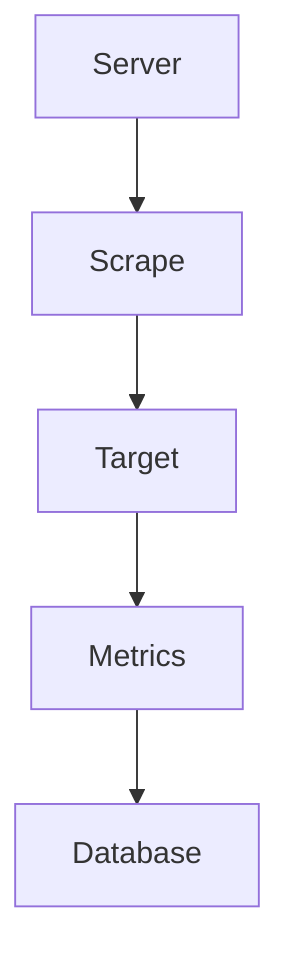

# Lesson 1: Prometheus Fundamentals

## First-Principles Intuition & Invariants

Prometheus is a monitoring system designed to provide a comprehensive view of system performance and behavior. At its core, Prometheus is a time-series database that collects and stores metrics from various sources, enabling users to analyze and visualize system performance over time. Understanding Prometheus requires grasping its underlying architecture and the mechanisms that enable it to collect and store metrics.

Prometheus operates on a simple yet powerful principle: every metric is a time-series data point that can be collected from a target system. This principle is rooted in the concept of a "metric," which is a quantifiable value that describes a system's behavior or performance. Metrics can be thought of as a snapshot of a system's state at a particular point in time, and Prometheus collects these snapshots to create a comprehensive picture of system behavior over time.

The key invariant in Prometheus is the concept of a "scrape," which is the process of collecting metrics from a target system. Scraping is a periodic process that occurs at a specified interval, and it's responsible for collecting metrics from a target system and storing them in the Prometheus database. The scrape process is the heartbeat of Prometheus, and it's what enables the system to collect and store metrics in real-time.

## Core Architecture & Mechanics

Prometheus consists of several key components that work together to collect and store metrics. The core components of Prometheus are:

* **Server**: The Prometheus server is responsible for collecting metrics from target systems and storing them in the database. The server is the central hub of the Prometheus system, and it's responsible for managing the scrape process.
* **Scrape**: The scrape process is responsible for collecting metrics from target systems. Scrapes are periodic and occur at a specified interval, and they're responsible for collecting metrics from a target system and storing them in the database.
* **Target**: A target is a system that exposes metrics that can be collected by Prometheus. Targets can be services, applications, or even individual components, and they're responsible for exposing metrics that can be collected by Prometheus.

The Prometheus architecture is designed to be highly scalable and fault-tolerant. The server is responsible for managing the scrape process, and it can handle a large number of targets and scrapes. The scrape process is also designed to be highly concurrent, and it can collect metrics from multiple targets simultaneously.

Here's a high-level overview of the Prometheus architecture:

## High-Performance Optimization & Failure Modes

Prometheus is designed to handle high-performance workloads and large amounts of data. To achieve high performance, Prometheus uses a number of optimization techniques, including:

* **Concurrency**: Prometheus uses concurrency to collect metrics from multiple targets simultaneously. This enables Prometheus to handle large amounts of data and high-performance workloads.
* **Resource Scaling**: Prometheus is designed to scale horizontally, and it can handle large amounts of data and high-performance workloads by adding additional servers and targets.
* **Boundary Edge Cases**: Prometheus is designed to handle boundary edge cases, including cases where targets are unavailable or metrics are missing.

Despite its high-performance capabilities, Prometheus is not immune to failure modes. Some common failure modes include:

* **Scrape Failure**: Scrape failure occurs when the scrape process is unable to collect metrics from a target system. This can be due to a number of reasons, including network connectivity issues or target unavailability.
* **Database Failure**: Database failure occurs when the Prometheus database is unable to store metrics. This can be due to a number of reasons, including database corruption or storage issues.
* **Target Unavailability**: Target unavailability occurs when a target system is unavailable or unable to expose metrics. This can be due to a number of reasons, including network connectivity issues or target unavailability.

To mitigate these failure modes, Prometheus provides a number of features, including:

* **Scrape Retry**: Scrape retry enables Prometheus to retry the scrape process in case of failure.
* **Database Backup**: Database backup enables Prometheus to backup the database and recover from failure.
* **Target Health Checking**: Target health checking enables Prometheus to check the health of targets and detect unavailability.
