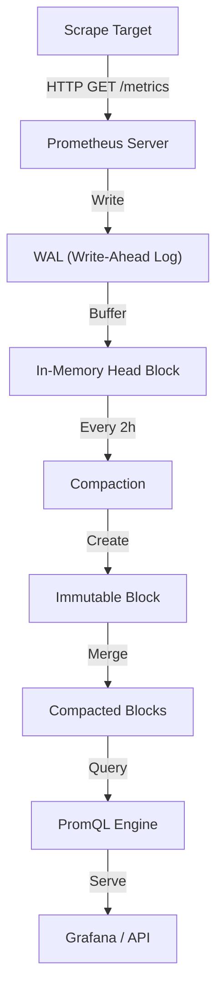

# Lesson 2: Configuring Prometheus

## Introduction: Pull-Based Architecture & Design Philosophy

Prometheus is a dimensional time-series database and monitoring system built on a **pull-based scraping model**. Unlike push-based systems (e.g., StatsD, Graphite), where instrumented applications actively send metrics to collectors, Prometheus servers actively poll (scrape) HTTP endpoints exposed by targets at regular intervals. This architectural choice yields several critical advantages:

1. **Service discovery and health monitoring are unified**: If a scrape fails, Prometheus immediately knows the target is unreachable. Push-based systems require separate health checks.
2. **Centralized configuration**: Scrape intervals, timeouts, and relabeling rules are defined at the Prometheus server, not distributed across dozens of application configurations.
3. **Backpressure and rate limiting**: The server controls the rate of data ingestion. Targets cannot overwhelm Prometheus by pushing data faster than it can process.
4. **Simplified network topology**: Targets need only expose an HTTP endpoint; they do not need to know the location of collectors or handle retries.

The tradeoff is that Prometheus requires **network-level reachability** from the server to all targets. Short-lived jobs (batch processes, serverless functions) cannot be scraped before they terminate, necessitating the **Pushgateway** pattern for those workloads.

## Core Architecture & Mechanics

### Time-Series Data Model

Prometheus organizes metrics as **labeled time series**. Each unique combination of metric name and label set defines a distinct series:

```
http_requests_total{method="GET", handler="/api/users", status="200"}
http_requests_total{method="POST", handler="/api/users", status="201"}
```

These are two distinct series. The cardinality (number of unique series) is the product of all label value combinations. High cardinality (e.g., labels with unbounded values like `user_id` or `timestamp`) leads to memory exhaustion and query performance degradation.

**Metric types** are client-side abstractions that guide how to aggregate and interpret values:

- **Counter**: Monotonically increasing value (resets on restart). Use `rate()` or `increase()` to compute per-second rates. Example: `http_requests_total`.
- **Gauge**: Point-in-time value that can go up or down. Example: `node_memory_available_bytes`.
- **Histogram**: Buckets of observations, pre-aggregated by the client. Enables percentile estimation via `histogram_quantile()`. Example: `http_request_duration_seconds`.
- **Summary**: Similar to histogram, but calculates quantiles client-side. Cannot aggregate across instances. Largely deprecated in favor of histograms.

### Time-Series Database (TSDB) Internals

Prometheus stores data in a local on-disk TSDB, optimized for write-heavy append-only workloads. The storage layout is:

```
data/
├── 01HQZX0000000000000000/   # Block directory (ULID timestamp)
│   ├── chunks/
│   │   └── 000001             # Compressed sample data
│   ├── index                  # Inverted index (series -> chunk refs)
│   ├── meta.json              # Block metadata (min/max time, stats)
│   └── tombstones             # Deletion markers
├── 01HQZY0000000000000000/
└── wal/                        # Write-Ahead Log (in-memory buffer)
    ├── 00000000
    └── 00000001
```

**Write path**:

1. Scraped samples are appended to the **Write-Ahead Log (WAL)**, a sequential log on disk.
2. Samples are held in an in-memory **head block** for the current 2-hour window.
3. Every 2 hours, the head block is **compacted** into an immutable block on disk, and the WAL is truncated.
4. A background **compaction process** merges small blocks into larger ones to reduce fragmentation and improve query performance.

**Read path**:

1. Query execution identifies relevant series via the **inverted index** (labels → series IDs).
2. The query planner determines which blocks overlap the query time range.
3. Compressed chunks are read from disk (or page cache) and decompressed.
4. Samples are aggregated according to the PromQL expression.



**Compression**: Prometheus uses **delta-of-delta encoding** for timestamps and **XOR-based compression** for float64 values (Gorilla algorithm). This achieves ~1.3 bytes per sample on average.

**Retention**: Blocks older than the configured retention period (e.g., `--storage.tsdb.retention.time=15d`) are deleted. Size-based retention (`--storage.tsdb.retention.size`) is also supported.

## Configuration Deep Dive

### Scrape Configuration

The `prometheus.yml` file defines scrape jobs, each with a set of targets. A minimal scrape config:

```yaml
global:
  scrape_interval: 15s       # Default scrape interval
  scrape_timeout: 10s        # Must be < scrape_interval
  evaluation_interval: 15s   # How often to evaluate alerting rules

scrape_configs:
  - job_name: 'node_exporter'
    static_configs:
      - targets:
          - 'localhost:9100'
          - '192.168.1.10:9100'
```

**Key parameters**:

- `scrape_interval`: Shorter intervals (e.g., 5s) increase resolution but also memory usage and CPU load. Typical production values: 15s–60s.
- `scrape_timeout`: Must be less than `scrape_interval` to avoid overlapping scrapes. If a scrape exceeds the timeout, Prometheus marks it as failed and records `up{job="..."} = 0`.
- `sample_limit`: Maximum number of samples per scrape. Prevents a single misbehaving target from exhausting memory. Default: 0 (no limit).
- `metric_relabel_configs`: Drop or modify metrics after scraping but before storage. Use to reduce cardinality:

```yaml
metric_relabel_configs:
  - source_labels: [__name__]
    regex: 'go_.*'
    action: drop  # Drop all Go runtime metrics
  - source_labels: [user_id]
    action: labeldrop  # Remove high-cardinality label
```

**Relabeling lifecycle**:

1. **Service discovery** generates initial targets with `__meta_*` labels.
2. **`relabel_configs`** (target relabeling) runs before the scrape. Use to drop targets, modify scrape URLs, or rewrite labels.
3. The scrape occurs.
4. **`metric_relabel_configs`** runs after the scrape. Use to drop metrics or modify labels before storage.

### Service Discovery

Static configs are brittle. Prometheus supports dynamic service discovery for Kubernetes, Consul, EC2, Azure, GCP, and more:

```yaml
scrape_configs:
  - job_name: 'kubernetes-pods'
    kubernetes_sd_configs:
      - role: pod
    relabel_configs:
      - source_labels: [__meta_kubernetes_pod_annotation_prometheus_io_scrape]
        action: keep
        regex: true
      - source_labels: [__meta_kubernetes_pod_annotation_prometheus_io_port]
        target_label: __address__
        regex: (.+)
        replacement: ${1}:${__meta_kubernetes_pod_annotation_prometheus_io_port}
```

This configuration scrapes all Kubernetes pods annotated with `prometheus.io/scrape: "true"`, using the port specified in `prometheus.io/port`.

**Service discovery labels** (e.g., `__meta_kubernetes_pod_name`, `__meta_ec2_instance_id`) are available only during relabeling and are dropped before storage. To persist them as metric labels, explicitly copy them:

```yaml
relabel_configs:
  - source_labels: [__meta_kubernetes_pod_name]
    target_label: pod
```

### Storage Configuration

**Disk space estimation**:

```
bytes_per_sample ≈ 1.3 (compressed)
samples_per_second = (number_of_series) × (1 / scrape_interval)
disk_per_day = samples_per_second × 86400 × bytes_per_sample
disk_for_retention = disk_per_day × retention_days
```

Example: 100k series, 15s scrape interval, 30-day retention:

```
samples_per_second = 100,000 / 15 ≈ 6,667
disk_per_day = 6,667 × 86400 × 1.3 ≈ 749 MB/day
disk_for_retention = 749 MB × 30 ≈ 22 GB
```

Add 50% headroom for WAL, compaction overhead, and burst cardinality growth.

**Retention policies**:

```yaml
storage:
  tsdb:
    path: /var/lib/prometheus
    retention.time: 30d
    retention.size: 50GB  # Whichever limit is hit first
```

**Memory usage**: Prometheus keeps the head block (last 2 hours) entirely in RAM. Memory usage is roughly:

```
memory_bytes ≈ number_of_series × 3KB (metadata + index) + chunk_memory
chunk_memory ≈ number_of_series × 1KB (active chunks)
```

For 1M series, expect ~4GB baseline memory usage. Cardinality explosions (e.g., adding `request_id` labels) cause OOM kills.

## High-Performance Optimization

### Scrape Performance

**Problem**: Scraping 10,000 targets with 15s intervals requires 667 scrapes/second. Each scrape is an HTTP request with TLS handshake, DNS lookup, and TCP connection overhead.

**Solutions**:

1. **Connection pooling**: Prometheus reuses HTTP connections via `keep-alive`. Ensure targets support persistent connections.
2. **Federation**: Split targets across multiple Prometheus servers, then aggregate via federation or remote read:

```yaml
# Global aggregator
scrape_configs:
  - job_name: 'federate'
    honor_labels: true
    metrics_path: '/federate'
    params:
      match[]:
        - '{job=~".+"}'  # Federate all metrics
    static_configs:
      - targets:
          - 'prometheus-shard-1:9090'
          - 'prometheus-shard-2:9090'
```

3. **Hashmod relabeling**: Distribute targets across shards using consistent hashing:

```yaml
relabel_configs:
  - source_labels: [__address__]
    modulus: 3
    target_label: __tmp_hash
    action: hashmod
  - source_labels: [__tmp_hash]
    regex: '^0$'  # Keep only shard 0 on this Prometheus instance
    action: keep
```

### Query Performance

**Problem**: Queries like `rate(http_requests_total[5m])` must read millions of samples across hundreds of series.

**Solutions**:

1. **Limit query time range**: Queries over 30+ days are slow. Use `max_query_length` to enforce limits:

```yaml
query:
  max_samples: 50000000
  timeout: 2m
```

2. **Precompute with recording rules**: Recording rules evaluate expensive queries periodically and store the result as a new time series:

```yaml
groups:
  - name: api_performance
    interval: 30s
    rules:
      - record: api:http_request_duration_seconds:p95
        expr: histogram_quantile(0.95, rate(http_request_duration_seconds_bucket[5m]))
```

Now query `api:http_request_duration_seconds:p95` instead of running the histogram calculation on every dashboard load.

3. **Avoid high-cardinality aggregations**: Queries like `sum(rate(http_requests_total[5m])) by (user_id)` with millions of users create millions of result series. Aggregate by low-cardinality labels (e.g., `handler`, `status`) instead.

### Cardinality Management

**Problem**: A label with 1M unique values explodes the series count by 1M×.

**Detection**:

```promql
# Series count per metric
count by (__name__) ({__name__=~".+"})

# Cardinality per label
count by (label_name) ({__name__="metric_name"})
```

**Mitigation**:

1. **Drop high-cardinality labels** via `metric_relabel_configs`.
2. **Limit label values**: For HTTP paths, use a `handler` label with routes (e.g., `/api/users/:id`) instead of raw paths (e.g., `/api/users/12345`).
3. **Use `sample_limit`** to prevent runaway exporters:

```yaml
scrape_configs:
  - job_name: 'app'
    sample_limit: 10000  # Fail the scrape if >10k samples
```

## Failure Modes & Resilience

### Scrape Failures

**Symptoms**: `up{job="...", instance="..."}` metric is `0`.

**Causes**:

1. Target is unreachable (network partition, DNS failure).
2. Target returns non-200 HTTP status.
3. Scrape exceeds `scrape_timeout`.
4. TLS certificate validation fails.

**Mitigation**:

```yaml
scrape_configs:
  - job_name: 'flaky_service'
    scrape_interval: 30s
    scrape_timeout: 10s
    tls_config:
      insecure_skip_verify: true  # Only for testing
    relabel_configs:
      - source_labels: [__address__]
        target_label: instance
```

Monitor `prometheus_target_scrapes_exceeded_sample_limit_total` and `prometheus_target_scrape_pool_exceeded_target_limit_total`.

### Out-of-Memory (OOM)

**Symptoms**: Prometheus pod/container is killed. Linux OOM killer logs: `Out of memory: Killed process <pid> (prometheus)`.

**Root causes**:

1. **Cardinality explosion**: A new label with unbounded values (e.g., `trace_id`).
2. **Query memory**: Large PromQL queries (e.g., joins, subqueries) hold result sets in RAM.
3. **Chunk overflow**: Too many active chunks in the head block.

**Mitigation**:

```yaml
# Limit query concurrency
query:
  max_concurrency: 20

# Force garbage collection
storage:
  tsdb:
    min_block_duration: 2h  # Default
    max_block_duration: 36h  # Reduce for faster compaction
```

Use `prometheus_tsdb_head_series` and `prometheus_tsdb_head_chunks` metrics to track memory pressure.

### Disk Exhaustion

**Symptoms**: Prometheus stops accepting writes. Logs: `msg="compaction failed" err="no space left on device"`.

**Mitigation**:

1. Set `storage.tsdb.retention.size` as a hard cap.
2. Monitor `prometheus_tsdb_storage_blocks_bytes` and alert before hitting 90% disk usage.
3. Enable **remote write** to offload data to long-term storage (e.g., Thanos, Cortex, Mimir):

```yaml
remote_write:
  - url: 'http://thanos-receiver:19291/api/v1/receive'
    queue_config:
      capacity: 10000
      max_shards: 50
      max_samples_per_send: 5000
```

### Data Loss During Restarts

**Problem**: Prometheus crashes before the WAL is checkpointed. Recent data (last 2 hours) is lost.

**Mitigation**:

1. Use **persistent volumes** in Kubernetes with `fsync`-capable storage (e.g., EBS with `gp3`, local NVMe).
2. Enable **remote write** for durability.
3. Run multiple Prometheus instances (with `hashmod` sharding) and aggregate via remote read or federation. If one instance fails, the others continue collecting data.

## Production-Grade Configuration Example

```yaml
global:
  scrape_interval: 30s
  scrape_timeout: 10s
  evaluation_interval: 30s
  external_labels:
    cluster: 'prod-us-east-1'
    replica: '1'

storage:
  tsdb:
    path: /prometheus/data
    retention.time: 15d
    retention.size: 100GB

query:
  max_concurrency: 50
  timeout: 2m
  max_samples: 50000000

scrape_configs:
  - job_name: 'kubernetes-pods'
    kubernetes_sd_configs:
      - role: pod
        namespaces:
          names: ['production', 'monitoring']
    sample_limit: 15000
    relabel_configs:
      - source_labels: [__meta_kubernetes_pod_annotation_prometheus_io_scrape]
        action: keep
        regex: true
      - source_labels: [__meta_kubernetes_pod_annotation_prometheus_io_port]
        target_label: __address__
        regex: (.+)
        replacement: '${1}:${__meta_kubernetes_pod_annotation_prometheus_io_port}'
      - source_labels: [__meta_kubernetes_namespace]
        target_label: namespace
      - source_labels: [__meta_kubernetes_pod_name]
        target_label: pod
    metric_relabel_configs:
      - source_labels: [__name__]
        regex: 'go_gc_.*'
        action: drop
      - source_labels: [le]
        regex: '(0\.005|0\.01|0\.025|10\.0|30\.0)'
        action: drop  # Drop excessive histogram buckets

  - job_name: 'node-exporter'
    static_configs:
      - targets:
          - 'node-1.example.com:9100'
          - 'node-2.example.com:9100'
    metric_relabel_configs:
      - source_labels: [__name__]
        regex: 'node_(network_transmit_packets_total|network_receive_packets_total)'
        action: drop

remote_write:
  - url: 'http://thanos-receive:19291/api/v1/receive'
    queue_config:
      capacity: 10000
      max_shards: 100
      min_shards: 10
      max_samples_per_send: 5000
      batch_send_deadline: 5s
    write_relabel_configs:
      - source_labels: [__name__]
        regex: 'ALERTS|ALERTS_FOR_STATE'
        action: drop  # Don't send alerting state to remote storage

alerting:
  alertmanagers:
    - static_configs:
        - targets:
            - 'alertmanager:9093'
      timeout: 10s

rule_files:
  - '/etc/prometheus/rules/*.yml'
```

## Summary

Prometheus configuration requires balancing **cardinality**, **scrape frequency**, **retention**, and **query performance**. The pull-based model centralizes control but requires network reachability. The TSDB's append-only design optimizes for write throughput, while compaction and compression minimize storage overhead. High-cardinality labels and unbounded label values are the primary source of production incidents. Use relabeling, sample limits, and remote write to maintain stability at scale. Monitor `prometheus_tsdb_head_series`, `prometheus_target_scrapes_exceeded_sample_limit_total`, and disk usage to detect issues before they cause outages.
