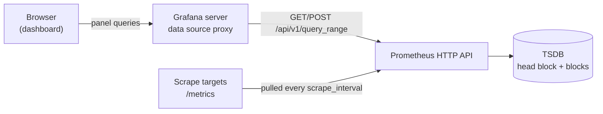

# Lesson 4: Customizing Grafana for Prometheus

## 1. Architectural Foundations & Invariants

### Grafana Stores No Metrics

The most common misconception about Grafana is that metrics flow *into* it. They do not. Prometheus scrapes targets and stores samples in its own time-series database (TSDB). Grafana holds no copy of that data: every time a dashboard loads or refreshes, each panel sends a PromQL query to Prometheus's HTTP API and draws whatever comes back. Grafana's own database (SQLite by default, or MySQL/PostgreSQL) stores only configuration: users, folders, dashboards as JSON, data source definitions and alert rules.

Three consequences follow, and they shape everything in this lesson:

1. **A dashboard can only be as fast as its slowest query.** A panel that takes 20 seconds in the Prometheus expression browser takes 20 seconds in Grafana too.
2. **Retention belongs to Prometheus.** If Prometheus keeps 15 days of data (`--storage.tsdb.retention.time=15d`), a "last 30 days" dashboard shows 15 days of lines and 15 days of nothing.
3. **Dashboards are code.** A dashboard is a JSON document. It can be versioned, reviewed, provisioned from files and generated, exactly like the Prometheus rule files from Lesson 3.

### The Request Path



With the data source's access mode set to **Server** (called *proxy* in configuration files, and the only mode current Grafana versions support for new data sources), the browser never talks to Prometheus directly. It asks the Grafana server, which adds credentials, forwards the query and returns the result. That is why Prometheus can stay on a private network that only the Grafana host can reach.

### Invariant: Every Graph Is a Range Query With a Step

A time-series panel issues a *range query*: an expression plus `start`, `end` and `step`. Prometheus evaluates the expression once per step, so a 6-hour range with a 30-second step returns up to 720 points per series. Grafana chooses the step for you from two inputs:

- **Max data points** (by default roughly the panel's width in pixels),
- **Min interval** (on the query or the data source).

The chosen step is exposed as the variable `$__interval`. Wider time ranges mean larger steps, which is why a spike visible over 1 hour can vanish over 7 days: it falls between evaluation points. Keep this invariant in mind; most "the graph is lying" reports come from it.

---

## 2. Core Mechanics & Data Structures

### 2.1 Provisioning the Data Source

Clicking through the UI works once. For any environment you rebuild, define the data source in a provisioning file that Grafana reads at start-up (`/etc/grafana/provisioning/datasources/` on package installs):

```yaml
# /etc/grafana/provisioning/datasources/prometheus.yaml
apiVersion: 1
datasources:
  - name: Prometheus
    type: prometheus
    uid: prom-main            # stable ID that dashboards reference
    access: proxy             # "Server" access in the UI
    url: http://prometheus:9090
    isDefault: true
    jsonData:
      timeInterval: "15s"     # must equal Prometheus's scrape_interval
      httpMethod: POST        # long queries do not hit URL-length limits
```

`timeInterval` (shown in the UI as *Scrape interval*) matters more than it looks: Grafana uses it to compute `$__rate_interval` (section 2.3). If Prometheus scrapes every 15 seconds but the data source claims 60 seconds, every `rate()` window Grafana generates is four times longer than necessary and graphs look smoothed. If it claims 5 seconds, windows can become too short to contain two samples, and panels show gaps.

The fixed `uid` lets dashboards reference the data source independently of its display name, so renaming "Prometheus" to "Prometheus (prod)" breaks nothing.

### 2.2 The Dashboard JSON Model

Every dashboard is a JSON object. The parts you will edit most:

```json
{
  "uid": "node-overview",
  "title": "Node Overview",
  "refresh": "1m",
  "time": { "from": "now-6h", "to": "now" },
  "templating": { "list": [] },
  "panels": [
    {
      "type": "timeseries",
      "title": "CPU busy",
      "gridPos": { "x": 0, "y": 0, "w": 12, "h": 8 },
      "datasource": { "type": "prometheus", "uid": "prom-main" },
      "targets": [
        {
          "refId": "A",
          "expr": "1 - avg by (instance) (rate(node_cpu_seconds_total{mode=\"idle\", instance=~\"$instance\"}[$__rate_interval]))",
          "legendFormat": "{{instance}}"
        }
      ],
      "fieldConfig": {
        "defaults": { "unit": "percentunit", "min": 0, "max": 1 }
      }
    }
  ]
}
```

- `gridPos` places the panel on a 24-column grid.
- `targets` holds one entry per query, each with a `refId` (A, B, C…) that transformations and expressions refer to.
- `legendFormat` turns label values into series names; `{{instance}}` is replaced by each series' `instance` label.
- `fieldConfig.defaults` sets units, ranges, thresholds and colours for every series in the panel; `fieldConfig.overrides` changes them for selected series.

Export any dashboard you built in the UI with *Share → Export* (or *Export → Export as JSON* in newer versions) to see its full model.

### 2.3 The Built-In Interval Variables

| Variable | Meaning | Use it for |
|---|---|---|
| `$__interval` | The step Grafana chose for this panel | `avg_over_time(x[$__interval])` when you want one window per point |
| `$__rate_interval` | `max($__interval + scrape interval, 4 × scrape interval)` | Every `rate()`, `irate()` and `increase()` |
| `$__range` | The whole dashboard time range | Totals over the visible range, e.g. `increase(x[$__range])` in a Stat panel |

Why `$__rate_interval` exists: `rate()` needs at least two samples inside its window. With a 15-second scrape interval, `rate(x[15s])` usually finds one sample and returns nothing; `rate(x[1m])` finds four and is reliable. Using `$__interval` directly in `rate()` fails at short ranges (window too small) and silently skips data at long ones (windows narrower than the step leave gaps between them). `$__rate_interval` guarantees at least four scrapes per window *and* windows that overlap the step, so no samples are skipped.

Rule of thumb: **never hard-code `[5m]` in a dashboard query and never put `$__interval` inside `rate()`**. Use `$__rate_interval`.

### 2.4 Template Variables

Variables turn one dashboard into a view of any job, instance or namespace. They are defined under *Dashboard settings → Variables* (stored in `templating.list`). The Prometheus data source provides query functions for them:

```promql
# Variable "job": every job that has targets
label_values(up, job)

# Variable "instance": instances of the selected job only (a chained variable)
label_values(up{job="$job"}, instance)

# Variable "namespace": from any metric that carries the label
label_values(kube_pod_info, namespace)
```

With **Multi-value** or **Include All option** enabled, Grafana substitutes the selection as a regular expression such as `(web-1|web-2)`. So a multi-value variable must be used with the regex matcher:

```promql
# Correct for multi-value variables
rate(http_requests_total{instance=~"$instance"}[$__rate_interval])

# Wrong: "=" compares against the literal string "(web-1|web-2)" and matches nothing
rate(http_requests_total{instance="$instance"}[$__rate_interval])
```

Grafana escapes regex special characters in the values (dots in IP addresses, for example), so `10.0.1.5:9100` matches only itself.

**Custom "All" value.** By default "All" expands to every value in the list. With thousands of values that becomes a huge regex in every query. Set the *Custom all value* to `.*` so "All" becomes `instance=~".*"`, which Prometheus handles efficiently.

**Refresh behaviour.** A variable can refresh *On dashboard load* or *On time range change*. Use the second only when label values really change with time (short-lived pods). Each refresh is another query against Prometheus.

### 2.5 Choosing the Right Panel

| Question the viewer asks | Panel | Query shape |
|---|---|---|
| How does it change over time? | Time series | Range query, `rate()` / gauges |
| What is the value now? | Stat / Gauge | Instant query, reduce to *Last* |
| Which ones are worst? | Bar gauge or Table | `topk(10, …)`, instant, *Format: Table* |
| How is latency distributed? | Heatmap | Histogram buckets, *Format: Heatmap* |
| When was it up or down? | State timeline | `up` or a 0/1 expression with value mappings |

Two of these need specific settings.

**Tables.** Set the query's *Type* to *Instant* and *Format* to *Table*. Each label becomes a column and the value goes in a column named `Value`. Use the *Organize fields* transformation to hide and rename columns, and *Join by field* (outer join on `instance`) to combine several queries into one row per instance.

**Heatmaps from Prometheus histograms.**

```promql
sum by (le) (rate(http_request_duration_seconds_bucket{job="$job"}[$__rate_interval]))
```

Set *Format* to *Heatmap* and the legend to `{{le}}`. Grafana then de-accumulates the cumulative buckets (each `le` bucket includes all smaller ones) into per-bucket counts. Without that setting, the top row always looks hottest because it contains everything.

### 2.6 Units, Thresholds, Overrides and Value Mappings

Raw numbers mislead. `node_memory_MemAvailable_bytes` reads as `8.4e+09` until you set the unit to *bytes (IEC)*, when it reads `7.82 GiB`. Set units at the source of truth:

- `percentunit` for ratios in 0–1 (as in the CPU example), `percent` for 0–100,
- `s` or `ms` for durations (Prometheus histograms are in seconds by convention),
- `reqps` for request rates, `bytes`/`Bps` for sizes and throughput.

**Thresholds** colour values (green below 0.7, amber to 0.9, red above). Choose them from the service's objectives, not from what looks nice: if the SLO is "p99 under 300 ms", the red threshold for the p99 panel is 0.3 s.

**Overrides** apply settings to series matched by name, regex or query. A typical use is drawing the "limit" series as a dashed red line while the "usage" series stays filled.

**Value mappings** turn numbers into words: map `up` values `1 → UP (green)` and `0 → DOWN (red)` in a State timeline, and the panel reads like a status board.

---

## 3. High-Performance Optimization & Failure Modes

### 3.1 Where the Load Comes From

A dashboard with 30 panels, each with two queries, refreshing every 10 seconds, viewed by 20 people, sends **120 queries per second** to Prometheus. Nothing about it looks expensive in the editor. Control the load at each factor:

- **Refresh rate.** A 10-second refresh is rarely useful when Prometheus scrapes every 15 seconds. Set the dashboard default to 1 minute. Administrators can enforce a floor with `min_refresh_interval` in the `[dashboards]` section of `grafana.ini`.
- **Collapsed rows.** Panels inside a collapsed row do not run queries until the row is opened. Put the detail panels there.
- **Repeated panels.** *Repeat by variable* creates one panel per selected value. With "All" selected across 200 instances, that is 200 panels of queries. Limit the variable, or aggregate in one panel.
- **Shared queries.** The *-- Dashboard --* data source lets a panel reuse another panel's query result instead of sending the same query twice.

### 3.2 Expensive Queries Belong in Recording Rules

The cost of a PromQL query grows with the number of series it touches times the number of steps. A query such as

```promql
histogram_quantile(0.99, sum by (le, route) (rate(http_request_duration_seconds_bucket[$__rate_interval])))
```

over 400 routes, 12 buckets each, and 50 instances reads 240,000 series on every refresh. Pre-compute it with a recording rule (Lesson 3, section 3.1):

```yaml
groups:
  - name: http-latency
    interval: 30s
    rules:
      - record: route:http_request_duration_seconds_bucket:rate1m
        expr: sum by (le, route) (rate(http_request_duration_seconds_bucket[1m]))
```

and point the panel at the much smaller result:

```promql
histogram_quantile(0.99, sum by (le, route) (route:http_request_duration_seconds_bucket:rate1m))
```

Note that a recording rule fixes the window (`1m` here), so `$__rate_interval` no longer applies to it. That is the trade-off: speed in exchange for a fixed resolution.

### 3.3 Limits That Turn Into Errors

| Symptom in the panel | Cause | Fix |
|---|---|---|
| `query processing would load too many samples into memory` | Prometheus `--query.max-samples` (default 50,000,000) exceeded | Narrow the selector, aggregate earlier, use a recording rule |
| `Gateway Timeout` / `context deadline exceeded` | Grafana's data proxy timeout (`[dataproxy] timeout`, 30 s by default) or Prometheus `--query.timeout` (2 m) | Make the query cheaper first; raise timeouts only after that |
| Graph stops at a date | Prometheus retention | Expected; use long-term storage (Thanos, Mimir) for longer ranges |
| `exceeded maximum resolution of 11,000 points per timeseries` | Range ÷ step too large (an explicit tiny *Min interval* over a long range) | Remove the fixed interval; let Grafana choose the step |

### 3.4 Failure Modes That Show Wrong Data Without an Error

**No data at short ranges.** The query uses `rate(x[$__interval])`, or a hard-coded window shorter than two scrapes. Switch to `$__rate_interval` and check the data source's scrape interval setting.

**Spikes that disappear when zooming out.** Over 7 days the step may be 10 minutes, and `rate()` with a 10-minute window averages a 30-second spike into a bump. For "did it ever spike?" questions, graph `max_over_time(...[$__interval])` of a recorded 1-minute rate instead, so each point shows the worst value in its step.

**A multi-value variable matches nothing.** The query uses `=` instead of `=~`. Selecting a single value still works, because a one-value regex equals the value, so the bug appears only when someone selects two.

**Dashboard changes vanish after a restart.** The dashboard is provisioned from a file, and the file wins on every reload. Either edit the file (the right answer for shared dashboards) or set `allowUiUpdates: true` in the provider and accept that the UI and the file can drift apart.

**Counters that seem to drop.** `increase()` and `rate()` handle counter resets, but a panel graphing the raw counter `http_requests_total` shows a cliff at every restart. Graph raw counters only when debugging; dashboards should show rates.

**Wrong time zone.** A dashboard pinned to `UTC` and an engineer reading local time disagree by hours about when an incident started. Pick one per organisation (UTC is the usual choice for on-call) and set it in the dashboard settings.

### 3.5 Dashboards as Code

Treat dashboards like the Prometheus configuration they visualise:

```yaml
# /etc/grafana/provisioning/dashboards/default.yaml
apiVersion: 1
providers:
  - name: team-dashboards
    folder: Infrastructure
    type: file
    disableDeletion: true
    allowUiUpdates: false
    updateIntervalSeconds: 60
    options:
      path: /var/lib/grafana/dashboards     # directory of *.json files from git
```

Commit the JSON files to git, review changes like code, and let the provider load them. For dashboards created through automation instead of files, the HTTP API accepts the same JSON:

```bash
curl -s -X POST http://grafana:3000/api/dashboards/db \
  -H "Authorization: Bearer $GRAFANA_TOKEN" \
  -H "Content-Type: application/json" \
  -d "{\"dashboard\": $(cat node-overview.json), \"overwrite\": true, \"folderUid\": \"infra\"}"
```

Keep `uid` stable in the JSON: links, alerts and bookmarks refer to it.

### 3.6 Alerts: Keep One Source of Truth

Grafana has its own alerting engine, and it can evaluate the same PromQL as Prometheus. Running alert rules in both places is a recipe for two pages for one incident, or for one silenced copy that hides the other. A workable split:

- **Prometheus + Alertmanager** (Lesson 3) for alerts on Prometheus metrics: they keep working when Grafana is down, and the rules live next to the recording rules they use.
- **Grafana alerting** only for alerts that combine sources Prometheus cannot see (a SQL query, a cloud provider metric).

Link panels to alerts the other way round: add the alert's expression as a panel and its threshold as a threshold line, so the person paged sees exactly what fired.

---

## 4. Summary: The Dashboard Contract

- Grafana draws; Prometheus stores and computes. Fix slow dashboards in PromQL and recording rules, not in Grafana settings.
- Set the data source's scrape interval to the real `scrape_interval`, and use `$__rate_interval` in every `rate()`.
- Use `=~` with multi-value variables, and `.*` as the custom "All" value.
- Pick the panel from the question being asked, and set units and thresholds from the service's objectives.
- Provision data sources and dashboards from files in git; keep `uid`s stable.
- Keep alert rules in one place.
