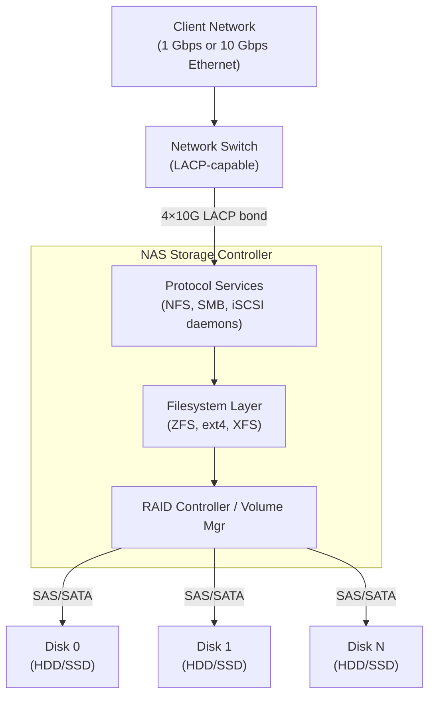
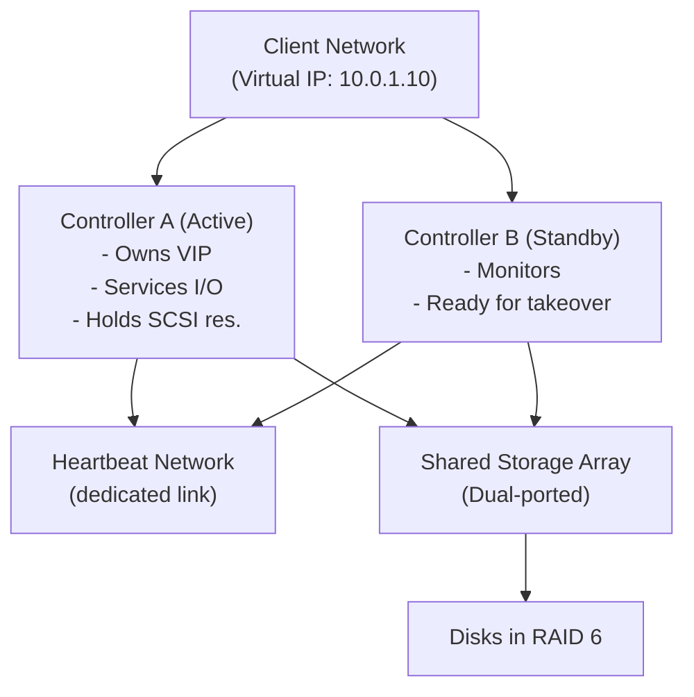
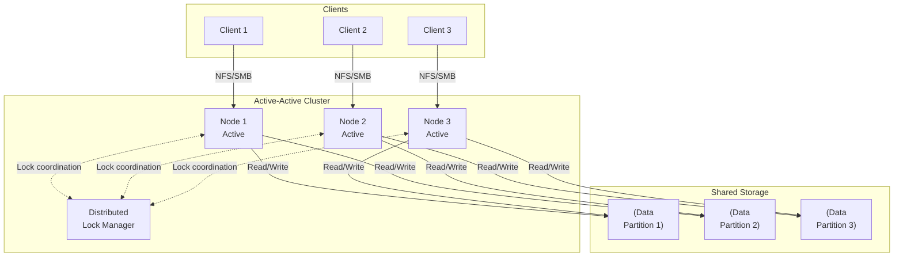
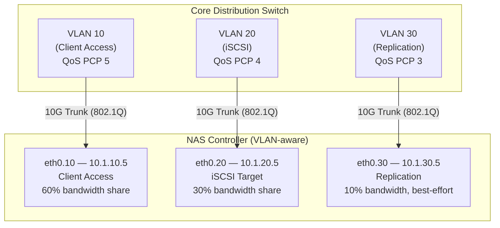

# Lesson 3: NAS Deployment Patterns, Scaling, and High Availability

## 1. First-Principles Intuition & Invariants

Network-attached storage exists in a fundamental tension between two competing invariants: the need for shared access to a unified namespace and the physical reality that storage capacity, bandwidth, and failure domains remain bounded by hardware constraints. A single NAS appliance presents a coherent file system abstraction to dozens or hundreds of clients simultaneously, but this consolidation creates a concentrated point of failure and a performance bottleneck that grows more severe as workload demands increase. The architecture of enterprise NAS systems resolves this tension through replication, clustering, and protocol-level state distribution, transforming what appears to clients as a monolithic storage service into a distributed system with carefully orchestrated failure modes and performance characteristics.

At the foundation of NAS availability design lies the distinction between stateful and stateless protocol operations. NFS, particularly NFSv3, maintains minimal server-side state about open files and client sessions, allowing a replacement server to assume responsibility for a failed node's IP address and storage volumes with only brief interruption to client operations. Clients detect the outage through network timeouts, retry their requests, and resume operations once the replacement server responds. SMB/CIFS, conversely, maintains extensive session state including open file handles, oplocks (opportunistic locks), and client authentication contexts. A server failure invalidates this state, forcing clients to re-establish sessions and reopen files, often surfacing errors to applications that were not designed to handle mid-operation server disappearance. This difference in protocol statefulness fundamentally shapes the complexity and transparency of failover mechanisms.

The mathematical reality of storage system reliability follows from the probabilistic independence of component failures. A single storage controller with an annual failure rate of 2% delivers 98% availability, corresponding to roughly 7.3 days of downtime per year. Adding a second controller in active-passive configuration with automated failover reduces the probability of simultaneous failure to approximately 0.04% (the product of independent failure rates), assuming perfect failure detection and instantaneous failover. Real systems experience additional downtime from network partitions, software bugs, and operator error, but the principle holds: redundancy of stateful components transforms high-probability single-point failures into low-probability scenarios where multiple independent subsystems must fail within overlapping time windows.

Capacity planning for NAS systems requires reasoning about the interaction between storage growth rates, snapshot retention policies, and protocol overhead. A department generating 100 GB of new data monthly while retaining daily snapshots for 30 days does not simply require 3 TB of capacity (100 GB baseline plus 3000 GB of snapshots). Copy-on-write snapshot implementations store only modified blocks, but the rate of block modification varies dramatically by workload. A database with frequent random updates might see 40% of its blocks change daily, while archived documents remain nearly static. The actual capacity requirement emerges from the convolution of write patterns, snapshot frequency, and retention duration, often requiring 50-80% more physical capacity than the logical dataset size to accommodate metadata, fragmentation, and future growth headroom.

Performance optimization in NAS deployments confronts the fundamental asymmetry between sequential and random I/O operations on underlying storage media. Spinning disks deliver 100-200 MB/s of sequential throughput but only 80-150 IOPS of random access, creating a two-orders-of-magnitude performance cliff when workload access patterns shift. Read and write caching in RAM can mask this disparity for working sets that fit in memory, but cache effectiveness depends on temporal and spatial locality that varies unpredictably across mixed workloads. A video editing workflow with large sequential reads exhibits excellent cache hit rates on metadata but poor rates on media files, while a software build system with thousands of small object files and headers shows the inverse pattern. The NAS system cannot a priori know which files merit caching, making cache policy implementation a continuous trade-off between recency and frequency metrics, each optimized for different access patterns.

## 2. Core Architecture & Mechanics

### Single-Node NAS Architecture and Resource Boundaries

A standalone NAS appliance consolidates storage hardware, network interfaces, filesystem management, and protocol services into a single administrative domain. The storage layer typically consists of a RAID controller managing an array of physical disks configured for redundancy (RAID 5, RAID 6, or RAID 10), presenting logical volumes to the upper filesystem layer. Modern deployments increasingly replace hardware RAID controllers with software-defined storage using ZFS or Btrfs, which implement RAID-equivalent redundancy, snapshot capabilities, and data integrity verification through end-to-end checksums. The filesystem layer maintains the directory hierarchy, file metadata, and block allocation structures, while protocol daemons (NFS, SMB, iSCSI) translate client requests into filesystem operations.

Network topology for a single-node NAS typically employs link aggregation (IEEE 802.3ad LACP) to combine multiple physical Ethernet interfaces into a higher-bandwidth logical channel. A NAS with four 10 Gigabit Ethernet interfaces can theoretically deliver 40 Gbps of aggregate throughput, though real-world performance depends on the switch's ability to distribute traffic across member links using a hash function based on source/destination MAC addresses or IP tuples. The link aggregation provides both increased bandwidth and resilience against single link failure, though it does not protect against switch failure or NAS controller failure.



The single-node architecture exhibits clear performance boundaries. Network bandwidth caps the maximum aggregate throughput across all clients: a 40 Gbps bond cannot serve more than approximately 4.5 GB/s even with perfectly parallelized workloads. Storage backend throughput imposes a second ceiling: twelve 7200 RPM SATA drives in RAID 6 might deliver 1.2 GB/s sequential reads but only 1200-1500 IOPS of random writes after RAID parity overhead. The CPU resources consumed by protocol processing, encryption (if enabled), and filesystem operations create a third constraint, particularly visible in SMB workloads that require frequent metadata operations or ACL evaluations. These three boundaries—network, storage, and compute—interact non-linearly, and the actual bottleneck shifts depending on workload characteristics.

### Active-Passive Failover and Shared Storage Architectures

High-availability NAS deployments eliminate the single controller as a point of failure by introducing a second controller that monitors the primary and assumes its identity upon failure. In the active-passive pattern, one controller actively serves client traffic while the standby controller remains idle but continuously monitors the active node's health through heartbeat messages exchanged over a dedicated interconnect. Both controllers connect to the same shared storage backend—either a dual-ported disk array, a SAN volume, or a shared JBOD enclosure—ensuring that either controller can access the complete dataset.

The shared storage architecture requires careful coordination of write operations to prevent data corruption. SCSI reservations provide a hardware-level mutual exclusion mechanism: the active controller registers a reservation on each shared LUN, and the standby controller periodically tests its ability to communicate with the storage devices without disrupting the reservation. If the active controller fails, the standby controller breaks the existing reservation, establishes its own, and imports the filesystem volumes. This process typically completes within 10-30 seconds for well-configured systems, though actual client impact depends on protocol timeouts and retry logic.



IP address failover leverages gratuitous ARP (GARP) to update network topology. The active controller binds a virtual IP address (VIP) to one of its physical interfaces and responds to client requests. Upon takeover, the standby controller configures the VIP on its own interface and broadcasts a GARP packet announcing the new MAC address associated with the VIP. Switches update their MAC address tables, redirecting subsequent traffic to the new active controller. Clients with established TCP connections experience connection resets and must reconnect, but because the VIP remains constant, no client-side reconfiguration is required.

Filesystem consistency during failover depends on journaling or transactional guarantees. A ZFS-based system ensures that all write operations are part of transaction groups committed atomically to disk; an interrupted write operation simply reverts to the last committed state. Ext4 with ordered or data journaling modes provides similar guarantees by ensuring metadata consistency even after unclean shutdown. The new active controller performs a filesystem check (fsck) or imports the ZFS pool, replays any pending journal entries, and mounts the volumes read-write. Clients that were performing writes at the moment of failure observe either completed operations or errors, but never partial or corrupted data due to the filesystem's atomic commit semantics.

### Active-Active Clustering and Cache Coherence

Active-active NAS clusters eliminate the resource waste of idle standby controllers by distributing client traffic across multiple nodes, each actively serving I/O requests. This architecture multiplies aggregate throughput and enables horizontal scaling, but introduces complex challenges around cache coherence and distributed locking. When multiple controllers cache the same file data in RAM and a client writes through one node, the other nodes' cached copies become stale. Without coordination, clients reading through different nodes might observe inconsistent versions of the same file, violating POSIX filesystem semantics.

Clustered filesystems like GPFS, Lustre, or Oracle Cluster File System 2 (OCFS2) address cache coherence through distributed lock managers (DLM). Before a node can read or write a file, it must acquire appropriate locks from the DLM, which tracks which nodes hold which locks and in what modes (shared for reads, exclusive for writes). When a node requests an exclusive lock on a file that other nodes have cached, the DLM sends revocation messages forcing those nodes to flush dirty data and invalidate their cached copies. This lock traffic introduces latency overhead proportional to the contention level: frequently-modified files shared across many nodes trigger cascading invalidations that serialize access and diminish the performance benefits of clustering.

Scale-out NAS architectures like Isilon or Qumulo distribute both data and metadata across cluster nodes, avoiding centralized bottlenecks. A file's data blocks are striped across multiple nodes with configurable protection levels (mirroring or erasure coding), while metadata operations are distributed using consistent hashing or explicit metadata partitions. A client writing a large file might stream data to three different nodes simultaneously, each responsible for a subset of the file's blocks. Read operations similarly parallelize across nodes, delivering aggregate bandwidth that scales nearly linearly with node count for large sequential workloads. Random workloads with small files, however, benefit less because each operation still requires coordination overhead and metadata lookups that cannot be parallelized.



### Replication Strategies and Consistency Models

Replication for disaster recovery or geographic distribution introduces a spectrum of consistency guarantees with corresponding performance trade-offs. Synchronous replication ensures that write operations are not acknowledged to clients until data is safely committed on both primary and replica sites, guaranteeing zero data loss (RPO = 0) but doubling write latency by the round-trip time between sites. A primary NAS in New York replicating synchronously to a site in London incurs approximately 80 milliseconds of additional latency per write operation, rendering this approach impractical for workloads sensitive to write performance or distances beyond metropolitan fiber rings.

Asynchronous replication decouples acknowledgment from replica commit: the primary acknowledges writes after local persistence, then forwards changes to the replica with some delay. This approach preserves local write performance but introduces a recovery point objective (RPO) equal to the replication lag—typically seconds to minutes depending on change rate and network bandwidth. A failure of the primary site before all buffered changes reach the replica results in loss of recent writes. Filesystem-level replication using ZFS send/receive, Btrfs send, or rsync operates at the granularity of snapshots, transmitting block-level deltas between periodic snapshot pairs. A common pattern involves taking hourly snapshots and replicating them asynchronously, yielding an RPO of one hour.

Semi-synchronous replication provides a middle ground: write operations are acknowledged after the primary persists data locally and the replica acknowledges receipt (but not necessarily persistence) of the data. This model bounds data loss to the replica's uncommitted write buffer—typically a few seconds—while avoiding the full round-trip latency of synchronous replication. NetApp SnapMirror, Dell EMC RecoverPoint, and similar enterprise replication technologies implement variants of this approach with configurable consistency guarantees.

The consistency model visible to applications depends on how the NAS system orders replicated operations. Crash consistency, the weakest model, ensures only that the replica state corresponds to some valid point-in-time snapshot of the primary, equivalent to the state after an unclean shutdown. Applications must be resilient to journal replay and potential rollback of in-flight transactions. Application consistency requires integration with the applications themselves: the replication system must coordinate with databases, virtual machines, or other stateful services to quiesce writes, flush buffers, and capture a coherent snapshot. This coordination typically uses volume shadow copy services (VSS) on Windows or filesystem freeze operations on Linux, ensuring that the replica can be cleanly mounted and activated without corruption.

## 3. High-Performance Optimization & Failure Modes

### Network Topology and Quality of Service Configuration

Enterprise NAS deployments integrate into complex network topologies with multiple VLANs segregating different traffic classes. Storage networks are typically isolated from general-purpose user traffic on dedicated VLANs to prevent noisy-neighbor effects where backup jobs or bulk data transfers congest the network and impact latency-sensitive workloads. A common pattern involves separate VLANs for NFS/SMB client access, iSCSI block traffic, management interfaces, and replication/backup streams. Switches implementing 802.1Q VLAN tagging encapsulate frames with 4-byte tags specifying the VLAN identifier, and NAS controllers bind multiple virtual interfaces to a single physical port, each associated with a different VLAN.

Quality of Service (QoS) mechanisms prioritize latency-sensitive traffic over throughput-oriented bulk transfers. IEEE 802.1p specifies 3-bit priority code points (PCP) embedded in the VLAN tag, defining eight priority levels from background (PCP 0) to network control (PCP 7). Production NAS deployments typically assign interactive file access to PCP 4 or 5, bulk backup traffic to PCP 2, and replication streams to PCP 3. Network switches inspect these priority tags and implement weighted fair queueing or strict priority scheduling to ensure that high-priority traffic receives preferential access to link bandwidth during congestion.



Jumbo frames (MTU 9000 bytes instead of the standard 1500) reduce CPU overhead and improve throughput for bulk transfers by decreasing the packet-per-byte ratio. A 64 KB write operation fragmented into 1500-byte MTU requires 44 packets, each incurring per-packet processing overhead in the NIC, kernel protocol stack, and switch. With 9000-byte jumbo frames, the same transfer requires only 8 packets, reducing interrupt load and switch buffer occupancy. Jumbo frames must be enabled consistently across all network segments between clients and storage; a single device with standard MTU fragments packets and negates the benefit. NAS performance tuning typically enables jumbo frames on dedicated storage VLANs while leaving client-facing VLANs at standard MTU to accommodate heterogeneous client configurations.

Network flow control prevents buffer overflows in converged Ethernet environments where storage and general traffic share infrastructure. IEEE 802.3x PAUSE frames allow a congested receiver to temporarily halt transmission from the sender, preventing packet drops. Data Center Bridging (DCB) extensions including Priority Flow Control (802.1Qbb) provide per-priority-class flow control, enabling iSCSI traffic to trigger back-pressure without blocking unrelated traffic classes. However, excessive flow control can create head-of-line blocking where slow receivers stall faster flows, making careful QoS policy design essential.

### Capacity Planning and Storage Efficiency Technologies

Accurate capacity forecasting requires modeling the interaction between logical data growth, snapshot retention, deduplication effectiveness, and filesystem overhead. The logical capacity—the sum of all file sizes visible to users—represents only the starting point. Copy-on-write snapshots consume additional space proportional to the rate of data modification: a 10 TB dataset with 5% daily change rate and 30-day snapshot retention requires approximately 10 TB (baseline) + (10 TB × 0.05 × 30) = 25 TB of physical capacity, assuming no data sharing between snapshots. Real-world snapshot consumption varies dramatically: databases with frequent updates consume snapshot space at 80-120% of the logical data size per retention period, while archived media files consume less than 5%.

Deduplication identifies and eliminates redundant data blocks, storing a single physical copy of each unique block and maintaining reference counts. Effectiveness depends critically on workload characteristics. Virtual machine deployments with multiple instances of the same operating system image achieve 20:1 to 50:1 deduplication ratios because the base OS files are identical across VMs. Software development environments with numerous branches of similar codebases might achieve 3:1 to 5:1 ratios. Unique user-generated content like high-resolution photographs or encrypted backups offers negligible deduplication benefit because each file is statistically unique.

Inline deduplication processes writes synchronously, computing block hashes and consulting the deduplication table before acknowledging client writes. This approach maximizes space savings but introduces write latency proportional to hash computation and table lookup costs—typically 20-50% additional latency for 4 KB block granularity. Post-process deduplication writes data initially in non-deduplicated form, then asynchronously scans for duplicates during idle periods. Write latency remains unaffected, but space savings lag behind data ingestion, requiring 10-20% additional capacity headroom to accommodate temporarily duplicated data awaiting post-process analysis.

```text
Sample Capacity Planning Calculation:

Given:
- Logical dataset: 50 TB
- Monthly growth rate: 8% (4 TB/month)
- Snapshot retention: 90 days (daily snapshots)
- Average daily change rate: 3%
- Deduplication ratio: 4:1 (VM environment)
- Filesystem metadata overhead: 2%

Computation:
1. Baseline capacity (post-dedup): 50 TB / 4 = 12.5 TB
2. Daily snapshot delta: 50 TB × 0.03 = 1.5 TB logical
3. 90-day snapshot consumption: 1.5 TB × 90 = 135 TB logical
4. Snapshot capacity (post-dedup): 135 TB / 4 = 33.75 TB
5. Total before metadata: 12.5 TB + 33.75 TB = 46.25 TB
6. Metadata overhead: 46.25 TB × 0.02 = 0.93 TB
7. Total physical capacity: 46.25 TB + 0.93 TB = 47.18 TB

With 20% growth headroom: 47.18 TB × 1.20 = 56.6 TB
Recommended provision: 60 TB usable capacity
```

Compression complements deduplication by reducing the size of unique blocks. Text files, log data, and structured datasets compress at 2:1 to 4:1 ratios using LZ4 or zstd algorithms, while multimedia files (JPEG, MP4, MP3) are already compressed and yield negligible benefit. Adaptive compression algorithms like ZFS's configurable compression levels allow administrators to trade CPU overhead against space savings: LZ4 offers minimal CPU cost with moderate savings, while zstd at higher levels delivers superior compression at the expense of increased CPU utilization. Inline compression on write paths is generally acceptable for text-heavy workloads but may bottleneck video editing or other high-throughput sequential write patterns.

### Performance Tuning and Workload-Specific Optimization

Read caching exploits temporal and spatial locality by retaining frequently accessed data in RAM. The ZFS Adaptive Replacement Cache (ARC) implements a dual-queue structure tracking both recency (LRU - Least Recently Used) and frequency (LFU - Least Frequently Used) to balance protection against scan-resistant workloads. A large backup job reading sequentially through the entire dataset would evict the entire LRU cache if naively implemented, destroying hit rates for interactive workloads. The ARC's ghost lists track recently evicted blocks without storing their data, allowing the algorithm to detect when LFU-evicted blocks are accessed more frequently than LRU blocks, dynamically adjusting the balance between the two policies.

Write caching using non-volatile memory (NVRAM) or battery-backed DRAM allows the NAS to acknowledge write operations after committing to persistent cache rather than waiting for slow disk writes. This transforms write latency from disk-bound (5-15 milliseconds for spinning drives) to cache-bound (50-200 microseconds), a 50-100× improvement. ZFS Intent Log (ZIL) and NVDIMM-based write caching provide crash consistency by ensuring that acknowledged writes survive power loss. Upon recovery from unexpected shutdown, the system replays the ZIL or NVDIMM contents to restore all acknowledged writes. Cache sizing must account for peak write burst rates: a workload sustaining 500 MB/s writes during batch processing periods requires a minimum cache size of (500 MB/s × flush_interval_seconds) to avoid overflow and synchronous write stalls.

Protocol tuning dramatically affects performance for specific workloads. NFS performance benefits from increasing the read and write sizes (rsize and wsize mount options) to match the NAS server's maximum supported values, typically 1048576 bytes. Larger transfer sizes reduce per-operation overhead but increase the impact of packet loss or corruption. The async mount option (for NFSv3) allows the NAS to acknowledge writes before committing to stable storage, trading safety for performance in environments where client-side caching and application-level checkpoints provide sufficient data protection. SMB multichannel (SMB 3.0+) enables simultaneous use of multiple network paths between client and server, multiplying throughput for clients with multiple network interfaces and improving fault tolerance through transparent path failover.

Workload isolation prevents interference between competing I/O patterns. A mixed environment with latency-sensitive database workloads and throughput-oriented backup jobs experiences degraded database performance when the two share storage pools. Spinning disk drives exhibit extreme latency variance when servicing mixed random and sequential operations: the seek time penalty for switching between random database I/O and sequential backup I/O can reach 10-20 milliseconds per operation. Isolating workloads onto separate storage pools, LUNs, or separate physical disk sets eliminates this interference. For systems using SSDs or all-flash arrays, the physical isolation becomes less critical, but logical isolation using storage QoS policies remains valuable to prevent runaway processes from consuming all available IOPS.

### Failure Mode Analysis and Operational Resilience

Split-brain conditions arise in active-passive clusters when network partitions prevent heartbeat communication but both controllers remain operational and retain access to shared storage. Without coordination, both nodes may simultaneously attempt to mount filesystems read-write, leading to catastrophic data corruption as conflicting writes destroy metadata structures. STONITH (Shoot The Other Node In The Head) fencing mechanisms prevent this scenario by ensuring that a node suspecting its peer has failed first confirms the peer is truly dead—either through power management interfaces (IPMI), network switch port disabling, or SAN-level LUN masking—before assuming the active role. The requirement for reliable fencing infrastructure introduces additional hardware dependencies: BMC (Baseboard Management Controller) interfaces, switched PDUs, or SAN fabric zoning configurations.

Backup infrastructure failures create hidden data loss risks that only materialize during disaster recovery attempts. A common anti-pattern involves relying on a single backup repository that accumulates years of snapshots without independent verification. Silent corruption in the backup storage system, expired retention policies accidentally deleting critical restore points, or misconfigured backup software failing to capture application-consistent snapshots remain undetected until restoration is attempted. Best practice implements the 3-2-1 rule: three copies of data (production, local backup, remote backup), two different storage media types (disk and tape, or disk and cloud), and one off-site copy. Periodic restore testing exercises the entire recovery procedure under realistic failure scenarios, validating both technical capability and procedural documentation.

Network-level failures in multi-site replication scenarios require careful analysis of failover semantics. When a site-to-site VPN or dedicated WAN link fails, the primary site continues serving production traffic but cannot replicate to the disaster recovery site, increasing RPO risk. Automated failover to the DR site would be incorrect—the primary remains functional and contains more recent data. The correct operational response involves continuing production at the primary while urgently restoring replication connectivity. If the primary site subsequently fails during the replication outage window, data loss equals the accumulated change during the replication blackout period. Organizations with strict RPO requirements deploy redundant WAN links via diverse carriers and routing paths, ensuring that site-level reachability failures require simultaneous independent link failures.

Storage capacity exhaustion triggers cascading failures across dependent systems. When a filesystem reaches 100% full, all write operations fail, affecting not only user data but also metadata operations, snapshot creation, and replication processes. Applications without defensive quota checking abort transactions, leave temporary files orphaned, or enter inconsistent states requiring manual intervention. ZFS and Btrfs reservation mechanisms allow administrators to withhold a percentage of capacity from user allocation, guaranteeing headroom for critical system operations and emergency cleanup. Setting a 5-10% reserved capacity threshold provides sufficient buffer for administrators to diagnose capacity issues, extend volumes, or delete obsolete snapshots before user-visible impact occurs. Monitoring systems should trigger alerts at 80% utilization, providing adequate warning time for capacity planning and procurement processes.

Human operational errors—accidental file deletions, misconfigured replication policies, incorrect failover procedures—cause more data loss incidents than hardware failures in well-designed NAS environments. Immutable snapshots with sufficient retention depth (30-90 days) provide protection against accidental deletions and malicious encryption (ransomware). Role-based access controls restricting snapshot deletion and replication policy modification to senior infrastructure staff reduce the probability of configuration errors. Comprehensive change management processes requiring peer review and testing in non-production environments before applying configuration changes to production NAS systems add overhead to operational workflows but dramatically reduce the frequency of catastrophic mistakes. The discipline of treating infrastructure-as-code—version controlling NAS configurations, ZFS pool definitions, and replication policies in Git repositories—enables rapid recovery from misconfigurations by reverting to known-good states and provides audit trails for post-incident analysis.
