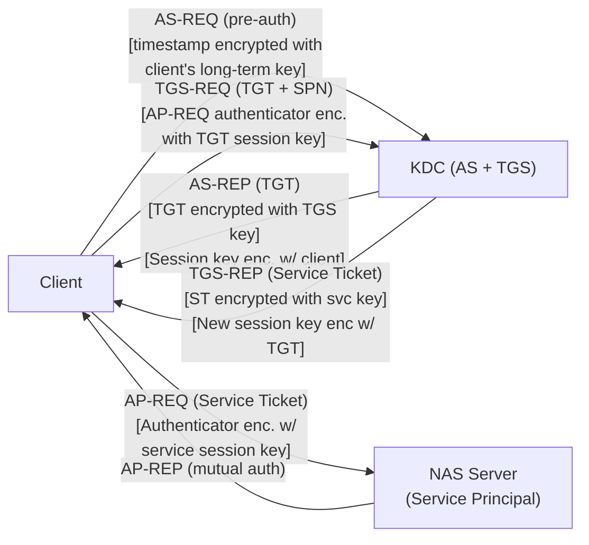

# Lesson 4: Security, Access Control, and Operational Excellence

## 1. First-Principles Intuition & Invariants

A network-attached storage system is, at its architectural core, a trust boundary. Every byte of data flowing across its interfaces crosses from one security domain into another, and every identity asserting access to a share represents a claim that the system must verify before it can safely honor. What distinguishes a production NAS deployment from a naively configured file server is precisely the rigor with which that boundary is enforced. Security on a NAS is not a feature you bolt on after the fact; it is a property that emerges from deliberate decisions at the identity layer, the transport layer, the storage layer, and the operational layer simultaneously.

The fundamental security invariants of any multi-tenant NAS system reduce to three axiomatic properties. First, identity must be externally authoritative: no user credential should be defined or owned solely by the NAS appliance itself, because a closed identity system cannot participate in enterprise-wide revocation workflows or cross-service single sign-on. Second, authorization must be explicit: a subject possesses access to a resource only when a policy grants it, never by default or by omission. Third, confidentiality must be layered: data must be unreadable to an adversary whether the attack surface is a network tap between client and server, a stolen disk removed from the array, or a compromised hypervisor reading raw storage pages. These three invariants — authoritative identity, explicit authorization, layered confidentiality — govern every architectural decision we explore in this lesson.

Understanding why these properties are difficult to achieve requires grounding them in the actual protocols and kernel subsystems that NAS storage runs on. When a Linux client mounts an NFS share, the kernel's RPC layer sends a credential embedded in each request. In NFSv3, that credential is a raw UID/GID pair asserted by the client's kernel with no cryptographic verification, which means any client with root access can forge any identity by simply setting its effective UID. This is not a bug; it is the documented NFSv3 security model, and it explains why NFSv3 environments were traditionally confined to trusted private networks. NFSv4 with RPCSEC_GSS and Kerberos replaces this honor-system identity model with a cryptographically signed ticket that the KDC issued to a verified principal, eliminating the impersonation surface entirely. SMB's evolution tells a similar story: NTLMv1 used a 56-bit DES challenge-response that falls to brute force in minutes on modern hardware; NTLMv2 improved the hash construction but remains vulnerable to relay attacks; Kerberos over SMB3 solves relay attacks through mutual authentication where both client and server prove identity to each other before any data moves.

The practical implication for infrastructure architects is that the choice of NFS version or SMB dialect is not primarily a performance decision — it is a security posture decision. Performance differences between NFSv3 and NFSv4.1 with pNFS are real but measurable; the difference in the attack surface is categorical.

## 2. Core Architecture & Mechanics

### Identity: LDAP Directory Integration

The first structural component of NAS security is the identity provider. LDAP (Lightweight Directory Access Protocol) is the wire protocol through which NAS appliances — whether TrueNAS SCALE, NetApp ONTAP, or a custom Linux NFS server — resolve user and group identities against an authoritative directory such as Microsoft Active Directory or OpenLDAP.

The LDAP data model is a hierarchical tree called the Directory Information Tree (DIT). Every object in the tree has a Distinguished Name (DN) that encodes its full path, such as `cn=alice,ou=engineers,dc=corp,dc=example,dc=com`. NAS appliances use LDAP queries to map a username string to a UID/GID pair that the underlying POSIX filesystem can apply to inodes and ACL entries. When a user authenticates to a Samba-based NAS joined to Active Directory, the winbind daemon issues LDAP queries against the nearest AD domain controller to retrieve the user's SID, which is then mapped to a local UID through either idmap_rid (algorithmic mapping from the RID portion of the SID) or idmap_ad (reading uidNumber attributes explicitly stored in AD).

The following `sssd.conf` configuration wires a Linux-based NAS node into an Active Directory domain using SSSD, which caches LDAP lookups locally and survives short domain controller outages:

```ini
[sssd]
services = nss, pam
domains = corp.example.com

[domain/corp.example.com]
id_provider = ad
auth_provider = ad
access_provider = ad
ad_domain = corp.example.com
ad_server = dc01.corp.example.com, dc02.corp.example.com
krb5_realm = CORP.EXAMPLE.COM
ldap_id_mapping = true
ldap_schema = ad
cache_credentials = true
krb5_store_password_if_offline = true
default_shell = /bin/bash
fallback_homedir = /home/%u@%d
use_fully_qualified_names = false
```

The `ldap_id_mapping = true` directive enables algorithmic UID/GID generation from the AD SID, eliminating the need to extend the AD schema with POSIX attributes. SSSD computes a consistent hash from the SID that maps to a UID in a configurable range (by default 200000–2147483647), so the same username always resolves to the same UID across all NAS nodes in the cluster without any centralized UID database.

For OpenLDAP in environments not running Active Directory, the NAS node queries the directory over LDAP and must do so over a TLS-encrypted connection. Never deploy LDAP over port 389 without StartTLS on a production NAS; the bind credentials and all queried attributes, including group memberships, flow in cleartext. The correct deployment uses LDAPS on port 636 or LDAP with STARTTLS enforced at the client. The certificate chain validation for the LDAP connection must be anchored to the enterprise CA; accepting self-signed certificates silently opens the system to man-in-the-middle substitution of directory data.

### Authentication: Kerberos Mechanics

Kerberos is the authentication substrate that transforms "this client claims to be alice" into "this client cryptographically proved to the KDC that it holds alice's secret, and the KDC issued a time-limited proof." Understanding Kerberos from first principles requires tracing the three-phase exchange precisely.



The critical security property here is that the NAS server never contacts the KDC during the AP-REQ phase. It decrypts the service ticket using its own long-term key (the keytab), extracts the session key, and uses that to verify the authenticator's freshness timestamp. The 5-minute clock skew tolerance is not arbitrary; it closes replay attack windows while accommodating real-world NTP drift. If the NAS node's clock drifts beyond this window, all Kerberos authentication silently fails with `KRB5KRB_AP_ERR_SKEW`, which is why NTP synchronization to the same stratum as the KDC is a hard operational dependency.

Deploying Kerberos-authenticated NFS requires generating a keytab for the NFS service principal and distributing it to each NAS node. On a Linux NAS server joined to FreeIPA:

```bash
# On the IPA server, create the NFS service principal
ipa service-add nfs/nas01.corp.example.com@CORP.EXAMPLE.COM

# Retrieve the keytab to the NAS node
ipa-getkeytab -s ipa.corp.example.com \
              -p nfs/nas01.corp.example.com@CORP.EXAMPLE.COM \
              -k /etc/krb5.keytab

# Verify the keytab contents
klist -k /etc/krb5.keytab
```

The `/etc/exports` on the NAS must then require Kerberos integrity or privacy at the protocol level:

```bash
/exports/engineering  192.168.10.0/24(rw,sync,sec=krb5p,root_squash,no_subtree_check)
/exports/public       192.168.10.0/24(ro,sync,sec=krb5,root_squash,no_subtree_check)
```

The `sec=` parameter accepts three values that form a strict security hierarchy. `krb5` authenticates the initial connection but sends data unauthenticated. `krb5i` adds integrity checksums (using AES-256-CTS-HMAC-SHA1-96 by default in modern implementations) to every RPC message, detecting any tampering in transit. `krb5p` adds full encryption on top of integrity protection, preventing passive interception. The engineering share demands `krb5p`; the performance cost is a CPU overhead of roughly 3–8% for AES-NI-capable hosts, which is acceptable for the security guarantee it delivers. For latency-sensitive workloads like database transaction logs, engineers sometimes tolerate `krb5i` as a compromise that proves integrity without paying the full encryption overhead.

### SMB3 with Active Directory

For Windows clients and cross-platform environments, Samba 4 acting as an Active Directory member server provides SMB3 with Kerberos authentication. The Samba configuration that enables SMB3 encryption on a share-by-share basis:

```ini
[global]
    workgroup = CORP
    realm = CORP.EXAMPLE.COM
    security = ADS
    kerberos method = secrets and keytab
    dedicated keytab file = /etc/krb5.keytab
    winbind use default domain = yes
    winbind offline logon = yes
    idmap config * : backend = tdb
    idmap config * : range = 10000-19999
    idmap config CORP : backend = rid
    idmap config CORP : range = 20000-9999999
    server min protocol = SMB3_00
    smb encrypt = required
    ntlm auth = no
    lanman auth = no

[engineering-data]
    path = /exports/engineering
    valid users = @CORP\engineers, @CORP\architects
    read only = no
    create mask = 0660
    directory mask = 0770
    force group = engineers
    smb encrypt = required
```

Setting `ntlm auth = no` and `lanman auth = no` forces all authentication through Kerberos, eliminating the NTLM relay attack surface entirely. The `server min protocol = SMB3_00` directive refuses connections from SMB1 or SMB2 clients, which is correct: SMB1 (CIFS) has known critical vulnerabilities (EternalBlue, MS17-010) and must never be enabled on a production NAS.

### Encryption at Rest

Encrypting data at rest addresses the threat of physical media theft. When a drive is pulled from a NAS enclosure — an event that occurs during routine hardware replacement, unauthorized physical access, or end-of-life disposal — full-disk encryption renders the data unreadable without the key material. The two dominant approaches are hardware-based Self-Encrypting Drives (SEDs) and software-based encryption through dm-crypt/LUKS in the Linux kernel.

SEDs implement AES-256 encryption in the drive controller's firmware, using an internal media encryption key (MEK) that never leaves the drive. Access control uses a separate authentication credential (the drive's SED password or TCG Opal unlock key) that the host must supply at startup to authorize the drive controller to operate on the MEK. The critical subtlety is that "erasing" an SED requires only changing the MEK, which the drive can do in milliseconds, rendering all previous data permanently irrecoverable. This makes SEDs operationally elegant for rapid data destruction workflows but requires careful key management: if the unlock credential is lost, the data is gone with the same finality as a MEK change.

Linux dm-crypt with LUKS (Linux Unified Key Setup) provides software-layer encryption that is independent of drive hardware and therefore auditable, portable, and open to inspection. LUKS stores up to eight key slots in a standardized header, each containing the volume master key encrypted with a different passphrase or key file. This allows multiple operators to unlock the volume independently without sharing the master key. The header also records the cipher specification (by convention AES-XTS-PLAIN64 for block devices, using AES-256 in XTS mode with a 512-bit key split into two 256-bit halves for the XTS tweak and cipher operations).

```bash
# Create a LUKS2 container on a raw device using AES-256-XTS
cryptsetup luksFormat --type luks2 \
    --cipher aes-xts-plain64 \
    --key-size 512 \
    --hash sha256 \
    --iter-time 5000 \
    --label nas-data-01 \
    /dev/sdb

# Open the encrypted device
cryptsetup luksOpen /dev/sdb nas-data-01

# Add a slot for a hardware key file stored in a TPM or HSM
cryptsetup luksAddKey /dev/sdb --key-slot 1 /etc/security/nas-keyfile

# Inspect the LUKS header
cryptsetup luksDump /dev/sdb
```

The `--iter-time 5000` parameter controls PBKDF2 iteration count, calibrating it so the KDF takes approximately 5000ms on the current hardware during key derivation. LUKS2 defaults to Argon2id, which is preferable for new deployments because Argon2id is memory-hard, dramatically increasing the cost of GPU-based dictionary attacks against captured LUKS headers.

For NAS clusters where automated boot without operator intervention is required, the LUKS master key can be escrowed in a Clevis/Tang setup: the Tang server holds a portion of the key derivation material, and the NAS node uses a network-based key agreement protocol (José/JWE) to reconstruct the decryption key at boot without transmitting the master key across the network. This solves the operational paradox of "headless encrypted boot" without reverting to storing the key in plaintext on the boot media.

### Encryption in Transit: TLS for Management and Protocol Encryption

Beyond Kerberos-authenticated NFS and SMB3 encryption, NAS management interfaces must enforce TLS everywhere. The TrueNAS web UI, NetApp System Manager, and similar interfaces that accept API calls or administrative sessions must present valid TLS certificates signed by the enterprise CA. Browsers and infrastructure automation tools can then validate the certificate chain, preventing credential capture through HTTPS interception.

For iSCSI block storage, which does not carry Kerberos natively, authentication uses the Challenge Handshake Authentication Protocol (CHAP) with mutual authentication where the target also authenticates itself to the initiator. This prevents a rogue storage target from accepting initiator connections and capturing authentication material. CHAP credentials must be rotated on a regular schedule and must never be shared across initiator groups.

## 3. High-Performance Optimization & Failure Modes

### Audit Logging Architecture

Audit logging on a NAS system must answer three classes of forensic question: who accessed what data and when, who changed which configuration and from where, and what anomalous access patterns preceded a security incident. These questions demand different log streams that must be architected independently.

For NFS servers, kernel-level audit logging flows through the Linux Audit framework (`auditd`). The following rules capture all file opens, permission changes, and ownership changes on the exported filesystem:

```bash
# /etc/audit/rules.d/nas-access.rules

# Audit all opens of files in the engineering export with write intent
-a always,exit -F arch=b64 -F dir=/exports/engineering -S open -F a1&0100 -k nas_write_access
-a always,exit -F arch=b64 -F dir=/exports/engineering -S openat -F a1&0100 -k nas_write_access

# Audit chmod, chown, setxattr on all exports
-a always,exit -F arch=b64 -F dir=/exports -S chmod -S fchmod -S fchmodat -k nas_perm_change
-a always,exit -F arch=b64 -F dir=/exports -S chown -S fchown -S fchownat -k nas_owner_change
-a always,exit -F arch=b64 -F dir=/exports -S setxattr -S lsetxattr -S fsetxattr -k nas_attr_change

# Audit deletions
-a always,exit -F arch=b64 -F dir=/exports -S unlink -S unlinkat -S rename -S renameat -k nas_deletion
```

The `-F a1&0100` filter matches the `O_WRONLY` flag bit, capturing only write-intent opens rather than flooding the log with read operations. For high-throughput NAS nodes serving thousands of concurrent clients, logging every read is operationally impractical; auditing writes, deletes, and attribute changes captures the events that matter for data integrity investigations.

Audit events must be shipped off the NAS node in near-real-time to a tamper-evident log aggregator. If the NAS node is compromised, local audit logs can be manipulated; a forwarded stream that the attacker cannot reach is the forensic record that survives the incident. The standard approach uses `audisp-remote` to forward events over an encrypted TLS channel to a central syslog collector (typically a SIEM like Elasticsearch/Kibana or Splunk):

```bash
# /etc/audisp/plugins.d/au-remote.conf
active = yes
direction = out
path = /sbin/audisp-remote
type = always
args = 10.0.1.50
format = string
```

For Samba/SMB audit logging, the `vfs_full_audit` module captures share-level operations at the VFS layer with configurable per-share granularity:

```ini
[engineering-data]
    path = /exports/engineering
    vfs objects = full_audit acl_xattr
    full_audit:prefix = %u|%I|%m|%S
    full_audit:success = open opendir read pread write pwrite rename unlink mkdir rmdir
    full_audit:failure = open connect
    full_audit:facility = LOCAL7
    full_audit:priority = NOTICE
```

The `%u|%I|%m|%S` prefix encodes the authenticated username, client IP address, machine name, and share name into every log entry, providing the attribution data that forensic analysis requires.

### Backup and Disaster Recovery

A NAS backup strategy must be designed around two parameters that have an inverse relationship: the Recovery Point Objective (RPO), which defines the maximum acceptable data loss measured as time between the last good backup and the failure event, and the Recovery Time Objective (RTO), which defines the maximum acceptable duration before the system returns to service. A financial institution might demand an RPO of 15 minutes and an RTO of one hour; a development NAS might tolerate an RPO of 24 hours and an RTO of four hours. The architecture you deploy must be engineered to meet these parameters under realistic failure modes, not just the best-case scenario.

ZFS provides the most operationally clean backup substrate for Linux-based NAS systems because its snapshot mechanism is both atomic and storage-efficient. A ZFS snapshot captures the state of an entire dataset at the moment `zfs snapshot` executes, consuming no additional space initially and only accumulating space as the original dataset diverges from the snapshot state through subsequent writes. This write-time copy-on-write accounting means that snapshots are instantaneous, and a consistent point-in-time view of the filesystem requires no quiescing, flushing, or application coordination.

```bash
# Create a recursive snapshot of all datasets under the engineering pool
zfs snapshot -r tank/exports/engineering@2024-01-15T14:30:00Z

# List snapshots with space consumption breakdown
zfs list -t snapshot -o name,used,referenced,creation tank/exports/engineering

# Send an incremental snapshot stream to a remote DR site
zfs send -R -i tank/exports/engineering@2024-01-15T06:00:00Z \
            tank/exports/engineering@2024-01-15T14:30:00Z \
  | mbuffer -s 128k -m 1G \
  | ssh -c aes256-gcm@openssh.com -p 22 dr-nas.corp.example.com \
    "zfs receive -F tank/dr-engineering"
```

The `zfs send -R` flag sends the full replication stream including all descendant datasets and their associated property metadata, ensuring the replica is structurally identical to the source. The `mbuffer` stage smooths out the bursty I/O that ZFS send produces, preventing SSH from experiencing stalls that cause it to close the connection. The SSH cipher is explicitly set to `aes256-gcm@openssh.com`, which is an AEAD cipher that provides both encryption and integrity verification and is typically hardware-accelerated through AES-NI.

For automated backup workflows, `zfs-auto-snapshot` or the more configurable `sanoid` (which also manages replication through `syncoid`) is the production standard:

```ini
# /etc/sanoid/sanoid.conf

[tank/exports/engineering]
    use_template = production
    recursive = yes

[template_production]
    frequently = 0
    hourly = 24
    daily = 30
    monthly = 12
    yearly = 2
    autosnap = yes
    autoprune = yes
```

```bash
# Run syncoid to push to DR target
syncoid --recursive \
        --compress lz4 \
        --source-bwlimit 500m \
        tank/exports/engineering \
        dr-nas.corp.example.com:tank/dr-engineering
```

Backup integrity must be validated on a schedule, not assumed. A backup process that runs successfully for months may produce corrupted or incomplete replicas due to silent bit rot on the backup media, ZFS send stream truncation, or receive-side errors that were not propagated back to the monitoring system. The validation procedure for a ZFS-based backup must periodically perform a `zfs scrub` on the replica pool, verify that the most recent snapshot timestamp matches the expected replication interval, and conduct periodic restore tests by mounting a snapshot from the replica and verifying file checksums against the source.

```bash
# On the DR site: initiate scrub on replica pool
zfs scrub tank/dr-engineering

# Check scrub status
zpool status tank/dr-engineering

# Spot-check a restore: clone a snapshot into a temporary dataset
zfs clone tank/dr-engineering/exports/engineering@2024-01-15T14:30:00Z \
          tank/restore-test/engineering-20240115

# Verify file integrity against checksums captured from source
# (checksums stored externally, e.g., in a CMDB or S3)
sha256sum -c /var/lib/backup-checksums/engineering-20240115.sha256sum \
  --basedir /tank/restore-test/engineering-20240115
```

### Monitoring NAS Health

NAS operational health divides into four signal domains: filesystem health, hardware health, network path health, and security health. Each demands dedicated instrumentation, and each has failure modes that the others will not detect.

Filesystem health on a ZFS-based NAS is monitored through pool status, scrub schedules, and I/O error counters. ZFS maintains per-vdev read, write, and checksum error counters that increment whenever the RAID subsystem corrects or fails to correct a data integrity error. A checksum error that ZFS corrects is a recoverable event that should trigger an alert for investigation; an uncorrectable error in a RAIDZ2 pool typically means two drives in the same RAIDZ group have failed simultaneously and the pool is operating in a degraded-and-uncorrectable state that immediately risks data loss.

```bash
# Parse pool health into a Prometheus-compatible exposition format
# using the zpool_exporter or by scripting zpool status parsing

zpool status -v tank | grep -E "state:|errors:|scan:"
```

For production environments, the Prometheus `node_exporter` with the ZFS collector (`--collector.zfs`) exposes the full ZFS ARC statistics, pool I/O rates, and vdev error counters as Prometheus metrics, which can then feed Grafana dashboards and Alertmanager rules.

Hardware health requires monitoring disk SMART attributes, enclosure temperatures, fan speeds, and power supply redundancy. `smartmontools` provides automated SMART testing and threshold monitoring:

```bash
# /etc/smartd.conf

# Monitor all ATA/SCSI drives, run short self-test every day at 02:00,
# run long self-test every Sunday at 03:00,
# email alerts on health failure or 50 new pending sectors
DEVICESCAN -a \
           -s S/../.././02 \
           -s L/../../7/03 \
           -C 197+ \
           -U 198+ \
           -m nas-alerts@corp.example.com \
           -M exec /usr/local/bin/notify-opsgeenie.sh
```

SMART attribute 197 (Current Pending Sector Count) and attribute 198 (Uncorrectable Sector Count) are the two most reliable early indicators of imminent drive failure. A drive with zero pending sectors that suddenly accumulates 50 within a 24-hour window is statistically unlikely to survive a full self-test, and replacing it before it fails entirely is always preferable to discovering its failure during a pool resilver that stresses every remaining drive in the vdev.

Network path health for NAS must monitor both the data plane and the management plane. On a NAS node with 25GbE bonded interfaces in LACP, the bond interface's operational state must be checked to ensure all physical members are active:

```bash
# Check LACP bond state
cat /proc/net/bonding/bond0

# Monitor interface errors with ethtool
ethtool -S ens3f0 | grep -E "rx_errors|tx_errors|rx_missed|rx_no_buffer"

# Track NFS server statistics
nfsstat -s

# Track RPC errors and retransmissions
nfsstat -rc
```

The `nfsstat -rc` output is particularly diagnostic: a climbing retransmit counter means NFS clients are not receiving responses within their timeout window and are resending requests, which typically indicates either network packet loss or NFS server thread exhaustion. When NFS server threads are exhausted, new RPC requests queue in the kernel's sunrpc socket buffer until a thread becomes available; the client's RPC timeout fires before the queued request is served, triggering a retransmit that doubles the server's load, which is a classic feedback loop leading to cascading service degradation. The correct response is to increase the NFS thread count (`/proc/fs/nfsd/threads`) and investigate which client or workload is generating the saturation.

Security health monitoring closes the loop between the access control architecture we built and the operational confidence that it is functioning as designed. The monitoring checklist for a production NAS encompasses verifying that Kerberos ticket renewal is functioning by checking `klist` for valid service tickets, that SSSD's LDAP cache is current by confirming the `sssd_be` process last bound to the domain controller within the expected cache TTL, that audit log forwarding is not dropping events by comparing the `auditd` event counter on the NAS against the event count in the SIEM, and that LUKS-encrypted volumes have not been silently re-keyed or had key slots added without an authorized change management record.

Combining these signal domains into a unified observability stack requires a Prometheus scrape configuration that pulls from `node_exporter` (ZFS, disk, network), `smartd_exporter` (SMART attributes), and a custom exporter for Kerberos and SSSD health, feeding a Grafana dashboard that surfaces any of the following conditions as immediate pages: pool degraded or faulted, drive SMART status prefail, bond member down, NFS retransmit rate above threshold, audit log pipeline gap exceeding five minutes, and SSSD offline authentication mode active. Each of these conditions represents a failure mode that could either cause data loss, enable unauthorized access, or prevent forensic reconstruction of a security incident, and all of them are detectable with instrumentation that costs nothing to operate beyond the initial deployment investment.

The discipline of NAS operational excellence is ultimately the discipline of treating storage infrastructure with the same engineering rigor as compute infrastructure: every invariant tested, every failure mode anticipated, every security boundary formally defined, and every operational procedure validated against the actual disaster scenarios it is meant to survive.
