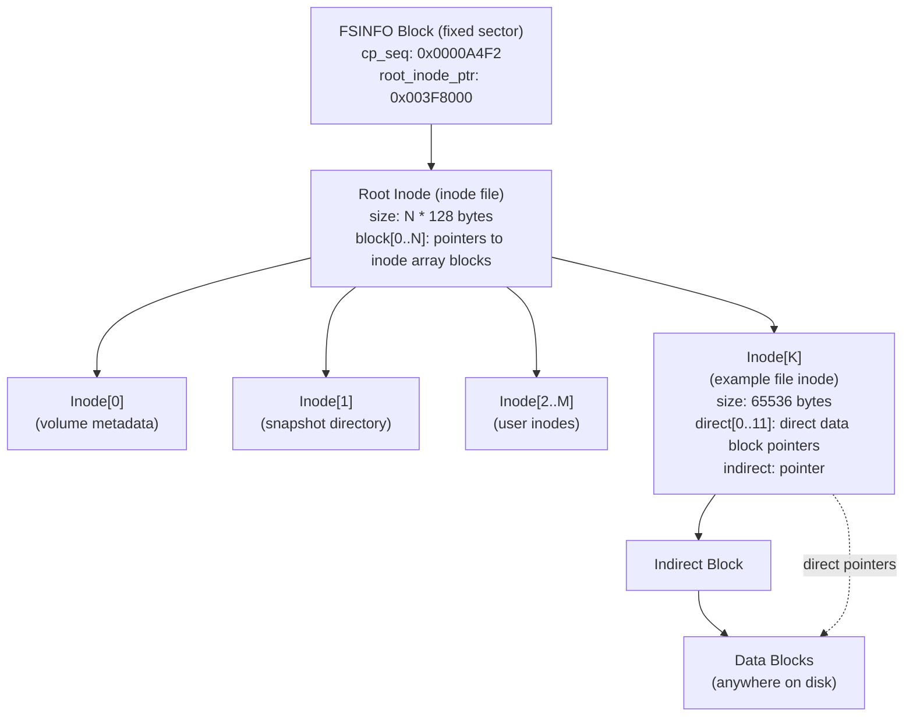
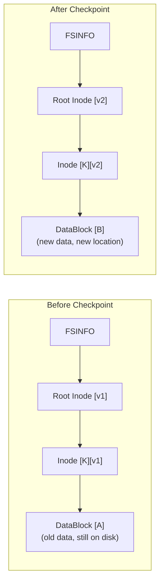
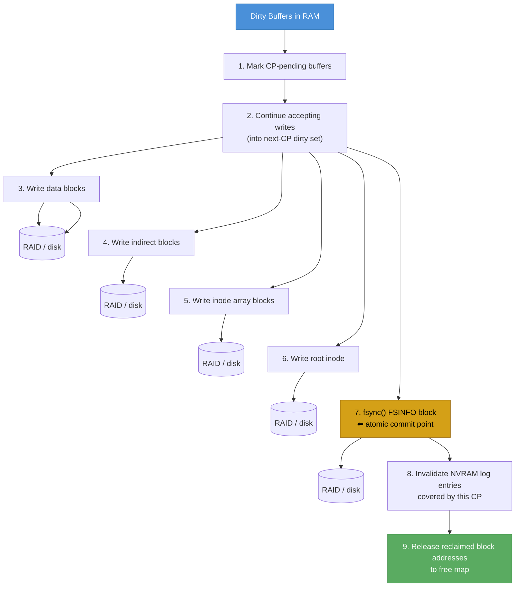

# Lesson 1: WAFL Filesystem Architecture

## 1. First-Principles Intuition & Invariants

Every filesystem design is ultimately a negotiation between three forces that cannot all be maximized simultaneously: write throughput, read locality, and crash consistency. Traditional Unix filesystems—FFS, ext2, and their descendants—optimized for read locality by placing metadata close to the data it describes and by pre-allocating space in cylinder groups. The penalty was write amplification: a single logical write to a file touched multiple distinct disk locations (the inode, the bitmap, the data block, and sometimes the directory), and a crash between any two of those writes could leave the filesystem in an inconsistent state. FSCK was the purgatory you endured to atone for that inconsistency, and on a large volume it could take hours.

NetApp's engineers, working in the early 1990s, understood that the emerging workload of enterprise NAS was structurally different from the workloads that FFS was designed to serve. Network-attached storage aggregates the write streams of hundreds or thousands of clients. Those streams arrive randomly, with no spatial locality whatsoever. Any algorithm that tries to place data near its metadata is working against the fundamental nature of the traffic. The right answer is to stop trying to impose spatial order on incoming writes and instead let them land wherever the allocator finds free space—which, in a freshly formatted volume, means sequential writes to the next available block. This is the core intuition behind the Write Anywhere File Layout: free every write from the obligation to update in place, and instead record every change as a new allocation somewhere on the disk.

The philosophical implication of this decision is profound. If no block is ever modified in place, then the previous version of every block is implicitly preserved until its space is reclaimed. The filesystem does not need a journal because it never creates the intermediate inconsistent states that journaling exists to recover from. Consistency is not a property that must be restored after a crash; it is a property that is structurally guaranteed by the write discipline itself. WAFL derives its crash-consistency invariant from the same principle that makes functional persistent data structures safe: immutability.

The central data structure that makes this tractable is the **inode file**: an inode that describes all other inodes. Conventional filesystems locate inodes at fixed disk addresses, which is why the inode table must be pre-allocated and cannot grow. WAFL inverts this arrangement. The inode file is itself a file, described by a single root inode whose block pointer is stored in a privileged, fixed location called the **FSINFO block**. Everything else—every file's inode, every directory entry, every data block—is reachable by following pointers down from that root. When WAFL writes a new block, it updates the pointer in the parent block, which causes the parent block to be rewritten, which updates the pointer in its parent, and so on, cascading up to the root inode. At the moment the FSINFO block is atomically updated to point at the new root, the entire new state of the filesystem becomes visible. Before that moment, the entire old state remains intact and consistent. There is no window of inconsistency.

This cascade of pointer updates is the mechanism NetApp calls a **consistency point** (CP). A consistency point is not a checkpoint in the journaling sense—it does not record intentions before acting. It is an atomic commitment of a complete, internally consistent filesystem state. The filesystem runs in memory, accumulating writes into a dirty buffer pool, and periodically drives a CP to flush that accumulated state to disk in a single coordinated operation. The NVRAM write-ahead log (covered in detail below) bridges the gap between CPs, providing a recovery mechanism for any writes acknowledged to clients that have not yet been committed to a CP. The two mechanisms are complementary: NVRAM provides durability for in-flight writes; CPs provide the structural consistency that makes the filesystem self-describing and snapshot-capable.

Understanding WAFL requires holding two timescales in mind simultaneously. At the microsecond timescale, individual client writes land in NVRAM and in the WAFL buffer cache. At the second timescale (every few seconds under normal load, or triggered by memory pressure or an explicit sync), a CP sweeps those dirty buffers to disk, advances the filesystem root, and releases the NVRAM space consumed by the log entries that are now redundantly recorded on disk. The client experiences low-latency acknowledgment because NVRAM absorbs the write immediately. The disk sees a stream of large, sequential writes because WAFL batches many client writes into each CP. Both properties emerge from the same architecture.

---

## 2. Core Architecture & Mechanics

### The On-Disk Layout and Inode Tree

WAFL's on-disk structure can be visualized as a tree rooted at the FSINFO block. The FSINFO block occupies a fixed sector address on each RAID group and contains the block pointer to the root inode of the inode file, a generation count, and the CP sequence number. The root inode of the inode file uses a standard indirect block tree—direct pointers, single indirect, double indirect, triple indirect—exactly like a Unix inode, except that what it describes is not user data but an array of 128-byte inode records, one per file or directory in the volume.



The critical insight in this layout is that every block in the tree carries the address of the block it points to, not the address of itself. This is pointer-based addressing rather than offset-based addressing, and it is what makes write-anywhere semantically coherent. When a data block is rewritten, its new physical address is recorded in its parent indirect block; when that indirect block changes, its new address propagates up to the inode; when the inode changes, the inode array block is rewritten, which propagates up to the root inode, which forces a new FSINFO write. The old chain of blocks remains on disk, unreferenced by the live tree but perfectly intact.



The blocks labeled v1 remain physically present until the space reclaimer (a background process WAFL calls the **block reclaimer** or, in ONTAP terminology, the **wafl_scan** subsystem) determines that no snapshot holds a reference to them. This deferred reclamation is not a bug or a space-leak—it is the mechanism by which snapshots are free. A snapshot is nothing more than a saved copy of the FSINFO block, preserving the root inode pointer that was current at the moment the snapshot was taken.

### Consistency Points: The Commit Protocol

A consistency point proceeds in several phases. During the **accumulation phase**, the system accepts client writes into the WAFL buffer cache and logs them to NVRAM. The buffer cache is organized as a hash table of 4 KB buffer headers, each carrying a dirty bit, a CP-pending bit, and a snapshot-reference bitmap. The CP-pending bit distinguishes buffers that were dirty at the time the CP started (and must be written to disk as part of this CP) from buffers that became dirty after the CP started (which will participate in the next CP). This distinction is critical because the filesystem must remain available for client writes throughout the CP—a stop-the-world commit would be operationally unacceptable.

During the **write phase**, the CP engine walks all CP-pending buffers, allocates new block addresses from the block map (a bitmap structure that tracks free blocks across the RAID group), issues the writes to the RAID layer, and builds the new indirect block tree from bottom to top. Data blocks are written first, then indirect blocks, then inode array blocks, then the root inode, and finally the FSINFO block. This ordering is mandatory. If the system crashes after writing a data block but before writing the FSINFO block, the new data block is simply unreachable—it will eventually be identified as free space by a consistency scan. The old filesystem state, rooted at the previous FSINFO block, remains intact.

The final write of the CP—the FSINFO update—is a single-sector synchronous write. Because a disk sector write is atomic at the hardware level (the drive controller guarantees either the full sector is written or the old sector remains), the transition from the old filesystem state to the new one is atomic. There is no torn-write problem at the root. This is the invariant that eliminates the need for a recovery journal: the filesystem is always rooted at a valid, consistent FSINFO block.



### NVRAM: The Durability Bridge

Between consistency points, every write that WAFL acknowledges to a client must survive a power failure. The acknowledgment guarantee—the foundation of NFS write semantics when the client uses `fsync()` or when the NFS mount uses the `sync` option—requires that the data be on stable storage before the server replies. Writing through to spinning disk on every client write would eliminate the batching advantage that CPs provide. NVRAM solves this by providing a battery-backed (or more recently, flash-backed) write-ahead log that absorbs incoming writes at memory speed.

WAFL's NVRAM log is structurally similar to a database WAL. Each log entry records the operation (write, truncate, create, delete), the target file and offset, and the data payload. Log entries are appended sequentially, and the log head pointer is advanced atomically after each entry. On a crash recovery, WAFL reads the NVRAM log from the last successfully committed CP sequence number forward, replays all subsequent log entries into the buffer cache, and then drives an immediate CP to flush that recovered state to disk. The recovery time is bounded by the log replay rate and is typically measured in seconds, regardless of volume size.

The NVRAM log has a fixed capacity, typically measured in gigabytes on modern ONTAP systems. When the log fills, WAFL is forced to drive a CP to drain it. This creates a feedback loop: a sudden burst of incoming writes fills the NVRAM log faster than the CP engine can drain it, which triggers back-pressure on client write throughput. The ONTAP performance counters `wafl_cp_count` and `nvram_log_used_percent` expose this dynamic directly, and a sustained high value for the latter is a reliable indicator that the system is CP-bound.

### Block Allocation: The Write-Anywhere Allocator

The name "Write Anywhere" refers specifically to the block allocator's freedom to place any block at any available address. WAFL maintains a **block map** (also called the space map), a hierarchical bitmap structure that tracks allocation state across the entire aggregate. At the bottom level, each bit represents a single 4 KB block. At higher levels, summary bits indicate whether any free blocks exist in a 64-block range, a 4096-block range, and so on—a structure analogous to a segment summary in LFS or a free-space tree in btrfs.

The allocator operates on the principle of **best-effort sequentiality**. Within each CP, it allocates blocks from a contiguous run whenever possible, producing large sequential writes that amortize rotational latency on spinning disks and exploit write-combining on SSD. Because writes from many files are batched into a single CP, the allocator can interleave blocks from multiple files into a single sequential region without regard for file identity—a strategy that maximizes disk throughput at the cost of read locality, since related blocks of the same file may be scattered across the disk. WAFL compensates for this with a **read-ahead engine** and, on modern systems, the AFF (All Flash FAS) platforms where random read latency is negligible.

WAFL divides the aggregate's raw storage into 2 GB **CPs groups** (called checkpoint groups in some versions of the documentation, or more precisely **block groups** in ONTAP 9). Each block group is managed semi-independently, with its own section of the block map, allowing the allocator to operate in parallel across groups when multiple CP threads are active. This partitioning reduces contention on the free-block bitmap, which under heavy write load would otherwise become a serialization bottleneck.

### Snapshot Mechanics: Frozen Tree Roots

A WAFL snapshot is created by saving a copy of the current FSINFO block—specifically, the root inode pointer and CP sequence number it contains—and incrementing a reference count on every block reachable from that root. The reference counting is not done eagerly at snapshot creation time (which would require traversing the entire inode tree and would take minutes on a large volume). Instead, WAFL uses a **copy-on-write reference scheme** combined with a per-block snapshot presence bitmap.

Each buffer header in the WAFL buffer cache carries a 255-bit snapshot presence bitmap (ONTAP supports up to 255 snapshots per volume). Bit N in the bitmap indicates that snapshot N holds a reference to this block. When the CP engine needs to write a dirty block, it checks whether any snapshot bit is set. If the block is snapshot-referenced, the engine allocates a new physical address for the new version and writes the new data there, leaving the old block at its original address for the snapshots that reference it. If no snapshot references the block, the engine can overwrite it in place (though WAFL's pure copy-on-write mode never does this—the write-anywhere allocator always produces new addresses, and the old block is reclaimed at the end of the CP cycle).

The space consumed by a snapshot is not the full volume size but the **differential**: the set of blocks that existed at snapshot time and have since been modified or deleted in the live filesystem. This is the **changed block tracking** property that makes WAFL snapshots space-efficient and nearly instantaneous to create. The `snap list` command (in ONTAP 7-Mode) or `volume snapshot show` (in ONTAP 9 Cluster Mode) reports the cumulative and differential space consumed by each snapshot, which reflects this incremental accounting.

```text
Snapshot Space Accounting:

Live volume blocks:    [B1'][B2'][B3'][B4'][B5]  ← current versions
                                                   (primes = rewritten)
Snapshot 1 blocks:    [B1 ][B2 ][B3 ]            ← original versions
                                                   preserved on disk
Snapshot 2 blocks:    [B1'][B2']                  ← versions at snap2 time

Differential(snap1):  3 blocks  (B1, B2, B3)
Differential(snap2):  2 blocks  (B1', B2')
```

Restoring a snapshot requires only pointing the FSINFO block at the saved root inode pointer—a single-sector synchronous write. The restore is instantaneous from the filesystem's perspective. Any blocks allocated between the snapshot time and the restore time become unreferenced and are gradually reclaimed by the block reclaimer. SnapRestore, the ONTAP feature that exposes this capability, is one of the most operationally powerful consequences of the WAFL architecture, and its near-zero recovery time stands in sharp contrast to the multi-hour restore times typical of tape-based or backup-copy-based recovery workflows.

---

## 3. High-Performance Optimization & Failure Modes

### CP Coalescing and Write Amplification

The CP mechanism's greatest strength—batching many writes into a single commit—creates a subtle write amplification problem that practitioners must understand to tune correctly. Consider a 4 KB write to a file with a three-level indirect block tree. That single client write causes the data block to be written (4 KB), the indirect block referencing it to be rewritten (4 KB), the double-indirect block to be rewritten (4 KB), the inode to be rewritten (128 bytes, rounded to 4 KB at the block level), the inode array block to be rewritten (4 KB), and the root inode and FSINFO block to be written. In the worst case—a single write in isolation—the write amplification factor approaches 6x. In the best case—a CP that batches 100,000 writes—the metadata overhead is amortized to near zero because many dirty data blocks share a single parent indirect block that need only be written once.

This means WAFL's write amplification is inversely proportional to CP size. Systems under moderate-to-heavy write load have naturally large CPs and low effective write amplification. Systems that are nearly idle, receiving occasional single writes, have small CPs and high effective write amplification. The practical consequence is that WAFL is optimized for throughput workloads and may exhibit higher-than-expected disk utilization under sparse, bursty write patterns. The ONTAP diagnostic command `wafl_susp` (available via `nodeshell`) exposes CP write statistics, including the number of blocks written per CP, allowing you to characterize this behavior quantitatively.

### Snapshot Proliferation and Space Traps

The most common operational failure mode in WAFL-based systems is not data corruption but space exhaustion caused by snapshot accumulation. Because each snapshot preserves the differential from the moment of its creation, a volume that is heavily written will accumulate large snapshot differentials rapidly. The trap is that snapshot space consumption is not visible in the volume's used-space counter as reported by NFS or SMB clients—client tools see only the live filesystem's usage. The snapshot reserve (a configurable percentage of the volume, historically defaulting to 20%) is intended to absorb this differential, but workloads that overwrite large fractions of the volume between snapshot schedules can exhaust the reserve, causing snapshots to consume space from the live volume and triggering unexpected ENOSPC errors on clients that believe the volume has ample free space.

The ONTAP diagnostic workflow for snapshot space pressure begins with `volume show -fields size,used,available,percent-used` to establish the live volume's allocation, followed by `volume snapshot show -volume <vol> -fields size` to enumerate snapshot differential sizes. When a specific snapshot is consuming disproportionate space, `volume snapshot delta show` quantifies the block changes between consecutive snapshots. The remediation path is either to delete old snapshots (releasing their differential blocks to the block reclaimer) or to increase the volume size, which ONTAP supports online via `volume modify -size`.

### NVRAM Failure and Dirty-Data Loss

NVRAM failure is the most severe single-component failure in a WAFL system because it carries the risk of losing all writes acknowledged since the last CP. Modern ONTAP systems mitigate this through NVRAM mirroring across the HA pair: each controller mirrors its NVRAM log to its partner over a dedicated NVRAM interconnect. When a write lands in the primary controller's NVRAM, it is replicated to the partner before the acknowledgment is returned to the client. This synchronous mirroring ensures that an NVRAM failure on the primary controller (whether from battery failure, component fault, or complete controller failure) does not result in data loss, because the partner holds a complete copy of the unwritten log.

The practical implication for infrastructure architects is that the NVRAM mirror interconnect latency directly adds to the write acknowledgment latency seen by clients. ONTAP exposes this as `wafl_nvram_mirror_latency_avg` in the performance object store. A degraded interconnect—miscabled, running at reduced bandwidth, or showing elevated error counts—will manifest first as elevated write latency before the interconnect degrades to the point of triggering an HA takeover. Monitoring this counter proactively is significantly more valuable than reacting to client-reported latency spikes after the fact.

### Deduplication and Compression Interaction with WAFL

Inline and post-process deduplication in ONTAP interact with WAFL's block allocation model in a way that deserves careful attention. WAFL deduplication works by maintaining a **fingerprint store** (SHA-256 hashes of block content) and a **block sharing map** that tracks which logical addresses map to shared physical blocks. A shared block is treated by the CP engine identically to a snapshot-referenced block: when a client writes a new version of data whose underlying block is shared, the write-anywhere allocator produces a new block at a new address, and the shared block's reference count is decremented rather than the block being freed. The fingerprint store must be consulted on every new data write, which introduces latency that ONTAP manages by running deduplication as a post-process job (`sis start`) rather than inline for most traditional spinning-disk workloads. All-flash FAS systems can sustain inline deduplication because the fingerprint lookup latency, measured against NVME access times, is acceptable.

Compression interacts with WAFL's 4 KB block granularity by operating at the compression group level (typically 8 KB or 32 KB in ONTAP 9). A compression group spans multiple WAFL blocks, and when any single WAFL block within the group is modified, the entire compression group must be decompressed, modified, and recompressed before the new blocks are written. This introduces a read-modify-write cycle that partially counteracts WAFL's write-anywhere advantage for compressed volumes under random write workloads. The `sis stat` command exposes compression efficiency and the compression group miss rate, allowing you to quantify whether a given workload's access pattern is compatible with the compression group size in use.

### Aggregate Layout and RAID-DP Interaction

WAFL does not operate on a single volume in isolation—it operates on an **aggregate**, which is a pool of raw RAID storage from which multiple FlexVols or FlexGroups are carved. The aggregate is itself a WAFL volume (the **aggregate root volume**, or **aggr root vol**), and FlexVol volumes appear as large files within it. This two-level WAFL nesting means that a client write traverses two independent WAFL inode trees: one for the FlexVol containing the client's file, and one for the aggregate that contains the FlexVol. The CP engine coordinates CPs across both levels in a single atomic commit, maintaining the same consistency invariants at both layers.

RAID-DP (NetApp's implementation of RAID-6 with two independent parity streams) interacts with WAFL's CP write pattern in a performance-critical way. Each WAFL CP produces a large burst of sequential writes to the RAID layer, which RAID-DP must translate into stripe writes. A full stripe write (all data drives in a RAID group written simultaneously) is efficient because both parity values can be computed in a single pass. A partial stripe write requires a **read-modify-write cycle**: RAID-DP must read the existing data drives, compute the delta, update both parity drives, and write the full set. WAFL maximizes full-stripe write efficiency by aligning its CP write burst to RAID stripe boundaries wherever possible, a behavior visible in the `raid_group stripe_full_pct` performance counter. A low full-stripe percentage indicates that the WAFL aggregate is too small relative to the write rate, and that increasing the aggregate's RAID group count or write-coalescing behavior would improve effective throughput.

### Practical Diagnostic Command Reference

The following commands are executed in ONTAP 9 Cluster Mode unless noted. They are ordered from broad health assessment to narrow fault isolation.

For aggregate and volume space health, begin with `df -A <aggr_name>` from the clustershell to view aggregate-level free space, then `volume show -vserver <vserver> -volume <vol> -fields size,used,available,snapshot-space-used` to separate live and snapshot consumption.

To assess CP behavior quantitatively, access the nodeshell via `system node run -node <node>` and execute `sysstat -x 1` to observe CP frequency, CP type (timer-driven versus log-full versus memory-pressure), and NVRAM log utilization in one-second intervals. The CP type distribution is diagnostic: a preponderance of log-full CPs indicates NVRAM saturation; memory-pressure CPs indicate that the WAFL buffer cache is under allocation pressure from competing consumers (dedup fingerprint store, FlexCache, ARC).

For snapshot differential accounting, `volume snapshot show -volume <vol> -fields cumulative-total,delta` quantifies the marginal cost of each snapshot. For deduplication and compression efficiency, `volume efficiency stat -volume <vol>` reports the logical-to-physical space ratio, compression group efficiency, and inline versus post-process savings split.

The aggregate of these diagnostic views gives an infrastructure architect a complete picture of WAFL's operational state: how frequently the system is committing consistency points, whether NVRAM is the throughput constraint or the buffer cache is, whether snapshot accumulation is eroding usable capacity, and whether the deduplication and compression pipeline is compatible with the workload's write pattern. WAFL's transparency to diagnostics—a consequence of the fact that every performance dimension maps cleanly to a specific architectural mechanism—is itself a design virtue, and understanding the mechanisms described in this lesson is the prerequisite for interpreting those diagnostics correctly.
