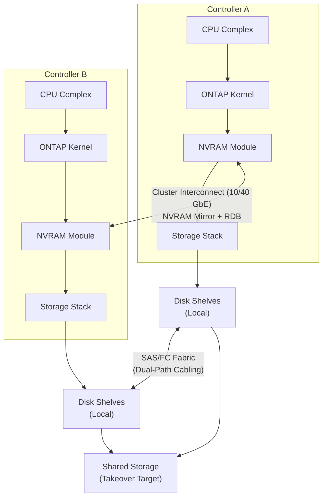

# Lesson 3: Clustered Data ONTAP High Availability

## 1. First-Principles Intuition & Invariants

At the heart of enterprise storage systems lies a single immutable requirement: data must remain accessible despite hardware failure, network partition, or administrative intervention. Traditional storage architectures approach this problem through monolithic redundancy—mirrored controllers, dual paths, and failover scripts that react to catastrophic events. NetApp's Clustered Data ONTAP inverts this paradigm by treating high availability not as a reactive failover mechanism but as a continuous, stateful negotiation between paired storage controllers operating within a distributed consensus fabric.

The fundamental invariant governing ONTAP high availability is that every storage controller node exists in exactly one of three states at any moment: **active** (serving client I/O for its local aggregates), **partner-active** (serving I/O for both its own aggregates and those of a failed partner), or **in-transition** (executing a takeover or giveback operation). These states are not ephemeral suggestions but enforced through kernel-level resource locks, NVRAM journal synchronization, and cluster-wide quorum agreement. Unlike traditional active-passive failover where the standby node idles until catastrophe, ONTAP HA pairs operate in active-active configuration, each node independently serving client requests while maintaining real-time awareness of its partner's health through sub-second heartbeat intervals transmitted over a dedicated low-latency cluster interconnect.

The cluster interconnect itself forms the nervous system of ONTAP HA architecture. This physically separate network—distinct from client data paths and management interfaces—carries three critical traffic classes: NVRAM mirroring (write journals replicated synchronously between HA partners), cluster fabric messaging (Replicated Database or RDB updates propagating configuration state), and health monitoring (heartbeat probes detecting node liveness). The interconnect operates at Layer 2, typically 10GbE or faster, with hardware-enforced quality-of-service guarantees ensuring NVRAM replication never starves behind bulk data transfers. When a write operation arrives at a controller, the ONTAP kernel commits it first to battery-backed NVRAM, then immediately mirrors that journal entry to the partner's NVRAM across the interconnect before acknowledging the write to the client. This synchronous dual-commit protocol ensures zero data loss during takeover: if a node fails mid-transaction, its partner possesses a byte-perfect replica of all uncommitted write operations stored in non-volatile memory.

Takeover mechanics rest on this NVRAM foundation. When a controller detects partner failure—through missed heartbeats, environmental shutdown signals, or administrative command—it transitions from serving only its local aggregates to assuming ownership of the failed partner's disk shelves. This ownership transfer occurs not through wholesale data migration but through metadata reassignment: the surviving node updates its internal aggregate tables to claim the partner's physical disks, replays the partner's NVRAM journal to recover in-flight writes, and begins serving I/O requests for what were previously the partner's volumes. Clients experience brief I/O suspension measured in seconds rather than minutes because no data moves; only control plane metadata updates and journal replay execute. The critical invariant here is that NVRAM mirroring keeps recovery time bounded and deterministic, decoupled from dataset size. A petabyte aggregate recovers in the same sub-30-second window as a terabyte dataset because recovery latency derives from journal replay depth, not total capacity.

Giveback represents the inverse operation, executed when a failed node returns to service and reclaims its aggregates from the partner. Unlike takeover, giveback is non-disruptive by design—client I/O continues uninterrupted through aggregate relocation orchestrated at the kernel volume layer. ONTAP employs a lock-step protocol where the source node (currently serving the aggregates) and destination node (reclaiming ownership) negotiate each aggregate's transfer through a series of barrier synchronizations. First, the source node flushes all dirty write-cache blocks to stable storage, ensuring disk state consistency. Second, it transfers a serialized snapshot of the aggregate's buffer cache and metadata structures to the destination node over the interconnect. Third, the destination node replays this state into its own memory, validates consistency checksums, and signals readiness. Finally, the cluster RDB atomically updates ownership records, redirecting new I/O requests to the destination while in-flight operations complete on the source. Clients experience transparent path migration handled by multipath I/O drivers; from the host perspective, storage LUNs and NFS exports remain continuously available throughout the giveback window.

Quorum management extends these paired-node mechanics to cluster-wide consensus. In a Clustered Data ONTAP environment spanning four, eight, or even twenty-four nodes, configuration changes—creating a new volume, modifying Quality-of-Service policies, updating routing tables—must propagate atomically across all controllers to maintain a consistent view of storage topology. ONTAP implements this through the Replicated Database, a distributed key-value store inspired by multi-Paxos consensus but optimized for storage control planes. The RDB divides configuration state into logical units of replication called RDB rings, each ring maintaining a specific domain of metadata: volume definitions, network interface configurations, SVM tenant boundaries, or cluster membership records. Every write to an RDB ring requires acknowledgment from a quorum majority of nodes, ensuring that even if network partitions split the cluster, no two subsets can independently commit conflicting updates.

Central to quorum computation is the concept of the epsilon node, a cluster-wide designee holding fractional voting weight that breaks even-number cluster ties. Consider a four-node cluster experiencing network partition into two equal halves. Without epsilon designation, each partition holds two votes and neither can form quorum majority. ONTAP's master election algorithm assigns one node—typically the lowest node-ID controller during initial cluster formation—epsilon privilege, granting it voting weight of 1 + ε where ε is infinitesimally small but sufficient to break ties. The partition containing the epsilon node achieves quorum (2 + ε votes out of 4 total) and continues accepting configuration changes; the minority partition detects quorum loss and transitions into read-only mode, serving existing data but refusing new administrative operations. This asymmetric weight assignment prevents split-brain scenarios where both partitions believe they hold authority to modify cluster state.

Epsilon management operates through the cluster RDB itself using a Paxos-like proposal sequence. When epsilon reassignment becomes necessary—due to node removal, planned maintenance, or automated load balancing—a candidate node increments the epsilon epoch counter and proposes itself as new holder. This proposal propagates through the RDB gossip protocol, and if quorum nodes acknowledge within a timeout window, the candidate assumes epsilon privilege. The previous epsilon holder relinquishes its fractional weight only after confirming quorum agreement on the new holder, ensuring epsilon never resides on multiple nodes simultaneously. This careful handoff protocol maintains the invariant that exactly one epsilon node exists at all times in a healthy cluster, with epsilon automatically migrating to surviving nodes during failures.

Non-disruptive operations theory emerges from composing these mechanisms into higher-level workflows. Firmware updates, controller replacements, and aggregate migrations all leverage the same underlying primitives: NVRAM mirroring for zero-data-loss failover, RDB quorum for consistent metadata updates, and giveback protocols for transparent ownership transfers. An ONTAP cluster administrator can upgrade controller firmware on a sixteen-node cluster without scheduling maintenance windows or suspending application access. The procedure iteratively takes over each node's aggregates to its HA partner, upgrades the evacuated node, executes giveback to restore original ownership, then advances to the next HA pair. Because takeover and giveback preserve client connectivity through multipath I/O redirection and because quorum ensures the remaining nodes maintain consistent configuration state, applications perceive continuous storage availability despite systematic controller evacuations rolling through the cluster.

The mathematical foundation for quorum resilience derives from the formula $Q = \lfloor N/2 \rfloor + 1$ where $N$ represents total cluster nodes and $Q$ denotes the minimum node count required for configuration write acceptance. A six-node cluster requires four-node quorum; losing two nodes leaves four survivors capable of forming majority. Losing three nodes drops the cluster below quorum, preventing new configuration changes but preserving existing data paths. This $Q$ threshold decouples data availability from control plane availability: even when quorum fails, established volumes continue serving I/O because data path forwarding operates independently from RDB consensus. Clients accessing pre-configured LUNs and NFS exports experience uninterrupted read and write operations; only administrative actions like creating new volumes or modifying SVM settings block pending quorum restoration.

## 2. Core Architecture & Mechanics

The physical topology of an ONTAP HA pair begins with two independent storage controllers interconnected through three distinct network planes. The cluster interconnect plane, typically bonded 10GbE or 40GbE links, carries NVRAM mirroring traffic and RDB gossip messages. Each controller maintains a dedicated NVRAM module—battery-backed DIMM or newer NVDIMM flash—capable of persisting several gigabytes of write journals across power loss. When a client write arrives at Controller A, the ONTAP kernel appends the operation to its local NVRAM log, then transmits a synchronous replication message to Controller B over the interconnect. Controller B appends the replicated entry to its own NVRAM and sends acknowledgment back to Controller A. Only after receiving this acknowledgment does Controller A respond to the client, confirming durable commit. This synchronous round-trip protocol introduces latency measured in tens of microseconds over low-latency interconnects, imperceptible against typical disk service times but critical for zero-data-loss guarantees.

Disk ownership assignment follows strict partitioning rules to prevent split-brain scenarios at the physical layer. Each disk shelf connects to both controllers through redundant SAS or Fibre Channel paths, but ONTAP assigns each individual disk spindle to exactly one controller as its owner. During normal operation, Controller A serves I/O exclusively for its owned disks, and Controller B does likewise. The partner controller can read the ownership metadata written to reserved sectors on each disk but cannot issue write operations to disks it does not own. This invariant ensures that even if network connectivity between controllers fails completely, both nodes cannot simultaneously modify the same disk, preventing filesystem corruption.

Takeover initiation begins with failure detection through a multi-layered health monitoring subsystem. The primary detection mechanism involves kernel-level heartbeat messages exchanged every 500 milliseconds over the cluster interconnect. Each controller transmits a timestamped beacon containing its current epoch counter, aggregate ownership map, and NVRAM sequence number. The partner controller expects beacons within a 3-second sliding window; missing three consecutive beacons triggers suspicion state. During suspicion, the monitoring subsystem queries alternative communication channels: management network reachability tests, disk shelf I/O probes to verify the partner hasn't merely lost interconnect connectivity, and environmental sensor polling to detect hardware shutdown signals from the partner's baseboard management controller. Only after confirming partner unreachability through multiple independent channels does the surviving controller commit to takeover, minimizing false positives that could trigger unnecessary aggregate migrations.

Once takeover decision commits, the surviving controller executes a deterministic sequence of ownership assertions. First, it broadcasts SCSI persistent reservation updates across all disk shelves, claiming ownership of the partner's disks by writing new controller identifiers into the disk reservation metadata. This physical claim prevents the failed controller from resuming disk access if it unexpectedly recovers mid-takeover, avoiding potential data corruption from dual-writer scenarios. Second, the surviving controller replays the partner's NVRAM journal entries from its mirrored copy, applying all uncommitted writes to the newly claimed disks. NVRAM entries contain logical block addresses, data payloads, and filesystem transaction identifiers allowing the kernel to reconstruct exactly which WAFL (Write Anywhere File Layout) operations were in-flight when the partner failed. This replay process transforms the surviving controller's view of the partner's aggregates from potentially inconsistent state into a fully coherent filesystem image.

Third, the controller updates its internal aggregate routing tables to include the partner's volumes and LUNs in its I/O servicing paths. The ONTAP kernel maintains a hash table mapping volume UUIDs to aggregate objects; during takeover, it inserts entries for the partner's volumes, linking them to the newly claimed disk sets. Fourth, it notifies the cluster RDB of the ownership change, propagating updated aggregate-to-node mappings across all cluster members. This RDB update triggers path failover on client hosts: multipath I/O drivers receive path state change notifications through SCSI Asymmetric Logical Unit Access (ALUA) or NFS path migration callbacks, redirecting subsequent I/O requests to the takeover controller's network interfaces. The entire sequence from failure detection through client path migration completes within 15 to 30 seconds for typical configurations, dominated by NVRAM replay latency rather than network propagation delays.

Giveback orchestration involves more intricate state coordination because both controllers remain operational throughout the process. When an administrator issues the `storage failover giveback` command, the takeover controller (currently serving both its own aggregates and the partner's) and the destination controller (reclaiming ownership) enter a negotiated handshake. The giveback protocol proceeds through five phases: validation, cache flush, aggregate preparation, ownership transfer, and verification.

During validation, both controllers confirm prerequisites: the destination controller has completed boot and passed diagnostic checks, network interfaces on the destination have rejoined the cluster fabric, and the destination's NVRAM holds no stale journal entries from previous failures. If any prerequisite fails, giveback aborts and logs detailed failure reasons to the cluster event log.

Cache flush forces the takeover controller to synchronize all dirty data blocks from its write cache to stable storage on the partner's disks. ONTAP employs a multi-tier caching hierarchy with NVRAM holding the most recent writes, DRAM buffers caching frequently accessed blocks, and NVDIMM or SSD tiers providing intermediate persistence. Flushing involves traversing the dirty-block bitmap for each aggregate being returned, issuing write commands to disk for every modified block, and waiting for disk controller acknowledgments confirming stable media writes. For aggregates with high write activity, flush operations can take several minutes, but client I/O continues uninterrupted during this phase because the takeover controller still actively services requests.

Aggregate preparation constructs a serialized representation of the aggregate's in-memory state: inode caches, directory lookup tables, deduplication fingerprint indexes, and filesystem transaction logs. This snapshot transfers across the cluster interconnect to the destination controller, which deserializes the structures into its own kernel memory. The transfer employs a compact binary format optimized for high-bandwidth interconnects, typically completing in seconds for even multi-terabyte aggregates because metadata volume remains orders of magnitude smaller than raw data capacity.

Ownership transfer executes the atomic metadata flip. The takeover controller sends a final barrier synchronization message to the destination controller, confirming all caches are flushed and metadata transfer is complete. The destination controller acknowledges readiness and updates its disk ownership reservations, reclaiming its disks from the takeover controller's temporary custody. Simultaneously, both controllers update the cluster RDB with the new ownership mapping. This RDB transaction uses two-phase commit: all quorum nodes first prepare the update by staging the new mapping in temporary storage, then atomically commit once all nodes acknowledge preparation success. This ensures no window exists where different cluster nodes hold conflicting views of which controller owns each aggregate.

The final verification phase confirms client connectivity to the destination controller. The destination controller begins servicing I/O requests for the reclaimed aggregates while the takeover controller monitors for stale requests still arriving on its interfaces. The ONTAP kernel employs a grace period where both controllers can service requests for recently transferred aggregates, allowing in-flight I/O operations to drain naturally. After the grace period expires, the takeover controller rejects any remaining requests for the transferred aggregates with SCSI sense codes or NFS ESTALE errors, forcing clients to retry through their multipath logic and complete the path migration.

Epsilon election and quorum calculation integrate through the RDB consensus protocol. Each ONTAP node maintains a local replica of the cluster RDB, organized into multiple ring databases corresponding to different configuration domains. The management ring holds cluster membership, node roles, and epsilon assignment. The volume location database (VLDB) ring tracks aggregate-to-node mappings and SVM configurations. The virtual interface (VIF) ring records network interface states and failover groups. Every write to any ring must achieve quorum acknowledgment from a majority of nodes before committing locally.

The RDB master node, elected through a Paxos-like ballot process, coordinates writes and resolves conflicts. When a configuration change request arrives—for example, creating a new volume—the receiving node forwards the request to the current RDB master. The master increments a monotonic revision counter, constructs a replication message containing the change and new revision number, and broadcasts it to all cluster nodes. Each node applies the change to its local RDB replica and acknowledges the revision. Once the master receives acknowledgments from $Q = \lfloor N/2 \rfloor + 1$ nodes, it commits the change and responds success to the originating client. If the master fails to achieve quorum within a timeout window (typically 10 seconds), it aborts the transaction and returns an error, preserving consistency by refusing partial updates.

Epsilon assignment occurs during cluster initialization and during certain topology changes. When the first two nodes join to form a new cluster, ONTAP automatically assigns epsilon to the node with the lower hardware serial number, establishing a deterministic tiebreaker. As additional nodes join, epsilon remains with the original holder unless administratively reassigned or the epsilon node departs the cluster. During planned epsilon migration—executed via `cluster modify -node <node-name> -eligibility true` followed by `cluster modify -epsilon true`—the current epsilon holder proposes the new assignment through an RDB transaction. Quorum nodes vote on the proposal; if majority agrees, the new node assumes epsilon and increments its voting weight. The transition occurs atomically from the RDB's perspective, ensuring no window where multiple nodes claim epsilon or where epsilon is unassigned.

When network partition splits a cluster, epsilon determines which partition retains write authority. Consider an eight-node cluster partitioned into subsets of five and three nodes. The five-node partition achieves quorum ($Q = 5$ for $N = 8$) regardless of epsilon location. However, in a four-four split, the partition containing the epsilon node reaches quorum (4 + ε > 4) while the partition without epsilon falls short. The epsilon-holding partition continues accepting configuration changes; the non-epsilon partition detects quorum failure and transitions to read-only mode. This asymmetric outcome prevents both partitions from independently modifying cluster state, which would create conflicting configuration versions impossible to reconcile after partition healing.

Non-disruptive operations leverage these primitives to enable maintenance without downtime. Automated Non-Disruptive Upgrade (ANDU) workflows orchestrate rolling controller reboots across an entire cluster. The procedure begins by selecting an HA pair and evacuating one controller's aggregates to its partner through takeover. With the controller's aggregates now served by the partner, ANDU updates the evacuated controller's firmware and reboots it. After successful boot and cluster rejoin, ANDU executes giveback to restore original aggregate ownership, then repeats the process for the partner controller. The workflow then advances to the next HA pair, systematically upgrading the entire cluster without suspending client I/O.

Aggregate relocation, a more sophisticated non-disruptive operation, physically migrates volumes between controllers without requiring HA takeover relationships. The source controller incrementally copies aggregate data to the destination controller over the cluster interconnect while continuing to serve live client I/O. ONTAP employs a copy-on-write snapshot technique where the source takes a point-in-time snapshot of the aggregate, transfers the snapshot's blocks to the destination, then iteratively transfers delta changes that occurred during the baseline copy. As delta windows shrink, the source eventually pauses client I/O for a brief cutover window (typically under one second), flushes final changes, updates the RDB ownership mapping, and redirects clients to the destination. This technique enables load balancing, controller decommissioning, and data center migrations without scheduled outages.

## 3. High-Performance Optimization & Failure Modes

Optimizing HA performance requires tuning the cluster interconnect for NVRAM mirroring latency and RDB propagation throughput. ONTAP best practices mandate dedicated 10GbE or faster links for the cluster interconnect, isolated from client data traffic through VLAN segmentation or physical separation. Network engineers should configure the interconnect switches with jumbo frames (MTU 9000) to reduce packetization overhead for large RDB transactions and enable explicit congestion notification (ECN) to prevent buffer bloat during bursts. Quality-of-service policies on the interconnect should prioritize NVRAM mirroring traffic to the highest tier, ensuring that write acknowledgment latency remains bounded even when large RDB updates propagate metadata changes across the cluster.

NVRAM sizing directly impacts takeover recovery time because the surviving controller must replay the failed partner's entire journal during takeover. Standard ONTAP controllers provision 8 to 16 GB of NVRAM per node, sufficient for roughly 30 seconds of write traffic at maximum throughput. Administrators managing write-intensive workloads should monitor NVRAM utilization through the `statistics show -object nvram` command, watching for high-water marks approaching capacity. If NVRAM consistently fills, the kernel throttles incoming writes to prevent journal overflow, introducing latency spikes visible to clients. Upgrading to controllers with larger NVRAM capacity or deploying NVDIMM-based persistent memory can extend the buffering window, reducing write throttling frequency.

RDB scaling considerations emerge in large clusters where metadata propagation must traverse dozens of nodes. Each RDB ring employs a gossip protocol where updates propagate through a spanning tree rooted at the master node. In a twenty-four-node cluster, updates may require four network hops to reach the furthest leaf nodes, introducing cumulative latency. ONTAP mitigates this through aggressive caching: nodes maintain read replicas of frequently accessed RDB keys and validate freshness through version vectors rather than querying the master for every lookup. Configuration changes that modify hot keys—such as updating a heavily accessed volume's export policy—trigger rapid cache invalidation broadcasts, temporarily increasing RDB traffic. Administrators should batch related configuration changes and execute them during maintenance windows to minimize invalidation storms.

Epsilon placement strategy impacts cluster resilience during cascading failures. Default epsilon assignment to the lowest-serial-number node provides determinism but may not optimize for fault tolerance. Consider a cluster spanning two data centers with nodes A, B, C, D in Site 1 and nodes E, F, G, H in Site 2. If epsilon resides on node A in Site 1 and a WAN partition severs inter-site connectivity, Site 1 retains quorum (four nodes plus epsilon) while Site 2 loses write access. For balanced failure handling, administrators should explicitly assign epsilon to a mid-serial node and monitor epsilon node health closely. The command `cluster show -node * -fields epsilon` reveals current assignment; `cluster modify -node <node> -epsilon true` migrates epsilon after ensuring quorum agreement.

Split-brain prevention during simultaneous interconnect and disk fabric failures requires careful attention to fencing mechanisms. If both the cluster interconnect fails and a controller loses access to its partner's disks—perhaps due to SAS cable faults—traditional heartbeat-based failure detection may misfire. The degraded controller cannot communicate with its partner over the interconnect but also cannot verify via disk I/O that the partner has truly failed. ONTAP employs an escalation policy where controllers query external witness systems—either dedicated mediator appliances in MetroCluster configurations or management network canaries—to break ambiguity. The controller contacts the witness, reports its own health status, and queries whether the witness can reach the partner. Only if the witness confirms the controller is healthy and the partner is unreachable does takeover proceed. This three-party validation prevents scenarios where both controllers independently attempt takeover, which would deadlock at the disk ownership assertion phase.

Failure mode analysis begins with interconnect saturation. When NVRAM mirroring traffic overwhelms interconnect bandwidth—possible during extreme write bursts or when large RDB updates coincide with sustained write I/O—the kernel detects replication lag through acknowledgment timeouts. If the partner's NVRAM acknowledgment doesn't arrive within 500 milliseconds, the local controller buffers subsequent writes in a secondary staging area while retrying replication. If lag persists beyond 5 seconds, the controller transitions to write-back mode, acknowledging client writes after local NVRAM commit only, deferring partner replication until interconnect capacity recovers. This fallback mode trades the zero-data-loss guarantee for continued availability; administrators must monitor for `Ha-interconnect-degraded` events in the AutoSupport telemetry and remediate interconnect congestion promptly.

NVRAM journal overflow represents a critical failure mode. If write traffic exceeds NVRAM capacity and the kernel's throttling mechanisms fail to control inflow—perhaps during synthetic benchmarks or malfunctioning applications generating unbounded writes—the journal wraps and overwrites uncommitted entries. ONTAP detects this condition through internal consistency checks comparing journal sequence numbers against committed on-disk checkpoints. When overflow is detected, the kernel forces a filesystem checkpoint, blocking all client I/O until the journal syncs to disk and frees space. This emergency checkpoint can stall I/O for tens of seconds, appearing as application hangs. Preventing overflow requires proactive capacity planning: the rule of thumb dictates NVRAM should buffer at least 30 seconds of peak write throughput, calculated as NVRAM size (GB) ≥ peak write rate (GB/s) × 30.

Quorum loss during asymmetric network failures introduces subtle availability degradations. Suppose a four-node cluster experiences a fault where node A can communicate with nodes B and C but not node D, while node D maintains connectivity to B and C. From A's perspective, it sees three nodes (A, B, C) forming quorum. From D's perspective, it also sees three nodes (D, B, C) forming quorum. Both subsets claim quorum majority, but the RDB master election protocol prevents split authority. Nodes B and C, able to communicate with all other nodes, detect the partial partition and refuse to participate in dual quorums. The RDB master (assume it's node B) continues accepting writes but logs partition warnings, alerting administrators to the degraded topology. Nodes A and D each independently believe they hold quorum, but because neither can achieve acknowledgment from the master on configuration writes, neither can actually commit changes. Data I/O continues unaffected because established volumes route independently of RDB consensus, but administrative operations stall pending partition resolution.

Giveback failures during aggregate relocation arise from cache inconsistencies or metadata corruption. If the destination controller's deserialization of the aggregate metadata snapshot fails—due to bitflips, interconnect transmission errors, or software bugs—giveback aborts and the takeover controller retains ownership. ONTAP logs detailed error codes to `/mroot/etc/log/mlog/` files, including snapshots of the failing metadata structures and checksums verifying data integrity. Administrators must analyze these logs to determine whether the fault lies in hardware (ECC memory errors, interconnect CRC failures) or software (kernel bugs, incompatible ONTAP versions between partners). Persistent giveback failures often necessitate controller reboot to reset metadata state, executed carefully to avoid compounding failures: reboot the takeover controller only after confirming its partner is healthy and can assume ownership through reverse takeover.

Epsilon flapping during marginal interconnect reliability creates oscillating quorum states. If the interconnect experiences intermittent packet loss—perhaps due to failing optics or oversubscribed switch ports—the RDB master may interpret temporary communication failures as node departures and initiate epsilon migration. If connectivity recovers before migration completes, the master cancels the migration, but repeated cycles of failure and recovery cause epsilon to ping-pong between nodes. Each migration triggers RDB updates, consuming interconnect bandwidth and introducing latency into configuration operations. Administrators identify flapping through the `cluster ring show` command, which displays RDB epoch counters and recent master elections. Sustained increases in epoch numbers over short timescales (multiple increments per minute) indicate instability. Remediation requires stabilizing the physical interconnect: replacing suspect cables, upgrading switch firmware, or reconfiguring link aggregation to eliminate transient faults.

Disaster recovery planning must account for HA pair failure where both controllers in an HA pair fail simultaneously—perhaps due to power distribution unit faults or environmental overheating. In this scenario, the cluster loses access to all aggregates owned by the failed pair. If the cluster spans additional HA pairs, those pairs continue serving their own aggregates and the cluster maintains quorum (assuming sufficient survivors for $Q = \lfloor N/2 \rfloor + 1$). However, volumes owned by the failed pair become unavailable until at least one controller recovers. ONTAP does not automatically migrate aggregates from failed HA pairs to surviving controllers because doing so would require three-way disk ownership, violating the invariant that each disk belongs to exactly one HA pair. Implementing true multi-node redundancy requires deploying SyncMirror, ONTAP's synchronous mirroring technology, which maintains real-time replicas of each aggregate on disks owned by different HA pairs. With SyncMirror enabled, failure of an entire HA pair triggers transparent failover to the mirrored plex hosted by surviving controllers, preserving data availability at the cost of doubled disk capacity overhead.

Long-term operational excellence requires continuous monitoring of HA subsystem health metrics. The `storage failover show` command provides current takeover capability status for each HA pair, displaying states such as `Connected`, `PartialGiveback`, `WaitingForGiveback`, or `Takeover`. Administrators should script this command through the ONTAP REST API or NetApp PowerShell Toolkit, polling every 60 seconds and alerting on state transitions away from `Connected`. The `statistics show -object ha_interconnect` command exposes real-time NVRAM mirroring latency, measured as round-trip time for replication acknowledgments. Baseline latency should remain under 500 microseconds on properly configured interconnects; sustained increases above 1 millisecond warrant investigation. The cluster event log, queried via `event log show -severity alert,emergency`, records all takeover/giveback operations, quorum state changes, and epsilon migrations, providing a historical audit trail for post-incident analysis.

Capacity planning for HA resilience involves calculating aggregate distribution to ensure balanced takeover loads. If one controller in an HA pair owns 80 TB of aggregates while its partner owns only 20 TB, the partner must serve 100 TB (its own 20 TB plus the failed partner's 80 TB) during takeover, potentially overloading its I/O capacity. ONTAP best practice dictates roughly equal aggregate distribution within each HA pair, typically achieved during initial cluster deployment. The `storage aggregate show -fields node, size` command lists all aggregates and their owning controllers; administrators should verify that per-node capacity sums differ by no more than 20 percent within each HA pair. Rebalancing requires aggregate relocation, which consumes significant interconnect bandwidth and CPU cycles—schedule such operations during low-traffic windows and monitor impact through `statistics show -object aggregate` to observe read/write latency increases during migration.

Advanced architectures leverage four-node MetroCluster configurations to extend HA across geographic sites. MetroCluster combines local HA pairs with synchronous mirroring between data centers, tolerating complete site failures. Each site hosts an HA pair (nodes A, B in Site 1 and nodes C, D in Site 2), with cluster interconnects spanning both locally and across the WAN. NVRAM mirroring operates locally within each HA pair over low-latency interconnects, while SyncMirror replicates data synchronously between sites over dedicated dark fiber or low-latency WAN circuits. During site failure, the surviving site's HA pair continues serving all data with no loss, having maintained real-time replicas. Quorum in MetroCluster relies on external mediator appliances or Tiebreaker software monitoring both sites from a third location, automatically triggering site failover when one side becomes unreachable. MetroCluster configurations demand stringent latency requirements—round-trip time between sites must remain under 10 milliseconds for synchronous mirroring to maintain acceptable write performance—making them suitable primarily for metropolitan-area topologies rather than continental-scale deployments.
