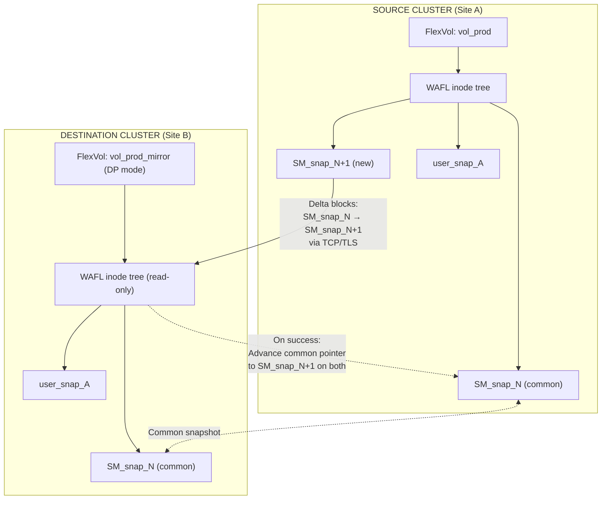
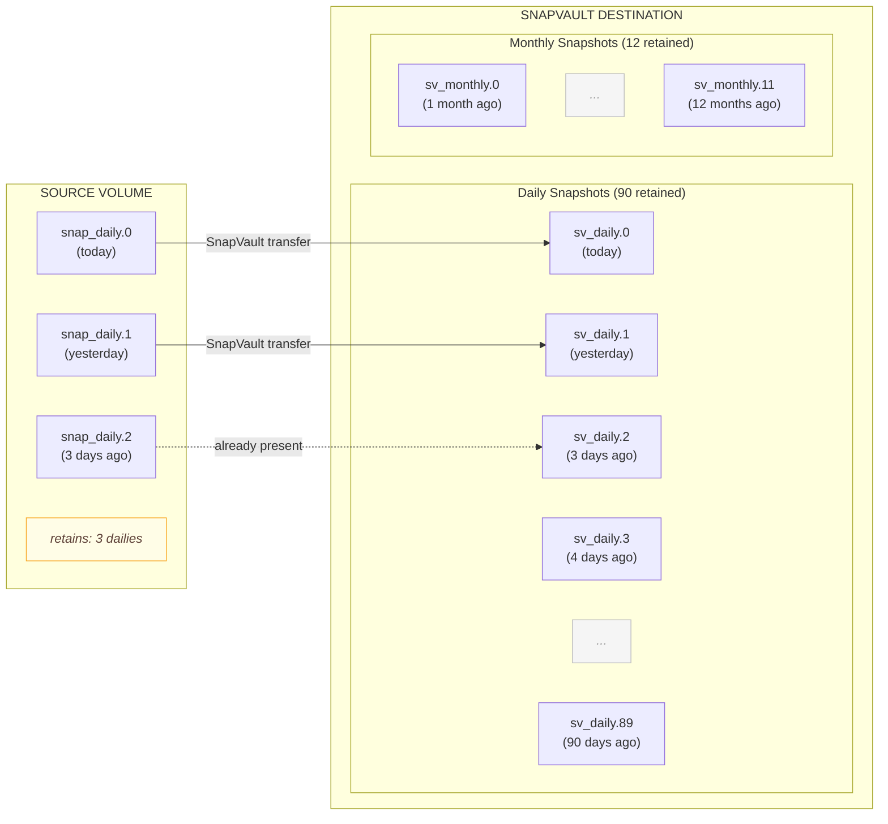
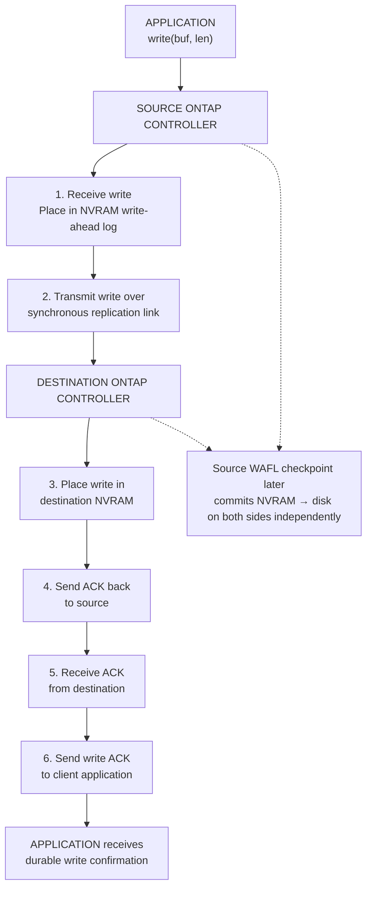
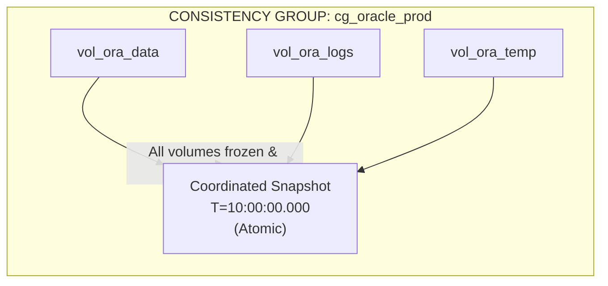

# Lesson 4: Data Protection Replication Models

## 1. First-Principles Intuition & Invariants

Every storage system ultimately confronts a single inescapable physical reality: any medium that can write data can also fail to preserve it. Spinning disks develop bad sectors, flash cells wear out, entire data centers lose power, and—most insidiously—software bugs can corrupt data silently over months before the corruption is ever detected. The engineering discipline of data replication exists not to eliminate these failure modes, which is impossible, but to bound the temporal and spatial extent of data loss when they materialize. Understanding how NetApp approaches this problem requires first understanding what it means, mathematically and operationally, to make a durable promise about data.

The two canonical metrics in data protection are the Recovery Point Objective (RPO) and the Recovery Time Objective (RTO). RPO answers the question: at the moment of failure, how far back in time does the most recent recoverable state sit? An RPO of zero means no data is ever lost—every write that was acknowledged to the application exists in at least two independent, failure-isolated locations. An RPO of one hour means the organization has accepted that up to one hour of writes may be irrecoverably lost in the worst case. RTO answers a different question: once failure is declared, how long does restoration of service take? These two metrics are not independent. Achieving zero RPO generally requires synchronous replication, which introduces write latency proportional to the round-trip time between source and destination, which in turn can degrade application throughput and therefore affect the RTO calculus when destinations are geographically distant.

NetApp's data protection portfolio is built on a versioned snapshot substrate called WAFL—the Write Anywhere File Layout. WAFL is a copy-on-write filesystem whose consistency model is rooted in the concept of a consistent point-in-time image called a Snapshot. Because WAFL never overwrites existing data blocks in-place but instead writes new blocks and atomically updates the inode tree at a commit point, every Snapshot is simply a pointer to a frozen inode tree root. The cost of creating a Snapshot is therefore O(1) in time and proportional to metadata overhead rather than data volume. This architecture is not incidental to NetApp's replication story—it is its entire mechanical foundation. SnapMirror, SnapVault, and synchronous replication all operate by transferring and anchoring these versioned Snapshot trees between volumes, either on the same cluster or across a WAN to a remote cluster.

The core invariant governing all WAFL-based replication is this: *replication correctness is defined by Snapshot consistency, not by continuous block-level streaming*. This distinguishes NetApp's approach from journal-based or change-block-tracking replication engines. When a SnapMirror transfer occurs, the system does not stream a live byte range—it transfers the delta between two named, immutable Snapshot boundaries. This guarantees that the destination volume, at the conclusion of a successful transfer, represents a point-in-time consistent image of the source, free of torn writes or partial I/O.

---

## 2. Core Architecture & Mechanics

### SnapMirror: Asynchronous Replication Engine

SnapMirror is NetApp's primary asynchronous replication technology, designed to replicate FlexVol volumes, FlexGroup volumes, and—with ONTAP 9.3 and later—entire Storage Virtual Machines (SVMs, also called Vservers) including their namespace configuration, export policies, and CIFS shares. Understanding SnapMirror requires a precise mental model of its state machine.

At the moment a SnapMirror relationship is initialized, the source volume holds an ordered series of Snapshots. ONTAP creates a dedicated Snapshot labeled as the SnapMirror baseline—call it `SM_snap_0`—and performs a full baseline transfer of all data blocks reachable from that Snapshot to the destination. The destination volume is placed in a read-only, restricted state called DP (Data Protection) mode; it cannot serve client reads or writes while functioning as a replication target. This is an intentional design constraint that eliminates the split-brain complexity inherent in active-active models. The destination is a true passive standby.

After the baseline transfer completes, all subsequent SnapMirror updates are incremental. ONTAP computes the block-level delta between the most recent transferred Snapshot and the next Snapshot created on the source. The transfer engine uses a persistent block-change log maintained by WAFL, allowing it to enumerate changed blocks without scanning the entire volume. This delta is transmitted over TCP using the SnapMirror Data Transfer Protocol (NDMP-based internally, though exposed through ONTAP REST and ZAPI control planes), compressed and optionally deduplicated in-flight, and applied to the destination. Once the destination confirms the transfer is complete and consistent, ONTAP atomically creates the corresponding Snapshot on the destination and advances the SnapMirror common Snapshot pointer—the anchor that marks the last mutually known consistent state between source and destination.

The critical failure-resilience property here is that the common Snapshot pointer is never advanced until both sides confirm integrity. If a transfer is interrupted mid-flight, the next scheduled update simply restarts from the last committed common Snapshot, discarding any partially received blocks. The destination cannot enter a corrupted intermediate state because WAFL's copy-on-write geometry ensures that the destination's current consistent Snapshot remains untouched until the new transfer is fully committed.



The RPO of an asynchronous SnapMirror relationship is therefore equal to the interval between successive Snapshot-and-transfer cycles. With a schedule of every five minutes (the minimum for standard SnapMirror in most ONTAP releases), the worst-case data loss is five minutes of writes—those acknowledged by the source after `SM_snap_N+1` was cut but before `SM_snap_N+2` completes transfer. Modern ONTAP deployments running SnapMirror over low-latency metro links can achieve sub-minute RPOs in practice, though the operational floor depends on volume change rate, available bandwidth, and cluster CPU budget for transfer processing.

The following CLI workflow establishes a SnapMirror relationship between two clusters with a five-minute replication schedule:

**Step 1 — Peer the clusters (run once per cluster pair):**

```shell
# On source cluster
cluster_A::> cluster peer create -peer-addrs 10.20.30.1,10.20.30.2 \
    -ipspace Default

# On destination cluster — accept the peer relationship
cluster_B::> cluster peer create -peer-addrs 10.10.10.1,10.10.10.2 \
    -ipspace Default
```

**Step 2 — Peer the SVMs:**

```shell
# On source cluster
cluster_A::> vserver peer create -vserver svm_prod \
    -peer-vserver svm_dr \
    -peer-cluster cluster_B \
    -applications snapmirror

# On destination cluster — accept
cluster_B::> vserver peer accept -vserver svm_dr \
    -peer-vserver svm_prod
```

**Step 3 — Create destination volume in DP mode:**

```shell
cluster_B::> vol create -vserver svm_dr \
    -volume vol_prod_mirror \
    -aggregate aggr_dr_01 \
    -size 2TB \
    -type DP
```

**Step 4 — Create the SnapMirror policy (mirror-vault hybrid):**

```shell
cluster_B::> snapmirror policy create \
    -vserver svm_dr \
    -policy pol_5min_mirror \
    -type async-mirror \
    -comment "5-minute RPO async replication"

cluster_B::> snapmirror policy add-rule \
    -vserver svm_dr \
    -policy pol_5min_mirror \
    -snapmirror-label sm_5min \
    -keep 12
```

**Step 5 — Create the relationship and initialize:**

```shell
cluster_B::> snapmirror create \
    -source-path svm_prod:vol_prod \
    -destination-path svm_dr:vol_prod_mirror \
    -policy pol_5min_mirror \
    -schedule cron_5min

cluster_B::> snapmirror initialize \
    -destination-path svm_dr:vol_prod_mirror

# Monitor initialization progress
cluster_B::> snapmirror show \
    -destination-path svm_dr:vol_prod_mirror \
    -fields state,transfer-bytes,lag-time
```

The `lag-time` field in the final `snapmirror show` output is the operational RPO indicator. It measures the time elapsed since the last successful Snapshot transfer completed. SREs should alert when `lag-time` exceeds the policy interval by a configurable threshold—NetApp's recommended threshold is `2 × schedule_interval`—as this indicates transfer failures or bandwidth saturation.

### SnapVault: Disk-to-Disk Backup with Long Retention

SnapVault solves a different problem than SnapMirror. Where SnapMirror maintains a continuously updated mirror for disaster recovery failover, SnapVault maintains a long-retention archive of multiple independent Snapshot generations for data recovery—restoring individual files, LUNs, or directories that were deleted or corrupted, potentially weeks or months ago. This is the distinction between disaster recovery (SnapMirror's domain) and backup-and-restore (SnapVault's domain), and conflating them is a common architectural error.

The mechanical difference between SnapMirror and SnapVault is in how they handle Snapshots at the destination. SnapMirror maintains a destination that mirrors the source's Snapshot inventory: when a Snapshot ages off the source, it ages off the destination. The destination is always in approximate topological agreement with the source's current state. SnapVault, by contrast, maintains its own independent Snapshot retention schedule at the destination, governed by a separate retention policy. The destination can hold 90 daily Snapshots, 12 monthly Snapshots, and 7 yearly Snapshots simultaneously, long after the corresponding source Snapshots have been deleted. The SnapVault destination accumulates history that the source has discarded.



The transfer mechanism for SnapVault is identical to SnapMirror at the block transport layer—it transfers deltas between Snapshot boundaries. The divergence is entirely in retention policy semantics. This architectural unification means that in ONTAP 8.2 and later, NetApp merged both capabilities under the "extended data protection" (XDP) relationship type, allowing a single SnapMirror XDP relationship to function as both a disaster recovery mirror and a long-retention vault simultaneously. The relationship type a practitioner chooses—DP (mirror-only) or XDP (unified mirror-vault)—determines which Snapshot retention rules apply at the destination.

Configuring a SnapVault relationship follows the same cluster and SVM peering prerequisites as SnapMirror. The critical difference is in the policy type (`vault` or `mirror-vault`) and in the SnapMirror labels used to match source Snapshots to destination retention rules:

**Step 1 — Create a vault policy on the destination cluster:**

```shell
cluster_B::> snapmirror policy create \
    -vserver svm_vault \
    -policy pol_vault_90d \
    -type vault \
    -comment "90-day daily backup, 12-month monthly archive"

cluster_B::> snapmirror policy add-rule \
    -vserver svm_vault \
    -policy pol_vault_90d \
    -snapmirror-label daily \
    -keep 90

cluster_B::> snapmirror policy add-rule \
    -vserver svm_vault \
    -policy pol_vault_90d \
    -snapmirror-label monthly \
    -keep 12
```

**Step 2 — Configure source Snapshot policy to generate labeled Snapshots:**

```shell
cluster_A::> snapshot policy create \
    -vserver svm_prod \
    -policy snap_pol_vault \
    -enabled true \
    -schedule1 @daily \
    -count1 3 \
    -snapmirror-label1 daily \
    -schedule2 @monthly \
    -count2 2 \
    -snapmirror-label2 monthly
```

**Step 3 — Create XDP relationship and initialize:**

```shell
cluster_B::> snapmirror create \
    -source-path svm_prod:vol_prod \
    -destination-path svm_vault:vol_prod_vault \
    -type XDP \
    -policy pol_vault_90d \
    -schedule cron_daily

cluster_B::> snapmirror initialize \
    -destination-path svm_vault:vol_prod_vault
```

The SnapMirror label mechanism is the precise control surface for vault retention. The source Snapshot policy stamps each Snapshot with a label string (`daily`, `monthly`). The vault policy on the destination maps those labels to retention counts. Only Snapshots whose labels match a rule in the destination policy are transferred and retained. Unlabeled Snapshots are ignored by SnapVault, which allows source administrators to maintain local operational Snapshots (hourly, pre-backup) without polluting the vault's retention inventory.

### Synchronous Replication: SnapMirror Synchronous

SnapMirror Synchronous (SM-S) achieves zero-RPO replication by inserting the destination write acknowledgment into the source I/O commit path. The source WAFL filesystem does not acknowledge a client write as durable until the destination storage system has confirmed that the same write has been persisted to stable storage. The fundamental guarantee is therefore: *no write acknowledged to the application is ever lost*, because every acknowledged write exists on two independent storage systems before the application sees confirmation.

ONTAP implements SM-S through two synchronization policies that trade consistency scope for failure tolerance: `Sync` and `StrictSync`.

Under `Sync` policy, ONTAP acknowledges the client write as soon as both the source NVRAM (the battery-backed write cache) and the destination NVRAM have committed the write. WAFL's commit to spinning disk or flash is deferred to the normal WAFL checkpoint cycle, which runs every few seconds. This model delivers zero-RPO against any failure that does not simultaneously destroy both NVRAMs, which covers the vast majority of realistic failure scenarios including controller failures, disk failures, and site power loss. The latency impact is precisely the network round-trip time between source and destination NVRAMs, plus processing overhead—typically 2–5 ms for a synchronous storage pair residing in the same metropolitan area.

Under `StrictSync` policy, ONTAP tightens the consistency guarantee: if replication connectivity to the destination is lost for any reason, the source immediately halts all client I/O rather than continuing to serve writes that cannot be replicated. This prevents any data divergence between source and destination at the cost of I/O availability during link failures. `StrictSync` is appropriate for financial transaction systems, database journals, and any application where split-brain data divergence is architecturally unacceptable. `Sync` policy, by contrast, allows the source to continue serving I/O during a link interruption (entering an "out-of-sync" state) and resynchronizes automatically when connectivity is restored, with the brief window of unreplicated writes representing the actual RPO incurred.



Configuring SM-S requires ONTAP 9.5 or later and a cluster peering relationship whose inter-cluster network latency does not exceed 10 ms RTT for `Sync` policy (20 ms for some specific workloads with explicit NetApp validation). The initialization workflow mirrors asynchronous SnapMirror but specifies the `sync` or `strict-sync` policy type:

**Step 1 — Create the synchronous policy:**

```shell
cluster_B::> snapmirror policy create \
    -vserver svm_dr \
    -policy pol_zero_rpo \
    -type sync \
    -sync-type Sync \
    -comment "Zero-RPO synchronous mirror"
```

**Step 2 — Create the SM-S relationship:**

```shell
cluster_B::> snapmirror create \
    -source-path svm_prod:vol_prod \
    -destination-path svm_dr:vol_prod_mirror \
    -policy pol_zero_rpo

cluster_B::> snapmirror initialize \
    -destination-path svm_dr:vol_prod_mirror
```

**Step 3 — Verify synchronous relationship health:**

```shell
cluster_B::> snapmirror show \
    -destination-path svm_dr:vol_prod_mirror \
    -fields state,is-healthy,relationship-status,lag-time

# Expected output for healthy SM-S:
# state: Snapmirrored
# is-healthy: true
# relationship-status: InSync
# lag-time: 0
```

The `InSync` state is the operational health indicator for SM-S. Any transition to `OutOfSync` triggers an ONTAP EMS event that should feed directly into monitoring infrastructure. Under `Sync` policy, `OutOfSync` does not halt source I/O, but the duration of the `OutOfSync` window becomes the actual RPO if a source failure occurs during that window.

### Consistency Groups

Replicating a single volume in isolation is straightforward. Replicating a multi-volume application—a database whose data files live on `vol_data`, whose redo logs live on `vol_logs`, and whose tempfiles live on `vol_temp`—requires that all three volumes be captured at an identical point in time. A SnapMirror transfer that captures `vol_data` at T=10:00:00.000 and `vol_logs` at T=10:00:00.047 produces a recoverable image that is 47 milliseconds temporally inconsistent. For a transactional database with write-ahead logging, this is catastrophic: the redo log may reference transactions that the data files have not yet reflected, or the data files may contain committed transactions whose log records have already been overwritten.

ONTAP Consistency Groups (CGs), introduced in ONTAP 9.7 for SAN and extended to NAS in later releases, solve this by creating a crash-consistent coordinated Snapshot across all member volumes simultaneously. A Consistency Group is an ONTAP object that groups volumes under a single namespace and exposes a single Snapshot operation that suspends I/O acknowledgment across all member volumes, flushes all pending writes, takes Snapshots on each member simultaneously, and then releases the I/O hold. The entire freeze-and-snapshot operation completes within microseconds from the perspective of the storage system, ensuring that the resulting Snapshot set across all volumes reflects the same crash-consistent storage state.



Creating and replicating a Consistency Group in ONTAP uses the REST API (ONTAP 9.10+) rather than the CLI, as CG management is fully REST-native:

**Step 1 — Create the Consistency Group:**

```shell
curl -X POST https://cluster_A/api/application/consistency-groups \
    -u admin:password \
    -H "Content-Type: application/json" \
    -d '{
        "name": "cg_oracle_prod",
        "svm": { "name": "svm_prod" },
        "volumes": [
            { "name": "vol_ora_data" },
            { "name": "vol_ora_logs" },
            { "name": "vol_ora_temp" }
        ]
    }'
```

**Step 2 — Take a manual application-consistent CG Snapshot:**

```shell
curl -X POST \
    https://cluster_A/api/application/consistency-groups/{cg_uuid}/snapshots \
    -u admin:password \
    -H "Content-Type: application/json" \
    -d '{
        "name": "cg_snap_preupgrade",
        "consistency_type": "application",
        "comment": "Pre-upgrade consistency point"
    }'
```

**Step 3 — Configure CG SnapMirror relationship via REST:**

```shell
curl -X POST https://cluster_B/api/snapmirror/relationships \
    -u admin:password \
    -H "Content-Type: application/json" \
    -d '{
        "source": {
            "consistency_group": {
                "name": "cg_oracle_prod"
            },
            "svm": { "name": "svm_prod" },
            "cluster": { "name": "cluster_A" }
        },
        "destination": {
            "consistency_group": {
                "name": "cg_oracle_prod_mirror"
            },
            "svm": { "name": "svm_dr" }
        },
        "policy": { "name": "AutomatedFailOver" }
    }'
```

The `AutomatedFailOver` policy (available in ONTAP 9.8+ for SAN) is the production policy for zero-RPO CG SnapMirror, binding synchronous replication semantics to multi-volume consistency. It supports automatic, non-disruptive failover for SAN hosts connected via iSCSI or FC through ALUA-aware path management, allowing a host to continue serving I/O transparently even when the source controller fails.

---

## 3. High-Performance Optimization & Failure Modes

### Transfer Throttling and Bandwidth Budgeting

SnapMirror transfers run as background tasks on the ONTAP source controller, consuming both CPU cycles for block enumeration and compression, and network bandwidth on the inter-cluster LIF. In production environments where SnapMirror shares inter-cluster links with backup traffic, SVM migration, or multiple concurrent replication relationships, unthrottled transfer bursts can saturate the inter-cluster network and inflate lag-time for high-priority relationships. ONTAP provides per-relationship and per-network-interface throttles:

```shell
# Apply a 500 MB/s transfer rate limit to a specific relationship
cluster_B::> snapmirror modify \
    -destination-path svm_dr:vol_prod_mirror \
    -throttle 512000

# Alternatively, set a network interface bandwidth limit
# that applies to all replication traffic on that LIF
cluster_A::> network interface modify \
    -vserver svm_prod \
    -lif ic_lif_01 \
    -failover-policy local-only \
    -dns-zone none \
    -auto-revert true

cluster_A::> network qos-policy-group create \
    -policy-group pg_snapmirror_cap \
    -vserver svm_prod \
    -max-throughput 400MB/s
```

A subtler optimization involves ONTAP's network compression for SnapMirror transfers. Compression is enabled by default for transfers over WAN paths but can be disabled for LAN transfers where the CPU cost of compression exceeds the savings from reduced wire time. The control is at the relationship level:

```shell
cluster_B::> snapmirror modify \
    -destination-path svm_dr:vol_prod_mirror \
    -is-network-compression-enabled true
```

For FlexGroup volumes—NetApp's scale-out volume type that distributes data across multiple constituent volumes on multiple nodes—SnapMirror must replicate all constituents in parallel, and the slowest constituent governs the overall lag-time. When a FlexGroup SnapMirror relationship shows elevated lag-time, the diagnostic procedure is to inspect individual constituent transfer statistics:

```shell
cluster_B::> snapmirror show -expand \
    -destination-path svm_dr:vol_flexgroup_mirror \
    -fields lag-time,transfer-bytes,state
```

The `-expand` flag displays each constituent relationship individually, allowing identification of a hot constituent that is falling behind due to uneven data distribution or aggregate-level I/O congestion.

### Failure Modes: What Actually Breaks Replication

The most operationally dangerous failure mode for asynchronous SnapMirror is the **stale common Snapshot**. If the source volume's Snapshot policy deletes the common Snapshot before a SnapMirror transfer completes—which can happen if the common Snapshot is old enough to age out of the retention policy during a prolonged transfer failure—SnapMirror loses its incremental transfer anchor. The relationship enters the `Broken-Off` state and requires a full re-baseline transfer, consuming the entire volume worth of bandwidth. Preventing this requires ensuring that the source Snapshot policy retains at least two more Snapshots than the maximum transfer failure duration could consume. The minimum safe formula is `source_retention_count ≥ (max_outage_hours / schedule_interval_hours) + 2`.

The `Broken-Off` state is surfaced in monitoring as follows:

```shell
cluster_B::> snapmirror show \
    -destination-path svm_dr:vol_prod_mirror \
    -fields state,unhealthy-reason

# Output indicating broken relationship:
# state: Broken-off
# unhealthy-reason: "Common Snapshot copy has been deleted"
```

Recovery from a `Broken-Off` state requires resynchronization from scratch:

```shell
# Resync (triggers new baseline—bandwidth-intensive)
cluster_B::> snapmirror resync \
    -destination-path svm_dr:vol_prod_mirror

# Monitor resync progress
cluster_B::> snapmirror show \
    -destination-path svm_dr:vol_prod_mirror \
    -fields state,transfer-bytes
```

For synchronous SnapMirror, the failure mode landscape is structurally different. The critical failure scenario is a synchronous relationship that is `OutOfSync` for an extended period due to a network partition, and during which the source controller fails. In this scenario, the destination holds the last consistent replicated state, but all writes acknowledged to the application after the last successful synchronous commit are unrecoverable. Under `StrictSync` policy, this scenario is prevented because the source halts I/O when it cannot reach the destination—but this trades data durability for availability, which is the correct trade-off for applications that cannot tolerate divergence. Under `Sync` policy, the application continues writing, and the actual RPO becomes the duration of the network partition. Monitoring systems must therefore alert on `OutOfSync` immediately and treat the duration of that state as the live RPO.

A less obvious failure mode is **SVM DR relationship fan-out interference**. When an SVM SnapMirror relationship exists alongside individual volume SnapMirror relationships for volumes within that SVM, ONTAP's lock ordering for Snapshot creation can produce transfer serialization: the SVM-level Snapshot must coordinate across all volumes in the SVM, and concurrent volume-level transfers must wait. In large SVMs with hundreds of volumes, this serialization can cause individual volume relationships to miss their scheduled transfer windows. The diagnostic is to examine transfer start times across relationships:

```shell
cluster_B::> snapmirror show -fields source-path,last-transfer-end-timestamp,lag-time | \
    sort-field last-transfer-end-timestamp
```

Persistent clustering of `last-transfer-end-timestamp` values around the same second indicates serialized transfers, which should trigger a review of SVM scope and whether certain high-priority volumes should be migrated to a dedicated SVM to escape the serialization lock domain.

### Recovery Workflow: Planned Failover and Failback

A planned SnapMirror failover—executed during a scheduled maintenance window or controlled cutover—requires quiescing the relationship, breaking the mirror, and reversing replication for failback:

**Planned failover sequence:**

```shell
# Step 1: Quiesce the relationship (stop scheduled transfers)
cluster_B::> snapmirror quiesce \
    -destination-path svm_dr:vol_prod_mirror

# Step 2: Wait for any in-progress transfer to complete
cluster_B::> snapmirror show \
    -destination-path svm_dr:vol_prod_mirror \
    -fields state,transfer-bytes

# Step 3: Break the mirror (destination becomes read-write)
cluster_B::> snapmirror break \
    -destination-path svm_dr:vol_prod_mirror

# Step 4: Mount destination volume and redirect application
cluster_B::> vol mount \
    -vserver svm_dr \
    -volume vol_prod_mirror \
    -junction-path /prod_data

# [Application writes now flow to cluster_B]

# Step 5: Reverse SnapMirror for failback (make original source the new destination)
cluster_A::> snapmirror resync \
    -source-path svm_dr:vol_prod_mirror \
    -destination-path svm_prod:vol_prod

# Step 6: When ready to fail back, repeat the break/resync cycle in reverse
```

Unplanned failover—where the source is unavailable and cannot be quiesced—skips the quiesce step and proceeds directly to `snapmirror break` on the destination, with the understanding that the destination's most recent Snapshot represents the furthest-back-in-time recovery state, and any writes after that Snapshot were lost. After the source cluster is recovered, the failback resync transfers only the delta between the common Snapshot and the current destination state, which is bounded by the RPO window rather than the full volume size—a critical operational property that keeps failback windows predictable.

The RPO, RTO, and topology choices explored throughout this lesson are not abstract policy decisions. They resolve into concrete ONTAP object configurations, Snapshot retention arithmetic, network bandwidth budgets, and cluster peering topologies. Every RPO commitment an organization makes to its stakeholders is ultimately backed by a SnapMirror relationship type, a schedule interval, a Snapshot retention count, and a network that can drain the volume change rate within that interval. The engineer's job is to verify, continuously, that the operational reality matches that commitment—and the tools to do so are all present in `snapmirror show`.
