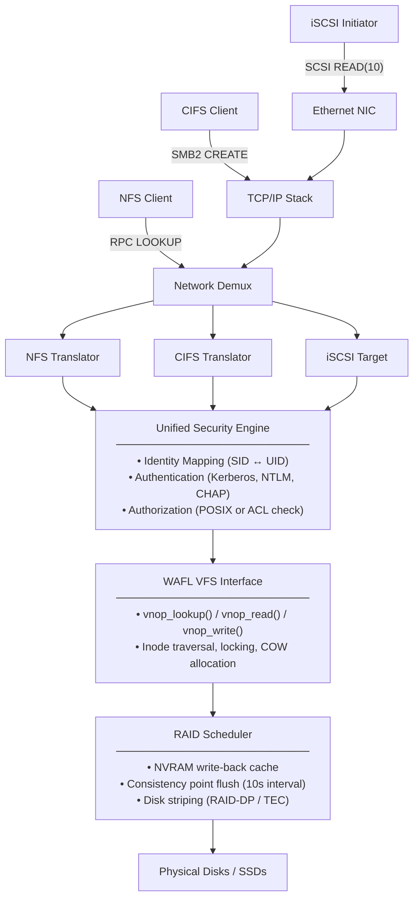

# Lesson 5: Multi-Protocol Unified Storage Stack

## 1. First-Principles Intuition & Invariants

The fundamental architectural challenge in enterprise storage systems lies not in serving data through a single protocol, but in presenting a unified, coherent view of stored objects across radically different access semantics. NetApp's Data ONTAP operating system confronts this challenge by constructing a multi-protocol storage stack where a single inode—a single on-disk data structure representing a file or logical unit—can be simultaneously accessed through NFS (Network File System), CIFS (Common Internet File System, the modern name for SMB), iSCSI (Internet Small Computer Systems Interface), and Fibre Channel protocols. This architectural unification is not merely a convenience feature but a hard-fought invariant that emerges from careful protocol translation, security model reconciliation, and namespace coherence guarantees.

At the heart of this design lies the WAFL (Write Anywhere File Layout) filesystem, which serves as the substrate upon which all protocol handlers operate. WAFL maintains a single source of truth for storage objects, whether those objects manifest to clients as POSIX files, Windows streams, or SCSI block devices. The protocol handlers themselves—NFS daemon threads, CIFS session managers, iSCSI target engines, and FC target ports—do not maintain independent copies of metadata or divergent views of the storage hierarchy. Instead, they translate protocol-specific semantics into canonical WAFL operations: lookups, reads, writes, and attribute modifications. This translation layer enforces consistency through a unified locking mechanism that prevents race conditions when, for example, a CIFS client modifies a file's ACL (Access Control List) while an NFS client simultaneously attempts to read the same file using UNIX permissions.

The invariants that govern this multi-protocol stack are strict. First, **identity unification**: every authenticated client identity, whether it arrives as a Kerberos principal from NFS, an Active Directory SID (Security Identifier) from CIFS, or a CHAP (Challenge-Handshake Authentication Protocol) username from iSCSI, must map to a canonical ONTAP user identity with a deterministic UID and set of group memberships. Second, **permission reconciliation**: when protocols with conflicting permission models (POSIX mode bits versus Windows discretionary ACLs) collide on the same file, ONTAP must deterministically choose a security style and enforce it atomically, never allowing a read operation to succeed under one model while a concurrent write fails under another. Third, **namespace coherence**: symbolic links, hard links, and mount points must behave predictably across all protocols, even when some protocols (like iSCSI) have no native concept of a filesystem namespace. Fourth, **lock compatibility**: advisory locks acquired through NFS's NLM (Network Lock Manager) protocol must coexist with opportunistic locks (oplocks) granted to Windows clients, and mandatory byte-range locks must be respected by block protocols operating on the same underlying data.

The unified namespace theory that underpins NetApp's architecture treats the storage system as a single, globally consistent tree rooted at the SVM (Storage Virtual Machine) namespace. Each SVM presents an independent root directory, beneath which volumes appear as junction points. Within volumes, qtrees (quota trees) provide a second level of hierarchical subdivision, allowing administrators to partition a volume's capacity and apply independent policies for quotas, security styles, and protocol access. This tree structure is not merely a logical abstraction; it is enforced by the WAFL filesystem's internal inode hierarchy, where each directory inode contains a B-tree of name-to-inode mappings, and each file inode references a tree of indirect blocks pointing to 4KB data blocks. When an NFS client performs a multi-hop lookup like `/vol/engineering/docs/2025/Q1/report.docx`, ONTAP walks this structure sequentially, checking permissions at each directory level before descending to the next, exactly as a POSIX filesystem would. When a CIFS client accesses the same file via `\\netapp-svm\engineering\docs\2025\Q1\report.docx`, ONTAP translates the UNC path to the identical inode traversal, applying Windows security checks at each junction.

The protocol handling architecture is fundamentally asynchronous and event-driven. ONTAP's kernel maintains a thread pool for each protocol service—dozens of `nfsd` threads for NFS, a separate pool for CIFS connection handlers, and dedicated worker threads for iSCSI command processing. When a network packet arrives on a physical or virtual interface, the network stack demultiplexes it by protocol (TCP port 2049 for NFS, 445 for CIFS, 3260 for iSCSI) and enqueues the request into the appropriate service queue. The protocol handler thread dequeues the request, performs authentication and authorization checks, translates the protocol-specific operation into a WAFL call, awaits the filesystem response, and constructs a protocol-compliant reply. This pipeline introduces latency at each stage: network stack processing, protocol parsing, security validation, WAFL traversal, disk I/O (if the data is not cached), and reply serialization. High-performance configurations minimize this latency through interrupt coalescing, zero-copy DMA transfers, and aggressive read-ahead caching in NVRAM-backed memory.

Block protocols—iSCSI and Fibre Channel—introduce an additional layer of abstraction. Unlike file protocols that operate on named objects within a directory tree, block protocols expose LUNs (Logical Unit Numbers), which appear to initiators (clients) as raw SCSI disks. Inside ONTAP, however, a LUN is not a raw block device but a special file within a volume, typically stored at a path like `/vol/prod_luns/lun0`. This file is preallocated to a fixed size and structured with SCSI metadata: a fake partition table, a disk geometry descriptor, and a sparse map of allocated blocks. When an iSCSI initiator issues a `READ(10)` SCSI command to logical block address 8192, the iSCSI target translates this into a byte offset (8192 × 512 bytes = 4MB) and performs a `pread()` on the LUN file. If the LUN is space-reserved (thick-provisioned), ONTAP guarantees that every block has a physical allocation; if the LUN is thin-provisioned, unwritten blocks consume no disk space and return zeros on read. This duality allows NetApp systems to serve both transactional database workloads (which require predictable I/O latency and no write failures due to capacity exhaustion) and virtual machine storage (which benefits from thin provisioning's space efficiency).

The security styles that govern multi-protocol access—UNIX, NTFS, and mixed—form the core of ONTAP's permission reconciliation strategy. Every volume and qtree has an assigned security style that determines the authoritative source of truth for access control. In UNIX security style, the filesystem stores POSIX owner, group, and mode bits (the familiar `rwxr-xr-x` triplets), and all authorization decisions derive from these attributes, even for CIFS clients. When a Windows user accesses a UNIX-style file, ONTAP maps the user's SID to a UNIX UID through a name-mapping database (either local or LDAP-backed), then checks the POSIX permissions. If the mapped UID matches the file's owner or if the user's groups intersect with the file's group, access proceeds according to the mode bits. Conversely, in NTFS security style, the filesystem stores Windows discretionary ACLs (lists of security descriptors containing SIDs and permission masks like `READ_DATA`, `WRITE_DATA`, `APPEND_DATA`), and all clients—including NFS—are subject to ACL evaluation. An NFS client's UID is reverse-mapped to a SID, and the ACL is walked to determine whether the SID has the requested access. Mixed security style is the most complex: newly created files inherit their security style from the creating protocol. An NFS-created file becomes UNIX-style, a CIFS-created file becomes NTFS-style, and the two can coexist within the same directory. This flexibility introduces operational complexity, as administrators must reason about per-file security semantics rather than volume-wide policies.

The qtree architecture provides a lightweight partitioning mechanism within volumes, enabling capacity quotas, security boundaries, and protocol restrictions without requiring separate volumes. A qtree is a specially marked directory subtree identified by an opaque 32-bit qtree ID stored in its inode. Unlike a volume, which occupies a separate FlexVol container with independent snapshot reserves and growth limits, a qtree shares its parent volume's aggregate space but can have its own quota limits (user quotas, group quotas, and tree quotas) and its own security style override. Qtrees are often used to carve up a large volume for multi-tenancy: a `/vol/home` volume might contain thousands of user home directories, each as a qtree, with per-user quotas enforced by ONTAP's quota subsystem. The quota engine tracks usage by inode ownership and qtree membership, updating in-memory counters on every write operation and periodically flushing these counters to disk. When a quota is exceeded, ONTAP fails subsequent write operations with `EDQUOT` (disk quota exceeded), ensuring that one tenant cannot monopolize shared capacity.

LUN geometry—the logical structure of block addresses, cylinder-head-sector translations, and partition alignment—is a critical performance consideration for block protocol workloads. Even though modern SCSI LUNs no longer correspond to physical spinning platters with literal cylinders and heads, legacy operating systems and filesystems still expect a geometrically consistent block device. ONTAP constructs a fake CHS (cylinder-head-sector) geometry for each LUN based on its size, typically using 255 heads and 63 sectors per track, values that satisfy the expectations of most OS partition tools. More importantly, ONTAP enforces 4KB block alignment by default, ensuring that I/O operations land on WAFL's native 4KB block boundaries. Misaligned LUNs—where the filesystem's block allocations straddle two underlying WAFL blocks—can double write amplification, as a single 4KB guest OS write triggers two read-modify-write cycles in WAFL. NetApp's `lun create` command defaults to offset 0 for partitionless LUNs and offset 1MB for partitioned LUNs (the modern standard for GPT partition tables), guaranteeing alignment for both thick and thin provisioning modes.

Protocol performance is heavily gated by network stack efficiency and CPU utilization. ONTAP dedicates separate CPU cores to network processing, protocol handling, and WAFL I/O, leveraging NUMA (Non-Uniform Memory Access) awareness to keep packets and their associated processing on the same socket. For Fibre Channel, the system offloads much of the protocol processing to specialized HBAs (Host Bus Adapters) with hardware assistance for frame parsing, CRC computation, and DMA transfers. For iSCSI, ONTAP relies on TOE (TCP Offload Engine) NICs when available, but even without hardware offload, modern multi-core systems can saturate 10GbE and 25GbE links with software iSCSI stacks. NFS and CIFS workloads, being more metadata-intensive, benefit from large memory allocations to cache directory inodes and file attributes in DRAM, reducing the frequency of disk seeks. ONTAP's buffer cache is unified across all protocols, so a file read by an NFS client populates the same cache pages that a subsequent CIFS read would hit, eliminating redundant I/O.

The interaction between snapshots and multi-protocol access is subtle but critical. When ONTAP creates a snapshot, it freezes the WAFL consistency point, capturing the state of all inodes, block pointers, and namespace structures at that instant. This snapshot is visible through all protocols simultaneously: NFS clients can traverse `.snapshot` directories, CIFS clients see `~snapshot` folders (when enabled), and iSCSI initiators can clone LUNs from snapshots. However, the permissions required to access snapshot data depend on the security style of the parent volume. In UNIX security style, the `.snapshot` directory is owned by root and readable by all, reflecting the POSIX convention that snapshots are administrative resources. In NTFS security style, the snapshot directory inherits its ACL from the volume root, and only users with `Traverse Folder` and `List Folder` permissions can enumerate snapshots. This consistency ensures that snapshot access control remains predictable across all client protocols, preventing information leakage scenarios where a user denied access to the live filesystem could browse historical versions through a different protocol.

## 2. Core Architecture & Mechanics

The multi-protocol stack in Data ONTAP is architecturally decomposed into five major subsystems: the network demultiplexer, the protocol translator layer, the unified security engine, the WAFL filesystem interface, and the block I/O scheduler. Each subsystem operates as a pipelined stage with explicit handoff contracts, allowing ONTAP to scale protocol services across multiple CPU cores while maintaining strong consistency guarantees. The network demultiplexer sits at the bottom of the stack, receiving raw Ethernet frames from physical and virtual NICs. It examines the EtherType field to distinguish IP packets from other traffic (like FCoE or LLDP), then parses the IP header to extract the transport protocol (TCP, UDP, SCTP) and destination port. Based on this tuple, it routes the packet to the appropriate protocol handler's receive queue. For NFS over UDP, packets are delivered directly to the NFS RPC dispatcher; for NFS over TCP, they are first reassembled by the TCP stack, then handed to the RPC layer when a complete RPC request is buffered.

The protocol translator layer is where the semantic mapping from wire protocol to WAFL operations occurs. For NFS, the translator implements the NFSv3, NFSv4, and NFSv4.1 specifications, handling RPC procedure calls like `LOOKUP`, `READ`, `WRITE`, `GETATTR`, `SETATTR`, and compound operations in NFSv4. Each RPC procedure is unpacked from its XDR (External Data Representation) encoding, validated for parameter sanity, and transformed into a sequence of WAFL function calls. A `READ` RPC maps to a WAFL `vnop_read()` invocation on the target vnode (the in-kernel representation of an inode), which in turn resolves the file's block pointers and issues read requests to the RAID layer. The reply path reverses this process: WAFL returns data buffers, the NFS translator serializes them into XDR format, and the network stack transmits the TCP segment or UDP datagram. For CIFS, the translator is a full-featured SMB server implementing SMB2 and SMB3 protocols, including durable handles, multi-channel aggregation, and SMB Direct (RDMA). CIFS operations like `SMB2_CREATE`, `SMB2_READ`, `SMB2_WRITE`, and `SMB2_IOCTL` are parsed from SMB packet structures, authenticated using NTLM or Kerberos tokens, and converted to equivalent WAFL calls. The CIFS translator also maintains session state: open file handles, oplocks, byte-range locks, and connection metadata, all indexed by session ID and tree ID (the SMB identifier for a connected share).

Block protocol translators—iSCSI and FC—operate differently because they expose SCSI semantics rather than file operations. The iSCSI target maintains a session for each initiator, identified by the iSCSI Qualified Name (IQN) and ISID (Initiator Session ID). When an initiator sends a SCSI command PDU (Protocol Data Unit), the target parses the embedded CDB (Command Descriptor Block), which specifies the operation (`READ(10)`, `WRITE(10)`, `READ CAPACITY`, `INQUIRY`) and parameters (LBA, transfer length, flags). The target validates that the initiator has access to the addressed LUN, then translates the SCSI operation into a file operation on the LUN file. A `READ(10)` becomes a `pread()` at byte offset LBA × block size; a `WRITE(10)` becomes a `pwrite()` followed by an explicit `fsync()` if the FUA (Force Unit Access) bit is set in the CDB, bypassing the cache and ensuring data persistence. The Fibre Channel target operates similarly but offloads much of the low-level protocol handling to the HBA firmware. ONTAP's FC target driver constructs SCSI response frames with status codes, sense data, and optional data payloads, then hands them to the HBA for transmission. Both block protocol engines enforce SCSI reservations (persistent and legacy), allowing initiators to claim exclusive access to a LUN and preventing concurrent writes from other initiators—a critical feature for clustered filesystems and database RAC (Real Application Clusters) configurations.

The unified security engine is the centralized subsystem responsible for identity mapping, authentication validation, and access control evaluation. When a protocol handler receives a client request, it extracts the client's identity credentials: a Kerberos ticket for NFSv4, an NTLMSSP blob for CIFS, or a CHAP response for iSCSI. The security engine validates these credentials against the configured authentication sources—Active Directory domain controllers for Windows identities, LDAP servers for UNIX identities, or local user databases. If authentication succeeds, the engine performs name mapping to resolve the protocol-native identity into a canonical ONTAP user structure containing a UID, a list of GIDs, and a SID. Name mapping rules are expressed as ordered pattern-matching directives: for example, a rule might map the Windows user `CORP\john.doe` to the UNIX user `jdoe` with UID 5001, while a fallback rule maps all unmapped Windows users to `nobody`. Once the canonical identity is established, the security engine evaluates access control. For UNIX-style objects, it performs traditional POSIX permission checks: the effective UID is compared against the file's owner UID, and the effective GIDs are intersected with the file's group GID; if no match occurs, the "other" permission bits apply. For NTFS-style objects, the engine walks the DACL (Discretionary Access Control List) in order, comparing each ACE (Access Control Entry) against the user's SID and group SIDs, accumulating allowed and denied permissions according to Windows ACL evaluation semantics (explicit deny entries override explicit allow entries, and access is denied by default if no matching allow ACE is found).

The WAFL filesystem interface exposes a VFS-like (Virtual File System) abstraction to the protocol translators, allowing them to invoke generic operations—`vnop_lookup()`, `vnop_read()`, `vnop_write()`, `vnop_create()`, `vnop_remove()`—without knowledge of WAFL's internal layout. This abstraction is implemented through a dispatch table of function pointers, with each WAFL volume registering its own handlers. When a protocol translator calls `vnop_lookup("/vol/data/file.txt")`, WAFL walks the directory tree, resolving each path component by searching the parent directory's B-tree for the next component's name, loading the corresponding inode, checking permissions, and descending recursively. This traversal is instrumented with fine-grained locking: directory inodes are protected by read-write locks (allowing concurrent lookups but exclusive writes), and individual file inodes have their own locks to permit concurrent reads and serialized writes. WAFL's copy-on-write nature complicates the locking model: when a write operation occurs, WAFL allocates new blocks rather than overwriting existing blocks, then atomically updates the inode's block pointers during the next consistency point. This means that read operations never block on writes—readers continue accessing the old blocks while writers populate new ones—until the consistency point commits, at which time the new blocks become the authoritative version.

The block I/O scheduler sits beneath WAFL and is responsible for aggregating, reordering, and issuing disk operations to maximize throughput and minimize latency. ONTAP's scheduler is RAID-aware: it understands the layout of RAID 4, RAID-DP (dual parity), and RAID-TEC (triple parity) stripes across multiple disks and issues read requests to optimal disks to avoid head contention on SATA/SAS drives or load-balance across SSDs. Write operations are deferred through NVRAM (non-volatile RAM): when a protocol handler commits a write, WAFL logs the operation to NVRAM, acknowledges the write immediately, and schedules a background task to flush the dirty data to disk during the next consistency point (typically every 10 seconds). This write-back caching dramatically reduces write latency, as clients perceive sub-millisecond response times instead of waiting for physical disk rotations. However, it introduces a consistency window: if the system crashes between the NVRAM log and the disk flush, the lost writes are recovered from NVRAM on reboot, replaying the log to bring the filesystem to a consistent state. The scheduler also implements QoS (Quality of Service) policies, assigning I/O budgets to different workloads based on administrator-defined priorities. A high-priority LUN serving a latency-sensitive database might be allocated 5000 IOPS with a maximum latency of 2ms, while a low-priority backup job is throttled to 500 IOPS with no latency guarantees.

The protocol stack's interaction with snapshots deserves detailed mechanical exposition. When ONTAP creates a snapshot, it performs a consistency point flush, writing all dirty buffers to disk and freezing the current root inode block pointer. This root pointer becomes the snapshot's immutable entry point. The active filesystem continues using a new root pointer, and subsequent writes trigger copy-on-write allocations. When a client accesses a file through a snapshot (via `.snapshot/hourly.0/file.txt` in NFS), WAFL follows the snapshot's root pointer instead of the active root pointer, traversing the frozen inode tree. Critically, all protocols can access snapshots concurrently with active I/O, because snapshots are read-only and never modified. A CIFS client browsing `~snapshot\hourly.0` executes the same directory traversal logic as an NFS client, and an iSCSI initiator can clone a LUN from a snapshot by creating a new LUN file that initially references the snapshot's blocks (a space-efficient clone) and only allocates new blocks when the clone is written to.

The LUN geometry implementation within ONTAP's block protocol layer is meticulously engineered to avoid alignment pitfalls. When an administrator executes `lun create -path /vol/iscsi/lun0 -size 100GB`, ONTAP allocates a sparse file at that path and embeds a fake DOS/MBR partition table in the first 512 bytes, specifying a single partition starting at sector 2048 (1MB offset). This offset ensures that the partition's first block aligns with a 4KB boundary (2048 sectors × 512 bytes/sector = 1MB, which is 256 WAFL blocks of 4KB each). When a Windows or Linux host partitions the LUN, its partition tool detects this existing offset and preserves the alignment. For ESXi hosts, VMware's VMFS filesystem also defaults to 1MB alignment, avoiding misalignment issues. Inside the LUN file, ONTAP maintains a sparse block map: a B-tree indexed by LBA, where each entry records whether the block is allocated and, if so, its physical location in the aggregate. Unallocated blocks (holes) consume no disk space and return zeros on read. When a `WRITE SAME` SCSI command arrives (used by operating systems to initialize large regions with zeros or a pattern), ONTAP interprets it as a space reclamation hint and deallocates the affected blocks, returning them to the free pool.

The protocol translator layer also handles multi-protocol locking coordination. NFS clients acquire locks through the NLM protocol (a separate RPC service), sending `NLM_LOCK` requests that specify a file handle, byte range, and lock type (read or write). ONTAP stores these locks in a global lock table indexed by inode number and byte range, represented as a red-black tree for efficient range overlap queries. When a CIFS client requests an oplock on the same file, ONTAP must reconcile the semantics: NFS byte-range locks are advisory (the server records them but does not enforce them on I/O operations), while CIFS oplocks are break-on-access (the server revokes the lock and notifies the client if another client attempts conflicting access). ONTAP's policy is to deny oplocks on files with active NFS locks, preventing scenarios where a CIFS client caches file data locally under an oplock while an NFS client holds a lock and writes to the same region. Conversely, if a CIFS client holds an oplock, ONTAP breaks the oplock (sending an `SMB2 OPLOCK_BREAK` notification) when an NFS client attempts to lock or write the file, forcing the CIFS client to flush its cache and relinquish the oplock.

The qtree architecture is implemented as a special inode flag and a 32-bit qtree ID field in the inode metadata. When an administrator creates a qtree with `qtree create -volume vol0 -qtree qt0`, ONTAP marks the directory inode with the qtree flag and assigns it the next available qtree ID (starting from 1; qtree ID 0 is reserved for the default qtree, which encompasses all files not under an explicit qtree). The quota subsystem scans the volume periodically, walking the inode tree and summing disk usage (blocks and file counts) by owner UID, group GID, and qtree ID. These sums are stored in a quota database file within the volume, indexed by quota type and target identifier. When a write operation occurs, WAFL checks the quota database to determine if the operation would exceed the target's quota. If the quota is a hard limit (enforced), the write fails with `EDQUOT`. If the quota is a soft limit (advisory), the write succeeds but a warning is logged. Qtree quotas are particularly useful in multi-tenant environments, where each tenant is assigned a qtree with a capacity ceiling, preventing runaway consumption from affecting other tenants.

For multi-protocol export policies, ONTAP uses a rule-based access control system that operates at the volume and qtree level. An export policy consists of an ordered list of rules, each specifying a client match pattern (IP address, hostname, netgroup), a protocol set (NFS, CIFS, iSCSI), and an access mode (read-only, read-write, root access for NFS). When a client attempts to mount or connect to a volume, ONTAP evaluates the export policy rules in order until a match is found. The first matching rule determines the client's access level. For example, a rule might grant read-write NFS access to the subnet `192.168.1.0/24`, while denying access to all other clients. CIFS shares have a parallel permission model: each share has an ACL specifying which Windows users or groups can connect. Once connected, the client's access to individual files is further governed by the volume's security style and the file's NTFS ACL or POSIX permissions. This layered security model—export policy at the network level, share ACL at the SMB level, and filesystem permissions at the object level—provides defense in depth, ensuring that a misconfigured share ACL does not grant blanket access to sensitive data.

The performance characteristics of each protocol differ significantly due to their operational semantics. NFS workloads tend to be metadata-heavy, with frequent `GETATTR` and `LOOKUP` operations consuming CPU cycles in directory traversal and attribute serialization. NFSv3's stateless nature exacerbates this, as every operation includes a full file handle (containing the inode number, generation number, and export ID), requiring handle validation on each RPC. NFSv4 improves efficiency through compound operations, which batch multiple RPCs into a single network round-trip, but the server must still execute each sub-operation sequentially. CIFS workloads benefit from connection-oriented TCP streams and aggressive client-side caching under oplocks, reducing server load for read-heavy scenarios. However, CIFS's SMB2 protocol is chattier for metadata operations, often requiring multiple round-trips to query file attributes, security descriptors, and alternate data streams. iSCSI and FC workloads, being block-oriented, bypass the filesystem metadata layer entirely for data I/O, translating directly to LUN file offsets. This makes block protocols ideal for low-latency transactional workloads, but they sacrifice the flexibility of filesystem-level snapshots, clones, and deduplication (though ONTAP does support these features on LUNs, they operate at the LUN file level rather than per-block).

## 3. High-Performance Optimization & Failure Modes

Optimizing multi-protocol performance on NetApp systems requires simultaneous attention to network throughput, CPU utilization, memory caching, and disk I/O patterns. The most impactful optimization is proper network interface configuration. ONTAP supports link aggregation through LACP (Link Aggregation Control Protocol), allowing multiple physical Ethernet ports to be bonded into a single logical interface (ifgrp) with increased bandwidth and fault tolerance. For multi-protocol environments, administrators should configure separate VLANs for NFS, CIFS, and iSCSI traffic, tagging each VLAN with a distinct VLAN ID and assigning each protocol's logical interface (LIF) to its dedicated VLAN. This segregation prevents protocol cross-talk and allows per-VLAN QoS policies at the network switch layer. Additionally, enabling jumbo frames (9000-byte MTU) on iSCSI VLANs reduces CPU overhead by decreasing the packet count for large block transfers; however, jumbo frames require end-to-end support across all switches and NICs in the path, and mismatched MTU settings cause fragmentation and performance degradation.

CPU affinity tuning is critical for scaling protocol services across many cores. ONTAP's default scheduler pins network interrupt handling and protocol threads to specific CPU cores, leveraging NUMA locality to keep packets and their processing on the same memory controller. Administrators can inspect this affinity with `system node run -node <node> -command "sysstat -m"`, which displays per-core CPU utilization and interrupt distribution. In systems with heavy NFS load, increasing the `nfs.v4.num_threads` parameter (default 64) spawns additional NFS daemon threads, distributing RPC processing across more cores. However, excessive thread counts can introduce context-switching overhead, so tuning requires empirical measurement. For CIFS, the `cifs.max_mpx` parameter controls the maximum number of concurrent SMB commands per session; raising it from the default (50) to 255 allows clients with high-latency links to issue more in-flight requests, improving throughput at the cost of server memory.

Memory caching is where multi-protocol unification shines. Because all protocols share the same buffer cache, a file read by an NFS client populates cache entries that a subsequent CIFS or iSCSI read will hit, eliminating redundant disk I/O. ONTAP's buffer cache is dynamically sized, consuming as much free memory as available but shrinking under memory pressure to accommodate other subsystems (protocol state, inode cache, WAFL metadata). The cache eviction policy is a hybrid LRU/LFU (Least Recently Used / Least Frequently Used) algorithm that prioritizes frequently accessed blocks while aging out one-time sequential reads. For read-heavy workloads, administrators can increase the cache's priority by disabling unnecessary features like deduplication scanning or antivirus scanning, which compete for memory. For write-heavy workloads, NVRAM sizing becomes the bottleneck: ONTAP's NVRAM is finite (typically 2–16 GB depending on the controller model), and if the write rate exceeds the NVRAM flush rate, incoming writes are throttled, manifesting as increased client latency.

Disk I/O optimization for multi-protocol workloads hinges on workload segregation and tiering. Database LUNs, which exhibit random read-write patterns with low queue depths, should reside on SSD aggregates with RAID 10 or RAID-DP configurations for maximum IOPS and minimal latency. Sequential file workloads, like video streaming or backup ingestion, should reside on HDD aggregates with larger stripe widths (more disks per RAID group) to maximize throughput. ONTAP's Flash Pool feature hybridizes these tiers by caching hot blocks from HDD aggregates into SSD-backed cache drives, but Flash Pool introduces complexity: the cache promotion policy must be tuned to avoid thrashing (repeatedly evicting useful data), and cache hit rates must be monitored with `storage aggregate show-status` and `statistics show` commands. For all-flash systems, the bottleneck shifts to the RAID controller's CPU, which must compute parity for RAID-DP/TEC writes and handle thousands of parallel I/O completions per second. Enabling hardware-assisted RAID offload (when available) reduces this burden, but many all-flash configurations rely on software RAID and require careful CPU provisioning.

Failure modes in multi-protocol stacks are diverse and protocol-specific. NFS clients often exhibit hang behavior when the server becomes unresponsive: because NFS mounts default to hard mounts with infinite retry, a client will block indefinitely on a failed RPC, causing application freezes. Administrators should configure soft mounts with short timeouts (`timeo=100,soft` in Linux fstab) for non-critical mounts to allow applications to handle failures gracefully. CIFS clients are more resilient due to SMB's session-oriented design: if a connection drops, the client automatically reconnects and reestablishes handles using durable handle or persistent handle features (in SMB3). However, durable handle recovery fails if the file has been modified by another client in the interim, leading to stale handle errors (`STATUS_FILE_NOT_AVAILABLE`). iSCSI initiators are particularly sensitive to network interruptions: a single dropped packet during a SCSI command can trigger a 30-second timeout, followed by command retry or session recovery. Administrators should enable iSCSI error recovery level 0 or higher (`iface.iscsi.ErrorRecoveryLevel=1` in Linux open-iscsi configuration) to enable sequence number recovery and avoid full session reinstatement.

Locking conflicts between protocols represent a subtle but pernicious failure mode. Consider a scenario where an NFS client acquires a byte-range lock on a database file, then crashes without releasing the lock. The NLM protocol relies on a separate statd daemon to track client liveness; if statd fails to detect the crash, the lock persists indefinitely, blocking other clients. ONTAP implements a grace period (default 45 seconds) during which clients can reclaim locks after a server reboot, but stale locks from crashed clients require manual intervention via `vserver locks break`. CIFS oplocks are less prone to staleness because the SMB protocol includes a heartbeat mechanism (SMB2 ECHO), allowing the server to detect dead clients and revoke their oplocks proactively. However, oplock breaks introduce latency: when a CIFS client with a batch oplock (allowing aggressive caching) receives a break notification, it must flush dirty data and close cached handles before acknowledging the break, potentially delaying the requesting client by hundreds of milliseconds.

Quota exhaustion is a common failure in multi-tenant qtree configurations. When a user or qtree exceeds its hard quota, writes fail with `EDQUOT`, but the error propagation varies by protocol. NFS clients receive the error immediately as part of the write RPC reply, and well-behaved applications check the return code and report the failure. CIFS clients also receive an error, but the Windows SMB redirector may retry the write multiple times before surfacing the error to the application, adding latency. iSCSI initiators see quota failures as SCSI sense data with a sense key of `DATA_PROTECT` and an ASC/ASCQ (Additional Sense Code / Qualifier) of `SPACE_ALLOCATION_FAILED`, which most operating systems translate to an I/O error or out-of-space condition. Administrators should monitor quota usage with `quota report` and `volume show -fields available` to proactively expand volumes or quotas before exhaustion occurs.

Security style mismatches cause insidious authorization failures that are difficult to diagnose. A common scenario: a volume is configured with UNIX security style, and a Windows user creates a file via CIFS. ONTAP maps the user's SID to a UNIX UID (e.g., 10001) and sets the file's owner to that UID with default mode bits `0644` (owner read-write, group and others read-only). If the user later attempts to modify the file, ONTAP maps the SID to the same UID, confirms ownership, and grants write access—this works as expected. However, if another Windows user in the same group attempts to modify the file, ONTAP maps their SID to a different UID (say, 10002), checks the file's group and other permissions, finds no write access (group and others are read-only), and denies the write—even though both users are members of the same Windows group. The root cause is that UNIX mode bits encode group permissions based on a single GID, while Windows groups are multi-valued (a user belongs to dozens of groups). NTFS security style avoids this by storing an explicit ACL listing all permitted SIDs, but it requires the volume to be reformatted or migrated. Mixed security style mitigates the issue by allowing per-file security styles, but it introduces inconsistency: files in the same directory may have different permission semantics.

Network partition scenarios—where the storage controller remains online but network connectivity to clients is lost—expose the limits of protocol resilience. NFS clients with hard mounts will hang indefinitely, waiting for the network to recover. NFSv4 improves the situation with its lease-based design: clients must renew their leases every 90 seconds (the default lease time), and if renewal fails, the client assumes a network partition and forces applications to handle `EJUKEBOX` errors. CIFS clients with SMB multichannel can transparently fail over to an alternate network path, but this requires careful LIF configuration: each node must have at least two data LIFs on separate physical links, and the client must be configured to use multichannel (`Set-SmbClientConfiguration -EnableMultiChannel $true` in PowerShell). iSCSI multipathing (MPIO) provides path failover, but it requires the initiator to be configured with multiple target portals (IP addresses) and the operating system's multipath driver to detect path failures and reroute I/O. Without multipathing, an iSCSI session over a failed link will time out and disconnect, requiring manual intervention to restore connectivity.

Performance monitoring for multi-protocol workloads demands protocol-specific metrics and correlation across subsystems. For NFS, key metrics include RPC operation counts (`statistics show -object nfsv3 -counter total_ops`), average latency per operation type (`avg_latency_<op>`), and queue depth (`current_queue_depth`). High latency on `GETATTR` operations suggests CPU saturation, while high latency on `READ` or `WRITE` indicates disk bottlenecks. For CIFS, monitor SMB operation latencies (`statistics show -object cifs -counter smb2_<op>_latency_histogram`) and track oplock breaks per second (`oplocks_break_total`) to identify contention. For iSCSI, the critical metrics are SCSI command latency (`statistics show -object iscsi_lif -counter iscsi_cmd_latency`), queue depth (`iscsi_session_cmd_count`), and alignment statistics (`statistics show -object lun -counter aligned_read_ops` and `misaligned_write_ops`). Cross-subsystem correlation is achieved by examining WAFL consistency point durations (`wafl_cp_time_total`), which spike during heavy write periods and cascade into protocol latency spikes.

A final optimization frontier is protocol-specific tuning for large-scale deployments. For NFS exports serving thousands of clients, enable connection caching (`nfs.v4.client_cache_size`) to avoid repeated authentication overhead, and increase the NFS RPC slot table size (`nfs.rpc.slot_table_size`) to handle bursty traffic. For CIFS environments with large Active Directory forests, configure domain controller affinity to prefer nearby DCs, reducing authentication latency. For iSCSI, enable CHAP mutual authentication to prevent rogue initiators from spoofing legitimate clients, but be aware that CHAP adds cryptographic overhead to session establishment. In environments mixing file and block protocols, periodically audit LUN alignment with `lun show -fields misaligned` and use ONTAP's LUN migration tools to realign misaligned LUNs during maintenance windows, reclaiming the performance lost to write amplification. Above all, treat protocol performance as a system-wide property: optimizing NFS throughput is futile if the underlying RAID group is saturated with CIFS writes, and tuning iSCSI latency is ineffective if the network fabric drops packets due to switch buffer overflows. Multi-protocol optimization requires holistic measurement, disciplined change control, and continuous validation under production workloads.
