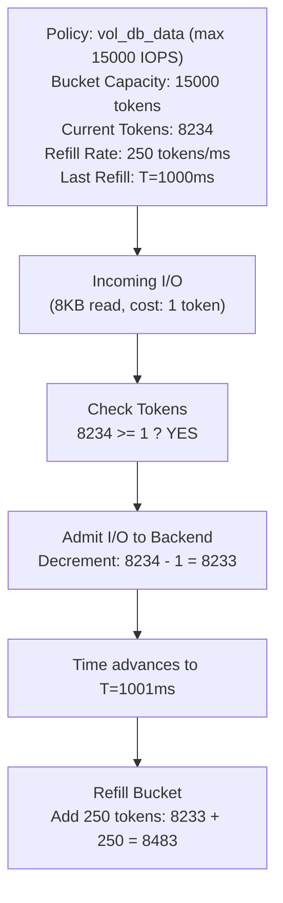
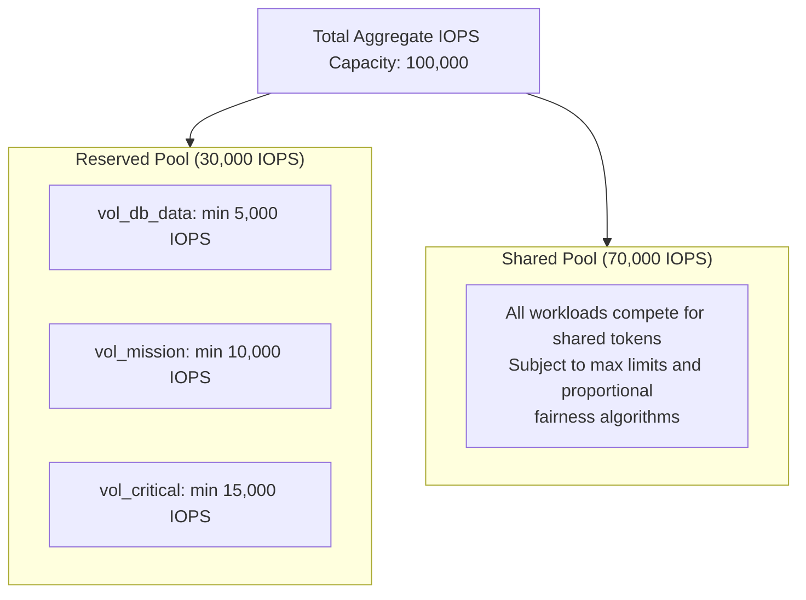

# Lesson 6: Performance Management QoS Framework

## 1. First-Principles Intuition & Invariants

Modern enterprise storage systems confront a fundamental tension: multiple concurrent workloads with heterogeneous performance requirements must share finite physical resources—spindles, flash cells, CPU cycles, and network bandwidth. Without a rigorous quality-of-service framework, this contention produces unpredictable latency spikes, throughput starvation, and cascading application failures. NetApp ONTAP resolves this through a comprehensive QoS architecture that enforces performance isolation guarantees while maintaining high aggregate utilization across the storage fabric.

The core intellectual framework begins with workload classification as a resource allocation problem. Every I/O operation entering the storage controller originates from a workload entity—a volume, LUN, or file—that carries identity, priority, and performance expectations. The QoS subsystem must answer three questions in real-time: Which workload does this I/O belong to? What performance contract governs its service? How do we enforce that contract without starving other workloads or leaving resources idle? The answers emerge from a multi-layered classification system, adaptive rate limiting, and continuous headroom monitoring that together form a closed-loop control system.

At the architectural foundation, ONTAP models storage performance through three primary dimensions: IOPS (operations per second), throughput (megabytes per second), and latency (milliseconds per operation). These metrics are not independent—they form a performance envelope constrained by physical hardware limits and protocol overheads. A single high-throughput sequential write may consume the same back-end resources as hundreds of random read IOPS. The QoS framework must reason about this multi-dimensional constraint space and translate high-level policy intentions into low-level scheduling decisions that respect both per-workload contracts and system-wide capacity boundaries.

The invariants that govern NetApp QoS behavior are grounded in fairness, predictability, and efficiency. First, the proportional fairness invariant: workloads with equivalent QoS policies should receive equivalent service when competing for resources, absent explicit priority differentiation. Second, the isolation invariant: a misbehaving or overdemanding workload must not degrade service for other workloads beyond the bounds of their respective contracts. Third, the utilization invariant: the QoS system should maximize aggregate resource utilization while meeting all active performance guarantees—leaving resources idle when contracts are satisfiable is acceptable, but leaving them idle when workloads are throttled is a control system failure.

These invariants must hold across heterogeneous hardware substrates and protocol stacks. A QoS policy applied to a NFS volume must deliver equivalent behavior whether the underlying storage is backed by SAS hard drives, NVMe SSDs, or a hybrid aggregate combining both media types. The abstraction layer that enables this portability is the Adaptive QoS engine, which continuously recalibrates rate limits based on measured backend capacity, current load distribution, and storage efficiency transformations that alter the relationship between logical I/O requests and physical device operations.

Storage efficiency features—deduplication, compression, and compaction—introduce profound complexity into performance management. When a client writes 1 MB of compressible data, the QoS system must account for the logical 1 MB write against the workload's throughput budget, but the physical I/O to disk may be only 250 KB after compression. Conversely, a read of deduplicated data may require minimal physical I/O if the target block resides in cache, or may trigger scattered reads across multiple extents if cache misses occur. The QoS framework must reason about both logical resource consumption (what the client sees) and physical resource consumption (what the hardware executes) to maintain fairness and predictability.

The performance contract model in ONTAP supports both minimum guarantees and maximum limits, encoded as QoS policies attached to storage objects. A minimum guarantee reserves a floor of IOPS or throughput for a critical workload, ensuring that even during periods of contention, the workload receives sufficient resources to meet service-level objectives. A maximum limit caps resource consumption to prevent noisy neighbors from monopolizing shared infrastructure. The tension between these dual objectives—guaranteeing minimums while enforcing maximums—requires a token bucket rate limiter with dynamic replenishment rates and preemption logic that can shed lower-priority work when high-priority workloads approach their minimum thresholds.

Latency guarantees introduce additional complexity because latency is an emergent property of the entire I/O stack, not a directly controllable resource like IOPS or throughput. An I/O operation's end-to-end latency includes network transmission time, protocol processing overhead, QoS scheduling delay, cache lookup time, physical media access time, and return path processing. The QoS subsystem controls only the scheduling component—the time an I/O spends waiting for admission to the backend resources. To meet latency SLAs, the QoS engine must predict the backend service time for each I/O class and adjust admission rates such that queueing delays remain within budget. This prediction requires real-time telemetry about media performance, cache hit rates, and workload access patterns.

Headroom monitoring forms the observability foundation for adaptive QoS behavior. Headroom quantifies the unused performance capacity remaining in the system—the delta between theoretical maximum throughput and current utilization. As headroom approaches zero, the risk of SLA violations increases because any additional load or variance in I/O characteristics can trigger queueing delays. The headroom monitoring subsystem tracks multiple resource dimensions: aggregate-level IOPS and throughput headroom, per-node CPU utilization, protocol stack depth, and cache pressure metrics. When headroom falls below configured thresholds, the QoS engine shifts into a conservative operating mode—tightening rate limits, increasing reservation priorities, and generating alerts for capacity planning interventions.

The interaction between QoS policies and storage efficiency transformations creates feedback loops that require careful control system design. Enabling compression on a high-throughput volume effectively increases the physical write capacity available to that workload, potentially allowing it to exceed its intended share of backend resources. The Adaptive QoS framework compensates by adjusting policy limits based on observed compression ratios—if a volume with a 10,000 IOPS limit achieves 3:1 compression, the effective physical IOPS budget is automatically scaled to maintain fairness relative to uncompressed workloads. This dynamic recalibration occurs continuously in the background, driven by periodic efficiency scans and write pattern analysis.

From a systems programming perspective, the QoS enforcement mechanism operates at multiple layers of the ONTAP storage stack. At the top layer, the Virtual Server (Vserver) QoS policy engine classifies incoming I/O requests based on volume, LUN, or file identity and consults the active policy database to determine rate limits. At the mid layer, the Storage Virtual Machine (SVM) resource scheduler applies token bucket algorithms to admit or delay requests based on current consumption rates and remaining token balances. At the bottom layer, the aggregate-level QoS controller arbitrates access to physical disk groups, ensuring that per-aggregate IOPS limits are never exceeded and that reserved minimum guarantees are honored even during periods of oversubscription.

The token bucket algorithm that underpins rate limiting operates on a simple but powerful principle: each workload receives a bucket with a maximum capacity and a fixed refill rate. Every I/O operation consumes tokens from the bucket—the consumption amount is proportional to the operation's size and type. When the bucket is empty, subsequent I/Os are queued until tokens replenish. The refill rate encodes the workload's throughput or IOPS limit, while the bucket depth provides burst capacity to accommodate short-term load spikes without immediately throttling. The critical design decision is choosing the refill granularity—too coarse and workloads experience bursty, uneven service; too fine and the control overhead dominates processing time.

Adaptive QoS extends the static token bucket model by introducing dynamic refill rate adjustment based on real-time resource availability. If the system is underutilized and a workload's bucket frequently empties, the QoS engine can temporarily increase the refill rate to improve utilization without violating other policies. Conversely, if aggregate contention increases and multiple workloads compete for constrained resources, the engine can proportionally reduce all refill rates to maintain isolation while preventing starvation. This adaptation requires a control loop that samples resource utilization at regular intervals, computes error signals relative to target operating points, and applies corrective adjustments through proportional-integral-derivative (PID) logic or similar feedback mechanisms.

The classification layer that assigns I/O operations to workload identities must operate with minimal latency and maximum precision. In ONTAP, this classification leverages metadata already present in the I/O path—volume identifiers, inode numbers, and file handles—to perform O(1) hash table lookups into the policy database. For SAN environments where multiple LUNs share a single FlexVol, fine-grained QoS requires per-LUN policy attachment, necessitating additional metadata extraction from SCSI or NVMe protocol headers. The classification engine must handle edge cases where I/O requests span multiple storage objects, such as snapshots or clones that share underlying data blocks through deduplication—in these scenarios, the policy associated with the logical object accessed by the client takes precedence.

Performance guarantees interact with high-availability mechanisms in non-trivial ways. When a storage controller fails over to its HA partner, all QoS policies must fail over as well, but the target node may have different physical capacity or existing workload commitments. The QoS subsystem must rapidly recompute feasible rate limits that respect the original policy intent while adapting to the new resource constraints. This recomputation occurs during the takeover process, using historical performance metrics and current headroom measurements to establish conservative initial limits that gradually relax as the system stabilizes post-failover.

The observability challenge in QoS systems is diagnosing why a particular workload is experiencing throttling or latency degradation. Is the workload exceeding its configured limit? Are other workloads consuming shared resources and forcing contention? Is the underlying hardware approaching saturation? The ONTAP QoS telemetry subsystem exposes per-policy counters that track admitted IOPS, throttled IOPS, average latency, and token bucket state. These metrics integrate with the broader system monitoring framework, allowing operators to correlate QoS events with cache statistics, disk utilization, and network performance. Effective troubleshooting requires examining the entire resource chain from client application through network stack, protocol handlers, QoS layer, cache subsystem, and finally physical media.

## 2. Core Architecture & Mechanics

The NetApp ONTAP QoS architecture decomposes into four primary subsystems: the Policy Management Engine, the Classification and Admission Controller, the Rate Limiting Scheduler, and the Headroom Monitor. These components operate in a coordinated pipeline, processing every I/O request that traverses the storage stack and making real-time scheduling decisions that enforce performance contracts.

The Policy Management Engine maintains the authoritative database of all active QoS policies within the cluster. Policies are defined at multiple scopes—system-wide default policies, per-SVM policies, per-volume policies, and per-LUN policies—forming a hierarchical inheritance structure. Each policy object encodes one or more performance constraints: minimum IOPS guarantee, maximum IOPS limit, maximum throughput limit, or target latency. Policies can be fixed or adaptive—fixed policies specify absolute numerical limits, while adaptive policies express limits as formulas that scale with allocated storage capacity or provisioned volume size. The engine exposes a RESTful API and CLI interface for policy creation, modification, and deletion, with transactional consistency guarantees that ensure policy updates propagate atomically across all nodes in the cluster.

```
Policy Inheritance Hierarchy:

Cluster Default QoS Policy
    │
    ├── SVM "svm_production" Policy (max: 50000 IOPS)
    │       │
    │       ├── Volume "vol_db_data" Policy (min: 5000 IOPS, max: 15000 IOPS)
    │       │       │
    │       │       └── LUN "lun_oracle_01" Policy (max: 8000 IOPS)
    │       │
    │       └── Volume "vol_app_logs" Policy (max: 10000 IOPS)
    │
    └── SVM "svm_dev" Policy (max: 10000 IOPS)
            │
            └── Volume "vol_test" Policy (Adaptive: 128 IOPS/TB)
```

When an I/O request enters the storage stack, the Classification Controller extracts identifying metadata—source SVM, target volume, LUN identifier if applicable—and performs a hierarchical policy lookup. The lookup proceeds from most specific to least specific: if a LUN-level policy exists, it takes precedence; otherwise, the volume-level policy applies; cascading to SVM and cluster defaults if no explicit policy is attached. This inheritance model allows operators to establish baseline performance boundaries for entire storage virtual machines while carving out specific guarantees or limits for critical workloads.

The Admission Controller makes the gate-keeping decision: should this I/O be admitted immediately to the backend, or should it be queued pending token availability? This decision requires consulting the Rate Limiting Scheduler, which maintains per-policy token buckets and tracks current consumption rates. The token bucket data structure consists of four fields: current token count, maximum capacity, refill rate (tokens per millisecond), and last refill timestamp. The admission algorithm computes the tokens required for the incoming I/O—typically 1 token per IOP or N tokens per megabyte for throughput-limited policies—and checks whether sufficient tokens exist. If the bucket contains adequate tokens, the I/O is admitted and the token count is decremented atomically. If tokens are insufficient, the I/O enters a per-policy wait queue ordered by arrival time or priority level.



The refill mechanism executes asynchronously at high frequency—typically every millisecond or sub-millisecond—to minimize latency variance. A dedicated kernel thread within the QoS subsystem iterates through all active token buckets, computes elapsed time since last refill, calculates the token increment based on refill rate and elapsed duration, and updates bucket state atomically using lock-free compare-and-swap operations to avoid contention on the critical path. When a bucket refills, the scheduler examines the associated wait queue and admits queued I/Os in FIFO order until tokens are exhausted or the queue is drained.

Adaptive QoS policies introduce a formula evaluation layer between policy definition and token bucket configuration. An adaptive policy expresses limits as a function of storage allocation—for example, "128 IOPS per terabyte provisioned." When a volume's size changes due to autosize or manual resize operations, the QoS engine recalculates the effective IOPS limit and updates the token bucket's refill rate accordingly. This recalculation must account for storage efficiency: if a 10 TB volume achieves 2:1 compression, should the IOPS limit scale with logical capacity (10 TB) or physical capacity (5 TB)? ONTAP provides both modes—peak policies scale with logical size to provide consistent client-visible performance regardless of efficiency, while expected policies scale with physical consumption to maintain fair resource distribution at the hardware layer.

The interaction between minimum guarantees (IOPS floors) and maximum limits (IOPS ceilings) requires a two-tier arbitration strategy. Workloads with minimum guarantees receive priority admission when aggregate resources approach saturation—the Rate Limiting Scheduler maintains a reserved resource pool that only guaranteed workloads can access. When a workload with a minimum guarantee submits I/O and finds its standard token bucket empty, the admission controller checks whether the workload's consumption rate has fallen below its guarantee. If so, it admits the I/O from the reserved pool, effectively bypassing the maximum limit temporarily to honor the minimum commitment. This preemption mechanism ensures that guaranteed workloads never starve, even when competing with aggressive non-guaranteed traffic.



Latency-based QoS policies operate differently because latency is not a consumable resource like IOPS—it is an outcome of queueing behavior and backend service time. To enforce a maximum latency target, the QoS scheduler measures the average service time for recent I/Os in a workload's class and uses Little's Law to compute the maximum allowable admission rate: `Max_Admission_Rate = Target_Latency / Avg_Service_Time`. If the observed service time increases due to backend congestion or cache pressure, the admission rate automatically decreases to prevent queue buildup. This feedback-driven approach transforms a latency constraint into an implicitly adaptive IOPS limit that tracks system performance in real-time.

The Headroom Monitor operates as a continuous background observer, sampling performance counters from all layers of the storage stack. It tracks current aggregate IOPS, throughput, CPU utilization, cache hit rates, and physical disk service times, comparing these observations against known hardware capacity limits and historical performance baselines. The monitor computes a composite headroom metric—a percentage value indicating how much additional load the system can absorb before violating existing QoS commitments. When headroom drops below configurable thresholds (typically 20% for warning, 10% for critical), the monitor triggers adaptive responses: tightening burst limits, reducing shared pool allocation, and generating EMS (Event Management System) alerts for operator intervention.

Headroom calculation must account for non-linear resource consumption patterns. Disk IOPS capacity degrades as workload randomness increases—the same disk array that delivers 50,000 sequential IOPS may provide only 10,000 random IOPS. The Headroom Monitor maintains separate capacity estimates for different I/O profiles (sequential read, random read, sequential write, random write) and weights current workload composition to predict effective remaining capacity. If the workload mix shifts dramatically—for example, a backup job transitions from sequential reads to random metadata updates—the monitor detects the capacity decrease and adjusts headroom estimates accordingly.

The QoS telemetry subsystem exposes per-policy performance metrics through multiple interfaces. The `qos statistics` CLI commands provide real-time snapshots of admitted IOPS, throttled IOPS, average latency, and token bucket fill levels. The REST API exports these metrics as time-series data consumable by external monitoring platforms like Grafana or Splunk. For deep troubleshooting, the `statistics show` framework allows operators to drill into specific QoS counters at millisecond granularity, revealing patterns like periodic throttling (indicating burst exhaustion) or consistent high latency (suggesting backend saturation rather than QoS limiting).

```
# Real-time QoS monitoring workflow

# Display per-policy statistics
::> qos statistics performance show

Policy Group          IOPS     Throughput  Latency   Throttle %
--------------------- -------- ----------- --------- ----------
pg_db_production      14,823   1,893 MB/s  1.2 ms    0%
pg_web_tier           8,456    543 MB/s    0.8 ms    0%
pg_backup             4,123    2,108 MB/s  5.4 ms    12%
pg_test_dev           145      18 MB/s     0.5 ms    0%

# Investigate throttling on pg_backup
::> qos statistics latency show -policy-group pg_backup

Latency Distribution (ms):    0-1   1-2   2-5   5-10  >10
I/O Operations:               20%   35%   28%   10%   7%

Throttle Events:              234 in last minute
Reason:                       Maximum throughput limit (2000 MB/s)

# Check aggregate headroom
::> qos statistics resource show -aggregate aggr1

Resource              Used      Available  Headroom
--------------------- --------- ---------- --------
IOPS                  87,234    12,766     12.8%
Throughput            14.2 GB/s 3.8 GB/s   21.1%
CPU                   68%       32%        32.0%
```

The policy conflict resolution engine handles scenarios where multiple QoS policies could apply to a single I/O operation. For example, a LUN residing in a volume within an SVM might inherit policies at all three levels. ONTAP's resolution rules prioritize specificity: the most granular policy wins. If a LUN has an explicit policy, it overrides the parent volume's policy for that LUN's I/O. If no LUN policy exists, the volume policy applies. This cascading resolution ensures that operators can set broad defaults while overriding them selectively for performance-critical workloads.

Storage efficiency transformations—deduplication, compression, compaction—interact with QoS accounting through a logical-to-physical translation layer. When a workload writes 1 MB of compressible data, the client observes 1 MB of logical write throughput and the QoS system charges 1 MB against the workload's throughput budget. However, if the data compresses to 250 KB, only 250 KB of physical disk throughput is consumed. To maintain fairness across workloads with heterogeneous efficiency characteristics, Adaptive QoS can operate in physical-resource mode, where limits and guarantees apply to the physical I/O footprint rather than logical client operations. This mode requires the QoS layer to consult post-efficiency metrics from the WAFL storage engine before making admission decisions.

The integration between QoS and caching subsystems introduces additional control loops. A workload experiencing frequent cache hits consumes minimal backend resources per I/O, allowing it to sustain higher IOPS within the same QoS budget. Conversely, cache misses force backend disk access, reducing sustainable IOPS. The Rate Limiting Scheduler incorporates cache hit rate predictions into admission decisions—if a workload's cache hit rate is 90%, the scheduler can admit I/Os more aggressively because the expected backend load is only 10% of the logical request rate. This predictive admission reduces unnecessary throttling and improves utilization while maintaining isolation guarantees.

Failover and giveback operations require QoS policy state to replicate across HA pairs with transaction-level consistency. When a node takes over its partner's workloads during a failure, the QoS engine on the takeover node imports all active policies and reconstructs token bucket state based on recent consumption history. Because the takeover node may have different physical capacity, the imported policies undergo a feasibility check—if the combined workload demands exceed available capacity, the QoS engine scales down all non-guaranteed policies proportionally to fit within resource constraints. Operators receive EMS alerts when policy scaling occurs, enabling proactive capacity planning to restore full performance guarantees.

The performance isolation that QoS provides depends fundamentally on accurate resource accounting at every layer. If the accounting is imprecise—for example, if I/O operations bypass the QoS layer through back-door code paths or if background maintenance tasks consume untracked resources—then isolation guarantees degrade. ONTAP enforces accounting completeness by interposing the QoS Admission Controller at the single point of control where all I/O enters the storage engine, regardless of protocol (NFS, CIFS, iSCSI, FC, NVMe). System-level operations like aggregate scrubs, volume moves, and SnapMirror replication also flow through QoS policies, preventing maintenance workloads from starving user-facing applications.

## 3. High-Performance Optimization & Failure Modes

Optimizing QoS performance begins with right-sizing policy parameters to match workload characteristics and hardware capabilities. Overly restrictive limits leave resources idle even when workloads could benefit from additional capacity, while overly permissive limits fail to prevent noisy neighbor effects during contention. The calibration process requires empirical measurement: establish baseline performance metrics for each workload under isolation, identify peak demand patterns, and set QoS limits that provide headroom for burst behavior while preventing sustained overuse.

For latency-sensitive workloads, configure minimum IOPS guarantees rather than relying solely on maximum limits. Minimum guarantees ensure that critical applications receive predictable service even when the system experiences unexpected load spikes from batch jobs or maintenance operations. The sizing calculation for minimum guarantees should account for worst-case concurrency: if an application spawns 10 worker threads each issuing 100 IOPS, the minimum guarantee should be at least 1,000 IOPS to prevent thread starvation and application-level deadlocks.

Adaptive QoS policies provide operational agility by automatically adjusting limits as storage allocations change, eliminating manual recalibration during volume resizes. However, adaptive policies require careful formula selection. The default 128 IOPS/TB allocation works well for general-purpose workloads but may under-provision database volumes with high access density or over-provision archive volumes with sparse access patterns. Operators should analyze workload IOPS density (IOPS per TB of active dataset) and adjust adaptive formulas accordingly—database tiers might use 256-512 IOPS/TB, while backup targets might use 32-64 IOPS/TB.

Token bucket depth configuration controls burst tolerance—the amount of instantaneous load a workload can absorb without throttling. Shallow buckets (low depth) enforce strict rate adherence but penalize bursty workloads that alternate between idle and active periods. Deep buckets allow extended bursts but may enable workloads to monopolize resources temporarily, violating soft isolation. A practical heuristic is setting bucket depth to accommodate 1-2 seconds of peak IOPS: for a 10,000 IOPS policy, configure a bucket capacity of 10,000-20,000 tokens. This depth smooths transient spikes while preventing sustained overruns.

The interaction between QoS and FlexGroup volumes introduces distributed coordination challenges. FlexGroups distribute data across multiple constituent volumes, potentially spanning multiple aggregates and nodes. A single QoS policy applied to a FlexGroup must coordinate rate limiting across all constituents. ONTAP implements this through a distributed token bucket architecture where each constituent maintains a local bucket with a fraction of the total policy limit. The QoS engine on each node enforces its local limit, and a cluster-wide coordinator periodically rebalances token allocations to account for skewed data distribution or access patterns.

For workloads with highly variable I/O sizes, throughput-based QoS policies often provide better isolation than IOPS-based policies. A workload issuing 10,000 IOPS of 4 KB reads consumes approximately 40 MB/s, while another workload issuing 10,000 IOPS of 64 KB reads consumes 640 MB/s—identical IOPS but 16× throughput difference. If both workloads share an aggregate with limited throughput capacity, the large-block workload will dominate. Throughput-based policies cap megabytes per second, ensuring that backend bandwidth is distributed fairly regardless of I/O size distribution.

Cache sizing and QoS interact through feedback loops that require monitoring and adjustment. Workloads with cache-heavy access patterns can sustain higher IOPS than their QoS limits suggest because most operations satisfy from cache without backend load. As cache hit rates fluctuate—due to working set changes, competing workloads evicting data, or memory pressure from system operations—the effective backend load varies. Operators should monitor the `qos statistics latency` breakdown to distinguish cache-serviced latency from disk-serviced latency. If disk latency dominates and QoS throttling occurs, the root cause may be insufficient cache rather than overly restrictive QoS limits.

Debugging QoS throttling requires systematic elimination of potential bottlenecks. First, verify that the workload's actual demand exceeds its policy limit by examining `qos statistics performance` counters—if admitted IOPS approach the policy maximum and throttle percentage is non-zero, the policy is the active constraint. Second, check aggregate-level resource utilization to determine whether backend capacity is saturated. If aggregate IOPS are far below capacity but throttling still occurs, the issue may be contention at a finer granularity—specific RAID groups, plex synchronization delays, or protocol processing bottlenecks.

A common failure mode occurs when operators set QoS policies on a FlexVol without accounting for storage efficiency. A 10 TB volume with 4:1 compression effectively stores 40 TB of logical data. If the volume hosts a database with 500 IOPS/TB density, the expected IOPS demand is 20,000 IOPS (40 TB × 500 IOPS/TB), not the 5,000 IOPS (10 TB × 500 IOPS/TB) that sizing based on physical allocation would suggest. Adaptive QoS policies must use peak (logical) mode for capacity-based scaling to avoid systematically under-provisioning compressed workloads.

When multiple workloads with minimum guarantees compete for resources during saturation, the QoS arbitration logic must prevent starvation while honoring all guarantees. If the sum of minimum guarantees exceeds aggregate capacity—a resource overcommitment scenario—the QoS engine enters deficit mode, where guarantees become best-effort targets rather than hard contracts. ONTAP prevents this configuration proactively by validating that total guaranteed IOPS across all policies do not exceed measured aggregate capacity during policy creation. If an operator attempts to create a guarantee that would cause overcommitment, the system rejects the policy with a capacity violation error.

Network-induced latency can masquerade as storage latency in client-observed metrics, leading to misdiagnosis of QoS issues. If clients report high latency but `qos statistics latency` shows low storage-side latency, the problem lies in the network path or protocol stack, not QoS throttling. Use `statistics show` with interface and SVM-level counters to isolate network latency components. Tools like `network ping` and `network traceroute` from the ONTAP CLI can identify packet loss or routing issues that inflate end-to-end latency independent of storage performance.

SSD wear leveling and garbage collection introduce periodic latency spikes that interact poorly with strict QoS latency targets. When an SSD performs internal housekeeping, individual I/O operations may experience 10-100× normal latency. If a QoS policy enforces a sub-millisecond latency target, these periodic spikes cause the admission controller to drastically reduce the workload's rate, resulting in IOPS starvation. Mitigation strategies include using latency-based QoS only for workloads on high-endurance enterprise SSDs with predictable GC behavior, or relaxing latency targets to the 95th percentile rather than maximum to tolerate outliers.

The priority QoS feature allows operators to assign relative priority levels to workloads, influencing scheduling decisions during contention. High-priority workloads receive preferential admission when resources are scarce, while low-priority workloads are throttled first. This capability is critical for mixed-workload environments where production services must take precedence over batch analytics or backup operations. Priority does not override explicit IOPS limits—a low-priority workload with a 5,000 IOPS limit will not be throttled below 5,000 IOPS to make room for a high-priority workload—but it does affect scheduling order within the shared resource pool.

Monitoring QoS effectiveness requires establishing performance baselines before and after policy application. Capture metrics for workload IOPS, throughput, latency, and cache hit rates under normal load without QoS policies, then apply policies and observe changes. Effective QoS should stabilize latency variance (reduce 95th percentile latency spikes) without significantly degrading average throughput for well-behaved workloads. If average throughput drops sharply after QoS enablement, the policies are overly restrictive or the system lacks sufficient capacity to honor all configured guarantees.

Advanced QoS workflows leverage policy templates and automation to maintain consistency across large storage environments. Instead of manually configuring QoS for each volume, operators define policy templates—for example, "Gold Tier: 256 IOPS/TB, 50 MB/s throughput"—and apply them programmatically via Ansible, Terraform, or NetApp's ONTAP REST API. Template-based management ensures uniform performance characteristics for workload classes and simplifies troubleshooting by reducing configuration variability.

The relationship between QoS and SnapMirror replication requires coordination to prevent replication traffic from starving primary workloads. SnapMirror transfers consume backend IOPS and throughput, competing with user-facing I/O. Operators should apply QoS policies to SnapMirror source volumes that reserve sufficient headroom for replication, or configure separate QoS policies specifically for SnapMirror workloads that throttle replication during business hours and allow full-speed transfers during maintenance windows. The `snapmirror throttle` command provides an alternative mechanism to cap replication bandwidth without affecting source volume QoS policies.

Capacity planning for QoS environments requires projecting future workload growth and validating that aggregate headroom can absorb increases without violating performance contracts. A practical planning cadence involves monthly headroom assessments: if aggregate headroom consistently falls below 20%, initiate discussions for hardware expansion or workload migration. Use historical QoS telemetry to model growth scenarios—if a database volume's IOPS consumption grows 10% per quarter, project when its demands will exhaust headroom and schedule upgrades proactively.

The ultimate failure mode in QoS systems is silent under-provisioning: the system accepts performance guarantees that it cannot deliver, discovers the deficit only during peak load, and violates SLAs without operator awareness. ONTAP's admission control validation prevents this by performing feasibility checks during policy creation, but operators must maintain vigilance as workload patterns evolve. Continuous monitoring of `qos statistics resource` and automated alerting when headroom thresholds breach provide early warning of impending capacity exhaustion.

Effective QoS management balances competing objectives—maximizing utilization, ensuring isolation, meeting latency SLAs, and maintaining operational simplicity. The framework provides powerful tools for enforcing performance contracts, but success requires deep understanding of workload characteristics, hardware capabilities, and the interaction between QoS, caching, and storage efficiency. Operators who invest in baseline measurement, empirical tuning, and continuous observability unlock the full potential of NetApp's QoS architecture to deliver predictable, high-performance storage services.
