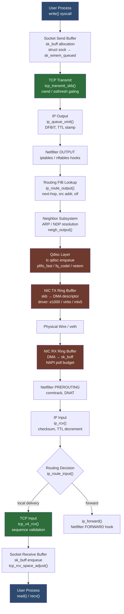
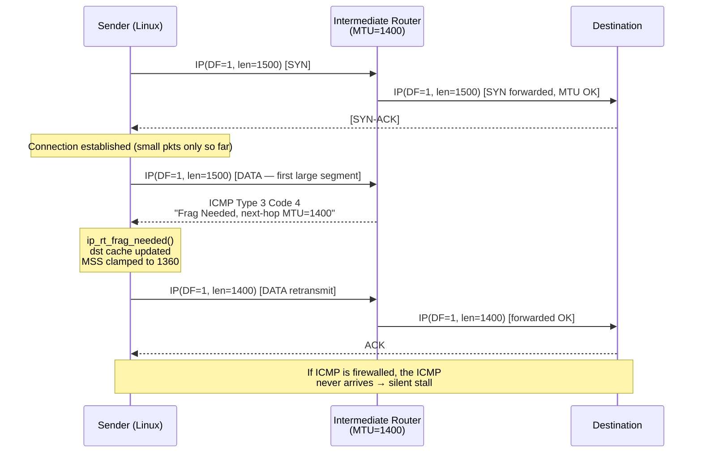
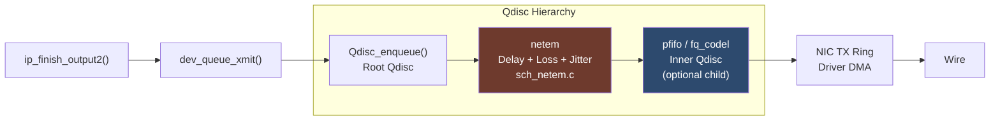
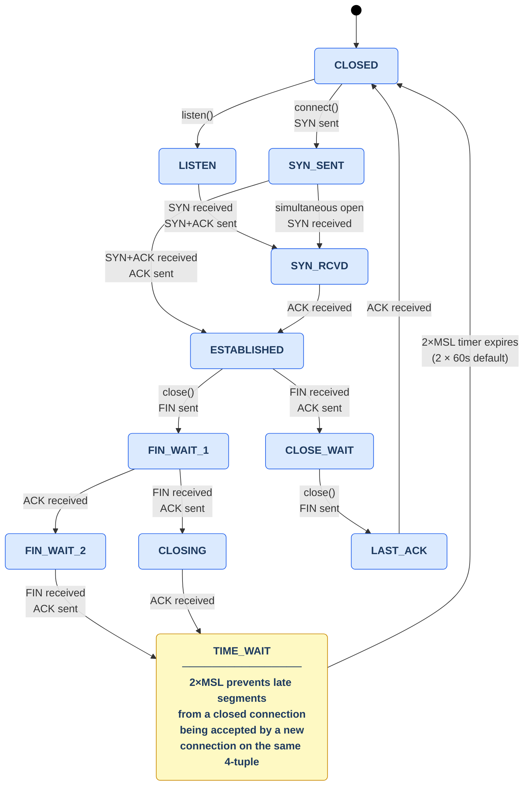
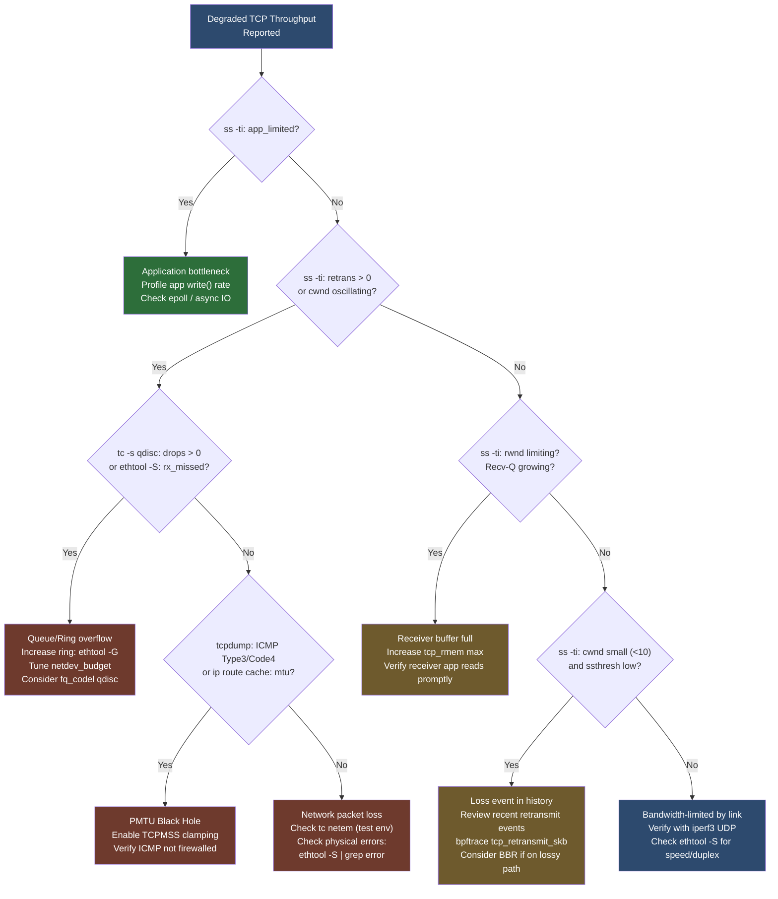

# Operational Verification Labs: Networking Internals

## Preface: Architecture Before Commands

Networking tools are window dressings on a substrate of kernel data structures. Before issuing a single command, understand *what you are actually looking at*. Every `ss` output field maps to a field in `struct tcp_sock`. Every `ethtool -S` counter maps to a hardware register read by the driver. Every `tc qdisc` rule maps to a kernel object in the `Qdisc` hierarchy hanging off a `net_device`. Operating without this mental model turns diagnostics into cargo-cult rituals.

This lab is structured around three invariants of the kernel network path:

1. **Data moves through socket buffers** (`sk_buff` chains) managed by the TCP state machine.
2. **Packets traverse the routing subsystem** (FIB lookup → neighbor resolution → device queue).
3. **Hardware and software queues** impose backpressure that manifests as drops, retransmissions, and latency spikes.

Each exercise operationally verifies one or more of these invariants.

---

## Environment Setup

### Required Tooling

| Package | Provides | Minimum Version |
|:---|:---|:---|
| `iproute2` | `ip`, `ss`, `bridge`, `tc` | 5.x (kernel 4.15+) |
| `tcpdump` | Raw packet capture via `AF_PACKET` | 4.9+ |
| `tshark` | Protocol dissection from CLI | 3.x |
| `ethtool` | NIC register and driver introspection | 5.x |
| `iperf3` | TCP/UDP bandwidth generation | 3.9+ |
| `bpftrace` / `perf` | Kernel tracepoint and eBPF instrumentation | kernel 5.8+ |

Verify the kernel exposes the required `tcp_diag` netlink module (required for `ss -i`):

```bash
# Confirm tcp_diag module is loaded; ss will fail silently without it
modprobe tcp_diag && lsmod | grep tcp_diag

# Confirm kernel config supports NETLINK_SOCK_DIAG
zcat /proc/config.gz | grep -E "SOCK_DIAG|INET_DIAG"
# Expected: CONFIG_INET_DIAG=y, CONFIG_INET_TCP_DIAG=y
```

### Kernel Tunables Baseline

Record the system's initial buffer configuration before any exercise:

```bash
# System-wide socket buffer limits (bytes)
sysctl net.core.rmem_max net.core.wmem_max
sysctl net.ipv4.tcp_rmem net.ipv4.tcp_wmem

# TCP congestion control algorithm in use
sysctl net.ipv4.tcp_congestion_control

# Confirm BDP-aware autotuning is enabled (should be 1)
sysctl net.ipv4.tcp_moderate_rcvbuf
```

The three values in `tcp_rmem` / `tcp_wmem` are `[min, default, max]` bytes. The kernel autotunes within these bounds based on measured RTT and BDP (Bandwidth-Delay Product). Understanding this prevents misinterpreting `ss` output: the allocated buffer you see is *not* the kernel maximum — it is the kernel's current estimate of what this connection requires.

---

## Conceptual Map: The Linux Network Stack

The following diagram traces a single outbound TCP segment from `write()` syscall to wire, and the inbound path from NIC interrupt to `read()`. Every diagnostic tool in this lab targets one or more nodes in this graph.



---

## Exercise 1: Socket Buffer Inspection & TCP State Machine Diagnostics

### Background: `struct tcp_sock` and What `ss` Reads

`ss` with `-i` does not parse `/proc` files. It opens a `NETLINK_INET_DIAG` socket and sends a `SOCK_DIAG_BY_FAMILY` request. The kernel's `tcp_diag_get_info()` function populates a `tcp_info` structure directly from `struct tcp_sock` fields in memory. This means the data is authoritative and lock-consistent, unlike `/proc/net/tcp` which is a text snapshot.

Key fields in `struct tcp_sock` that `ss` exposes:

| `ss` field | Kernel source field | Meaning |
|:---|:---|:---|
| `cwnd` | `tp->snd_cwnd` | Congestion window (segments) |
| `ssthresh` | `tp->snd_ssthresh` | Slow-start threshold |
| `rtt` | `tp->srtt_us >> 3` (μs) | EWMA smoothed RTT (RFC 6298) |
| `rttvar` | `tp->mdev_us >> 2` (μs) | Mean deviation (variance proxy) |
| `send` | computed from `cwnd` × MSS / SRTT | Estimated send throughput |
| `lastsnd/lastrcv` | `tp->lsndtime`, `tp->lrcvtime` | Idle time for keepalive |
| `pacing_rate` | `sk->sk_pacing_rate` | FQ pacing token bucket rate |
| `retrans` | `tp->retrans_out` | Segments in flight, unacked after RTO |

### 1.1 Detailed Socket Memory & Flow Inspection

```bash
# Full TCP diagnostic: timer state (-o), internal TCP info (-i),
# socket memory breakdown (-m), process name (-p), all established sockets
ss -tipm state established

# Filter to a specific port or destination with BPF-style filter expressions
ss -tipm state established '( dport = :443 or dport = :80 )'

# Show sockets with non-zero retransmit counters — identifies stressed connections
ss -ti state established | awk '/retrans/ && $0 !~ /retrans:0/'
```

Annotated output breakdown:

```text
Netid State Recv-Q Send-Q  Local Address:Port  Peer Address:Port
tcp   ESTAB  0      0       192.168.1.5:54312  93.184.216.34:443

         cubic wscale:7,7 rto:204 rtt:2.4/0.8 ato:40 mss:1448 pmtu:1500
         rcvmss:1448 advmss:1448 cwnd:10 ssthresh:7 bytes_sent:14882
         bytes_acked:14882 bytes_received:208450 segs_out:36 segs_in:187
         send 48.3Mbps lastsnd:72 lastrcv:68 lastack:68 pacing_rate 57.9Mbps
         delivery_rate 48.3Mbps delivered:35 app_limited
         rcv_rtt:2.5 rcv_space:14600 rcv_ssthresh:64108 minrtt:1.902
         skmem:(r0,rb131072,t0,tb87040,f0,w0,o0,bl0,d0)
```

Interpretation of `skmem:(r0,rb131072,t0,tb87040,f0,w0,o0,bl0,d0)`:

| Token | Field | Value (bytes) | Meaning |
|:---|:---|:---|:---|
| `r` | `rmem_alloc` | 0 | Bytes allocated in receive buffer right now |
| `rb` | `rcv_buf` | 131072 | Current receive buffer ceiling (autotune may grow this) |
| `t` | `wmem_alloc` | 0 | Bytes in transmit buffer right now |
| `tb` | `snd_buf` | 87040 | Current send buffer ceiling |
| `f` | `fwd_alloc` | 0 | Forward-allocated receive memory (pre-allocated for future skbs) |
| `w` | `wmem_queued` | 0 | Bytes queued in write queue but not yet sent |
| `o` | `opt_mem` | 0 | Memory used for TCP options (timestamps, SACK blocks) |
| `bl` | `back_log` | 0 | sk_backlog (frames received while socket lock held by process) |
| `d` | `drops` | 0 | Tail-drop events on this socket due to full receive buffer |

The `app_limited` flag is diagnostic gold: it means the sender could have sent more (cwnd permitted it) but the application did not call `write()` fast enough. This distinguishes an *application bottleneck* from a *network bottleneck*.

### 1.2 Network Interface Queue & Ring Buffer Profiling

Ring buffers are the DMA-mapped memory regions shared between the CPU and the NIC. The NIC writes received frames into RX ring slots; the driver's NAPI poll function harvests them. When the ring fills faster than the NAPI budget processes it, frames are dropped *at the hardware level*, before any socket buffer is involved.

```bash
# Full interface statistics: bytes, packets, errors, drops, overruns per direction
ip -s -s link show dev eth0
# Note: -s -s (double) adds more detail including carrier/collisions

# Query NIC ring buffer depth — these are hardware descriptor counts, not bytes
ethtool -g eth0
# Output example:
# Ring parameters for eth0:
# Pre-set maximums:
#   RX: 4096      TX: 4096
# Current hardware settings:
#   RX: 256       TX: 256
# A small current RX value with high packet rates → ring starvation drops

# Increase RX ring to reduce drops under burst traffic
sudo ethtool -G eth0 rx 4096

# NIC-level hardware counters — these are driver-specific register reads
ethtool -S eth0 | grep -iE "miss|drop|error|overflow|fifo|no_desc"

# Common meaningful counters (Intel e1000e driver example):
# rx_missed_errors:   Frames dropped because RX ring was full
# rx_fifo_errors:     Frames dropped in NIC FIFO before DMA
# tx_fifo_errors:     TX underruns
# rx_no_buffer_count: Descriptors depleted in ring

# Check interrupt coalescing settings — high coalesce delays increase latency
# but reduce interrupt storm at high PPS
ethtool -c eth0
```

Correlate hardware drops with softirq scheduling:

```bash
# Watch per-CPU softirq NET_RX and NET_TX rates
watch -n 1 'cat /proc/net/softnet_stat'
# Column 1: Total frames processed
# Column 2: Frames dropped (budget exceeded or throttled) — this is NOT ring drop
# Column 3: Times NAPI rescheduled (time_squeeze) — indicates CPU was unable
#            to drain the queue within budget; increase net.core.netdev_budget
#            if this column grows rapidly

sysctl net.core.netdev_budget          # Default: 300 frames per NAPI poll
sysctl net.core.netdev_budget_usecs    # Default: 2000 μs per poll cycle
```

---

## Exercise 2: Path MTU Discovery & Congestion Window Dynamics

### Background: PMTUD Mechanics

Path MTU Discovery (RFC 1191 for IPv4, RFC 8899 for the modern PLPMTUD variant) works by sending packets with the IPv4 DF bit set (or relying on IPv6's mandatory no-fragmentation-by-routers rule) and listening for ICMP Type 3, Code 4 (`Fragmentation Needed`) responses that carry the MTU of the constraining link in the ICMP unreachable body.

The kernel caches discovered PMTU values in the route cache (and in the destination cache `dst_entry`). When a `Fragmentation Needed` message arrives, `ip_rt_frag_needed()` updates `dst->metrics[RTAX_MTU]` and triggers `tcp_mtu_clamping()` to reduce the MSS for existing connections.

**A critical failure mode:** many corporate firewalls and cloud security groups silently drop ICMP unreachables. This breaks PMTUD and causes TCP connections to stall after the initial handshake completes — the handshake uses small packets, but bulk data transfers hit the MTU ceiling. This is the infamous "black hole" problem addressed by TCP MSS clamping in `iptables` / `nftables`.



### 2.1 Path MTU Fragmentation Boundary Testing

```bash
# Standard Ethernet: MTU=1500, IP header=20B, ICMP header=8B → max payload=1472B
ping -c 3 -M do -s 1472 1.1.1.1   # Should succeed (1472+28 = 1500)
ping -c 3 -M do -s 1473 1.1.1.1   # Should fail with "Frag needed" if MTU=1500

# For tunneled paths (VPN, GRE, VXLAN) the effective MTU is lower:
# GRE adds 24B overhead → effective MTU=1476 → max payload=1448B
# VXLAN adds 50B overhead → effective MTU=1450 → max payload=1422B
# WireGuard adds ~60B overhead → effective MTU=1420B typical

# IPv6 uses a different mechanism — no DF bit needed; probe with:
ping6 -c 3 -M do -s 1452 2606:4700:4700::1111
# IPv6 header=40B, ICMPv6 header=8B → 1500-48=1452B max payload

# Capture ICMP fragmentation-needed responses in real time
sudo tcpdump -nn -i any -v 'icmp and icmp[0] == 3 and icmp[1] == 4'
# icmp[0]==3: Type=Destination Unreachable
# icmp[1]==4: Code=Fragmentation Needed and DF Set

# For IPv6 PTB (Packet Too Big, Type 2):
sudo tcpdump -nn -i any 'icmp6 and ip6[40] == 2'

# Inspect the kernel route cache for PMTU entries
ip route get 1.1.1.1
# Look for: cache expires <N>sec mtu <value>

# Full route cache dump (kernel may suppress entries if PMTU == path MTU)
ip route show table cache
ip route show table cache | grep mtu

# Force-flush PMTU cache for a destination to re-probe
ip route flush cache
```

TCP MSS clamping as a workaround for ICMP black holes (applied at `FORWARD` hook for a router):

```bash
# In iptables: clamp MSS to PMTU for all forwarded TCP SYN and SYN-ACK packets
# This prevents the black hole problem entirely for TCP
sudo iptables -t mangle -A FORWARD \
  -p tcp --tcp-flags SYN,RST SYN \
  -j TCPMSS --clamp-mss-to-pmtu

# nftables equivalent (preferred on modern systems):
# nft add rule ip filter forward tcp flags syn tcp option maxseg size set rt mtu
```

### 2.2 TCP Congestion Window Dynamics Under Load

TCP congestion control is a distributed algorithm running independently at each sender. The key state variables:

- **`cwnd`** (`snd_cwnd`): How many MSS-sized segments the sender may have in flight simultaneously. Governs throughput: `throughput ≈ cwnd × MSS / RTT`.
- **`ssthresh`** (`snd_ssthresh`): The threshold between *slow start* (exponential cwnd growth) and *congestion avoidance* (linear/CUBIC growth).
- **`flight size`** (`packets_out`): Segments sent but not yet acknowledged. Throughput is limited by `min(cwnd, rwnd)` where `rwnd` is the receiver's advertised window.
- **BDP**: `bandwidth × RTT`. The *correct* buffer size for maximum throughput equals the BDP. Under-buffering starves the pipe; over-buffering causes BufferBloat.

```bash
# Terminal 1: Real-time cwnd/ssthresh/rtt tracing during active transfer
# The filter uses ss's BPF-like filter syntax (not classic BPF)
watch -n 0.3 'ss -tni state established "( sport = :5201 or dport = :5201 )" | \
  grep -E "cubic|reno|bbr|cwnd|rtt"'

# Terminal 2: 10-second multi-stream iperf3 test, 4 parallel streams, with per-interval reporting
iperf3 -c 127.0.0.1 -t 10 -P 4 -i 1 --logfile /tmp/iperf3_run.log

# Terminal 3: Track TCP retransmission events via kernel tracepoints (requires bpftrace)
sudo bpftrace -e '
tracepoint:tcp:tcp_retransmit_skb {
    printf("retransmit: pid=%d comm=%s saddr=%s daddr=%s sport=%d dport=%d\n",
        pid, comm,
        ntop(args->saddr), ntop(args->daddr),
        args->sport, args->dport);
}
'

# Alternative (no bpftrace): use ss retrans counter differential
while true; do
  ss -ti state established | grep retrans | awk '{print strftime("%H:%M:%S"), $0}'
  sleep 1
done
```

Measure the BDP and validate buffer sizing:

```bash
# Example: 1 Gbps link, 10ms RTT
# BDP = 1,000,000,000 bps × 0.010s / 8 = 1,250,000 bytes ≈ 1.25 MB
# Default tcp_rmem max is 6MB on most distros, which is adequate.
# For 10 Gbps WAN with 100ms RTT:
# BDP = 10,000,000,000 × 0.1 / 8 = 125,000,000 bytes = 125 MB
# In that case, increase:
sudo sysctl -w net.core.rmem_max=134217728       # 128 MB
sudo sysctl -w net.ipv4.tcp_rmem="4096 87380 134217728"
sudo sysctl -w net.ipv4.tcp_wmem="4096 65536 134217728"
```

---

## Exercise 3: Queueing Discipline (tc) Fault Injection, Verification & Analysis

### Background: The Qdisc Layer and `struct Qdisc`

Every `net_device` in Linux has a *root qdisc* attached to it. When `ip_finish_output2()` calls `dev_queue_xmit()`, the packet is handed to `Qdisc_enqueue()`. The simplest root qdisc is `pfifo_fast` (three-band priority FIFO based on DSCP/TOS), which is the kernel default for most interfaces.

`netem` (Network Emulator) is a qdisc that wraps the egress queue with configurable delay, jitter (via distribution tables), packet loss (by marking or dropping), packet duplication, reordering, and corruption. It is implemented in `net/sched/sch_netem.c` and uses a red-black tree keyed on delivery timestamp to implement variable delay.

The loss model in `netem` defaults to independent (Bernoulli) loss. For more realistic bursty loss, use the Gilbert-Elliott model: `loss gemodel p r 1-h 1-k`.



### 3.1 Isolated Test Environment: `veth` Pair

Do **not** apply `netem` to the loopback interface for TCP tests. The loopback path in the kernel (`lo`) does not go through the full NIC + qdisc stack the same way a real interface does for all kernel paths, and `netem` on `lo` has historically produced inconsistent behavior with TCP's fast path. Use an isolated `veth` pair instead:

```bash
# Create a veth pair: veth0 ↔ veth1 in the same namespace
sudo ip link add veth0 type veth peer name veth1
sudo ip addr add 10.100.0.1/30 dev veth0
sudo ip addr add 10.100.0.2/30 dev veth1
sudo ip link set veth0 up
sudo ip link set veth1 up

# Confirm connectivity
ping -c 2 10.100.0.2

# Attach netem to the EGRESS of veth0:
# 100ms base delay, normally-distributed ±10ms jitter, 5% independent loss
sudo tc qdisc add dev veth0 root netem \
  delay 100ms 10ms distribution normal \
  loss 5%

# Verify the installed qdisc
tc qdisc show dev veth0
# Expected: qdisc netem 8001: root refcnt 2 limit 1000
#           delay 100ms  10ms  loss 5%
```

For bidirectional loss and delay (simulating a real WAN path), apply `netem` to both `veth0` and `veth1`.

### 3.2 Advanced `netem` Configuration

```bash
# Gilbert-Elliott burst loss model (more realistic than Bernoulli):
# p=5% transition good→bad, r=10% bad→good, 1-h=100% loss in bad state, 1-k=0% loss in good
sudo tc qdisc replace dev veth0 root netem \
  loss gemodel 5% 10% 100% 0%

# Reordering: 25% of packets reordered with 10ms gap, correlated to 50% of previous
sudo tc qdisc replace dev veth0 root netem \
  delay 10ms reorder 25% 50% gap 5

# Rate limiting combined with delay (bandwidth + latency emulation)
# Simulates a 10 Mbit/s link with 50ms RTT and 1% loss
sudo tc qdisc replace dev veth0 root netem \
  rate 10mbit delay 25ms loss 1%

# Full WAN simulation: rate + delay + jitter + loss + queue limit
sudo tc qdisc replace dev veth0 root netem \
  limit 1000 \
  delay 50ms 5ms distribution pareto \
  rate 10mbit \
  loss 1% 25%
# loss 1% 25% = 1% loss with 25% correlation between consecutive losses
```

### 3.3 Capturing & Verifying Fault Injection Effects

```bash
# Start iperf3 server on veth1 side
iperf3 -s -B 10.100.0.2 --one-off &

# Run a 30s test through the degraded veth0 path
iperf3 -c 10.100.0.2 -B 10.100.0.1 -t 30 -i 2 --logfile /tmp/netem_test.log

# Simultaneously capture ALL TCP traffic on the veth pair for Wireshark analysis
sudo tcpdump -nn -i veth0 -w /tmp/netem_capture.pcap &

# In another terminal: watch TCP retransmit/fast-retransmit indicators live
# Duplicate ACKs appear as ACK packets with the same acknowledgment number
# Fast retransmit fires after 3 dupACKs (RFC 5681)
sudo tcpdump -nn -i veth0 -l tcp | awk '
/seq/ {
    split($0, f, "ack ");
    ack = f[2]+0;
    if (ack == prev_ack) {
        dupacks++;
        if (dupacks == 3) print "FAST RETRANSMIT TRIGGER: 3 dupACKs for ack=" ack
    } else {
        dupacks = 0;
        prev_ack = ack;
    }
}'
```

Measure the actual loss rate delivered by `netem` to verify configuration accuracy:

```bash
# iperf3 UDP mode gives precise loss measurement
# Generate 20 Mbit/s UDP traffic (above the 10mbit netem rate limit)
iperf3 -c 10.100.0.2 -B 10.100.0.1 -u -b 20M -t 10

# Expected output excerpt:
# [ ID] Interval       Transfer     Bitrate         Jitter    Lost/Total Datagrams
# [  5]  0.00-10.00s  23.8 MBytes  19.9 Mbits/sec  0.000 ms  0/17064 (0%) sender
# [  5]  0.00-10.00s  11.9 MBytes  9.99 Mbits/sec  5.254 ms  2127/10664 (20%) receiver
# The receiver-side loss combines rate-limit drops + netem loss
```

Inspect TCP congestion response to injected loss with `bpftrace`:

```bash
# Trace cwnd reductions triggered by loss events
sudo bpftrace -e '
tracepoint:tcp:tcp_cong_state_set {
    printf("%-8s %-20s cwnd_reduction sport=%d dport=%d new_state=%d\n",
        strftime("%H:%M:%S", nsecs),
        comm,
        args->sport, args->dport,
        args->ca_state);
}
'
# ca_state values: 0=Open, 1=Disorder, 2=CWR, 3=Recovery, 4=Loss
# State 3 (Recovery) = fast retransmit/fast recovery triggered
# State 4 (Loss) = RTO expired
```

### 3.4 Measuring `tc` Statistics: Verifying Drops at the Qdisc Layer

```bash
# Show qdisc byte/packet/drop counters — confirms netem is actually dropping
tc -s qdisc show dev veth0
# Expected output:
# qdisc netem 8001: root refcnt 2 limit 1000
#   Sent 2846720 bytes 1960 pkt (dropped 98, overlimits 0 requeues 0)
#   backlog 0b 0p requeues 0
# "dropped 98" = frames netem discarded per its loss model

# Correlate with interface-level drop counters
ip -s link show dev veth0
# RX and TX error/drop counters should be low; netem drops are qdisc-level,
# not interface-level, so they appear in tc -s output, not in ip -s link
```

### 3.5 Recovery & Environment Teardown

```bash
# Stop background processes
kill %1 2>/dev/null; killall tcpdump 2>/dev/null; killall iperf3 2>/dev/null

# Remove netem qdisc (restores pfifo_fast default)
sudo tc qdisc del dev veth0 root 2>/dev/null

# Verify qdisc restored to default
tc qdisc show dev veth0
# Should show: qdisc fq_codel or pfifo_fast (kernel default)

# Tear down veth pair completely
sudo ip link del veth0
# Deleting one end of a veth pair automatically removes the other

# Confirm removal
ip link show | grep veth
```

---

## Exercise 4: Routing Table Internals & Next-Hop Resolution

This exercise is absent from most practical networking curricula but is essential for diagnosing asymmetric routing, policy-based routing failures, and VPN split-tunnel misconfiguration.

### Background: Linux FIB and the Route Lookup Path

The Linux routing subsystem uses a *Forwarding Information Base* (FIB), implemented since kernel 2.6 as a *FIB trie* (LC-trie: level-compressed trie) for IPv4 and a hash/radix hybrid for IPv6. The lookup algorithm is `fib_lookup()`. The result is a `fib_result` that identifies the `fib_nh` (next-hop), which then resolves through the *neighbor subsystem* (ARP for IPv4, NDP for IPv6) to get a MAC address.

```bash
# Simulate exactly what the kernel does for a given src/dst/tos/mark
ip route get 8.8.8.8
# Output: 8.8.8.8 via 192.168.1.1 dev eth0 src 192.168.1.5 uid 1000
#          cache

# With source address forced (policy routing simulation)
ip route get 8.8.8.8 from 10.0.0.5
# Tests whether a specific source address routes correctly

# With firewall mark (used by policy routing rules, VPNs, Kubernetes)
ip route get 8.8.8.8 mark 100

# List all routing tables (Linux supports 256 policy routing tables)
ip rule list
# Default output:
# 0:  lookup local       (kernel-managed: loopback, broadcast)
# 32766: lookup main      (normal routes from 'ip route add')
# 32767: lookup default   (last-resort, usually empty)

# Inspect a specific routing table (e.g., table 100 used by a VPN)
ip route show table 100

# List all non-empty routing tables
ip rule list | awk '{print $NF}' | sort -u | \
  while read t; do
    echo "=== Table: $t ==="; ip route show table "$t" 2>/dev/null
  done

# Neighbor (ARP) table — maps IP → MAC for connected subnets
ip neigh show
# States: REACHABLE, STALE, DELAY, PROBE, FAILED, PERMANENT
# STALE = NUD timer expired but entry still usable until traffic triggers DELAY
# FAILED = ARP request got no reply → packets to this IP will be dropped
```

---

## Exercise 5: eBPF Socket Inspection

For production systems where `ss` overhead is too high or where you need streaming telemetry, eBPF programs attached to `cgroup/sock` or `kprobe` hooks provide zero-overhead, in-kernel inspection.

```c
// Minimal eBPF program skeleton: trace every TCP state change
// Compile with: clang -O2 -target bpf -c tcp_trace.bpf.c -o tcp_trace.bpf.o
// Load with: tc filter add dev eth0 ingress bpf obj tcp_trace.bpf.o
// Or use bpftrace one-liner shown below instead

// File: tcp_state_trace.bpf.c
#include <linux/bpf.h>
#include <bpf/bpf_helpers.h>
#include <bpf/bpf_tracing.h>
#include <net/sock.h>

// Tracepoint format: /sys/kernel/tracing/events/tcp/tcp_set_state/format
struct tcp_set_state_args {
    __u64 __pad;
    const void *skaddr;
    int oldstate;
    int newstate;
    __u16 sport;
    __u16 dport;
    __u16 family;
    __u8  saddr[4];
    __u8  daddr[4];
    __u8  saddr_v6[16];
    __u8  daddr_v6[16];
};

SEC("tracepoint/tcp/tcp_set_state")
int trace_tcp_set_state(struct tcp_set_state_args *ctx)
{
    // TCP state values: TCP_ESTABLISHED=1, TCP_SYN_SENT=2, TCP_CLOSE_WAIT=8,
    //                   TCP_TIME_WAIT=6, TCP_CLOSE=7
    if (ctx->newstate == 1 || ctx->newstate == 7) {
        bpf_printk("TCP state: %d → %d  sport=%u dport=%u\n",
            ctx->oldstate, ctx->newstate,
            ctx->sport, ctx->dport);
    }
    return 0;
}

char LICENSE[] SEC("license") = "GPL";
```

```bash
# Equivalent bpftrace one-liner (no compilation needed)
sudo bpftrace -e '
tracepoint:tcp:tcp_set_state {
    @states[args->oldstate, args->newstate] = count();
    if (args->newstate == 7) {
        printf("CLOSE: sport=%d dport=%d\n", args->sport, args->dport);
    }
}
interval:s:5 {
    print(@states); clear(@states);
}
'
```

---

## Networking Diagnostic Cheat Sheet

| Subsystem | Command | What It Actually Reads | Diagnostic Purpose |
|:---|:---|:---|:---|
| **Socket State** | `ss -tipm state established` | `NETLINK_INET_DIAG` → `struct tcp_sock` | `cwnd`, `ssthresh`, `rtt`, `skmem` breakdown |
| **Socket Drops** | `ss -ti` → `skmem` `d` field | `sk->sk_drops` | Tail-drops on full receive buffer |
| **Interface Stats** | `ip -s -s link show dev <iface>` | `/proc/net/dev` + netlink | RX/TX bytes, errors, drops, overruns |
| **Ring Buffers** | `ethtool -g <iface>` | `ETHTOOL_GRINGPARAM` ioctl | NIC RX/TX hardware descriptor counts |
| **NIC HW Counters** | `ethtool -S <iface>` | `ETHTOOL_GSTATS` ioctl (driver regs) | `rx_missed_errors`, `rx_fifo_errors`, `rx_no_buffer_count` |
| **Coalesce Settings** | `ethtool -c <iface>` | `ETHTOOL_GCOALESCE` | Interrupt coalescing delay (latency vs. throughput) |
| **NAPI Drops** | `cat /proc/net/softnet_stat` | Per-CPU softnet stats | Budget exhaustion vs. ring drops |
| **Packet Trace** | `tcpdump -nn -i <iface> -w file.pcap` | `AF_PACKET` raw socket | Protocol flags, timing, retransmits |
| **Route Lookup** | `ip route get <dst> from <src>` | `fib_lookup()` simulation | Routing table selection, next-hop, src addr |
| **Route Cache** | `ip route show table cache` | `dst_entry` cache | PMTU entries per destination |
| **ARP/NDP Table** | `ip neigh show` | Neighbor subsystem | MAC resolution state (REACHABLE/STALE/FAILED) |
| **Qdisc Stats** | `tc -s qdisc show dev <iface>` | `Qdisc` struct counters | Qdisc-level drops, backlog depth |
| **Fault Injection** | `tc qdisc add dev <iface> root netem` | `sch_netem.c` | Delay, jitter, loss, reorder, corruption |
| **cwnd Tracing** | `bpftrace -e 'tracepoint:tcp:tcp_cong_state_set'` | Kernel tracepoint | Real-time congestion state machine transitions |

---

## Appendix A: TCP State Machine Reference



---

## Appendix B: Congestion Control Algorithm Selection

Different workloads require different congestion control algorithms. The kernel supports runtime selection per-socket via `TCP_CONGESTION` socket option.

| Algorithm | Kernel Module | Loss Signal | Best For | Key Characteristic |
|:---|:---|:---|:---|:---|
| `cubic` | built-in | Packet loss (dupACK/RTO) | General purpose, long RTT | Cubic growth function, default since Linux 2.6.19 |
| `bbr` | `tcp_bbr` | Bandwidth + RTT model | High BDP, lossy links | Probes bandwidth, not loss-based; avoids BufferBloat |
| `htcp` | `tcp_htcp` | Packet loss | High BDP LANs | High-speed variant of CUBIC predecessor |
| `reno` | built-in | Packet loss (dupACK/RTO) | Reference / testing | Additive increase, multiplicative decrease (AIMD) baseline |
| `dctcp` | `tcp_dctcp` | ECN (explicit congestion) | Data center, low RTT | Requires ECN-capable switches; reacts to ECN CE marks |

```bash
# Check available congestion control algorithms
cat /proc/sys/net/ipv4/tcp_available_congestion_control

# Change system default
sudo sysctl -w net.ipv4.tcp_congestion_control=bbr

# Load BBR module if not built-in
sudo modprobe tcp_bbr

# Override per-connection in application code (Python example)
python3 -c "
import socket, struct
s = socket.socket(socket.AF_INET, socket.SOCK_STREAM)
# TCP_CONGESTION = 13
s.setsockopt(socket.IPPROTO_TCP, 13, b'bbr\x00')
print('CA set to:', s.getsockopt(socket.IPPROTO_TCP, 13, 16).rstrip(b'\x00').decode())
s.close()
"
```

---

## Appendix C: Production Diagnostic Runbook

When a TCP connection exhibits degraded throughput, follow this decision tree before modifying any kernel parameters.



---

## Appendix D: Key Kernel Source References

Understanding where these mechanisms live in the kernel source makes the diagnostic output interpretable rather than opaque.

| Mechanism | Kernel Source File | Key Functions |
|:---|:---|:---|
| TCP input path | `net/ipv4/tcp_input.c` | `tcp_rcv_established()`, `tcp_ack()`, `tcp_data_queue()` |
| TCP output path | `net/ipv4/tcp_output.c` | `tcp_transmit_skb()`, `tcp_write_xmit()`, `tcp_mtu_probe()` |
| Congestion control API | `net/ipv4/tcp_cong.c` | `tcp_set_ca_state()`, `tcp_cong_avoid()` |
| Socket buffer management | `net/core/sock.c` | `sk_stream_alloc_skb()`, `sk_wmem_schedule()` |
| Qdisc layer | `net/sched/sch_generic.c` | `dev_queue_xmit()`, `qdisc_run()`, `sch_direct_xmit()` |
| netem implementation | `net/sched/sch_netem.c` | `netem_enqueue()`, `netem_dequeue()` |
| FIB trie (IPv4) | `net/ipv4/fib_trie.c` | `fib_lookup()`, `trie_lookup()` |
| Neighbor subsystem | `net/core/neighbour.c` | `neigh_output()`, `neigh_resolve_output()` |
| PMTU handling | `net/ipv4/route.c` | `ip_rt_frag_needed()`, `__ip_rt_update_pmtu()` |
| Socket diagnostics netlink | `net/ipv4/tcp_diag.c` | `tcp_diag_get_info()` |
