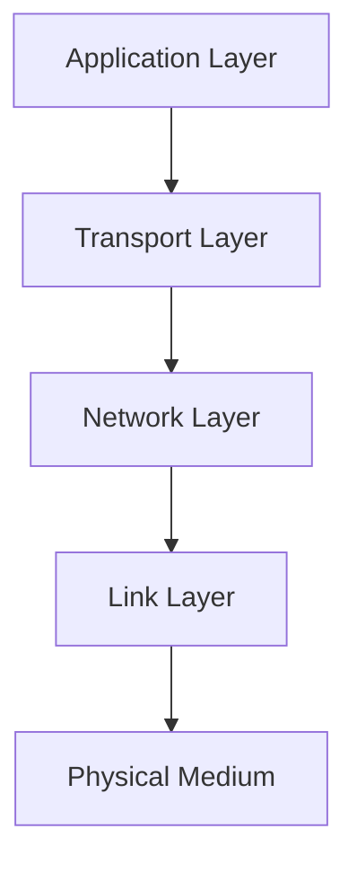

# Lesson 1: TCP/IP Protocol Suite

## 1. First-Principles Intuition & Invariants

The TCP/IP protocol suite is the backbone of modern networking, enabling the seamless exchange of data across diverse and interconnected networks. At its core, TCP/IP is a layered architecture that abstracts the complexities of network communication, providing a robust and scalable framework for data transmission. This lesson delves into the foundational principles that underpin the TCP/IP model, including IP addressing, routing, and the essential roles of TCP and UDP.

The problem space addressed by TCP/IP is the need for a universal communication protocol that can operate over heterogeneous networks, ensuring reliable and efficient data transfer. The Internet Protocol (IP) is the cornerstone of this suite, responsible for addressing and routing packets of data across networks. IP addresses serve as unique identifiers for devices on a network, facilitating the routing of packets to their intended destinations. The IPv4 address space consists of 32-bit addresses, while IPv6 expands this to 128 bits, addressing the growing demand for unique identifiers in the expanding Internet.

Routing is a critical component of the IP protocol, enabling the forwarding of packets from source to destination across multiple networks. Routers operate at the network layer, using routing tables to determine the best path for data packets based on network topology and routing metrics. The Internet Control Message Protocol (ICMP) plays a vital role in network diagnostics, providing mechanisms for error reporting and operational information exchange.

Transmission Control Protocol (TCP) and User Datagram Protocol (UDP) are the two primary transport layer protocols in the TCP/IP suite. TCP is a connection-oriented protocol that ensures reliable, ordered, and error-checked delivery of a stream of bytes between applications running on hosts communicating over an IP network. TCP achieves reliability through mechanisms such as sequence numbers, acknowledgments, and retransmissions, ensuring that data is delivered accurately and in the correct order. In contrast, UDP is a connectionless protocol that provides a best-effort delivery service, offering faster transmission but without the guarantees of reliability and ordering provided by TCP. UDP is often used in applications where speed is critical, and the occasional loss of data is acceptable, such as in real-time multimedia streaming.

The invariants of the TCP/IP model include the end-to-end principle, which asserts that network functions should be implemented in the end systems rather than in the network itself. This principle allows for greater flexibility and innovation, as new protocols and applications can be developed without requiring changes to the underlying network infrastructure. Another invariant is the separation of concerns, where each layer of the protocol suite is responsible for a specific set of functions, enabling modularity and scalability.

## 2. Core Architecture & Mechanics

The TCP/IP protocol suite is organized into four layers: the application layer, transport layer, network layer, and link layer. Each layer builds upon the services provided by the layer below, creating a hierarchical architecture that abstracts the complexities of network communication.

At the application layer, protocols such as HTTP, FTP, and SMTP provide services for applications to communicate over the network. These protocols define the syntax and semantics of data exchange, enabling applications to send and receive data in a standardized format.

The transport layer is responsible for end-to-end communication between applications, providing reliable and ordered delivery of data. TCP and UDP are the two primary transport layer protocols, each serving different use cases. TCP ensures reliable delivery through mechanisms such as sequence numbers, acknowledgments, and retransmissions, while UDP provides a faster, connectionless service.

The network layer is responsible for routing packets of data across networks. IP addresses serve as unique identifiers for devices on a network, facilitating the routing of packets to their intended destinations. Routers operate at the network layer, using routing tables to determine the best path for data packets based on network topology and routing metrics. The Internet Control Message Protocol (ICMP) plays a vital role in network diagnostics, providing mechanisms for error reporting and operational information exchange.

The link layer is responsible for the physical transmission of data over a network. This layer defines the electrical and physical characteristics of the network, as well as the procedures for sending and receiving data. Common link layer protocols include Ethernet, Wi-Fi, and PPP.

To illustrate the architecture of the TCP/IP protocol suite, consider the following diagram:

In this diagram, the application layer is at the top, providing services for applications to communicate over the network. The transport layer is responsible for end-to-end communication between applications, while the network layer is responsible for routing packets of data across networks. The link layer is responsible for the physical transmission of data over a network, and the physical medium represents the actual transmission medium, such as Ethernet or Wi-Fi.

## 3. High-Performance Optimization & Failure Modes

The performance and reliability of the TCP/IP protocol suite are critical factors in ensuring efficient and reliable data transmission. High-performance optimization techniques are essential for maximizing the throughput and minimizing the latency of network communication. One such technique is the use of congestion control algorithms, which regulate the flow of data to prevent network congestion and ensure fair resource allocation.

TCP employs several congestion control algorithms, including TCP Reno, TCP Tahoe, and TCP Cubic. These algorithms use mechanisms such as slow start, congestion avoidance, fast retransmit, and fast recovery to regulate the flow of data and prevent network congestion. Slow start gradually increases the transmission rate, while congestion avoidance maintains a stable transmission rate based on network conditions. Fast retransmit and fast recovery are used to quickly recover from packet loss, minimizing the impact on network performance.

Another technique for optimizing TCP performance is the use of selective acknowledgments (SACK), which allows the receiver to acknowledge only the packets that have been successfully received, rather than all packets up to a certain sequence number. This mechanism reduces the number of retransmissions required, improving the efficiency of the TCP protocol.

UDP, being a connectionless protocol, does not provide the same level of reliability and congestion control as TCP. However, UDP can be optimized for performance by using techniques such as packet coalescing, which combines multiple small packets into a single larger packet to reduce the overhead of packet headers. Additionally, UDP can be optimized by using techniques such as checksum offloading, which offloads the computation of checksums to the network interface card (NIC), reducing the processing load on the CPU.

Failure modes in the TCP/IP protocol suite can arise from a variety of sources, including network congestion, packet loss, and routing errors. Network congestion can occur when the rate of data transmission exceeds the capacity of the network, leading to packet loss and degraded performance. Packet loss can occur due to a variety of factors, including network congestion, hardware failures, and interference. Routing errors can occur when routers fail to correctly forward packets to their intended destinations, leading to packet loss and degraded performance.

To mitigate these failure modes, the TCP/IP protocol suite provides several mechanisms for error detection and recovery. TCP uses mechanisms such as sequence numbers, acknowledgments, and retransmissions to detect and recover from packet loss. ICMP provides mechanisms for error reporting and operational information exchange, enabling network administrators to diagnose and resolve network issues. Additionally, the use of redundancy and failover mechanisms can help to ensure the availability and reliability of network communication.

In conclusion, the TCP/IP protocol suite is a robust and scalable framework for network communication, providing reliable and efficient data transmission across diverse and interconnected networks. By understanding the layers of the TCP/IP model, including IP addressing, routing, and the roles of TCP and UDP, senior software engineers, systems programmers, and domain architects can design and implement high-performance and reliable network applications. Through the use of congestion control algorithms, selective acknowledgments, and other optimization techniques, the TCP/IP protocol suite can be optimized for performance, while mechanisms for error detection and recovery can help to mitigate failure modes and ensure the reliability of network communication.
