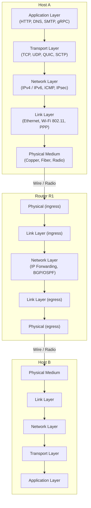
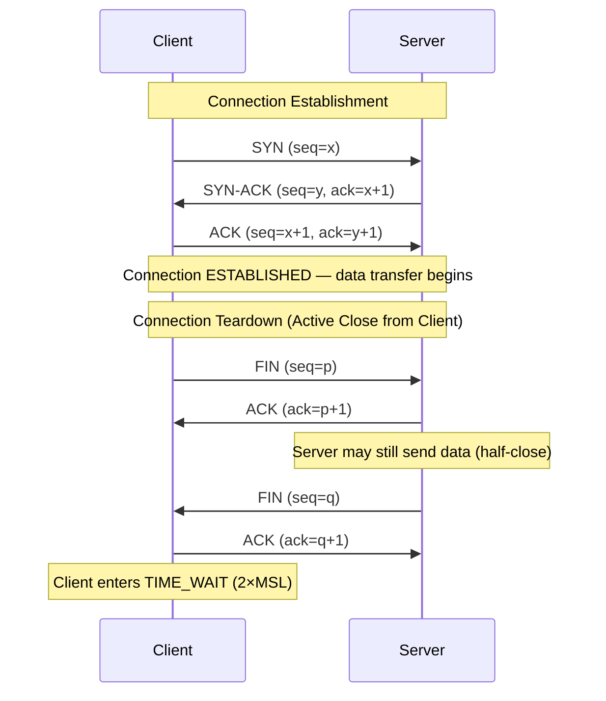
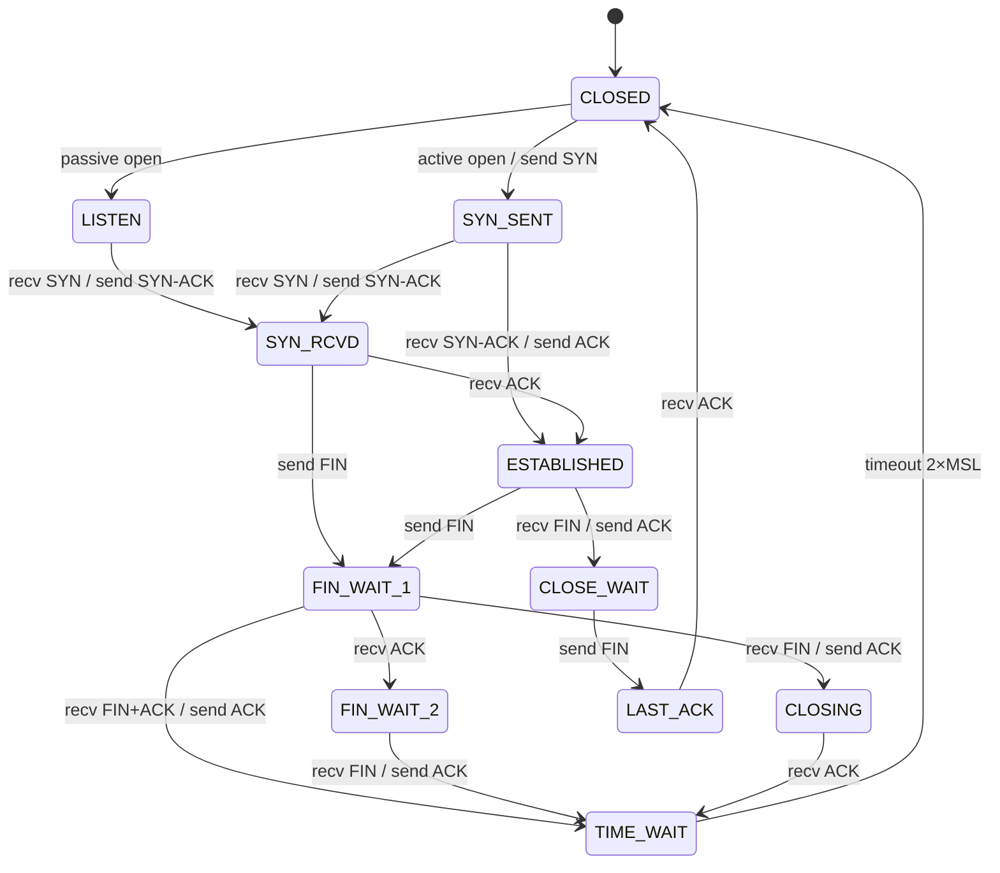
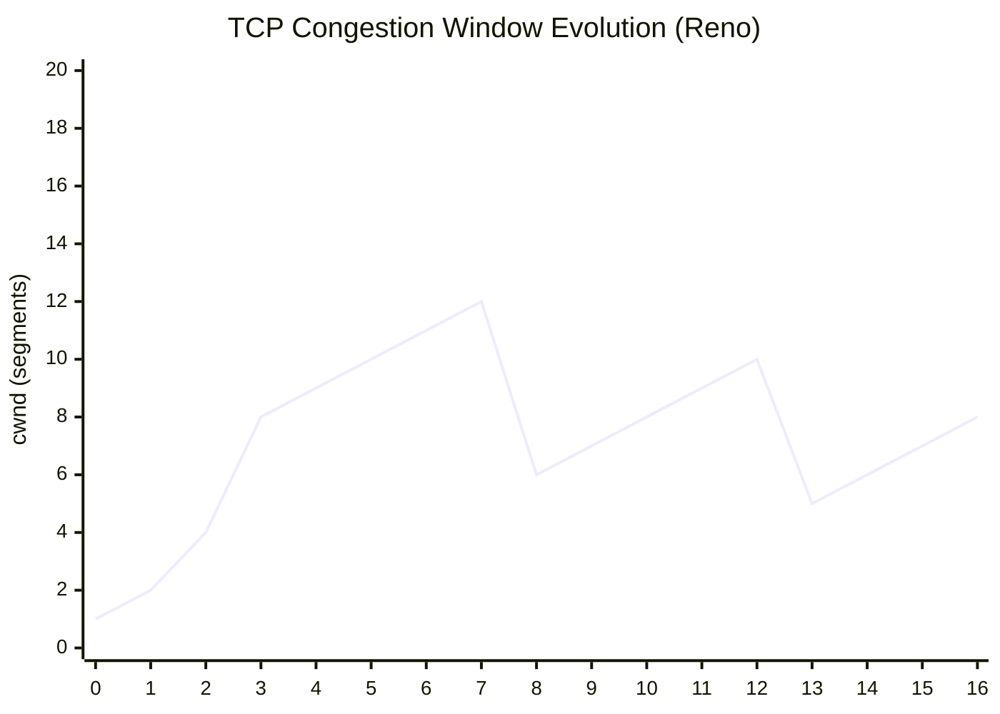
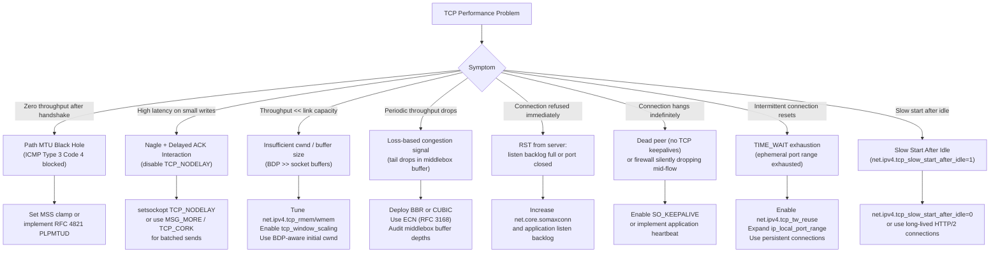
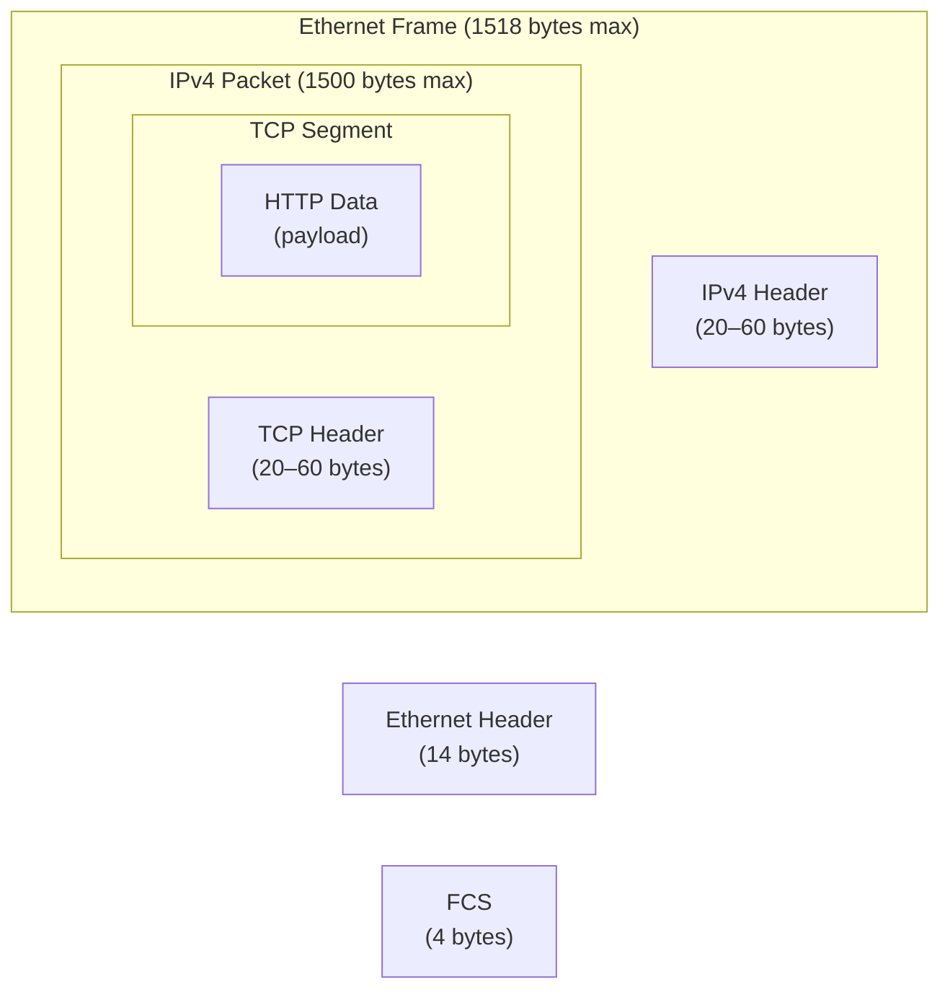
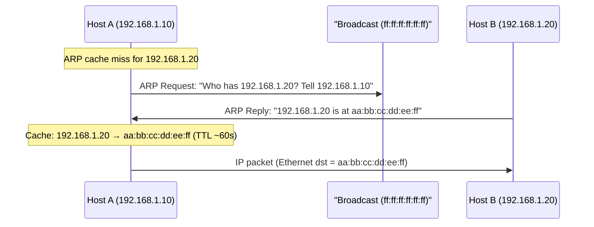

# Lesson 1: TCP/IP Protocol Suite

## 1. First-Principles Intuition & Invariants

The fundamental problem TCP/IP solves is *heterogeneous internetworking*: how do you transmit data reliably between two arbitrary endpoints when the intervening path traverses networks built from incompatible physical technologies—coaxial Ethernet, fiber optic SONET rings, 802.11 radio links, cellular LTE—each with different MTUs, error characteristics, and addressing schemes?

The answer is a *narrow waist* architecture. The hourglass model intentionally constrains the entire internet to a single universal protocol at the network layer (IP), above which any transport protocol can run, and below which any link technology can sit. This design decision, made in the late 1970s by Cerf and Kahn, is the reason a WebRTC video call can traverse Wi-Fi, 5G, and fiber in a single end-to-end path without any intermediate node understanding the application payload.

### The End-to-End Principle

Articulated by Saltzer, Reed, and Clark in their 1984 paper *"End-to-End Arguments in System Design"*, the end-to-end principle asserts that correctness functions—reliability, security, ordering—can only be fully and correctly implemented at the application endpoints, not in the network. The network's job is to deliver packets on a best-effort basis. Any reliability mechanism placed in the network is at best redundant and at worst harmful (it may mask failures that the endpoint still needs to handle).

This is why IP is stateless and unreliable by design. It is not a limitation; it is a deliberate invariant. Reliability is TCP's concern. Ordering is TCP's concern. The network just moves bits.

### Layering as a Contract

Each layer boundary is an interface contract, not merely a grouping of features:

- The **link layer** contract: deliver a frame between two directly-connected nodes sharing the same broadcast domain.
- The **network layer** contract: deliver a datagram between any two globally-addressed nodes, potentially across many hops.
- The **transport layer** contract: multiplex data streams between specific processes on two nodes.
- The **application layer** contract: provide semantics meaningful to the user application.

Violating these contracts—such as a router inspecting TCP sequence numbers to perform NAT traversal, or a middlebox reassembling IP fragments—creates the accretion of "middlebox ossification" that has made deploying new transport protocols (e.g., QUIC) over the public internet so difficult for decades.

### IPv4 vs. IPv6 Address Space

IPv4 uses 32-bit addresses, yielding a theoretical address space of 2³² ≈ 4.29 billion unique addresses. IANA exhausted its top-level IPv4 allocation in February 2011. Regional Internet Registries (RIRs) have been operating under exhaustion policies since roughly 2012–2019 depending on the region.

IPv6 uses 128-bit addresses, yielding 2¹²⁸ ≈ 3.4 × 10³⁸ addresses. This is not simply "more addresses"; it eliminates the architectural necessity of NAT, restores the original end-to-end model, and simplifies routing aggregation through hierarchical prefix delegation. An IPv6 address is written as eight groups of four hexadecimal digits separated by colons, with the `::` notation collapsing one or more consecutive groups of zeros.

---

## 2. Core Architecture & Mechanics

### Protocol Stack Layering



Routers are layer-3 devices: they terminate the link layer, examine the IP header, perform a forwarding decision, and re-encapsulate into a new link-layer frame. They do not examine or modify transport-layer headers under normal operation. Hosts run the full stack.

### IP Addressing and Subnetting

An IPv4 address is a 32-bit integer, conventionally written in dotted-decimal notation (e.g., `192.168.10.5`). A subnet is defined by a network prefix and a prefix length. CIDR (Classless Inter-Domain Routing, RFC 4632) notation expresses this as `address/prefix_length`, e.g., `10.0.0.0/8`.

The network address is computed by bitwise-ANDing the IP address with the subnet mask. The broadcast address is the network address with all host bits set to 1. Usable host addresses occupy the range between these two extremes.

```
Address:   192.168.1.100   = 11000000.10101000.00000001.01100100
Mask /24:  255.255.255.0   = 11111111.11111111.11111111.00000000
Network:   192.168.1.0     = 11000000.10101000.00000001.00000000
Broadcast: 192.168.1.255   = 11000000.10101000.00000001.11111111
Hosts:     192.168.1.1 – 192.168.1.254  (254 usable addresses)
```

A `/30` subnet yields exactly 2 usable host addresses, which is why it is used canonically for point-to-point router links.

### IP Packet Header (IPv4)

Understanding the IPv4 header fields is essential for diagnosing real-world network behavior:

```
 0                   1                   2                   3
 0 1 2 3 4 5 6 7 8 9 0 1 2 3 4 5 6 7 8 9 0 1 2 3 4 5 6 7 8 9 0 1
+-+-+-+-+-+-+-+-+-+-+-+-+-+-+-+-+-+-+-+-+-+-+-+-+-+-+-+-+-+-+-+-+
|Version|  IHL  |Type of Service|          Total Length         |
+-+-+-+-+-+-+-+-+-+-+-+-+-+-+-+-+-+-+-+-+-+-+-+-+-+-+-+-+-+-+-+-+
|         Identification        |Flags|      Fragment Offset    |
+-+-+-+-+-+-+-+-+-+-+-+-+-+-+-+-+-+-+-+-+-+-+-+-+-+-+-+-+-+-+-+-+
|  Time to Live |    Protocol   |         Header Checksum       |
+-+-+-+-+-+-+-+-+-+-+-+-+-+-+-+-+-+-+-+-+-+-+-+-+-+-+-+-+-+-+-+-+
|                       Source Address                          |
+-+-+-+-+-+-+-+-+-+-+-+-+-+-+-+-+-+-+-+-+-+-+-+-+-+-+-+-+-+-+-+-+
|                    Destination Address                        |
+-+-+-+-+-+-+-+-+-+-+-+-+-+-+-+-+-+-+-+-+-+-+-+-+-+-+-+-+-+-+-+-+
|                    Options                    |    Padding    |
+-+-+-+-+-+-+-+-+-+-+-+-+-+-+-+-+-+-+-+-+-+-+-+-+-+-+-+-+-+-+-+-+
```

Key fields:

- **TTL (Time to Live)**: Decremented by each router. At zero, the router drops the packet and sends an ICMP Time Exceeded message to the source. This prevents routing loops from consuming the network indefinitely. `traceroute` exploits this: it sends probes with TTL=1, 2, 3, … and collects the ICMP responses to map the path.
- **Protocol**: Identifies the encapsulated transport protocol. `6` = TCP, `17` = UDP, `1` = ICMP, `89` = OSPF, `50` = ESP (IPsec).
- **Fragment Offset / Flags**: IPv4 allows routers to fragment packets that exceed a link's MTU. The DF (Don't Fragment) bit, when set, instructs routers never to fragment; if the packet is too large, the router drops it and sends an ICMP "Fragmentation Needed" message back. This is the mechanism by which Path MTU Discovery (PMTUD, RFC 1191) operates. IPv6 eliminates router-based fragmentation entirely; only the source may fragment, using extension headers.
- **IHL (Internet Header Length)**: The header length in 32-bit words. The minimum is 5 (20 bytes). Options can extend this to a maximum of 15 (60 bytes).

### Routing: Forwarding Tables and the Longest-Prefix Match

A router's forwarding table (FIB, Forwarding Information Base) maps destination prefixes to next-hop addresses and egress interfaces. When a packet arrives, the router performs a *longest-prefix match* (LPM) lookup: among all table entries whose prefix matches the destination address, it selects the most specific one (the longest prefix length).

```
Destination     Prefix Len  Next Hop        Interface
10.0.0.0        /8          192.0.2.1       eth0
10.1.0.0        /16         192.0.2.5       eth1
10.1.2.0        /24         192.0.2.9       eth2
0.0.0.0         /0          203.0.113.1     eth0    ← default route
```

A packet destined for `10.1.2.50` matches all four entries, but the `/24` is the longest match, so it is forwarded via `eth2`. The default route (`/0`) matches everything and is the route of last resort.

Modern hardware performs LPM at line rate using TCAM (Ternary Content-Addressable Memory), which can compare all table entries simultaneously in a single clock cycle.

### Routing Protocols

Routing protocols populate the RIB (Routing Information Base) from which the FIB is derived. They fall into two categories:

**Interior Gateway Protocols (IGPs)** operate within a single autonomous system (AS):
- **OSPF (Open Shortest Path First, RFC 2328)**: Link-state protocol. Each router floods its local link-state advertisement (LSA) throughout the AS. Every router builds a complete topology graph and runs Dijkstra's SPF algorithm to compute shortest paths. Converges quickly; scales to thousands of routers within a single area.
- **IS-IS (Intermediate System to Intermediate System)**: Also link-state, similar to OSPF, preferred by large ISPs. Runs directly over layer 2, not IP.
- **RIP (Routing Information Protocol)**: Distance-vector protocol using hop count as the metric, maximum 15 hops. Effectively obsolete for production use due to slow convergence and limited scalability.
- **EIGRP (Enhanced Interior Gateway Routing Protocol)**: Cisco proprietary; uses DUAL (Diffusing Update Algorithm) for rapid, loop-free convergence.

**Exterior Gateway Protocols** operate between autonomous systems:
- **BGP (Border Gateway Protocol, RFC 4271)**: The routing protocol of the internet. BGP-4 is a path-vector protocol that propagates reachability information between ASes. BGP's policy flexibility—route filtering, local preference, MED, AS-path prepending—allows ISPs and enterprises to implement complex routing policies. BGP convergence is intentionally slow (minutes) to prevent route oscillation. The global BGP table as of 2024 contains over 950,000 IPv4 prefixes and over 200,000 IPv6 prefixes.

### ICMP: Diagnostic and Control Plane

ICMP (RFC 792 for v4, RFC 4443 for v6) is not a transport protocol; it is a *network-layer control protocol* encapsulated directly in IP. It has no ports, no connection state, and no reliability. Its messages are always sent by network devices (routers, hosts) in response to conditions, not by user applications directly.

Operationally significant ICMP message types:

| Type | Code | Meaning | Used By |
|------|------|---------|---------|
| 0 | 0 | Echo Reply | `ping` response |
| 3 | 0 | Destination Net Unreachable | Routing failure |
| 3 | 1 | Destination Host Unreachable | ARP failure at last hop |
| 3 | 3 | Destination Port Unreachable | UDP to closed port |
| 3 | 4 | Fragmentation Needed, DF Set | PMTUD |
| 4 | 0 | Source Quench | Deprecated (RFC 6633) |
| 8 | 0 | Echo Request | `ping` probe |
| 11 | 0 | Time Exceeded (TTL=0 in transit) | `traceroute` |
| 11 | 1 | Time Exceeded (fragment reassembly timeout) | — |

ICMP Type 3 Code 4 ("Fragmentation Needed") is particularly critical. Firewalls that blackhole all ICMP break PMTUD, causing TCP connections to hang after the initial handshake completes but before large data transfers succeed—a failure mode known as the "black hole" problem. RFC 4821 (Packetization Layer PMTUD) addresses this without relying on ICMP.

### TCP: Connection Lifecycle and Segment Structure

TCP provides a reliable, ordered, full-duplex byte stream between two endpoints. The state machine that governs a TCP connection is defined in RFC 793 and is fundamental to understanding every TCP-related performance issue.

#### Three-Way Handshake



The **TIME_WAIT** state deserves careful attention. After the active closer sends the final ACK, it must wait 2×MSL (Maximum Segment Lifetime, defined as 2 minutes in RFC 793, often 60 seconds in modern kernels) before the port tuple can be reused. The purpose is twofold: (1) ensure the final ACK is delivered (if lost, the passive closer retransmits the FIN, and the active closer can re-send the ACK), and (2) prevent segments from a previous incarnation of the connection from being misinterpreted by a new connection with the same 4-tuple.

Under high connection-rate workloads (HTTP/1.1 short connections), TIME_WAIT exhaustion is a real operational concern. The kernel parameter `net.ipv4.tw_reuse` (Linux) allows reuse of TIME_WAIT sockets for new outbound connections when it is safe to do so, using TCP timestamps to disambiguate old segments.

#### TCP Segment Header

```
 0                   1                   2                   3
 0 1 2 3 4 5 6 7 8 9 0 1 2 3 4 5 6 7 8 9 0 1 2 3 4 5 6 7 8 9 0 1
+-+-+-+-+-+-+-+-+-+-+-+-+-+-+-+-+-+-+-+-+-+-+-+-+-+-+-+-+-+-+-+-+
|          Source Port          |       Destination Port        |
+-+-+-+-+-+-+-+-+-+-+-+-+-+-+-+-+-+-+-+-+-+-+-+-+-+-+-+-+-+-+-+-+
|                        Sequence Number                        |
+-+-+-+-+-+-+-+-+-+-+-+-+-+-+-+-+-+-+-+-+-+-+-+-+-+-+-+-+-+-+-+-+
|                    Acknowledgment Number                      |
+-+-+-+-+-+-+-+-+-+-+-+-+-+-+-+-+-+-+-+-+-+-+-+-+-+-+-+-+-+-+-+-+
|  Data |           |U|A|P|R|S|F|                               |
| Offset| Reserved  |R|C|S|S|Y|I|            Window             |
|       |           |G|K|H|T|N|N|                               |
+-+-+-+-+-+-+-+-+-+-+-+-+-+-+-+-+-+-+-+-+-+-+-+-+-+-+-+-+-+-+-+-+
|           Checksum            |         Urgent Pointer        |
+-+-+-+-+-+-+-+-+-+-+-+-+-+-+-+-+-+-+-+-+-+-+-+-+-+-+-+-+-+-+-+-+
|                    Options                    |    Padding    |
+-+-+-+-+-+-+-+-+-+-+-+-+-+-+-+-+-+-+-+-+-+-+-+-+-+-+-+-+-+-+-+-+
```

The **sequence number** identifies the first byte of the payload in the byte stream. The **acknowledgment number** is the next byte the receiver expects (cumulative ACK). The **window** field, scaled by the TCP Window Scale option (RFC 7323), defines the receiver's current receive buffer size, bounding the sender's outstanding unacknowledged data (the flight size).

#### TCP State Machine



### UDP: Header and Semantics

UDP (RFC 768) adds the thinnest possible layer over IP: source port, destination port, length, and checksum—8 bytes total. It provides process-to-process demultiplexing with no connection setup, no ordering, no reliability, and no congestion control. The checksum is optional in IPv4 (but effectively required in practice) and mandatory in IPv6.

```
 0      7 8     15 16    23 24    31
+--------+--------+--------+--------+
|   Source Port   | Destination Port|
+--------+--------+--------+--------+
|     Length      |    Checksum     |
+--------+--------+--------+--------+
|          data octets ...
+---------------- ...
```

The absence of connection state means a UDP server can serve thousands of clients with a single socket. This is not a limitation to work around; it is a design that makes DNS, DHCP, NTP, and QUIC possible.

---

## 3. High-Performance Optimization & Failure Modes

### TCP Congestion Control: Mechanisms and Algorithms

TCP congestion control is the mechanism by which TCP infers network capacity and adjusts its sending rate accordingly. Without it, the internet would be subject to *congestion collapse*, a failure mode first observed in October 1986 when throughput on the ARPANET dropped by a factor of 1000. Van Jacobson's 1988 algorithms, published in the paper "Congestion Avoidance and Control", established the foundations still in use today.

The key variable is the **congestion window (cwnd)**: the maximum number of bytes the sender may have outstanding (sent but unacknowledged) at any time. The effective flight size is bounded by `min(cwnd, rwnd)`, where `rwnd` is the receiver's advertised window.

#### Slow Start and Congestion Avoidance



The phases are:

**Slow Start**: cwnd begins at the Initial Congestion Window (IW). RFC 6928 updated IW to 10 MSS (maximum segment size), up from 1–4 MSS in earlier RFCs. For each ACK received, cwnd increases by one MSS—this is exponential growth (cwnd doubles per RTT). Slow start terminates when cwnd reaches `ssthresh` (slow start threshold) or a loss event is detected.

**Congestion Avoidance**: cwnd increases by `MSS × (MSS / cwnd)` per ACK—approximately one MSS per RTT. This is the AIMD (Additive Increase, Multiplicative Decrease) behavior that makes TCP provably fair when multiple flows share a bottleneck link.

**Fast Retransmit**: When the sender receives three duplicate ACKs (three ACKs for the same sequence number), it infers a single segment loss without waiting for a retransmit timeout (RTO). It retransmits the missing segment immediately.

**Fast Recovery (Reno)**: After fast retransmit, `ssthresh` is set to `max(flight_size / 2, 2 × MSS)`, cwnd is set to `ssthresh + 3 × MSS`, and congestion avoidance resumes. The connection does not return to slow start.

**Timeout (RTO)**: A retransmit timeout indicates severe congestion or a black hole. `ssthresh` is set to `max(flight_size / 2, 2 × MSS)`, cwnd is reset to 1 MSS, and slow start restarts. The RTO is computed using Jacobson's algorithm based on SRTT (smoothed RTT) and RTTVAR (RTT variance): `RTO = SRTT + max(G, 4 × RTTVAR)` where G is the clock granularity.

#### Modern Congestion Control Algorithms

**TCP CUBIC (RFC 8312)**: The default algorithm in Linux since kernel 2.6.19. Instead of the linear increase of Reno, CUBIC uses a cubic function of time since the last congestion event. It grows aggressively away from the previous `Wmax`, then slows near `Wmax`, probing cautiously. CUBIC is significantly more aggressive than Reno on high-bandwidth-delay-product (BDP) paths (e.g., transcontinental 10 Gbps links).

**BBR (Bottleneck Bandwidth and Round-trip time)**: Developed at Google and published in 2016 (Cardwell et al., ACM Queue). BBR is a fundamentally different model: rather than reacting to loss, it continuously estimates the bottleneck bandwidth (`BtlBw`) and minimum RTT (`RTprop`) using delivery rate measurements. The sending rate is set to approximately `BtlBw × RTprop`. BBR does not interpret loss as congestion; it distinguishes between loss due to buffer overflow and loss due to other causes. BBR v2 addresses fairness issues with CUBIC in multi-flow scenarios.

**QUIC (RFC 9000, RFC 9002)**: QUIC implements its own congestion control in user space (typically NewReno or CUBIC by default, with BBR as an option). Because QUIC runs over UDP, kernel-level TCP stack improvements do not apply; the full congestion control, loss recovery, and flow control logic is in the user-space QUIC implementation.

### Selective Acknowledgments (SACK, RFC 2018)

Standard TCP uses cumulative ACKs. If segments 1, 2, 4, 5 arrive but 3 is lost, the receiver can only ACK up to segment 2, forcing the sender to retransmit 3 and potentially 4 and 5 as well. SACK extends the ACK to include *blocks* of received data beyond the cumulative ACK point. The sender can then perform selective retransmission of only the missing segments. SACK is negotiated during the SYN exchange and is universally supported in modern stacks.

SACK interacts with congestion control via the FACK (Forward Acknowledgment) algorithm, which uses SACK information to maintain an accurate estimate of the number of outstanding segments in the network.

### TCP Buffer Sizing and the BDP

The **bandwidth-delay product (BDP)** is the amount of data that can be "in flight" on a network path at any given time:

```
BDP = Bandwidth (bits/sec) × RTT (sec)
```

For a path with 100 Mbps bandwidth and 100 ms RTT:
```
BDP = 100 × 10⁶ × 0.1 = 10 × 10⁶ bits = 10 Mbps × 0.1s = 1.25 MB
```

To fully utilize this path, TCP must keep at least 1.25 MB of data in flight. The congestion window and both socket buffers (send and receive) must be large enough to accommodate this. The TCP receive window is bounded by the receive buffer size. The kernel default on Linux (`net.core.rmem_default`, `net.core.wmem_default`) is often 128–256 KB, which is insufficient for high-BDP paths. Proper tuning requires setting `net.ipv4.tcp_rmem` and `net.ipv4.tcp_wmem` to allow auto-tuning up to values exceeding the BDP.

### Path MTU Discovery and Fragmentation

Fragmentation is the nemesis of network performance. When a packet is fragmented, all fragments must arrive and be reassembled before the payload is delivered. Loss of any single fragment causes the entire original datagram to be retransmitted. Reassembly is expensive, requires state, and is a DoS attack vector (teardrop attack).

PMTUD (RFC 1191) avoids fragmentation by discovering the path MTU:
1. The host sends packets with the DF bit set.
2. If a router along the path has an MTU smaller than the packet, it drops the packet and sends ICMP Type 3 Code 4 back to the source with the link's MTU in the message.
3. The source reduces its packet size to the indicated MTU and retries.

The failure mode: if a firewall blocks ICMP, the source never receives the notification, and TCP connections silently hang after large transfers begin. The workaround is *MSS clamping*: a router or firewall rewrites the TCP MSS option in SYN packets to match the path MTU. This is widely deployed on DSL/PPPoE links where the PPPoE header reduces the effective MTU to 1492 bytes.

### Production-Grade TCP Socket Programming in C

The following example demonstrates a TCP server implementing `SO_REUSEPORT` (allowing multiple processes to bind the same port for kernel-level load distribution), TCP keepalives, and `TCP_NODELAY`:

```c
#include <stdio.h>
#include <stdlib.h>
#include <string.h>
#include <unistd.h>
#include <errno.h>
#include <sys/types.h>
#include <sys/socket.h>
#include <netinet/in.h>
#include <netinet/tcp.h>
#include <arpa/inet.h>

#define PORT        8080
#define BACKLOG     128
#define BUF_SIZE    65536

static int create_listener(void) {
    int fd = socket(AF_INET6, SOCK_STREAM, 0);
    if (fd < 0) { perror("socket"); exit(EXIT_FAILURE); }

    /* Allow binding IPv4-mapped IPv6 addresses (dual-stack) */
    int v6only = 0;
    if (setsockopt(fd, IPPROTO_IPV6, IPV6_V6ONLY, &v6only, sizeof(v6only)) < 0)
        perror("IPV6_V6ONLY");  /* non-fatal on platforms that don't support it */

    /* Avoid TIME_WAIT bind failure on restart */
    int reuse = 1;
    if (setsockopt(fd, SOL_SOCKET, SO_REUSEADDR, &reuse, sizeof(reuse)) < 0) {
        perror("SO_REUSEADDR"); exit(EXIT_FAILURE);
    }

    /*
     * SO_REUSEPORT: kernel distributes incoming connections across all sockets
     * bound to the same port, enabling multi-process / multi-thread accept()
     * without a lock. Each worker calls socket() + setsockopt() + bind() + listen().
     * Linux 3.9+, BSD, macOS.
     */
    if (setsockopt(fd, SOL_SOCKET, SO_REUSEPORT, &reuse, sizeof(reuse)) < 0) {
        perror("SO_REUSEPORT"); exit(EXIT_FAILURE);
    }

    struct sockaddr_in6 addr = {
        .sin6_family = AF_INET6,
        .sin6_port   = htons(PORT),
        .sin6_addr   = in6addr_any,
    };
    if (bind(fd, (struct sockaddr *)&addr, sizeof(addr)) < 0) {
        perror("bind"); exit(EXIT_FAILURE);
    }
    if (listen(fd, BACKLOG) < 0) {
        perror("listen"); exit(EXIT_FAILURE);
    }
    return fd;
}

static void configure_conn(int conn_fd) {
    /*
     * TCP_NODELAY: disable Nagle's algorithm. Nagle buffers small writes until
     * either a full MSS of data is accumulated or all outstanding data is ACKed.
     * For request-response protocols, this interacts badly with delayed ACKs on
     * the receiver, introducing up to 200ms of artificial latency. Disable it
     * for latency-sensitive workloads.
     */
    int nodelay = 1;
    if (setsockopt(conn_fd, IPPROTO_TCP, TCP_NODELAY, &nodelay, sizeof(nodelay)) < 0)
        perror("TCP_NODELAY");

    /*
     * TCP keepalives: detect dead peers without application-level heartbeats.
     * - TCP_KEEPIDLE:  seconds of inactivity before first keepalive probe
     * - TCP_KEEPINTVL: seconds between subsequent probes
     * - TCP_KEEPCNT:   number of unacknowledged probes before the connection
     *                  is considered dead and ECONNRESET is returned to the app
     *
     * Total dead-peer detection time = KEEPIDLE + KEEPINTVL × KEEPCNT
     * Example below: 30 + 5×3 = 45 seconds
     */
    int keepalive = 1;
    if (setsockopt(conn_fd, SOL_SOCKET, SO_KEEPALIVE, &keepalive, sizeof(keepalive)) < 0)
        perror("SO_KEEPALIVE");

    int keepidle = 30, keepintvl = 5, keepcnt = 3;
    setsockopt(conn_fd, IPPROTO_TCP, TCP_KEEPIDLE,  &keepidle,  sizeof(keepidle));
    setsockopt(conn_fd, IPPROTO_TCP, TCP_KEEPINTVL, &keepintvl, sizeof(keepintvl));
    setsockopt(conn_fd, IPPROTO_TCP, TCP_KEEPCNT,   &keepcnt,   sizeof(keepcnt));

    /*
     * SO_RCVBUF / SO_SNDBUF: set socket buffer sizes. The kernel doubles the
     * value provided to account for overhead. For high-BDP paths, this should
     * be at least equal to the path's BDP. If tcp_rmem / tcp_wmem auto-tuning
     * is enabled (net.ipv4.tcp_moderate_rcvbuf=1), manual setting overrides it.
     */
    int bufsize = 4 * 1024 * 1024;  /* 4 MiB */
    setsockopt(conn_fd, SOL_SOCKET, SO_RCVBUF, &bufsize, sizeof(bufsize));
    setsockopt(conn_fd, SOL_SOCKET, SO_SNDBUF, &bufsize, sizeof(bufsize));
}

int main(void) {
    int listen_fd = create_listener();
    printf("Listening on [::]:%d\n", PORT);

    for (;;) {
        struct sockaddr_in6 client_addr;
        socklen_t client_len = sizeof(client_addr);

        int conn_fd = accept(listen_fd, (struct sockaddr *)&client_addr, &client_len);
        if (conn_fd < 0) {
            if (errno == EINTR) continue;
            perror("accept");
            continue;
        }

        char addr_str[INET6_ADDRSTRLEN];
        inet_ntop(AF_INET6, &client_addr.sin6_addr, addr_str, sizeof(addr_str));
        printf("Connection from [%s]:%d\n", addr_str, ntohs(client_addr.sin6_port));

        configure_conn(conn_fd);

        /* Echo server: read until peer closes */
        char buf[BUF_SIZE];
        ssize_t n;
        while ((n = recv(conn_fd, buf, sizeof(buf), 0)) > 0) {
            /* Ensure complete send even if write is partial */
            ssize_t sent = 0;
            while (sent < n) {
                ssize_t w = send(conn_fd, buf + sent, (size_t)(n - sent), MSG_NOSIGNAL);
                if (w < 0) { perror("send"); goto close_conn; }
                sent += w;
            }
        }
        if (n < 0) perror("recv");

    close_conn:
        close(conn_fd);
    }

    close(listen_fd);
    return 0;
}
```

### Raw Socket Packet Inspection in Python (Scapy)

For diagnostics and protocol analysis, Scapy provides a Pythonic interface to raw packet construction and dissection:

```python
from scapy.all import (
    IP, TCP, UDP, ICMP, Ether,
    sniff, send, sr1,
    get_if_list, conf
)
import struct


def demonstrate_tcp_handshake_analysis():
    """
    Capture one complete TCP handshake and print per-segment details.
    Requires root/CAP_NET_RAW.
    """
    packets = sniff(
        filter="tcp and host 93.184.216.34",   # example.com
        count=10,
        timeout=10,
        iface=conf.iface
    )

    for pkt in packets:
        if TCP in pkt:
            ip  = pkt[IP]
            tcp = pkt[TCP]
            flags = tcp.sprintf("%TCP.flags%")
            print(
                f"  {ip.src}:{tcp.sport} → {ip.dst}:{tcp.dport} "
                f"flags={flags:>8}  seq={tcp.seq:<12}  ack={tcp.ack:<12}  "
                f"win={tcp.window:<6}  len={len(tcp.payload)}"
            )


def pmtud_probe(target: str, start_size: int = 1500, iface: str = None) -> int:
    """
    Binary-search for the effective path MTU to `target` by sending
    ICMP echo requests with the DF bit set at decreasing sizes.

    Returns the largest packet size (including IP+ICMP headers) that
    transits the path without fragmentation.
    """
    if iface is None:
        iface = conf.iface

    lo, hi = 68, start_size
    result  = lo

    while lo <= hi:
        mid = (lo + hi) // 2
        # Payload size = mid - 20 (IP header) - 8 (ICMP header)
        payload_size = max(0, mid - 28)
        pkt = IP(dst=target, flags="DF") / ICMP() / (b"\x00" * payload_size)

        # sr1: send one packet, receive one reply, timeout=2s
        reply = sr1(pkt, timeout=2, verbose=False, iface=iface)

        if reply is None:
            # No reply: either filtered, host down, or packet too large and
            # ICMP "Fragmentation Needed" was itself lost
            hi = mid - 1
        elif reply.haslayer(ICMP):
            icmp = reply[ICMP]
            if icmp.type == 0:          # Echo Reply → packet got through
                result = mid
                lo = mid + 1
            elif icmp.type == 3 and icmp.code == 4:  # Fragmentation Needed
                # The reply contains the next-hop MTU in the unused field
                # (RFC 1191 format: type=3, code=4, unused=0, next_hop_mtu)
                hi = mid - 1
            else:
                hi = mid - 1
        else:
            hi = mid - 1

    return result


def tcp_syn_fingerprint(target: str, port: int = 80) -> dict:
    """
    Send a TCP SYN and inspect the SYN-ACK to fingerprint the remote
    TCP stack's options (window size, MSS, SACK, timestamps, window scale).
    """
    syn = IP(dst=target) / TCP(
        dport=port,
        flags="S",
        seq=0x12345678,
        options=[
            ("MSS",        1460),
            ("SAckOK",     b""),
            ("Timestamp",  (0, 0)),
            ("NOP",        None),
            ("WScale",     7),
        ]
    )
    response = sr1(syn, timeout=3, verbose=False)

    if response is None or TCP not in response:
        return {"error": "no response"}

    tcp = response[TCP]
    opts = {k: v for k, v in tcp.options}

    return {
        "flags":       tcp.sprintf("%TCP.flags%"),
        "window":      tcp.window,
        "mss":         opts.get("MSS"),
        "sack_ok":     "SAckOK" in opts,
        "wscale":      opts.get("WScale"),
        "timestamp":   opts.get("Timestamp"),
        "ttl":         response[IP].ttl,
    }


if __name__ == "__main__":
    import sys
    target = sys.argv[1] if len(sys.argv) > 1 else "8.8.8.8"
    print(f"Path MTU to {target}: {pmtud_probe(target)} bytes")
    print(f"TCP fingerprint of {target}:80: {tcp_syn_fingerprint(target)}")
```

### High-Performance UDP Server in Go

```go
package main

import (
	"fmt"
	"log"
	"net"
	"os"
	"runtime"
	"sync"
	"syscall"
	"time"
)

const (
	listenAddr = ":9000"
	bufSize    = 65507 // maximum UDP payload (65535 - 20 IP header - 8 UDP header)
	numWorkers = 0     // 0 = use GOMAXPROCS
)

// UDPServer demonstrates a multi-goroutine UDP server using SO_REUSEPORT.
// Each goroutine holds its own socket, allowing the kernel to distribute
// incoming datagrams without a shared mutex on a single fd.
//
// Without SO_REUSEPORT, all goroutines would race on a single recvfrom(),
// and the kernel's socket receive queue would become the bottleneck.
type UDPServer struct {
	workers int
	wg      sync.WaitGroup
	stats   struct {
		sync.Mutex
		received uint64
		bytes    uint64
		errors   uint64
	}
}

func NewUDPServer() *UDPServer {
	workers := numWorkers
	if workers == 0 {
		workers = runtime.GOMAXPROCS(0)
	}
	return &UDPServer{workers: workers}
}

func (s *UDPServer) createSocket() (*net.UDPConn, error) {
	// We need raw control over SO_REUSEPORT, so use net.ListenConfig with
	// a custom Control function that sets the socket option before bind().
	lc := net.ListenConfig{
		Control: func(network, address string, c syscall.RawConn) error {
			var setsockoptErr error
			err := c.Control(func(fd uintptr) {
				setsockoptErr = syscall.SetsockoptInt(
					int(fd), syscall.SOL_SOCKET, syscall.SO_REUSEPORT, 1,
				)
			})
			if err != nil {
				return err
			}
			return setsockoptErr
		},
	}

	pc, err := lc.ListenPacket(nil /* use background context */, "udp4", listenAddr)
	if err != nil {
		return nil, err
	}
	return pc.(*net.UDPConn), nil
}

func (s *UDPServer) runWorker(id int) {
	defer s.wg.Done()

	conn, err := s.createSocket()
	if err != nil {
		log.Printf("worker %d: socket error: %v", id, err)
		return
	}
	defer conn.Close()

	// Increase the kernel receive buffer for this socket to 8 MiB.
	// This absorbs traffic bursts without dropping datagrams before the
	// application can call recvfrom().
	if err := conn.SetReadBuffer(8 * 1024 * 1024); err != nil {
		log.Printf("worker %d: SetReadBuffer: %v", id, err)
	}

	buf := make([]byte, bufSize)
	log.Printf("worker %d: listening on %s", id, listenAddr)

	for {
		conn.SetReadDeadline(time.Now().Add(5 * time.Second))
		n, remoteAddr, err := conn.ReadFromUDP(buf)
		if err != nil {
			if netErr, ok := err.(net.Error); ok && netErr.Timeout() {
				continue // periodic wakeup to check for shutdown signals
			}
			s.stats.Lock()
			s.stats.errors++
			s.stats.Unlock()
			log.Printf("worker %d: recv error: %v", id, err)
			continue
		}

		s.stats.Lock()
		s.stats.received++
		s.stats.bytes += uint64(n)
		s.stats.Unlock()

		// Echo the datagram back to the sender.
		// UDP sends are atomic up to bufSize; no partial write concern.
		if _, err := conn.WriteToUDP(buf[:n], remoteAddr); err != nil {
			log.Printf("worker %d: send error: %v", id, err)
		}
	}
}

func (s *UDPServer) Run() {
	for i := range s.workers {
		s.wg.Add(1)
		go s.runWorker(i)
	}

	// Periodically print statistics.
	ticker := time.NewTicker(10 * time.Second)
	defer ticker.Stop()
	for range ticker.C {
		s.stats.Lock()
		fmt.Printf("stats: received=%d  bytes=%d  errors=%d\n",
			s.stats.received, s.stats.bytes, s.stats.errors)
		s.stats.Unlock()
	}
}

func main() {
	if os.Geteuid() != 0 {
		// Binding ports below 1024 requires root; 9000 does not,
		// but SO_REUSEPORT requires no special privileges.
	}
	srv := NewUDPServer()
	log.Printf("starting %d worker goroutines", srv.workers)
	srv.Run() // blocks forever
}
```

### TCP Failure Modes: A Diagnostic Taxonomy



### Nagle's Algorithm and Delayed ACKs: The Deadly Combination

Nagle's algorithm (RFC 896) states: a TCP sender may have at most one outstanding small segment not yet acknowledged. If a write is smaller than MSS, the sender buffers it until either an ACK arrives for outstanding data or enough data accumulates to form a full MSS segment.

The receiver's delayed ACK mechanism (RFC 1122) says: a TCP receiver may delay its ACK by up to 500 ms (200 ms typical in Linux) if it expects to piggyback the ACK on a data segment going in the reverse direction.

The deadly combination: a client sends a small request (< MSS), the server receives it but delays the ACK (waiting for a reply to piggyback), the client has more data to send but Nagle prevents it until the first segment is ACKed, creating a 200 ms stall. This is not a bug in either algorithm individually; they interact adversarially. The fix for latency-sensitive protocols is to either disable Nagle with `TCP_NODELAY`, or use `TCP_CORK` / `MSG_MORE` to batch data explicitly and flush with a final uncorked write.

### Linux Kernel TCP Tuning Reference

```bash
# View current TCP memory parameters
sysctl net.ipv4.tcp_rmem        # [min, default, max] receive buffer in bytes
sysctl net.ipv4.tcp_wmem        # [min, default, max] send buffer in bytes
sysctl net.core.rmem_max        # hard cap for SO_RCVBUF
sysctl net.core.wmem_max        # hard cap for SO_SNDBUF

# High-BDP path tuning (e.g., 10 Gbps, 50ms RTT → BDP = 62.5 MB)
sysctl -w net.core.rmem_max=134217728          # 128 MiB
sysctl -w net.core.wmem_max=134217728
sysctl -w net.ipv4.tcp_rmem="4096 87380 134217728"
sysctl -w net.ipv4.tcp_wmem="4096 87380 134217728"
sysctl -w net.ipv4.tcp_congestion_control=bbr
sysctl -w net.core.default_qdisc=fq           # Required for BBR pacing
sysctl -w net.ipv4.tcp_window_scaling=1       # Should already be 1
sysctl -w net.ipv4.tcp_timestamps=1           # Required for RTTVAR accuracy
sysctl -w net.ipv4.tcp_sack=1                 # Selective ACKs
sysctl -w net.ipv4.tcp_slow_start_after_idle=0  # Don't halve cwnd on idle

# TIME_WAIT and connection scalability
sysctl -w net.ipv4.tcp_tw_reuse=1
sysctl -w net.ipv4.ip_local_port_range="1024 65535"
sysctl -w net.core.somaxconn=65535
sysctl -w net.ipv4.tcp_max_syn_backlog=65535

# Explicit Congestion Notification
sysctl -w net.ipv4.tcp_ecn=1

# View current congestion control algorithm
cat /proc/sys/net/ipv4/tcp_congestion_control

# Monitor TCP connection states
ss -s
ss -tnp state established
```

---

## 4. Protocol Interaction and Encapsulation

### The Encapsulation Chain

Each layer wraps the payload from the layer above in its own header (and sometimes trailer). Understanding the resulting overhead is essential for capacity planning and MTU management.



For a standard Ethernet frame carrying a TCP/IPv4 segment:
- Ethernet header: 14 bytes (6 dst MAC + 6 src MAC + 2 EtherType)
- IPv4 header: 20 bytes minimum
- TCP header: 20 bytes minimum (32 bytes with common options: MSS, SACK, timestamps, WScale)
- Ethernet FCS: 4 bytes
- Total overhead: **70 bytes minimum** out of 1518 bytes available → maximum payload ≈ 1448 bytes with TCP options.

This is why the canonical TCP MSS is 1460 bytes (1500 - 20 IP - 20 TCP) for standard Ethernet, and 1452 bytes for TCP over IPv6 (1500 - 40 IPv6 - 20 TCP).

### ARP: Bridging Layer 3 and Layer 2

IP addressing operates at layer 3; Ethernet uses 48-bit MAC addresses at layer 2. Address Resolution Protocol (ARP, RFC 826) maps IPv4 addresses to MAC addresses on a local network segment. When a host needs to send a packet to a destination on the same subnet, it broadcasts an ARP request ("who has 192.168.1.5?"), and the target responds with its MAC address. The result is cached in the ARP table for a period (typically 20–60 seconds in Linux).

ARP has no authentication; ARP spoofing (also called ARP poisoning) allows an attacker on the same broadcast domain to redirect traffic through their machine—a classic man-in-the-middle vector. IPv6 replaces ARP with Neighbor Discovery Protocol (NDP, RFC 4861), which uses ICMPv6 messages and includes mechanisms (SEND, RFC 3971) for cryptographic validation of neighbor advertisements, though SEND is rarely deployed in practice.



---

## 5. Lab: Hands-On Protocol Analysis

### Lab 5.1: TCP Handshake and Window Dynamics with Wireshark

**Objective**: Capture a real TCP connection, observe the three-way handshake, MSS negotiation, window scaling, and congestion window evolution.

**Setup**:
```bash
# Install tshark (CLI Wireshark)
sudo apt-get install tshark   # Debian/Ubuntu
brew install wireshark         # macOS (includes tshark)

# Capture traffic to/from example.com on the default interface
sudo tshark -i any \
    -f "host 93.184.216.34 and tcp port 80" \
    -w /tmp/capture.pcap &

# Generate a TCP connection
curl -v http://example.com/

# Stop capture
kill %1
```

**Analysis**:
```bash
# Display the three-way handshake with TCP options
sudo tshark -r /tmp/capture.pcap \
    -Y "tcp.flags.syn == 1" \
    -T fields \
    -e frame.number \
    -e ip.src \
    -e tcp.srcport \
    -e tcp.flags.str \
    -e tcp.seq \
    -e tcp.ack \
    -e tcp.window_size_value \
    -e tcp.options.mss_val \
    -e tcp.options.wscale.shift \
    -e tcp.options.sack_perm

# TCP stream graph: throughput over time
tshark -r /tmp/capture.pcap -q -z "io,stat,0.1,tcp"

# Check for retransmissions
tshark -r /tmp/capture.pcap -Y "tcp.analysis.retransmission"
```

### Lab 5.2: Implement a Minimal TCP Stack Feature in Rust

The following implements a minimal TCP segment parser that validates checksums and parses the full option space, demonstrating the wire format in production Rust:

```rust
use std::net::Ipv4Addr;

/// Errors that can occur during TCP segment parsing.
#[derive(Debug, PartialEq)]
pub enum TcpParseError {
    TooShort,
    InvalidDataOffset,
    ChecksumMismatch { got: u16, expected: u16 },
}

/// TCP flags bitmask constants (RFC 793 + RFC 3168 ECN flags).
pub mod flags {
    pub const FIN: u8 = 0x01;
    pub const SYN: u8 = 0x02;
    pub const RST: u8 = 0x04;
    pub const PSH: u8 = 0x08;
    pub const ACK: u8 = 0x10;
    pub const URG: u8 = 0x20;
    pub const ECE: u8 = 0x40;  // ECN-Echo (RFC 3168)
    pub const CWR: u8 = 0x80;  // Congestion Window Reduced (RFC 3168)
}

/// Parsed representation of a TCP option.
#[derive(Debug, PartialEq)]
pub enum TcpOption {
    /// End of Options List (kind=0)
    EndOfList,
    /// No Operation padding (kind=1)
    Nop,
    /// Maximum Segment Size (kind=2, len=4)
    Mss(u16),
    /// Window Scale factor (kind=3, len=3); window *= 2^factor
    WindowScale(u8),
    /// SACK Permitted (kind=4, len=2)
    SackPermitted,
    /// SACK block: (left_edge, right_edge) pairs (kind=5)
    Sack(Vec<(u32, u32)>),
    /// Timestamps: (TSval, TSecr) (kind=8, len=10)
    Timestamps { tsval: u32, tsecr: u32 },
    /// Unknown option
    Unknown { kind: u8, data: Vec<u8> },
}

/// A parsed TCP segment.
#[derive(Debug)]
pub struct TcpSegment<'a> {
    pub src_port:    u16,
    pub dst_port:    u16,
    pub seq:         u32,
    pub ack:         u32,
    pub data_offset: u8,     // header length in 32-bit words
    pub flags:       u8,
    pub window:      u16,
    pub checksum:    u16,
    pub urgent_ptr:  u16,
    pub options:     Vec<TcpOption>,
    pub payload:     &'a [u8],
}

impl<'a> TcpSegment<'a> {
    /// Parse a TCP segment from raw bytes.
    ///
    /// `src` and `dst` are the IPv4 source and destination addresses used
    /// to construct the pseudo-header for checksum validation.
    pub fn parse(
        raw: &'a [u8],
        src: Ipv4Addr,
        dst: Ipv4Addr,
        validate_checksum: bool,
    ) -> Result<Self, TcpParseError> {
        if raw.len() < 20 {
            return Err(TcpParseError::TooShort);
        }

        // data_offset is the high nibble of byte 12, in 32-bit words
        let data_offset = (raw[12] >> 4) & 0x0F;
        let header_len  = (data_offset as usize) * 4;

        if header_len < 20 || header_len > raw.len() {
            return Err(TcpParseError::InvalidDataOffset);
        }

        let src_port   = u16::from_be_bytes([raw[0],  raw[1]]);
        let dst_port   = u16::from_be_bytes([raw[2],  raw[3]]);
        let seq        = u32::from_be_bytes([raw[4],  raw[5],  raw[6],  raw[7]]);
        let ack        = u32::from_be_bytes([raw[8],  raw[9],  raw[10], raw[11]]);
        let flags      = raw[13];
        let window     = u16::from_be_bytes([raw[14], raw[15]]);
        let checksum   = u16::from_be_bytes([raw[16], raw[17]]);
        let urgent_ptr = u16::from_be_bytes([raw[18], raw[19]]);

        if validate_checksum {
            let computed = tcp_checksum(raw, src, dst);
            if computed != 0 {
                // A correct segment, when the stored checksum is included in
                // the one's complement sum, produces 0xFFFF (which is 0 after
                // the final complement). We compare the recomputed value
                // excluding the checksum field against the stored value.
                let expected = compute_tcp_checksum_no_stored(raw, src, dst);
                return Err(TcpParseError::ChecksumMismatch {
                    got:      checksum,
                    expected,
                });
            }
        }

        let options = parse_tcp_options(&raw[20..header_len]);
        let payload = &raw[header_len..];

        Ok(TcpSegment {
            src_port, dst_port, seq, ack,
            data_offset, flags, window,
            checksum, urgent_ptr, options, payload,
        })
    }

    pub fn has_flag(&self, flag: u8) -> bool {
        self.flags & flag != 0
    }

    pub fn flag_str(&self) -> String {
        let mut s = String::with_capacity(8);
        if self.has_flag(flags::CWR) { s.push('C'); } else { s.push('.'); }
        if self.has_flag(flags::ECE) { s.push('E'); } else { s.push('.'); }
        if self.has_flag(flags::URG) { s.push('U'); } else { s.push('.'); }
        if self.has_flag(flags::ACK) { s.push('A'); } else { s.push('.'); }
        if self.has_flag(flags::PSH) { s.push('P'); } else { s.push('.'); }
        if self.has_flag(flags::RST) { s.push('R'); } else { s.push('.'); }
        if self.has_flag(flags::SYN) { s.push('S'); } else { s.push('.'); }
        if self.has_flag(flags::FIN) { s.push('F'); } else { s.push('.'); }
        s
    }
}

/// Parse TCP options from the options region of the header.
fn parse_tcp_options(opts: &[u8]) -> Vec<TcpOption> {
    let mut result = Vec::new();
    let mut i = 0;
    while i < opts.len() {
        match opts[i] {
            0 => { result.push(TcpOption::EndOfList); break; }
            1 => { result.push(TcpOption::Nop); i += 1; }
            2 if i + 4 <= opts.len() => {
                let mss = u16::from_be_bytes([opts[i+2], opts[i+3]]);
                result.push(TcpOption::Mss(mss));
                i += 4;
            }
            3 if i + 3 <= opts.len() => {
                result.push(TcpOption::WindowScale(opts[i+2]));
                i += 3;
            }
            4 if i + 2 <= opts.len() => {
                result.push(TcpOption::SackPermitted);
                i += 2;
            }
            5 if i + 1 < opts.len() => {
                let len = opts[i+1] as usize;
                if i + len > opts.len() || len < 2 || (len - 2) % 8 != 0 {
                    break; // malformed
                }
                let n_blocks = (len - 2) / 8;
                let mut blocks = Vec::with_capacity(n_blocks);
                for b in 0..n_blocks {
                    let base = i + 2 + b * 8;
                    let left  = u32::from_be_bytes(opts[base..base+4].try_into().unwrap());
                    let right = u32::from_be_bytes(opts[base+4..base+8].try_into().unwrap());
                    blocks.push((left, right));
                }
                result.push(TcpOption::Sack(blocks));
                i += len;
            }
            8 if i + 10 <= opts.len() => {
                let tsval = u32::from_be_bytes([opts[i+2], opts[i+3], opts[i+4], opts[i+5]]);
                let tsecr = u32::from_be_bytes([opts[i+6], opts[i+7], opts[i+8], opts[i+9]]);
                result.push(TcpOption::Timestamps { tsval, tsecr });
                i += 10;
            }
            kind => {
                if i + 1 >= opts.len() { break; }
                let len = opts[i+1] as usize;
                if len < 2 || i + len > opts.len() { break; }
                result.push(TcpOption::Unknown {
                    kind,
                    data: opts[i+2..i+len].to_vec(),
                });
                i += len;
            }
        }
    }
    result
}

/// Compute the TCP checksum including the IPv4 pseudo-header.
///
/// The IPv4 pseudo-header for TCP checksum computation is:
///   - 4 bytes: source IP
///   - 4 bytes: destination IP
///   - 1 byte:  zeros
///   - 1 byte:  protocol (6)
///   - 2 bytes: TCP segment length (header + payload)
///
/// The checksum is the 16-bit one's complement of the one's complement sum
/// of all 16-bit words in the pseudo-header + TCP segment. With a correct
/// segment included, the sum of all words (including the stored checksum)
/// equals 0xFFFF, which one's-complement-negates to 0.
fn tcp_checksum(segment: &[u8], src: Ipv4Addr, dst: Ipv4Addr) -> u16 {
    let mut sum: u32 = 0;

    // Pseudo-header
    let s = src.octets();
    let d = dst.octets();
    sum += u16::from_be_bytes([s[0], s[1]]) as u32;
    sum += u16::from_be_bytes([s[2], s[3]]) as u32;
    sum += u16::from_be_bytes([d[0], d[1]]) as u32;
    sum += u16::from_be_bytes([d[2], d[3]]) as u32;
    sum += 6u32;                              // Protocol = TCP
    sum += segment.len() as u32;

    // TCP segment words
    let mut chunks = segment.chunks_exact(2);
    for chunk in &mut chunks {
        sum += u16::from_be_bytes([chunk[0], chunk[1]]) as u32;
    }
    if let Some(&last) = chunks.remainder().first() {
        sum += (last as u32) << 8;
    }

    // Fold 32-bit sum into 16 bits
    while sum >> 16 != 0 {
        sum = (sum & 0xFFFF) + (sum >> 16);
    }
    !sum as u16
}

/// Compute what the checksum should be, treating the checksum field as 0.
fn compute_tcp_checksum_no_stored(segment: &[u8], src: Ipv4Addr, dst: Ipv4Addr) -> u16 {
    // Clone the segment with the checksum field zeroed
    let mut s = segment.to_vec();
    if s.len() >= 18 {
        s[16] = 0;
        s[17] = 0;
    }
    tcp_checksum(&s, src, dst)
}

#[cfg(test)]
mod tests {
    use super::*;

    // A real TCP SYN packet captured from a Linux host (hex dump):
    // Source: 192.168.1.5:54321 → Destination: 93.184.216.34:80
    // Flags: SYN, Seq=0x12345678, Ack=0, Win=65535
    // Options: MSS=1460, NOP, WScale=7, NOP, NOP, SAckOK, Timestamps
    fn sample_syn() -> Vec<u8> {
        vec![
            0xD4, 0x31, // src port: 54321
            0x00, 0x50, // dst port: 80
            0x12, 0x34, 0x56, 0x78, // seq
            0x00, 0x00, 0x00, 0x00, // ack
            0xC0,       // data offset=12 (48 bytes), reserved=0
            0x02,       // flags: SYN
            0xFF, 0xFF, // window
            0x00, 0x00, // checksum (will be recomputed in real use)
            0x00, 0x00, // urgent ptr
            // Options (28 bytes):
            0x02, 0x04, 0x05, 0xB4, // MSS=1460
            0x01,                   // NOP
            0x03, 0x03, 0x07,       // WScale=7
            0x01,                   // NOP
            0x01,                   // NOP
            0x04, 0x02,             // SAckOK
            0x08, 0x0A,             // Timestamps kind+len
            0x00, 0x01, 0x02, 0x03, // TSval
            0x00, 0x00, 0x00, 0x00, // TSecr
            0x00,                   // EOL
            0x00, 0x00, 0x00,       // padding
        ]
    }

    #[test]
    fn test_parse_syn() {
        let raw = sample_syn();
        let seg = TcpSegment::parse(
            &raw,
            "192.168.1.5".parse().unwrap(),
            "93.184.216.34".parse().unwrap(),
            false, // skip checksum (zeroed in test fixture)
        ).unwrap();

        assert_eq!(seg.src_port, 54321);
        assert_eq!(seg.dst_port, 80);
        assert_eq!(seg.seq, 0x12345678);
        assert!(seg.has_flag(flags::SYN));
        assert!(!seg.has_flag(flags::ACK));
        assert_eq!(seg.window, 65535);

        assert!(seg.options.contains(&TcpOption::Mss(1460)));
        assert!(seg.options.contains(&TcpOption::WindowScale(7)));
        assert!(seg.options.contains(&TcpOption::SackPermitted));
        assert!(seg.options.contains(&TcpOption::Timestamps { tsval: 0x00010203, tsecr: 0 }));
    }

    #[test]
    fn test_too_short() {
        let raw = vec![0u8; 10];
        assert_eq!(
            TcpSegment::parse(&raw, "1.2.3.4".parse().unwrap(), "5.6.7.8".parse().unwrap(), false),
            Err(TcpParseError::TooShort)
        );
    }
}
```

---

## 6. Reference: Protocol Numbers, Port Assignments, and RFC Index

### Well-Known Ports (IANA-Assigned, RFC 1700 / IANA Service Name Registry)

| Port | Protocol | Service | RFC |
|------|----------|---------|-----|
| 20/21 | TCP | FTP Data / Control | RFC 959 |
| 22 | TCP | SSH | RFC 4253 |
| 23 | TCP | Telnet | RFC 854 |
| 25 | TCP | SMTP | RFC 5321 |
| 53 | TCP+UDP | DNS | RFC 1035 |
| 67/68 | UDP | DHCP Server/Client | RFC 2131 |
| 80 | TCP | HTTP/1.1 | RFC 9112 |
| 123 | UDP | NTP | RFC 5905 |
| 143 | TCP | IMAP | RFC 9051 |
| 179 | TCP | BGP | RFC 4271 |
| 443 | TCP+UDP | HTTPS / QUIC | RFC 9114 |
| 465 | TCP | SMTPS | RFC 8314 |
| 514 | UDP | Syslog | RFC 5424 |
| 546/547 | UDP | DHCPv6 Client/Server | RFC 8415 |
| 853 | TCP | DNS over TLS | RFC 7858 |
| 993 | TCP | IMAPS | RFC 9051 |

### Key RFCs

| RFC | Topic |
|-----|-------|
| RFC 791 | Internet Protocol (IPv4) |
| RFC 792 | ICMP |
| RFC 793 | Transmission Control Protocol |
| RFC 826 | ARP |
| RFC 768 | UDP |
| RFC 1035 | DNS |
| RFC 1191 | Path MTU Discovery (IPv4) |
| RFC 2018 | TCP SACK |
| RFC 2460 | IPv6 |
| RFC 2581 | TCP Congestion Control (superseded) |
| RFC 3168 | ECN for IP/TCP |
| RFC 4271 | BGP-4 |
| RFC 4443 | ICMPv6 |
| RFC 4821 | Packetization Layer PMTUD |
| RFC 5681 | TCP Congestion Control (current) |
| RFC 6298 | Computing TCP's Retransmission Timer |
| RFC 6633 | Deprecation of ICMP Source Quench |
| RFC 7323 | TCP Extensions for High Performance (timestamps, window scaling) |
| RFC 8312 | CUBIC for Fast Long-Distance Networks |
| RFC 9000 | QUIC Transport Protocol |
| RFC 9002 | QUIC Loss Detection and Congestion Control |
| RFC 9110 | HTTP Semantics |
| RFC 9114 | HTTP/3 |
