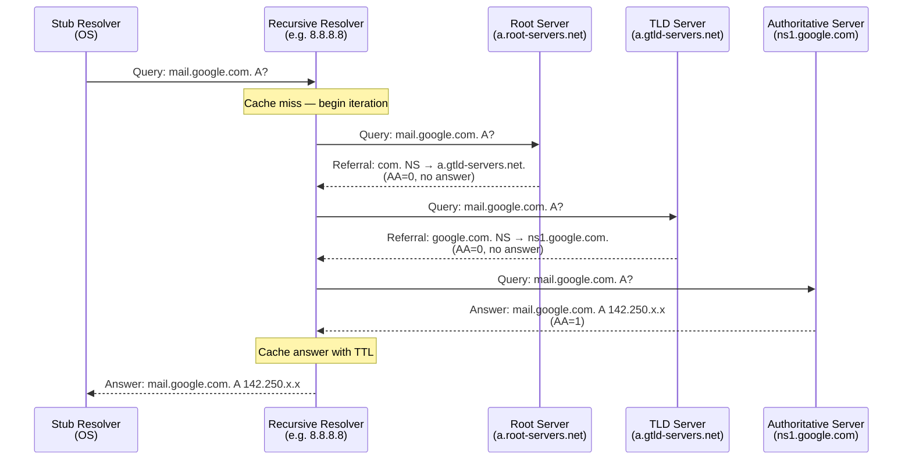
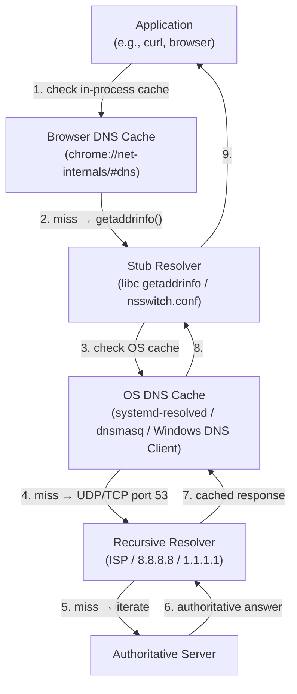
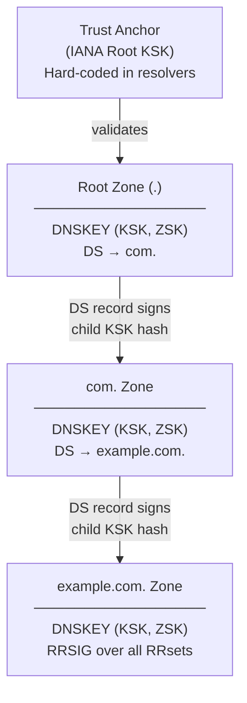
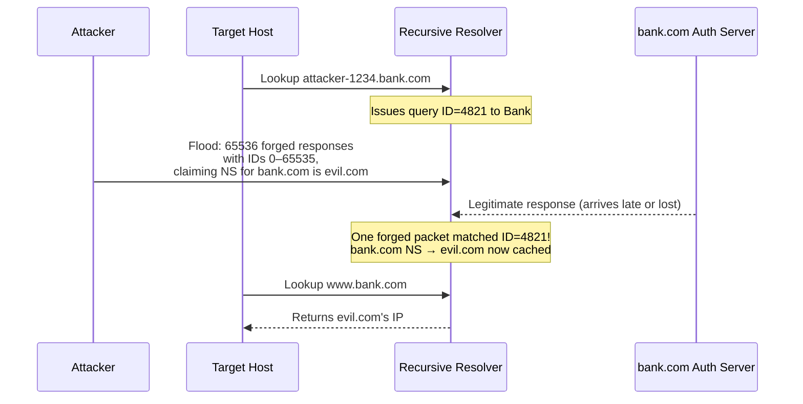
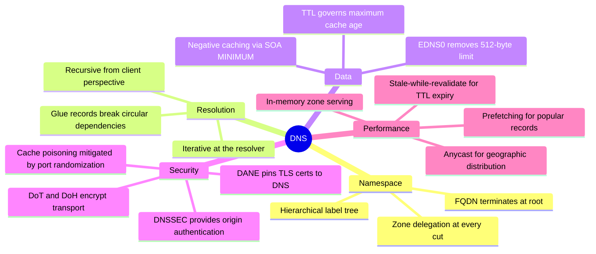

# Lesson 2: DNS and Name Resolution

## 1. First-Principles Intuition & Invariants

Before the Domain Name System existed, host-to-address mappings were maintained in a single flat file — `HOSTS.TXT` — distributed from SRI-NIC via FTP. By 1982, the ARPANET had grown to the point where this model was collapsing under its own weight: the file was updated twice weekly, every host had to poll for it, and namespace collisions were unavoidable with no administrative partitioning. Paul Mockapetris's response, published as RFC 882 and RFC 883 in 1983 and superseded by **RFC 1034** and **RFC 1035** in 1987, was not merely a lookup service — it was a design for a globally consistent, loosely coherent, delegated administrative database that could scale to billions of records without central coordination.

The key insight is **delegation**. No single authority needs to know the entire namespace. Each zone's administrator is responsible only for their subtree and publishes pointers (NS records) downward to child zones. Consistency is eventual rather than strict: authoritative servers are the source of truth, and the recursive infrastructure caches aggressively with TTL-governed expiry. This makes DNS a canonical example of **hierarchical, decentralized consensus under read-heavy workloads**.

### The Namespace as a Tree

The DNS namespace is a rooted label tree. Each node carries a label of 0–63 octets; the root node carries the empty label. A fully qualified domain name (FQDN) is the sequence of labels from a leaf to the root, separated by dots and terminated with a trailing dot (e.g., `mail.google.com.`). The trailing dot is almost always elided in practice but is structurally significant — its absence is what distinguishes a relative name from an absolute one.

```
                        . (root)
                       / \
                     com   org
                    /   \
               google   amazon
              /      \
           mail      www
```

**Invariants that must hold for the system to be correct:**

1. **Zone authority is non-overlapping.** A zone is a contiguous subtree that has been cut from its parent by an NS delegation. The parent zone contains NS records pointing to the child's authoritative servers, but it does not contain the child's data records (except for glue, discussed below).
2. **TTL governs the validity window, not the data.** A cached record with TTL=0 must not be used after the response is delivered. A record with TTL=86400 may be served from cache for 24 hours without revalidation.
3. **The resolver is stateless with respect to the client.** A recursive resolver may forget all state between two queries from the same client. The protocol carries all necessary context in every message.
4. **Authoritative answers are always preferred over cached answers.** The `AA` bit in the DNS response header flags a response from the zone's authoritative server; this response is definitive. A recursive resolver's cached copy is a convenience approximation.

---

## 2. Core Architecture & Mechanics

### 2.1 The Four-Actor Model

DNS resolution involves four distinct logical roles, often collapsed onto fewer physical machines:

| Role | Description |
|---|---|
| **Stub resolver** | A minimal client library in the OS (e.g., `getaddrinfo(3)`) that sends queries to a configured recursive resolver. It does no iteration itself. |
| **Recursive resolver** (full-service resolver) | Performs iterative queries across the hierarchy on behalf of the stub. Caches results. Run by ISPs, enterprises, or public operators (8.8.8.8, 1.1.1.1, 9.9.9.9). |
| **Authoritative server** | Holds the zone file for one or more zones. Returns `AA=1` responses. Does not recurse. |
| **Root servers** | 13 logical addresses (a–m.root-servers.net), each served by anycast clusters of hundreds of physical nodes. They answer queries for the root zone only, delegating to TLD servers. |

The 13 root server *addresses* (not machines) are a historical artifact of the original UDP packet size limit: 512 bytes was barely enough to fit 13 NS records with their glue A records. Modern EDNS0 removes this constraint, but the 13-address scheme persists for operational stability.

### 2.2 Iterative Resolution Walk-Through

A recursive resolver resolves `mail.google.com.` from cold cache as follows:



Each referral response carries the NS records for the next tier and, critically, **glue records** in the Additional section. Glue records are A/AAAA records for the name servers themselves. Without glue, resolving `ns1.google.com.` to query it would require another DNS lookup — a circular dependency. The TLD server includes glue because it holds the delegation; it is authoritative for the *pointer*, not the zone below it.

### 2.3 The Wire Format

DNS messages are binary-encoded, not text. Every implementation eventually confronts the wire format directly (debugging with `tcpdump`, writing a stub resolver, or implementing a custom authoritative server). Understanding it prevents the category of bugs that arise from treating DNS as a text protocol.

```
DNS Message Wire Format (RFC 1035 §4.1)
─────────────────────────────────────────
  0                   1                   2                   3
  0 1 2 3 4 5 6 7 8 9 0 1 2 3 4 5 6 7 8 9 0 1 2 3 4 5 6 7 8 9 0 1
 ┌─────────────────────────────────────────────────────────────────┐
 │                          ID (16 bits)                           │
 ├─┬─┬─┬─┬─┬─┬─┬─┬─┬─┬─────────┬─────────────────────────────────┤
 │QR│Op│AA│TC│RD│RA│ Z │  RCODE  │                                 │
 ├─┴─┴─┴─┴─┴─┴─┴─┴─┴─┴─────────┤  FLAGS (16 bits)                │
 ├─────────────────────────────────────────────────────────────────┤
 │                        QDCOUNT (16 bits)                        │
 ├─────────────────────────────────────────────────────────────────┤
 │                        ANCOUNT (16 bits)                        │
 ├─────────────────────────────────────────────────────────────────┤
 │                        NSCOUNT (16 bits)                        │
 ├─────────────────────────────────────────────────────────────────┤
 │                        ARCOUNT (16 bits)                        │
 ├─────────────────────────────────────────────────────────────────┤
 │                     Question Section                            │
 │   QNAME (variable length, label encoding)                       │
 │   QTYPE (16 bits) | QCLASS (16 bits)                           │
 ├─────────────────────────────────────────────────────────────────┤
 │                 Answer / Authority / Additional                  │
 │   NAME | TYPE | CLASS | TTL (32-bit) | RDLENGTH | RDATA        │
 └─────────────────────────────────────────────────────────────────┘
```

**Label encoding** is a compact scheme where each label is prefixed by its length byte. `mail.google.com.` encodes as:
`\x04mail\x06google\x03com\x00`
The terminal `\x00` represents the root label (zero-length). Bytes starting with `11` in the top two bits signal a **pointer** — a 14-bit offset into the message where the remaining name can be found. This compression scheme (RFC 1035 §4.1.4) is why DNS parsers must handle cycles carefully and why off-by-one errors in name parsing are a classic source of CVEs.

A minimal DNS query parser in C illustrates the structural invariants:

```c
#include <stdint.h>
#include <string.h>
#include <stdio.h>
#include <arpa/inet.h>

/* RFC 1035 §4.1.1 — DNS Header */
typedef struct __attribute__((packed)) {
    uint16_t id;
    uint16_t flags;   /* QR|OPCODE|AA|TC|RD|RA|Z|RCODE */
    uint16_t qdcount;
    uint16_t ancount;
    uint16_t nscount;
    uint16_t arcount;
} dns_header_t;

#define DNS_FLAG_QR     (1 << 15)   /* 0=query, 1=response      */
#define DNS_FLAG_AA     (1 << 10)   /* Authoritative Answer      */
#define DNS_FLAG_TC     (1 << 9)    /* TrunCated                 */
#define DNS_FLAG_RD     (1 << 8)    /* Recursion Desired         */
#define DNS_FLAG_RA     (1 << 7)    /* Recursion Available       */
#define DNS_RCODE_MASK  0x000F      /* Response code (4 bits)    */

/*
 * Decode a DNS name from `msg` at byte offset `*off`.
 * Follows pointer compression (RFC 1035 §4.1.4).
 * Writes the decoded name into `out` (null-terminated).
 * Returns 0 on success, -1 on malformed input.
 *
 * Security note: pointer loops are detected via a hop limit.
 */
int dns_decode_name(const uint8_t *msg, size_t msg_len,
                    size_t *off, char *out, size_t out_len) {
    size_t pos = *off;
    size_t written = 0;
    int    jumped  = 0;   /* did we follow at least one pointer?   */
    int    hops    = 0;   /* guard against pointer loops            */
    const int MAX_HOPS = 128;

    while (pos < msg_len) {
        uint8_t len = msg[pos];

        if ((len & 0xC0) == 0xC0) {           /* pointer */
            if (pos + 1 >= msg_len) return -1;
            if (++hops > MAX_HOPS)   return -1;
            uint16_t ptr = ((uint16_t)(len & 0x3F) << 8) | msg[pos + 1];
            if (ptr >= msg_len)      return -1;
            if (!jumped) *off = pos + 2;       /* advance caller past pointer */
            jumped = 1;
            pos = ptr;
            continue;
        }

        if (len == 0) {                        /* root label — done */
            if (written > 0) written--;        /* remove trailing dot */
            out[written] = '\0';
            if (!jumped) *off = pos + 1;
            return 0;
        }

        pos++;
        if (pos + len > msg_len) return -1;
        if (written + len + 1 >= out_len) return -1;

        if (written > 0) out[written++] = '.';
        memcpy(out + written, msg + pos, len);
        written += len;
        pos     += len;
    }
    return -1; /* truncated message */
}

void dns_print_header(const uint8_t *buf, size_t len) {
    if (len < sizeof(dns_header_t)) {
        fprintf(stderr, "Buffer too short for DNS header\n");
        return;
    }
    const dns_header_t *h = (const dns_header_t *)buf;
    uint16_t flags = ntohs(h->flags);

    printf("ID:      0x%04X\n", ntohs(h->id));
    printf("QR:      %s\n",     (flags & DNS_FLAG_QR) ? "Response" : "Query");
    printf("AA:      %s\n",     (flags & DNS_FLAG_AA) ? "yes" : "no");
    printf("RD:      %s\n",     (flags & DNS_FLAG_RD) ? "yes" : "no");
    printf("RA:      %s\n",     (flags & DNS_FLAG_RA) ? "yes" : "no");
    printf("RCODE:   %u\n",     flags & DNS_RCODE_MASK);
    printf("QDCount: %u\n",     ntohs(h->qdcount));
    printf("ANCount: %u\n",     ntohs(h->ancount));
}
```

### 2.4 Resource Record Types

DNS record types are not merely a list to memorize — their design encodes the semantics of different naming relationships. The following table covers records that any infrastructure engineer will encounter in practice.

| Type | RFC | RDATA contents | Semantics |
|---|---|---|---|
| **A** | 1035 | 4-byte IPv4 address | Forward lookup: name → IPv4 |
| **AAAA** | 3596 | 16-byte IPv6 address | Forward lookup: name → IPv6 |
| **CNAME** | 1035 | Target FQDN | Alias: the owner name is a synonym for the target. The resolver must restart the lookup at the target. A CNAME at the zone apex is illegal because it would conflict with SOA/NS records. |
| **MX** | 1035 | Priority (16-bit) + Exchange FQDN | Mail routing. Lower priority = higher preference. The exchange name must resolve to an A/AAAA; it cannot itself be a CNAME (RFC 2181 §10.3). |
| **NS** | 1035 | Name server FQDN | Zone delegation. The authoritative name servers for a zone. Must not point to a CNAME. |
| **SOA** | 1035 | MNAME RNAME SERIAL REFRESH RETRY EXPIRE MINIMUM | Zone metadata. MNAME = primary master. RNAME = responsible mailbox (dots encode `@`). SERIAL drives zone transfer; monotonically increasing (convention: YYYYMMDDnn). MINIMUM is the negative cache TTL (RFC 2308). |
| **PTR** | 1035 | Target FQDN | Reverse lookup: IP → name. Used in `in-addr.arpa.` (IPv4) and `ip6.arpa.` (IPv6) zones. |
| **TXT** | 1035 | One or more character strings | Free-form. Heavily overloaded for SPF (RFC 7208), DKIM (RFC 6376), DMARC (RFC 7489), site verification, ACME DNS challenges. |
| **SRV** | 2782 | Priority Weight Port Target | Service discovery: `_service._proto.name.` → endpoint. Used by SIP, XMPP, Kubernetes, etc. |
| **CAA** | 8659 | Flags Tag Value | Certification Authority Authorization. Specifies which CAs may issue TLS certificates for the domain. |
| **DNSKEY** | 4034 | Flags Protocol Algorithm PublicKey | DNSSEC public key. |
| **DS** | 4034 | KeyTag Alg DigestType Digest | Delegation Signer. Links a parent zone to a child's DNSKEY. The chain of DS records up to the root establishes the DNSSEC chain of trust. |
| **TLSA** | 6698 | Usage Selector Matching-Type CertData | DANE: pins TLS certificates to DNS, eliminating reliance on the CA PKI for STARTTLS/SMTPS. |

### 2.5 Zone Files and the SOA Record

A zone file is the serialization format for a zone's authoritative data. Understanding the SOA record parameters is critical for controlling replication behavior and negative caching:

```dns-zone
; Zone file for example.com.
; Directive $TTL sets default TTL for records lacking explicit TTL
$ORIGIN example.com.
$TTL    3600

;         MNAME              RNAME                SERIAL     REFRESH RETRY  EXPIRE  MINIMUM
@   IN  SOA ns1.example.com. hostmaster.example.com. (
                2024010101   ; Serial   — increment on every change
                7200         ; Refresh  — secondary polls primary this often (seconds)
                900          ; Retry    — if refresh fails, retry after this interval
                1209600      ; Expire   — secondary stops serving if it cannot refresh for 14 days
                300 )        ; Minimum  — negative cache TTL (RFC 2308 §4)

; Authoritative name servers
@       IN  NS  ns1.example.com.
@       IN  NS  ns2.example.com.

; Glue records (required when NS targets are within this zone)
ns1     IN  A   203.0.113.1
ns2     IN  A   203.0.113.2

; A records
@       IN  A   203.0.113.10
www     IN  A   203.0.113.10
mail    IN  A   203.0.113.20

; IPv6
@       IN  AAAA  2001:db8::1

; CNAME
ftp     IN  CNAME  www.example.com.

; MX (priority 10 is preferred over 20)
@       IN  MX  10  mail.example.com.
@       IN  MX  20  backup-mail.example.com.

; SPF (TXT)
@       IN  TXT  "v=spf1 mx -all"

; SRV: _service._proto.name  priority  weight  port  target
_https._tcp  IN  SRV  0  5  443  www.example.com.

; CAA
@       IN  CAA  0  issue  "letsencrypt.org"
```

---

## 3. Caching: The Performance Engine

DNS derives most of its performance from an aggressive, multi-level caching architecture. Without caching, every application DNS lookup would require a full iterative traversal — 3–5 round trips across the globe, adding 50–300 ms to every new connection.

### 3.1 TTL Mechanics

The 32-bit TTL field in every resource record specifies the **maximum** time (in seconds) that a downstream resolver or stub may cache the record. TTL is decremented in transit: if a recursive resolver fetches a record with TTL=300 and serves it 60 seconds later to a client, the client receives TTL=240. This prevents stale data from lingering beyond the original authority's intent.

**Practical TTL strategy for infrastructure engineers:**

- **Static infrastructure (NS, MX, root A records):** 86400s (24 hours). High TTL reduces resolver load and speeds up lookups for clients with cold caches.
- **Load-balanced or frequently changed A/AAAA records:** 60–300s. Enables relatively fast failover without excessive resolver churn.
- **During a planned migration:** Drop TTL to 60–300s at least one full original-TTL interval before the change. After migration, raise TTL again. Failing to pre-lower TTL is the most common DNS migration mistake, causing stale lookups for hours.
- **TTL=0:** Valid but pathological. Forces every lookup through the recursive resolver. Legitimate use cases: active-active failover systems where routing must change within seconds (e.g., some CDN health-check integrations).

**Negative caching (RFC 2308):** When a resolver returns `NXDOMAIN` (name does not exist) or `NOERROR` with an empty answer (record type does not exist), that negative result is itself cached. The cache TTL for a negative response is `min(SOA MINIMUM, response TTL)`, where the SOA MINIMUM field is the zone-wide negative caching default. This matters: if your zone's SOA MINIMUM is 3600 and you accidentally delete an A record, clients will cache the NXDOMAIN for up to an hour.

### 3.2 Cache Hierarchy in a Modern OS



Each layer in this stack has its own TTL-independent eviction policies (memory pressure, process restart, explicit flush commands). `sudo systemd-resolve --flush-caches`, `ipconfig /flushdns`, and `chrome://net-internals/#dns` clear different caches independently.

### 3.3 Python: Observing TTL Decay in a Recursive Resolver

```python
"""
Demonstrate TTL decay: query the same name twice with a delay
and observe the recursive resolver returning a decremented TTL.
Requires: pip install dnspython
"""
import time
import dns.resolver
import dns.rdatatype

def query_with_ttl(name: str, rdtype: str = "A") -> list[tuple[str, int]]:
    """Return list of (rdata, ttl) for each answer RR."""
    resolver = dns.resolver.Resolver()
    resolver.nameservers = ["8.8.8.8"]  # Google's public recursive resolver
    answer = resolver.resolve(name, rdtype)
    return [(rr.to_text(), answer.rrset.ttl) for rr in answer]

target = "example.com"

print(f"=== First query for {target} ===")
results1 = query_with_ttl(target)
for rdata, ttl in results1:
    print(f"  {target}  A  {rdata}  TTL={ttl}s")

sleep_seconds = 5
print(f"\nSleeping {sleep_seconds}s to let resolver cache age...\n")
time.sleep(sleep_seconds)

print(f"=== Second query for {target} ===")
results2 = query_with_ttl(target)
for rdata, ttl in results2:
    print(f"  {target}  A  {rdata}  TTL={ttl}s")

# If the recursive resolver cached the first response,
# the second TTL should be approximately (original_ttl - sleep_seconds).
ttl1 = results1[0][1]
ttl2 = results2[0][1]
delta = ttl1 - ttl2
print(f"\nTTL delta: {delta}s (expected ≈ {sleep_seconds}s if served from cache)")
```

---

## 4. Transport, Extensions, and Protocol Evolution

### 4.1 UDP vs. TCP

DNS was designed to run over UDP/53. The 512-byte response size limit was enforced by the original resolver implementations' buffer sizes, not by the protocol spec. When a response exceeds this limit, the server sets the TC (TruncaTed) bit and the client retries over TCP/53.

**EDNS0** (Extension Mechanisms for DNS, RFC 6891, originally RFC 2671) is a backward-compatible extension that adds an OPT pseudo-RR to the Additional section. Its most important function is advertising the client's UDP payload buffer size (typically 1232–4096 bytes, with 1232 being the EDNS buffer size recommended by DNS FLAG Day 2020 to stay below common MTUs). EDNS0 also enables:

- DNSSEC (`DO` bit in OPT flags)
- DNS cookies (RFC 7873, source address validation)
- Extended RCODE (12 bits instead of 4)

### 4.2 DNS over TLS (DoT) and DNS over HTTPS (DoH)

Classic DNS is cleartext. Any on-path observer (ISP, coffee shop Wi-Fi operator, nation-state) can read and modify every DNS query and response. Two standards address this:

- **DNS over TLS (DoT)** — RFC 7858. Wraps the existing DNS TCP framing (2-byte length prefix) inside a TLS session on **port 853**. Preserves the existing DNS wire format; only the transport changes.
- **DNS over HTTPS (DoH)** — RFC 8484. DNS messages encoded as the body of HTTPS requests (`Content-Type: application/dns-message`) on **port 443**. Blends DNS traffic into the HTTPS stream, making it indistinguishable from normal web traffic at the transport layer.

The architectural tradeoff between DoT and DoH is primarily about observability vs. privacy. DoT on port 853 is easy to identify and block, which makes it amenable to enterprise network policy. DoH on port 443 is effectively impossible to block without breaking HTTPS generally, which is why browser vendors (Firefox, Chrome) have deployed it aggressively against the objections of enterprise network operators.

```mermaid
flowchart LR
    subgraph Classic["Classic DNS (plaintext)"]
        C1[Client] -->|"UDP/TCP port 53\n(cleartext)"| R1[Recursive Resolver]
    end

    subgraph DoT["DNS over TLS"]
        C2[Client] -->|"TCP port 853\n(TLS encrypted)"| R2[Recursive Resolver]
    end

    subgraph DoH["DNS over HTTPS"]
        C3[Client] -->|"HTTPS port 443\nPOST /dns-query"| R3[DoH Resolver\n(e.g. 1.1.1.1/dns-query)]
    end
```

### 4.3 DNS over QUIC (DoQ)

RFC 9250 specifies DNS over QUIC on **port 853** (same port as DoT). QUIC eliminates TCP's head-of-line blocking, which matters in mobile environments where packet loss is common. Each DNS query runs in its own QUIC stream; a lost packet stalls only that stream, not all in-flight queries. DoQ is the most recent transport evolution and is not yet as widely deployed as DoT or DoH.

---

## 5. DNSSEC: Cryptographic Chain of Trust

DNS was designed before the threat model of an adversarial Internet was well understood. The absence of authentication in the original protocol enables cache poisoning (§6.1). DNSSEC (RFC 4033–4035) retrofits authentication by signing zone data with public-key cryptography.

### 5.1 How DNSSEC Works

DNSSEC does **not** encrypt DNS data. It provides **data origin authentication** and **denial-of-existence** proofs. Every resource record set (RRset) in a signed zone is accompanied by an **RRSIG** record containing a digital signature over the RRset, computed with the zone's private key. The corresponding public key is published in a **DNSKEY** record.

The chain of trust is established from the root downward:



The root zone's KSK (Key Signing Key) is the ultimate trust anchor. IANA publishes it, and it is hard-coded into validating resolvers (the same way root CA certificates are bundled with operating systems). The KSK signs the ZSK (Zone Signing Key); the ZSK signs individual RRsets. This two-key design allows frequent ZSK rotation (every 30–90 days is common) without requiring the parent zone to update its DS record, while the KSK rotates rarely (annually) and requires parent coordination.

**NSEC and NSEC3 — Proof of Non-Existence:** When a name does not exist, DNSSEC must prove it without revealing the entire zone. NSEC records form a sorted linked list of existing names; a resolver can verify that a queried name falls between two NSEC records and thus does not exist. NSEC has a **zone enumeration** vulnerability (walking the linked list reveals all names). NSEC3 (RFC 5155) replaces owner names with hashed labels, preventing trivial enumeration at the cost of additional complexity and the possibility of offline dictionary attacks.

### 5.2 Validating DNSSEC with Go

```go
package main

import (
    "fmt"
    "log"

    "github.com/miekg/dns"
)

// checkDNSSEC performs a basic DNSSEC validation check by querying
// for an A record with the DO (DNSSEC OK) bit set and checking
// whether the resolver returns an authenticated (AD) response.
//
// This relies on the upstream resolver performing validation.
// A production implementation would perform local validation
// using the root trust anchor per RFC 4033.
func checkDNSSEC(name, server string) error {
    c := new(dns.Client)

    m := new(dns.Msg)
    m.SetQuestion(dns.Fqdn(name), dns.TypeA)
    m.SetEdns0(4096, true) // EDNS0 with DO bit = true

    r, _, err := c.Exchange(m, server+":53")
    if err != nil {
        return fmt.Errorf("query failed: %w", err)
    }

    switch r.Rcode {
    case dns.RcodeSuccess:
        // good
    case dns.RcodeNameError:
        return fmt.Errorf("NXDOMAIN: %s does not exist", name)
    case dns.RcodeServerFailure:
        // SERVFAIL from a validating resolver typically means DNSSEC
        // validation failed — a critical signal.
        return fmt.Errorf("SERVFAIL: possible DNSSEC validation failure for %s", name)
    default:
        return fmt.Errorf("unexpected RCODE %d for %s", r.Rcode, name)
    }

    fmt.Printf("Query: %s A\n", name)
    fmt.Printf("AD bit (Authentic Data): %v\n", r.AuthenticatedData)
    fmt.Printf("Answer RRs: %d\n", len(r.Answer))

    for _, rr := range r.Answer {
        switch v := rr.(type) {
        case *dns.A:
            fmt.Printf("  A: %s  TTL=%d\n", v.A, v.Hdr.Ttl)
        case *dns.RRSIG:
            fmt.Printf("  RRSIG: type=%d algo=%d expiry=%s\n",
                v.TypeCovered, v.Algorithm, v.Expiration)
        }
    }
    return nil
}

func main() {
    // dnssec-failed.org is a test domain maintained for DNSSEC failure testing.
    // A validating resolver should return SERVFAIL for this name.
    targets := []struct {
        name   string
        expect string
    }{
        {"dnssec-failed.org.", "SERVFAIL expected (broken DNSSEC)"},
        {"cloudflare.com.", "AD=true expected (signed zone)"},
        {"example.com.", "AD may vary by resolver"},
    }

    resolver := "1.1.1.1" // Cloudflare — DNSSEC-validating

    for _, t := range targets {
        fmt.Printf("\n── %s (%s) ──\n", t.name, t.expect)
        if err := checkDNSSEC(t.name, resolver); err != nil {
            log.Printf("Error: %v", err)
        }
    }
}
```

---

## 6. Security Failure Modes

### 6.1 Cache Poisoning: The Kaminsky Attack

Dan Kaminsky disclosed in 2008 a practical cache poisoning attack that threatened the entire DNS infrastructure. The attack exploited the fact that a 16-bit transaction ID was the only source of randomness in classic DNS queries. An attacker could:

1. Trigger a recursive resolver to look up a name in a target domain (e.g., `attacker-triggered-N.bank.com.`).
2. Race to send forged responses with all 65,536 possible transaction IDs, claiming to be the authoritative server for `bank.com.`, injecting a malicious NS record.
3. If one forged response matched before the real one arrived, the recursive resolver would cache the poisoned delegation for the entire `bank.com.` zone, redirecting all subsequent queries.

The key insight is that by querying *random subdomains*, the attacker could keep the resolver issuing fresh queries indefinitely (each subdomain lookup bypasses the cache), giving them effectively unlimited attempts within the TTL window.

**Mitigations implemented in direct response to Kaminsky:**

- **Source port randomization (RFC 5452):** Instead of sending all queries from UDP source port 53, resolvers randomize the source port across the 16-bit space. Combined with the 16-bit transaction ID, this gives 32 bits of entropy — 4 billion combinations vs. 65,536. Deployed as an emergency patch in July 2008.
- **0x20 encoding (draft-vixie-dnsext-dns0x20):** Randomly mix upper and lower case in query names. DNS names are case-insensitive per RFC 1035, so the resolver can verify that the response's QNAME case matches the query's, adding further bits of entropy.
- **DNSSEC** (§5): The definitive cryptographic fix. A signed response cannot be forged.



### 6.2 DNS Amplification (Reflection) Attacks

DNS is a natural amplification vector because:
1. Requests are small (UDP query: ~40 bytes) but responses can be large (ANY query response: >3000 bytes).
2. UDP source addresses are trivially spoofed.
3. Open resolvers (those answering queries from arbitrary IPs) are numerous.

The amplification factor for a DNS reflection attack can exceed **70x**. An attacker spoofing the victim's IP sends a stream of small queries to open resolvers; each resolver sends a large response to the victim. With enough open resolvers, a single attacker can direct terabytes per second at a target.

**Mitigations:**
- **BCP 38 / RFC 2827 (ingress filtering):** Networks should drop packets with source addresses they do not own. Widely recommended, unevenly deployed.
- **Response Rate Limiting (RRL):** Authoritative servers detect when they are sending many identical responses to the same destination within a short window and throttle (slip) or drop excess responses. BIND and NSD implement this.
- **Disabling ANY queries:** RFC 8482 permits authoritative servers to respond to `ANY` queries with a minimal response, eliminating one of the highest-amplification vectors.
- **Restricting open recursion:** Recursive resolvers should answer only their configured clients (ACLs). An open recursive resolver is a misconfiguration.

### 6.3 DNS Hijacking and Split-Horizon DNS

**DNS hijacking** occurs when a resolver returns unauthorized answers — either by ISP-level injection (returning ad pages for NXDOMAIN), by malware modifying `/etc/resolv.conf` or the system DNS settings, or by BGP hijacking that routes queries to an attacker-controlled resolver.

**Split-horizon (split-brain) DNS** is a *legitimate* technique where the same zone serves different answers to different clients (typically internal vs. external). An internal DNS server resolves `api.company.com` to a private RFC 1918 address, while the public authoritative server returns a public IP. This is not a failure mode but requires careful operational discipline: a misconfigured split-horizon can expose internal topology or break external access from VPN clients.

---

## 7. High-Performance DNS Architecture

### 7.1 Anycast and Root Server Operation

The 13 root server logical addresses (192.5.5.241 for F-root, etc.) are served by hundreds of physical nodes worldwide via **IP anycast**. With anycast, the same prefix is announced from multiple locations; BGP routing causes each client to reach its topologically nearest instance. F-root (ISC) operates over 300 anycast nodes. This is why root server queries experience single-digit millisecond RTTs globally despite there being only 13 addresses.

Anycast is also the standard deployment pattern for public recursive resolvers: `8.8.8.8` (Google), `1.1.1.1` (Cloudflare), and `9.9.9.9` (Quad9) are all anycast addresses. From London, `1.1.1.1` resolves to Cloudflare's London PoP; from Tokyo, it resolves to their Tokyo PoP.

### 7.2 Authoritative Server at Scale

A high-traffic authoritative DNS server (e.g., serving a major CDN's zone) must handle millions of queries per second. The key design elements are:

- **In-memory zone loading:** Zone data is loaded entirely into memory on startup and re-loaded atomically on updates. Disk I/O is not on the query path.
- **Lock-free data structures:** Zone data is immutable between updates. Readers access a pointer to the current zone generation; updates atomically swap the pointer to a new generation.
- **UDP fast path:** Most queries are answered in a single UDP round trip from a hot cache. The kernel `SO_REUSEPORT` option allows multiple threads/processes to bind the same UDP socket, distributing query load across CPU cores without a central dispatcher.

```rust
// Minimal conceptual sketch of a lock-free zone swap in Rust.
// In production, use arc-swap or a similar tested crate.
use std::sync::Arc;
use arc_swap::ArcSwap;

#[derive(Debug)]
pub struct ZoneData {
    pub serial: u32,
    pub records: Vec<String>, // simplified; real implementation uses RRsets
}

pub struct AuthoritativeServer {
    // ArcSwap allows lock-free reads and atomic writes.
    // Readers get a snapshot of the Arc; writer swaps a new Arc in.
    zone: ArcSwap<ZoneData>,
}

impl AuthoritativeServer {
    pub fn new(initial: ZoneData) -> Self {
        Self {
            zone: ArcSwap::from_pointee(initial),
        }
    }

    /// Called by the query path — zero locks, zero allocations.
    pub fn query(&self, name: &str) -> Option<String> {
        let zone = self.zone.load(); // returns arc_swap::Guard<Arc<ZoneData>>
        zone.records.iter()
            .find(|r| r.starts_with(name))
            .cloned()
    }

    /// Called when a new zone version is available (AXFR, local edit, API push).
    /// All readers that loaded the old Arc before this point continue
    /// safely; they hold their own Arc reference. Memory is freed
    /// when the last reader drops its guard.
    pub fn reload(&self, new_data: ZoneData) {
        self.zone.store(Arc::new(new_data));
    }
}
```

### 7.3 Resolver Performance: Prefetching and Negative TTL Tuning

A subtle source of latency spikes in recursive resolvers is **TTL expiry under load**. When a popular record's TTL reaches zero, all concurrent requests for that name must wait for a fresh upstream query. This thundering-herd phenomenon is addressed by **stale-while-revalidate** (RFC 8767): serve the expired record for a brief grace period while refreshing it in the background. `Unbound` and `BIND 9.12+` implement this.

**Prefetching** is a complementary optimization: when a cached record's TTL drops below a configurable threshold (typically 10% of original TTL), the resolver proactively refreshes it. This eliminates the expiry latency spike entirely for popular records.

---

## 8. The `/etc/resolv.conf` and OS Resolver Configuration

The stub resolver's behavior is governed by `/etc/resolv.conf` on Unix systems (or the DNS Client service on Windows). Key directives:

```
# /etc/resolv.conf
nameserver 1.1.1.1          # Primary recursive resolver
nameserver 8.8.8.8          # Fallback (tried after ~5s timeout)
search     corp.example.com # Appended to unqualified names
options    ndots:5          # Names with < 5 dots are tried as relative first
options    timeout:2        # Per-query timeout in seconds
options    attempts:3       # Number of retries
options    rotate           # Round-robin across nameservers
```

`ndots:5` is the Linux default and is a frequent source of Kubernetes DNS latency. With `ndots:5`, a lookup for `api.internal` (1 dot, < 5) first attempts `api.internal.corp.example.com.`, then `api.internal.`, causing up to 6 DNS round trips before resolving. Kubernetes sets `ndots:5` to support short-form service names (e.g., `my-service` resolves as `my-service.namespace.svc.cluster.local.`), but applications making frequent external DNS lookups pay a latency penalty. Workaround: use fully qualified names (trailing dot) for external hosts, or tune `ndots`.

---

## 9. Practical Diagnostic Toolkit

### 9.1 `dig` — The Primary DNS Diagnostic Tool

```bash
# Full iterative trace from the root (bypasses local resolver)
dig +trace www.example.com

# Query a specific server, request DNSSEC records
dig @1.1.1.1 +dnssec +multiline example.com A

# Check NS delegation chain
dig +nssearch example.com

# Reverse lookup (PTR)
dig -x 93.184.216.34

# Check TLSA record for DANE
dig _443._tcp.example.com TLSA

# AXFR zone transfer attempt (usually refused; reveals misconfig if it succeeds)
dig @ns1.example.com example.com AXFR

# Measure query latency to a specific resolver
dig @9.9.9.9 example.com A | grep "Query time"
```

### 9.2 Rust: Building a Minimal DNS Query Tool

```rust
//! Minimal raw DNS query over UDP — educational implementation.
//! Demonstrates wire format construction and parsing without
//! external DNS libraries.

use std::net::UdpSocket;

/// Build a minimal DNS query packet for an A record lookup.
/// Returns the raw bytes to send.
fn build_dns_query(name: &str, transaction_id: u16) -> Vec<u8> {
    let mut buf: Vec<u8> = Vec::new();

    // Header (12 bytes)
    buf.extend_from_slice(&transaction_id.to_be_bytes()); // ID
    buf.extend_from_slice(&0x0100u16.to_be_bytes()); // Flags: RD=1 (recursion desired)
    buf.extend_from_slice(&1u16.to_be_bytes());       // QDCOUNT = 1
    buf.extend_from_slice(&0u16.to_be_bytes());       // ANCOUNT = 0
    buf.extend_from_slice(&0u16.to_be_bytes());       // NSCOUNT = 0
    buf.extend_from_slice(&0u16.to_be_bytes());       // ARCOUNT = 0

    // QNAME: label-encoded domain name
    for label in name.trim_end_matches('.').split('.') {
        assert!(label.len() <= 63, "Label too long");
        buf.push(label.len() as u8);
        buf.extend_from_slice(label.as_bytes());
    }
    buf.push(0x00); // root label

    // QTYPE = A (1), QCLASS = IN (1)
    buf.extend_from_slice(&1u16.to_be_bytes());
    buf.extend_from_slice(&1u16.to_be_bytes());

    buf
}

fn main() -> std::io::Result<()> {
    let name = "example.com";
    let resolver = "8.8.8.8:53";
    let txid: u16 = 0x1234;

    let query = build_dns_query(name, txid);

    let socket = UdpSocket::bind("0.0.0.0:0")?;
    socket.set_read_timeout(Some(std::time::Duration::from_secs(5)))?;
    socket.send_to(&query, resolver)?;

    let mut response = [0u8; 512];
    let (n, _) = socket.recv_from(&mut response)?;
    let resp = &response[..n];

    println!("Sent {} bytes, received {} bytes", query.len(), n);
    println!("Response ID:    0x{:04X}", u16::from_be_bytes([resp[0], resp[1]]));
    println!("Response flags: 0x{:04X}", u16::from_be_bytes([resp[2], resp[3]]));

    let ancount = u16::from_be_bytes([resp[6], resp[7]]);
    println!("Answer count:   {}", ancount);

    // A minimal parser: find the answer section by skipping the question section.
    // A production parser must use the name decompression logic from §2.3.
    if ancount > 0 && n > 12 {
        println!("(Raw answer section present — use a full parser for production use)");
        println!("Raw response hex: {}", resp.iter().map(|b| format!("{b:02X}")).collect::<Vec<_>>().join(" "));
    }

    Ok(())
}
```

### 9.3 Monitoring DNS Health in Production

A production monitoring checklist for DNS:

- **Latency percentiles (p50, p99)** from stub to recursive resolver. Elevated p99 indicates TTL expiry thundering-herds or congestion on the resolver.
- **SERVFAIL rate**: Any non-trivial SERVFAIL rate from a validating resolver indicates DNSSEC validation failures. Investigate with `dig +cd` (checking disabled) to distinguish DNSSEC failures from infrastructure failures.
- **NXDOMAIN rate**: A sudden spike in NXDOMAIN from an application may indicate a misconfigured `search` domain, a deleted DNS record, or a software deployment bug.
- **UDP vs. TCP ratio on authoritative servers**: A high TCP ratio indicates clients are receiving truncated UDP responses, suggesting EDNS0 is not being negotiated correctly or large DNSSEC responses are common.
- **Zone serial propagation**: Monitor that all secondary NS servers are serving the same serial number as the primary. A stale secondary indicates a failed zone transfer.

---

## 10. Summary: The DNS Invariants That Matter



DNS is simultaneously one of the oldest and most critical infrastructure components of the Internet. Its design — hierarchical delegation, distributed authority, aggressive caching, eventual consistency — predates most modern distributed systems literature but embodies the same fundamental tradeoffs. Every architectural decision in DNS resolves a tension: consistency vs. availability (high TTLs favor availability; low TTLs favor consistency), security vs. simplicity (DNSSEC is correct but operationally complex), and privacy vs. observability (DoH maximizes privacy but minimizes network operator control). Understanding DNS at this level is prerequisite knowledge for any engineer working on distributed systems, infrastructure, security, or network architecture.
