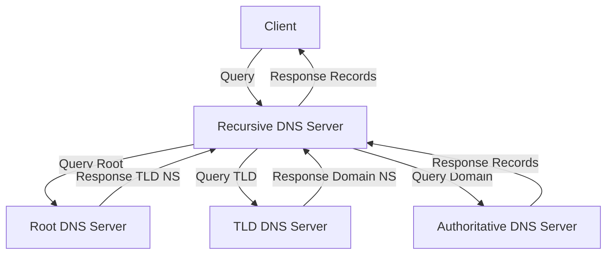

# Lesson 2: DNS and Name Resolution

## 1. First-Principles Intuition & Invariants

The Domain Name System (DNS) is a foundational component of the Internet, enabling the translation of human-readable domain names into machine-readable IP addresses. This transformation is crucial for the seamless operation of distributed systems and the World Wide Web. At its core, DNS operates as a distributed, hierarchical, and decentralized database that maps domain names to IP addresses and vice versa. The system's design is rooted in the principles of scalability, reliability, and efficiency, ensuring that it can handle the vast and dynamic nature of the Internet.

The problem space DNS addresses is the need for a robust and efficient method to resolve domain names to IP addresses. Without DNS, users would be required to remember the numeric IP addresses of every website they wish to visit, which is impractical and error-prone. DNS abstracts this complexity by providing a hierarchical naming system where domain names are organized into a tree structure. Each node in this tree represents a domain, and the leaves represent specific hosts within those domains.

The hierarchical structure of DNS is a critical invariant that enables the system to scale efficiently. The root of the DNS tree is the top-level domain (TLD), which includes generic TLDs (gTLDs) like `.com`, `.org`, and `.net`, as well as country-code TLDs (ccTLDs) like `.us`, `.uk`, and `.jp`. Below the TLDs are second-level domains (SLDs), such as `google` in `google.com`, and further down the hierarchy are third-level domains and subdomains, such as `mail.google.com`. This hierarchical structure allows DNS queries to be resolved efficiently by delegating responsibility to authoritative DNS servers at each level of the hierarchy.

Another invariant of DNS is its use of a distributed architecture. DNS servers are distributed across the Internet, and each server is responsible for a specific portion of the DNS tree. This distribution ensures that the system remains resilient to failures and can continue to operate even if individual servers go down. The distributed nature of DNS also allows for load balancing and geographic distribution, which can improve the performance and reliability of the system.

The DNS protocol is defined by a set of standards, primarily RFC 1035, which specifies the format of DNS messages and the behavior of DNS servers and clients. These standards ensure that DNS operates consistently across different implementations and platforms. The protocol is designed to be lightweight and efficient, using a request-response model where clients send queries to DNS servers, and servers respond with the requested information.

## 2. Core Architecture & Mechanics

The architecture of DNS is centered around the concept of a distributed, hierarchical database. At the heart of this architecture are DNS servers, which are responsible for storing and serving DNS records. DNS records are data structures that map domain names to IP addresses and other information, such as mail server addresses and canonical names. The most common types of DNS records are:

- **A (Address) Records:** Map domain names to IPv4 addresses.
- **AAAA (Quad-A) Records:** Map domain names to IPv6 addresses.
- **CNAME (Canonical Name) Records:** Provide aliases for domain names.
- **MX (Mail Exchange) Records:** Specify mail servers for a domain.
- **NS (Name Server) Records:** Specify authoritative DNS servers for a domain.
- **SOA (Start of Authority) Records:** Provide administrative information about a domain.

DNS queries are resolved through a series of steps that involve multiple DNS servers. When a client needs to resolve a domain name, it sends a query to a recursive DNS server, which is typically provided by the client's Internet service provider (ISP). The recursive DNS server then performs a series of queries to resolve the domain name. This process involves querying the root DNS servers, which are the authoritative DNS servers for the root of the DNS tree. The root DNS servers respond with the address of the authoritative DNS server for the TLD, which the recursive DNS server then queries. This process continues until the recursive DNS server reaches the authoritative DNS server for the domain, which responds with the requested DNS records.

The process of resolving a domain name can be visualized using a Mermaid diagram:

In this diagram, the client sends a query to the recursive DNS server, which then performs a series of queries to resolve the domain name. The recursive DNS server queries the root DNS server, which responds with the address of the TLD DNS server. The recursive DNS server then queries the TLD DNS server, which responds with the address of the authoritative DNS server for the domain. Finally, the recursive DNS server queries the authoritative DNS server, which responds with the requested DNS records.

The DNS protocol uses a request-response model, where DNS queries and responses are encoded in a specific format. DNS messages are composed of a header, a question section, an answer section, an authority section, and an additional section. The header contains metadata about the message, such as the message ID, flags, and the number of questions, answers, authority records, and additional records. The question section contains the domain name and record type that the client is querying. The answer section contains the DNS records that the server is responding with. The authority section contains DNS records that provide information about the authoritative DNS servers for the domain. The additional section contains DNS records that may be useful for the client, such as the IP addresses of the authoritative DNS servers.

The DNS protocol also supports caching, which can improve the performance of DNS queries. When a recursive DNS server receives a response from an authoritative DNS server, it caches the response for a specified period of time. If the same query is received again within the cache period, the recursive DNS server can respond immediately from the cache, without having to perform additional queries. This caching mechanism can significantly reduce the latency of DNS queries and improve the overall performance of the DNS system.

## 3. High-Performance Optimization & Failure Modes

The performance and reliability of DNS are critical for the operation of the Internet. To ensure that DNS operates efficiently, several optimizations and failure modes are considered.

One of the key optimizations in DNS is the use of caching. As mentioned earlier, recursive DNS servers cache DNS responses to reduce the latency of subsequent queries. The cache period is specified in the TTL (Time to Live) field of the DNS records. The TTL field indicates the maximum time that a DNS record can be cached before it must be refreshed. By caching DNS responses, recursive DNS servers can reduce the number of queries that need to be sent to authoritative DNS servers, which can improve the performance of DNS queries.

Another optimization in DNS is the use of anycast. Anycast is a network addressing and routing technique that allows a single IP address to be assigned to multiple DNS servers. When a client sends a DNS query to an anycast IP address, the query is routed to the nearest DNS server in the anycast group. This can improve the performance of DNS queries by reducing the latency of the query and the response.

DNS also supports load balancing, which can improve the performance and reliability of the system. Load balancing can be achieved through the use of multiple DNS servers for a domain. When a client sends a DNS query, the recursive DNS server can distribute the query across multiple DNS servers, which can improve the performance and reliability of the system.

One of the failure modes in DNS is cache poisoning, where an attacker sends a malicious DNS response to a recursive DNS server, causing it to cache the malicious response. Cache poisoning can cause clients to be redirected to malicious websites, which can lead to security vulnerabilities. To mitigate cache poisoning, DNS servers use several techniques, such as DNSSEC (DNS Security Extensions), which provides cryptographic authentication for DNS records.

Another failure mode in DNS is DNS amplification attacks, where an attacker sends a DNS query with a spoofed source IP address to a DNS server, causing the server to send a larger response to the spoofed IP address. This can cause a denial-of-service (DoS) attack on the target IP address. To mitigate DNS amplification attacks, DNS servers use several techniques, such as rate limiting and query validation.

In conclusion, the Domain Name System (DNS) is a critical component of the Internet, enabling the translation of human-readable domain names into machine-readable IP addresses. The architecture of DNS is centered around the concept of a distributed, hierarchical database, with DNS servers responsible for storing and serving DNS records. DNS queries are resolved through a series of steps that involve multiple DNS servers, and the DNS protocol uses a request-response model to encode DNS messages. The performance and reliability of DNS are critical for the operation of the Internet, and several optimizations and failure modes are considered to ensure that DNS operates efficiently and securely.
