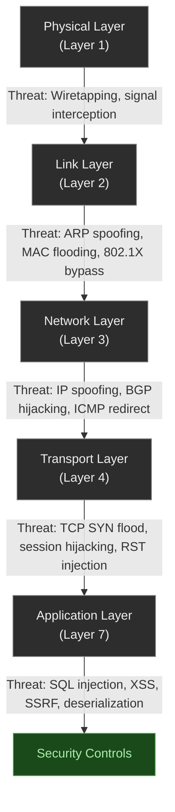
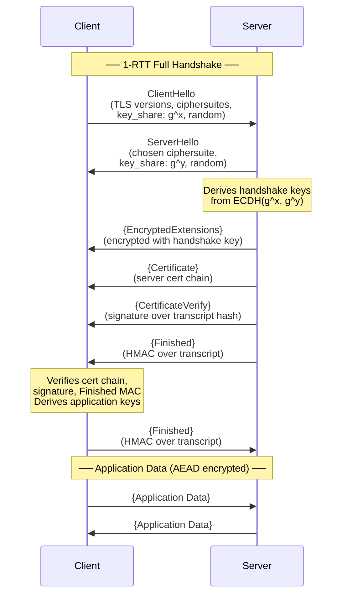
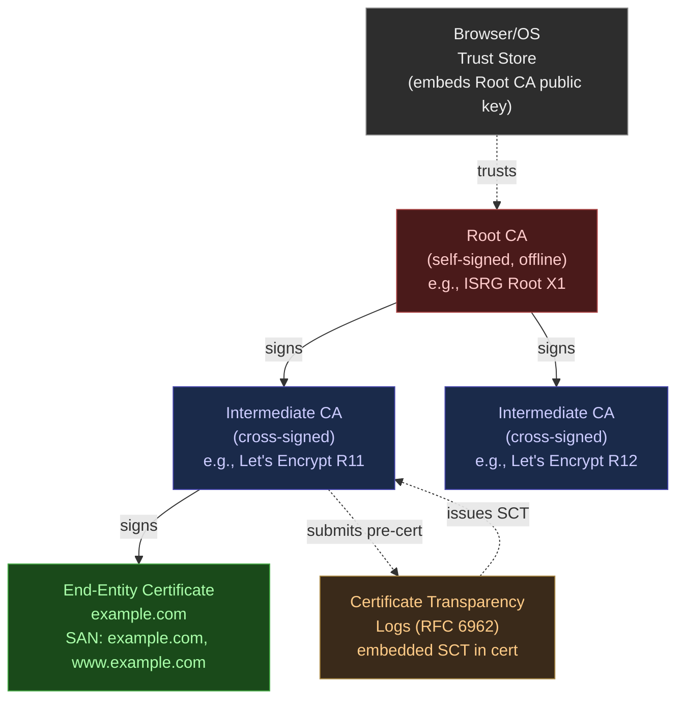
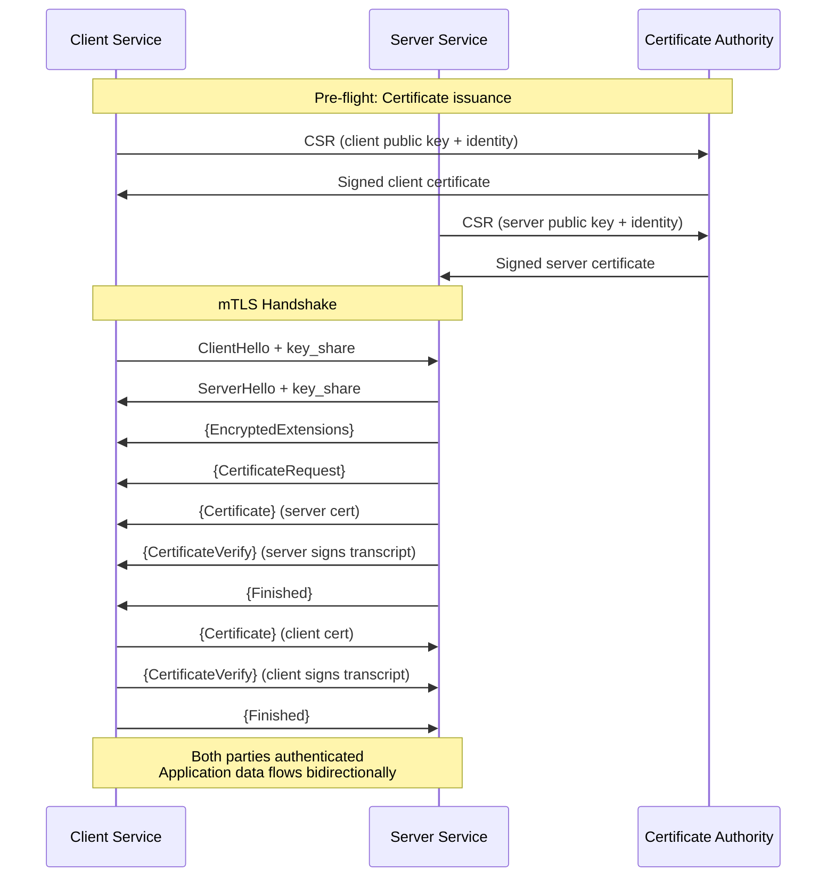
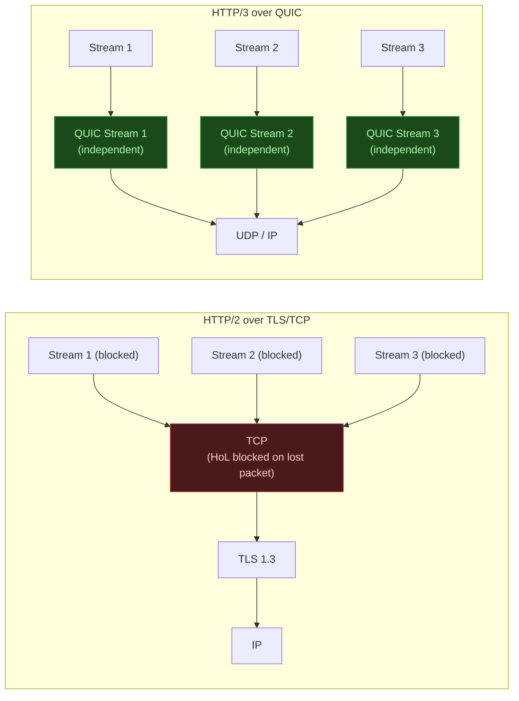
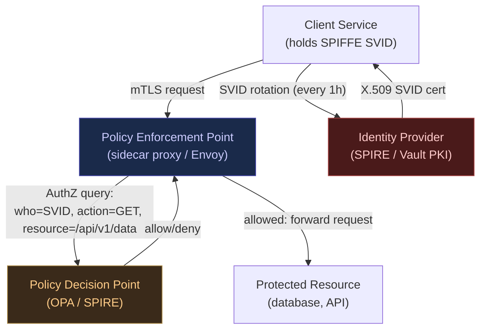
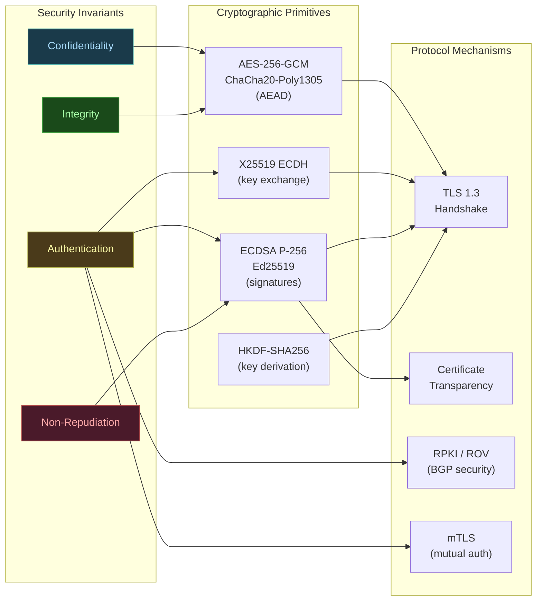

# Lesson 3: Network Security Fundamentals

---

## 1. First-Principles Intuition & Invariants

The network is not merely a conduit for data — it is an adversarial environment where every packet traverses infrastructure controlled by unknown parties. The fundamental engineering challenge is establishing a secure channel between two principals who share no prior secret, in an environment where an adversary — the Dolev-Yao adversary model — can observe, replay, delete, and inject arbitrary messages at any point in the communication path.

This is not merely a cryptography problem. It is a *systems* problem: how do you compose cryptographic primitives, state machines, and trust hierarchies into a protocol that remains secure under concurrent, interleaved, and adversarially-controlled execution? The answer to this question has consumed decades of academic and industrial effort, produced multiple CVEs in ostensibly "secure" implementations, and continues to evolve as quantum computing and new attack surfaces emerge.

### The Four Security Invariants

Network security is built on four invariants that must be preserved simultaneously, under all execution conditions, including failure:

**Confidentiality** — data must be computationally indistinguishable from random noise to any party not in possession of the decryption key. This is formalized as IND-CPA (Indistinguishability under Chosen-Plaintext Attack) and, more strictly, IND-CCA2 (under adaptive Chosen-Ciphertext Attack). AES-GCM, used in TLS 1.3, satisfies IND-CCA2 when the nonce is never reused; nonce reuse catastrophically breaks both confidentiality *and* integrity simultaneously.

**Integrity** — data must remain unaltered in transit. Integrity protection is provided by a Message Authentication Code (MAC) or an Authenticated Encryption with Associated Data (AEAD) scheme. It is architecturally critical to understand that *encryption alone does not provide integrity*. CBC-mode ciphertext is malleable: an attacker can flip predictable bits in the ciphertext and produce corresponding controlled changes in the plaintext without knowledge of the key. This is the root cause of the POODLE and BEAST attacks.

**Authentication** — parties must be able to verify each other's identities. Without authentication, confidentiality and integrity are meaningless because you are protecting a channel with an adversary. Authentication in TLS is asymmetric: the server always authenticates to the client via its certificate; mutual TLS (mTLS) additionally requires the client to present a certificate. Authentication chains back to a trusted anchor — the Certificate Authority (CA) root certificate embedded in the operating system or browser trust store.

**Non-repudiation** — a party cannot credibly deny having sent a message. This is a property of digital signatures, not MACs. A MAC requires the verifier to possess the same secret key as the signer, so either party could have produced it. A digital signature (e.g., ECDSA with a private key only the sender holds) is non-repudiable because only the sender could have produced the valid signature. TLS session keys are symmetric and therefore provide *authentication* but not *non-repudiation*. Non-repudiation requires signing application-layer messages at a layer above TLS.

These invariants are not independent. The collapse of authentication implies that an adversary may substitute their own key material, defeating both confidentiality and integrity even if the cryptographic algorithms themselves are unbroken. The collapse of integrity in an AEAD scheme allows ciphertext tampering that can induce decryption oracles, breaking confidentiality through side channels.

### The Packet as the Unit of Analysis

The Internet Protocol packet is the atomic unit of network communication. At the IPv4 layer, it consists of a 20-byte fixed header (plus options) and a variable-length payload. At the IPv6 layer, the fixed header is 40 bytes. The header contains the source and destination IP addresses, the protocol identifier (TCP=6, UDP=17, etc.), the TTL/Hop Limit, and a header checksum (IPv4 only; IPv6 removed the per-hop checksum by design for performance). The payload carries the transport-layer segment.

```
IPv4 Packet Layout (RFC 791):
 0                   1                   2                   3
 0 1 2 3 4 5 6 7 8 9 0 1 2 3 4 5 6 7 8 9 0 1 2 3 4 5 6 7 8 9 0 1
+-+-+-+-+-+-+-+-+-+-+-+-+-+-+-+-+-+-+-+-+-+-+-+-+-+-+-+-+-+-+-+-+
|Version|  IHL  |Type of Service|          Total Length         |
+-+-+-+-+-+-+-+-+-+-+-+-+-+-+-+-+-+-+-+-+-+-+-+-+-+-+-+-+-+-+-+-+
|         Identification        |Flags|      Fragment Offset    |
+-+-+-+-+-+-+-+-+-+-+-+-+-+-+-+-+-+-+-+-+-+-+-+-+-+-+-+-+-+-+-+-+
|  Time to Live |    Protocol   |         Header Checksum       |
+-+-+-+-+-+-+-+-+-+-+-+-+-+-+-+-+-+-+-+-+-+-+-+-+-+-+-+-+-+-+-+-+
|                       Source Address                          |
+-+-+-+-+-+-+-+-+-+-+-+-+-+-+-+-+-+-+-+-+-+-+-+-+-+-+-+-+-+-+-+-+
|                    Destination Address                        |
+-+-+-+-+-+-+-+-+-+-+-+-+-+-+-+-+-+-+-+-+-+-+-+-+-+-+-+-+-+-+-+-+
|                    Options                    |    Padding    |
+-+-+-+-+-+-+-+-+-+-+-+-+-+-+-+-+-+-+-+-+-+-+-+-+-+-+-+-+-+-+-+-+
```

The header is transmitted in plaintext unless encapsulated by a tunneling protocol such as IPsec in Tunnel Mode or WireGuard. This means network-layer metadata — who is communicating with whom, at what volume, at what time — is visible to any on-path observer even when the payload is encrypted. This is the **traffic analysis** problem: an adversary who cannot read your messages may still infer significant information from the pattern of communication itself.

### Cryptographic Foundations: Why Problems Are Hard

The security of asymmetric cryptography rests on the assumed computational intractability of specific mathematical problems:

- **RSA** relies on the **integer factorization problem**: given `n = p * q` where `p` and `q` are large primes (~2048 bits), recovering `p` and `q` from `n` has no known polynomial-time classical algorithm. The best known algorithm, the General Number Field Sieve (GNFS), runs in sub-exponential time `L_n[1/3, c]` — vastly slower than polynomial but faster than fully exponential.

- **ECDH / ECDSA** rely on the **elliptic curve discrete logarithm problem (ECDLP)**: given points `P` and `Q = kP` on an elliptic curve over a finite field, recovering the scalar `k` has no known sub-exponential algorithm for well-chosen curves. This is why a 256-bit ECDH key (e.g., P-256 or X25519) provides roughly equivalent security to a 3072-bit RSA key — the ECDLP has no equivalent of the index calculus attack that weakens DLP over multiplicative groups.

- **Diffie-Hellman** (classical, over `Z_p^*`) relies on the **discrete logarithm problem (DLP)**: given `g`, `p`, and `g^a mod p`, recovering `a` is hard. However, the index calculus algorithm does apply here, making finite-field DH weaker per-bit than ECDH.

The emergence of large-scale quantum computers would break RSA, classical DH, and ECDH via **Shor's algorithm**, which solves integer factorization and discrete logarithm in polynomial time `O((log n)^3)`. Symmetric keys require doubling their length to maintain equivalent security against **Grover's algorithm**, which provides a quadratic speedup for unstructured search, reducing a 256-bit key's effective security to 128 bits. NIST finalized its first post-quantum cryptographic standards in 2024: **ML-KEM** (Module-Lattice Key Encapsulation, formerly CRYSTALS-Kyber) for key exchange and **ML-DSA** (Module-Lattice Digital Signature, formerly CRYSTALS-Dilithium) for signatures, both based on the hardness of the Module Learning With Errors (MLWE) problem.

### Layered Defense: The Threat Model Per Layer



Each layer must be independently hardened because a compromise at any layer can undermine controls at higher layers. IPsec at Layer 3 does not prevent ARP poisoning at Layer 2. TLS at Layer 4 does not prevent application-layer injection attacks. Defense-in-depth is not rhetorical; it is a consequence of the layer independence of attack surfaces.

---

## 2. Core Architecture & Mechanics

### TLS 1.3: Protocol Deep Dive

Transport Layer Security 1.3 (RFC 8446, 2018) is the current standard for securing communications. TLS 1.3 is architecturally distinct from TLS 1.2 in ways that go beyond algorithm selection: it eliminates entire *classes* of vulnerability by removing protocol features that have historically been exploited.

**Key changes from TLS 1.2:**
- Removed RSA static key exchange (which lacked forward secrecy) — only ECDHE and DHE are permitted
- Removed all CBC-mode cipher suites (eliminating BEAST, Lucky13, POODLE-TLS)
- Removed RC4, 3DES, MD5, SHA-1 from cipher suites
- Removed renegotiation (source of triple-handshake attacks)
- Reduced the handshake to 1-RTT (from 2-RTT in TLS 1.2)
- Added 0-RTT resumption (with carefully specified security limitations)
- Made the entire handshake (from `ServerHello` onward) encrypted, hiding certificate information from passive observers

#### TLS 1.3 Handshake: Full 1-RTT Flow



The key derivation in TLS 1.3 uses HKDF (HMAC-based Key Derivation Function, RFC 5869) in a hierarchical schedule:

```
HKDF-Extract(salt=0, IKM=0)      → Early Secret
HKDF-Extract(salt=ES, IKM=DHE)   → Handshake Secret
HKDF-Extract(salt=HS, IKM=0)     → Master Secret

From Handshake Secret:
  client_handshake_traffic_secret = HKDF-Expand-Label(HS, "c hs traffic", CH..SH, Hash.length)
  server_handshake_traffic_secret = HKDF-Expand-Label(HS, "s hs traffic", CH..SH, Hash.length)

From Master Secret:
  client_application_traffic_secret = HKDF-Expand-Label(MS, "c ap traffic", CH..SF, Hash.length)
  server_application_traffic_secret = HKDF-Expand-Label(MS, "s ap traffic", CH..SF, Hash.length)
  exporter_master_secret            = HKDF-Expand-Label(MS, "exp master",   CH..SF, Hash.length)
  resumption_master_secret          = HKDF-Expand-Label(MS, "res master",   CH..CF, Hash.length)
```

Each secret is bound to the full transcript hash up to that point, providing **transcript integrity**: modifying any handshake message changes the transcript hash, which changes the derived keys, which causes the `Finished` MAC verification to fail. The adversary cannot silently downgrade the negotiated parameters because those parameters are covered by the transcript.

#### TLS 1.3 Record Layer

Application data is encapsulated in `TLSCiphertext` records:

```
struct {
    ContentType opaque_type = application_data; /* 0x17, always */
    ProtocolVersion legacy_record_version = 0x0303; /* TLS 1.2 for compatibility */
    uint16 length;                   /* length of encrypted_record */
    opaque encrypted_record[length]; /* AEAD(write_key, nonce, plaintext || ContentType || padding, header) */
} TLSCiphertext;
```

The `ContentType` inside the AEAD plaintext identifies whether the record carries a `Handshake` (0x16), `Application Data` (0x17), or `Alert` (0x15) message. The outer `opaque_type` is always `application_data` in TLS 1.3, preventing traffic analysis based on record type. The AEAD scheme (AES-128-GCM or CHACHA20-POLY1305) provides both encryption and authentication in a single pass.

The nonce for AEAD is derived by XOR-ing the per-record sequence number (zero-padded to IV length) with the `write_iv`. The sequence number increments monotonically for each record, preventing nonce reuse as long as the connection produces fewer than 2^64 records per key epoch. Key updates (`KeyUpdate` message) allow the write keys to be ratcheted forward, enabling indefinitely long connections without nonce exhaustion.

#### Cipher Suite Architecture

A TLS 1.3 cipher suite specifies only two algorithms: the AEAD function and the hash function used in HKDF. The key exchange and authentication algorithms are negotiated separately via extensions.

| Cipher Suite | AEAD | Hash | Notes |
|---|---|---|---|
| `TLS_AES_128_GCM_SHA256` | AES-128-GCM | SHA-256 | Mandatory to implement (RFC 8446) |
| `TLS_AES_256_GCM_SHA384` | AES-256-GCM | SHA-384 | 256-bit security level |
| `TLS_CHACHA20_POLY1305_SHA256` | ChaCha20-Poly1305 | SHA-256 | Software-fast, no AES-NI required |
| `TLS_AES_128_CCM_SHA256` | AES-128-CCM | SHA-256 | Constrained environments (IoT) |
| `TLS_AES_128_CCM_8_SHA256` | AES-128-CCM-8 | SHA-256 | 8-byte auth tag; reduced integrity |

TLS 1.2 cipher suites are four-part (`TLS_ECDHE_RSA_WITH_AES_128_GCM_SHA256`), encoding key exchange + authentication + cipher + MAC. The combinatorial explosion of TLS 1.2 cipher suites (hundreds of combinations, many insecure) is a primary reason why TLS 1.3 decoupled these concerns and reduced the cipher suite to its minimal cryptographic specification.

### The Certificate Authority Trust Model



The PKI trust model is hierarchical and anchored in root CA certificates embedded in browser and OS trust stores. Root CA private keys are kept offline in Hardware Security Modules (HSMs) in physically secured facilities; they are used only to sign intermediate CA certificates. Intermediate CAs perform day-to-day certificate issuance. This design limits the blast radius of an intermediate CA compromise: revoke the intermediate and reissue from the root, without requiring updates to all trust stores.

**Certificate validation** (RFC 5280) requires verifying:

1. The signature on each certificate in the chain using the issuer's public key
2. The `notBefore` and `notAfter` validity period for each certificate
3. The `BasicConstraints.cA` flag is `TRUE` on all CA certificates
4. The `KeyUsage` extension contains `keyCertSign` on CA certificates
5. The certificate is not revoked (via CRL or OCSP)
6. The subject matches the target hostname via `SubjectAltName` DNS entries (the deprecated `CommonName` is no longer used by browsers per CA/Browser Forum Baseline Requirements)
7. The certificate chain terminates at a trusted root

**Certificate Transparency (CT)** (RFC 6962) requires that all publicly-trusted certificates be logged in append-only Merkle tree logs before they will be trusted by Chrome and other browsers. The CA includes a Signed Certificate Timestamp (SCT) in the certificate, proving it has been submitted. This prevents the quiet issuance of fraudulent certificates for a domain — any such certificate would be visible in the public logs, allowing domain owners to detect misissued certificates.

**OCSP Stapling** (RFC 6066 `status_request` extension) is the production mechanism for communicating revocation status. Rather than the client making an out-of-band OCSP request to the CA's OCSP responder (which leaks browsing history to the CA and adds latency), the server fetches the OCSP response and "staples" it to the TLS handshake. The OCSP response is signed by the CA, so the client can verify it without contacting the CA.

### Production TLS Implementation in Rust (using `rustls`)

The following demonstrates a production-grade TLS client and server using `rustls`, which is a pure-Rust TLS 1.3 implementation that eliminates entire classes of C memory-safety vulnerabilities:

```toml
# Cargo.toml
[dependencies]
rustls = { version = "0.23", features = ["ring"] }
rustls-pemfile = "2.0"
webpki-roots = "0.26"
tokio = { version = "1", features = ["full"] }
tokio-rustls = "0.26"
```

```rust
// src/tls_server.rs
use std::sync::Arc;
use tokio::net::TcpListener;
use tokio::io::{AsyncReadExt, AsyncWriteExt};
use tokio_rustls::TlsAcceptor;
use rustls::{ServerConfig, pki_types::{CertificateDer, PrivateKeyDer}};
use rustls_pemfile::{certs, private_key};

/// Load a PEM certificate chain and return DER-encoded certificates.
fn load_certs(path: &str) -> std::io::Result<Vec<CertificateDer<'static>>> {
    let certfile = std::fs::File::open(path)?;
    let mut reader = std::io::BufReader::new(certfile);
    // rustls-pemfile returns owned DER bytes; map to static lifetime
    certs(&mut reader).collect()
}

/// Load the first private key from a PEM file.
fn load_private_key(path: &str) -> std::io::Result<PrivateKeyDer<'static>> {
    let keyfile = std::fs::File::open(path)?;
    let mut reader = std::io::BufReader::new(keyfile);
    private_key(&mut reader)?
        .ok_or_else(|| std::io::Error::new(std::io::ErrorKind::InvalidData, "no private key found"))
}

pub async fn run_tls_server(
    bind_addr: &str,
    cert_path: &str,
    key_path: &str,
) -> Result<(), Box<dyn std::error::Error>> {
    let certs = load_certs(cert_path)?;
    let key = load_private_key(key_path)?;

    // Build a ServerConfig that:
    //   - only supports TLS 1.3 (explicitly excludes TLS 1.2)
    //   - uses the system's default cipher suites (AES-GCM, ChaCha20-Poly1305)
    //   - requires client certificate validation (mTLS) if needed
    let config = ServerConfig::builder()
        .with_no_client_auth()           // change to with_client_cert_verifier() for mTLS
        .with_single_cert(certs, key)
        .map_err(|e| format!("TLS config error: {e}"))?;

    let acceptor = TlsAcceptor::from(Arc::new(config));
    let listener = TcpListener::bind(bind_addr).await?;

    eprintln!("TLS server listening on {bind_addr}");

    loop {
        let (tcp_stream, peer_addr) = listener.accept().await?;
        let acceptor = acceptor.clone();

        tokio::spawn(async move {
            match acceptor.accept(tcp_stream).await {
                Err(e) => eprintln!("TLS handshake failed from {peer_addr}: {e}"),
                Ok(mut tls_stream) => {
                    let mut buf = vec![0u8; 4096];
                    match tls_stream.read(&mut buf).await {
                        Ok(n) if n > 0 => {
                            eprintln!("Received {} bytes from {peer_addr}", n);
                            // Echo back over the authenticated+encrypted channel
                            let _ = tls_stream.write_all(&buf[..n]).await;
                        }
                        Ok(_) => eprintln!("Client {peer_addr} closed connection"),
                        Err(e) => eprintln!("Read error from {peer_addr}: {e}"),
                    }
                    let _ = tls_stream.shutdown().await;
                }
            }
        });
    }
}
```

```rust
// src/tls_client.rs — connect with certificate pinning
use std::sync::Arc;
use tokio::net::TcpStream;
use tokio::io::{AsyncReadExt, AsyncWriteExt};
use tokio_rustls::TlsConnector;
use rustls::{ClientConfig, RootCertStore, pki_types::ServerName};

pub async fn connect_with_cert_pinning(
    host: &str,
    port: u16,
    trusted_cert_der: &[u8],
) -> Result<(), Box<dyn std::error::Error>> {
    // Certificate pinning: add only the specific CA cert to the trust store,
    // rather than the system roots. Prevents MITM even if a rogue CA is
    // trusted by the OS.
    let mut root_store = RootCertStore::empty();
    root_store.add(rustls::pki_types::CertificateDer::from(trusted_cert_der.to_vec()))?;

    let config = ClientConfig::builder()
        .with_root_certificates(root_store)
        .with_no_client_auth();

    let connector = TlsConnector::from(Arc::new(config));
    let tcp = TcpStream::connect((host, port)).await?;

    let server_name = ServerName::try_from(host.to_string())?;
    let mut tls = connector.connect(server_name, tcp).await?;

    tls.write_all(b"GET / HTTP/1.1\r\nHost: example.com\r\n\r\n").await?;

    let mut response = Vec::new();
    tls.read_to_end(&mut response).await?;
    println!("Response: {} bytes", response.len());

    tls.shutdown().await?;
    Ok(())
}
```

### Mutual TLS (mTLS) Architecture

mTLS extends the standard TLS handshake by requiring the client to present and prove ownership of a certificate, in addition to the server. This is the standard authentication mechanism for service-to-service communication in zero-trust architectures.



The `CertificateVerify` message is the proof of private key possession. The sender computes a digital signature over the concatenation of a 64-byte string of spaces, the context string `"TLS 1.3, client CertificateVerify"` or `"TLS 1.3, server CertificateVerify"`, a zero byte, and the hash of the entire handshake transcript. This binds the certificate to the specific handshake session, preventing certificate transplant attacks where a valid certificate is reused across different sessions.

### IPsec and WireGuard: Layer 3 Security

TLS operates at the application layer, requiring per-application integration. IPsec operates at the network layer, transparently securing all traffic between IP endpoints regardless of application protocol.

**IPsec** (RFC 4301-4309) provides two operational modes:

- **Transport Mode**: encrypts only the payload; the original IP header is preserved. Used for host-to-host security.
- **Tunnel Mode**: encrypts the entire original IP packet, encapsulating it in a new IP header. Used for VPN gateways. The inner header is the original source/destination; the outer header routes to the VPN endpoint.

IPsec uses two sub-protocols: **AH** (Authentication Header, protocol 51) provides integrity and authentication but not confidentiality. **ESP** (Encapsulating Security Payload, protocol 50) provides confidentiality, integrity, and authentication. In practice, AH is rarely deployed; ESP with AEAD (AES-GCM) provides all required properties.

**WireGuard** (RFC draft, now in Linux kernel 5.6+) is architecturally simpler than IPsec. Its protocol stack is fixed: X25519 for key exchange, ChaCha20-Poly1305 for AEAD, BLAKE2s for hashing, SipHash for hashtable keys, and HKDF for key derivation. This cryptographic agility absence is a security property, not a limitation — it eliminates cipher negotiation as an attack surface. The handshake uses a 1.5-RTT Noise Protocol Framework (IKpsk2 pattern) with a 1-minute session key rotation.

```
WireGuard Handshake (Noise IKpsk2):
  Initiator → Responder: msg_type=1, sender_index, ephemeral_pub, encrypted_static, encrypted_timestamp, mac1, mac2
  Responder → Initiator: msg_type=2, sender_index, receiver_index, ephemeral_pub, empty_encrypted, mac1, mac2
  → Both derive session keys; data packets flow immediately
```

---

## 3. High-Performance Optimization & Failure Modes

### TLS Handshake Latency: RTT Analysis

Handshake latency is the dominant performance cost of TLS in connection-heavy workloads. The number of round-trips required before application data can flow:

| Protocol | Full Handshake RTTs | Resumed (Session Ticket) RTTs | 0-RTT |
|---|---|---|---|
| TLS 1.2 | 2-RTT | 1-RTT | No |
| TLS 1.3 | 1-RTT | 0.5-RTT (Finished + data together) | Yes (with caveats) |
| QUIC+TLS 1.3 | 1-RTT | 0-RTT | Yes (with caveats) |
| HTTP/3 (QUIC) | 0-RTT possible | 0-RTT | Yes |

In a 100ms RTT network (transcontinental), TLS 1.2 adds 200ms of handshake latency per new connection. TLS 1.3 reduces this to 100ms. For microservices making thousands of RPC calls per second, connection pooling and session resumption are non-negotiable.

**0-RTT resumption security caveat**: 0-RTT data (called "early data") does not have forward secrecy relative to the ticket encryption key — if the server's ticket key is compromised, historical early data is decryptable. More critically, 0-RTT data is **replayable**: an adversary who captures the first flight of a connection can replay it to the server. Applications must therefore ensure that 0-RTT requests are **idempotent** (HTTP GET, not POST with side effects). TLS 1.3 provides anti-replay mechanisms at the protocol level (via a server-side cache of ClientHello nonces), but these have a time window and require coordination in distributed deployments.

### Hardware Acceleration: AES-NI and AVX-512

Modern x86 processors implement AES as a circuit-level instruction. The `AESENC` instruction performs one AES round (SubBytes + ShiftRows + MixColumns + AddRoundKey) in approximately 1 cycle with 4-7 cycle latency, pipelined with 1-cycle throughput on modern Intel microarchitectures. AES-128-GCM throughput on a single core reaches 10-40 Gbps with AES-NI, compared to ~300 Mbps in pure software.

```c
// Demonstrating AES-NI intrinsic usage (conceptual; production code uses
// OpenSSL EVP or similar API, which selects the optimal backend automatically)
#include <wmmintrin.h>  // Intel AES-NI intrinsics
#include <stdint.h>
#include <string.h>

/*
 * AES-128 key expansion using AESKEYGENASSIST.
 * This is a low-level illustration; never use raw AES-ECB in production.
 * Production code should use AES-GCM via EVP_AEAD_CTX in BoringSSL/OpenSSL.
 */
static inline __m128i aes128_key_expand(__m128i key, __m128i keygened) {
    keygened = _mm_shuffle_epi32(keygened, _MM_SHUFFLE(3, 3, 3, 3));
    key = _mm_xor_si128(key, _mm_slli_si128(key, 4));
    key = _mm_xor_si128(key, _mm_slli_si128(key, 4));
    key = _mm_xor_si128(key, _mm_slli_si128(key, 4));
    return _mm_xor_si128(key, keygened);
}

void aes128_key_schedule(const uint8_t *user_key, __m128i *round_keys) {
    round_keys[0] = _mm_loadu_si128((const __m128i *)user_key);
    // Key expansion rounds 1-10 using AESKEYGENASSIST
    #define EXPAND(rk, prev, rcon) \
        (rk) = aes128_key_expand((prev), _mm_aeskeygenassist_si128((prev), (rcon)))
    EXPAND(round_keys[1],  round_keys[0],  0x01);
    EXPAND(round_keys[2],  round_keys[1],  0x02);
    EXPAND(round_keys[3],  round_keys[2],  0x04);
    EXPAND(round_keys[4],  round_keys[3],  0x08);
    EXPAND(round_keys[5],  round_keys[4],  0x10);
    EXPAND(round_keys[6],  round_keys[5],  0x20);
    EXPAND(round_keys[7],  round_keys[6],  0x40);
    EXPAND(round_keys[8],  round_keys[7],  0x80);
    EXPAND(round_keys[9],  round_keys[8],  0x1b);
    EXPAND(round_keys[10], round_keys[9],  0x36);
    #undef EXPAND
}
```

For ChaCha20-Poly1305 — the preferred cipher when AES-NI is unavailable (ARM mobile, MIPS embedded systems) — the primitive operations are 32-bit XOR, addition, and rotation, achieving ~1.5-4 Gbps in software on modern ARM64. This is why TLS 1.3 mandates both AES-GCM and ChaCha20-Poly1305: each is optimal for a different hardware class.

### QUIC: Eliminating TLS-over-TCP Head-of-Line Blocking

HTTP/2 multiplexes multiple streams over a single TLS/TCP connection, but TCP's stream ordering guarantee means a single lost packet stalls *all* streams until retransmission — head-of-line (HoL) blocking at the transport layer. QUIC (RFC 9000) replaces TCP with UDP-based transport and integrates TLS 1.3 natively:



QUIC integrates TLS 1.3 at the handshake layer but uses its own packet protection mechanism for data: QUIC packets are AEAD-protected using the TLS 1.3-derived keys, but the framing, stream multiplexing, and loss recovery are handled by QUIC itself. TLS `Finished` messages are carried in QUIC `CRYPTO` frames. The result is a 1-RTT initial connection and 0-RTT resumption with the same security properties as TLS 1.3 — plus connection migration (changing source IP/port without connection teardown, essential for mobile clients changing networks).

### Canonical Attack Taxonomy

#### BEAST (Browser Exploit Against SSL/TLS)

**Root cause**: TLS 1.0 uses CBC mode with a chained IV: the IV for record `n` is the last ciphertext block of record `n-1`. This is not IND-CPA secure — a chosen-plaintext attacker who can observe the previous ciphertext block can predict the IV for the next record and mount a chosen-plaintext attack to recover plaintext one byte at a time.

**Fix**: TLS 1.1 introduced explicit, random IVs per record, eliminating the IV predictability. TLS 1.3 eliminated CBC mode entirely.

**Current relevance**: Only relevant against TLS 1.0 endpoints. Any server supporting TLS 1.0 in 2024 is misconfigured.

#### POODLE (Padding Oracle On Downgraded Legacy Encryption)

**Root cause**: SSL 3.0 CBC padding validation accepts any byte value for padding bytes (only the last byte specifies the padding length), creating a padding oracle. An attacker who can make the client send the target plaintext in a large number of connections, manipulating which block position the target byte falls in, can decrypt the target byte in an expected 256 requests per byte.

**Fix**: Disabling SSL 3.0 entirely. TLS_FALLBACK_SCSV (RFC 7507) prevents protocol downgrade by having clients advertise the highest version they support in a special pseudo-cipher-suite; servers reject handshakes that use TLS_FALLBACK_SCSV with a version below the server's maximum.

**POODLE-TLS**: The original POODLE was SSL 3.0 specific, but a variant affects some TLS 1.0-1.2 implementations that have incorrect CBC padding validation. This was patched in all major TLS libraries by 2015.

#### Lucky Thirteen

**Root cause**: HMAC-then-Pad-then-Encrypt (the MAC-then-encrypt construction used in TLS 1.0-1.2 CBC suites) requires variable-length MAC computation during decryption depending on the padding value. This creates a timing side channel of approximately 13 cycles (one SHA-1 compression function call) — the eponymous "Lucky Thirteen." An attacker with sub-millisecond network timing precision can distinguish valid from invalid padding.

**Fix**: Constant-time padding validation (never branch on secret data, always process the maximum possible padding bytes). AES-GCM and ChaCha20-Poly1305, the AEAD ciphers used in TLS 1.3, do not have this structure — the MAC is verified over the ciphertext (Encrypt-then-MAC), and authentication failure returns immediately with a constant-time comparison.

#### Heartbleed (CVE-2014-0160)

**Root cause**: A bounds-check omission in OpenSSL's implementation of the TLS Heartbeat extension (RFC 6520). The `HeartbeatRequest` message carries a `payload_length` field and a `payload`. OpenSSL echoed `payload_length` bytes starting from the payload buffer — but did not verify that `payload_length ≤ actual payload length`. Sending a 1-byte payload with `payload_length = 65535` caused OpenSSL to read and return 64 KB of heap memory adjacent to the TLS receive buffer, potentially containing private keys, session tokens, and plaintext passwords.

```c
/* Vulnerable code (simplified from OpenSSL 1.0.1f openssl/ssl/d1_both.c) */
unsigned int payload = /* read from network, no bounds check */ s->s3->rrec.data[...];
/* ... */
memcpy(bp, pl, payload);  /* pl points into receive buffer; payload is attacker-controlled */
```

**Fix**: A single length validation check: `if (1 + 2 + payload + 16 > s->s3->rrec.length) return 0;` — three tokens that would have prevented one of the most damaging vulnerabilities in Internet history. Rust's memory model prevents this class of vulnerability entirely by making out-of-bounds indexing a panic rather than undefined behavior.

#### CRIME and BREACH (Compression Oracles)

**Root cause**: TLS record-layer compression (optional in TLS 1.2 via `zlib` in `CompressionMethod`) combined with attacker-controlled plaintext creates a compression oracle. If an attacker can inject chosen plaintext into the same compressed stream as a secret (e.g., a session cookie), they can observe whether the compressed+encrypted record length decreases — indicating that their injected bytes share prefixes with the secret — and recover the secret byte by byte.

CRIME exploits TLS-layer compression. BREACH exploits HTTP-layer `Content-Encoding: gzip` compression. BREACH can be exploited over HTTPS even without TLS compression because HTTP response bodies are compressed at the application layer.

**Fix**: TLS 1.3 removed compression from the protocol specification. Mitigating BREACH requires cross-origin request forgery protection (CSRF tokens that change per-request), response body padding, or disabling HTTP compression for secret-bearing responses.

#### BGP Hijacking

BGP (Border Gateway Protocol, RFC 4271) is the inter-domain routing protocol of the Internet. BGP routers accept route advertisements from peers with minimal validation — there is no cryptographic binding between an AS (Autonomous System) and the IP prefixes it advertises. A misconfigured or malicious AS can announce more-specific prefixes than the legitimate owner, attracting traffic to itself.

BGP hijacking does not break TLS directly — the attacker still cannot present a valid certificate for the targeted domain without a CA misissuing one. But it enables:
- **Traffic interception** for unencrypted protocols
- **Certificate Authority validation bypass** if the CA uses HTTP-based domain validation (DV) from a network position that the hijacker controls
- **OCSP stapling denial** by black-holing revocation checking traffic

**RPKI** (Resource Public Key Infrastructure, RFC 6811) provides cryptographic origin validation for BGP routes. Route Origin Authorizations (ROAs) are signed by the Regional Internet Registry (RIR) that allocated the IP prefix, binding the prefix to an AS number. ROV (Route Origin Validation) at receiving routers rejects routes whose origin AS does not match the ROA. As of 2024, approximately 50% of the global routing table is covered by ROAs, and major transit providers enforce ROV.

### Constant-Time Programming: Eliminating Side Channels

Timing side channels arise when program execution time depends on secret data. The canonical example is a byte-by-byte string comparison:

```c
/* INSECURE: short-circuits on first mismatch — timing reveals prefix length */
int insecure_compare(const uint8_t *a, const uint8_t *b, size_t len) {
    for (size_t i = 0; i < len; i++) {
        if (a[i] != b[i]) return 0;  /* early return leaks position of first mismatch */
    }
    return 1;
}

/* SECURE: constant time — always processes all bytes, result accumulated */
int constant_time_compare(const uint8_t *a, const uint8_t *b, size_t len) {
    uint8_t diff = 0;
    for (size_t i = 0; i < len; i++) {
        diff |= a[i] ^ b[i];  /* accumulate differences without branching */
    }
    return diff == 0;  /* single branch on non-secret computed value */
}
```

The constant-time comparison must also avoid compiler optimizations that reintroduce the branch. In C, `memcmp` is explicitly *not* required to be constant-time by the C standard; compilers may optimize it with SIMD early-exit instructions. Use `CRYPTO_memcmp` (OpenSSL), `timingsafe_bcmp` (OpenBSD libc), or `subtle::ConstantTimeEq` (Rust) for cryptographic comparisons.

```rust
// Rust constant-time comparison using the `subtle` crate
use subtle::ConstantTimeEq;

fn verify_mac(expected: &[u8; 32], computed: &[u8; 32]) -> bool {
    // subtle::ConstantTimeEq is guaranteed not to short-circuit.
    // Returns subtle::Choice (1 for equal, 0 for unequal) — not bool,
    // preventing accidental use in branching contexts without explicit unwrap.
    expected.ct_eq(computed).into()
}
```

The same principle applies to RSA decryption (Bleichenbacher's attack on PKCS#1 v1.5 padding exploits a ~1-bit timing difference in the padding check), to scalar multiplication on elliptic curves (must use constant-time Montgomery ladder, not double-and-add with branches), and to table lookups in AES software implementations (must use bitsliced or masking techniques to prevent cache-timing attacks against S-box lookups).

### Denial-of-Service Resistance: Cryptographic Puzzles and Connection State

The TLS handshake is computationally asymmetric: the server performs significantly more work (certificate signature verification, key exchange computation) than the client needs to trigger with a single `ClientHello` packet (1 UDP datagram with QUIC, 1 TCP SYN + 1 application write with TLS/TCP). This asymmetry enables **handshake amplification DoS**, where an attacker floods a server with `ClientHello` messages from spoofed source IPs.

**TCP SYN cookies** mitigate this at the transport layer for TCP: the server encodes session state in the SYN-ACK sequence number rather than allocating kernel memory per half-open connection, so spoofed SYNs consume no server resources.

**QUIC address validation** (RFC 9000, §8): before allocating connection state, a QUIC server can require the client to demonstrate it owns the source IP address by completing a `Retry` token round-trip. The token is an HMAC of the client's IP, port, and a server secret; replay of tokens is prevented by expiry time and nonce.

```python
import hmac, hashlib, time, struct, os

SERVER_SECRET = os.urandom(32)  # generated at server startup; persisted across restarts if needed

def generate_retry_token(client_ip: str, client_port: int) -> bytes:
    """
    Generate a QUIC Retry token binding the client's IP/port and an expiry timestamp.
    The token proves the client can receive packets at this address (IP ownership proof).
    """
    expiry = int(time.time()) + 10  # token valid for 10 seconds
    message = f"{client_ip}:{client_port}:{expiry}".encode()
    tag = hmac.new(SERVER_SECRET, message, hashlib.sha256).digest()
    # Encode: expiry (4 bytes) || ip:port message || HMAC-SHA256 (32 bytes)
    return struct.pack(">I", expiry) + message + tag

def validate_retry_token(token: bytes, client_ip: str, client_port: int) -> bool:
    """
    Validate a Retry token. Returns True only if:
      1. The HMAC is valid (token is authentic, not forged)
      2. The token has not expired
      3. The IP:port matches the current connection source
    """
    if len(token) < 4 + 32:
        return False
    expiry = struct.unpack(">I", token[:4])[0]
    if time.time() > expiry:
        return False
    message = token[4:-32]
    expected_tag = token[-32:]
    expected_message = f"{client_ip}:{client_port}:{expiry}".encode()
    if message != expected_message:
        return False
    actual_tag = hmac.new(SERVER_SECRET, message, hashlib.sha256).digest()
    # Constant-time comparison to prevent timing oracle on HMAC
    return hmac.compare_digest(actual_tag, expected_tag)
```

For TLS 1.3 over TCP, **HelloRetryRequest** can be used to validate client reachability before performing the computationally expensive ECDH computation — though this re-introduces a round-trip. Production deployments use load balancers with TCP SYN cookie offload and rate limiting per source IP/ASN at the network edge.

### Firewalls, Packet Filtering, and eBPF-Based Security

A stateful firewall tracks the state of TCP/UDP connections in a flow table and permits only packets that are part of established or expected connections:

```
Connection state machine (TCP firewall):
  SYN received from outside → NEW: allow, create state entry (SYN_SENT)
  SYN-ACK from server → ESTABLISHED: allow, update state
  ACK → ESTABLISHED: allow
  RST or FIN → CLOSING/CLOSED: allow, schedule state removal
  Any packet without matching state → DROP (unless from trusted source)
```

Linux `nftables` (successor to `iptables`, using the netfilter framework) provides a native state tracking mechanism:

```
# /etc/nftables.conf — minimal stateful firewall ruleset
table inet filter {
    chain input {
        type filter hook input priority 0; policy drop;

        # Allow loopback unconditionally
        iif "lo" accept

        # Allow established and related connections (reverse traffic for outbound sessions)
        ct state established,related accept

        # Allow ICMP for path MTU discovery and diagnostics
        ip protocol icmp accept
        ip6 nexthdr icmpv6 accept

        # Allow SSH from trusted management CIDR only
        tcp dport 22 ip saddr 10.0.0.0/8 ct state new accept

        # Allow HTTPS; TLS handles application-layer authentication
        tcp dport { 443, 8443 } ct state new accept

        # Explicit reject with RST for TCP (faster than DROP for legitimate clients)
        tcp flags syn reject with tcp reset

        # Drop everything else
        drop
    }

    chain forward {
        type filter hook forward priority 0; policy drop;
    }

    chain output {
        type filter hook output priority 0; policy accept;
    }
}
```

**eBPF XDP** (eXpress Data Path) enables kernel-bypass packet filtering at line rate — before the packet even reaches the kernel's network stack. An XDP program attached to a NIC driver's receive hook can drop, pass, or redirect a packet in ~100ns:

```c
// xdp_rate_limit.c — eBPF XDP program to rate-limit SYN floods per source IP
// Compile with: clang -O2 -target bpf -c xdp_rate_limit.c -o xdp_rate_limit.o
#include <linux/bpf.h>
#include <linux/if_ether.h>
#include <linux/ip.h>
#include <linux/tcp.h>
#include <bpf/bpf_helpers.h>
#include <bpf/bpf_endian.h>

// Per-source-IP packet counter map (LRU to bound memory usage)
struct {
    __uint(type, BPF_MAP_TYPE_LRU_PERCPU_HASH);
    __uint(max_entries, 1 << 20);  // 1M entries
    __type(key, __u32);            // source IPv4 address
    __type(value, __u64);          // packet count in current window
} syn_counter SEC(".maps");

#define MAX_SYNS_PER_SECOND 100

SEC("xdp")
int xdp_syn_guard(struct xdp_md *ctx) {
    void *data     = (void *)(long)ctx->data;
    void *data_end = (void *)(long)ctx->data_end;

    struct ethhdr *eth = data;
    if ((void *)(eth + 1) > data_end) return XDP_PASS;
    if (bpf_ntohs(eth->h_proto) != ETH_P_IP) return XDP_PASS;

    struct iphdr *ip = (void *)(eth + 1);
    if ((void *)(ip + 1) > data_end) return XDP_PASS;
    if (ip->protocol != IPPROTO_TCP) return XDP_PASS;

    struct tcphdr *tcp = (void *)ip + (ip->ihl * 4);
    if ((void *)(tcp + 1) > data_end) return XDP_PASS;

    // Only rate-limit SYN packets (new connection initiations)
    if (!tcp->syn || tcp->ack) return XDP_PASS;

    __u32 src_ip = ip->saddr;
    __u64 *count = bpf_map_lookup_elem(&syn_counter, &src_ip);
    if (count) {
        __sync_fetch_and_add(count, 1);
        if (*count > MAX_SYNS_PER_SECOND) return XDP_DROP;
    } else {
        __u64 initial = 1;
        bpf_map_update_elem(&syn_counter, &src_ip, &initial, BPF_ANY);
    }

    return XDP_PASS;
}

char _license[] SEC("license") = "GPL";
```

This XDP program drops packets in the driver interrupt context, before any kernel memory allocation or socket lookup occurs — the most resource-efficient point to absorb a DoS flood.

---

## 4. Zero-Trust Architecture and Modern Access Control

Traditional perimeter security models assume that traffic inside the corporate network is implicitly trusted. This model fails when an attacker gains a foothold inside the perimeter (lateral movement), when employees work remotely, or when workloads run in multi-tenant cloud environments where "inside the network" is not a meaningful boundary.

**Zero-trust** (NIST SP 800-207) replaces implicit perimeter trust with explicit, per-request verification of:
1. **Identity**: who is making the request? (mTLS certificate, OIDC JWT, SPIFFE SVID)
2. **Device posture**: is the requesting device compliant? (certificate bound to TPM, endpoint detection agent reporting healthy state)
3. **Authorization**: is this identity, from this device, permitted to perform this operation on this resource?



**SPIFFE** (Secure Production Identity Framework for Everyone) provides workload identity in dynamic environments (Kubernetes, VMs, serverless). Each workload receives a **SVID** (SPIFFE Verifiable Identity Document), which is an X.509 certificate with a URI SAN in the form `spiffe://trust-domain/path`. SVIDs are short-lived (1-24 hours) and automatically rotated by the **SPIRE** agent running on each node, which attests workload identity using node-level attestation (TPM, AWS IID, Kubernetes service account tokens).

The key operational advantage of short-lived certificates is that certificate revocation becomes unnecessary. A compromised SVID expires within hours without any revocation infrastructure.

---

## 5. Lab: Building and Analyzing a Secure Communication Channel

### Environment Setup

```bash
# Generate a self-signed CA for lab use
openssl genrsa -out ca.key 4096
openssl req -new -x509 -days 365 -key ca.key \
  -subj "/C=US/ST=Lab/O=SecurityLab/CN=Lab Root CA" \
  -out ca.crt

# Generate server key and CSR
openssl genrsa -out server.key 4096
openssl req -new -key server.key \
  -subj "/C=US/ST=Lab/O=SecurityLab/CN=localhost" \
  -out server.csr

# Sign the server certificate with our CA, adding SAN extension
cat > server_ext.cnf <<'EOF'
[SAN]
subjectAltName=DNS:localhost,IP:127.0.0.1
EOF

openssl x509 -req -days 365 -in server.csr \
  -CA ca.crt -CAkey ca.key -CAcreateserial \
  -extfile server_ext.cnf -extensions SAN \
  -out server.crt

# Generate client key and CSR (for mTLS exercise)
openssl genrsa -out client.key 4096
openssl req -new -key client.key \
  -subj "/C=US/ST=Lab/O=SecurityLab/CN=lab-client" \
  -out client.csr

openssl x509 -req -days 365 -in client.csr \
  -CA ca.crt -CAkey ca.key -CAcreateserial \
  -out client.crt
```

### Capturing and Analyzing a TLS 1.3 Handshake with Wireshark

```bash
# Install tshark (CLI Wireshark)
# apt install tshark / brew install wireshark

# Start a TLS server (OpenSSL s_server)
openssl s_server -accept 4443 \
  -cert server.crt -key server.key \
  -CAfile ca.crt \
  -tls1_3 \
  -www

# In a separate terminal: capture on loopback
tshark -i lo -f "tcp port 4443" -w handshake.pcap

# In a third terminal: initiate TLS connection
openssl s_client \
  -connect localhost:4443 \
  -CAfile ca.crt \
  -tls1_3

# Stop capture and inspect
tshark -r handshake.pcap -Y "tls" -V | head -200

# Decrypt TLS traffic by providing the session key log file
# (requires server to export key material — development only, never in production)
SSLKEYLOGFILE=./keys.log openssl s_client -connect localhost:4443 -CAfile ca.crt
tshark -r handshake.pcap -o "tls.keylog_file:./keys.log" -Y "http || tls" -V
```

### Analyzing Certificate Chains with OpenSSL

```bash
# Inspect a live certificate chain
openssl s_client -connect example.com:443 -servername example.com \
  -showcerts </dev/null 2>/dev/null \
  | openssl x509 -noout -text \
  | grep -A 20 "X509v3 extensions"

# Verify certificate chain against our lab CA
openssl verify -CAfile ca.crt -untrusted server.crt server.crt

# Check certificate transparency SCT (expect "signed certificate timestamps")
openssl s_client -connect example.com:443 </dev/null 2>/dev/null \
  | openssl x509 -noout -text | grep -A 5 "CT Precertificate"

# Check OCSP stapling
openssl s_client -connect example.com:443 -status </dev/null 2>/dev/null \
  | grep -A 20 "OCSP Response"

# Enumerate supported cipher suites (use nmap ssl-enum-ciphers for external audit)
nmap --script ssl-enum-ciphers -p 443 example.com

# Check for deprecated TLS versions
openssl s_client -connect example.com:443 -tls1   # should fail on hardened servers
openssl s_client -connect example.com:443 -tls1_1 # should fail on hardened servers
openssl s_client -connect example.com:443 -tls1_2 # may succeed (deprecated but common)
openssl s_client -connect example.com:443 -tls1_3 # should succeed
```

### Python: Implementing a Minimal Secure Channel with Explicit Control

```python
#!/usr/bin/env python3
"""
secure_channel.py — demonstrates explicit TLS context construction in Python.
Enforces TLS 1.3 only, disables compression, enables certificate verification,
and shows how to inspect negotiated parameters post-handshake.
"""
import ssl
import socket
import json
from datetime import datetime, timezone

def build_strict_ssl_context(
    ca_cert_path: str,
    client_cert_path: str | None = None,
    client_key_path: str | None = None,
    purpose: ssl.Purpose = ssl.Purpose.SERVER_AUTH,
) -> ssl.SSLContext:
    """
    Build an SSLContext that:
    - Requires TLS 1.3 as the minimum version
    - Verifies the peer certificate against the given CA
    - Optionally loads a client certificate for mTLS
    - Disables compression (CRIME mitigation)
    - Sets secure options (no SSLv2/3, no TLS 1.0/1.1)
    """
    ctx = ssl.SSLContext(ssl.PROTOCOL_TLS_CLIENT)

    # Enforce TLS 1.3 minimum. Python's ssl module maps this to
    # OpenSSL's SSL_CTX_set_min_proto_version(TLS1_3_VERSION).
    ctx.minimum_version = ssl.TLSVersion.TLSv1_3

    # Load trusted CA certificate(s) for chain validation
    ctx.load_verify_locations(cafile=ca_cert_path)
    ctx.verify_mode = ssl.CERT_REQUIRED

    # Disable TLS compression (CRIME attack mitigation)
    ctx.options |= ssl.OP_NO_COMPRESSION

    # Disable session tickets to prevent ticket-based resumption if not needed
    # (Uncomment to enforce fresh handshakes only — higher security, higher latency)
    # ctx.options |= ssl.OP_NO_TICKET

    # Load client certificate for mTLS if provided
    if client_cert_path and client_key_path:
        ctx.load_cert_chain(certfile=client_cert_path, keyfile=client_key_path)

    return ctx


def inspect_connection(conn: ssl.SSLSocket) -> dict:
    """Extract and return negotiated security parameters from an established TLS session."""
    cipher_name, proto_version, key_bits = conn.cipher()
    peer_cert = conn.getpeercert()

    # Parse certificate validity window
    not_after_str = peer_cert.get("notAfter", "")
    not_after = datetime.strptime(not_after_str, "%b %d %H:%M:%S %Y %Z").replace(
        tzinfo=timezone.utc
    ) if not_after_str else None

    days_remaining = (not_after - datetime.now(timezone.utc)).days if not_after else None

    return {
        "protocol": proto_version,
        "cipher": cipher_name,
        "key_bits": key_bits,
        "peer_subject": dict(x[0] for x in peer_cert.get("subject", [])),
        "peer_issuer": dict(x[0] for x in peer_cert.get("issuer", [])),
        "san": [v for t, v in peer_cert.get("subjectAltName", []) if t == "DNS"],
        "valid_until": not_after_str,
        "days_until_expiry": days_remaining,
        "tls_session_id": conn.session.id.hex() if conn.session else None,
        "session_reused": conn.session_reused,
    }


def secure_get(hostname: str, port: int = 443, ca_cert: str = None) -> None:
    ca = ca_cert or ssl.get_default_verify_paths().cafile

    ctx = build_strict_ssl_context(ca)

    with socket.create_connection((hostname, port), timeout=10) as raw_sock:
        with ctx.wrap_socket(raw_sock, server_hostname=hostname) as tls_sock:
            params = inspect_connection(tls_sock)
            print(json.dumps(params, indent=2))

            # Send a minimal HTTP/1.1 request
            request = (
                f"GET / HTTP/1.1\r\n"
                f"Host: {hostname}\r\n"
                f"Connection: close\r\n"
                f"\r\n"
            ).encode()
            tls_sock.sendall(request)

            response_headers = b""
            while b"\r\n\r\n" not in response_headers:
                chunk = tls_sock.recv(4096)
                if not chunk:
                    break
                response_headers += chunk

            status_line = response_headers.split(b"\r\n")[0].decode()
            print(f"\nHTTP Response: {status_line}")


if __name__ == "__main__":
    import sys
    host = sys.argv[1] if len(sys.argv) > 1 else "example.com"
    secure_get(host)
```

### Go: HTTP Server with TLS Configuration Hardening

```go
package main

import (
	"crypto/tls"
	"fmt"
	"log"
	"net/http"
	"time"
)

// buildHardenedTLSConfig returns a tls.Config that:
//   - Requires TLS 1.3 minimum
//   - Explicitly sets the preferred cipher suites (TLS 1.2 fallback if needed)
//   - Sets session ticket rotation
//   - Enables OCSP stapling via GetCertificate hook
func buildHardenedTLSConfig(certFile, keyFile string) (*tls.Config, error) {
	cert, err := tls.LoadX509KeyPair(certFile, keyFile)
	if err != nil {
		return nil, fmt.Errorf("loading key pair: %w", err)
	}

	cfg := &tls.Config{
		Certificates: []tls.Certificate{cert},

		// Minimum TLS 1.3; Go's crypto/tls fully supports TLS 1.3 as of Go 1.12.
		// In Go 1.22+, TLS 1.3 is preferred by default; setting MinVersion makes it explicit.
		MinVersion: tls.VersionTLS13,

		// TLS 1.3 cipher suites are fixed by the spec; this only affects TLS 1.2 fallback.
		// Listed in preference order: AEAD-only, forward secret.
		CipherSuites: []uint16{
			tls.TLS_AES_256_GCM_SHA384,       // TLS 1.3 (always used in TLS 1.3 regardless)
			tls.TLS_AES_128_GCM_SHA256,       // TLS 1.3
			tls.TLS_CHACHA20_POLY1305_SHA256, // TLS 1.3
		},

		// CurvePreferences controls ECDH group selection.
		// X25519 is preferred: faster, no weak parameter risk, constant-time by construction.
		// P-256 is included for compatibility with FIPS 140-2 environments.
		CurvePreferences: []tls.CurveID{
			tls.X25519,
			tls.CurveP256,
		},

		// Session tickets provide 0-RTT resumption. The key is rotated every 24h
		// in production via SetSessionTicketKeys; here we use a single key for brevity.
		SessionTicketsDisabled: false,

		// Renegotiation is disabled in TLS 1.3 by spec; this applies to TLS 1.2 fallback.
		Renegotiation: tls.RenegotiateNever,
	}

	return cfg, nil
}

func main() {
	mux := http.NewServeMux()

	mux.HandleFunc("/", func(w http.ResponseWriter, r *http.Request) {
		// Add HSTS header: tell browsers to only connect via HTTPS for the next year
		w.Header().Set("Strict-Transport-Security", "max-age=31536000; includeSubDomains; preload")
		// Prevent MIME-type sniffing
		w.Header().Set("X-Content-Type-Options", "nosniff")
		// Prevent clickjacking
		w.Header().Set("X-Frame-Options", "DENY")
		// Restrict browser features
		w.Header().Set("Content-Security-Policy", "default-src 'self'")

		proto := r.TLS.NegotiatedProtocol // "h2" or "" for HTTP/1.1
		version := fmt.Sprintf("TLS %x", r.TLS.Version)
		fmt.Fprintf(w, "Secure connection established\nProtocol: %s\nTLS Version: %s\n",
			proto, version)
	})

	tlsCfg, err := buildHardenedTLSConfig("server.crt", "server.key")
	if err != nil {
		log.Fatalf("TLS config: %v", err)
	}

	srv := &http.Server{
		Addr:              ":8443",
		Handler:           mux,
		TLSConfig:         tlsCfg,
		ReadTimeout:       10 * time.Second,
		WriteTimeout:      10 * time.Second,
		IdleTimeout:       120 * time.Second,
		ReadHeaderTimeout: 5 * time.Second,
	}

	log.Printf("Starting hardened TLS server on :8443")
	// ListenAndServeTLS uses the Certificates in TLSConfig; cert/key args are ignored
	// when TLSConfig.Certificates is populated, but required as non-empty strings.
	if err := srv.ListenAndServeTLS("", ""); err != nil {
		log.Fatalf("Server error: %v", err)
	}
}
```

---

## 6. Security Headers and HTTP-Layer Defense

TLS secures the transport channel; it does not protect against application-layer attacks delivered over that channel. HTTP security headers instruct the browser to enforce additional protections:

| Header | Purpose | Recommended Value |
|---|---|---|
| `Strict-Transport-Security` | Force HTTPS for future requests; prevent protocol downgrade | `max-age=31536000; includeSubDomains; preload` |
| `Content-Security-Policy` | Whitelist allowed script/style/font/frame origins; mitigate XSS | `default-src 'self'; script-src 'self' 'nonce-{random}'` |
| `X-Frame-Options` | Prevent clickjacking by disallowing framing | `DENY` or `SAMEORIGIN` |
| `X-Content-Type-Options` | Disable MIME sniffing; prevent content-type confusion attacks | `nosniff` |
| `Referrer-Policy` | Limit referrer leakage across origins | `strict-origin-when-cross-origin` |
| `Permissions-Policy` | Restrict browser feature APIs (camera, geolocation, etc.) | Feature-specific allowlist |
| `Cross-Origin-Opener-Policy` | Isolate browsing context from cross-origin popups | `same-origin` |
| `Cross-Origin-Resource-Policy` | Prevent cross-origin resource loading (Spectre mitigation) | `same-origin` |

**HSTS preloading** is the strongest form of HSTS enforcement: the domain is submitted to a browser-maintained list (hstspreload.org) and compiled into browser binaries. Any HTTP request to a preloaded domain is internally redirected to HTTPS *before* the first packet leaves the machine, preventing even the first-ever connection from being intercepted.

---

## 7. Summary: Invariant-to-Implementation Traceability

Every implementation decision in a secure communication system should trace back to one of the core security invariants:



The architectural lesson is that security properties are not features you add after the fact — they are design constraints that propagate from the invariant level through every layer of the stack. The TLS 1.3 handshake is what it is because the BEAST, Lucky13, POODLE, and CRIME attacks demonstrated, empirically, that the TLS 1.2 design violated those invariants under realistic adversarial conditions. Each RFC iteration is a correction to a falsified security assumption.
