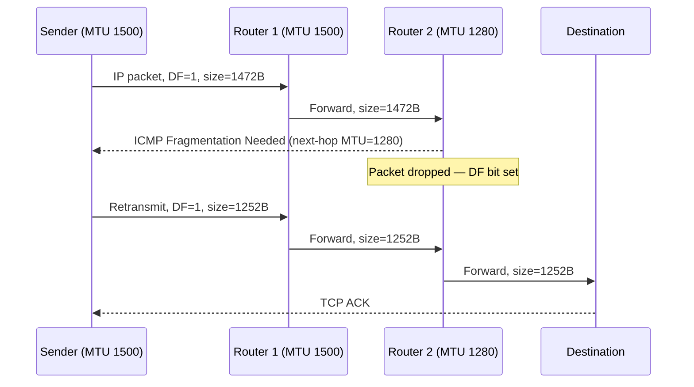
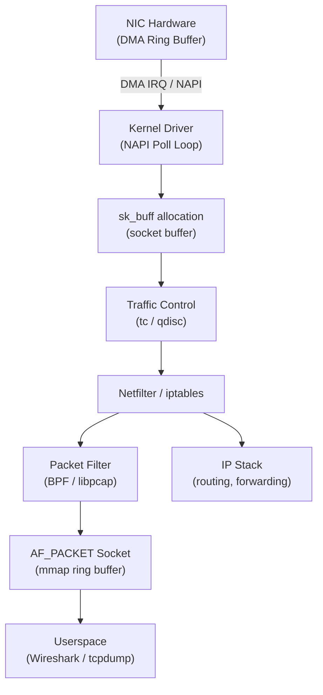
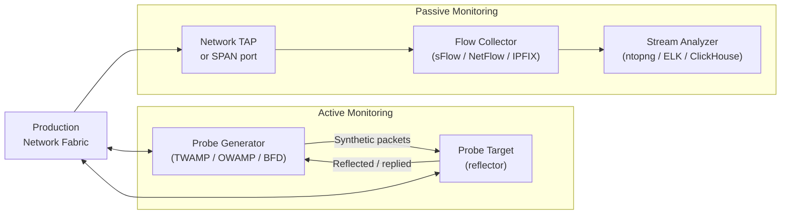
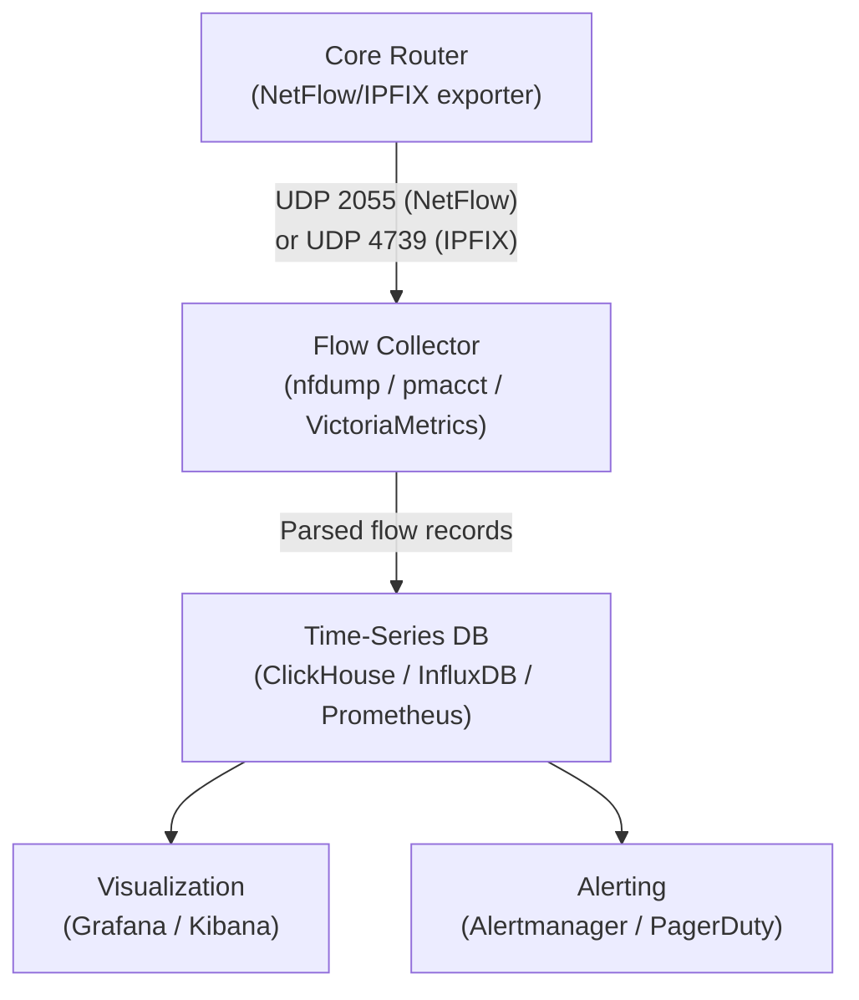
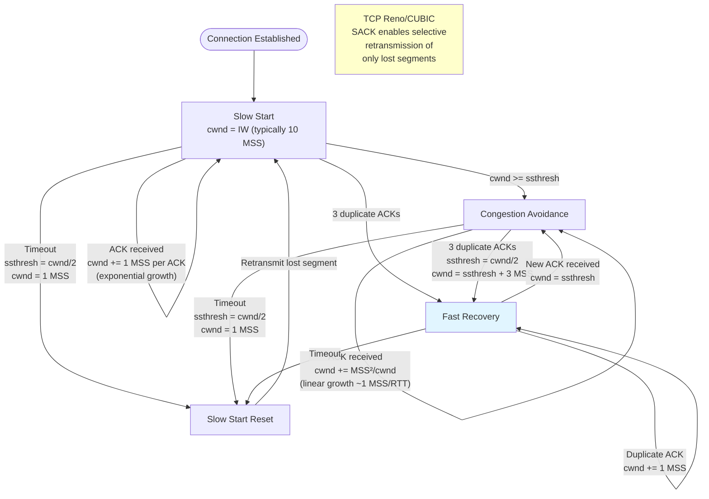
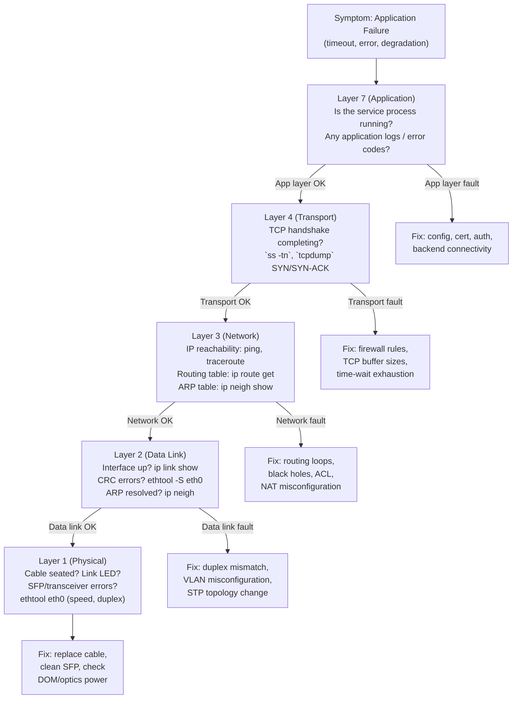

# Lesson 4: Network Monitoring and Troubleshooting

## 1. First-Principles Intuition & Invariants

Network monitoring and troubleshooting are not merely operational activities — they are the applied discipline of observing and reasoning about a distributed system whose state is fundamentally ephemeral. Every packet that traverses a network represents a state transition that cannot be recalled once it passes. This makes monitoring a discipline of inference: you reconstruct system state from partial observations and reason about causality under uncertainty.

### The End-to-End Principle

The end-to-end argument (Saltzer, Reed, and Clark, 1984) states that application-layer correctness functions — such as error detection, retransmission, and ordering — can only be reliably implemented at the endpoints, not in intermediate nodes. This is not merely a design preference; it is a correctness argument. Any intermediate node that attempts to provide application-level guarantees must have knowledge of application semantics it structurally cannot possess. The implication for network monitoring is profound: the network fabric itself is a *best-effort delivery system*. Its job is to move bits; correctness is the application's responsibility.

This principle explains why TCP's reliability mechanisms live in the host stack, why IPsec terminates at endpoints, and why QUIC moved congestion control into the application layer. It also explains why monitoring must observe *both* endpoints and the fabric — a packet loss event at the router level may be invisible at the application level if TCP retransmission masks it, yet the retransmission itself introduces latency that degrades user experience.

### Fundamental Network Metrics

Four metrics form the basis of all network performance characterization:

**Packet Loss Rate (PLR)** is the fraction of transmitted packets that do not reach the destination. At the IP layer, loss is caused by queue overflow (tail-drop or AQM-triggered), hardware errors, or routing black holes. TCP interprets loss as a congestion signal (via CUBIC, BBR, RENO, etc.) and reduces its sending rate. UDP delivers loss directly to the application. Even 0.1% PLR on a 10 Gbps link degrades a single TCP flow's throughput to roughly 100 Mbps under classical Reno congestion control, as described by the Mathis throughput formula:

```text
Throughput ≈ (MSS / RTT) × (1 / √PLR)
```

**Round-Trip Time (RTT)** is the elapsed time between sending a segment and receiving its acknowledgement. RTT has two components: propagation delay (bounded by the speed of light — approximately 5 μs/km in fiber) and serialization delay (packet size / link bandwidth). An 8000-byte jumbo frame on a 1 Gbps link adds 64 μs of serialization delay. Queue depth adds variable queuing delay. RTT directly limits TCP throughput via the bandwidth-delay product: `BDP = bandwidth × RTT`. To fill a 10 Gbps pipe with 100ms RTT requires a receive window of 125 MB.

**Jitter** (more precisely, inter-packet delay variation, IPDV) is the variance of one-way packet delay. Jitter destroys real-time streams. VoIP requires jitter below 20ms for acceptable quality (G.711 codec with 20ms packetization). Video conferencing tolerates up to 50ms with adaptive jitter buffers. Jitter is caused by variable queuing depth along the path and CPU scheduling non-determinism in the host stack.

**Throughput** is the application-layer goodput: bytes delivered per second, net of retransmissions and protocol overhead. It differs from link utilization, which counts all layer-2 frames including retransmissions, padding, and control frames.

### Packet Fragmentation and the PMTU Problem

IP fragmentation occurs when a datagram exceeds the Maximum Transmission Unit (MTU) of an outgoing link. IPv4 permits routers to fragment; IPv6 requires the source to perform Path MTU Discovery (PMTUD) and prohibits in-network fragmentation. The standard Ethernet MTU is 1500 bytes. Jumbo frames extend this to 9000 bytes but require end-to-end support.

PMTUD (RFC 1191 for IPv4, RFC 1981 for IPv6) works by sending packets with the DF (Don't Fragment) bit set and observing ICMP "Fragmentation Needed" messages. PMTUD black holes occur when firewalls drop ICMP unreachables, causing TCP sessions to stall after the initial handshake once payload sizes exceed the path MTU. This is a persistent source of hard-to-diagnose connectivity failures.



---

## 2. Core Architecture & Mechanics

### The Packet Capture Stack

Packet capture in the Linux kernel follows a layered path from the NIC to userspace. Understanding this path is essential for diagnosing capture gaps and performance problems.



The kernel's NAPI (New API) polling mechanism is critical for high-speed capture: rather than generating a hardware interrupt per packet (which would saturate CPU at 10+ Gbps), NAPI disables the interrupt after the first packet and polls the ring buffer until it is drained, then re-enables interrupts. This batching is essential for performance but introduces bounded latency.

libpcap uses `AF_PACKET` sockets with `PACKET_MMAP` to establish a shared memory ring between kernel and userspace, eliminating one copy. Without `PACKET_MMAP`, each captured packet requires a `recvmsg()` syscall and a copy from kernel to userspace — catastrophic at 10 Gbps line rate.

For even higher throughput, kernel bypass technologies eliminate the kernel entirely:

| Technology | Mechanism | Typical Throughput |
|---|---|---|
| AF_PACKET + PACKET_MMAP | Shared mmap ring | ~1–3 Mpps |
| PF_RING (ntop) | Kernel module, ring buffer | ~5–10 Mpps |
| DPDK | Poll-mode driver, hugepages | 50–80+ Mpps |
| XDP (eBPF) | Program runs in driver context | 10–40+ Mpps |

### Production-Grade Packet Capture with libpcap

The following C implementation captures packets with proper error handling, BPF filtering, non-blocking operation, and statistics reporting. It correctly handles the distinction between `pcap_loop()` and `pcap_dispatch()`, which the original example elides.

```c
#include <pcap.h>
#include <stdio.h>
#include <stdlib.h>
#include <string.h>
#include <signal.h>
#include <stdint.h>
#include <arpa/inet.h>
#include <netinet/ip.h>
#include <netinet/tcp.h>
#include <netinet/udp.h>
#include <netinet/ether.h>

/* Ethernet header is 14 bytes; IP header minimum is 20 bytes */
#define ETHER_HDR_LEN 14

static volatile int running = 1;
static pcap_t *global_handle = NULL;

/* Packet counter for stats */
static uint64_t pkt_count = 0;
static uint64_t byte_count = 0;

static void signal_handler(int signo) {
    (void)signo;
    running = 0;
    if (global_handle) {
        pcap_breakloop(global_handle);
    }
}

static void print_ip_packet(const u_char *packet, uint32_t caplen) {
    if (caplen < ETHER_HDR_LEN + sizeof(struct ip)) {
        return; /* truncated */
    }

    const struct ip *ip_hdr = (const struct ip *)(packet + ETHER_HDR_LEN);
    char src_str[INET_ADDRSTRLEN], dst_str[INET_ADDRSTRLEN];
    inet_ntop(AF_INET, &ip_hdr->ip_src, src_str, sizeof(src_str));
    inet_ntop(AF_INET, &ip_hdr->ip_dst, dst_str, sizeof(dst_str));

    int ip_hdr_len = ip_hdr->ip_hl * 4;

    switch (ip_hdr->ip_p) {
        case IPPROTO_TCP: {
            if (caplen < (uint32_t)(ETHER_HDR_LEN + ip_hdr_len + (int)sizeof(struct tcphdr)))
                break;
            const struct tcphdr *tcp =
                (const struct tcphdr *)(packet + ETHER_HDR_LEN + ip_hdr_len);
            printf("TCP  %s:%-5u -> %s:%-5u  flags=[%s%s%s%s%s]  seq=%u  win=%u\n",
                   src_str, ntohs(tcp->th_sport),
                   dst_str, ntohs(tcp->th_dport),
                   tcp->th_flags & TH_SYN  ? "S" : "",
                   tcp->th_flags & TH_ACK  ? "A" : "",
                   tcp->th_flags & TH_FIN  ? "F" : "",
                   tcp->th_flags & TH_RST  ? "R" : "",
                   tcp->th_flags & TH_PUSH ? "P" : "",
                   ntohl(tcp->th_seq),
                   ntohs(tcp->th_win));
            break;
        }
        case IPPROTO_UDP: {
            if (caplen < (uint32_t)(ETHER_HDR_LEN + ip_hdr_len + (int)sizeof(struct udphdr)))
                break;
            const struct udphdr *udp =
                (const struct udphdr *)(packet + ETHER_HDR_LEN + ip_hdr_len);
            printf("UDP  %s:%-5u -> %s:%-5u  len=%u\n",
                   src_str, ntohs(udp->uh_sport),
                   dst_str, ntohs(udp->uh_dport),
                   ntohs(udp->uh_ulen));
            break;
        }
        case IPPROTO_ICMP:
            printf("ICMP %s -> %s  ttl=%u\n", src_str, dst_str, ip_hdr->ip_ttl);
            break;
        default:
            printf("IP   %s -> %s  proto=%u\n", src_str, dst_str, ip_hdr->ip_p);
    }
}

static void packet_callback(u_char *args,
                            const struct pcap_pkthdr *header,
                            const u_char *packet) {
    (void)args;
    pkt_count++;
    byte_count += header->caplen;

    /* Only decode Ethernet frames carrying IPv4 */
    if (header->caplen >= ETHER_HDR_LEN) {
        const struct ether_header *eth = (const struct ether_header *)packet;
        if (ntohs(eth->ether_type) == ETHERTYPE_IP) {
            print_ip_packet(packet, header->caplen);
        }
    }
}

int main(int argc, char *argv[]) {
    char errbuf[PCAP_ERRBUF_SIZE];
    struct bpf_program fp;
    bpf_u_int32 net, mask;
    int snaplen = 65535;    /* capture full packets */
    int promisc = 1;        /* promiscuous mode */
    int timeout_ms = 100;   /* read timeout in ms */

    const char *dev    = (argc > 1) ? argv[1] : "eth0";
    const char *filter = (argc > 2) ? argv[2] : "ip";

    signal(SIGINT,  signal_handler);
    signal(SIGTERM, signal_handler);

    /* Retrieve device network address and mask for BPF compilation */
    if (pcap_lookupnet(dev, &net, &mask, errbuf) == PCAP_ERROR) {
        fprintf(stderr, "pcap_lookupnet(%s): %s — continuing without netmask\n",
                dev, errbuf);
        net = mask = 0;
    }

    global_handle = pcap_open_live(dev, snaplen, promisc, timeout_ms, errbuf);
    if (global_handle == NULL) {
        fprintf(stderr, "pcap_open_live(%s): %s\n", dev, errbuf);
        return EXIT_FAILURE;
    }

    /* Warn if the kernel dropped the snaplen request */
    if (pcap_snapshot(global_handle) < snaplen) {
        fprintf(stderr, "Warning: kernel capped snaplen at %d\n",
                pcap_snapshot(global_handle));
    }

    /* Compile and apply BPF filter — dramatically reduces kernel-to-userspace copies */
    if (pcap_compile(global_handle, &fp, filter, 1 /*optimize*/, mask) == PCAP_ERROR) {
        fprintf(stderr, "pcap_compile('%s'): %s\n", filter, pcap_geterr(global_handle));
        pcap_close(global_handle);
        return EXIT_FAILURE;
    }
    if (pcap_setfilter(global_handle, &fp) == PCAP_ERROR) {
        fprintf(stderr, "pcap_setfilter: %s\n", pcap_geterr(global_handle));
        pcap_freecode(&fp);
        pcap_close(global_handle);
        return EXIT_FAILURE;
    }
    pcap_freecode(&fp);

    printf("Capturing on '%s' with filter '%s'  (Ctrl-C to stop)\n\n", dev, filter);

    /*
     * pcap_loop() blocks until count packets are captured, an error occurs,
     * or pcap_breakloop() is called. Using pcap_dispatch() in a poll loop
     * is preferred when integrating with an event loop (select/epoll).
     */
    int rc = pcap_loop(global_handle, 0, packet_callback, NULL);
    if (rc == PCAP_ERROR) {
        fprintf(stderr, "pcap_loop: %s\n", pcap_geterr(global_handle));
    }

    /* Retrieve and print kernel-level capture statistics */
    struct pcap_stat stats;
    if (pcap_stats(global_handle, &stats) == 0) {
        printf("\n--- Capture Statistics ---\n");
        printf("Packets received by filter : %u\n", stats.ps_recv);
        printf("Packets dropped by kernel  : %u\n", stats.ps_drop);
        printf("Packets dropped by iface   : %u\n", stats.ps_ifdrop);
        printf("Packets decoded by callback: %llu\n", (unsigned long long)pkt_count);
        printf("Bytes  decoded             : %llu\n", (unsigned long long)byte_count);
    }

    pcap_close(global_handle);
    return EXIT_SUCCESS;
}
```

Compile with: `gcc -O2 -Wall -o capture capture.c -lpcap`

The critical insight missing from the original: `pcap_stats()` exposes `ps_drop`, which counts packets the kernel discarded because the capture socket's ring buffer was full. This is not the same as network packet loss. If `ps_drop` is non-zero, increase the ring buffer size via `pcap_set_buffer_size()` or switch to `PACKET_MMAP`.

### High-Performance Capture with XDP/eBPF (Go + libbpf-go)

For production scenarios requiring line-rate capture at 10–100 Gbps, XDP programs execute in the driver's receive path, before the sk_buff is allocated. The following Go program loads an XDP program that counts packets per source IP and exports metrics via a perf event ring buffer.

```go
//go:build linux

package main

import (
	"encoding/binary"
	"fmt"
	"log"
	"net"
	"os"
	"os/signal"
	"syscall"
	"time"

	"github.com/cilium/ebpf"
	"github.com/cilium/ebpf/link"
	"github.com/cilium/ebpf/perf"
	"github.com/cilium/ebpf/rlimit"
)

// PktEvent mirrors the C struct sent via the perf ring buffer.
// Must match the layout defined in xdp_monitor.c (packed, no padding).
type PktEvent struct {
	SrcIP   uint32
	DstIP   uint32
	SrcPort uint16
	DstPort uint16
	Proto   uint8
	_       [3]byte // padding to align to 4 bytes
}

// objs is populated by bpf2go-generated code from xdp_monitor.c
// Here we construct it manually to illustrate the pattern.
type xdpObjects struct {
	XdpMonitor *ebpf.Program `ebpf:"xdp_monitor"`
	PktCounts  *ebpf.Map     `ebpf:"pkt_counts"`
	Events     *ebpf.Map     `ebpf:"events"`
}

func main() {
	if err := rlimit.RemoveMemlock(); err != nil {
		log.Fatalf("remove memlock rlimit: %v", err)
	}

	ifname := "eth0"
	if len(os.Args) > 1 {
		ifname = os.Args[1]
	}

	iface, err := net.InterfaceByName(ifname)
	if err != nil {
		log.Fatalf("interface %s: %v", ifname, err)
	}

	// In a real deployment: use bpf2go to compile xdp_monitor.c into Go.
	// Here we load a pre-compiled object for demonstration.
	spec, err := ebpf.LoadCollectionSpec("xdp_monitor.o")
	if err != nil {
		log.Fatalf("load collection spec: %v", err)
	}

	var objs xdpObjects
	if err := spec.LoadAndAssign(&objs, nil); err != nil {
		log.Fatalf("load and assign: %v", err)
	}
	defer objs.PktCounts.Close()
	defer objs.Events.Close()
	defer objs.XdpMonitor.Close()

	// Attach XDP program to the NIC. XDP_FLAGS_DRV_MODE requires driver support;
	// fall back to XDP_FLAGS_SKB_MODE (generic/software mode) if unavailable.
	l, err := link.AttachXDP(link.XDPOptions{
		Program:   objs.XdpMonitor,
		Interface: iface.Index,
	})
	if err != nil {
		log.Fatalf("attach XDP: %v", err)
	}
	defer l.Close()

	log.Printf("XDP monitor attached to %s (ifindex %d)", ifname, iface.Index)

	// Open perf event reader — 8 pages per CPU (must be power of 2)
	rd, err := perf.NewReader(objs.Events, 8*os.Getpagesize())
	if err != nil {
		log.Fatalf("perf reader: %v", err)
	}
	defer rd.Close()

	sig := make(chan os.Signal, 1)
	signal.Notify(sig, syscall.SIGINT, syscall.SIGTERM)

	go func() {
		ticker := time.NewTicker(5 * time.Second)
		defer ticker.Stop()
		for range ticker.C {
			printTopSources(objs.PktCounts)
		}
	}()

	log.Println("Listening for packets (Ctrl-C to stop)...")
	for {
		select {
		case <-sig:
			log.Println("Shutting down.")
			return
		default:
		}

		record, err := rd.Read()
		if err != nil {
			if err == perf.ErrClosed {
				return
			}
			log.Printf("perf read: %v", err)
			continue
		}

		if len(record.RawSample) < 12 {
			continue
		}
		var evt PktEvent
		evt.SrcIP   = binary.LittleEndian.Uint32(record.RawSample[0:4])
		evt.DstIP   = binary.LittleEndian.Uint32(record.RawSample[4:8])
		evt.SrcPort = binary.LittleEndian.Uint16(record.RawSample[8:10])
		evt.DstPort = binary.LittleEndian.Uint16(record.RawSample[10:12])

		src := net.IP(record.RawSample[0:4])
		dst := net.IP(record.RawSample[4:8])
		fmt.Printf("%-15s:%-5d -> %-15s:%-5d\n",
			src, evt.SrcPort, dst, evt.DstPort)
	}
}

func printTopSources(m *ebpf.Map) {
	fmt.Println("\n--- Top Source IPs (last 5s) ---")
	var key uint32
	var val uint64
	iter := m.Iterate()
	count := 0
	for iter.Next(&key, &val) && count < 10 {
		ip := make(net.IP, 4)
		binary.LittleEndian.PutUint32(ip, key)
		fmt.Printf("  %-15s  %d pkts\n", ip, val)
		count++
	}
	// Reset counts after printing
	iter2 := m.Iterate()
	for iter2.Next(&key, &val) {
		_ = m.Delete(&key)
	}
}
```

The corresponding XDP kernel program (compiled with clang/LLVM targeting BPF):

```c
// xdp_monitor.c — compiled with:
// clang -O2 -g -target bpf -D__TARGET_ARCH_x86 \
//       -I/usr/include/x86_64-linux-gnu \
//       -c xdp_monitor.c -o xdp_monitor.o

#include <linux/bpf.h>
#include <linux/if_ether.h>
#include <linux/ip.h>
#include <linux/tcp.h>
#include <linux/udp.h>
#include <bpf/bpf_helpers.h>
#include <bpf/bpf_endian.h>

struct pkt_event {
    __u32 src_ip;
    __u32 dst_ip;
    __u16 src_port;
    __u16 dst_port;
    __u8  proto;
    __u8  pad[3];
};

/* Per-CPU hash map: src_ip -> packet count */
struct {
    __uint(type,        BPF_MAP_TYPE_PERCPU_HASH);
    __uint(max_entries, 1024);
    __type(key,         __u32);
    __type(value,       __u64);
} pkt_counts SEC(".maps");

/* Perf event array for streaming events to userspace */
struct {
    __uint(type,        BPF_MAP_TYPE_PERF_EVENT_ARRAY);
    __uint(max_entries, 128);
    __type(key,         __u32);
    __type(value,       __u32);
} events SEC(".maps");

SEC("xdp")
int xdp_monitor(struct xdp_md *ctx) {
    void *data     = (void *)(long)ctx->data;
    void *data_end = (void *)(long)ctx->data_end;

    struct ethhdr *eth = data;
    if ((void *)(eth + 1) > data_end)
        return XDP_PASS;

    if (bpf_ntohs(eth->h_proto) != ETH_P_IP)
        return XDP_PASS;

    struct iphdr *ip = (void *)(eth + 1);
    if ((void *)(ip + 1) > data_end)
        return XDP_PASS;

    /* Update per-source-IP packet counter */
    __u32 src = ip->saddr;
    __u64 *cnt = bpf_map_lookup_elem(&pkt_counts, &src);
    if (cnt) {
        __sync_fetch_and_add(cnt, 1);
    } else {
        __u64 one = 1;
        bpf_map_update_elem(&pkt_counts, &src, &one, BPF_ANY);
    }

    /* Emit event for TCP and UDP only */
    if (ip->protocol != IPPROTO_TCP && ip->protocol != IPPROTO_UDP)
        return XDP_PASS;

    struct pkt_event evt = {};
    evt.src_ip = ip->saddr;
    evt.dst_ip = ip->daddr;
    evt.proto  = ip->protocol;

    int ip_hdr_len = ip->ihl * 4;

    if (ip->protocol == IPPROTO_TCP) {
        struct tcphdr *tcp = (void *)ip + ip_hdr_len;
        if ((void *)(tcp + 1) > data_end)
            return XDP_PASS;
        evt.src_port = bpf_ntohs(tcp->source);
        evt.dst_port = bpf_ntohs(tcp->dest);
    } else {
        struct udphdr *udp = (void *)ip + ip_hdr_len;
        if ((void *)(udp + 1) > data_end)
            return XDP_PASS;
        evt.src_port = bpf_ntohs(udp->source);
        evt.dst_port = bpf_ntohs(udp->dest);
    }

    bpf_perf_event_output(ctx, &events, BPF_F_CURRENT_CPU,
                          &evt, sizeof(evt));
    return XDP_PASS;
}

char LICENSE[] SEC("license") = "GPL";
```

---

## 3. Network Diagnostic Tools: Architecture and Correct Usage

### `ping` and ICMP Echo — What It Does and Does Not Tell You

`ping` sends ICMP Echo Request datagrams and measures the RTT to receive Echo Replies. It is useful for reachability testing and rough latency measurement, but critically limited: ICMP is frequently rate-limited or deprioritized by router CPUs. A router that hardware-forwards 40 Gbps of transit traffic may rate-limit ICMP replies to 100 pps from the control plane CPU. Packet loss seen in `ping` to a transit router hop does not indicate packet loss on the forwarding path.

`ping -f` (flood ping) with `-s 1400` tests fragmentation and large-packet loss independently of small-packet behavior — an essential distinction for diagnosing PMTU issues.

### `traceroute` / `tracepath` — TTL Mechanics

`traceroute` exploits the IP TTL field. It sends a series of probes with TTL=1, 2, 3, ... Each router decrements TTL to zero and returns an ICMP Time Exceeded message, revealing that router's IP address and the RTT to reach it. By default, Linux `traceroute` uses UDP probes to high port numbers (33434+); `traceroute -I` uses ICMP; `traceroute -T -p 80` uses TCP SYN packets (useful for firewall traversal).

`tracepath` additionally performs PMTUD along the path, reporting the MTU at each hop.

A common misreading: asymmetric routing means the forward and return paths may differ. The RTT shown for hop N is the round-trip through two potentially different paths, not just the forward latency to that hop.

### `ss` — Replacing `netstat` for Socket Inspection

`netstat` is deprecated on Linux. `ss` queries the kernel's socket tables directly via netlink, with far lower overhead. The following idiom lists all TCP sockets in ESTABLISHED state with their send/receive buffer occupancy and congestion control state:

```bash
# All established TCP connections with detailed TCP info
ss -tni state established

# Show timer information (retransmit timer, keepalive timer)
ss -to

# Filter by destination port (e.g., HTTPS)
ss -tn dst :443

# Show sockets with significant send-queue backlog (possible congestion)
ss -tn 'sport != :22' | awk 'NR>1 && $3 > 0 {print}'

# Show retransmission counters per socket (requires kernel >= 4.2)
ss -tin | grep -A1 "ESTAB" | grep retrans
```

The `ss -tni` output includes the congestion control algorithm in use (`cubic`, `bbr`, `reno`), the current congestion window (`cwnd`), bytes in flight (`bytes_acked`, `bytes_retrans`), and smoothed RTT (`rtt`). This is the correct tool for correlating application-layer latency with TCP-layer behavior.

### `tcpdump` — Production Filter Patterns

`tcpdump` wraps libpcap with a command-line BPF filter compiler. BPF filters are compiled to a bytecode VM that runs in-kernel, discarding non-matching packets before they cross to userspace. This is architecturally important: without a tight filter on a busy interface, `tcpdump` will drop packets (visible as "X packets dropped by kernel" in its output summary).

```bash
# Capture TCP SYN and SYN-ACK packets only (connection establishment)
tcpdump -nn -i eth0 'tcp[tcpflags] & (tcp-syn|tcp-ack) != 0 and \
                     tcp[tcpflags] & tcp-ack == 0' -w syns.pcap

# Capture DNS queries and responses (UDP/TCP port 53)
tcpdump -nn -i eth0 'port 53' -w dns.pcap

# Capture ICMP unreachables (crucial for PMTUD debugging)
tcpdump -nn -i eth0 'icmp[icmptype] == icmp-unreach' -w pmtu.pcap

# Capture packets with IP TTL <= 5 (trace near-expiry packets)
tcpdump -nn -i eth0 'ip[8] <= 5'

# Capture TCP retransmissions heuristically:
# RST packets and connections in non-ESTAB state
tcpdump -nn -i eth0 'tcp[tcpflags] & tcp-rst != 0'

# High-performance capture to pcap with kernel ring buffer
tcpdump -nn -i eth0 -B 65536 -s 128 --immediate-mode \
        'not arp and not stp' -w /tmp/capture.pcap
```

The `-B 65536` flag sets the kernel capture buffer to 64 MB. `-s 128` captures only the first 128 bytes per packet (sufficient for headers), dramatically reducing I/O. `--immediate-mode` disables buffering for real-time analysis but reduces throughput.

### `nmap` — Correct Interpretation of Scan Types

The original material cited Nmap as a "protocol analysis tool." Nmap is a port scanner and host discovery tool. Its protocol analysis is limited to banner grabbing and service version detection (`-sV`). Calling it a protocol analyzer alongside Wireshark conflates fundamentally different tools.

Nmap's key scan types differ in their use of the TCP state machine:

| Scan Type | Flag | Mechanism | Requires Root |
|---|---|---|---|
| TCP SYN (stealth) | `-sS` | Sends SYN, reads SYN-ACK/RST, sends RST before full connect | Yes |
| TCP Connect | `-sT` | Full three-way handshake via `connect()` syscall | No |
| UDP | `-sU` | Sends UDP datagram, waits for ICMP port unreachable | Yes |
| XMAS | `-sX` | FIN+PSH+URG flags — exploits RFC 793 behavior | Yes |
| Null | `-sN` | No flags set | Yes |

```bash
# Host discovery only (no port scan) across a /24
nmap -sn 192.168.1.0/24

# SYN scan with OS detection, version detection, scripts, traceroute
# -T4 sets the timing template: 4=aggressive (reduces --scan-delay to 10ms)
# Note: -T5 may cause missed ports on lossy networks
nmap -sS -sV -O --traceroute -T4 -p 22,80,443,8080,8443 192.168.1.0/24 \
     -oA scan_results

# Targeted NSE script: check for HTTP security headers
nmap --script http-security-headers -p 80,443 example.com

# UDP service discovery (slow; limit port range)
nmap -sU -p 53,67,68,123,161,500 --open 192.168.1.1
```

The `-O` (OS detection) flag works by analyzing TCP/IP stack fingerprints — specifically the initial window size, TTL, DF bit, TOS byte, timestamp option behavior, and IP ID sequence. These fingerprints are compiled in Nmap's `nmap-os-db` database.

---

## 4. High-Performance Monitoring Architecture

### Active vs. Passive Monitoring

Active monitoring injects synthetic probes into the network and measures their behavior. Passive monitoring captures and analyzes production traffic. Neither is superior; they measure different things.



TWAMP (Two-Way Active Measurement Protocol, RFC 5357) is the IETF standard for bidirectional active measurement. It separates the control channel (TCP, negotiates sessions) from the test channel (UDP, transmits probes), enabling one-way delay measurements when timestamps are available. BFD (Bidirectional Forwarding Detection, RFC 5880) is a sub-second failure detection protocol used by routing protocols as a liveness check; it operates at 10–50ms intervals, far faster than OSPF/BGP dead timers.

### Flow-Based Telemetry: NetFlow, sFlow, IPFIX

Packet-level capture is impractical at 100 Gbps. Flow telemetry samples or aggregates traffic metadata without capturing payloads, enabling traffic matrix analysis, anomaly detection, and capacity planning.

**NetFlow v9 / IPFIX (RFC 7011)** exports flow records from routers. A flow is defined by the 5-tuple: `(src_ip, dst_ip, src_port, dst_port, protocol)`. The router maintains a flow cache and exports records when flows expire (idle timeout or active timeout). IPFIX is the IETF standardization of NetFlow v9, adding a template mechanism for flexible record formats.

**sFlow (RFC 3176)** uses statistical packet sampling (1-in-N) rather than flow tracking. It is stateless on the device: every Nth packet is copied and exported immediately as a raw sample. sFlow is more scalable on high-speed links where maintaining per-flow state is expensive, but provides statistical rather than exact counts.



The following Python script uses the `dpkt` library to parse NetFlow v5 export datagrams (the simplest fixed-format version, widely deployed on Cisco IOS):

```python
"""
netflow_v5_parser.py — Parse NetFlow v5 export datagrams.

NetFlow v5 header: 24 bytes
NetFlow v5 record: 48 bytes, up to 30 records per datagram

Wire format (all fields big-endian):
  Header:
    version (2B), count (2B), sys_uptime (4B), unix_secs (4B),
    unix_nsecs (4B), flow_sequence (4B), engine_type (1B),
    engine_id (1B), sampling_interval (2B)

  Per-record (48 bytes):
    src_addr(4), dst_addr(4), nexthop(4), input(2), output(2),
    dPkts(4), dOctets(4), first(4), last(4),
    src_port(2), dst_port(2), pad1(1), tcp_flags(1),
    prot(1), tos(1), src_as(2), dst_as(2),
    src_mask(1), dst_mask(1), pad2(2)
"""

import socket
import struct
import datetime
from dataclasses import dataclass, field
from typing import List, Optional


NF5_HEADER_FMT = "!HHIIIIHBB H"   # 24 bytes
NF5_RECORD_FMT = "!IIIHHIIIIHHBBBBHHBBxx"  # 48 bytes

NF5_HEADER_SIZE = struct.calcsize(NF5_HEADER_FMT)  # 24
NF5_RECORD_SIZE = struct.calcsize(NF5_RECORD_FMT)  # 48

PROTO_NAMES = {1: "ICMP", 6: "TCP", 17: "UDP", 47: "GRE", 50: "ESP"}


@dataclass
class NetFlowV5Header:
    version:           int
    count:             int
    sys_uptime_ms:     int    # milliseconds since device boot
    unix_secs:         int
    unix_nsecs:        int
    flow_sequence:     int
    engine_type:       int
    engine_id:         int
    sampling_interval: int

    @property
    def export_time(self) -> datetime.datetime:
        return datetime.datetime.utcfromtimestamp(self.unix_secs)


@dataclass
class NetFlowV5Record:
    src_addr:   str
    dst_addr:   str
    nexthop:    str
    input_if:   int
    output_if:  int
    packets:    int
    octets:     int
    first_ms:   int    # uptime ms when flow started
    last_ms:    int    # uptime ms when flow last seen
    src_port:   int
    dst_port:   int
    tcp_flags:  int
    protocol:   int
    tos:        int
    src_as:     int
    dst_as:     int

    @property
    def protocol_name(self) -> str:
        return PROTO_NAMES.get(self.protocol, str(self.protocol))

    @property
    def duration_ms(self) -> int:
        return self.last_ms - self.first_ms

    @property
    def bytes_per_packet(self) -> float:
        return self.octets / self.packets if self.packets > 0 else 0.0

    def __str__(self) -> str:
        return (
            f"{self.src_addr}:{self.src_port} -> {self.dst_addr}:{self.dst_port}"
            f"  {self.protocol_name}  {self.packets}pkts  {self.octets}B"
            f"  {self.duration_ms}ms  flags=0x{self.tcp_flags:02x}"
        )


def parse_ipv4(raw: int) -> str:
    return socket.inet_ntoa(struct.pack("!I", raw))


def parse_netflow_v5(data: bytes) -> Optional[tuple]:
    """
    Returns (header, records) or None if the datagram is invalid.
    """
    if len(data) < NF5_HEADER_SIZE:
        return None

    hdr_raw = struct.unpack_from(NF5_HEADER_FMT, data, 0)
    header = NetFlowV5Header(
        version=hdr_raw[0],
        count=hdr_raw[1],
        sys_uptime_ms=hdr_raw[2],
        unix_secs=hdr_raw[3],
        unix_nsecs=hdr_raw[4],
        flow_sequence=hdr_raw[5],
        engine_type=hdr_raw[6],
        engine_id=hdr_raw[7],
        sampling_interval=hdr_raw[8],
    )

    if header.version != 5:
        return None  # Not NetFlow v5

    expected_len = NF5_HEADER_SIZE + header.count * NF5_RECORD_SIZE
    if len(data) < expected_len:
        return None  # Truncated datagram

    records: List[NetFlowV5Record] = []
    offset = NF5_HEADER_SIZE

    for _ in range(header.count):
        r = struct.unpack_from(NF5_RECORD_FMT, data, offset)
        offset += NF5_RECORD_SIZE

        records.append(NetFlowV5Record(
            src_addr  = parse_ipv4(r[0]),
            dst_addr  = parse_ipv4(r[1]),
            nexthop   = parse_ipv4(r[2]),
            input_if  = r[3],
            output_if = r[4],
            packets   = r[5],
            octets    = r[6],
            first_ms  = r[7],
            last_ms   = r[8],
            src_port  = r[9],
            dst_port  = r[10],
            tcp_flags = r[12],
            protocol  = r[13],
            tos       = r[14],
            src_as    = r[15],
            dst_as    = r[16],
        ))

    return header, records


def collect(listen_ip: str = "0.0.0.0", port: int = 2055) -> None:
    sock = socket.socket(socket.AF_INET, socket.SOCK_DGRAM)
    sock.setsockopt(socket.SOL_SOCKET, socket.SO_RCVBUF, 4 * 1024 * 1024)
    sock.bind((listen_ip, port))
    print(f"NetFlow v5 collector listening on {listen_ip}:{port}")

    while True:
        data, addr = sock.recvfrom(65535)
        result = parse_netflow_v5(data)
        if result is None:
            print(f"[{addr[0]}] Invalid or non-v5 datagram ({len(data)} bytes)")
            continue

        header, records = result
        print(f"\n[{addr[0]}] Export at {header.export_time}  "
              f"seq={header.flow_sequence}  flows={header.count}")
        for rec in records:
            print(f"  {rec}")


if __name__ == "__main__":
    import sys
    port = int(sys.argv[1]) if len(sys.argv) > 1 else 2055
    collect(port=port)
```

---

## 5. Failure Modes, Congestion, and Root-Cause Analysis

### TCP Congestion Control State Machine

Understanding TCP congestion control is mandatory for diagnosing throughput problems. The congestion window (`cwnd`) limits how much unacknowledged data can be in flight. The effective send rate is:

```text
effective_rate = min(cwnd, rwnd) / RTT
```

where `rwnd` is the receiver's advertised window.



The salient diagnostic implication: a TCP flow exhibiting "saw-tooth" throughput in Wireshark's IO graph is not experiencing random drops — it is in the normal CUBIC/Reno congestion avoidance cycle. Persistent low throughput with many retransmissions indicates either chronic congestion (queue overflow), or a faulty NIC/cable introducing physical-layer errors.

### Active Queue Management: Why Tail-Drop is Wrong

The default queuing discipline on most Linux systems is `pfifo_fast` (or `fq_codel` on modern distributions), not simple tail-drop. Tail-drop FIFO queues cause TCP synchronization: when the queue fills, it drops packets from multiple flows simultaneously, causing all those flows to enter slow-start simultaneously, emptying the queue, filling it again — oscillating at the queue drain rate. This is the global synchronization problem.

CoDel (Controlled Delay, RFC 8289) and FQ-CoDel address this by measuring per-packet sojourn time (time the packet spent in the queue). If sojourn time exceeds a target (typically 5ms) for longer than an interval (100ms), CoDel begins dropping or marking packets using a square-root controller, maintaining low queue depth while keeping high throughput. FQ-CoDel adds per-flow fair queuing via a stochastic flow hash, preventing a single high-bandwidth flow from monopolizing the queue.

```bash
# Inspect current qdisc on eth0
tc qdisc show dev eth0

# Replace with FQ-CoDel (if not already set)
tc qdisc replace dev eth0 root fq_codel

# Inspect FQ-CoDel statistics: drops, ecn_mark, maxpacket, drop_overlimit
tc -s qdisc show dev eth0

# Add HTB (Hierarchical Token Bucket) for traffic shaping
# Limit eth0 egress to 100 Mbit/s with a 10 Mbit/s burst
tc qdisc add dev eth0 root handle 1: htb default 10
tc class add dev eth0 parent 1: classid 1:10 htb rate 100mbit burst 10mbit
tc qdisc add dev eth0 parent 1:10 fq_codel
```

### Network Emulation for Testing: `tc netem`

Before deploying code to production, reproduce failure modes locally using the Linux Traffic Control netem discipline:

```bash
# Simulate 100ms RTT (50ms one-way delay) with 1% packet loss and 10ms jitter
# on the loopback interface (affects all local traffic — use with care)
tc qdisc add dev lo root netem \
    delay 50ms 10ms distribution normal \
    loss 1% 25%                          \
    duplicate 0.1%                       \
    corrupt 0.01%

# Add reordering: 25% of packets are reordered with 5ms delay
tc qdisc change dev lo root netem \
    delay 50ms reorder 25% 50%

# Remove netem (restore normal behavior)
tc qdisc del dev lo root

# Simulate a 10 Mbit/s bandwidth-constrained link (rate limiting)
tc qdisc add dev eth0 root tbf rate 10mbit burst 32kbit latency 400ms
```

The `loss 1% 25%` syntax uses a Markov chain model: 1% loss probability, with 25% correlation to the previous packet's loss state (burst loss model, more realistic than independent random loss).

### Systematic Troubleshooting Methodology

Network problems reduce to a small set of root causes. A disciplined top-down or bottom-up approach locates the fault layer before attempting remediation.



### `ethtool` for Physical Layer and NIC Statistics

`ethtool` is the primary interface to NIC driver statistics and hardware configuration on Linux. The following diagnostics should be run before concluding that a problem is in the network fabric:

```bash
# Check link speed, duplex, autonegotiation status
ethtool eth0

# Display NIC hardware statistics (driver-specific counters)
# Look for: rx_crc_errors, rx_fifo_errors, tx_dropped, rx_missed_errors
ethtool -S eth0

# Check for transmit queue stops (indicates kernel-level congestion)
ethtool -S eth0 | grep -i "tx_queue\|stop\|wake"

# Adjust interrupt
```
