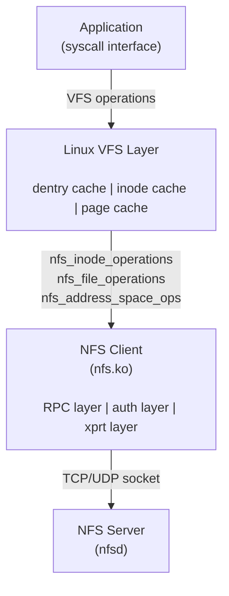
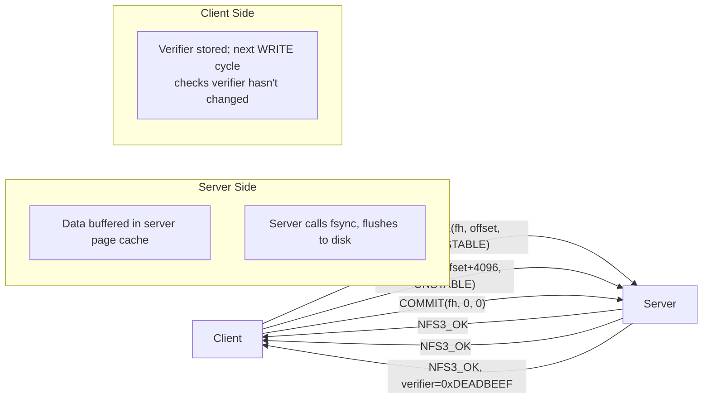

# Lesson 2: File Handle Semantics, VFS Integration, Core Operations

## 1. First-Principles Intuition & Invariants

The fundamental problem NFS must solve is one that local filesystems never face: a file identifier must remain valid across two independent address spaces, two independent kernels, and an unreliable network that sits between them. On a local Linux filesystem, a file descriptor is an integer index into a per-process table of `struct file` pointers, and an inode number is a stable identifier within a single mounted device. Both of these abstractions collapse the moment you introduce a second machine. The server's inode number means nothing to the client's VFS layer, and a client's open file descriptor means nothing to the server, which is intentionally stateless in NFSv3 and largely stateless even in NFSv4's session model. The NFS file handle is the engineered solution to this identity problem, and understanding its design constraints is the prerequisite for everything else in this lesson.

A file handle is a byte string that the server mints and the client treats as an opaque token. The client neither parses nor constructs file handles; it stores them, caches them, and presents them back to the server with every RPC. This opacity is a deliberate invariant. The server is free to encode into the handle whatever information it needs to reconstruct the file's identity after a reboot, a failover, or a mount re-export. In the Linux NFS server implementation (`nfsd`), the default handle encoding packs a filesystem UUID, an inode number, and a generation counter into a fixed-width structure. The generation counter is the detail that matters most for correctness: when a file is deleted and a new file is created that reuses the same inode number, the generation counter increments, so any client holding a stale handle to the deleted file receives `NFS3ERR_STALE` rather than silently accessing the wrong data. This is the fundamental freshness invariant of the file handle contract.

NFSv4 formalized handle semantics considerably relative to NFSv2 and NFSv3. Under NFSv3, handle staleness was the server's problem to detect and the client's problem to handle gracefully. Under NFSv4, the protocol introduces the concept of a *filehandle type*: persistent filehandles must remain valid across server restarts (the server guarantees this), volatile filehandles may become invalid but must set a flag indicating this volatility, and anonymous filehandles are used only for the initial `PUTROOTFH` and `PUTPUBFH` operations. The vast majority of production NFS servers advertise persistent filehandles because the alternative, requiring clients to re-traverse the entire directory tree after a server reboot, is operationally catastrophic at scale.

The relationship between NFS and the Virtual Filesystem Switch (VFS) on the Linux client is where protocol semantics are translated into the POSIX guarantees that application programmers expect. The VFS is not a filesystem; it is an abstract interface layer that sits between system calls and concrete filesystem implementations. When a process calls `open("/mnt/nfs/data/records.csv", O_RDONLY)`, the kernel's VFS layer walks the directory component by component, issuing LOOKUP RPCs to the NFS server for each component that is not cached in the `dentry` cache, and ultimately constructing a `struct inode` and a `struct file` in the client kernel's memory. From this point forward, the application interacts with that `struct file` through VFS operations, and the NFS client translates those VFS operations into the appropriate wire protocol RPCs. The indirection is complete: the application has no knowledge of NFS, and the VFS has no knowledge of whether the underlying implementation is ext4, XFS, or a remote server in another datacenter.

This translation layer introduces a critical invariant that every NFS practitioner must internalize: **NFS does not provide the same consistency semantics as a local filesystem by default**. POSIX requires that a write followed by a read from any process on the same machine observes the written data. NFS, operating across independent client caches on independent machines, cannot guarantee this without either disabling caching entirely (which makes NFS unusably slow) or implementing a cache coherence protocol. NFSv3 adopted a pragmatic compromise called *close-to-open consistency*, and NFSv4 introduced *delegations* as a more precise coherence mechanism. Both are examined in depth later in this lesson, but the foundational intuition must be established here: NFS trades strict POSIX consistency for performance, and the protocol semantics are designed to make this trade-off survivable in practice for the overwhelming majority of workloads.

---

## 2. Core Architecture & Mechanics

### The File Handle: Structure and Lifetime

On the Linux `nfsd` server, file handles are constructed by the `fh_compose()` function in `fs/nfsd/nfshdr.h`. The on-wire representation varies by NFS version, but the internal `struct svc_fh` that nfsd works with contains a `struct knfsd_fh` whose payload is laid out as follows:

```c
/*
 * Server-side NFS file handle representation (Linux nfsd)
 * Located in include/linux/nfsd/nfsfh.h
 */
struct nfs_fhbase_new {
    __u8    fb_version;     /* == 1 for new-style filehandles */
    __u8    fb_auth_type;   /* 0 = no auth pseudoflavor encoded */
    __u8    fb_fsid_type;   /* filesystem identifier encoding type */
    __u8    fb_fileid_type; /* inode encoding type */
    __u32   fb_auth[1];     /* optional auth data, variable length */
    /* followed by: fsid data, then fileid data */
};
```

The `fb_fsid_type` field selects among several encoding strategies: UUID-based (type 6, the most robust), major/minor device number (type 0, the legacy default), or UUID plus inode (type 7). The `fb_fileid_type` field controls how the inode identity is encoded. For most filesystems, type 1 encodes a 64-bit inode number and 32-bit generation counter. For directories, type 2 adds the parent directory inode number, which enables the server to reconstruct the directory path for export permission checking without traversing the full tree.

The generation counter (`i_generation` in `struct inode`) is set when the inode is allocated and never changes during the inode's lifetime. When ext4 or XFS deletes a file and later allocates a new file at the same inode number, the new inode receives a new generation value drawn from a monotonically incrementing per-filesystem counter. The nfsd handle verification path in `fh_verify()` checks this generation value explicitly: if the client presents a handle whose encoded generation does not match the current inode's generation, nfsd returns `ESTALE`, which the client's VFS layer translates into `ESTALE` back to the calling process.

### VFS Integration on the Client

The NFS client implements the full set of VFS abstract operations through function pointer tables registered in `struct inode_operations`, `struct file_operations`, and `struct address_space_operations`. When the kernel builds the VFS layer for an NFS-mounted filesystem, it registers these tables so that generic VFS calls are dispatched to NFS-specific implementations.



The `dentry cache` is the client's mapping from pathname components to inode objects. When a LOOKUP RPC returns a file handle, the client creates a `struct dentry` associating the filename with a `struct inode` that holds the returned file handle in its NFS-specific inode data (`struct nfs_inode`). Subsequent path lookups for the same filename find the dentry in cache and avoid the RPC entirely, until the dentry's validity timeout (`acdirmin`/`acdirmax`) expires.

The `struct nfs_inode` structure extends the generic `struct inode` and is the central data structure for all client-side NFS state:

```c
/*
 * NFS-specific inode data (simplified from fs/nfs/nfs4_fs.h and nfs_fs.h)
 */
struct nfs_inode {
    struct inode        vfs_inode;       /* must be first; embedded, not pointer */
    struct nfs_fh       fh;              /* the file handle for this inode */
    struct nfs_fattr    cache_attrs;     /* cached fattr response */
    unsigned long       read_cache_jiffies;  /* when attrs were last validated */
    unsigned long       attrtimeo;       /* current attribute timeout (adaptive) */
    unsigned long       attrtimeo_timestamp;
    unsigned long long  change_attr;     /* NFSv4 change attribute */
    loff_t              cache_change_attribute;
    struct rb_root      access_cache;   /* per-inode ACCESS RPC result cache */
    struct list_head    open_files;      /* list of open nfs4_state structs */
    struct rw_semaphore rwsem;           /* protects above */
};
```

The `fh` field is the persistent binding between this in-memory inode object and the server-side file. Every RPC that references this file will include this handle on the wire. The `attrtimeo` field drives the adaptive attribute cache timeout algorithm, which is discussed in detail in the caching section below.

### The LOOKUP Operation

LOOKUP is the atomic operation that maps a name within a directory to a file handle. It is worth examining the full mechanical path of a LOOKUP RPC because the same infrastructure is reused by every other operation.

When the VFS calls `nfs_lookup()` with a parent `dentry` and a component name, the client first checks the dentry cache. On a miss, it constructs an `nfs3_diropargs` (NFSv3) or issues a `COMPOUND` RPC containing a `PUTFH` followed by a `LOOKUP` and a `GETATTR` (NFSv4). The NFSv4 `COMPOUND` mechanism is a significant protocol optimization: it pipelines multiple operations into a single RPC round trip. A naive NFSv3 `open("/a/b/c")` requires three sequential LOOKUP RPCs (one per path component) plus a final file-opening RPC. Under NFSv4, the same operation can be encoded as a single COMPOUND: `PUTROOTFH | LOOKUP("a") | LOOKUP("b") | LOOKUP("c") | OPEN(...)`, collapsing five round trips into one.

The server processes the LOOKUP by calling the underlying filesystem's `inode_operations->lookup()`, which on ext4 triggers a directory block read (from the server's page cache or disk), a linear or htree scan of directory entries, and returns the inode number and generation of the target file. The server then constructs a file handle using `fh_compose()` and returns it along with the file's `fattr` (file attributes: size, mtime, ctime, nlink, uid, gid, mode).

The client receives this response, allocates or finds an existing `struct inode` via `nfs_fhget()`, populates the `nfs_inode` with the returned handle and attributes, inserts the dentry into the dentry cache, and returns the inode to the VFS. The entire path from syscall to populated inode is instrumented through the `sunrpc` tracepoints, which are the primary diagnostic tool for latency analysis.

### READ and WRITE: The Page Cache Interaction

NFS client I/O is not a simple pass-through of `read(2)` and `write(2)` to RPCs. It flows through the Linux page cache, which is the same unified buffer cache used by local filesystems. This design allows NFS to aggregate small writes into full pages and to serve repeated reads from cache without network round trips.

When an application issues a `read(2)`, the VFS calls `generic_file_read_iter()`, which checks the page cache for the requested byte range. On a page cache miss, `nfs_readpage()` (or `nfs_readpages()` for readahead) is called, which constructs one or more `NFS_READ` RPCs. The `rsize` mount parameter controls the maximum READ payload per RPC; the client will issue multiple RPCs in parallel if the request spans more bytes than `rsize`. Each READ RPC specifies the file handle, the byte offset, and the requested byte count. The server responds with the data and the file's current `eof` flag. The client fills the page cache entries and wakes the waiting process.

The write path is more architecturally complex because NFS must bridge the gap between POSIX write semantics (a successful `write(2)` must be durable if the process later calls `close(2)`) and the stateless server model (the server has no concept of "this client has this file open"). The resolution is a two-phase write protocol.

In the first phase, the client marks dirty pages in the page cache and, when it decides to flush them (either because dirty memory pressure triggers writeback, or because a `close(2)` or `fsync(2)` is called), it issues `WRITE` RPCs with `stability` set to `UNSTABLE`. An `UNSTABLE` write tells the server: "store this data, but you do not need to commit it to stable storage before responding." The server writes to its page cache and returns `NFS3_OK` immediately. This makes writes fast, but the data is not yet durable; a server crash before the data reaches disk would lose it.

In the second phase, the client issues a `COMMIT` RPC. The `COMMIT` operation tells the server: "take all the data you have buffered for this file and flush it to stable storage now." The server calls `vfs_fsync()` on the file and returns a 64-bit `verifier` value, which is a server-generated token (typically initialized to the server's boot time) that the client can use to detect server reboots between the WRITE and COMMIT. If the client detects a changed verifier, it knows the server rebooted and potentially lost the unstable writes, and it must re-send the entire dirty range.



The `DATA_SYNC` and `FILE_SYNC` stability levels exist as intermediate options. `FILE_SYNC` requires the server to commit the data *and* all metadata to stable storage before responding, which is equivalent to `O_SYNC | O_DSYNC` semantics on a local filesystem. This is rarely used in practice because it eliminates server-side write buffering entirely and reduces throughput to the speed of the server's storage commit path.

### Attribute Caching and the Adaptive Timeout Algorithm

Every NFS RPC that returns `fattr` data gives the client an opportunity to update its cached view of the file's attributes. The client must decide how long to trust this cached view before revalidating with the server. Too short a timeout causes excessive GETATTR traffic that overwhelms the server for read-heavy workloads. Too long a timeout allows clients to operate on stale metadata, which breaks programs that check file sizes or modification times to detect updates.

The Linux NFS client implements an *adaptive timeout* algorithm. Rather than using a fixed cache timeout, `attrtimeo` grows exponentially when the client observes that attributes are not changing, up to `acregmax` (for regular files) or `acdirmax` (for directories). When the client observes that attributes have changed on a revalidation, `attrtimeo` resets to `acregmin` or `acdirmin`. The rationale is that a file being actively modified will have a short cache timeout (catching updates quickly), while a quiescent file will have a long cache timeout (reducing GETATTR load).

The algorithm, expressed in terms that parallel the kernel's `nfs_update_inode()` logic, works as follows. When a revalidation RPC returns new attributes, the client compares the returned `mtime` and `ctime` to the cached values. If they match, the file has not changed, and `attrtimeo` is doubled (capped at `acregmax`). If they differ, the file has changed, `attrtimeo` resets to `acregmin`, and the client must invalidate any cached data that may now be stale. For regular files, this means invalidating dirty pages that have not yet been written back and discarding the page cache entries for the file, forcing the next read to fetch fresh data from the server.

The `change_attr` field in NFSv4 is a more precise mechanism for the same purpose. Rather than comparing timestamps (which have one-second granularity in NFSv3 and can produce false negatives when two modifications occur within the same second), NFSv4 defines a server-maintained opaque 64-bit integer that the server increments on every metadata-modifying operation. The client caches this value and invalidates its state whenever the server returns a different `change_attr`, regardless of timestamp granularity.

### Close-to-Open Consistency

The term "close-to-open consistency" describes a specific contract: if process A writes to a file and closes it, then process B opens the same file and reads from it, B must observe A's writes. This is weaker than full POSIX consistency (which would require B to see A's writes even without the intervening close/open), but it is a practical guarantee that covers the dominant pattern of Unix inter-process communication via files.

The NFS client enforces close-to-open consistency through two mechanisms. On `close(2)`, the client flushes all dirty pages for the file, issues WRITE RPCs for any remaining dirty data, and issues a COMMIT RPC. Only after the COMMIT completes successfully does `close(2)` return to the application. This ensures that by the time the closing process's `close(2)` returns, all written data is durable on the server.

On `open(2)`, the client performs a mandatory GETATTR RPC regardless of whether the inode is cached and regardless of `attrtimeo`. This unconditional revalidation is what gives the protocol its name: the moment of `open(2)` is a synchronization point that breaks the cache coherence boundary. If another client modified the file between the last cached GETATTR and this open, the returned attributes will reflect the newer state, and the client will invalidate its cached data accordingly.

This design has an important implication for NFSv4 delegations. A *read delegation* is a promise from the server to the holding client that no other client will modify the file while the delegation is held. With a delegation, the client is authorized to satisfy `open(2)` reads from its local cache without issuing a GETATTR to the server, because the server's callback mechanism will revoke the delegation before allowing any other client to modify the file. This transforms close-to-open consistency from a network-round-trip-at-every-open model into a local-cache model, which is a substantial performance gain for read-heavy shared workloads.

---

## 3. High-Performance Optimization & Failure Modes

### Diagnosing Performance with `nfsstat`, `mountstats`, and `nfs_iostat`

Production NFS performance diagnosis begins with the client-side statistics that the kernel exports through `/proc/self/mountstats` and the aggregated counters in `/proc/net/rpc/nfs`. The `nfsstat(8)` utility provides formatted access to both, but reading `/proc/self/mountstats` directly gives per-mount granularity that `nfsstat` aggregates away.

```bash
# Per-mount operation statistics: RPC counts, byte counts, latency
cat /proc/self/mountstats

# nfsstat summary: ops, retrans, auth errors
nfsstat -c          # client-side
nfsstat -s          # server-side (run on the server)
nfsstat -m          # mounted filesystem options

# Identify specific mount by server:export
nfsstat -m | grep "server01:/exports/data"
```

The `mountstats` output for each operation (READ, WRITE, GETATTR, LOOKUP, etc.) includes the number of RPCs sent, the number of bytes sent and received, and cumulative latency. The `nfsiostat` utility from `nfs-utils` formats this into human-readable per-operation average latency:

```bash
# Install nfs-utils on RHEL/CentOS/Rocky
dnf install nfs-utils -y

# 2-second interval, show per-operation latency for all NFS mounts
nfsiostat 2

# Target a specific mount
nfsiostat -m /mnt/nfs/data 2
```

The most diagnostically useful field in `mountstats` is `ops` versus `retrans`. Retransmissions indicate that RPCs are timing out before the server responds, which almost always means network congestion, server CPU saturation, or server storage I/O queuing. A retransmission rate above 0.1% warrants investigation. The `timeouts` counter distinguishes between RPCs that received an error response and RPCs that received no response at all; a rising `timeouts` counter with no corresponding `retrans` suggests the network is dropping packets asymmetrically.

### Tuning `rsize`, `wsize`, and the Relationship to TCP Window Scaling

The `rsize` and `wsize` mount parameters control the maximum payload per READ or WRITE RPC. The kernel negotiates these with the server during mount and caps them at the server's advertised maximum (65536 bytes for NFSv3, up to 1 MB for NFSv4.1 with pNFS). Setting these to their maximum supported values is almost always correct for high-throughput workloads on modern networks.

```bash
# Mount with explicit tuning for high-throughput workloads
mount -t nfs4 \
  -o rsize=1048576,wsize=1048576,timeo=600,retrans=5,\
     proto=tcp,vers=4.2,nconnect=4 \
  server01:/exports/data /mnt/nfs/data

# Verify negotiated options after mount
cat /proc/mounts | grep nfs
# or
nfsstat -m
```

The `nconnect` option, available in kernels 5.3 and later, establishes multiple TCP connections to the same server. By default, NFSv4 uses a single TCP connection, which limits throughput on high-bandwidth links because the TCP window scaling and congestion control state of a single connection constrains the maximum in-flight data. With `nconnect=4`, the client round-robins RPC transmission across four connections, effectively quadrupling the available TCP window for sustained transfers. This is particularly impactful when the RTT to the server is non-negligible (e.g., cross-datacenter mounts) because TCP throughput is inversely proportional to RTT for a fixed window size.

### Attribute Cache Tuning for Specific Workloads

The default `acregmin=3,acregmax=60,acdirmin=30,acdirmax=60` values are appropriate for general-purpose workloads but can be counter-productive in specialized cases. A log aggregation workload where many clients write to separate files in a shared directory will generate continuous GETATTR traffic as each client revalidates the directory to check for new entries. Setting `acdirmax=300` reduces this traffic at the cost of a longer window during which newly created files are not visible to other clients.

Conversely, a build farm that uses NFS-hosted source code and must detect source file changes quickly should use `acregmin=0,acregmax=0` to disable attribute caching entirely for the source tree, or mount with `actimeo=0`. This guarantees that every `open(2)` performs a server GETATTR, but ensures that a developer's pushed change is immediately visible to all build workers. The performance cost is typically acceptable for build workloads because GETATTR RPCs are fast and the bottleneck is usually compilation, not NFS metadata traffic.

```bash
# High-frequency-change workload: minimal attribute caching
mount -t nfs4 \
  -o actimeo=0,rsize=1048576,wsize=1048576,proto=tcp,vers=4.2 \
  server01:/exports/src /mnt/nfs/src

# Low-churn archival workload: aggressive attribute caching
mount -t nfs4 \
  -o acregmin=60,acregmax=600,acdirmin=60,acdirmax=600,\
     rsize=1048576,wsize=1048576,proto=tcp,vers=4.2 \
  server01:/exports/archive /mnt/nfs/archive
```

### The `ESTALE` Failure Mode: Causes, Detection, and Recovery

`ESTALE` is the error that NFS clients receive when they present a file handle that the server can no longer resolve. The two primary causes are file deletion and filesystem re-export after a server rebuild. File deletion is handled cleanly by the generation counter mechanism described earlier: the client learns about the staleness immediately on the next operation and returns `ESTALE` to the application.

The more insidious case is filesystem re-export. If a server's root filesystem is reinstalled and the NFS export is re-created from a backup or snapshot, the new filesystem will have different inode generation counters even if the files have the same names and inodes. Clients that were mounted before the rebuild will hold file handles that now contain stale generation values or even stale fsid values. These clients will receive `ESTALE` for every operation, and the standard recovery procedure is to unmount and remount.

A less obvious source of `ESTALE` is export option misconfiguration. If the server's `/etc/exports` changes the `fsid=` value for an export (or removes it, allowing it to be inferred differently), all existing client handles become stale. This is a common pitfall when migrating NFS exports between servers: the new server must be configured to present the same `fsid` as the old server, or clients must remount.

```bash
# On the server: diagnose stale handle reports in nfsd logs
journalctl -u nfs-server -f | grep -i stale

# Check current export configuration including fsid values
exportfs -v

# Force re-export after configuration change (without full service restart)
exportfs -ra

# On the client: detect stale handles by watching for ESTALE in dmesg
dmesg | grep -i "stale\|NFS"

# Recover by lazy unmounting and remounting
umount -l /mnt/nfs/data
mount -t nfs4 server01:/exports/data /mnt/nfs/data
```

### Write Instability and the COMMIT Verification Race

The most dangerous failure mode in the NFS write path is the COMMIT verifier mismatch. If a server crashes after receiving UNSTABLE writes but before the client issues COMMIT, the client's dirty data is lost. The client detects this on the next COMMIT by observing a changed verifier (the server's boot time changed), and it will re-send the data. However, if the application called `close(2)` *before* the server crashed, and the client's `close(2)` returned successfully because the COMMIT completed just before the crash, the client believes the data is durable. If the server then crashes before its writeback daemon has flushed the page cache to disk, the data is lost without the client having any way to know.

This is not a bug in NFS; it is an explicit protocol trade-off. The solution for workloads that cannot tolerate this risk is to mount with `sync` (which sets all writes to `FILE_SYNC` stability, eliminating server-side buffering) or to use an NFS server backed by storage with battery-backed write cache (which makes UNSTABLE writes genuinely stable because the storage controller guarantees flush even on power loss). Modern NAS appliances and cloud NFS services (AWS EFS, Azure NFS, GCP Filestore) guarantee this at the hardware or platform level, making UNSTABLE writes safe in practice.

```bash
# Mount with synchronous writes (maximum durability, reduced throughput)
mount -t nfs4 \
  -o sync,rsize=1048576,wsize=1048576,proto=tcp,vers=4.2 \
  server01:/exports/critical /mnt/nfs/critical

# Verify sync option is active
grep "sync" /proc/mounts | grep nfs
```

### NFSv4 Delegation Revocation and Lock Recovery

Delegations are a powerful NFSv4 performance mechanism, but they introduce a failure mode that has no NFSv3 equivalent: delegation revocation. When the server needs to grant a conflicting operation to another client (a write open on a file for which a read delegation is held, for example), it sends a CB_RECALL RPC on the callback channel to the delegation-holding client. The client must flush its cached state, return the delegation, and confirm the return within a server-defined grace period (typically 90 seconds for lease duration).

If the client does not respond within the grace period (because it is under heavy load, the callback channel has broken, or the client is partitioned from the server), the server forcibly revokes the delegation. When the client next contacts the server, it receives `NFS4ERR_EXPIRED` or `NFS4ERR_BAD_STATEID`, and must re-establish its state by re-opening all files and re-acquiring necessary locks. This state recovery process is managed by the `nfs4_state_manager` kernel thread and is usually transparent to applications, but it can cause observable latency spikes of several seconds.

The callback channel itself deserves operational attention. The server initiates TCP connections back to the client for callbacks, which means firewalls between client and server must permit inbound connections to the client's callback port. A broken callback channel causes the server to treat all delegations to that client as unrecallable, which typically causes the server to stop granting delegations to the affected client entirely. This is detectable via `nfsstat -c` by observing that `DELEGRETURN` operations drop to zero while `OPEN` operations continue at a high rate.

```bash
# Check NFSv4 delegation state on the server
cat /proc/fs/nfsd/clients/*/info 2>/dev/null | grep -A 20 "CB state"

# Monitor client-side delegation and state management
cat /proc/fs/nfs/*/info 2>/dev/null

# Force a mount-level state recovery (useful after network partition recovery)
# This triggers nfs4_state_manager to re-establish all state
echo 1 > /proc/sys/vm/drop_caches   # flush client page cache first
umount /mnt/nfs/data && mount /mnt/nfs/data
```

### Directory Entry Caching and Negative Dentry Management

One frequently overlooked performance factor is the behavior of the dentry cache for negative entries: dentries that record the *absence* of a file. When an application repeatedly checks for a file that does not yet exist (a common pattern in polling loops and configuration management tools), the kernel would ordinarily issue a LOOKUP RPC on every check. The NFS client caches negative dentries for `acdirmin` seconds, after which the negative entry is invalidated and the next lookup issues a fresh RPC. For polling workloads, `acdirmin=1` or even `acdirmin=0` is appropriate. For workloads where negative lookups are common and the directory is known to be stable, `acdirmin=60` amortizes the lookup cost across the polling period.

Understanding the interaction between these tunables, the VFS dentry lifecycle, the wire protocol operations, and the server's export and filesystem configuration is what separates NFS deployments that scale gracefully under production load from those that collapse under it. The file handle's design encodes the entire philosophy of NFS: a small, opaque, server-authoritative token that lets the client navigate a remote filesystem as if it were local, while the protocol's caching and consistency mechanisms paper over the fundamental unreliability of the network layer beneath.
