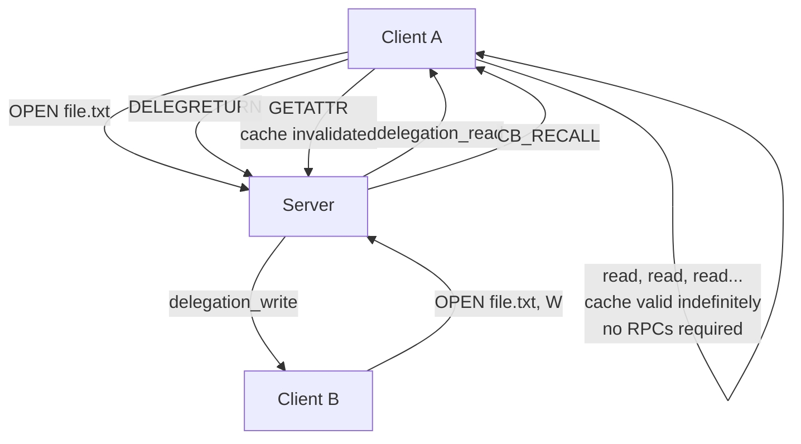

# Lesson 3: Caching Strategies, Consistency Models, Locking Mechanisms

## 1. First-Principles Intuition & Invariants

Network File Systems exist in a fundamental tension between performance and correctness. When a client application reads a file over NFS, the data must traverse network fabric, suffer serialization latency, endure kernel context switches, and navigate protocol state machines before arriving in user space. A naive implementation that fetched every byte from the server on demand would render interactive workloads unusable. Yet caching introduces a profound challenge: multiple clients may mount the same filesystem simultaneously, each maintaining their own view of file data and metadata. Without careful coordination, one client's write may remain invisible to another client's subsequent read, violating the close-to-open consistency semantics that POSIX applications expect.

The design space for distributed cache coherence spans a spectrum from strict serializability, where every read observes the most recent write in global time order, to eventual consistency, where updates propagate lazily and readers tolerate stale data. NFS carved out a middle ground rooted in pragmatic engineering: it guarantees that changes made by one client become visible to another client when files are explicitly closed and reopened, but makes no promises about concurrent readers observing writes before synchronization boundaries. This close-to-open consistency model permits aggressive client-side caching while preserving enough correctness for traditional Unix workloads like software builds, where processes coordinate through file creation and deletion rather than simultaneous writes to shared files.

Client-side caching in NFS operates across three distinct layers: data blocks, metadata attributes, and directory entries. Data caching stores file contents in the page cache, allowing subsequent reads to avoid network round trips entirely. Attribute caching retains file metadata like size, modification time, and permissions, eliminating the need for frequent GETATTR RPCs. Directory entry caching, or DNLC (Directory Name Lookup Cache), accelerates pathname resolution by remembering which names map to which file handles. Each cache layer introduces its own consistency challenges and requires distinct invalidation strategies.

The fundamental invariant governing NFS caching is the attribute timeout mechanism. Every cached attribute or data block carries an expiration timestamp. When a client needs to read a file, it first checks whether its cached attributes remain valid. If the timeout has expired, the client issues a GETATTR RPC to the server and compares the returned modification time (`mtime`) and change time (`ctime`) against its cached values. A mismatch indicates that another client modified the file, forcing the client to discard its stale data cache and refetch from the server. This validation-on-timeout protocol bounds staleness while avoiding the overhead of consulting the server on every read.

Write-through versus write-back caching represents another core tradeoff. In write-through mode, every application write triggers an immediate WRITE RPC to the server, ensuring that data reaches stable storage before the write system call returns. This approach maximizes consistency but devastates performance for workloads that perform many small writes. Write-back caching accumulates dirty pages in memory and flushes them asynchronously, amortizing network and storage latency across multiple writes. NFS implementations typically default to write-back for data but employ write-through or periodic flushing for metadata to prevent catastrophic inconsistencies after crashes.

NFSv4 introduced delegation, a radical departure from the stateless validation model of NFSv3. A delegation is an explicit grant from the server to a client, conferring the right to cache file data and handle operations locally without consulting the server. Read delegations permit aggressive caching because the server promises to recall the delegation before allowing another client to modify the file. Write delegations go further, allowing the client to buffer writes and even handle lock requests locally. Delegations transform the NFS consistency model from timeout-driven polling into a push-based callback protocol, dramatically improving performance for workloads where files are accessed by a single client at a time.

Locking in distributed filesystems confronts the reality that clients may crash while holding locks, and network partitions may isolate clients from the server. NFS lock recovery must balance correctness against availability. The lock manager cannot simply wait indefinitely for a crashed client to release its locks, or the filesystem would hang whenever a client failed. Yet aggressively reclaiming locks from slow or partitioned clients risks violating mutual exclusion if the client is actually alive and continues executing its critical section. NFSv4 resolved this dilemma through lease-based locking, where every lock is tied to a client lease that must be renewed periodically. If the client fails to renew its lease, the server reclaims all associated locks, breaking the deadlock while establishing a bounded window for correctness.

## 2. Core Architecture & Mechanics

The NFS client implements its caching subsystem within the virtual filesystem layer of the kernel, hooking into the standard page cache and dentry cache mechanisms that all filesystems share. When an application issues a read system call on an NFS-mounted file, the kernel first consults the page cache to determine whether the requested pages are resident. If a page is present and valid, the read completes without any network communication. Validity is determined by comparing the current time against the attribute cache timeout: if the cached attributes for the inode have expired, the client issues a GETATTR RPC to retrieve fresh metadata from the server.

The GETATTR response contains a full `fattr` structure including file size, modification time, change time, and a server-assigned change attribute. The client compares the returned `mtime` and `ctime` against the cached values. If they differ, the client invalidates all cached data pages for that inode, forcing subsequent reads to refetch from the server. If the attributes match, the client trusts its cached pages and extends the attribute timeout according to the configured `acregmin`, `acregmax`, `acdirmin`, and `acdirmax` mount options. These parameters specify minimum and maximum attribute cache durations for regular files and directories, implementing an adaptive timeout strategy that balances consistency with performance.

Directory entry caching operates through the kernel's dentry cache, a hash table mapping parent directory and name tuples to child inode pointers. When an application resolves a pathname like `/mnt/nfs/project/src/main.c`, the kernel walks each component and consults the dentry cache. If the cache contains a valid entry for `src` under `project`, the lookup proceeds without a LOOKUP RPC. Dentry validity is similarly governed by the attribute cache: when the parent directory's attributes expire, the client revalidates the dentry by issuing a LOOKUP RPC and comparing file handles. An inode's `d_revalidate` callback implements this logic, allowing the NFS client to inject its cache coherence protocol into the standard VFS pathname resolution path.

Write caching introduces the concept of dirty pages and writeback. When an application writes to an NFS file, the kernel marks the affected pages dirty in the page cache but does not immediately send them to the server. The writeback daemon `nfsiod` periodically scans for dirty pages and issues WRITE RPCs, batching multiple pages into a single request when possible. The `commit` field in the WRITE request specifies the stability level: `UNSTABLE` allows the server to cache writes in volatile memory, while `FILE_SYNC` and `DATA_SYNC` require immediate flush to stable storage. After an unstable write, the client must eventually issue a COMMIT RPC to force persistence. This two-phase protocol allows servers to aggregate writes for better disk scheduling while maintaining crash consistency.

The close-to-open consistency guarantee emerges from the interaction between page cache writeback and attribute validation. When an application closes a file that has been modified, the NFS client flushes all dirty pages and issues a COMMIT if necessary, ensuring that writes reach the server before the close system call returns. When another application subsequently opens the same file, the kernel performs an attribute validation, forcing a GETATTR RPC that runs immediately because open resets the attribute cache timer. If the server's `mtime` reflects the recently committed writes, the opening client's cache is invalidated and subsequent reads will fetch the updated data. This protocol does not prevent concurrent readers from observing stale data while writes are in progress, but it guarantees that explicit synchronization through close and open propagates changes.

NFSv4 delegations introduce a fundamentally different architecture. When a client opens a file, it may request a delegation as part of the OPEN operation. The server's response includes a delegation stateid and type: `OPEN_DELEGATE_READ` or `OPEN_DELEGATE_WRITE`. A read delegation permits the client to satisfy all read operations from its cache without revalidation, even after attribute timeouts expire. A write delegation goes further, allowing the client to service other local clients' read and write requests without contacting the server. The server maintains a callback RPC channel to each client. When another client attempts to access a delegated file in a conflicting mode, the server sends a CB_RECALL callback to the delegation holder, which must flush dirty data and return the delegation before the server can grant the new client's request.



Delegation recall introduces tail latency challenges. If the delegation holder is slow to respond to the callback, the requesting client blocks waiting for the delegation to be returned. NFSv4 servers typically implement delegation timeouts, forcibly revoking a delegation if the client does not respond within a grace period. Clients that lose delegations in this manner must revalidate their cache and may discover that their open file handles are no longer valid, forcing them to reopen the file and potentially lose their position in the file.

Byte-range locking in NFS maps POSIX `fcntl` locks into protocol operations. In NFSv3, the Network Lock Manager (NLM) operates as a separate RPC service alongside the mount and NFS daemons. A client requesting a lock sends an NLM_LOCK request specifying the file handle, lock type (read or write), and byte range. The lock manager maintains a lock table associating ranges with client identifiers. If the requested range conflicts with an existing lock held by another client, the server queues the request and grants it asynchronously when the conflict clears. The asynchronous callback model complicates error handling: if the client crashes after requesting a lock but before receiving the grant callback, the server must eventually time out the request to avoid leaking lock state.

NFSv4 integrated locking into the core protocol, replacing NLM with new LOCK and LOCKU operations that use the same stateful model as OPEN. Each lock is associated with a lock_owner and a stateid that evolves with each lock operation. The server tracks not only which byte ranges are locked but also the sequence of operations performed by each lock owner, enabling it to detect and reject replayed requests. When a client acquires a lock, it receives a stateid that it must present in subsequent READ and WRITE operations on the locked range, allowing the server to enforce lock semantics even for non-POSIX clients.

Lock recovery in NFSv4 relies on the lease mechanism. Every client maintains a lease with the server, renewed through any stateful operation (OPEN, LOCK, READ, WRITE) or an explicit RENEW or SEQUENCE operation. The lease period is negotiated during the initial SETCLIENTID exchange, typically 90 seconds. If a client fails to renew its lease, the server marks the client as expired and reclaims all its locks, opens, and delegations. When the client eventually recovers or the network partition heals, it discovers that its state has been purged and must reacquire locks. The protocol distinguishes between server-initiated lease expiration and client-initiated recovery through the RECLAIM_COMPLETE operation, ensuring that the server does not prematurely reclaim state during a legitimate client reboot.

The lease-based model creates a fundamental tension: short lease periods improve recovery time when clients crash but increase network overhead for renewing leases. Long lease periods reduce overhead but leave resources unavailable for extended periods after failures. NFSv4.1 addressed this with session-based state management, where the client and server establish a session with a negotiated heartbeat interval. The server sends CB_RECALL_SLOT callbacks to prune idle sessions, and the client can explicitly destroy sessions when unmounting. Sessions also enable operation replay detection and exactly-once semantics through a sliding window of slot sequence numbers, preventing duplicate lock acquisitions after retransmitted requests.

```c
/* Simplified NFS client attribute cache validation */
struct nfs_inode {
    struct inode vfs_inode;
    __u64 change_attr;
    unsigned long attrtimeo;
    unsigned long attrtimeo_timestamp;
    struct timespec64 cache_mtime;
    __u32 cache_ctime;
    unsigned long flags;
};

int nfs_revalidate_inode(struct nfs_server *server, struct inode *inode)
{
    struct nfs_inode *nfsi = NFS_I(inode);
    struct nfs_fattr fattr;
    unsigned long now = jiffies;
    
    /* Check if attribute cache is still valid */
    if (time_before(now, nfsi->attrtimeo_timestamp + nfsi->attrtimeo))
        return 0;
    
    /* Issue GETATTR RPC to server */
    int error = server->nfs_client->rpc_ops->getattr(server, 
                                                      NFS_FH(inode), 
                                                      &fattr);
    if (error)
        return error;
    
    /* Compare change attribute and timestamps */
    if (fattr.change_attr != nfsi->change_attr ||
        !timespec64_equal(&fattr.mtime, &nfsi->cache_mtime)) {
        /* Invalidate data cache */
        invalidate_inode_pages2(inode->i_mapping);
        nfsi->change_attr = fattr.change_attr;
        nfsi->cache_mtime = fattr.mtime;
    }
    
    /* Update attribute cache timeout using adaptive algorithm */
    nfsi->attrtimeo = NFS_SERVER(inode)->acregmin;
    nfsi->attrtimeo_timestamp = now;
    
    return 0;
}
```

The adaptive attribute cache timeout algorithm attempts to detect stable versus frequently-changing files. When repeated revalidations confirm that the file has not changed, the client exponentially increases the timeout up to `acregmax`. When a change is detected, the timeout resets to `acregmin`. This heuristic works well for files that are either actively being modified or completely stable, but performs poorly for files that alternate between modification and stability at intervals near the timeout value.

Delegation state recovery after server restart follows a grace period protocol. When an NFSv4 server reboots, it enters a grace period during which it accepts only reclaim operations from clients attempting to reestablish their previous state. Each client that held delegations or locks before the server crashed must reissue LOCK and OPEN operations with the `OPEN4_RECLAIM_PREVIOUS` flag. The server grants these reclaim requests without checking for conflicts, trusting that the client is faithfully reconstructing its pre-reboot state. After the grace period expires, the server returns to normal operation and rejects any further reclaim attempts. This protocol ensures that clients can recover their locks without losing data integrity, but it assumes that all clients that held state before the reboot participate in the grace period.

## 3. High-Performance Optimization & Failure Modes

Tuning NFS client caching for maximum performance requires careful analysis of workload access patterns. Read-heavy workloads with large files benefit from increasing `acregmax` and `acdirmax` to reduce attribute validation overhead. The Linux client defaults to 60 seconds for file attribute caching and 60 seconds for directory attribute caching, which is conservative for stable filesystems. Extending these values to 300 or 600 seconds can eliminate nearly all GETATTR traffic for archival or content distribution workloads where data changes infrequently. The cost is increased staleness: clients may observe file modifications up to the maximum timeout after they occur on the server.

Write-heavy workloads, conversely, demand aggressive write coalescing and batching. The `wsize` mount option controls the maximum write size per RPC, typically 1048576 bytes (1 MiB) on modern systems. Larger write sizes amortize network and protocol overhead but increase latency for small writes. The `async` mount option allows the client to return from write system calls before data reaches the server, deferring writeback to the background flusher threads. This mode violates POSIX synchronous write semantics but delivers dramatically better throughput for applications that do not require immediate durability. Database workloads that manage their own transaction logs should use `sync` mounting to ensure that commits truly reach stable storage.

The `noac` mount option disables attribute caching entirely, forcing the client to issue a GETATTR before every operation. This mode provides near-synchronous consistency semantics, where clients observe writes from other clients almost immediately. The performance cost is severe: every read, write, and stat call incurs a network round trip. The `lookupcache` option provides finer control over directory entry caching, with `none` disabling dcache for NFS entirely, `pos` caching only positive lookups (entries that exist), and `all` caching both positive and negative lookups. Disabling negative lookup caching prevents the client from incorrectly reporting ENOENT when another client has created a file, at the cost of additional LOOKUP RPCs.

Delegation effectiveness depends critically on the workload's sharing patterns. Files accessed by a single client at a time are ideal delegation candidates: the server grants a write delegation to the sole opener, and the client handles all subsequent operations locally. As soon as a second client accesses the file, the server recalls the delegation, and performance reverts to the standard cache coherence protocol. Workloads with high degrees of file sharing, like parallel compilation across many machines building from a shared source tree, experience constant delegation churn as clients repeatedly acquire and release delegations. For such workloads, disabling delegations via the `nordelegation` mount option may paradoxically improve performance by avoiding the overhead of delegation recall.

Server-side delegation policies significantly impact client behavior. Aggressive delegation granting improves single-client performance but increases recall overhead. Some servers implement delegation policies that refuse to grant delegations for files in frequently-accessed directories, or that delay granting delegations for recently-modified files to avoid immediate recall. The NFSv4.1 pNFS protocol represents an alternative to delegations for high-performance workloads, allowing clients to perform I/O directly to storage devices while the metadata server handles only namespace operations. However, pNFS deployment requires specialized storage infrastructure and client support, limiting its adoption outside large-scale data centers.

Lock contention on NFS represents a pathological failure mode. When multiple clients contend for the same lock, each unsuccessful lock attempt triggers a round trip to the server, serializing all clients on network latency. A workload that heavily uses `flock` or `fcntl` locks for short critical sections will perform far worse over NFS than on a local filesystem. Applications that use file locking for coordination rather than mutual exclusion—for example, using a lock file as a simple semaphore—should consider switching to a dedicated coordination service like ZooKeeper or etcd. These systems are designed for distributed coordination and provide lower latency and better failure handling than NFS locking.

Lock recovery failures manifest as stale file handle errors or I/O errors after network partitions or server restarts. When a client's lease expires, the server reclaims all associated state. If the client continues to hold open file descriptors and attempts I/O, those operations fail with ESTALE or EIO errors that applications are rarely prepared to handle. Defensive programming for NFS clients requires retrying operations, reopening files, and potentially revalidating directory paths. The `soft` versus `hard` mount option controls retry behavior: `soft` mounts return errors to applications after a timeout, while `hard` mounts retry indefinitely. Hard mounts prevent data corruption by ensuring that writes eventually succeed, but they can cause applications to hang indefinitely during network outages.

The close-to-open consistency guarantee does not extend to memory-mapped files. When multiple clients map the same file using `mmap`, modifications made by one client may or may not be visible to others, and the timing is implementation-dependent. The kernel's page cache and memory management subsystem interact with NFS caching in complex ways: dirty pages may be flushed asynchronously, and the `msync` system call may or may not trigger immediate writeback depending on the mount options. Applications that require coherent shared memory across machines should use distributed shared memory systems or message-passing middleware rather than relying on mmap over NFS.

Directory entry cache invalidation after directory modifications represents another subtle correctness issue. When a client creates or deletes a file, it must invalidate not only its own directory entry cache but also any cached attributes for the parent directory. If the client's `mtime` for the directory is stale, other clients may not revalidate their own dcaches, causing them to incorrectly believe that the old directory contents are current. The NFS client marks the parent directory's cache invalid on modifications, but the exact timing of when other clients observe the change depends on their attribute cache timeouts. This creates a window where clients see inconsistent views of the directory, particularly problematic for lock files or other coordination mechanisms that rely on file presence.

Monitoring NFS cache effectiveness requires examining kernel statistics exposed through `/proc/net/rpc/nfs` and `/proc/self/mountstats`. The `mountstats` file contains per-mount statistics including cache hit rates, RPC counts, and error counters. High GETATTR counts relative to read operations indicate poor attribute cache performance, suggesting that shorter cache timeouts or high file modification rates are forcing frequent revalidation. High COMMIT counts indicate that the server is not honoring unstable write requests, forcing the client to use the two-phase write protocol and doubling write latency. Analyzing these statistics guides tuning decisions: if attribute cache hits exceed 99%, increasing timeouts further yields diminishing returns, whereas a 50% hit rate suggests significant room for improvement.

The NFSv4 session model introduces slot exhaustion as a failure mode. Each client-server session has a negotiated number of slots, each capable of handling one outstanding request. If the client exhausts its slots—typically by issuing many concurrent asynchronous operations—subsequent operations block until a slot becomes available. The `nconnect` mount option in modern Linux kernels allows the client to establish multiple TCP connections to the server, effectively multiplying the available parallelism. For workloads with high operation concurrency, such as many threads performing random I/O, increasing `nconnect` from the default of 1 to 4 or 8 can dramatically improve throughput by allowing more operations to be in flight simultaneously.

Lease expiration during network partitions creates a split-brain scenario where the client believes it holds locks but the server has reclaimed them. NFSv4.1 introduced session trunking and callback path fault detection to mitigate this, allowing the client to detect that its callback channel has failed and proactively return delegations before the lease expires. However, if the partition is complete—both forward and reverse paths are severed—the client has no way to know that its lease is expiring until the partition heals. Defensive server configurations pair lease timeouts with aggressive reclaim policies, ensuring that resources do not remain locked for long periods after client failures, but this increases the risk of false positives where slow or partitioned clients lose state unnecessarily.

The interaction between NFS caching and client-local caching layers, such as fscache and cachefilesd, adds another dimension of complexity. These mechanisms allow NFS clients to maintain persistent caches on local disk, surviving client reboots and providing read performance comparable to local filesystems. However, they introduce additional cache invalidation requirements: the persistent cache must be invalidated whenever the server's version of a file changes, and the validation logic must account for the possibility that the local cache is arbitrarily stale. The Linux CacheFiles implementation uses the NFS change attribute as a cache key, invalidating local cache entries when the server's change attribute advances. This works well for files that change infrequently but introduces overhead for frequently-modified files, where the local cache is constantly invalidated and refilled.

Ultimately, NFS caching and consistency represent a carefully balanced tradeoff between performance, correctness, and operational complexity. The protocol's design philosophy prioritizes practicality over theoretical rigor: it provides strong enough consistency for traditional Unix workloads while allowing aggressive caching for single-client scenarios. Understanding the mechanical details of attribute validation, writeback coalescing, delegation recall, and lease-based recovery equips infrastructure engineers to diagnose performance problems, tune mount options for specific workloads, and design applications that operate correctly even when cache coherence introduces subtle timing behaviors. The close-to-open model remains the semantic foundation, but delegations, leases, and adaptive timeouts layer sophisticated optimizations atop that foundation, transforming NFS from a simple remote procedure call protocol into a sophisticated distributed cache coherence system.
