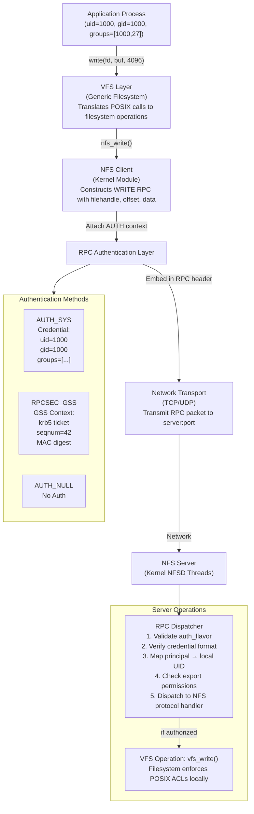

# Lesson 4: Security Models, Performance Optimization, Failure Modes

## 1. First-Principles Intuition & Invariants

Network File System security operates within a trust model fundamentally different from local filesystem semantics. When a process accesses a local file through `open()`, the kernel validates credentials against inode ownership and permission bits stored on the same physical machine, within the same trust domain. Network filesystems fracture this trust boundary: the client kernel trusts the server to enforce access control, yet the server must trust client-asserted credentials transmitted across an untrusted network. This creates what cryptographers call a **remote attestation problem**—how does a server authenticate a client's claimed identity when both the network path and potentially the client itself may be compromised?

The original NFS design made a pragmatic but security-weak choice: AUTH_SYS (formerly AUTH_UNIX) transmits numeric user and group IDs in cleartext within RPC headers, relying entirely on network perimeter security. The server accepts these credentials without cryptographic proof, trusting that IP address filtering and physical network isolation prevent impersonation. This model worked acceptably in 1980s academic networks where all machines shared administrative control and users operated within a single Kerberos realm or NIS domain. Modern deployments spanning cloud availability zones, containerized workloads with ephemeral IP addresses, and multi-tenant infrastructure expose AUTH_SYS's foundational vulnerability: any attacker with network access can forge arbitrary UIDs by crafting RPC packets with spoofed credentials.

RPCSEC_GSS (Generic Security Services) addresses this by introducing cryptographic authentication through the GSS-API framework, most commonly implemented via Kerberos v5. Rather than transmitting credentials, the client and server perform a multi-round challenge-response exchange where each party proves possession of a secret key without revealing it. The Kerberos Key Distribution Center (KDC) acts as a trusted third party, issuing time-limited tickets encrypted with service-specific keys derived from a shared master secret. This establishes **mutual authentication**—both client and server verify each other's identity—and enables per-RPC integrity verification through message authentication codes (MACs) or full confidentiality via encrypted payloads.

The security invariants we must maintain across all NFS authentication models include **identity continuity** (a user's effective UID remains consistent across mount lifetime despite credential refresh), **operation atomicity** (authentication failures must not leave partially-completed filesystem mutations), and **revocation enforcement** (once credentials expire or are revoked, no cached client state can bypass revalidation). These invariants interact with NFS's stateless design philosophy in subtle ways. While NFSv3 maintains no server-side client state, authentication contexts necessarily introduce statefulness: Kerberos tickets have bounded lifetimes, GSS security contexts require initialization and teardown, and credential caches live in kernel memory. The server must balance security rigor against performance overhead, deciding how frequently to revalidate credentials for operations like GETATTR on cached metadata versus high-privilege writes.

Performance optimization in NFS inherently trades off three competing concerns: latency hiding through aggressive client-side caching, data consistency guarantees enforced through synchronous validation, and network bandwidth consumption driven by I/O amplification. The fundamental tension arises from NFS's synchronous-by-default semantics: a client `write()` system call must wait for the server's WRITE RPC to complete and receive a verifier confirming stable storage commitment before returning to userspace. This round-trip delay dominates small-write workloads where application threads serialize on network latency rather than disk throughput. Read-ahead and write-behind strategies attempt to mask latency by speculatively prefetching data or buffering writes asynchronously, but must respect close-to-open consistency semantics that mandate flushing dirty data before file close and revalidating cached attributes on open.

Failure modes in distributed filesystems fall into two categories: **fail-stop** scenarios where a component crashes cleanly and stops responding, and **Byzantine** scenarios where partial failures or network partitions cause divergent views of system state. NFS handles server crashes through its stateless protocol design—when a server reboots, clients simply retry outstanding RPCs with idempotency tokens until the server recovers. However, this assumes the server's persistent state (filesystem contents and export configurations) survives reboot intact. Disk failures, filesystem corruption, or administrator errors that modify exports while clients hold open file handles create **split-brain conditions** where the client's cached state diverges irreconcilably from server truth. The client must detect these scenarios through filehandle validation (ESTALE errors when stale handles are dereferenced) and force remount or application restart to resynchronize state.

## 2. Core Architecture & Mechanics

### Authentication Protocol Stack

NFS authentication occurs at the RPC layer, wrapping filesystem protocol messages in security contexts that establish caller identity before operation execution. The RPC header contains an `auth_flavor` field specifying the credential format, followed by opaque credential and verifier blobs whose structure depends on the selected flavor. The server's RPC dispatch routine validates these credentials before invoking the NFS protocol handler, mapping authenticated principal identities to local UIDs through name service lookups or explicit ID mapping configurations.



AUTH_SYS credentials consist of a machine name string (often ignored), a numeric UID, a numeric GID, and an auxiliary group list limited to 16 entries. The server trusts these values implicitly, applying them directly to VFS permission checks. An `/etc/exports` entry with `root_squash` remaps client UID 0 to the `nobody` user (typically UID 65534) to prevent root privilege escalation, but non-root UIDs pass through unmodified. The `all_squash` option forces all users to `nobody`, effectively creating anonymous read-only or read-write shares. ID mapping complications arise when client and server use different user databases: a user `alice` with UID 1000 on the client may map to UID 1050 on the server if they maintain separate `/etc/passwd` files. Enterprise deployments resolve this through centralized identity systems like LDAP, ensuring numeric UIDs stay synchronized across the infrastructure.

RPCSEC_GSS wraps NFS protocol messages in GSS-API tokens generated by underlying security mechanisms—most commonly Kerberos, but the framework supports SPKM-3, LIPKEY, and custom plugins. The client initiates a security context by sending an RPCSEC_GSS_INIT RPC containing a Kerberos TGT (ticket-granting ticket) obtained from the KDC. The server validates this ticket using its service key (stored in `/etc/krb5.keytab`), extracts the client principal name, and returns a context handle. Subsequent RPCs reference this handle in the credential field and include a verifier containing either a message integrity code (rpc_gss_svc_integrity) or encrypted payload (rpc_gss_svc_privacy). The MIC verifier protects RPC header and arguments against tampering using HMAC-SHA1 or AES-based MACs, while privacy mode encrypts the entire payload with AES-128 or AES-256 negotiated during context establishment.

The server maintains an LRU cache of active GSS contexts indexed by client handle, typically sized to accommodate hundreds of concurrent clients. Context lifetimes match the underlying Kerberos ticket lifetime (default 10 hours), after which the client must perform RPCSEC_GSS_INIT again. Servers enforce maximum context counts to prevent memory exhaustion attacks where malicious clients initiate thousands of contexts without completing authentication. When a client's ticket approaches expiration, the kernel's GSS upcall mechanism invokes a userspace daemon (`rpc.gssd`) to obtain a fresh ticket from the KDC using cached credentials or prompting for password input. This renewal happens transparently to applications with open file handles, maintaining identity continuity across credential refresh cycles.

### Performance Optimization Mechanisms

NFS client-side caching operates through three interconnected subsystems: the page cache for file data, the directory entry cache (dcache) for pathname lookups, and the attribute cache for inode metadata. When an application reads a file, the kernel allocates physical memory pages mapped into the process's virtual address space and issues NFS READ RPCs to populate those pages from the server. Subsequent reads from the same byte ranges hit the page cache without network round-trips until the cached data exceeds its validity timeout. The client tracks per-inode `acdirmin`/`acdirmax` and `acregmin`/`acregmax` bounds that exponentially increase attribute cache lifetime from 3 seconds up to 60 seconds as long as cached attributes remain fresh. This adaptive timeout mechanism reduces GETATTR traffic for stable files while ensuring prompt consistency checks for frequently-modified data.

Read-ahead prefetching exploits sequential access patterns by issuing speculative READ RPCs for byte ranges beyond the current read position. The kernel's read-ahead heuristic tracks per-file access patterns using a two-window algorithm: the **current window** covers recently-read ranges, while the **ahead window** prefetches subsequent data assuming sequential access continues. When an application reads offset N with length L, the client checks if N lies within the current window. If so, it doubles the ahead window size (capped at `rsize * 16` or 1 MB) and issues asynchronous READ RPCs to populate page cache entries for the ahead range. This overlaps network latency with application computation, allowing the next `read()` system call to return immediately from cache. Random access patterns disable read-ahead: when reads jump non-sequentially, the kernel resets window sizes and switches to synchronous on-demand fetching.

Write-behind buffering accumulates small writes in the page cache, deferring NFS WRITE RPCs until the kernel's dirty page writeback logic triggers asynchronous flush operations. This amortizes network overhead by coalescing multiple application writes into larger server requests, approaching the `wsize` limit (typically 1 MB). The writeback daemon (`pdflush` or per-BDI `flush` threads in modern kernels) wakes periodically to scan dirty inodes and issue WRITE+COMMIT operations. NFS enforces close-to-open consistency by flushing all dirty pages when an application calls `close()` on a file descriptor, ensuring the server has durably committed data before returning. This synchronization point serializes concurrent writers: if processes A and B both write to the same file, their writes reach the server in whatever order their `close()` calls complete, with the last writer's view winning.

The trade-off between caching aggressiveness and consistency appears starkly in multi-client scenarios. When multiple NFS clients mount the same export and concurrently modify shared files, cached data diverges from server state. Client A's page cache holds stale data for a file that client B just overwrote. Without additional coordination, client A will not see B's changes until A's attribute cache expires and revalidates the inode, discovering the newer `mtime` and discarding cached pages. The `noac` mount option disables attribute caching entirely, forcing every operation to synchronously validate with the server—correct but devastatingly slow for read-heavy workloads. Production deployments tune cache timeouts through `actimeo` (unified timeout), `lookupcache=positive` (cache successful lookups longer than ENOENT responses), and application-level advisory locks (`lockd` protocol) to serialize access when strict ordering matters.

Network latency mitigation techniques extend beyond caching into protocol-level optimizations. The `async` export option allows the server to acknowledge WRITE RPCs before data reaches stable storage, drastically improving write throughput at the cost of potential data loss if the server crashes before committing buffered writes. Clients detect uncommitted writes through the write verifier mechanism: each WRITE reply includes a 64-bit verifier (typically the server's boot time) that changes on reboot. When a COMMIT RPC returns a different verifier than the original WRITE, the client knows the server lost buffered data and must retransmit. The `sync` export option (default for NFSv3+) prohibits this optimization, forcing synchronous disk writes that guarantee durability but halve write throughput on typical storage hardware.

Server-side parallelism amplifies throughput by spawning multiple `nfsd` kernel threads that concurrently process incoming RPCs. Each thread independently accepts connections, authenticates credentials, and dispatches filesystem operations. The optimal thread count depends on workload characteristics: CPU-bound operations (checksumming, encryption) scale linearly with core count, while I/O-bound operations saturate at the point where disk queues remain continuously full. The `/proc/fs/nfsd/threads` interface exposes current thread count, adjustable at runtime via `rpc.nfsd N`. Setting too few threads causes request queuing and increased latency; setting too many wastes memory on idle threads and increases context switching overhead. Empirical tuning typically starts at 8 threads per CPU core for latency-sensitive workloads, scaling down for throughput-oriented batch processing.

### Failure Detection and Recovery

Server crash recovery in NFSv3's stateless model relies on the client's ability to retry idempotent operations indefinitely until the server responds. When a server becomes unreachable—whether through crash, network partition, or administrator maintenance—the client's RPC layer implements exponential backoff with a configurable timeout (`timeo` mount option, default 600 deciseconds = 60 seconds). After the timeout expires, the kernel either returns EIO to the application (soft mount) or continues retrying forever (hard mount). Hard mounts preserve POSIX semantics where I/O operations block until completion, preventing data loss from transient outages. Soft mounts enable applications to handle I/O errors gracefully but risk data corruption if retries stop while the server still holds uncommitted writes.

The idempotency requirement constrains server behavior: operations like READ, GETATTR, and LOOKUP naturally satisfy this property since repeated execution produces identical results. WRITE and CREATE operations require additional machinery—the server must detect duplicate requests resulting from client retries and return cached results rather than re-executing the operation. NFSv3 accomplishes this through a **duplicate request cache** indexed by (client IP, XID, procedure) tuples. When a server receives a WRITE RPC, it checks if an identical XID from the same client already completed. If found, it returns the cached reply without modifying filesystem state. This cache must survive server reboots to handle the edge case where a client retries after the server crashes mid-WRITE but before returning the reply.

Filehandle staleness occurs when the server-side filesystem object referenced by a client's cached handle gets deleted, moved, or experiences filesystem corruption. The server returns ESTALE (Stale NFS file handle) when the client dereferences an invalid handle, forcing the client to discard cached state and revalidate the path from the mount root. Applications receive ESTALE as EIO, typically causing reads/writes to fail and requiring the application to reopen the file. Processes with `chdir()` into a stale directory become trapped: they cannot `open()` relative paths because the kernel cannot resolve `..` components through the stale handle. The only recovery path involves process termination or `umount -f` (forced unmount) to detach the filesystem and clear cached handles.

Split-brain scenarios arise when network partitions isolate clients from the authoritative NFS server but allow clients to maintain cached state. Client A and client B simultaneously write to the same file while partitioned from each other and the server. When the partition heals, each client's cached writes diverge: there exists no globally consistent ordering of operations that satisfies all clients' observed I/O sequences. NFS provides no distributed consensus mechanism to detect or resolve split-brain; instead, the last writer to flush dirty pages wins, and earlier writes are lost. High-availability NFS deployments using shared storage backends (SAN, clustered filesystems) must implement server-side **fencing** to prevent multiple servers from concurrently serving the same export, typically through SCSI-3 persistent reservations or distributed lock managers that forcibly reboot servers that lose quorum.

Client-side durable caching in NFSv4.2 introduces a delegation mechanism where the server grants exclusive or shared access rights to a client, allowing that client to service operations locally without contacting the server. Read delegations permit aggressive caching since the server promises to notify the client before allowing another client to modify the file. Write delegations let the client buffer writes and delay server updates, improving small-write throughput. The server revokes delegations by sending a callback RPC to the client, which must flush dirty state and return the delegation before the server proceeds with conflicting operations from other clients. This callback model creates a new failure mode: if the client becomes unreachable (crashed, partitioned), the server must wait for a delegation lease timeout (typically 90 seconds) before forcibly reclaiming the delegation and potentially losing the client's uncommitted writes.

## 3. High-Performance Optimization & Failure Modes

### Operational Tuning and Kernel Parameters

Maximizing NFS performance requires coordinated tuning across network stack, RPC layer, filesystem cache, and application I/O patterns. The `rsize` and `wsize` mount options control maximum read and write request sizes, directly impacting network efficiency. Increasing these values from the default 1 MB to the maximum supported by NICs (typically 1 MB for NFSv3, up to 1 MB for NFSv4) reduces per-operation overhead since each RPC carries fixed header costs regardless of payload size. However, larger transfer sizes exacerbate packet loss impact: dropping a single 1 MB packet forces retransmission of the entire request, whereas smaller 128 KB chunks limit blast radius. The optimal setting depends on network quality—low-latency datacenter fabrics with sub-millisecond RTT tolerate larger sizes, while WAN links with 50+ ms latency and occasional congestion benefit from smaller, more granular transfers.

The server's read-ahead and write-behind buffer sizes (`nfsd_ra_size`, `nfsd_tcp_max_slot_table_entries`) govern how much data the kernel prefetches or buffers before blocking client requests. Increasing read-ahead multipliers from 16× to 32× of `rsize` allows the server to pipeline more data into network buffers, keeping TCP windows saturated during sequential reads. Write buffering controlled by VM dirty ratios (`vm.dirty_ratio`, `vm.dirty_background_ratio`) determines when the kernel blocks application writes to throttle I/O submission rate. Setting dirty ratios too high (e.g., 80% of RAM) allows clients to accumulate gigabytes of uncommitted writes, increasing data-at-risk if servers crash. Conservative settings (10-20%) reduce exposure but increase write latency when applications generate bursty traffic.

TCP socket tuning parameters interact subtly with NFS behavior. The kernel's TCP window scaling (`net.ipv4.tcp_window_scaling=1`) permits windows larger than 64 KB, essential for high-bandwidth×delay product networks. A 10 Gbps link with 10 ms RTT requires a 12.5 MB window to fully saturate bandwidth. Socket buffer sizes (`net.core.rmem_max`, `net.core.wmem_max`) must accommodate these windows plus queueing depth for multiple concurrent clients. Increasing `net.ipv4.tcp_rmem` and `tcp_wmem` to `[4096, 87380, 16777216]` (min, default, max in bytes) allows connections to autotune up to 16 MB per socket. NFS servers with hundreds of active clients need proportionally larger global memory budgets—a server handling 500 clients with 16 MB buffers each reserves 8 GB just for socket buffers.

Client-side parallel mounts to different servers enable load distribution and fault isolation. Deploying multiple NFS servers behind DNS round-robin or an L4 load balancer spreads client connections, but requires careful filesystem partitioning since different servers cannot coherently share the same export path. Sharded designs where `/data/shard0` resides on server1, `/data/shard1` on server2, etc., let applications explicitly select servers for locality. This approach trades consistency for throughput: applications must handle heterogeneous latencies and cannot transparently fail over between shards. Advanced deployments using pNFS (parallel NFS in v4.1+) allow a single logical export to span multiple storage servers, with the metadata server directing clients to stripe data across backends. This centralizes namespace management while distributing I/O load, though it introduces metadata server scalability bottlenecks.

### Authentication Performance and Credential Caching

RPCSEC_GSS authentication overhead manifests as increased RPC latency due to cryptographic operations and additional network round-trips during context establishment. Kerberos TGT retrieval requires a client-to-KDC exchange (AS-REQ/AS-REP), followed by a service ticket request (TGS-REQ/TGS-REP), followed by RPCSEC_GSS_INIT to establish the NFS security context. These operations add 50-100 ms of latency before the first filesystem RPC succeeds. Credential caching amortizes this cost: the kernel caches both Kerberos tickets (in the keyring subsystem) and GSS contexts (in the RPC layer), reusing them across process lifetimes until expiration. Configuring longer ticket lifetimes (24 hours instead of 10) reduces renewal frequency but increases the window where stolen credentials remain valid.

Integrity and privacy protection impose per-RPC CPU overhead for MAC computation or encryption. HMAC-SHA1 verification adds ~5 µs per RPC on modern processors, negligible for large data transfers but significant for metadata-heavy workloads generating thousands of GETATTR requests per second. Privacy mode encryption using AES-GCM roughly doubles this cost since both request and reply payloads require cryptographic processing. Servers with hardware AES acceleration (AES-NI instructions) reduce overhead to ~10 µs per RPC, but software implementations on older CPUs can consume 5-10% of total CPU capacity during peak load. Deployments balancing security against performance often use integrity mode for exports containing sensitive data while leaving public read-only shares with AUTH_SYS to maximize throughput.

The kernel's RPC credential cache (`rpcauth_cache`) stores mappings from (UID, security flavor, GSS context) to RPC authentication handles, avoiding redundant context lookups for rapid-fire operations from the same user. This cache uses an LRU eviction policy sized by `nfs.nfs_congestion_kb` (typically 256 entries). Cache misses force synchronous GSS upcalls to `rpc.gssd`, blocking the calling process for 10-20 ms while userspace retrieves fresh tickets. Applications spawning short-lived processes that each perform single-file operations (e.g., shell scripts in loops) suffer worst-case behavior: every process incurs cold-cache penalties since credentials expire before the next invocation. Mitigations include persistent credential caches (`persistent_keyring`), long-running daemon processes that amortize authentication costs, or switching to AUTH_SYS for non-sensitive temporary workloads.

### Failure Mode Analysis and Mitigation

Network partition failures decouple client caches from server state, creating consistency violations that manifest as stale reads or lost writes. When a client loses connectivity mid-operation, pending RPCs timeout and retry until `timeo` expires. Hard mounts continue retrying indefinitely, causing applications to hang in uninterruptible sleep (`D` state in `ps` output). This preserves data integrity at the cost of availability: critical system processes like shell logins or init scripts blocking on NFS can render the entire client unresponsive. Soft mounts return EIO after timeout, allowing applications to detect failures and potentially fall back to cached data or alternative paths. However, soft mounts violate POSIX semantics—`write()` returning success then later failing with EIO during `close()` breaks assumptions of durable storage, risking silent data loss.

Server-side export configuration errors create subtle failure modes where filesystem operations succeed but violate intended security boundaries. An export with `no_root_squash` inadvertently allows remote root privilege escalation: a compromised client mounting the export can create setuid-root binaries in shared directories, then execute them to gain root on other clients. The `secure` export option restricts clients to privileged ports (< 1024), preventing unprivileged users from impersonating NFS clients, but this protection relies on client kernel security—a compromised client can bind low ports anyway. Defense-in-depth requires layered controls: `root_squash` on all exports, IP-based access lists (exportfs hosts), and application-level permission checks that do not trust client-provided UIDs.

Disk exhaustion on the server manifests as ENOSPC errors propagated to clients, but delayed write buffering obscures the failure point. An application writing gigabytes of data receives successful `write()` returns as long as the client's page cache has free memory. The actual ENOSPC occurs during writeback flush, potentially minutes or hours later when `close()` forces dirty page synchronization. Applications checking return codes see `close()` fail with EIO, but the root cause—insufficient server disk space—requires examining server logs or manually checking `df` output. Proactive monitoring through `statd` notifications or custom health checks can alert before exhaustion, but the fundamental race persists: clients cannot atomically reserve server disk space before buffering writes.

Thundering herd problems arise when many clients simultaneously issue expensive operations like listing large directories or reading recently-invalidated cached data. A common trigger: administrator modifies a shared configuration file that hundreds of application containers read at startup. When the mtime changes, all clients detect cache invalidation and issue concurrent READ RPCs, overwhelming server I/O queues. The server serializes requests, but queuing delays cascade: early clients experience 100 ms latency, later clients wait seconds, timeout expirations trigger retries that further saturate the server. Mitigation strategies include client-side rate limiting (random jitter before revalidation), server-side read deduplication (cache identical READ requests during processing), or redesigning applications to use configuration management systems that push updates instead of polling shared files.

Lock recovery failures in NFSv4 occur when clients hold byte-range or file locks during server crash. The lock state resides in server memory, destroyed by reboot. Upon restart, the server enters a **grace period** (typically 90 seconds) during which clients reclaim locks by replaying LOCK operations. If a client fails to reclaim within the grace period—perhaps due to network issues or client crash—the server discards unclaimed locks and grants conflicting locks to other clients. This violates application assumptions: a process holding an exclusive lock expects no other process can acquire that lock until released. Applications relying on NFS locks for correctness (database storage on NFS, highly discouraged) must implement application-level distributed consensus (Raft, Paxos) rather than trusting stateful NFSv4 lock semantics.

### Production Deployment Patterns

Enterprise NFS deployments layer caching proxies between clients and authoritative storage servers to amplify read throughput and improve fault tolerance. A caching proxy runs its own NFS server (`nfsd`) while mounting backend storage as an NFS client, serving hot data from local SSD or memory. Clients mount the proxy rather than the backend, consolidating access patterns and reducing backend load. Write operations flow through the proxy with `sync` semantics to prevent data loss, while reads populate a local page cache sized to the proxy's RAM. This architecture handles backend server maintenance transparently: the proxy continues serving cached reads during backend downtime, and buffered writes queue until connectivity restores. Cache coherency requires proxy servers to revalidate cached data periodically or receive invalidation notifications through out-of-band channels.

High-availability configurations pair active/passive NFS servers sharing a backend storage volume (iSCSI LUN, Fibre Channel, NVMe-oF), with a floating virtual IP that clients mount. Heartbeat monitors (Corosync, Pacemaker) detect active server failures and trigger failover: the passive server mounts the shared storage, starts `nfsd`, and claims the virtual IP. Clients see the server disappear, retry RPCs during the failover window (30-60 seconds), then resume operations transparently when the new active responds. This design requires STONITH (Shoot The Other Node In The Head) fencing to prevent split-brain: before assuming the active role, the passive server must forcibly power-cycle the previous active via IPMI or fence the storage LUN to guarantee only one server writes to the filesystem. Without fencing, simultaneous writes from both servers corrupt the underlying ext4/XFS filesystem, requiring manual `fsck` recovery.

Container orchestration platforms like Kubernetes integrate NFS through persistent volume claims backed by NFS provisioners. The provisioner automates export creation: when a pod requests a 10 GB persistent volume, the provisioner creates a subdirectory on the NFS server, configures `/etc/exports` via API calls, and returns mount parameters to the kubelet. The kubelet mounts the NFS share into the pod's namespace using kernel mount rather than FUSE, achieving near-native performance. Challenges arise from UID mapping: container processes run as arbitrary UIDs assigned by the container runtime, often differing from host UIDs. The NFS server sees these container UIDs in AUTH_SYS credentials and applies file permissions accordingly, frequently resulting in "permission denied" errors. Solutions include running containers as root (insecure), using `all_squash` with a shared UID (breaks multi-tenancy), or deploying Kerberos with gssproxy to map container service accounts to Kerberos principals.

Observability tooling captures NFS performance metrics through multiple instrumentation points. The client exposes `/proc/self/mountstats` containing per-mount counters for RPC operations, retries, timeouts, and data volumes. Parsing this file reveals bottlenecks: high retry counts indicate network instability, elevated read/write latencies point to server overload, and disproportionate GETATTR traffic suggests excessive cache revalidation. Server-side metrics live in `/proc/net/rpc/nfsd` and include per-operation histograms, thread utilization, and reply cache hit rates. Combining client and server metrics pinpoints fault domains: if client metrics show high latency but server metrics show low CPU and disk utilization, the network path likely introduces delay (congestion, routing loops).

The configuration below implements a hardened NFS deployment with RPCSEC_GSS authentication, tuned caching parameters, and defensive timeouts suitable for production multi-tenant environments. The server exports a filesystem with synchronous writes enforced, Kerberos-only authentication, and root squashing. Clients mount with hard semantics to prevent data loss, reduced cache timeouts to improve consistency, and explicit timeout values chosen for a datacenter network with < 5 ms RTT.

Server configuration (`/etc/exports`):
```text
/exports/shared  192.168.1.0/24(rw,sync,no_subtree_check,root_squash,sec=krb5p)
```

Client mount command:
```bash
mount -t nfs -o vers=3,proto=tcp,rsize=1048576,wsize=1048576,hard,timeo=100,retrans=3,sec=krb5p,actimeo=30 nfs-server.example.com:/exports/shared /mnt/nfs
```

Kerberos keytab generation on server:
```bash
kadmin.local -q "addprinc -randkey nfs/nfs-server.example.com"
kadmin.local -q "ktadd -k /etc/krb5.keytab nfs/nfs-server.example.com"
chmod 600 /etc/krb5.keytab
```

Client credential acquisition:
```bash
kinit user@EXAMPLE.COM
# Kernel automatically requests NFS service ticket via gssd
# Verify context establishment:
cat /proc/net/rpc/auth.rpcsec.context/content | grep nfs-server
```

Server thread and cache tuning:
```bash
# Set 64 nfsd threads for 8-core server
echo 64 > /proc/fs/nfsd/threads

# Increase TCP slot table for concurrent clients
echo 1024 > /proc/fs/nfsd/max_block_size

# Tune kernel dirty ratios for write safety
sysctl -w vm.dirty_ratio=15
sysctl -w vm.dirty_background_ratio=5
```

Client-side network tuning for high-throughput link:
```bash
# Increase socket buffers to 16 MB
sysctl -w net.core.rmem_max=16777216
sysctl -w net.core.wmem_max=16777216
sysctl -w net.ipv4.tcp_rmem="4096 87380 16777216"
sysctl -w net.ipv4.tcp_wmem="4096 65536 16777216"

# Enable TCP window scaling
sysctl -w net.ipv4.tcp_window_scaling=1
```

Monitoring script to detect client-side stalls:
```bash
#!/bin/bash
# Alert if any NFS mount has >100 pending RPC requests (likely server unresponsive)
for mount in $(mount | grep nfs | awk '{print $3}'); do
    stats=$(cat /proc/self/mountstats | awk -v mount="$mount" '
        /device.*mounted on/ { if ($5 == mount) found=1 }
        found && /pending/ { print $2 }
    ')
    if [ "$stats" -gt 100 ]; then
        echo "ALERT: $mount has $stats pending RPCs, server may be down"
    fi
done
```

The interplay between authentication overhead, caching behavior, and failure recovery defines NFS's operational envelope. Deployments must choose positions along security-performance and consistency-availability axes based on workload requirements. Financial trading systems prioritize low latency and accept AUTH_SYS risks within physically isolated networks. Medical imaging archives demand HIPAA-compliant encryption (krb5p) despite throughput penalties. Multi-tenant cloud platforms cannot tolerate stale reads and disable client caching entirely, sacrificing performance for correctness. No universal configuration exists; instead, operators tune parameters through iterative measurement: deploy monitoring, generate representative load, identify bottlenecks in metrics, adjust one parameter, and re-measure until service level objectives are met. This empirical process, grounded in first-principles understanding of protocol mechanics, separates functioning NFS infrastructure from perpetually troubleshooting deployments.
