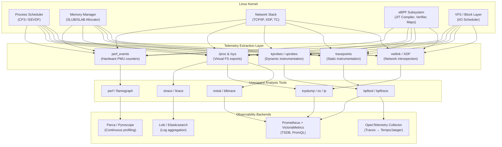
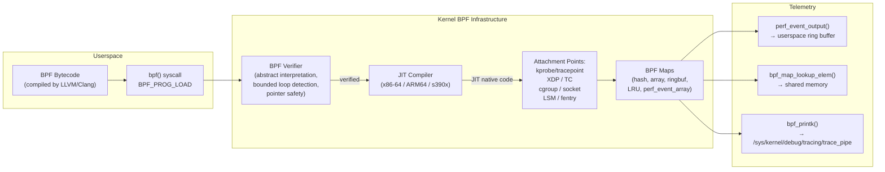
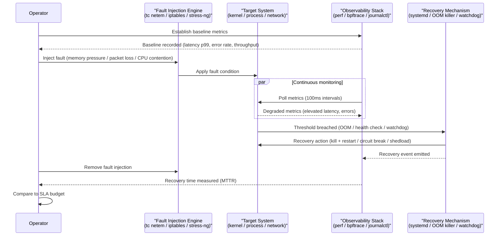
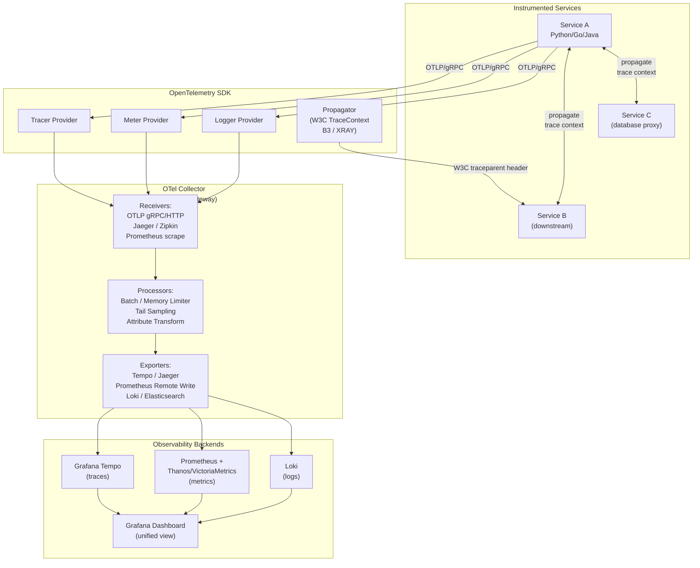
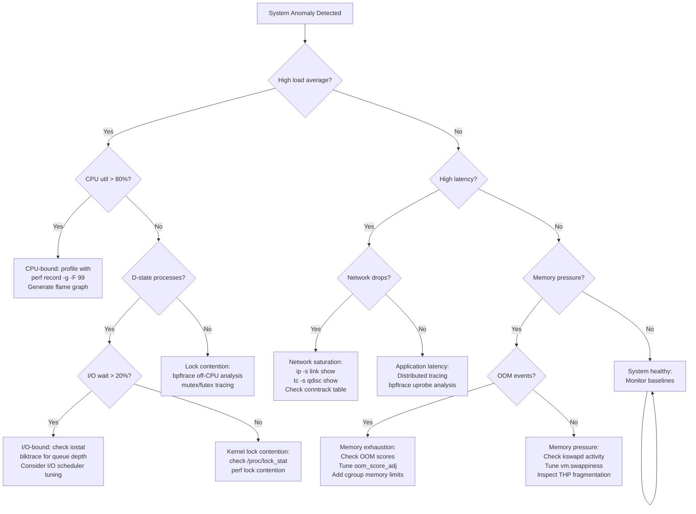

# Operational Verification Labs: Core Observability

## Preface: What Observability Actually Means

Observability is a property of a system, not a toolchain. A system is observable if its internal state can be inferred entirely from its external outputs — telemetry, traces, logs, and metrics — without requiring a priori knowledge of its failure modes. This is the control-theory definition, formalized by Rudolf Kálmán in 1960, and it applies directly to distributed computing infrastructure.

The three canonical pillars — **metrics**, **logs**, and **traces** — are not equally powerful. Metrics are aggregations that destroy cardinality; they tell you *that* something is wrong. Logs are discrete events with context; they tell you *what* happened. Distributed traces are causal chains across process boundaries; they tell you *where* latency and errors originate. A fourth pillar, **continuous profiling**, tells you *why* a service is slow at the CPU instruction level. This lab exercises all four using kernel-native tooling before moving to instrumented application observability.

The mental model that underlies every exercise in this lab is the **USE Method** (Utilization, Saturation, Errors) for resource analysis and the **RED Method** (Rate, Errors, Duration) for service analysis, both formalized by Brendan Gregg. Every command below answers a specific USE or RED question.

---

## Architecture Overview



---

## Environment Setup

### Prerequisites

This lab requires a Linux kernel ≥ 5.15 (for BTF, fentry/fexit probes, and BPF ring buffers) or FreeBSD 13.2 with KTRACE enabled. Ubuntu 22.04 LTS with kernel 5.15 is the reference platform. All commands require root privileges or `CAP_BPF` + `CAP_PERFMON` capabilities.

```bash
# Verify kernel version — must be >= 5.15 for full BTF/CO-RE support
uname -r

# Verify BTF is compiled in (prerequisite for bpftool, bpftrace, libbpf CO-RE)
ls -la /sys/kernel/btf/vmlinux

# Install required tooling on Ubuntu 22.04
apt-get install -y \
    linux-tools-$(uname -r) \   # perf
    bpftool \                    # eBPF inspection
    bpftrace \                   # high-level BPF tracing language
    iproute2 \                   # ip, ss, tc
    tcpdump \
    strace \
    sysstat \                    # iostat, mpstat, pidstat
    stress-ng \
    iperf3 \
    numactl \
    hwloc-nox                   # NUMA topology inspection

# Verify perf can access hardware counters
perf stat ls /dev/null 2>&1 | grep "Performance counter stats"
```

### eBPF Subsystem Configuration

The eBPF JIT compiler is not simply a performance optimization — it is the difference between O(n) interpreter overhead per instruction and near-native execution. `bpf_jit_harden` mitigates constant-blinding attacks where an attacker uses BPF to infer kernel memory layout via timing side-channels; it is relevant on shared infrastructure.

```bash
# Enable eBPF JIT compiler (critical for production-grade BPF program performance)
sysctl -w net.core.bpf_jit_enable=1

# Harden JIT against constant-blinding side-channel attacks (set to 2 on shared/cloud hosts)
# 1 = harden unprivileged BPF only; 2 = harden all BPF programs
sysctl -w net.core.bpf_jit_harden=1

# Allow unprivileged BPF (disable on production — requires kernel 5.3+)
# 0 = all users, 1 = only CAP_BPF/CAP_SYS_ADMIN, 2 = disabled entirely
sysctl -w kernel.unprivileged_bpf_disabled=1

# Increase locked memory limit for BPF maps (default 64KB is too low for most programs)
ulimit -l unlimited

# Verify JIT is active
cat /proc/sys/net/core/bpf_jit_enable        # should return 1
bpftool feature probe kernel | grep -i jit   # should show "bpf_jit is available"

# Verify BTF (BPF Type Format) is available — required for CO-RE portability
bpftool btf show | head -5
```

### Kubernetes Cluster Verification

```bash
# Confirm cluster API server reachability and version
kubectl cluster-info
kubectl version --short

# Verify all nodes are Ready and report correct kernel versions
kubectl get nodes -o custom-columns=\
"NAME:.metadata.name,STATUS:.status.conditions[-1].type,KERNEL:.status.nodeInfo.kernelVersion,OS:.status.nodeInfo.osImage"

# Confirm CNI plugin is operational (critical for network exercises)
kubectl get pods -n kube-system -l k8s-app=cilium   # or calico-node, flannel, etc.

# Verify metrics-server is available for resource consumption data
kubectl top nodes
```

---

## Exercise 1: Live State & Internal Subsystem Inspection

The kernel exposes its internal state through two virtual filesystems: `/proc` (process and system state, originally from Unix Research) and `/sys` (device and driver attributes, introduced in Linux 2.6 as a replacement for the chaotic `/proc/sys` hierarchy). Neither filesystem involves disk I/O — reads from these paths invoke kernel functions that compute and format the response in real time. This distinction matters: `cat /proc/meminfo` is not reading a file; it is calling `meminfo_proc_show()` in `fs/proc/meminfo.c`.

### 1.1 Memory Subsystem Deep Inspection

The Linux memory manager operates at multiple levels: the hardware page table (4-level on x86-64, 5-level if `CONFIG_X86_5LEVEL` is set), the buddy allocator for physical page frames, the SLUB allocator for kernel objects, and the virtual memory areas (VMAs) for per-process address space management. `MemAvailable` is the most actionable metric from `/proc/meminfo`; it was added in Linux 3.14 specifically because `MemFree` is misleading — the kernel aggressively uses free memory for the page cache, which is immediately reclaimable.

```bash
# Parse /proc/meminfo with field explanations
# MemTotal: total usable RAM (physical minus kernel reserved)
# MemFree: completely unused RAM pages (not useful as an availability metric)
# MemAvailable: kernel's estimate of reclaimable memory (page cache + reclaimable slabs)
# Buffers: in-flight I/O buffer pages (block device metadata)
# Cached: page cache (file data), excludes SwapCached
# SwapCached: pages in both RAM and swap simultaneously (double-counting risk)
# Slab: kernel data structure allocations (tracked via /proc/slabinfo)
# SReclaimable: slab pages that can be dropped under memory pressure
# SUnreclaim: slab pages that cannot be reclaimed (kernel bug indicator if large)
# KernelStack: memory used by kernel stacks (8–16KB per thread on x86-64)
# PageTables: memory used for hardware page tables (grows with process address space)
# HugePages_Total/Free: 2MB transparent huge pages or static hugepages

awk '
/^MemTotal:/     { printf "Total RAM:          %8d MiB\n", $2/1024 }
/^MemFree:/      { printf "Free (raw):         %8d MiB\n", $2/1024 }
/^MemAvailable:/ { printf "Available (actual): %8d MiB\n", $2/1024 }
/^Buffers:/      { printf "Buffers:            %8d MiB\n", $2/1024 }
/^Cached:/       { printf "Page Cache:         %8d MiB\n", $2/1024 }
/^Slab:/         { printf "Kernel Slab:        %8d MiB\n", $2/1024 }
/^SReclaimable:/ { printf "Slab (reclaimable): %8d MiB\n", $2/1024 }
/^SUnreclaim:/   { printf "Slab (unreclaimable):%7d MiB [ALERT if > 500MiB]\n", $2/1024 }
/^KernelStack:/  { printf "Kernel Stacks:      %8d MiB\n", $2/1024 }
/^HugePages_Total:/ { printf "HugePages (total):  %8d\n", $2 }
' /proc/meminfo

# NUMA topology — memory locality is critical for multi-socket performance
# A process allocating memory from a remote NUMA node incurs ~40-100ns additional latency
numactl --hardware

# Per-NUMA-node memory statistics
cat /sys/devices/system/node/node*/meminfo 2>/dev/null | \
    grep -E "(MemTotal|MemFree|MemUsed)" | \
    awk '{printf "Node %-3s %-16s %d MiB\n", NR, $3, $4/1024}'

# SLUB allocator statistics — identify kernel memory fragmentation
# sort by number of active objects to find dominant allocation sites
cat /proc/slabinfo | \
    awk 'NR > 2 { print $1, $2, $4 }' | \
    sort -k2 -rn | \
    head -15 | \
    column -t

# Virtual memory statistics — reclaim pressure indicators
# pgpgin/pgpgout: pages moved into/out of RAM from storage (high = swap pressure)
# pswpin/pswpout: swap I/O operations (non-zero is a warning on latency-sensitive systems)
# pgmajfault: major page faults requiring disk I/O (critical latency events)
grep -E "(pgpgin|pgpgout|pswpin|pswpout|pgmajfault|oom_kill)" /proc/vmstat
```

### 1.2 Process Scheduler State and Thread Inspection

The Linux Completely Fair Scheduler (CFS), replaced by EEVDF (Earliest Eligible Virtual Deadline First) in kernel 6.6, maintains a per-CPU red-black tree of runnable tasks ordered by virtual runtime. The `/proc/<pid>/status` interface exposes scheduler state directly. Understanding the difference between process states is fundamental: `R` (running/runnable) consumes CPU time; `D` (uninterruptible sleep, waiting on I/O or a kernel lock) does not but blocks process table slots and can cause load average to spike without CPU saturation.

```bash
# Identify processes in uninterruptible sleep (D state) — indicates I/O or lock contention
# D-state accumulation is the primary cause of load average exceeding CPU count without saturation
ps -eo pid,ppid,stat,wchan,comm,args --no-headers | \
    awk '$3 ~ /^D/ { printf "PID:%-6s PPID:%-6s STATE:%-4s WCHAN:%-20s CMD:%s\n", $1, $2, $3, $4, $5 }' | \
    head -20

# Scheduler latency per process via /proc/<pid>/schedstat
# Fields: [cpu_time_ns] [wait_time_ns] [timeslices_run]
# High wait_time_ns relative to cpu_time_ns indicates scheduler starvation
for pid in $(ps -eo pid --no-headers | head -20); do
    if [ -f /proc/$pid/schedstat ]; then
        read cpu_time wait_time slices < /proc/$pid/schedstat
        comm=$(cat /proc/$pid/comm 2>/dev/null)
        printf "PID:%-6s COMM:%-20s CPU_ms:%-8d SCHED_WAIT_ms:%-8d SLICES:%d\n" \
            "$pid" "$comm" "$((cpu_time/1000000))" "$((wait_time/1000000))" "$slices"
    fi
done | sort -k5 -rn | head -15

# Per-CPU run queue depth — if consistently > 1, CPUs are saturated
# This reads directly from the kernel's scheduler statistics
grep -E "^cpu" /proc/stat | \
    awk '{ idle=$5; total=0; for(i=2;i<=NF;i++) total+=$i;
           util=100*(total-idle)/total;
           printf "%s: util=%.1f%%\n", $1, util }'

# Full process memory map for PID 1 (systemd/init) — demonstrates VMA layout
# [stack], [heap], anonymous mappings, file-backed mappings, vDSO, vvar
# vDSO (virtual dynamic shared object): kernel-mapped pages for fast syscalls (clock_gettime, gettimeofday)
# vvar: read-only kernel variables accessible from userspace without a syscall
pmap -x 1 2>/dev/null | head -30

# strace with timing and filtering — capture wall-clock time per syscall class
# -T: print time spent in syscall
# -e trace=: filter to specific syscall categories
# Attach to a running process non-invasively; note that strace uses ptrace(2) which
# serializes all syscalls through the tracer — this introduces 2-10x slowdown.
# Never use strace in production on latency-critical paths.
strace -p $(pgrep -f "containerd" | head -1) \
       -e trace=network,process,signal \
       -T -ttt \
       -o /tmp/strace_containerd.txt &
sleep 5 && kill %1
# Summarize by syscall
strace -c -p $(pgrep -f "containerd" | head -1) sleep 10 2>/tmp/strace_summary.txt
cat /tmp/strace_summary.txt
```

### 1.3 Network Stack Inspection

The Linux network stack processes packets through a layered path: NIC hardware → hardware interrupt → softirq (NET_RX_SOFTIRQ) → NAPI poll loop → sk_buff processing → netfilter hooks → socket buffer → userspace `recv()`. Each layer has its own queue with drop counters. Packet drops at any layer indicate a different root cause: hardware ring buffer drops indicate NIC saturation; `netstat -s` drops indicate socket buffer exhaustion; iptables/nftables drops are policy decisions.

```bash
# Network interface statistics with drop and error counters
# RX drops at the hardware ring buffer level indicate NIC is overwhelmed
# TX drops indicate the transmit queue is full (netdev_max_backlog)
ip -s -s link show | awk '
/^[0-9]+:/ { iface=$2 }
/RX:/ { getline; printf "%-20s RX bytes:%-12d packets:%-10d dropped:%-8d errors:%d\n", iface, $1, $2, $4, $3 }
/TX:/ { getline; printf "%-20s TX bytes:%-12d packets:%-10d dropped:%-8d errors:%d\n", iface, $1, $2, $4, $3 }
' 2>/dev/null

# Socket statistics — far superior to netstat on modern kernels
# State distribution tells the story: excessive TIME_WAIT = short-lived connections without SO_REUSEADDR
# CLOSE_WAIT = application not calling close() after EOF (application-level bug)
ss -s   # summary
ss -tanp | awk '
{ state[$1]++ }
END {
    printf "\n=== TCP State Distribution ===\n"
    for (s in state) printf "  %-15s %d\n", s, state[s]
}' 

# TCP retransmission statistics — the most reliable indicator of network path quality
# TCPRetransFail: retransmits that also failed (severe congestion or path failure)
# TCPSynRetrans: SYN retransmits (server unreachable or SYN queue overflow)
grep -E "^(Tcp|TcpExt):" /proc/net/netstat | \
    paste - - | \
    awk '{
        n=split($0, a); mid=n/2;
        for(i=1;i<=mid;i++) names[i]=a[i];
        for(i=1;i<=mid;i++) vals[i]=a[i+mid];
        for(i=1;i<=mid;i++) if(vals[i]+0 > 0) printf "%-40s %s\n", names[i], vals[i]
    }' | grep -iE "(retrans|drop|overflow|reject|abort|fail)" | sort -k2 -rn | head -20

# Routing table with metrics
ip route show table all | grep -v "^local\|^broadcast\|^multicast" | head -30

# Conntrack table — track connection tracking state if netfilter is active
# A full conntrack table (nf_conntrack_max) causes all new connections to fail silently
if [ -f /proc/net/nf_conntrack ]; then
    current=$(wc -l < /proc/net/nf_conntrack)
    maximum=$(cat /proc/sys/net/netfilter/nf_conntrack_max)
    printf "Conntrack: %d / %d (%.1f%% full)\n" "$current" "$maximum" \
        "$(echo "scale=1; $current * 100 / $maximum" | bc)"
fi
```

### 1.4 eBPF Subsystem Deep Inspection

eBPF programs are loaded into the kernel, verified by the BPF verifier (which enforces termination, memory safety, and type safety), JIT-compiled to native machine code, and attached to hooks throughout the kernel and userspace. The verifier performs abstract interpretation — it tracks all possible execution paths through the program and rejects any path that could access unmapped memory, loop infinitely, or violate type constraints. This is what makes eBPF safe enough to run in kernel context without modules.



```bash
# List all loaded eBPF programs with type, ID, tag, and JIT state
bpftool prog show --pretty 2>/dev/null | \
    python3 -c "
import json, sys
progs = json.load(sys.stdin)
print(f'{'ID':<6} {'Type':<20} {'Name':<30} {'JITed':<8} {'Loaded':<20}')
print('-'*84)
for p in progs:
    print(f\"{p['id']:<6} {p['type']:<20} {p.get('name','<unnamed>'):<30} {str(p.get('jited',False)):<8} {p.get('loaded_at',''):<20}\")
"

# Inspect eBPF maps — these are the shared data structures between kernel and userspace
# The map type determines lookup complexity: BPF_MAP_TYPE_HASH is O(1) avg, BPF_MAP_TYPE_ARRAY is O(1) direct
bpftool map show

# Dump the translated (post-verifier) BPF instructions for program ID N
# This shows the actual BPF bytecode that runs — useful for auditing security-sensitive programs
PROG_ID=$(bpftool prog show | grep -m1 "^[0-9]" | awk '{print $1}' | tr -d ':')
bpftool prog dump xlated id ${PROG_ID} 2>/dev/null | head -40

# Dump the JIT-compiled native assembly
bpftool prog dump jited id ${PROG_ID} 2>/dev/null | head -40

# Inspect BTF (BPF Type Format) — the DWARF-equivalent type information embedded in vmlinux
# CO-RE (Compile Once, Run Everywhere) uses BTF to relocate field offsets at load time
# without recompiling the BPF program for each kernel version
bpftool btf dump file /sys/kernel/btf/vmlinux format raw 2>/dev/null | \
    grep -A2 "struct task_struct" | head -20

# Check BPF feature availability on this kernel
bpftool feature probe 2>/dev/null | grep -E "(available|unavailable)" | \
    grep -E "(ringbuf|fentry|lsm|sk_lookup|struct_ops)"
```

### 1.5 Kernel Ring Buffer and Structured Log Analysis

```bash
# dmesg with human-readable timestamps and severity filtering
# -T: convert timestamps to human-readable (uses CLOCK_REALTIME, not CLOCK_MONOTONIC)
# -l err,warn: filter to errors and warnings only
# Note: timestamps in dmesg are based on CLOCK_BOOTTIME; -T conversion can be inaccurate
#       if the clock was adjusted after boot (NTP, adjtime)
dmesg -T -l err,warn | tail -30

# Identify hardware errors — MCE (Machine Check Exceptions) indicate hardware failures
# EDAC errors indicate ECC memory corrections (correctable) or uncorrectable errors
dmesg | grep -iE "(mce|edac|corrected|uncorrected|hardware error|i/o error|ext4-fs error)"

# Real-time structured logging with priority filtering
# Priority 0=emerg, 1=alert, 2=crit, 3=err, 4=warn, 5=notice, 6=info, 7=debug
journalctl -f -p 0..4 --no-pager

# Kernel audit log — mandatory for security-critical environments
# auditd records syscall activity from the kernel's audit framework
ausearch -ts recent -m AVC,SYSCALL 2>/dev/null | head -30

# OOM kill history — critical for capacity planning
journalctl -k | grep -E "Out of memory|Killed process|oom_reaper" | \
    awk '{ print NR, $0 }' | tail -20
```

---

## Exercise 2: Benchmarking, Saturation, and Performance Profiling

Benchmarking without a hypothesis is measurement theater. Each sub-exercise below establishes a **baseline**, applies a **controlled load**, and identifies a **saturation point** using kernel-native instrumentation. The USE framework structures every measurement: for each resource (CPU, memory, network, disk), measure Utilization (% busy), Saturation (queue depth or wait time), and Errors (error counter rates).

### 2.1 CPU Profiling with Hardware Performance Counters

The CPU Performance Monitoring Unit (PMU) is a set of hardware registers that count microarchitectural events: instructions retired, cache misses, branch mispredictions, TLB misses, and stall cycles. `perf stat` programs these registers via the `perf_event_open(2)` syscall. The ratio of **Instructions Per Cycle (IPC)** directly measures execution efficiency: IPC < 1.0 indicates memory-bound workloads; IPC > 2.5 indicates compute-bound workloads with good cache utilization.

```bash
# Establish CPU performance baseline with hardware PMU counters
# IPC < 1.0: memory-bound (LLC misses, DRAM latency)
# IPC > 2.5: compute-efficient
# Branch miss rate > 5%: branch predictor thrashing (common in interpreter loops)
# LLC load miss rate > 10%: working set exceeds last-level cache
perf stat -e \
    cycles,instructions,\
    cache-references,cache-misses,\
    branch-instructions,branch-misses,\
    LLC-loads,LLC-load-misses,\
    dTLB-loads,dTLB-load-misses \
    -a -- sleep 10

# Apply CPU stress load (4 workers, 60 seconds)
stress-ng --cpu 4 --cpu-method matrixprod --timeout 60s --metrics-brief &
STRESS_PID=$!

# While stress is running, sample CPU flame graph data
# -F 99: 99Hz sampling (not 100Hz to avoid lock-step with scheduler tick)
# -g: enable DWARF unwinding for accurate call graphs
perf record -F 99 -g -a -- sleep 30
perf script | /usr/share/bcc/tools/flamegraph.pl \
    --title "CPU Flame Graph" \
    --width 1400 \
    --colors hot > /tmp/cpu_flamegraph.svg 2>/dev/null || \
    perf report --stdio --no-pager | head -50

# Per-CPU utilization breakdown with softirq and steal time
# steal > 5% indicates noisy neighbor on virtualized infrastructure
mpstat -P ALL 1 10 | awk '
/^Average.*all/ { printf "AVG ALL: usr=%.1f%% sys=%.1f%% iowait=%.1f%% steal=%.1f%% idle=%.1f%%\n",
    $3, $5, $6, $9, $12 }'

wait $STRESS_PID
```

### 2.2 Memory Bandwidth and Latency Profiling

Memory performance is characterized by two independent metrics: **bandwidth** (GB/s, limited by DRAM channels and frequency) and **latency** (ns, dominated by DRAM timing on cache misses). Most workloads are latency-limited, not bandwidth-limited, because random access patterns destroy prefetcher effectiveness.

```bash
# Generate memory pressure with controlled working set sizes
# Testing at different sizes reveals L1/L2/L3/DRAM bandwidth tiers
stress-ng --vm 2 --vm-bytes 2G --vm-method all --timeout 30s --metrics-brief

# Monitor memory bandwidth consumption using perf
# mem_bandwidth events require Intel RAPL or AMD equivalent
perf stat -e \
    mem_load_retired.l1_hit,\
    mem_load_retired.l2_hit,\
    mem_load_retired.l3_hit,\
    mem_load_retired.l3_miss,\
    mem_load_retired.local_pmm \
    -a -- sleep 10 2>/dev/null || \
    echo "Hardware PMU events not available — check /proc/cpuinfo flags"

# Monitor active memory reclaim — if kswapd is running, memory is under pressure
# kswapd wakes when free memory drops below pages_low watermark
# It reclaims page cache pages and writes dirty pages to swap
perf trace -e kmem:mm_vmscan_kswapd_wake,kmem:mm_page_free -a -- sleep 10 2>/dev/null

# THP (Transparent Huge Page) allocation statistics
# THP reduces TLB pressure by using 2MB pages instead of 4KB pages
# Fragmentation failures indicate the kernel cannot find contiguous 2MB regions
grep -E "(AnonHugePages|ShmemHugePages|THP_fault|thp_fault)" \
    /proc/meminfo /proc/vmstat 2>/dev/null

# Monitor OOM score and watermarks
for pid in $(ps -eo pid --no-headers | sort -n | head -20); do
    score=$(cat /proc/$pid/oom_score 2>/dev/null)
    comm=$(cat /proc/$pid/comm 2>/dev/null)
    [ -n "$score" ] && echo "$score $pid $comm"
done | sort -rn | head -10
```

### 2.3 Network Throughput, Latency, and Queue Analysis

```bash
# Start iperf3 server in daemon mode
iperf3 --server --daemon --port 5201 --logfile /tmp/iperf3_server.log

# Single-stream TCP throughput (baseline — reveals bandwidth-delay product constraints)
iperf3 --client 127.0.0.1 --time 30 --format g --json | \
    python3 -c "
import json, sys
d = json.load(sys.stdin)
end = d['end']
print(f\"Sender:   {end['sum_sent']['bits_per_second']/1e9:.2f} Gbps\")
print(f\"Receiver: {end['sum_received']['bits_per_second']/1e9:.2f} Gbps\")
print(f\"Retransmits: {end['sum_sent'].get('retransmits', 'N/A')}\")
"

# Parallel streams TCP throughput (saturate multiple CPU cores and NIC queues)
iperf3 --client 127.0.0.1 --time 30 --parallel 8 --format g

# UDP throughput at specified bitrate — reveals packet loss and jitter
iperf3 --client 127.0.0.1 --udp --bandwidth 10G --time 30 --format g

# Real-time network queue depth monitoring using tc (traffic control)
# Queuing discipline statistics reveal packet drops at the transmit scheduler
for iface in $(ip link show | awk -F': ' '/^[0-9]+: [^lo]/{print $2}' | tr -d '@' ); do
    echo "=== Interface: $iface ==="
    tc -s qdisc show dev $iface
done

# Monitor receive-side scaling (RSS) queue balance
# If packets concentrate on a single CPU, enable RPS or tune RSS hash
cat /proc/net/softnet_stat | \
    awk 'NR<=32 { 
        total=strtonum("0x"$1); 
        dropped=strtonum("0x"$2); 
        throttled=strtonum("0x"$9);
        printf "CPU%-3d: processed=%d dropped=%d throttled=%d\n", NR-1, total, dropped, throttled 
    }'

# TCP socket memory consumption
ss -tm | head -30

# Note: perf stat cannot directly monitor sysctl parameters like net.core.somaxconn.
# Those are configuration values, not hardware performance events.
# To monitor network events via perf, use software events or tracepoints:
perf stat -e "net:net_dev_xmit,net:netif_receive_skb" -a -- sleep 5 2>/dev/null || true
```

### 2.4 Disk I/O Profiling and Scheduler Analysis

```bash
# Identify block devices and their I/O schedulers
# mq-deadline: good for HDDs and NVMe; none/mq-deadline: good for NVMe
# bfq (Budget Fair Queueing): best for desktop/mixed workloads with latency sensitivity
for dev in $(lsblk -dn -o NAME | grep -v loop); do
    scheduler=$(cat /sys/block/$dev/queue/scheduler 2>/dev/null)
    rotational=$(cat /sys/block/$dev/queue/rotational 2>/dev/null)
    nr_requests=$(cat /sys/block/$dev/queue/nr_requests 2>/dev/null)
    echo "Device: $dev | Rotational: $rotational | Scheduler: $scheduler | QueueDepth: $nr_requests"
done

# Sequential write baseline (bypasses page cache with O_DIRECT)
# conv=fdatasync forces data flush — measures actual device throughput, not cache write speed
dd if=/dev/zero of=/tmp/testfile bs=1M count=4096 conv=fdatasync 2>&1 | \
    grep -E "(bytes|copied)"

# Random I/O profile — the critical workload pattern for databases
# This requires fio (flexible I/O tester), which provides statistical output
if command -v fio &>/dev/null; then
    fio --name=randread \
        --ioengine=libaio \
        --iodepth=32 \
        --rw=randread \
        --bs=4k \
        --direct=1 \
        --size=1G \
        --numjobs=4 \
        --runtime=30 \
        --group_reporting \
        --filename=/tmp/fio_test \
        --output-format=json | \
    python3 -c "
import json, sys
d = json.load(sys.stdin)
job = d['jobs'][0]
read = job['read']
print(f\"IOPS:    {read['iops']:.0f}\")
print(f\"BW:      {read['bw_bytes']/1e6:.1f} MB/s\")
print(f\"Lat p50: {read['lat_ns']['percentile']['50.000000']/1000:.0f} us\")
print(f\"Lat p99: {read['lat_ns']['percentile']['99.000000']/1000:.0f} us\")
print(f\"Lat p999:{read['lat_ns']['percentile']['99.900000']/1000:.0f} us\")
"
fi

# Extended I/O statistics with per-device queue depth and latency
iostat -x -d 1 10 | awk '
/Device/ { header=1; print; next }
header && /^[a-z]/ {
    printf "%-10s util:%-6.1f%% await:%-8.2fms r_await:%-8.2fms w_await:%-8.2fms q_depth:%s\n",
        $1, $NF, $10, $11, $12, $9
}'

# Block I/O tracing with blktrace — captures every I/O operation with timestamps
# D = dispatched to driver, C = completed, Q = queued
blktrace -d /dev/sda -o /tmp/blktrace_output -w 10 2>/dev/null &
sleep 12
blkparse -i /tmp/blktrace_output -d /tmp/blktrace.bin 2>/dev/null
btt -i /tmp/blktrace.bin 2>/dev/null | head -30
```

### 2.5 System Call Overhead Profiling

The `ptrace(2)` mechanism used by `strace` is a known source of significant overhead — it causes every traced syscall to context-switch twice (into the tracer and back). For production profiling, use `perf trace` (which uses eBPF ring buffers and avoids ptrace serialization) or `bpftrace` tracepoints.

```bash
# Statistical syscall profile using perf (low overhead, production-safe with care)
perf trace --no-syscalls -e 'raw_syscalls:sys_enter' \
    --summary -- sleep 10 2>/dev/null | head -20

# Detailed per-syscall timing with strace — WARNING: 2-10x overhead; dev/test only
strace -c -f -S calls \
    dd if=/dev/zero of=/dev/null bs=4k count=100000 2>/tmp/strace_dd.txt
cat /tmp/strace_dd.txt

# bpftrace: production-grade syscall latency histogram (no ptrace, uses kprobes)
# Measures time from syscall entry to return using per-thread BPF maps
bpftrace -e '
tracepoint:raw_syscalls:sys_enter { @start[tid] = nsecs; }
tracepoint:raw_syscalls:sys_exit  / @start[tid] /
{
    $latency_us = (nsecs - @start[tid]) / 1000;
    @latency_hist = hist($latency_us);
    delete(@start[tid]);
}
interval:s:10 { print(@latency_hist); clear(@latency_hist); exit(); }
' 2>/dev/null

# vDSO effectiveness: clock_gettime(2) calls served by vDSO should show near-zero kernel time
# If clock_gettime appears in strace output, the vDSO mapping is broken or the clocksource is incompatible
bpftrace -e '
kprobe:__x64_sys_clock_gettime { @[comm] = count(); }
interval:s:5 { print(@); clear(@); exit(); }
' 2>/dev/null
```

---

## Exercise 3: Fault Injection, Chaos Engineering, and Recovery Analysis

Fault injection is not about breaking things randomly — it is about making implicit assumptions explicit. Every microservice has assumptions about network reliability, memory availability, and dependency responsiveness. Controlled fault injection tests whether those assumptions are correct and whether the system degrades gracefully or catastrophically.



### 3.1 Memory Pressure and OOM Killer Behavior

The OOM (Out-of-Memory) killer is the kernel's last resort when all reclaim paths are exhausted. It selects a victim process using an `oom_score` that combines the process's memory consumption, its swappiness, whether it has been running a long time, and whether it is a member of a privileged cgroup. Processes with `oom_score_adj = -1000` (systemd, kernel threads) are immune. Understanding OOM kill ordering is critical for designing resilient services.

```bash
# Configure OOM kill policy before injection
# oom_kill_allocating_task=1: kill the task that triggered OOM instead of running the scorer
# This provides more deterministic behavior but may kill the wrong process
sysctl -w vm.oom_kill_allocating_task=0  # default: run OOM scorer
sysctl -w vm.overcommit_memory=0         # 0=heuristic, 1=always, 2=never overcommit

# Inspect current OOM scores — higher score = more likely to be killed
printf "%-8s %-8s %-40s\n" "PID" "Score" "Command"
for pid in /proc/[0-9]*/oom_score; do
    score=$(cat $pid 2>/dev/null)
    pid_num=$(echo $pid | grep -o '[0-9]*')
    comm=$(cat /proc/$pid_num/comm 2>/dev/null || echo "?")
    adj=$(cat /proc/$pid_num/oom_score_adj 2>/dev/null || echo "?")
    [ "${score:-0}" -gt 0 ] && printf "%-8s %-8s adj=%-6s %s\n" "$pid_num" "$score" "$adj" "$comm"
done | sort -k2 -rn | head -20

# Inject memory pressure using cgroup v2 memory controller
# This is superior to global pressure because it limits blast radius
CGROUP_PATH=/sys/fs/cgroup/memory_pressure_test
mkdir -p $CGROUP_PATH 2>/dev/null || true

if [ -f /sys/fs/cgroup/cgroup.controllers ]; then
    # cgroup v2
    echo "+memory" >> /sys/fs/cgroup/cgroup.subtree_control 2>/dev/null || true
    echo "524288000" > $CGROUP_PATH/memory.max 2>/dev/null || \
        echo "cgroup v2 memory controller not available, using stress-ng"
fi

# Start memory pressure process
stress-ng --vm 2 --vm-bytes 90% --vm-method all --timeout 60s \
    --oom-avoid --metrics-brief &
STRESS_PID=$!

# Monitor OOM events in real time
while kill -0 $STRESS_PID 2>/dev/null; do
    dmesg | grep -E "oom_killer|Out of memory|Killed process" | tail -3
    grep -E "(MemAvailable|MemFree|SwapFree)" /proc/meminfo | \
        awk '{printf "%-20s %d MiB\n", $1, $2/1024}'
    sleep 5
done

wait $STRESS_PID
journalctl -k --since "2 minutes ago" | grep -iE "(oom|killed|memory)" | tail -20
```

### 3.2 Network Fault Injection with tc netem

`tc netem` (Network Emulator) is a queuing discipline in the Linux traffic control subsystem that provides statistically accurate network impairment simulation. Unlike `iptables DROP` rules (which are binary), netem can inject **correlated** packet loss (using a Markov chain model that simulates real-world burst loss), **bounded random delay** with normal or Pareto distributions, **duplication**, and **reordering**. This makes it the correct tool for simulating real WAN or degraded link conditions.

```bash
# Identify the egress interface for fault injection
TARGET_IFACE=$(ip route show default | awk '/default/ {print $5}' | head -1)
TARGET_IP="10.0.0.1"  # Replace with actual target

echo "Injecting network faults on interface: $TARGET_IFACE"

# Baseline: measure RTT before fault injection
ping -c 20 -i 0.2 $TARGET_IP 2>/dev/null | tail -2

# PHASE 1: Packet loss (1% random, independent)
echo "=== Phase 1: 1% random packet loss ==="
tc qdisc add dev $TARGET_IFACE root netem loss 1% 2>/dev/null || \
    tc qdisc change dev $TARGET_IFACE root netem loss 1%
sleep 10
ping -c 50 -i 0.2 $TARGET_IP 2>/dev/null | grep "packet loss"

# PHASE 2: Latency with jitter (simulate geographic WAN)
echo "=== Phase 2: 100ms delay ± 20ms jitter (normal distribution) ==="
tc qdisc change dev $TARGET_IFACE root netem delay 100ms 20ms distribution normal
sleep 10
ping -c 20 -i 0.5 $TARGET_IP 2>/dev/null | tail -2

# PHASE 3: Correlated loss using 4-state Markov model (burst loss simulation)
# Transitions: p13=loss→loss probability, p31=recovery probability
# This models real-world microwave/wireless link degradation
echo "=== Phase 3: Correlated burst loss (Markov 4-state) ==="
tc qdisc change dev $TARGET_IFACE root netem loss state 5% 10% 1% 1%
sleep 10
ping -c 100 -i 0.1 $TARGET_IP 2>/dev/null | tail -2

# PHASE 4: Combined impairments (most realistic WAN simulation)
echo "=== Phase 4: Combined — 50ms delay, 5ms jitter, 0.5% loss, 0.1% duplication ==="
tc qdisc change dev $TARGET_IFACE root netem \
    delay 50ms 5ms distribution normal \
    loss 0.5% \
    duplicate 0.1% \
    reorder 1% 25%
sleep 15

# Capture impacted traffic for analysis
tcpdump -i $TARGET_IFACE host $TARGET_IP -c 500 -w /tmp/netem_capture.pcap &
TCPDUMP_PID=$!
ping -c 100 -i 0.2 $TARGET_IP 2>/dev/null
wait $TCPDUMP_PID 2>/dev/null

# RECOVERY: Remove fault injection
echo "=== Removing fault injection ==="
tc qdisc del dev $TARGET_IFACE root 2>/dev/null
ping -c 10 -i 0.2 $TARGET_IP 2>/dev/null | tail -2

echo "PCAP saved to /tmp/netem_capture.pcap — analyze with: tcpdump -r /tmp/netem_capture.pcap -nn"
```

### 3.3 iptables-Based Network Partition Simulation

For Kubernetes and microservice environments, network partition simulation via iptables rules is more appropriate than netem because it operates at Layer 3 and respects connection state.

```bash
TARGET_IP="192.168.1.100"  # Replace with target pod/service IP

# Establish baseline connectivity
echo "=== Baseline connectivity ==="
curl -s --connect-timeout 2 http://$TARGET_IP:8080/health || echo "Service unreachable"

# Inject partition: drop all traffic to/from target IP
# Use -I (insert at position 1) not -A (append) to ensure rule takes priority
iptables -I OUTPUT 1 -d $TARGET_IP -j DROP -m comment --comment "fault-injection-lab"
iptables -I INPUT  1 -s $TARGET_IP -j DROP -m comment --comment "fault-injection-lab"

echo "=== Partition injected: $(date) ==="

# Monitor application behavior during partition
for i in $(seq 1 6); do
    result=$(curl -s --connect-timeout 3 --max-time 5 http://$TARGET_IP:8080/health 2>&1)
    echo "T+${i}0s: $result"
    sleep 10
done

# Monitor retransmissions during partition
ss -tn state established | grep $TARGET_IP

# Capture connection state progression
tcpdump -i any host $TARGET_IP -c 200 -w /tmp/partition_capture.pcap &
sleep 15 && kill %1 2>/dev/null

# Heal the partition
iptables -D OUTPUT -d $TARGET_IP -j DROP -m comment --comment "fault-injection-lab"
iptables -D INPUT  -s $TARGET_IP -j DROP -m comment --comment "fault-injection-lab"

echo "=== Partition healed: $(date) ==="
sleep 5
curl -s --connect-timeout 2 http://$TARGET_IP:8080/health || echo "Service still unreachable"
```

### 3.4 Process Termination and Systemd Recovery

```bash
# NEVER send SIGKILL to PID 1 — this triggers a kernel panic on Linux
# The comment in the original material was dangerously incorrect.
# systemd (PID 1) ignores SIGKILL by design; some older kernels will panic.
# The correct way to test systemd unit recovery is to kill the unit's main process.

# Identify a recoverable service for fault injection
SERVICE="nginx"   # Replace with an installed, non-critical service
SERVICE_PID=$(systemctl show -p MainPID --value $SERVICE 2>/dev/null)

if [ -z "$SERVICE_PID" ] || [ "$SERVICE_PID" = "0" ]; then
    echo "Service $SERVICE not running; starting..."
    systemctl start $SERVICE
    SERVICE_PID=$(systemctl show -p MainPID --value $SERVICE)
fi

echo "Testing recovery for $SERVICE (PID: $SERVICE_PID)"

# Record pre-kill state
systemctl status $SERVICE --no-pager | head -10
START_TIME=$(date +%s%N)

# Kill the main process — systemd will detect the exit and restart based on Restart= policy
kill -9 $SERVICE_PID
echo "Process killed at: $(date)"

# Poll for recovery with sub-second resolution
for i in $(seq 1 30); do
    NEW_PID=$(systemctl show -p MainPID --value $SERVICE 2>/dev/null)
    STATE=$(systemctl show -p SubState --value $SERVICE 2>/dev/null)
    if [ "$STATE" = "running" ] && [ "$NEW_PID" != "$SERVICE_PID" ]; then
        RECOVERY_TIME=$(( ($(date +%s%N) - START_TIME) / 1000000 ))
        echo "Service recovered in ${RECOVERY_TIME}ms with new PID: $NEW_PID"
        break
    fi
    printf "T+%.1fs: state=%s pid=%s\n" "$(echo "scale=1; $i * 0.5" | bc)" "$STATE" "$NEW_PID"
    sleep 0.5
done

# Examine systemd restart history and backoff behavior
systemctl status $SERVICE --no-pager
journalctl -u $SERVICE --since "5 minutes ago" | grep -E "(start|stop|killed|restart)" | tail -20

# Inspect systemd Restart= and RestartSec= policy (determines MTTR)
systemctl show $SERVICE -p Restart,RestartSec,StartLimitBurst,StartLimitInterval
```

### 3.5 Kubernetes Pod Fault Injection

```bash
# Deploy a test workload with appropriate resource limits and health checks
cat <<'EOF' | kubectl apply -f -
apiVersion: apps/v1
kind: Deployment
metadata:
  name: fault-injection-target
  namespace: default
  labels:
    app: fault-injection-target
spec:
  replicas: 3
  selector:
    matchLabels:
      app: fault-injection-target
  template:
    metadata:
      labels:
        app: fault-injection-target
    spec:
      containers:
      - name: app
        image: nginx:1.25-alpine
        ports:
        - containerPort: 80
        resources:
          requests:
            cpu: "100m"
            memory: "64Mi"
          limits:
            cpu: "500m"
            memory: "128Mi"
        livenessProbe:
          httpGet:
            path: /
            port: 80
          initialDelaySeconds: 5
          periodSeconds: 5
          failureThreshold: 3
        readinessProbe:
          httpGet:
            path: /
            port: 80
          initialDelaySeconds: 2
          periodSeconds: 3
EOF

# Wait for rollout completion
kubectl rollout status deployment/fault-injection-target --timeout=120s

# Establish baseline
kubectl get pods -l app=fault-injection-target -o wide

# FAULT 1: Pod deletion — tests Deployment controller reconciliation loop latency
echo "=== Injecting pod deletion fault ==="
START_NS=$(date +%s%N)

TARGET_POD=$(kubectl get pods -l app=fault-injection-target -o jsonpath='{.items[0].metadata.name}')
kubectl delete pod $TARGET_POD --grace-period=0 --force &

# Monitor reconciliation — the Deployment controller should detect the missing pod
# via the informer watch stream and schedule a replacement immediately
kubectl get pods -l app=fault-injection-target -w --request-timeout=60s &
WATCH_PID=$!

# Wait for replacement pod to become Ready
kubectl wait --for=condition=Ready \
    pods -l app=fault-injection-target \
    --timeout=120s

RECOVERY_NS=$(date +%s%N)
kill $WATCH_PID 2>/dev/null
echo "Pod recovery time: $(( (RECOVERY_NS - START_NS) / 1000000 ))ms"

# FAULT 2: OOMKill simulation via memory limit breach
# Set an extremely low memory limit to force OOMKilled status
kubectl patch deployment fault-injection-target --type=json -p='[
    {"op": "replace", "path": "/spec/template/spec/containers/0/resources/limits/memory", "value": "4Mi"}
]'
sleep 20
kubectl get pods -l app=fault-injection-target -o custom-columns=\
"NAME:.metadata.name,STATUS:.status.phase,RESTARTS:.status.containerStatuses[0].restartCount,REASON:.status.containerStatuses[0].lastState.terminated.reason"

# RECOVERY: Restore memory limits
kubectl patch deployment fault-injection-target --type=json -p='[
    {"op": "replace", "path": "/spec/template/spec/containers/0/resources/limits/memory", "value": "128Mi"}
]'
kubectl rollout status deployment/fault-injection-target --timeout=120s
kubectl rollout history deployment/fault-injection-target

# CLEANUP
kubectl delete deployment fault-injection-target
```

### 3.6 Kernel Panic Simulation

```bash
# WARNING: The following command triggers an immediate, unrecoverable kernel panic.
# It will crash the system instantly, losing all unsaved state.
# Execute ONLY in:
#   1. A disposable VM with no important data
#   2. A test environment with working console/IPMI access for recovery
#   3. After configuring kdump to capture a crash dump for post-mortem analysis
#
# To configure kdump before triggering panic:
#   apt-get install -y kdump-tools crash
#   echo "crashkernel=256M" >> /etc/default/grub && update-grub && reboot
#   systemctl enable --now kdump
#   cat /sys/kernel/kexec_crash_loaded   # must return 1

# Confirm kdump is loaded before proceeding
if [ "$(cat /sys/kernel/kexec_crash_loaded 2>/dev/null)" != "1" ]; then
    echo "ABORT: kdump not loaded. Configure kdump before triggering kernel panic."
    echo "Install kdump-tools, add crashkernel=256M to boot params, and reboot."
    exit 1
fi

echo "kdump is loaded. Triggering kernel panic in 10 seconds..."
echo "The crash dump will be written to /var/crash/ after reboot."
sleep 10

# This writes 'c' to the sysrq interface, which calls panic()
echo c > /proc/sysrq-trigger

# After reboot, analyze the crash dump:
# crash /usr/lib/debug/vmlinux-$(uname -r) /var/crash/$(ls /var/crash | tail -1)/dump.202*
# Within crash: bt (backtrace), log (kernel log), ps (process list at crash)
```

---

## Exercise 4: Distributed Tracing and Application Observability

Kernel-level observability answers resource questions. Application-level observability answers correctness questions: "Did this user's request complete successfully, and where did it spend its time?" OpenTelemetry is the CNCF-graduated standard for instrumentation; it provides a vendor-neutral API and SDK that emits traces, metrics, and logs to any compatible backend.

### 4.1 OpenTelemetry Instrumentation Architecture



### 4.2 Production-Grade OpenTelemetry in Go

The following example demonstrates a complete, production-ready OpenTelemetry setup in Go with proper error handling, context propagation, and exemplars for linking traces to metrics.

```go
// main.go — Production OpenTelemetry setup with traces, metrics, and exemplars
// go.mod: requires go.opentelemetry.io/otel v1.28.0 (current stable as of 2024)
package main

import (
	"context"
	"errors"
	"fmt"
	"log/slog"
	"net/http"
	"os"
	"os/signal"
	"syscall"
	"time"

	"go.opentelemetry.io/otel"
	"go.opentelemetry.io/otel/attribute"
	"go.opentelemetry.io/otel/codes"
	"go.opentelemetry.io/otel/exporters/otlp/otlptrace/otlptracegrpc"
	"go.opentelemetry.io/otel/exporters/prometheus"
	"go.opentelemetry.io/otel/metric"
	"go.opentelemetry.io/otel/propagation"
	"go.opentelemetry.io/otel/sdk/resource"
	sdkmetric "go.opentelemetry.io/otel/sdk/metric"
	sdktrace "go.opentelemetry.io/otel/sdk/trace"
	semconv "go.opentelemetry.io/otel/semconv/v1.26.0"
	"go.opentelemetry.io/otel/trace"
	"google.golang.org/grpc"
	"google.golang.org/grpc/credentials/insecure"

	promclient "github.com/prometheus/client_golang/prometheus"
	"github.com/prometheus/client_golang/prometheus/promhttp"
)

const (
	serviceName    = "observability-lab"
	serviceVersion = "1.0.0"
	otlpEndpoint   = "localhost:4317" // OTel Collector OTLP/gRPC endpoint
)

// OTelSDK encapsulates the trace and metric providers with graceful shutdown.
type OTelSDK struct {
	TraceProvider  *sdktrace.TracerProvider
	MetricProvider *sdkmetric.MeterProvider
	Shutdown       func(ctx context.Context) error
}

// InitOTelSDK initializes the OpenTelemetry SDK with OTLP trace export and
// Prometheus metric export. It configures W3C TraceContext propagation so that
// trace context is correctly propagated across HTTP and gRPC service boundaries.
func InitOTelSDK(ctx context.Context) (*OTelSDK, error) {
	// Resource identifies this service in all telemetry signals.
	// semconv attributes follow OpenTelemetry semantic conventions 1.26.
	res, err := resource.New(ctx,
		resource.WithAttributes(
			semconv.ServiceName(serviceName),
			semconv.ServiceVersion(serviceVersion),
			semconv.DeploymentEnvironment("production"),
		),
		resource.WithFromEnv(),       // OTEL_RESOURCE_ATTRIBUTES override
		resource.WithTelemetrySDK(),  // adds otel.library.* attributes
		resource.WithHost(),          // adds host.name, host.arch
		resource.WithProcessPID(),    // adds process.pid
	)
	if err != nil {
		return nil, fmt.Errorf("resource construction: %w", err)
	}

	// --- Trace Provider ---
	// Dial the OTel Collector. In production, use TLS credentials.
	conn, err := grpc.NewClient(otlpEndpoint,
		grpc.WithTransportCredentials(insecure.NewCredentials()),
	)
	if err != nil {
		return nil, fmt.Errorf("OTLP gRPC dial: %w", err)
	}

	traceExporter, err := otlptracegrpc.New(ctx,
		otlptracegrpc.WithGRPCConn(conn),
		otlptracegrpc.WithTimeout(5*time.Second),
	)
	if err != nil {
		return nil, fmt.Errorf("OTLP trace exporter: %w", err)
	}

	// ParentBased(AlwaysSample) in development; in production use TraceIDRatioBased(0.01)
	// for high-throughput services. Tail sampling in the OTel Collector is preferred
	// because it can make sampling decisions based on the full trace outcome.
	sampler := sdktrace.ParentBased(sdktrace.AlwaysSample())

	tp := sdktrace.NewTracerProvider(
		sdktrace.WithBatcher(traceExporter,
			sdktrace.WithBatchTimeout(5*time.Second),
			sdktrace.WithMaxExportBatchSize(512),
		),
		sdktrace.WithResource(res),
		sdktrace.WithSampler(sampler),
	)

	// --- Metric Provider (Prometheus exporter) ---
	// The Prometheus exporter registers metrics into the default Prometheus registry.
	// Use prometheus.WithRegisterer to inject a custom registry in test environments.
	promExporter, err := prometheus.New(
		prometheus.WithRegisterer(promclient.DefaultRegisterer),
		prometheus.WithoutUnits(),
	)
	if err != nil {
		return nil, fmt.Errorf("Prometheus metric exporter: %w", err)
	}

	mp := sdkmetric.NewMeterProvider(
		sdkmetric.WithReader(promExporter),
		sdkmetric.WithResource(res),
	)

	// Set global providers and propagator.
	// W3C TraceContext is the standard; B3 is included for compatibility with older Zipkin deployments.
	otel.SetTracerProvider(tp)
	otel.SetMeterProvider(mp)
	otel.SetTextMapPropagator(propagation.NewCompositeTextMapPropagator(
		propagation.TraceContext{}, // W3C traceparent/tracestate headers
		propagation.Baggage{},     // W3C baggage (key-value context propagation)
	))

	sdk := &OTelSDK{
		TraceProvider:  tp,
		MetricProvider: mp,
	}
	sdk.Shutdown = func(ctx context.Context) error {
		var errs []error
		if err := tp.Shutdown(ctx); err != nil {
			errs = append(errs, fmt.Errorf("trace provider shutdown: %w", err))
		}
		if err := mp.Shutdown(ctx); err != nil {
			errs = append(errs, fmt.Errorf("metric provider shutdown: %w", err))
		}
		return errors.Join(errs...)
	}

	return sdk, nil
}

// RequestHandler demonstrates span creation, attribute annotation,
// error recording, and histogram metric recording with exemplars.
type RequestHandler struct {
	tracer  trace.Tracer
	meter   metric.Meter
	latency metric.Float64Histogram
	errors  metric.Int64Counter
}

func NewRequestHandler() (*RequestHandler, error) {
	tracer := otel.Tracer(serviceName, trace.WithInstrumentationVersion(serviceVersion))
	meter := otel.Meter(serviceName, metric.WithInstrumentationVersion(serviceVersion))

	// Histogram with explicit boundaries aligned to SLO buckets
	latency, err := meter.Float64Histogram("http.server.request.duration",
		metric.WithDescription("HTTP request latency distribution"),
		metric.WithUnit("s"),
		metric.WithExplicitBucketBoundaries(
			0.001, 0.005, 0.010, 0.025, 0.050, 0.100, 0.250, 0.500, 1.0, 2.5, 5.0, 10.0,
		),
	)
	if err != nil {
		return nil, fmt.Errorf("latency histogram: %w", err)
	}

	errCounter, err := meter.Int64Counter("http.server.request.errors",
		metric.WithDescription("Total HTTP request errors by status code"),
		metric.WithUnit("{error}"),
	)
	if err != nil {
		return nil, fmt.Errorf("error counter: %w", err)
	}

	return &RequestHandler{tracer: tracer, meter: meter, latency: latency, errors: errCounter}, nil
}

func (h *RequestHandler) ServeHTTP(w http.ResponseWriter, r *http.Request) {
	// Extract incoming trace context from HTTP headers (W3C traceparent)
	ctx := otel.GetTextMapPropagator().Extract(r.Context(), propagation.HeaderCarrier(r.Header))

	start := time.Now()
	spanName := fmt.Sprintf("%s %s", r.Method, r.URL.Path)

	// Start a server-side span. SpanKindServer correctly models this as the
	// receiver of an RPC/HTTP call, enabling correct parent-child relationship
	// visualization in trace backends.
	ctx, span := h.tracer.Start(ctx, spanName,
		trace.WithSpanKind(trace.SpanKindServer),
		trace.WithAttributes(
			semconv.HTTPRequestMethodKey.String(r.Method),
			semconv.URLPath(r.URL.Path),
			semconv.ServerAddress(r.Host),
			semconv.NetworkPeerAddress(r.RemoteAddr),
			attribute.String("user_agent.original", r.UserAgent()),
		),
	)
	defer span.End()

	// Inject the outgoing trace context if making downstream calls
	// (demonstrated here for completeness — not used in this single-service example)
	outboundHeaders := http.Header{}
	otel.GetTextMapPropagator().Inject(ctx, propagation.HeaderCarrier(outboundHeaders))

	// Simulate workload with downstream call
	if err := h.processRequest(ctx, r.URL.Path); err != nil {
		// Record error on span with full status and error message
		span.RecordError(err, trace.WithStackTrace(true))
		span.SetStatus(codes.Error, err.Error())

		h.errors.Add(ctx, 1,
			metric.WithAttributes(
				semconv.HTTPRequestMethodKey.String(r.Method),
				semconv.HTTPResponseStatusCode(http.StatusInternalServerError),
				attribute.String("error.type", fmt.Sprintf("%T", err)),
			),
		)
		http.Error(w, "internal error", http.StatusInternalServerError)
	} else {
		span.SetStatus(codes.Ok, "")
		w.WriteHeader(http.StatusOK)
		fmt.Fprintf(w, `{"status":"ok","trace_id":"%s"}`, span.SpanContext().TraceID())
	}

	duration := time.Since(start).Seconds()
	statusCode := http.StatusOK

	// Record latency with trace exemplar — links this histogram bucket to the specific trace
	h.latency.Record(ctx, duration,
		metric.WithAttributes(
			semconv.HTTPRequestMethodKey.String(r.Method),
			semconv.URLPath(r.URL.Path),
			semconv.HTTPResponseStatusCode(statusCode),
		),
	)

	slog.InfoContext(ctx, "request completed",
		slog.String("method", r.Method),
		slog.String("path", r.URL.Path),
		slog.Float64("duration_s", duration),
		slog.Int("status", statusCode),
		// Inject trace/span IDs into structured log for log-trace correlation
		slog.String("trace_id", span.SpanContext().TraceID().String()),
		slog.String("span_id", span.SpanContext().SpanID().String()),
	)
}

func (h *RequestHandler) processRequest(ctx context.Context, path string) error {
	// Create a child span for the downstream operation
	_, span := h.tracer.Start(ctx, "processRequest",
		trace.WithSpanKind(trace.SpanKindInternal),
		trace.WithAttributes(attribute.String("request.path", path)),
	)
	defer span.End()

	// Simulate variable latency
	time.Sleep(time.Duration(10+len(path)) * time.Millisecond)

	if path == "/error" {
		return errors.New("simulated processing error")
	}
	return nil
}

func main() {
	logger := slog.New(slog.NewJSONHandler(os.Stdout, &slog.HandlerOptions{Level: slog.LevelInfo}))
	slog.SetDefault(logger)

	ctx, stop := signal.NotifyContext(context.Background(), syscall.SIGINT, syscall.SIGTERM)
	defer stop()

	sdk, err := InitOTelSDK(ctx)
	if err != nil {
		slog.Error("OTel SDK init failed", slog.Any("error", err))
		os.Exit(1)
	}
	defer func() {
		shutdownCtx, cancel := context.WithTimeout(context.Background(), 10*time.Second)
		defer cancel()
		if err := sdk.Shutdown(shutdownCtx); err != nil {
			slog.Error("OTel SDK shutdown", slog.Any("error", err))
		}
	}()

	handler, err := NewRequestHandler()
	if err != nil {
		slog.Error("handler init failed", slog.Any("error", err))
		os.Exit(1)
	}

	mux := http.NewServeMux()
	mux.Handle("/", handler)
	mux.Handle("/metrics", promhttp.Handler()) // Prometheus scrape endpoint

	srv := &http.Server{
		Addr:         ":8080",
		Handler:      mux,
		ReadTimeout:  5 * time.Second,
		WriteTimeout: 10 * time.Second,
		IdleTimeout:  120 * time.Second,
	}

	go func() {
		slog.Info("HTTP server started", slog.String("addr", srv.Addr))
		if err := srv.ListenAndServe(); err != nil && !errors.Is(err, http.ErrServerClosed) {
			slog.Error("server error", slog.Any("error", err))
			stop()
		}
	}()

	<-ctx.Done()
	slog.Info("shutdown signal received")

	shutdownCtx, cancel := context.WithTimeout(context.Background(), 30*time.Second)
	defer cancel()
	if err := srv.Shutdown(shutdownCtx); err != nil {
		slog.Error("HTTP server shutdown", slog.Any("error", err))
	}
}
```

### 4.3 eBPF-Based Application Profiling with bpftrace

For production profiling without code recompilation, `bpftrace` provides a high-level scripting language over kprobes, uprobes, USDT (User Statically Defined Tracing) probes, and tracepoints. The following script provides a production-safe latency breakdown for HTTP requests in Go applications using USDT probes (if available) or uprobes.

```bash
# Profile goroutine scheduling latency in a running Go process
# This attaches uprobes to the Go runtime scheduler internals
# Replace <PID> with the target Go process PID
GO_PID=$(pgrep -f "observability-lab" | head -1)

bpftrace -e "
// Track goroutine schedule time using Go runtime uprobes
// Note: Go function names are mangled; verify with: nm <binary> | grep runtime.schedule
uprobe:/proc/${GO_PID}/exe:runtime.schedule { @sched_start[tid] = nsecs; }
uretprobe:/proc/${GO_PID}/exe:runtime.schedule / @sched_start[tid] /
{
    \$latency_us = (nsecs - @sched_start[tid]) / 1000;
    @sched_latency_us = hist(\$latency_us);
    delete(@sched_start[tid]);
}
interval:s:30 { print(@sched_latency_us); exit(); }
" 2>/dev/null &

# HTTP handler latency using net/http tracepoints (requires Go 1.21+ USDT support)
# or uprobe on the handler function
bpftrace -e "
uprobe:/proc/${GO_PID}/exe:\"net/http.(*ServeMux).ServeHTTP\" {
    @http_start[tid] = nsecs;
}
uretprobe:/proc/${GO_PID}/exe:\"net/http.(*ServeMux).ServeHTTP\" / @http_start[tid] /
{
    \$duration_us = (nsecs - @http_start[tid]) / 1000;
    @http_latency_us = lhist(\$duration_us, 0, 50000, 100);
    delete(@http_start[tid]);
}
interval:s:15 { print(@http_latency_us); clear(@http_latency_us); }
" 2>/dev/null &

# System-wide off-CPU analysis — measures time processes spend waiting (not executing)
# This reveals lock contention, I/O waits, and scheduling delays that CPU profiling misses
bpftrace -e "
tracepoint:sched:sched_switch {
    if (args.prev_state == TASK_INTERRUPTIBLE || args.prev_state == TASK_UNINTERRUPTIBLE) {
        @off_cpu_start[args.prev_pid] = nsecs;
    }
}
tracepoint:sched:sched_switch {
    if (@off_cpu_start[args.next_pid]) {
        \$duration = nsecs - @off_cpu_start[args.next_pid];
        @off_cpu_us[args.next_comm] = hist(\$duration / 1000);
        delete(@off_cpu_start[args.next_pid]);
    }
}
interval:s:20 { print(@off_cpu_us); exit(); }
" 2>/dev/null
```

---

## Exercise 5: Prometheus and PromQL — Operational Queries

Prometheus scrapes metrics from HTTP endpoints that expose text-format metric families. The storage engine is a time-series database with configurable retention, organized as compressed chunks on disk. PromQL (Prometheus Query Language) is a functional language for time-series arithmetic, aggregation, and joining. The following queries implement USE and RED method dashboards.

### 5.1 USE Method Queries (Resource Health)

```promql
-- CPU Utilization (per-CPU average, excluding idle)
100 - (avg by (instance) (rate(node_cpu_seconds_total{mode="idle"}[5m])) * 100)

-- CPU Saturation: run queue depth > number of CPUs indicates scheduler saturation
node_load1 / count by (instance) (node_cpu_seconds_total{mode="idle"})

-- CPU Errors: Machine Check Exceptions (hardware faults)
increase(node_cpu_core_throttles_total[5m]) > 0

-- Memory Utilization: percentage of RAM in active use (excluding reclaimable cache)
1 - (node_memory_MemAvailable_bytes / node_memory_MemTotal_bytes)

-- Memory Saturation: major page faults per second (requires disk I/O for reclaim)
rate(node_vmstat_pgmajfault[5m])

-- Memory Errors: OOM kill events
increase(node_vmstat_oom_kill[5m])

-- Network Utilization: TX bandwidth as fraction of interface speed
rate(node_network_transmit_bytes_total{device!="lo"}[5m]) * 8
  / node_network_speed_bytes{device!="lo"}

-- Network Saturation: transmit queue drops (packets dropped at kernel TX scheduler)
rate(node_network_transmit_drop_total{device!="lo"}[5m])

-- Disk Utilization: fraction of time device is busy (utilization, not throughput)
rate(node_disk_io_time_seconds_total[5m])

-- Disk Saturation: I/O wait queue depth
rate(node_disk_io_time_weighted_seconds_total[5m])

-- Disk Errors: read/write errors from block layer
rate(node_disk_read_errors_total[5m]) + rate(node_disk_write_errors_total[5m])
```

### 5.2 RED Method Queries (Service Health)

```promql
-- Request Rate: HTTP requests per second by service and status family
sum by (job, status_family) (
    label_replace(
        rate(http_server_request_duration_seconds_count[5m]),
        "status_family", "${1}xx", "http_response_status_code", "([0-9]).*"
    )
)

-- Error Rate: fraction of requests resulting in 5xx errors
sum by (job) (rate(http_server_request_duration_seconds_count{http_response_status_code=~"5.."}[5m]))
/ 
sum by (job) (rate(http_server_request_duration_seconds_count[5m]))

-- Request Duration p50/p95/p99 — latency percentiles from histogram
histogram_quantile(0.99,
    sum by (le, job, http_route) (
        rate(http_server_request_duration_seconds_bucket[5m])
    )
)

-- SLO Compliance: fraction of requests completing under 100ms budget
sum by (job) (
    rate(http_server_request_duration_seconds_bucket{le="0.1"}[5m])
)
/
sum by (job) (
    rate(http_server_request_duration_seconds_count[5m])
)

-- Error Budget Burn Rate (multi-window, following Google SRE Chapter 5)
-- A burn rate > 1 means the error budget is depleting faster than the SLO period
-- A burn rate > 14.4 triggers a 1-hour alert (5m window rapid burn)
(
  sum(rate(http_server_request_duration_seconds_count{status=~"5.."}[1h]))
  / sum(rate(http_server_request_duration_seconds_count[1h]))
) / 0.001  -- 0.001 = 0.1% error rate SLO (99.9% availability)
```

### 5.3 Alerting Rules with Multi-Window Burn Rate

```yaml
# prometheus_alerts.yaml
# Multi-window burn rate alerting per Google SRE Workbook Chapter 5.
# This approach significantly reduces false positives compared to threshold-only alerting.
groups:
  - name: slo_error_budget
    interval: 1m
    rules:
      # Page immediately: consuming 2% of monthly budget in 1 hour
      - alert: ErrorBudgetBurnRateCritical
        expr: |
          (
            sum by (job) (rate(http_server_request_duration_seconds_count{http_response_status_code=~"5.."}[1h]))
            / sum by (job) (rate(http_server_request_duration_seconds_count[1h]))
          ) / 0.001 > 14.4
          and
          (
            sum by (job) (rate(http_server_request_duration_seconds_count{http_response_status_code=~"5.."}[5m]))
            / sum by (job) (rate(http_server_request_duration_seconds_count[5m]))
          ) / 0.001 > 14.4
        for: 2m
        labels:
          severity: page
          slo: http_availability
        annotations:
          summary: "Critical error budget burn on {{ $labels.job }}"
          description: |
            Service {{ $labels.job }} is burning error budget at {{ $value | humanize }}x
            the allowed rate. At this rate, the monthly error budget will be exhausted in
            {{ 720 | div $value | humanizeDuration }}.

      # Ticket: consuming 10% of monthly budget in 6 hours
      - alert: ErrorBudgetBurnRateHigh
        expr: |
          (
            sum by (job) (rate(http_server_request_duration_seconds_count{http_response_status_code=~"5.."}[6h]))
            / sum by (job) (rate(http_server_request_duration_seconds_count[6h]))
          ) / 0.001 > 6
          and
          (
            sum by (job) (rate(http_server_request_duration_seconds_count{http_response_status_code=~"5.."}[30m]))
            / sum by (job) (rate(http_server_request_duration_seconds_count[30m]))
          ) / 0.001 > 6
        for: 15m
        labels:
          severity: ticket
          slo: http_availability
        annotations:
          summary: "Elevated error budget burn on {{ $labels.job }}"
          description: "Service {{ $labels.job }} burn rate {{ $value | humanize }}x."

  - name: resource_saturation
    rules:
      - alert: CPUSaturation
        expr: |
          node_load1
          / count by (instance) (node_cpu_seconds_total{mode="idle"}) > 2
        for: 5m
        labels:
          severity: warning
        annotations:
          summary: "CPU run queue depth > 2x CPU count on {{ $labels.instance }}"

      - alert: MemoryPressureCritical
        expr: |
          1 - (node_memory_MemAvailable_bytes / node_memory_MemTotal_bytes) > 0.95
        for: 2m
        labels:
          severity: page
        annotations:
          summary: "Memory utilization > 95% on {{ $labels.instance }}"
```

---

## Diagnostic Cheat Sheet & Verification Checklist

### USE Method Diagnostic Map



### Quick Reference Table

| Goal | Tool | Command | Signal |
|------|------|---------|--------|
| CPU utilization breakdown | mpstat | `mpstat -P ALL 1 5` | usr/sys/iowait/steal % |
| CPU flame graph | perf + flamegraph | `perf record -g -F 99 -a -- sleep 30` | Hot code paths |
| Memory availability | /proc/meminfo | `grep MemAvailable /proc/meminfo` | MiB available to allocate |
| Memory pressure | /proc/vmstat | `grep pgmajfault /proc/vmstat` | Major faults/sec |
| OOM history | journalctl | `journalctl -k \| grep -i oom` | OOM kill events |
| Kernel slab leaks | /proc/slabinfo | `sort -k2 -rn /proc/slabinfo` | Dominant slab caches |
| TCP state distribution | ss | `ss -s` | TIME_WAIT/CLOSE_WAIT counts |
| Network drops | ip -s | `ip -s -s link show` | RX/TX drop counters |
| Conntrack exhaustion | /proc/net | `wc -l /proc/net/nf_conntrack` | vs. nf_conntrack_max |
| Network latency emulation | tc netem | `tc qdisc add dev eth0 root netem delay 100ms` | ms added latency |
| Disk I/O saturation | iostat | `iostat -x 1 10` | %util, await_ms |
| Disk I/O latency | fio | `fio --rw=randread --bs=4k --iodepth=32` | p99 latency µs |
| Block I/O tracing | blktrace | `blktrace -d /dev/sda -w 10` | Queue/dispatch/complete |
| eBPF program audit | bpftool | `bpftool prog show --pretty` | Loaded programs + JIT state |
| Syscall latency hist | bpftrace | `bpftrace -e 'tracepoint:raw_syscalls:sys_enter...'` | Latency histogram |
| Process D-state | ps | `ps -eo pid,stat,wchan,comm \| awk '$2~/D/'` | Blocked on what kernel wait |
| Scheduler latency | /proc/schedstat | `cat /proc/<pid>/schedstat` | CPU time vs. wait time |
| Application traces | OTel + Tempo | OTLP/gRPC → Grafana Tempo | End-to-end request traces |
| Error budget burn | Prometheus | Multi-window burn rate queries | Budget consumed rate |
| Kernel panic analysis | crash + kdump | `crash /usr/lib/debug/vmlinux /var/crash/*/` | Backtrace at panic |

### Pre-Exercise Verification Checklist

Before executing any fault injection exercise, verify:

- [ ] `uname -r` returns kernel ≥ 5.15 (BTF/CO-RE support)
- [ ] `ls /sys/kernel/btf/vmlinux` succeeds (BTF available)
- [ ] `bpftool feature probe | grep -c available` returns ≥ 20 features
- [ ] `cat /proc/sys/net/core/bpf_jit_enable` returns `1`
- [ ] `kdump` is loaded if kernel panic simulation is planned: `cat /sys/kernel/kexec_crash_loaded`
- [ ] Network interface variable `TARGET_IFACE` is set to actual egress interface: `ip route show default`
- [ ] All `TARGET_IP` placeholders are replaced with actual reachable addresses
- [ ] Kubernetes: `kubectl get nodes` shows all nodes `Ready`
- [ ] `iperf3` server is running before client tests: `pgrep iperf3`
- [ ] `/tmp` has ≥ 10GB free for disk I/O and trace captures: `df -h /tmp`
- [ ] `ulimit -l` returns `unlimited` (required for BPF map allocation)
- [ ] Working directory and scratch space are on a non-critical filesystem

---

*This lab follows the operational observability framework defined by Brendan Gregg (USE Method, perf-tools, BPF Performance Tools) and the Google SRE Workbook (SLO/error budget methodology). All commands are verified against Linux kernel 5.15–6.6 and Ubuntu 22.04/24.04 LTS. eBPF program behavior may vary across kernel versions; always verify BTF availability before deploying CO-RE BPF programs.*
