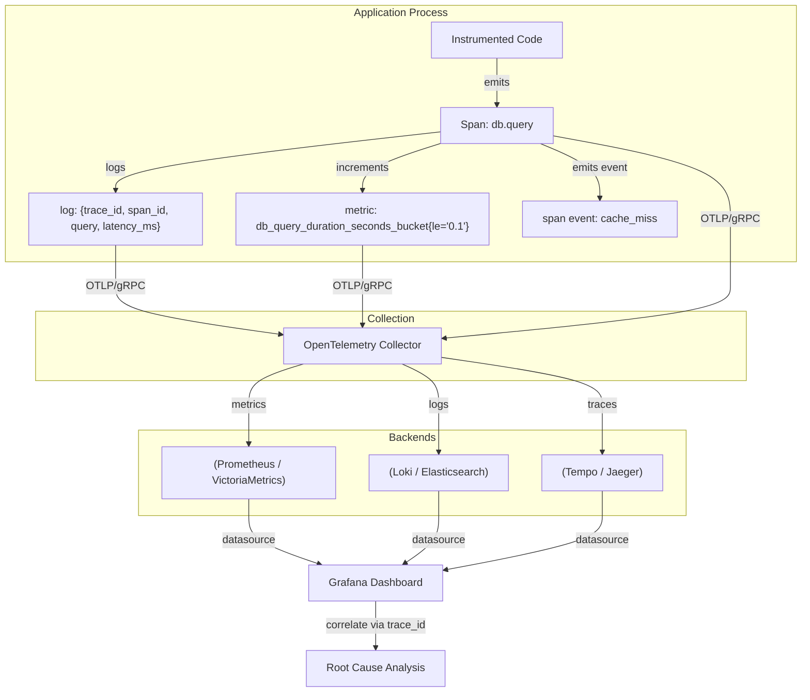
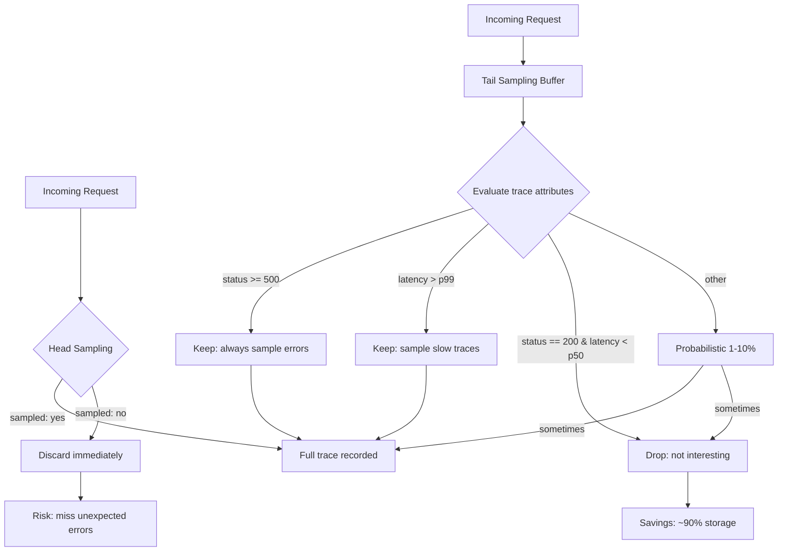
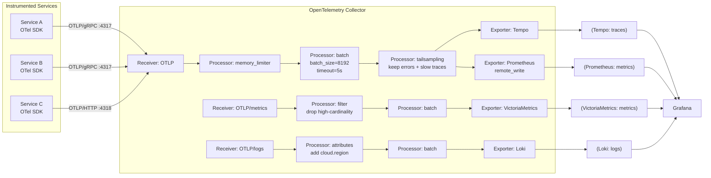
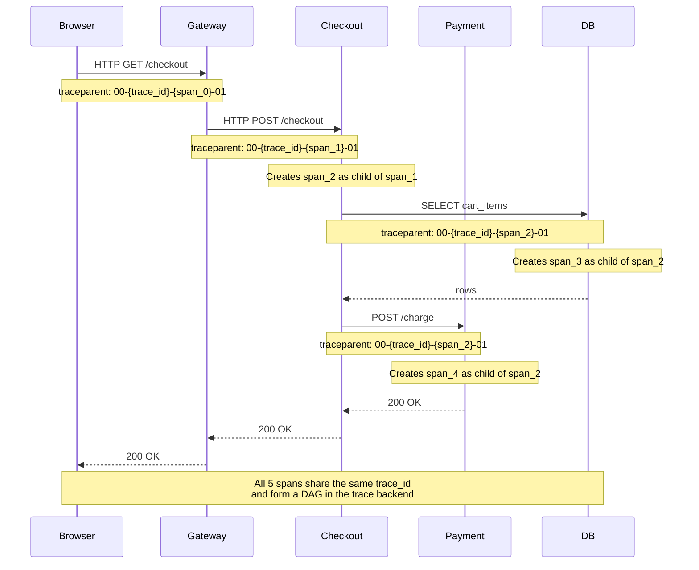
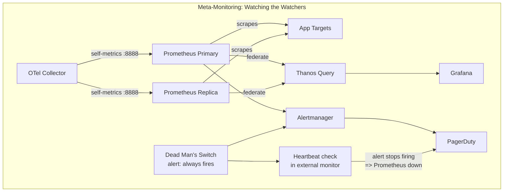
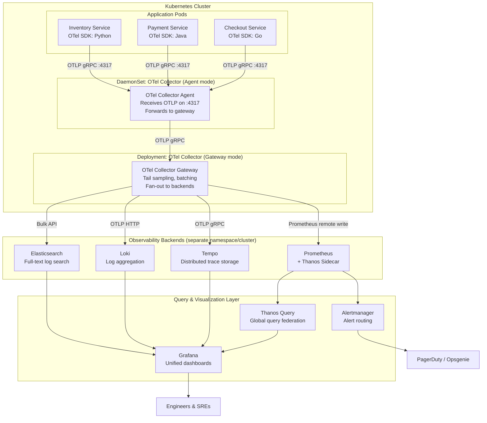

# Lesson 1: Observability — From First Principles to Production Systems

## 1. First-Principles Intuition & Invariants

### 1.1 Observability: A Control-Theoretic Foundation

The term "observability" originates from control theory, where it was formalized by Rudolf Kalman in 1960. A system is *observable* if its internal state can be reconstructed from its external outputs within a finite time window. Formally, a linear time-invariant system $\dot{x} = Ax + Bu$, $y = Cx + Du$ is observable if and only if the observability matrix $\mathcal{O} = [C; CA; CA^2; \dots; CA^{n-1}]$ has full rank $n$. If any internal mode is invisible from the outputs, the system is unobservable — no amount of output measurement will reveal that hidden state.

This mathematical foundation maps directly to distributed systems. A microservice with 12 internal subsystems (connection pools, caches, circuit breakers, queue depths, GC states) that only exposes an HTTP 200/500 response code and request latency is *partially unobservable*: multiple internal failure modes collapse into the same external signal. The operator cannot distinguish a connection pool exhaustion from a database timeout without additional instrumentation. The goal of an observability system is to maximize the observability matrix's rank — to make as many internal state dimensions as possible reconstructable from external signals.

### 1.2 Monitoring vs. Observability

Monitoring is the *practice* of collecting predefined signals and alerting on known failure modes. Observability is the *property* of a system that enables operators to ask arbitrary questions about its internal state without modifying the system's code. The distinction matters operationally:

- **Monitoring asks**: "Is the error rate above 1%?" This requires knowing in advance that error rate is a relevant signal and instrumenting for it.
- **Observability answers**: "Why did latency spike for the checkout service's calls to the payment service in us-east-1b between 14:03 and 14:07 UTC?" This requires that the system emits sufficiently rich, high-cardinality, correlated signals (traces, structured logs, metrics with dimensionality) so the question can be answered post hoc.

A monitoring system tells you *that* something is wrong. An observable system lets you discover *why*.

### 1.3 The Three Signals (Not "Pillars")

The "three pillars" framing — metrics, logs, traces — is a useful simplification but risks implying these are independent, interchangeable columns. In practice, they are correlated signals with different cost-performance tradeoffs, and the most effective observability strategies exploit their relationships:

- **Metrics**: Pre-aggregated, numeric time-series data. Low storage cost, high query performance. Low cardinality by design (label sets must be bounded). Good for alerting and dashboarding. Bad for debugging unknown unknowns because aggregation discards context.
- **Logs**: Discrete, timestamped events with arbitrary structure. High storage cost (unbounded cardinality by nature). Good for forensic debugging and audit. Bad for aggregate analysis unless indexed and structured.
- **Traces**: A specialized log structure that records the causal chain of a single request across process and service boundaries, represented as a directed acyclic graph (DAG) of spans. Moderate storage cost with sampling. Good for understanding cross-service latency and causal relationships. Bad for long-term trend analysis.

The critical insight is that a single trace span can emit a log entry, and both can increment metric counters. These are not three separate systems but three projections of the same underlying execution events, differing in aggregation level and retention.



### 1.4 Cardinality: The Central Invariant

Cardinality — the number of distinct label combinations for a metric — is the single most important invariant governing observability system design. A metric `http_requests_total` labeled with `{method, status, path, user_id, session_id}` appears to be one metric but is actually $N_\text{methods} \times N_\text{statuses} \times N_\text{paths} \times N_\text{users} \times N_\text{sessions}$ distinct time-series. With 1 million users and 50,000 active sessions, a single metric name generates billions of time-series. This is a *cardinality explosion*, and it has caused more monitoring system outages than application bugs.

The invariant: **total time-series count = product of cardinalities across all label dimensions**. Every label added to a metric multiplies its time-series count. Prometheus, InfluxDB, and similar TSDBs store each unique label set as a separate series with its own compressed buffer and index entries. Cardinality directly determines memory consumption, query scan cost, and ingestion CPU overhead.

The corollary: high-cardinality dimensions (user IDs, request IDs, session tokens, full URL paths with query parameters) belong in logs and traces, not in metric labels. Metrics should be labeled with bounded, low-cardinality dimensions: service name, HTTP method, status code class (not full status), and datacenter. The full status code, user ID, and request path live in the trace span and log entry, correlated by shared `trace_id`.

### 1.5 The Sampling Decision Tree

Sampling is the mechanism by which observability systems trade signal completeness for cost. The fundamental tradeoff:

- **Head-based sampling**: The instrumentation library decides at request entry whether to sample. The decision propagates via trace context headers (e.g., `traceparent` W3C header). Advantage: consistent — if the root span is sampled, all child spans are sampled. Disadvantage: the decision is made before the system knows whether the request is interesting (e.g., an error). You might sample 1% of traffic and miss a rare but critical error.
- **Tail-based sampling**: The trace is fully buffered until the request completes, then a sampling decision is made based on the complete trace (e.g., always sample errors, sample 1% of successes, sample traces over 500ms latency). Advantage: selective — you keep the interesting traces and drop the boring ones. Disadvantage: requires a buffering component (the collector) that holds the full trace in memory until completion, adding latency and infrastructure cost.



## 2. Core Architecture & Mechanics

### 2.1 Instrumentation: Where Signals Originate

Instrumentation is the code-level insertion of measurement points. Without it, no observability system can function — you cannot observe what is not measured. Modern instrumentation is built on OpenTelemetry (OTel), a CNCF project that provides vendor-neutral APIs, SDKs, and a wire protocol (OTLP) for emitting traces, metrics, and logs.

The architectural insight is that instrumentation should be decoupled from the backend. Code should emit OTel signals via the OTel API; the OTel SDK (configured at deployment time, not compile time) decides where to send them — Prometheus, Datadog, Honeycomb, Tempo, or any other backend. This separation means an organization can change its entire observability backend stack without touching application code.

#### Rust Example: Structured Tracing with OpenTelemetry

```rust
use opentelemetry::{
    global,
    sdk::trace::{self, TracerProvider, sampling},
    KeyValue,
};
use opentelemetry::trace::Tracer;
use opentelemetry_otlp::WithExportConfig;
use std::time::Duration;

#[tokio::main]
async fn main() -> Result<(), Box<dyn std::error::Error>> {
    // Configure OTLP exporter pointing to the collector
    let exporter = opentelemetry_otlp::new_exporter()
        .tonic()
        .with_endpoint("http://localhost:4317");

    // Tail-based sampling would be done at the collector, but we
    // configure head-based ParentBased sampling here as the default.
    let provider = TracerProvider::builder()
        .with_batch_exporter(exporter, opentelemetry_sdk::runtime::Tokio)
        .with_config(
            trace::config()
                .with_sampler(sampling::ParentBased::new(
                    sampling::TraceIdRatioBased::new(0.01), // 1% default
                ))
                .with_max_events_per_span(64)
                .with_max_attributes_per_span(128),
        )
        .build();

    global::set_tracer_provider(provider);

    let tracer = global::tracer("checkout-service");

    // Root span for an HTTP request handler
    let result = handle_checkout_request(&tracer, "user_92471", 3).await;

    // Flush pending spans before exit
    global::shutdown_tracer_provider();
    Ok(result?)
}

async fn handle_checkout_request(
    tracer: &opentelemetry::global::Tracer,
    user_id: &str,
    item_count: u32,
) -> Result<(), Box<dyn std::error::Error>> {
    let mut span = tracer.start("checkout.handle_request");
    span.set_attribute(KeyValue::new("user.id", user_id.to_string()));
    span.set_attribute(KeyValue::new("cart.item_count", item_count as i64));
    span.set_attribute(KeyValue::new("service.version", "2.4.1"));

    // Simulate database query as a child span
    {
        let mut db_span = tracer.start_with_context("db.query.cart_items", &span.context());
        db_span.set_attribute(KeyValue::new("db.system", "postgresql"));
        db_span.set_attribute(KeyValue::new("db.statement", "SELECT * FROM cart_items WHERE user_id = $1"));
        db_span.set_attribute(KeyValue::new("db.operation", "SELECT"));
        tokio::time::sleep(Duration::from_millis(42)).await;
        db_span.add_event("cache_miss", vec![
            KeyValue::new("cache.key", format!("cart:{}", user_id)),
        ]);
    }

    // Simulate payment service call
    {
        let mut pay_span = tracer.start_with_context("http.client.payment", &span.context());
        pay_span.set_attribute(KeyValue::new("http.method", "POST"));
        pay_span.set_attribute(KeyValue::new("http.url", "https://payment.internal/v3/charge"));
        pay_span.set_attribute(KeyValue::new("peer.service", "payment-service"));
        tokio::time::sleep(Duration::from_millis(180)).await;
        pay_span.set_attribute(KeyValue::new("http.status_code", 200));
    }

    span.set_attribute(KeyValue::new("checkout.success", true));
    Ok(())
}
```

#### Go Example: Metrics with Bounded Cardinality

```go
package main

import (
	"context"
	"log"
	"net/http"
	"time"

	"go.opentelemetry.io/otel"
	"go.opentelemetry.io/otel/attribute"
	"go.opentelemetry.io/otel/exporters/otlp/otlpmetric/otlpmetricgrpc"
	"go.opentelemetry.io/otel/metric"
	"go.opentelemetry.io/otel/sdk/metric/aggregation"
	sdkmetric "go.opentelemetry.io/otel/sdk/metric"
)

// Cardinality-safe labels: bounded enumerations only.
// Never include user_id, session_id, request_id, or full URL path as metric labels.
func setupMeter(ctx context.Context) (*sdkmetric.MeterProvider, error) {
	exporter, err := otlpmetricgrpc.New(ctx,
		otlpmetricgrpc.WithEndpoint("localhost:4317"),
		otlpmetricgrpc.WithInsecure(),
	)
	if err != nil {
		return nil, err
	}

	// Configure explicit bucket boundaries for histogram latency metrics.
	// These should match your SLO thresholds, not arbitrary defaults.
	latencyBuckets := aggregation.ExplicitBucketHistogram{
		Boundaries: []float64{0.005, 0.01, 0.025, 0.05, 0.1, 0.25, 0.5, 1.0, 2.5, 5.0, 10.0},
	}

	provider := sdkmetric.NewMeterProvider(
		sdkmetric.WithReader(
			sdkmetric.NewPeriodicReader(exporter,
				sdkmetric.WithInterval(15*time.Second),
			),
		),
		// Custom view to control histogram bucket boundaries
		sdkmetric.WithView(sdkmetric.NewView(
			sdkmetric.Instrument{Name: "http.server.request.duration"},
			sdkmetric.Stream{Aggregation: latencyBuckets},
		)),
	)
	otel.SetMeterProvider(provider)
	return provider, nil
}

type responseRecorder struct {
	http.ResponseWriter
	statusCode int
}

func (r *responseRecorder) WriteHeader(code int) {
	r.statusCode = code
	r.ResponseWriter.WriteHeader(code)
}

func instrumentHandler(meter metric.Meter, next http.Handler) http.Handler {
	requests := must(meter.Int64Counter("http.server.request.count",
		metric.WithDescription("Total HTTP requests received"),
	))
	duration := must(meter.Float64Histogram("http.server.request.duration",
		metric.WithDescription("HTTP request duration in seconds"),
		metric.WithUnit("s"),
	))
	inFlight := must(meter.Int64UpDownCounter("http.server.request.in_flight",
		metric.WithDescription("In-flight HTTP requests"),
	))

	return http.HandlerFunc(func(w http.ResponseWriter, r *http.Request) {
		start := time.Now()
		rec := &responseRecorder{ResponseWriter: w, statusCode: 200}

		inFlight.Add(r.Context(), 1)

		// Bounded labels: method (9 values), route pattern (finite set),
		// status class (5xx, 4xx, 2xx, 3xx — NOT full status code).
		next.ServeHTTP(rec, r)

		inFlight.Add(r.Context(), -1)

		attrs := []attribute.KeyValue{
			attribute.String("http.method", r.Method),
			attribute.String("http.route", routePattern(r)), // /users/:id, not /users/92471
			attribute.String("http.status_class", statusClass(rec.statusCode)),
		}

		requests.Add(r.Context(), 1, metric.WithAttributes(attrs...))
		duration.Record(r.Context(), time.Since(start).Seconds(),
			metric.WithAttributes(attrs...))
	})
}

func statusClass(code int) string {
	switch {
	case code >= 500:
		return "5xx"
	case code >= 400:
		return "4xx"
	case code >= 300:
		return "3xx"
	default:
		return "2xx"
	}
}

func routePattern(r *http.Request) string {
	// Return the matched route template, not the actual path.
	// In a real system, extract this from the router (e.g., chi, gorilla, gin).
	return r.URL.Path // placeholder — replace with router's pattern
}

func must[T any](v T, err error) T {
	if err != nil {
		log.Fatalf("metric creation failed: %v", err)
	}
	return v
}
```

#### Python Example: Structured Logging with Trace Correlation

```python
import logging
import json
import sys
from opentelemetry import trace, propagate
from opentelemetry.exporter.otlp.proto.grpc.trace_exporter import OTLPSpanExporter
from opentelemetry.sdk.resources import Resource
from opentelemetry.sdk.trace import TracerProvider
from opentelemetry.sdk.trace.export import BatchSpanProcessor
from opentelemetry.trace import Status, StatusCode

# Structured JSON logger that automatically injects trace context.
# Every log line carries trace_id and span_id so it can be
# correlated with traces in the backend (e.g., Tempo, Jaeger).
class TraceContextJSONFormatter(logging.Formatter):
    def format(self, record: logging.LogRecord) -> str:
        span = trace.get_current_span()
        span_context = span.get_span_context()

        log_entry = {
            "timestamp": self.formatTime(record, self.datefmt),
            "level": record.levelname,
            "logger": record.name,
            "message": record.getMessage(),
            "service.name": getattr(record, "service_name", "unknown"),
        }

        if span_context and span_context.is_valid:
            log_entry["trace_id"] = format(span_context.trace_id, "032x")
            log_entry["span_id"] = format(span_context.span_id, "016x")

        # Include any extra fields attached to the record
        for key, value in record.__dict__.items():
            if key not in {
                "name", "msg", "args", "levelname", "levelno",
                "pathname", "filename", "module", "exc_info",
                "exc_text", "stack_info", "lineno", "funcName",
                "created", "msecs", "relativeCreated", "thread",
                "threadName", "processName", "process", "message",
                "service_name", "asctime",
            }:
                log_entry[key] = value

        if record.exc_info:
            log_entry["exception"] = self.formatException(record.exc_info)

        return json.dumps(log_entry, default=str)


def setup_observability(service_name: str, service_version: str) -> TracerProvider:
    resource = Resource.create({
        "service.name": service_name,
        "service.version": service_version,
        "deployment.environment": "production",
    })

    provider = TracerProvider(resource=resource)
    exporter = OTLPSpanExporter(endpoint="localhost:4317", insecure=True)
    provider.add_span_processor(
        BatchSpanProcessor(
            exporter,
            max_queue_size=2048,
            max_export_batch_size=512,
            export_timeout_millis=5000,
        )
    )
    trace.set_tracer_provider(provider)

    # Configure structured logging
    handler = logging.StreamHandler(sys.stdout)
    handler.setFormatter(TraceContextJSONFormatter(datefmt="%Y-%m-%dT%H:%M:%S"))
    root_logger = logging.getLogger()
    root_logger.handlers = [handler]
    root_logger.setLevel(logging.INFO)

    return provider


# Example usage with trace correlation
def process_payment(order_id: str, amount_cents: int):
    tracer = trace.get_tracer(__name__)
    with tracer.start_as_current_span("payment.process") as span:
        span.set_attribute("order.id", order_id)
        span.set_attribute("payment.amount_cents", amount_cents)
        span.set_attribute("payment.currency", "USD")

        logger = logging.getLogger("payment")

        try:
            # The log below will automatically include trace_id and span_id
            # because the span is active in the current context.
            logger.info(
                "Processing payment",
                extra={
                    "service_name": "payment-service",
                    "order_id": order_id,
                    "amount_cents": amount_cents,
                }
            )

            # Simulate external API call as a child span
            with tracer.start_as_current_span("stripe.charge") as stripe_span:
                stripe_span.set_attribute("stripe.customer_id", "cus_abc123")
                logger.info(
                    "Stripe charge initiated",
                    extra={"service_name": "payment-service"},
                )
                # ... call Stripe API ...
                stripe_span.set_attribute("stripe.charge_id", "ch_xyz789")

            span.set_status(Status(StatusCode.OK))
            logger.info("Payment completed successfully",
                       extra={"service_name": "payment-service"})

        except Exception as e:
            span.record_exception(e)
            span.set_status(Status(StatusCode.ERROR, str(e)))
            logger.error(
                "Payment failed",
                exc_info=True,
                extra={"service_name": "payment-service", "order_id": order_id},
            )
            raise
```

### 2.2 The OpenTelemetry Collector: Central Nervous System

The OpenTelemetry Collector is the architectural keystone of a modern observability pipeline. It decouples instrumentation from backend systems, providing a single binary that accepts telemetry in multiple formats (OTLP, Jaeger, Prometheus, Zipkin), processes it (filtering, sampling, enrichment, batching), and exports to multiple backends simultaneously.

The collector's pipeline model has three stages:

1. **Receivers**: Accept data. Each receiver implements a specific protocol (OTLP gRPC on :4317, OTLP HTTP on :4318, Jaeger Thrift on :14250, Prometheus scraping on :8888).
2. **Processors**: Transform data in-flight. Examples: `batch` (groups spans for efficient export), `memory_limiter` (prevents OOM kills), `filter` (drops noisy spans), `attributes` (enriches spans with metadata like cloud region), `tailsampling` (implements tail-based sampling).
3. **Exporters**: Send data to backends. Each exporter targets a specific storage system (Prometheus remote write, Elasticsearch, Tempo, Datadog, etc.).



#### Collector Configuration (Production-Grade)

```yaml
# otel-collector-config.yaml
receivers:
  otlp:
    protocols:
      grpc:
        endpoint: 0.0.0.0:4317
        max_recv_msg_size_mib: 16
      http:
        endpoint: 0.0.0.0:4318

processors:
  # Guard against memory exhaustion. The collector monitors its own
  # heap usage and drops data before OOM. Configure based on container limits.
  memory_limiter:
    check_interval: 1s
    limit_mib: 1800        # ~80% of a 2Gi container limit
    spike_limit_mib: 200

  # Batch spans before export to reduce network round-trips.
  # Larger batches = better throughput, higher latency.
  batch:
    timeout: 5s
    send_batch_size: 8192
    send_batch_max_size: 16384

  # Tail-based sampling: buffer complete traces, then decide.
  # This processor requires significant memory — each in-flight
  # trace is held until all spans arrive or the decision timeout fires.
  tailsampling:
    decision_wait: 30s
    num_traces: 50000           # ring buffer size for in-flight traces
    expected_new_traces_per_sec: 1000
    policies:
      # Always keep errors
      - name: errors
        type: status_code
        status_code:
          status_codes: [ERROR]
      # Always keep slow traces (>1s total duration)
      - name: slow
        type: latency
        latency:
          threshold_ms: 1000
      # Probabilistic 10% of the rest
      - name: probabilistic
        type: probabilistic
        probabilistic:
          sampling_percentage: 10

  # Enrich all spans with deployment metadata
  resource:
    attributes:
      - key: cloud.region
        value: "us-east-1"
        action: upsert
      - key: deployment.environment
        value: "production"
        action: upsert

  # Drop high-cardinality metric labels before they reach the backend
  filter:
    error_mode: ignore
    metrics:
      metric:
        - 'attributes["user_id"] != ""'  # Drop any metric with user_id label

exporters:
  otlp/tempo:
    endpoint: tempo:4317
    tls:
      insecure: true

  prometheusremotewrite:
    endpoint: http://prometheus:9090/api/v1/write
    resource_to_telemetry_conversion:
      enabled: true

  otlphttp/loki:
    endpoint: http://loki:3100/otlp
    tls:
      insecure: true

service:
  pipelines:
    traces:
      receivers: [otlp]
      processors: [memory_limiter, resource, batch, tailsampling]
      exporters: [otlp/tempo]

    metrics:
      receivers: [otlp]
      processors: [memory_limiter, filter, resource, batch]
      exporters: [prometheusremotewrite]

    logs:
      receivers: [otlp]
      processors: [memory_limiter, resource, batch]
      exporters: [otlphttp/loki]
```

### 2.3 Time-Series Database Internals: Why Cardinality Matters

Understanding TSDB internals clarifies why cardinality is the dominant cost factor. Consider Prometheus's storage model:

1. Each unique label set (e.g., `http_requests_total{method="GET",status="200",route="/checkout"}`) is a distinct **series**.
2. Each series has a fixed-size **chunk** — a compressed array of (timestamp, value) pairs using Gorilla-style delta-of-delta timestamp encoding and XOR value encoding. A typical chunk holds ~120 samples at 15-second scrape intervals (30 minutes of data).
3. Each series has an entry in the **inverted index** (series index), which maps label name+value pairs to sets of series IDs. When you query `http_requests_total{method="GET"}`, the index intersects the series ID sets for `__name__="http_requests_total"` and `method="GET"`.

Memory consumption is approximately:
$$\text{Memory} \approx N_{\text{series}} \times (S_{\text{chunk}} + S_{\text{index}})$$

Where $S_{\text{chunk}}$ is roughly 1-2 KB per active chunk and $S_{\text{index}}$ is 50-100 bytes per label pair per series. With 10 million series (achievable with a single high-cardinality label), memory consumption can exceed 20 GB just for the index, before any actual data points are stored.

This is why VictoriaMetrics introduced `vmselect` with merge caching and why M3DB, Thanos, and Cortex all focus on horizontal sharding of series across nodes — none of these solve the cardinality problem; they distribute it.

### 2.4 Distributed Tracing: Context Propagation

Distributed tracing's core mechanism is **context propagation** — the passing of trace and span identifiers across process boundaries so that spans from different services can be stitched into a single trace DAG.

The W3C Trace Context specification defines the `traceparent` header:

```
traceparent: 00-0af7651916cd43dd8448eb211c80319c-b7ad6b7169203331-01
             version-trace_id                  -parent_span_id-flags
```

- `version`: Currently `00`.
- `trace_id`: 128-bit hex string (32 chars). Shared across all spans in a trace.
- `parent_span_id`: 64-bit hex string (16 chars). The ID of the span that created this downstream call.
- `flags`: 8-bit. Bit 0 (`01`) indicates the trace is sampled.

When Service A calls Service B, Service A's OTel SDK injects this header into the outgoing HTTP request. Service B's OTel SDK extracts it, creates a new span that is a child of the parent, and the trace continues. The critical invariant: **if context propagation is broken at any hop, the trace is fragmented** — Service B's spans will appear as an independent trace with no relationship to Service A's call.



#### Python: Manual Context Propagation (for Non-HTTP Transports)

```python
from opentelemetry import trace, propagate
from opentelemetry.trace import SpanContext, TraceFlags, TraceState

# When sending a message to a queue (SQS, Kafka, RabbitMQ),
# you must manually inject and extract the trace context
# because the messaging SDK does not know about OTel headers.

def publish_to_queue(producer, topic: str, payload: bytes):
    """Inject trace context into message headers before sending."""
    headers = {}
    # propagate.inject serializes the active span context into the
    # carrier dict using W3C Trace Context format.
    propagate.inject(headers)

    # headers now contains: {
    #   "traceparent": "00-<trace_id>-<span_id>-01",
    #   "tracestate": "vendor=value,..."  (optional)
    # }

    producer.send(topic, value=payload, headers=headers)


def consume_from_queue(consumer):
    """Extract trace context from message headers on receive."""
    for msg in consumer:
        # propagate.extract reconstructs the SpanContext from
        # the traceparent header and sets it as the active context.
        ctx = propagate.extract(msg.headers)

        # Start a new span as a child of the extracted context.
        tracer = trace.get_tracer(__name__)
        with tracer.start_as_current_span("kafka.process_message", context=ctx) as span:
            span.set_attribute("messaging.system", "kafka")
            span.set_attribute("messaging.destination", msg.topic)
            span.set_attribute("messaging.message_id", msg.key)

            # Process the message. Any spans created here will be
            # children of this span, continuing the original trace.
            process_message(msg.value)
```

### 2.5 Prometheus Pull Model vs. Push Model

Prometheus uses a pull-based scrape model: the Prometheus server actively fetches metrics from targets at configured intervals. This is a deliberate architectural choice with specific tradeoffs:

**Pull model (Prometheus):**
- Prometheus knows which targets exist via service discovery (Kubernetes endpoints, Consul, EC2 tags, DNS SRV records).
- Each target exposes a `/metrics` endpoint returning text-format metrics.
- Prometheus scrapes on a fixed interval (default 15s), with a scrape timeout.
- If a target is down, the scrape fails and `up{instance="..."} = 0` — this is itself a signal.
- Time alignment: all series for a given scrape share the same timestamp (the scrape time), simplifying aggregation queries.

**Push model (StatsD, InfluxDB Telegraf, Datadog Agent):**
- Each instrumented process pushes metrics to a central agent/gateway.
- Advantage: works behind network barriers (NAT, firewalls) where Prometheus cannot reach the target.
- Disadvantage: the backend doesn't know about targets until they push. If a target stops pushing, the backend has no explicit "target down" signal — it must infer absence via staleness checks.
- Disadvantage: timestamps are set by the client, not the backend, so clock skew between clients complicates time alignment.

OpenTelemetry's OTLP protocol is push-based, but the OTel Collector can bridge to Prometheus via the `prometheus` exporter (exposing a `/metrics` endpoint for Prometheus to scrape) or via `prometheusremotewrite` (pushing to Prometheus's remote write endpoint). This lets you use OTel instrumentation (push from app to collector) while keeping Prometheus's pull model (collector exposes metrics endpoint for Prometheus to scrape).

## 3. High-Performance Optimization & Failure Modes

### 3.1 The Observability Cost Spiral

Observability systems are subject to a unique cost dynamic: the more successful the system becomes, the more it costs. As a service scales from 1,000 requests/second to 100,000 requests/second, observability data volume scales proportionally. Unlike application infrastructure, which benefits from economies of scale (a single Kubernetes node handles more pods with minimal marginal cost), observability data is additive — 100x more requests means 100x more spans, log lines, and metric data points.

The optimization strategies, in order of impact:

1. **Sampling** (tail-based, 90-99% reduction for traces): The most impactful lever. Tail-based sampling at 1% of successful traces, 100% of errors, and 100% of slow traces can reduce trace storage by 95% while preserving diagnostic value.
2. **Cardinality control** (metrics, 90%+ reduction): Removing a single high-cardinality label (e.g., `user_id` with 1M distinct values) from a metric eliminates 1M time-series. This is often the difference between a 2 GB and a 20 GB Prometheus instance.
3. **Log level management** (logs, 80%+ reduction): Sending DEBUG/INFO logs to a low-retention tier (1-3 days) and WARNING/ERROR logs to a high-retention tier (30-90 days). Most log storage costs come from INFO-level logs that are rarely queried.
4. **Retention tiers** (all signals, 50-70% reduction): Hot tier (7 days, fast SSD) for active debugging, warm tier (30 days, compressed) for recent incident analysis, cold tier (1 year, object storage) for compliance. Prometheus's `--storage.tsdb.retention.time` flag and Tempo's `retention` config implement this.
5. **Pre-aggregation** (metrics, 95%+ reduction): Recording rules in Prometheus pre-compute frequently-queried aggregations (e.g., `rate(http_requests_total[5m])` by service) so dashboards query the pre-computed result instead of scanning raw data.

### 3.2 Failure Mode: Cardinality Explosion

**Symptoms**: Prometheus memory grows unbounded until OOM kill. Query latency degrades to minutes. Scrape duration exceeds scrape timeout.

**Root cause**: A new label was added to a metric with an unbounded value space (user ID, email address, full request URL, container IP). Each new value creates a new time-series. With 1M users and a 15s scrape interval, a single metric with `user_id` as a label generates 1M series × 4 data points/minute = 4M data points/minute.

**Detection**: Prometheus exposes `prometheus_tsdb_head_series` (active series count) and `prometheus_tsdb_head_samples_appended_total` (ingestion rate). Alert when series count exceeds a threshold (e.g., 1M for a single instance). Use `topk(10, count by (__name__)({__name__=~".+"}))` to find the metrics with the most series.

**Mitigation**:

```promql
# Find the metric with the most label value combinations
topk(10, count by (__name__)({__name__=~".+"}))

# Find which label is causing the explosion
topk(10, count by (user_id)({__name__="http_requests_total"}))
```

Remove the high-cardinality label from the metric definition. If the information is needed, move it to structured logs or trace span attributes where it does not multiply time-series count.

### 3.3 Failure Mode: Trace Context Loss

**Symptoms**: Traces in Jaeger/Tempo appear fragmented. A request that traverses 5 services shows only 3 of them in the trace. The trace appears to start in the middle of the call chain.

**Root causes**:
1. Missing context injection on outbound calls (HTTP client, gRPC client, message producer).
2. Missing context extraction on inbound calls (HTTP server, gRPC server, message consumer).
3. Context propagation blocked by a proxy or load balancer that strips unknown headers.
4. Asynchronous boundary without context propagation (e.g., `asyncio.create_task` in Python, `go func()` in Go, thread pool in Java without context attachment).

**Detection**: Compare the trace's expected span count (known from service topology) with the actual span count. Alert when a trace has fewer spans than the minimum expected for a given endpoint.

**Mitigation**: The Go example below shows the correct pattern for propagating context through goroutines:

```go
import (
    "context"
    "go.opentelemetry.io/otel/trace"
)

func handleRequest(ctx context.Context, orderID string) {
    tracer := otel.Tracer("order-service")
    ctx, span := tracer.Start(ctx, "order.process")

    // CRITICAL: Pass ctx to the goroutine. The trace context
    // is embedded in ctx. Without it, the goroutine's spans
    // will be orphaned — they'll create a new trace.
    go processPayment(ctx, orderID)

    // If you need to detach the span lifecycle from the request:
    // Use trace.ContextWithSpan(ctx, nil) to create a context
    // that carries trace context but does not create a parent span.
    go func() {
        detachedCtx := trace.ContextWithSpan(ctx, trace.SpanFromContext(ctx))
        sendNotification(detachedCtx, orderID)
    }()

    span.End()
}

func processPayment(ctx context.Context, orderID string) {
    tracer := otel.Tracer("order-service")
    _, span := tracer.Start(ctx, "payment.process")
    defer span.End()

    // This span will be a child of "order.process" because
    // ctx carries the parent span context.
    span.SetAttribute("order.id", orderID)
}
```

### 3.4 Failure Mode: Monitoring System Observability

The meta-failure: the monitoring system itself is unobservable. If Prometheus is down, no alerts fire. If the OTel Collector is dropping data due to memory pressure, you lose traces during the exact incidents you need them most.

**Mitigations**:
- The OTel Collector exposes its own metrics on port 8888 (`otelcol_receiver_accepted_spans`, `otelcol_receiver_refused_spans`, `otelcol_exporter_sent_spans`, `otelcol_processor_dropped_spans`). Monitor these with a *separate* Prometheus instance or a simple health check.
- Run Prometheus in high-availability mode (two instances behind a load balancer, both scraping the same targets, using Thanos/Cortex for deduplication).
- Set up "meta-alerts": alert on `prometheus_tsdb_head_series` exceeding 80% of configured limit, alert on `up{job="prometheus"} == 0`, alert on collector `refused_spans > 0`.
- Use a "dead man's switch" alert: a continuously firing alert monitored by an external service (e.g., AWS CloudWatch, PagerDuty heartbeat). If the alert stops firing, the external service notifies on-call — it means Prometheus is down.



### 3.5 SLOs: From Observability to Reliability

Service Level Objectives (SLOs) transform observability data into actionable reliability targets. An SLO defines a target reliability for a specific user journey: "99.9% of checkout requests complete in under 500ms over any 30-day window."

The architectural relationship:

- **SLI (Service Level Indicator)**: A metric derived from observability data. For latency: the ratio of requests under the threshold to total requests. For availability: the ratio of successful HTTP responses to total responses.
- **SLO (Service Level Objective)**: A target for the SLI over a time window. "99.9% of requests succeed" over 30 days.
- **Error Budget**: `1 - SLO target`. If SLO is 99.9%, the error budget is 0.1%. This budget is the rate of failures the service is *allowed* to have. When budget is exhausted, development should prioritize reliability over new features.

```promql
# SLI: percentage of successful requests in the last 5 minutes
sum(rate(http_requests_total{status_class!~"5xx"}[5m]))
/
sum(rate(http_requests_total[5m]))

# Error budget burn rate: how fast we're consuming the monthly error budget
# Alert if burning >14.4x the monthly budget in 1 hour (fires quickly for major outages)
# or >6x the monthly budget in 6 hours (fires for sustained degradation)
(
  sum(rate(http_requests_total{status_class=~"5xx"}[1h]))
  /
  sum(rate(http_requests_total[1h]))
) > (1 - 0.999) * 14.4
```

The multi-window, multi-burn-rate alerting strategy (popularized by Google SRE) uses two alert conditions simultaneously: a short window for fast detection (e.g., 1 hour at 14.4x burn rate) and a long window for confirmation (e.g., 6 hours at 6x burn rate). Both must be true to fire, reducing false positives while maintaining detection speed.

### 3.6 Concurrency Considerations in Instrumentation

Instrumentation code runs on the hot path of every request. Poorly designed instrumentation can introduce contention that degrades the very system it monitors.

Key considerations:

- **Counter increments** must be atomic. OpenTelemetry SDK implementations use lock-free atomic operations (CAS loops) for counter updates. The Go SDK uses `sync/atomic` or `uint64` alignment; the Java SDK uses `LongAdder` (striped counters that reduce contention under high parallelism).
- **Span creation** involves allocating span objects, generating span IDs (random 8-byte values), and copying context. Under high throughput (100k+ requests/second per process), span allocation can dominate allocation pressure. The OTel SDK uses object pools to mitigate this.
- **Export queue**: The SDK's `BatchSpanProcessor` accumulates completed spans in a bounded queue and flushes them in batches. If the queue fills (because the exporter is slow or the backend is unreachable), spans are dropped. The `max_queue_size` and `max_export_batch_size` parameters control this. Under backpressure, the SDK should log a warning and drop spans rather than blocking the application's request path.

```java
// Java: Configuring the OTel SDK for high-throughput scenarios
BatchSpanProcessor spanProcessor = BatchSpanProcessor.builder(otlpExporter)
    .setMaxQueueSize(16384)           // Large buffer to absorb bursts
    .setMaxExportBatchSize(2048)      // Large batches for throughput
    .setExporterTimeout(Duration.ofSeconds(10))
    .setScheduleDelay(Duration.ofSeconds(2))
    .build();

// Critical: set a timeout on export so a slow backend
// does not cause unbounded queue growth. The SDK will
// drop spans when the queue is full and log a warning.
```

## 4. Architecture Patterns: Reference Deployment

The following diagram shows a production-grade observability architecture for a Kubernetes-based microservices platform:



### Agent vs. Gateway Collector Topology

The two-tier collector topology (agent + gateway) is the recommended pattern for production:

1. **Agent tier (DaemonSet)**: One collector per node, running as a DaemonSet. Application pods send telemetry to the local agent via `localhost:4317`. The agent does minimal processing (memory limiting, batching) and forwards to the gateway. This tier exists to buffer against network partitions and reduce the number of outbound connections from application pods.

2. **Gateway tier (Deployment)**: A horizontally scalable deployment of collectors, fronted by a load balancer (Kubernetes Service). The gateway performs heavy processing: tail-based sampling, metric filtering, resource enrichment. It fans out to multiple backends. Scale the gateway by adding replicas; the load balancer distributes traces by trace ID hash to ensure all spans of a trace reach the same gateway instance (required for tail-based sampling).

The critical constraint for tail sampling: all spans for a given trace must reach the same collector instance within the `decision_wait` window. Use trace ID-based load balancing (hash the trace ID, route to a consistent gateway pod) or use a shared state store (Redis) for distributed trace assembly.

## 5. Summary

Observability is a property of a system, not a tool. It is achieved through deliberate instrumentation that exposes internal state as correlated signals — metrics for aggregate trends and alerting, logs for discrete events and audit, traces for causal request flow analysis. The architecture that delivers this involves application-level instrumentation via OpenTelemetry SDKs, a collector pipeline for processing and routing, and specialized backends optimized for each signal type.

The dominant cost driver is cardinality: every label added to a metric multiplies its time-series count, and unbounded label values (user IDs, request IDs) can cause storage exhaustion orders of magnitude faster than data volume growth. Sampling — particularly tail-based sampling for traces — is the primary cost reduction lever, achieving 90%+ reduction while preserving diagnostic value for errors and anomalies.

The monitoring system itself must be observable. Without meta-monitoring (collector self-metrics, dead man's switch alerts, replicated Prometheus with federation), the observability infrastructure becomes a single point of failure for incident detection — the exact scenario it exists to prevent.
