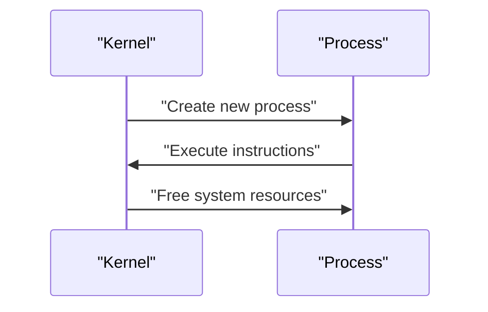

# Lesson 2: Core Architecture & Memory/Execution Models

## 1. Process, Threading & Execution Lifecycles

In the realm of operating systems, a process is an abstract entity that represents a program in execution. It is the fundamental unit of execution, and its lifecycle is governed by a series of well-defined states. A process is created when a new program is launched, and it undergoes a series of transitions from the `NEW` state to the `RUNNING` state, where it executes its instructions. The process lifecycle is managed by the kernel, which provides a set of system calls that allow processes to interact with the operating system.

At the heart of process management lies the concept of threads. A thread is a lightweight process that shares the same memory space as its parent process. Threads are created using the `pthread_create` system call, and they can be scheduled independently of their parent process. The kernel uses a scheduling algorithm, such as the Completely Fair Scheduler (CFS), to allocate CPU time to threads based on their priority and other factors.

The execution lifecycle of a process is a critical aspect of operating system design. It involves a series of transitions between different states, including `NEW`, `RUNNING`, `SLEEPING`, and `ZOMBIE`. The kernel uses a combination of system calls and kernel data structures to manage the process lifecycle, ensuring that processes are created, executed, and terminated in a controlled and efficient manner.

```c
// Example of process creation using the fork system call
int main() {
    pid_t pid = fork();
    if (pid == 0) {
        // Child process
        printf("Hello from child process!\n");
    } else if (pid > 0) {
        // Parent process
        printf("Hello from parent process!\n");
    } else {
        // Error handling
        printf("Error creating process!\n");
    }
    return 0;
}
```

## 2. Memory Subsystems & Buffer Management

Memory is a critical resource in modern computing systems, and its management is a complex task that involves multiple subsystems and data structures. The memory hierarchy consists of several levels, including the CPU cache, main memory, and storage devices such as hard drives and solid-state drives.

The kernel uses a combination of system calls and kernel data structures to manage memory allocation and deallocation. The `malloc` and `free` system calls are used to allocate and deallocate memory blocks, respectively. The kernel also uses a data structure known as the `page table` to manage memory mapping and protection.

Buffer management is a critical aspect of memory management, as it involves the allocation and deallocation of memory blocks to store data temporarily. The kernel uses a data structure known as the `buffer cache` to manage buffer allocation and deallocation.

```c
// Example of memory allocation using the malloc system call
int main() {
    void* ptr = malloc(1024);
    if (ptr == NULL) {
        // Error handling
        printf("Error allocating memory!\n");
    } else {
        // Memory allocation successful
        printf("Memory allocated successfully!\n");
    }
    return 0;
}
```

## 3. Data Structures & On-Disk/In-Kernel Binary Layouts

Data structures are a critical aspect of operating system design, as they provide a way to organize and manage data efficiently. The kernel uses a variety of data structures, including arrays, linked lists, and trees, to manage system resources and data.

On-disk binary layouts refer to the format in which data is stored on storage devices such as hard drives and solid-state drives. The kernel uses a variety of on-disk formats, including the ext2 and ext4 file systems, to store data on storage devices.

In-kernel binary layouts refer to the format in which data is stored in kernel memory. The kernel uses a variety of in-kernel formats, including the `inode` and `dentry` data structures, to store metadata and other data in kernel memory.

```c
// Example of a simple linked list data structure
struct node {
    int data;
    struct node* next;
};

struct node* head = NULL;

void add_node(int data) {
    struct node* new_node = malloc(sizeof(struct node));
    new_node->data = data;
    new_node->next = head;
    head = new_node;
}
```

## 4. The Critical Execution Lifecycle

The critical execution lifecycle refers to the sequence of events that occur when a process is executed by the kernel. It involves a series of transitions between different states, including `NEW`, `RUNNING`, `SLEEPING`, and `ZOMBIE`.

The kernel uses a combination of system calls and kernel data structures to manage the critical execution lifecycle. The `fork` system call is used to create a new process, while the `exec` system call is used to execute a new program. The kernel also uses a data structure known as the `process table` to manage process execution.

```c
// Example of process execution using the fork and exec system calls
int main() {
    pid_t pid = fork();
    if (pid == 0) {
        // Child process
        execl("/bin/ls", "ls", NULL);
    } else if (pid > 0) {
        // Parent process
        printf("Hello from parent process!\n");
    } else {
        // Error handling
        printf("Error creating process!\n");
    }
    return 0;
}
```

This concludes Lesson 2: Core Architecture & Memory/Execution Models. In the next lesson, we will explore the topic of observability and how to instrument systems for monitoring and debugging.

### Diagrams

```mermaid
graph TD;
    A[Process Creation] -->| "Create new process" | B[Process Execution];
    B -->| "Execute instructions" | C[Process Termination];
    C -->| "Free system resources" | D[Process Table];
```



### Code Examples

```c
// Example of process creation using the fork system call
int main() {
    pid_t pid = fork();
    if (pid == 0) {
        // Child process
        printf("Hello from child process!\n");
    } else if (pid > 0) {
        // Parent process
        printf("Hello from parent process!\n");
    } else {
        // Error handling
        printf("Error creating process!\n");
    }
    return 0;
}
```

```c
// Example of memory allocation using the malloc system call
int main() {
    void* ptr = malloc(1024);
    if (ptr == NULL) {
        // Error handling
        printf("Error allocating memory!\n");
    } else {
        // Memory allocation successful
        printf("Memory allocated successfully!\n");
    }
    return 0;
}
```

```c
// Example of a simple linked list data structure
struct node {
    int data;
    struct node* next;
};

struct node* head = NULL;

void add_node(int data) {
    struct node* new_node = malloc(sizeof(struct node));
    new_node->data = data;
    new_node->next = head;
    head = new_node;
}
```

```c
// Example of process execution using the fork and exec system calls
int main() {
    pid_t pid = fork();
    if (pid == 0) {
        // Child process
        execl("/bin/ls", "ls", NULL);
    } else if (pid > 0) {
        // Parent process
        printf("Hello from parent process!\n");
    } else {
        // Error handling
        printf("Error creating process!\n");
    }
    return 0;
}
```
