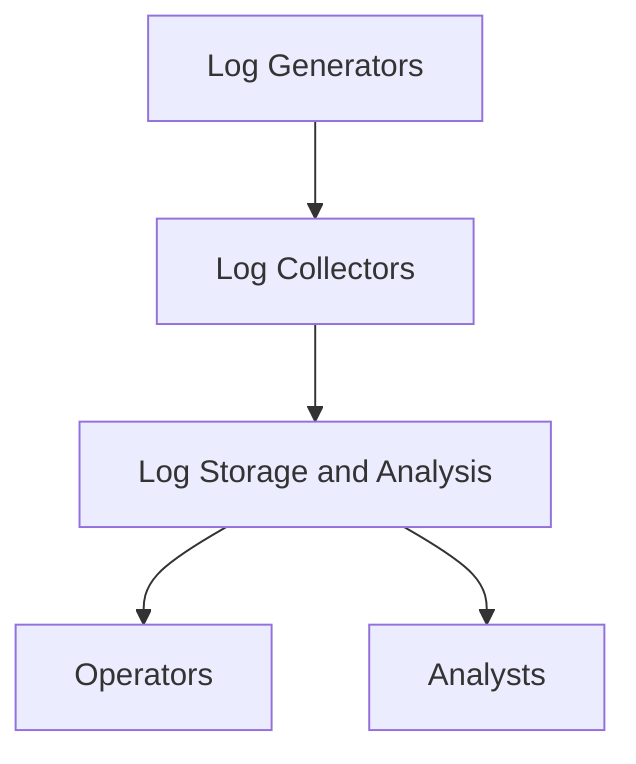

# Lesson 2: Logging Architectures

## 1. First-Principles Intuition & Invariants

Logging is a fundamental aspect of observability in modern software systems, serving as the primary means by which developers and operators gain insights into the behavior and state of applications and infrastructure. At its core, logging is about capturing and storing information about events that occur within a system, enabling post-mortem analysis, real-time monitoring, and proactive issue resolution. The problem space of logging is vast, encompassing diverse requirements such as high throughput, low latency, reliability, and scalability. These requirements are often at odds with one another, necessitating a deep understanding of the underlying system invariants and trade-offs.

To establish a first-principles intuition, we must consider the fundamental invariants of logging systems. Firstly, logs must be reliable and durable, ensuring that critical information is not lost in the event of system failures. Secondly, logs must be efficient, with minimal impact on the performance of the system being monitored. Thirdly, logs must be searchable and analyzable, allowing operators to extract meaningful insights from the vast volumes of data generated. Lastly, logs must be secure, protecting sensitive information from unauthorized access.

The mathematical and system invariants of logging systems can be understood through the lens of information theory and distributed systems. Information theory provides a framework for understanding the entropy and redundancy of log data, while distributed systems theory offers insights into the challenges of log aggregation and storage in large-scale environments. For instance, the Shannon entropy of log data can be used to quantify the amount of information contained within a log message, while the Raft consensus algorithm can be leveraged to ensure the reliability and durability of log storage in distributed systems.

## 2. Core Architecture & Mechanics

The architecture of a logging system is a complex interplay of components designed to capture, store, and analyze log data. At a high level, a logging system can be divided into three main components: log generators, log collectors, and log storage and analysis.

### Log Generators

Log generators are the sources of log data, typically embedded within applications and infrastructure components. The design of log generators is critical to the overall performance and reliability of the logging system. Log generators must be efficient, minimizing the overhead of log generation on the system being monitored. They must also be reliable, ensuring that critical log messages are not lost in the event of system failures.

In practice, log generators are often implemented as libraries or frameworks that provide a standardized interface for logging. For example, the popular logging library `log4j` provides a flexible and extensible framework for generating log messages in Java applications. The `log4j` library supports a variety of logging levels (e.g., DEBUG, INFO, WARN, ERROR, FATAL) and output formats, allowing developers to customize the logging behavior of their applications.

### Log Collectors

Log collectors are responsible for aggregating log data from multiple sources and forwarding it to a centralized log storage system. The design of log collectors is critical to the scalability and reliability of the logging system. Log collectors must be able to handle high volumes of log data, ensuring that log messages are not lost or delayed. They must also be reliable, ensuring that log data is delivered to the centralized log storage system in a timely and consistent manner.

In practice, log collectors are often implemented as agents or daemons that run on each node in the system. For example, the popular log collector `fluentd` is a lightweight and flexible agent that can be deployed on each node in a distributed system. `fluentd` supports a variety of input and output plugins, allowing it to collect log data from a wide range of sources and forward it to a centralized log storage system.

### Log Storage and Analysis

Log storage and analysis is the final component of a logging system, responsible for storing log data in a durable and searchable format. The design of log storage and analysis is critical to the usability and effectiveness of the logging system. Log storage systems must be able to handle high volumes of log data, ensuring that log messages are not lost or delayed. They must also be searchable and analyzable, allowing operators to extract meaningful insights from the vast volumes of data generated.

In practice, log storage and analysis systems are often implemented as distributed databases or data warehouses. For example, the popular log storage and analysis system `Elasticsearch` is a distributed search engine that can be used to store and analyze log data. `Elasticsearch` supports a variety of search and analysis features, allowing operators to extract meaningful insights from log data using a powerful query language.

To illustrate the architecture of a logging system, we can use a Mermaid diagram:

In this diagram, log generators (A) generate log messages, which are collected by log collectors (B). The log collectors forward the log messages to a centralized log storage and analysis system (C), which is used by operators (D) and analysts (E) to extract meaningful insights from the log data.

## 3. High-Performance Optimization & Failure Modes

The performance and reliability of a logging system are critical to its effectiveness. High-performance logging systems must be able to handle high volumes of log data with minimal impact on the performance of the system being monitored. They must also be reliable, ensuring that log messages are not lost or delayed in the event of system failures.

To achieve high performance, logging systems must be optimized for concurrency and resource scaling. Concurrency is critical to the performance of logging systems, as log generators and log collectors must be able to handle multiple log messages simultaneously. Resource scaling is also critical, as logging systems must be able to handle increasing volumes of log data as the system being monitored grows.

One common approach to optimizing logging systems for concurrency is to use asynchronous logging. Asynchronous logging involves decoupling the generation of log messages from the storage of log messages, allowing log generators to continue processing without waiting for log messages to be stored. For example, the popular logging library `log4j` supports asynchronous logging through the use of asynchronous appenders, which allow log messages to be stored in a separate thread.

Another common approach to optimizing logging systems for resource scaling is to use distributed storage and analysis systems. Distributed storage and analysis systems can handle high volumes of log data by distributing the workload across multiple nodes. For example, the popular log storage and analysis system `Elasticsearch` is a distributed search engine that can be used to store and analyze log data across multiple nodes.

Despite these optimizations, logging systems are not immune to failure. Common failure modes include log message loss, log message duplication, and log message corruption. Log message loss can occur if log messages are not stored reliably, while log message duplication can occur if log messages are stored multiple times. Log message corruption can occur if log messages are stored in an inconsistent or incomplete state.

To mitigate these failure modes, logging systems must be designed with reliability in mind. Reliability can be achieved through the use of reliable storage systems, such as distributed databases or data warehouses, and reliable communication protocols, such as TCP or TLS. For example, the popular log storage and analysis system `Elasticsearch` is a distributed search engine that uses a reliable storage system to ensure that log messages are not lost or corrupted.

In conclusion, logging is a critical aspect of observability in modern software systems, serving as the primary means by which developers and operators gain insights into the behavior and state of applications and infrastructure. The architecture of a logging system is a complex interplay of components designed to capture, store, and analyze log data, and must be optimized for concurrency, resource scaling, and reliability. By understanding the first-principles intuition and invariants of logging systems, we can design and implement high-performance logging systems that meet the diverse requirements of modern software systems.
