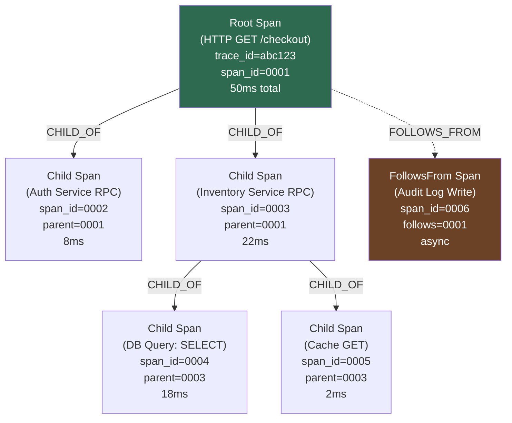
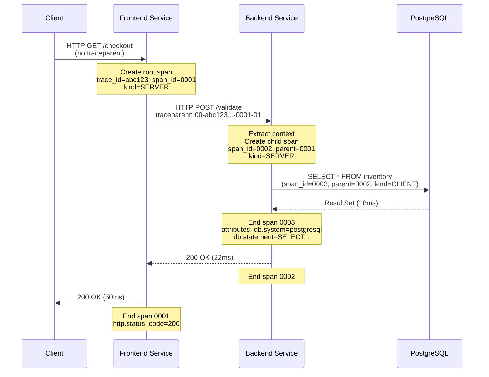
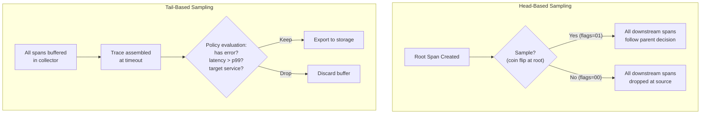
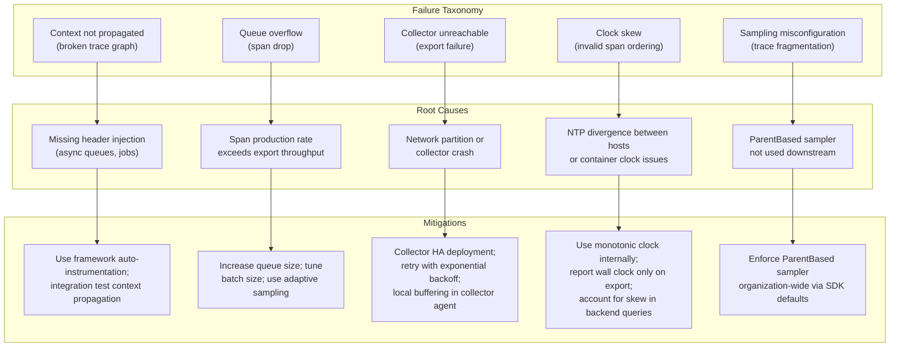
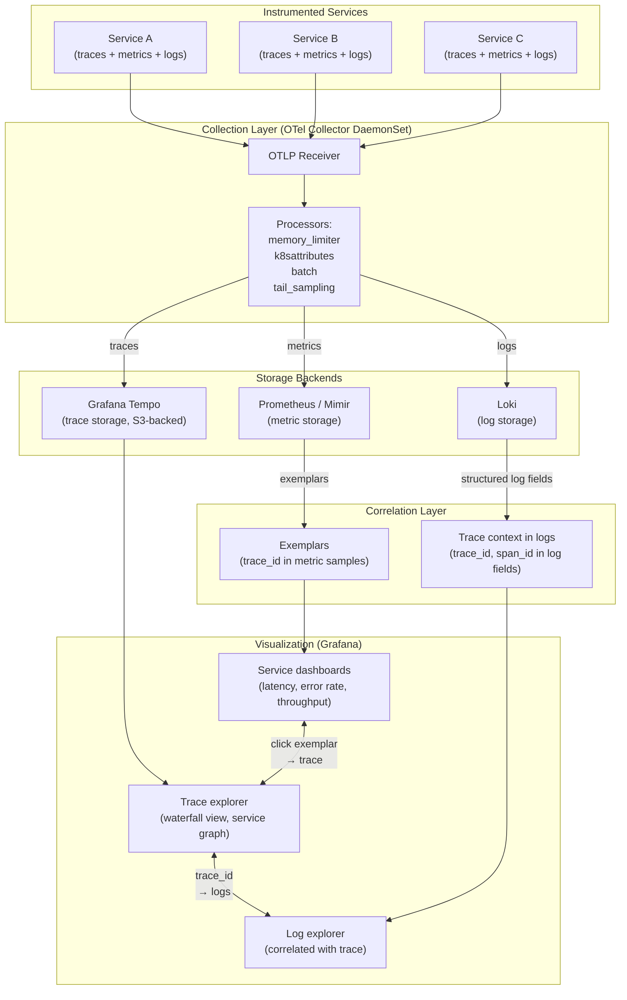

# Lesson 3: Tracing Techniques

---

## 1. First-Principles Intuition & Invariants

### The Fundamental Problem

A monolithic application runs in a single process. When something goes wrong, a stack trace and a timestamp are often sufficient to reconstruct the event. The moment you decompose that system into cooperating services—each with its own process, its own logs, its own clock—you lose the implicit causal thread that ties events together. A user's request no longer executes as a linear sequence in one memory space; it fans out across the network, spawns concurrent work in a dozen processes, and reassembles. The wall-clock times on each host are only loosely synchronized (NTP drifts; Lamport clocks are rarely used in production HTTP services). Correlating these fragments by timestamp alone is statistically unreliable.

Distributed tracing solves this by making **causality explicit and portable**. Rather than inferring which log line in Service B corresponds to a request in Service A by comparing timestamps, you inject a compact causal identifier into every inter-process call. That identifier is the substrate of a trace. Every piece of work that descends from the same user request carries the same identifier, and no timestamp comparison is required to group them.

### Formal Model: The Trace as a DAG

A trace is formally a **directed acyclic graph (DAG)** `T = (S, E)` where:

- `S` is a set of **spans**, each representing a bounded, named unit of work with a start time `t_start`, an end time `t_end`, and an attribute map.
- `E ⊆ S × S` is a set of directed edges encoding **happens-before** relationships in the sense of Lamport (1978). An edge `(s_parent, s_child) ∈ E` asserts that `s_parent` causally initiated `s_child`.

A well-formed trace satisfies three structural invariants:

1. **Single root.** There exists exactly one span `s_0 ∈ S` with no incoming edges. This is the root span, corresponding to the entry point of the request.
2. **Acyclicity.** `E` contains no cycles. Causality is irreversible; a child cannot causally precede its parent.
3. **Temporal consistency.** For every edge `(s_parent, s_child) ∈ E`, `t_start(s_parent) ≤ t_start(s_child)` and `t_end(s_child) ≤ t_end(s_parent)`. A parent span's lifetime must encompass the lifetimes of all its children (with the exception of **fire-and-forget** async spans, which are linked via `FOLLOWS_FROM` references in OpenTelemetry rather than `CHILD_OF`).

The distinction between `CHILD_OF` and `FOLLOWS_FROM` is architecturally important. A `CHILD_OF` relationship implies the parent is blocked waiting for the child to complete. A `FOLLOWS_FROM` relationship expresses that the child was initiated by the parent but the parent does not depend on the child's result—e.g., an async audit log write. Using the wrong relationship corrupts Gantt-style trace waterfall visualizations, making spans appear to exceed their parent's lifetime.



### System Invariants That Define Correctness

Beyond structural invariants of the graph, a production tracing system must uphold operational invariants:

**Causal consistency** requires that the trace graph's topology correctly reflects the actual execution order. This is violated when trace context is propagated through out-of-band channels (e.g., a job queue that strips headers) without manual context injection.

**Uniqueness** requires that trace IDs and span IDs are globally unique for the lifetime of the data. The W3C Trace Context specification mandates 128-bit trace IDs and 64-bit span IDs, generated with a cryptographically random source. Using a monotonic counter scoped to a single process is insufficient and will produce collisions across a fleet of instances.

**Low overhead** is a hard constraint, not a soft goal. The Google Dapper paper (Sigelman et al., 2010)—the foundational reference for virtually every production tracing system—set a target of less than 0.01% CPU overhead at a 1-in-1024 sampling rate. At full sampling, Dapper measured roughly a 1.5% performance hit on their production workloads. These numbers establish the engineering boundary: any tracing implementation that significantly exceeds this is a liability, not an asset.

**Completeness under partial failure** means that if one service in a call chain loses its span data (buffer overflow, crash, network partition), the remaining spans from other services are still valid, linkable fragments. The trace is degraded but not destroyed.

---

## 2. Core Architecture & Mechanics

### Component Taxonomy

A production tracing system comprises five logical components. Understanding each in isolation—and how they compose—is essential for building, operating, and debugging the tracing pipeline itself.

```mermaid
graph LR
    subgraph sub_application_process ["Application Process"]
        IN["Instrumentation\n(manual + auto)"]
        SP["Span Processor\n(BatchSpanProcessor)"]
        BUF["In-Memory Buffer\n(ring buffer)"]
        IN --> SP --> BUF
    end

    subgraph sub_export_pipeline ["Export Pipeline"]
        EXP["Exporter\n(OTLP/gRPC)"]
        BUF --> EXP
    end

    subgraph sub_collection_tier ["Collection Tier"]
        COL["OpenTelemetry Collector\n(receiver → processor → exporter)"]
        EXP -->|"OTLP gRPC\nor HTTP/protobuf"| COL
    end

    subgraph sub_storage___query ["Storage & Query"]
        JAE["Jaeger / Tempo\n(trace storage)"]
        IDX["Index\n(Elasticsearch / Cassandra)"]
        COL --> JAE
        JAE --> IDX
    end

    subgraph sub_visualization ["Visualization"]
        UI["Jaeger UI / Grafana"]
        IDX --> UI
    end
```



**Instrumentation** is the act of recording spans. It can be manual (the developer explicitly creates and annotates spans) or automatic (via bytecode instrumentation, eBPF probes, or monkey-patching, depending on the runtime). OpenTelemetry provides both paths. Auto-instrumentation covers common frameworks (HTTP servers, gRPC, database drivers, message queues) with zero code changes; manual instrumentation is required for business-logic-level visibility.

**Span Processors** sit between instrumentation and export. The `SimpleSpanProcessor` calls the exporter synchronously on span end—useful for testing, catastrophic in production because it blocks the application thread. The `BatchSpanProcessor` accumulates spans in a bounded queue and flushes them periodically or when the queue reaches a threshold. Its configuration parameters are performance-critical:

- `max_queue_size`: Maximum number of spans held in memory before dropping. The OpenTelemetry specification defaults to 2048.
- `max_export_batch_size`: Number of spans per export RPC call. Default: 512.
- `schedule_delay_millis`: How often the background thread flushes. Default: 5000 ms.
- `export_timeout_millis`: Timeout for a single export attempt. Default: 30,000 ms.

Tuning these values requires understanding your service's span generation rate. A service generating 10,000 spans/second with a 2048 queue and a 5-second flush interval will drop spans. The correct approach is to instrument, measure the span rate, and size the queue accordingly—or to increase the sampling fraction inversely.

**Exporters** serialize spans and transmit them. The industry has largely converged on **OTLP (OpenTelemetry Protocol)** over gRPC with protobuf serialization as the wire format, superseding the older Thrift-over-UDP (Jaeger legacy) and JSON-over-HTTP (Zipkin) formats. OTLP benefits from protobuf's compact binary encoding, gRPC's streaming and flow control, and HTTP/2 multiplexing. For latency-sensitive environments, OTLP over HTTP/1.1 with protobuf is a viable alternative that avoids the gRPC connection overhead.

**Collectors** (specifically the OpenTelemetry Collector) are intermediary aggregation and processing agents. Deploying a collector as a sidecar or DaemonSet decouples the application from the backend. Applications export to localhost (effectively free, no network hop), and the collector handles batching, retry, fan-out to multiple backends, and enrichment (adding Kubernetes metadata via the `k8s_attributes` processor). This is architecturally superior to exporting directly from the application to a remote backend.

**Backends** store spans and provide query interfaces. Jaeger (CNCF), Grafana Tempo, and Zipkin are the primary open-source options. Grafana Tempo is architecturally notable because it stores traces in object storage (S3, GCS) with no search index by default—it requires a Tempo TraceQL query with a known trace ID, or integration with Loki/Prometheus for trace discovery via exemplars. Jaeger uses Elasticsearch or Cassandra as its storage backend, providing full-text search over span attributes.

### The Span Data Structure

A span is not merely a name and two timestamps. Its complete structure, as defined by the OpenTelemetry specification, includes:

| Field | Type | Description |
|---|---|---|
| `trace_id` | 128-bit | Globally unique identifier for the trace |
| `span_id` | 64-bit | Unique within the trace |
| `parent_span_id` | 64-bit (optional) | Absent on the root span |
| `trace_flags` | 8-bit | Sampling decision (`sampled` bit) + future flags |
| `trace_state` | String | Vendor-specific state (W3C `tracestate` header value) |
| `name` | String | The operation name, e.g., `"HTTP GET /users/{id}"` |
| `kind` | Enum | `SERVER`, `CLIENT`, `PRODUCER`, `CONSUMER`, `INTERNAL` |
| `start_time` | UNIX nanoseconds | Monotonic clock recommended internally; wall clock exported |
| `end_time` | UNIX nanoseconds | |
| `attributes` | Key→Value map | Typed: string, bool, int64, float64, or arrays thereof |
| `events` | List of timed events | Point-in-time annotations with their own attribute maps |
| `links` | List of SpanContext | Cross-trace references (e.g., linking to the initiating job) |
| `status` | (Code, Message) | `UNSET`, `OK`, or `ERROR` |
| `resource` | Key→Value map | Process-level metadata: `service.name`, `host.name`, etc. |

The `kind` field is frequently misused. `CLIENT` must be used when the current service is making an outbound call—not `INTERNAL`. This distinction is critical for topology visualization in tools like Jaeger's Service Graph or Grafana's Service Map, which use span kind to determine directionality of service dependencies.

Span **events** are the correct mechanism for recording discrete points of interest within a span's lifetime (e.g., "cache miss", "retry attempt 2"). They are not additional spans—creating a new span for each log-worthy event is a common over-instrumentation mistake that balloons trace size and obscures signal.

### Trace Context Propagation

Propagation is the mechanism by which the trace's causal identifier travels across process boundaries. The **W3C Trace Context** specification (W3C Recommendation, 2021) defines two HTTP headers:

**`traceparent`**: A single header encoding four fields in a fixed format:
```text
traceparent: 00-4bf92f3577b34da6a3ce929d0e0e4736-00f067aa0ba902b7-01
              ^^ version (always 00)
                 ^^^^^^^^^^^^^^^^^^^^^^^^^^^^^^^^ trace-id (128-bit hex, 32 chars)
                                                  ^^^^^^^^^^^^^^^^ parent-span-id (64-bit hex, 16 chars)
                                                                   ^^ trace-flags (8-bit hex: 01 = sampled)
```

**`tracestate`**: An optional header carrying vendor-specific state as an ordered list of `key=value` pairs, e.g., `tracestate: vendorname=opaquevalue`. This allows vendors to inject routing or sampling information without polluting the standardized `traceparent`.

Before W3C Trace Context was standardized, two proprietary formats dominated: Zipkin's `X-B3-TraceId` / `X-B3-SpanId` / `X-B3-Sampled` headers (B3 propagation), and Jaeger's `uber-trace-id` header. Modern deployments should use W3C Trace Context as the primary format. OpenTelemetry's propagator stack supports simultaneous injection of multiple formats for backward compatibility with legacy services.

For non-HTTP transports, context propagation requires explicit integration:
- **Kafka**: Inject into record headers (`Headers` API). The OpenTelemetry Java/Python/Go instrumentation libraries do this automatically.
- **gRPC**: Inject into gRPC metadata. gRPC interceptors handle this transparently.
- **Message queues (SQS, RabbitMQ)**: Inject into message attributes/properties. No standard exists; the convention is to use the same `traceparent` key.
- **Async task queues (Celery, Sidekiq)**: Inject into the task's argument payload or header metadata. Missing this step is the most common cause of broken trace graphs in Python and Ruby microservices.

### End-to-End Trace Lifecycle: A Concrete Walk-Through



The critical architectural detail here is that **each service independently records its own spans** and exports them asynchronously. There is no synchronous chain of custody. The backend does not wait for the frontend to finish before exporting its spans. The trace is reconstructed by the backend storage system, which assembles the DAG by grouping all spans sharing the same `trace_id` and resolving parent-child relationships via `parent_span_id`. This means the trace may be assembled out of order and over a time window (Jaeger's default trace assembly timeout is configurable, with a typical value of 2 minutes to accommodate slow exporters).

---

## 3. Implementation: Production-Grade Code

### OpenTelemetry Tracing in Go (Manual + Auto Instrumentation)

```go
package main

import (
	"context"
	"errors"
	"fmt"
	"log"
	"net/http"
	"time"

	"go.opentelemetry.io/otel"
	"go.opentelemetry.io/otel/attribute"
	"go.opentelemetry.io/otel/codes"
	"go.opentelemetry.io/otel/exporters/otlp/otlptrace/otlptracegrpc"
	"go.opentelemetry.io/otel/propagation"
	"go.opentelemetry.io/otel/sdk/resource"
	sdktrace "go.opentelemetry.io/otel/sdk/trace"
	semconv "go.opentelemetry.io/otel/semconv/v1.21.0"
	"go.opentelemetry.io/otel/trace"
	"google.golang.org/grpc"
	"google.golang.org/grpc/credentials/insecure"
)

// initTracerProvider configures an OTLP gRPC exporter and returns a TracerProvider.
// The returned shutdown function must be called on application exit to flush
// the BatchSpanProcessor's in-memory queue.
func initTracerProvider(ctx context.Context, endpoint string) (*sdktrace.TracerProvider, error) {
	conn, err := grpc.DialContext(ctx, endpoint,
		grpc.WithTransportCredentials(insecure.NewCredentials()),
		grpc.WithBlock(),
	)
	if err != nil {
		return nil, fmt.Errorf("failed to connect to OTLP collector: %w", err)
	}

	exporter, err := otlptracegrpc.New(ctx, otlptracegrpc.WithGRPCConn(conn))
	if err != nil {
		return nil, fmt.Errorf("failed to create OTLP exporter: %w", err)
	}

	// Resource describes the entity producing telemetry.
	// service.name is mandatory; without it, Jaeger's service graph is broken.
	res, err := resource.New(ctx,
		resource.WithAttributes(
			semconv.ServiceName("checkout-service"),
			semconv.ServiceVersion("1.4.2"),
			semconv.DeploymentEnvironment("production"),
		),
		resource.WithFromEnv(),       // OTEL_RESOURCE_ATTRIBUTES
		resource.WithTelemetrySDK(),  // otel.library.*, telemetry.sdk.*
	)
	if err != nil {
		return nil, fmt.Errorf("failed to create resource: %w", err)
	}

	// ParentBased(TraceIDRatioBased) is the correct sampler for most services:
	// - If the incoming request is already sampled (traceparent's sampled bit = 1),
	//   continue sampling regardless of the local ratio.
	// - If there is no parent (this is the root span), apply the ratio.
	// This prevents the pathological case where a downstream service drops a span
	// whose parent was retained, fragmenting the trace.
	sampler := sdktrace.ParentBased(sdktrace.TraceIDRatioBased(0.1)) // 10% head sampling

	bsp := sdktrace.NewBatchSpanProcessor(exporter,
		sdktrace.WithMaxQueueSize(4096),
		sdktrace.WithMaxExportBatchSize(512),
		sdktrace.WithBatchTimeout(5*time.Second),
		sdktrace.WithExportTimeout(30*time.Second),
	)

	tp := sdktrace.NewTracerProvider(
		sdktrace.WithBatcher(exporter),
		sdktrace.WithSpanProcessor(bsp),
		sdktrace.WithResource(res),
		sdktrace.WithSampler(sampler),
	)

	// Register as global provider so auto-instrumentation libraries
	// (otelhttp, otelgrpc) pick it up without explicit wiring.
	otel.SetTracerProvider(tp)
	otel.SetTextMapPropagator(propagation.NewCompositeTextMapPropagator(
		propagation.TraceContext{}, // W3C traceparent/tracestate
		propagation.Baggage{},     // W3C baggage (user-defined KV propagation)
	))

	return tp, nil
}

var tracer = otel.Tracer("checkout-service")

// processCheckout demonstrates manual span creation, event recording,
// attribute annotation, and correct error propagation to the span status.
func processCheckout(ctx context.Context, userID string, cartID string) error {
	ctx, span := tracer.Start(ctx, "processCheckout",
		trace.WithSpanKind(trace.SpanKindInternal),
		trace.WithAttributes(
			attribute.String("user.id", userID),
			attribute.String("cart.id", cartID),
		),
	)
	defer span.End()

	// Record a point-in-time event—do NOT create a child span for this.
	span.AddEvent("validation.started")

	if err := validateCart(ctx, cartID); err != nil {
		// Set span status to ERROR and record the error as an event with a stack trace.
		// span.RecordError is shorthand for span.AddEvent("exception", ...) per the
		// OpenTelemetry semantic conventions for exceptions.
		span.RecordError(err)
		span.SetStatus(codes.Error, err.Error())
		return fmt.Errorf("cart validation failed: %w", err)
	}

	span.AddEvent("validation.completed")
	span.SetStatus(codes.Ok, "")
	return nil
}

func validateCart(ctx context.Context, cartID string) error {
	_, span := tracer.Start(ctx, "validateCart",
		trace.WithSpanKind(trace.SpanKindInternal),
		trace.WithAttributes(attribute.String("cart.id", cartID)),
	)
	defer span.End()

	if cartID == "" {
		err := errors.New("cart ID must not be empty")
		span.RecordError(err)
		span.SetStatus(codes.Error, err.Error())
		return err
	}

	span.SetAttributes(attribute.Bool("cart.valid", true))
	return nil
}

// checkoutHandler is an HTTP handler wrapped with otelhttp for automatic
// SERVER span creation, traceparent extraction, and http.* attribute population.
func checkoutHandler(w http.ResponseWriter, r *http.Request) {
	ctx := r.Context() // otelhttp middleware has already injected the span context here
	if err := processCheckout(ctx, r.URL.Query().Get("user"), r.URL.Query().Get("cart")); err != nil {
		http.Error(w, err.Error(), http.StatusBadRequest)
		return
	}
	w.WriteHeader(http.StatusOK)
}

func main() {
	ctx := context.Background()

	tp, err := initTracerProvider(ctx, "otel-collector:4317")
	if err != nil {
		log.Fatalf("failed to initialize tracer provider: %v", err)
	}
	defer func() {
		// Shutdown flushes the BatchSpanProcessor. Without this, spans buffered
		// in memory will be lost on process exit (e.g., during a graceful shutdown).
		shutdownCtx, cancel := context.WithTimeout(context.Background(), 10*time.Second)
		defer cancel()
		if err := tp.Shutdown(shutdownCtx); err != nil {
			log.Printf("error shutting down tracer provider: %v", err)
		}
	}()

	log.Println("checkout service started")
}
```

### OpenTelemetry Tracing in Python (with SQLAlchemy and requests auto-instrumentation)

```python
"""
Production-grade OpenTelemetry setup for a Python Flask service.

Dependencies (pinned):
    opentelemetry-api==1.24.0
    opentelemetry-sdk==1.24.0
    opentelemetry-exporter-otlp-proto-grpc==1.24.0
    opentelemetry-instrumentation-flask==0.45b0
    opentelemetry-instrumentation-sqlalchemy==0.45b0
    opentelemetry-instrumentation-requests==0.45b0
"""

import os
from contextlib import contextmanager
from typing import Generator

from opentelemetry import trace
from opentelemetry.exporter.otlp.proto.grpc.trace_exporter import OTLPSpanExporter
from opentelemetry.sdk.resources import Resource, SERVICE_NAME, SERVICE_VERSION
from opentelemetry.sdk.trace import TracerProvider
from opentelemetry.sdk.trace.export import BatchSpanProcessor
from opentelemetry.sdk.trace.sampling import ParentBased, TraceIdRatioBased
from opentelemetry.trace import SpanKind, Status, StatusCode
from opentelemetry.propagate import set_global_textmap
from opentelemetry.propagators.composite import CompositePropagator
from opentelemetry.trace.propagation.tracecontext import TraceContextTextMapPropagator
from opentelemetry.baggage.propagation import W3CBaggagePropagator


def configure_tracing(service_name: str, service_version: str, collector_endpoint: str) -> TracerProvider:
    """
    Configure a TracerProvider with OTLP gRPC export.

    The ParentBased sampler is critical: it ensures that a span whose parent
    was sampled is always retained, preventing broken traces where the root
    span exists in the backend but its children are missing.
    """
    resource = Resource.create({
        SERVICE_NAME: service_name,
        SERVICE_VERSION: service_version,
        "deployment.environment": os.getenv("DEPLOYMENT_ENV", "development"),
        "host.name": os.uname().nodename,
    })

    # 5% head-based sampling at root spans; 100% if parent is sampled.
    sampler = ParentBased(root=TraceIdRatioBased(0.05))

    provider = TracerProvider(resource=resource, sampler=sampler)

    exporter = OTLPSpanExporter(
        endpoint=collector_endpoint,
        insecure=True,  # Use TLS in production: insecure=False + credentials
    )

    processor = BatchSpanProcessor(
        exporter,
        max_queue_size=4096,
        max_export_batch_size=512,
        schedule_delay_millis=5000,
        export_timeout_millis=30000,
    )
    provider.add_span_processor(processor)

    # Register globally so instrumentation libraries (Flask, SQLAlchemy, requests)
    # can acquire a Tracer without direct provider references.
    trace.set_tracer_provider(provider)
    set_global_textmap(CompositePropagator([
        TraceContextTextMapPropagator(),  # W3C traceparent/tracestate
        W3CBaggagePropagator(),
    ]))

    return provider


tracer = trace.get_tracer("inventory-service", "1.0.0")


@contextmanager
def traced_operation(
    name: str,
    kind: SpanKind = SpanKind.INTERNAL,
    attributes: dict | None = None,
) -> Generator[trace.Span, None, None]:
    """
    Context manager for manual span creation with automatic error capture.

    Correctly sets span status to ERROR and records the exception as a
    structured event (per OTel semantic conventions for exceptions) before
    re-raising. This ensures the exception is visible in trace backends
    without suppressing it.
    """
    with tracer.start_as_current_span(name, kind=kind) as span:
        if attributes:
            for key, value in attributes.items():
                span.set_attribute(key, value)
        try:
            yield span
            span.set_status(Status(StatusCode.OK))
        except Exception as exc:
            span.record_error(exc)
            span.set_status(Status(StatusCode.ERROR, str(exc)))
            raise


def get_inventory(product_id: str, quantity: int) -> dict:
    """
    Example business function demonstrating manual instrumentation.
    The SQLAlchemy auto-instrumentation will create a child CLIENT span
    for the database query automatically.
    """
    with traced_operation(
        "get_inventory",
        attributes={
            "product.id": product_id,
            "request.quantity": quantity,
        },
    ) as span:
        # Simulate a database call—auto-instrumented by opentelemetry-instrumentation-sqlalchemy
        result = {"available": 42, "reserved": 5}

        span.add_event("inventory.fetched", attributes={
            "inventory.available": result["available"],
            "inventory.reserved": result["reserved"],
        })

        if result["available"] < quantity:
            span.set_attribute("inventory.sufficient", False)
            raise ValueError(f"Insufficient inventory: need {quantity}, have {result['available']}")

        span.set_attribute("inventory.sufficient", True)
        return result
```

### Low-Level Context Propagation in Rust (Manual W3C Trace Context Parsing)

This example implements a minimal, allocation-efficient W3C `traceparent` parser in Rust—the kind of code you would write for a sidecar proxy or a performance-critical middleware layer where pulling in the full OpenTelemetry SDK is not viable.

```rust
use std::fmt;
use std::num::ParseIntError;

/// A parsed W3C Trace Context `traceparent` header value.
/// Layout: `{version}-{trace_id}-{parent_id}-{flags}`
/// Spec: https://www.w3.org/TR/trace-context/
#[derive(Debug, Clone, PartialEq, Eq)]
pub struct TraceParent {
    /// Format version. Only version 0x00 is currently defined.
    pub version: u8,
    /// 128-bit trace identifier (globally unique per logical request).
    pub trace_id: u128,
    /// 64-bit identifier of the calling span (the "parent" of the span to be created).
    pub parent_id: u64,
    /// 8-bit flags field. Bit 0 (LSB) is the `sampled` flag.
    pub flags: u8,
}

impl TraceParent {
    /// Returns true if the `sampled` flag (bit 0) is set.
    /// Downstream services MUST respect this flag to avoid trace fragmentation.
    #[inline]
    pub fn is_sampled(&self) -> bool {
        self.flags & 0x01 != 0
    }
}

#[derive(Debug, PartialEq, Eq)]
pub enum ParseError {
    InvalidFormat(&'static str),
    InvalidHex(ParseIntError),
    UnsupportedVersion(u8),
    AllZeroTraceId,
    AllZeroParentId,
}

impl fmt::Display for ParseError {
    fn fmt(&self, f: &mut fmt::Formatter<'_>) -> fmt::Result {
        match self {
            Self::InvalidFormat(msg) => write!(f, "invalid traceparent format: {}", msg),
            Self::InvalidHex(e) => write!(f, "hex parse error: {}", e),
            Self::UnsupportedVersion(v) => write!(f, "unsupported traceparent version: 0x{:02x}", v),
            Self::AllZeroTraceId => write!(f, "trace-id must not be all zeros"),
            Self::AllZeroParentId => write!(f, "parent-id must not be all zeros"),
        }
    }
}

impl From<ParseIntError> for ParseError {
    fn from(e: ParseIntError) -> Self {
        Self::InvalidHex(e)
    }
}

/// Parse a W3C `traceparent` header value with strict spec compliance.
///
/// The spec mandates rejection of all-zero trace-id and parent-id values,
/// and rejection of version 0xff (reserved). Version-specific parsing rules
/// apply; for version 0x00 the header must be exactly 55 characters.
pub fn parse_traceparent(header: &str) -> Result<TraceParent, ParseError> {
    let parts: Vec<&str> = header.splitn(4, '-').collect();
    if parts.len() != 4 {
        return Err(ParseError::InvalidFormat("expected 4 dash-separated components"));
    }

    let version = u8::from_str_radix(parts[0], 16)?;
    if version == 0xff {
        return Err(ParseError::UnsupportedVersion(version));
    }
    // For version 0x00, the header length is fixed at 55 characters.
    if version == 0x00 && header.len() != 55 {
        return Err(ParseError::InvalidFormat("version 00 header must be exactly 55 characters"));
    }

    let trace_id = u128::from_str_radix(parts[1], 16)?;
    if trace_id == 0 {
        return Err(ParseError::AllZeroTraceId);
    }

    let parent_id = u64::from_str_radix(parts[2], 16)?;
    if parent_id == 0 {
        return Err(ParseError::AllZeroParentId);
    }

    let flags = u8::from_str_radix(parts[3], 16)?;

    Ok(TraceParent { version, trace_id, parent_id, flags })
}

/// Serialize a `TraceParent` to a W3C-compliant header string.
/// Uses version 0x00, the only currently standardized version.
pub fn format_traceparent(tp: &TraceParent) -> String {
    format!(
        "00-{:032x}-{:016x}-{:02x}",
        tp.trace_id, tp.parent_id, tp.flags
    )
}

#[cfg(test)]
mod tests {
    use super::*;

    #[test]
    fn round_trip_valid_header() {
        let header = "00-4bf92f3577b34da6a3ce929d0e0e4736-00f067aa0ba902b7-01";
        let tp = parse_traceparent(header).expect("valid header should parse");
        assert_eq!(tp.version, 0x00);
        assert_eq!(tp.trace_id, 0x4bf92f3577b34da6a3ce929d0e0e4736u128);
        assert_eq!(tp.parent_id, 0x00f067aa0ba902b7u64);
        assert!(tp.is_sampled());
        assert_eq!(format_traceparent(&tp), header);
    }

    #[test]
    fn rejects_all_zero_trace_id() {
        let header = "00-00000000000000000000000000000000-00f067aa0ba902b7-01";
        assert_eq!(parse_traceparent(header), Err(ParseError::AllZeroTraceId));
    }

    #[test]
    fn rejects_all_zero_parent_id() {
        let header = "00-4bf92f3577b34da6a3ce929d0e0e4736-0000000000000000-01";
        assert_eq!(parse_traceparent(header), Err(ParseError::AllZeroParentId));
    }

    #[test]
    fn unsampled_flag() {
        let header = "00-4bf92f3577b34da6a3ce929d0e0e4736-00f067aa0ba902b7-00";
        let tp = parse_traceparent(header).expect("valid header should parse");
        assert!(!tp.is_sampled());
    }
}
```

---

## 4. Sampling: Theory, Strategies, and Trade-offs

Sampling is the most consequential architectural decision in a tracing system. The fundamental tension is between **trace completeness** (you want every request traced) and **resource consumption** (tracing every request at high throughput is prohibitively expensive in CPU, memory, and storage). The right sampling strategy depends on the system's throughput, the criticality of individual traces, and the operational maturity of the team.

### Head-Based vs. Tail-Based Sampling

**Head-based sampling** makes the sampling decision at the moment the root span is created—before any downstream work has occurred. The decision is encoded in the `traceparent` flags and propagated to all downstream services, which then unconditionally follow the upstream decision. This is simple, cheap, and causally consistent (a trace is either fully collected or fully dropped). Its critical weakness is that the sampling decision is made without knowledge of the request's outcome. A slow or error-producing request looks identical to a fast, successful one at the head, so interesting traces are dropped at the same rate as uninteresting ones.

**Tail-based sampling** buffers all spans until the trace is complete, then applies a sampling policy based on the full trace. A trace that contains an error, has a latency above the 99th percentile, or involves a specific service can be retained with 100% probability while routine successful traces are sampled aggressively. This requires the sampling logic to run after the fact, which introduces two hard architectural constraints:

1. **All spans for a given trace must be routed to the same sampler instance.** Because spans from different services are exported independently and arrive at the collector at different times, a simple load-balanced fleet of collectors cannot perform tail-based sampling without trace-aware routing (e.g., consistent hashing on `trace_id` to route to a specific collector instance).
2. **The buffer must hold spans in memory until the trace is complete.** A trace assembly timeout must be configured (typically 30–120 seconds), and spans older than this window must be flushed whether the trace is complete or not.

The OpenTelemetry Collector's `tailsampling` processor implements tail-based sampling with policies including `latency`, `status_code`, `string_attribute`, `rate_limiting`, and `composite` (boolean combinations of the above). The `load_balancing` exporter provides consistent hash routing by `trace_id` across a fleet of collector instances.



### Adaptive (Dynamic) Sampling

Neither pure head-based nor pure tail-based sampling handles **traffic spikes** gracefully. A fixed 1% sampling rate that is appropriate at 100k RPS yields only 10 samples/second at 1k RPS—potentially missing rare but important events at low traffic. Conversely, at 1M RPS, 1% generates 10k samples/second, which may overwhelm the storage backend.

Adaptive sampling dynamically adjusts the sampling rate to maintain a target spans-per-second output, independent of input throughput. The OpenTelemetry Collector's `probabilistic_sampler` processor with the `hash_seed` configuration provides a rudimentary version of this. More sophisticated implementations use a **token bucket** or **leaky bucket** algorithm: each service instance replenishes sampling tokens at a fixed rate (e.g., 100 tokens/second) and consumes one token per sampled trace. When the bucket is empty, new root spans are unsampled until tokens are replenished.

```text
Adaptive sampling target rate: T samples/second
Observed request rate: R requests/second
Sampling fraction: f = min(1.0, T / R)
Token bucket refill rate: T tokens/second
Token bucket capacity: B = T * burst_window_seconds
```

### The Sampling Propagation Contract

A downstream service receiving a sampled `traceparent` (flags bit 0 = 1) **must not independently re-sample** that trace. It must create and export its spans unconditionally. This is the `ParentBased` sampler's guarantee. Violating this contract—by wrapping a `TraceIdRatioBased` sampler directly without `ParentBased`—causes trace fragmentation: the root span exists in the backend but its children are missing, producing a trace graph that appears to have done no work. This is one of the most common tracing configuration bugs in production.

---

## 5. High-Performance Optimization & Failure Modes

### Performance Overhead: Measured, Not Estimated

The overhead of tracing is not uniform. It has three distinct components:

1. **Span creation cost**: Allocating the span struct, capturing timestamps (a `clock_gettime(CLOCK_MONOTONIC)` syscall, or its vDSO equivalent, costs ~20–40 ns on modern Linux systems), and writing initial attributes. For applications creating thousands of spans per second per core, this is measurable but typically sub-1% CPU overhead.

2. **Context propagation cost**: Extracting and injecting HTTP headers on every inter-service call. A W3C `traceparent` header is 55 bytes. The extraction involves a string scan and four hex-to-integer conversions. This is O(1) and sub-microsecond, but header manipulation in hot paths (thousands of small RPCs per second) can aggregate to meaningful overhead.

3. **Export cost**: Serializing spans to protobuf and writing to a gRPC stream. The `BatchSpanProcessor` amortizes this across many spans per batch, and the export occurs on a background thread, so the primary path is not blocked. The cost on the application thread is a mutex acquisition on the queue and a pointer write. If the queue is full and spans are being dropped, there is no additional blocking—the span is simply discarded.

The vDSO-accelerated `clock_gettime` on Linux avoids a true syscall for `CLOCK_MONOTONIC` reads, keeping timestamp capture to ~20 ns on x86_64. Applications that call `time.Now()` (Go), `System.nanoTime()` (Java), or `std::time::Instant::now()` (Rust) in tight loops for span timing are using this path.

### In-Memory Buffer Sizing and Backpressure

The `BatchSpanProcessor`'s queue is a bounded, in-memory buffer. When the exporter is slower than span production (e.g., the OTLP collector is unreachable), the queue fills. At that point, one of two behaviors occurs: **drop newest** (the OpenTelemetry SDK default for most languages) or **drop oldest**. Neither is universally better. Drop-newest preserves older spans that may have more context; drop-oldest preserves the most recent activity. In practice, the queue should be sized to absorb at least `max_export_batch_size * (export_timeout / schedule_delay)` spans—enough to buffer several export cycles' worth of spans during a transient collector outage without dropping.

The OpenTelemetry SDK exposes `dropped_spans` as an internal metric via `SpanExporterObservability`. Alerting on a non-zero drop rate is essential: silent span loss is undetectable from trace backends (you don't see what isn't there) and misleads post-incident analysis.

### Failure Modes and Mitigations



**Clock skew** deserves special attention. Each service uses its local system clock to record `start_time` and `end_time`. NTP synchronization typically achieves sub-millisecond accuracy in a well-managed data center, but container environments with inconsistent chrony/ntpd configuration can exhibit multi-millisecond drift. When a child span's `start_time` (on host B) is earlier than the parent span's `start_time` (on host A) due to clock skew, trace visualization tools show negative latency for the network hop—which is physically impossible and indicates skew. Jaeger and Zipkin apply clock skew adjustment heuristics, but they are imperfect. The correct mitigation is proper NTP/PTP configuration on the underlying hosts.

**Orphaned spans** occur when a span's `parent_span_id` references a span that never arrives in the backend—either because the parent was not sampled, the parent's export failed, or the parent's service has no instrumentation. Backends handle orphaned spans by displaying them as synthetic root spans with a warning annotation. They are not an error condition in the backend; they indicate a gap in instrumentation or a sampling misconfiguration upstream.

### OpenTelemetry Collector Resiliency Configuration

```yaml
# otel-collector-config.yaml
# Production collector configuration with retry, backpressure, and HA tail sampling.

receivers:
  otlp:
    protocols:
      grpc:
        endpoint: "0.0.0.0:4317"
        # Limit concurrent streams to prevent memory exhaustion under load burst.
        max_concurrent_streams: 100
      http:
        endpoint: "0.0.0.0:4318"

processors:
  # Enrich spans with Kubernetes pod/namespace/node metadata.
  # Requires the collector to have read access to the Kubernetes API.
  k8sattributes:
    auth_type: serviceAccount
    passthrough: false
    extract:
      metadata:
        - k8s.pod.name
        - k8s.namespace.name
        - k8s.node.name
        - k8s.deployment.name

  # Memory limiter MUST be first in the pipeline to prevent OOM crashes.
  # It checks memory usage every 100ms and starts dropping spans when
  # usage exceeds `limit_mib`, recovering below `spike_limit_mib`.
  memory_limiter:
    check_interval: 100ms
    limit_mib: 1500
    spike_limit_mib: 300

  # Batch spans before sending to storage to reduce per-RPC overhead.
  batch:
    send_batch_size: 1024
    send_batch_max_size: 2048
    timeout: 5s

  # Tail-based sampling: retain all error traces, retain 10% of successful traces.
  # Route spans to this processor via the load_balancing exporter below.
  tail_sampling:
    decision_wait: 30s       # Wait up to 30s for all spans in a trace to arrive.
    num_traces: 100000        # Max traces to hold in memory simultaneously.
    expected_new_traces_per_sec: 1000
    policies:
      - name: retain_errors
        type: status_code
        status_code: { status_codes: [ERROR] }
      - name: retain_slow_traces
        type: latency
        latency: { threshold_ms: 1000 }
      - name: probabilistic_baseline
        type: probabilistic
        probabilistic: { sampling_percentage: 10 }
      - name: composite_policy
        type: composite
        composite:
          max_total_spans_per_second: 2000
          policy_order: [retain_errors, retain_slow_traces, probabilistic_baseline]

exporters:
  otlp/jaeger:
    endpoint: "jaeger-collector:4317"
    tls:
      insecure: false
      cert_file: /certs/client.crt
      key_file:  /certs/client.key
      ca_file:   /certs/ca.crt
    retry_on_failure:
      enabled: true
      initial_interval: 1s
      max_interval: 30s
      max_elapsed_time: 300s   # Give up after 5 minutes; spans are dropped.
    sending_queue:
      enabled: true
      num_consumers: 10
      queue_size: 10000        # Absorb bursts during transient Jaeger unavailability.

  # Load-balancing exporter routes spans to a consistent collector instance
  # by trace_id hash. Required for tail-based sampling correctness.
  loadbalancing:
    routing_key: traceID
    protocol:
      otlp:
        tls:
          insecure: true
    resolver:
      dns:
        hostname: otel-collector-headless.observability.svc.cluster.local
        port: 4317

service:
  pipelines:
    traces/ingest:
      receivers:  [otlp]
      processors: [memory_limiter, k8sattributes, batch]
      exporters:  [loadbalancing]
    traces/sample:
      receivers:  [otlp]
      processors: [memory_limiter, tail_sampling, batch]
      exporters:  [otlp/jaeger]
```

---

## 6. Advanced Patterns

### Trace-Metric Correlation via Exemplars

A trace in isolation answers "what happened to this specific request." A metric answers "what is the aggregate behavior of this endpoint over time." The connection between the two—exemplars—is one of the highest-value, least-understood observability patterns.

A **Prometheus exemplar** is a trace ID (and optionally a span ID) attached to a histogram observation. When a request's latency is recorded in a Prometheus `histogram`, the exemplar attaches the `trace_id` of that specific request to that specific latency measurement. In Grafana, a user can inspect a spike in a latency histogram, click an exemplar data point, and jump directly to the trace that caused that specific latency value. This bridges metrics (aggregate, cheap, always-on) and traces (detailed, sampled, expensive) without requiring full trace storage.

```python
from opentelemetry import trace as otel_trace
from prometheus_client import Histogram

REQUEST_LATENCY = Histogram(
    "http_request_duration_seconds",
    "HTTP request latency",
    ["method", "endpoint"],
    # exemplar_labels enables exemplar support in the Python Prometheus client
)

def record_request_latency(method: str, endpoint: str, duration_seconds: float) -> None:
    """Record request latency with an OpenTelemetry trace exemplar."""
    current_span = otel_trace.get_current_span()
    span_context = current_span.get_span_context()

    exemplar = None
    if span_context.is_valid:
        # Exemplar labels must include TraceID; SpanID is optional but recommended.
        exemplar = {
            "TraceID": format(span_context.trace_id, "032x"),
            "SpanID": format(span_context.span_id, "016x"),
        }

    REQUEST_LATENCY.labels(method=method, endpoint=endpoint).observe(
        duration_seconds,
        exemplar=exemplar,
    )
```

### Baggage: Cross-Cutting Context Propagation

The W3C Baggage specification defines a mechanism for propagating arbitrary key-value pairs alongside trace context, through every hop in a distributed system. Unlike span attributes (which are local to a single span in a single service), baggage values are readable by every downstream service without explicit coordination.

Practical uses: propagating a `tenant.id` for multi-tenant SaaS systems, a `feature_flag` value for correlation, or an `ab_experiment_group` identifier. Baggage is **not** a debugging tool for large payloads—each key-value pair is serialized into every outbound HTTP header, adding overhead proportional to the number of downstream hops. Keep baggage values small (a few dozen bytes total) and finite in cardinality. Treat baggage like a distributed transaction context, not a scratchpad.

### Continuous Profiling Integration

The frontier of observability integrates tracing with **continuous profiling** (Pyroscope, Parca, Google Cloud Profiler). The integration works by injecting the current `trace_id` and `span_id` into the profiler's label set when a CPU sample is captured. This links individual stack traces from the profiler to specific request traces. Rather than knowing that "function X consumed 20% of CPU over the last minute" (a profiler finding), you can know that "function X consumed 400ms of CPU during the specific trace `abc123` for user `user_42`" (a correlated finding). This precision is invaluable for diagnosing latency regressions in multi-tenant services where a single noisy customer impacts aggregate profiles.

---

## 7. Instrumentation Coverage: What to Trace and What Not To

A common instrumentation anti-pattern is **over-tracing**: creating a span for every function call, including trivial ones. This inflates trace size, obscures the signal, and increases export overhead without proportional observability gain. Spans should represent **units of work with meaningful latency or failure semantics**—IO operations, external service calls, significant in-process computations (e.g., serialization of large payloads), and explicit business-logic phases (checkout validation, payment processing).

The OpenTelemetry **Semantic Conventions** (formerly known as OpenTelemetry specification attribute naming conventions) define standardized attribute names for common operation types. Using these conventions ensures interoperability with visualization tools and allows backends to construct service graphs, database slow query views, and messaging dashboards automatically:

| Span Type | Key Attributes |
|---|---|
| HTTP Server | `http.request.method`, `http.route`, `http.response.status_code`, `server.address`, `server.port` |
| HTTP Client | `http.request.method`, `url.full`, `http.response.status_code`, `server.address` |
| Database | `db.system` (e.g., `postgresql`), `db.name`, `db.operation`, `db.statement` (sanitized) |
| Messaging (Producer) | `messaging.system`, `messaging.destination.name`, `messaging.operation` = `publish` |
| Messaging (Consumer) | `messaging.system`, `messaging.destination.name`, `messaging.operation` = `receive` or `process` |
| RPC | `rpc.system` (e.g., `grpc`), `rpc.service`, `rpc.method`, `rpc.grpc.status_code` |

Note: `db.statement` should be sanitized—literal parameter values must be redacted before recording to avoid PII leakage into the trace backend. OpenTelemetry's SQL sanitizer in the SQLAlchemy and JDBC instrumentations does this by default; custom instrumentation must handle it explicitly.

---

## 8. Observability Pipeline: The Full Picture

Tracing does not operate in isolation. Its full value is realized in an **observability pipeline** that correlates traces with metrics and logs.



The trace-to-log correlation requires that the application's logger emit `trace_id` and `span_id` as structured fields on every log entry. In Python using `structlog` or Java using `MDC` (Mapped Diagnostic Context), this is achieved by reading the current span context from the OpenTelemetry context and injecting it into the log context at the logger middleware level—not at every individual log call site.

```python
import structlog
from opentelemetry import trace

def add_trace_context(logger, method, event_dict):
    """
    structlog processor that injects the current OpenTelemetry span context
    into every log event as structured fields.
    Insert this processor in the structlog chain before the final renderer.
    """
    span = trace.get_current_span()
    ctx = span.get_span_context()
    if ctx.is_valid:
        event_dict["trace_id"] = format(ctx.trace_id, "032x")
        event_dict["span_id"]  = format(ctx.span_id, "016x")
        event_dict["sampled"]  = bool(ctx.trace_flags & 0x01)
    return event_dict

structlog.configure(
    processors=[
        structlog.contextvars.merge_contextvars,
        add_trace_context,          # inject trace context
        structlog.processors.TimeStamper(fmt="iso"),
        structlog.processors.JSONRenderer(),
    ]
)
```

---

## Summary

Distributed tracing is a formal discipline with a precise data model (the trace DAG), a standardized wire protocol (W3C Trace Context), and hard engineering constraints (sub-1% overhead, causal consistency, graceful degradation). Its practical value is inseparable from the sampling strategy chosen: head-based sampling is simple and causally consistent but blind to request outcomes; tail-based sampling is powerful but architecturally complex. The OpenTelemetry SDK and Collector provide a production-grade implementation of the full pipeline, but correct configuration—particularly the `ParentBased` sampler, `BatchSpanProcessor` queue sizing, collector memory limits, and semantic convention compliance—determines whether a tracing deployment provides reliable signal or misleading noise.

The highest-value observability investment is not richer tracing alone but the correlation layer: linking trace IDs into Prometheus exemplars and structured log fields, so a single data point in a latency dashboard can traverse to the exact trace and the exact log lines that explain it.
