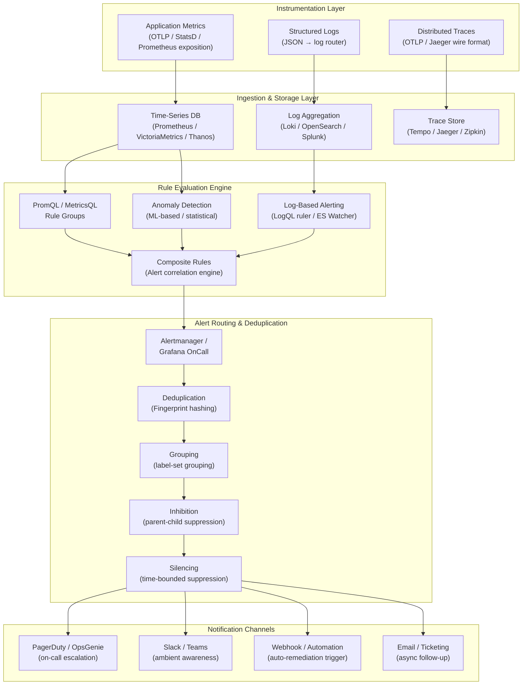
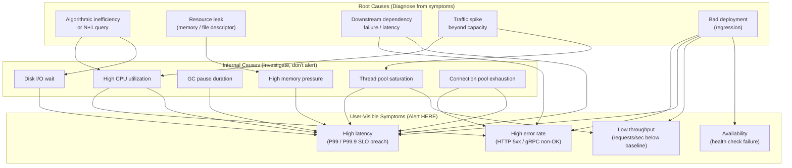
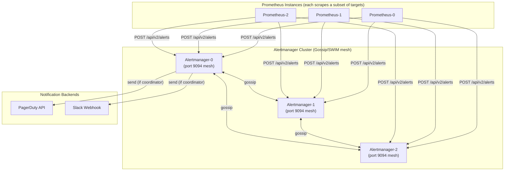
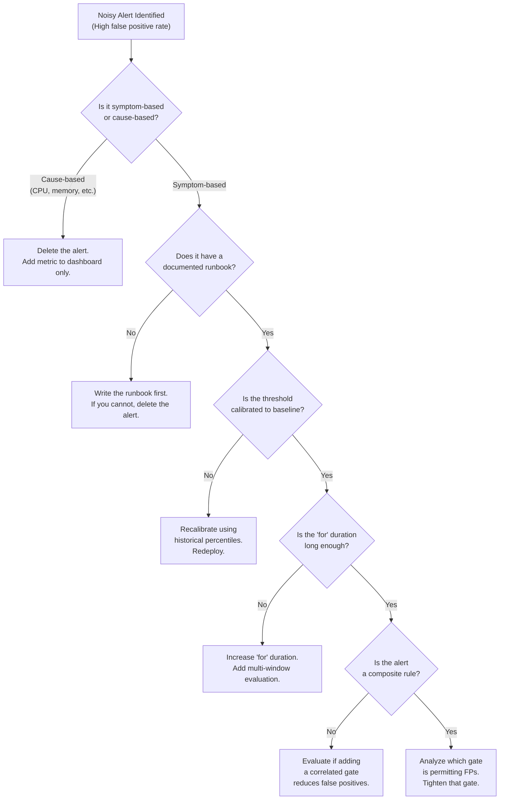
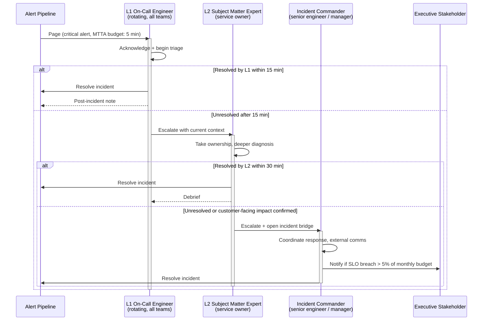

# Lesson 4: Alerting Strategies

## 1. First-Principles Intuition & Invariants

An alerting system is not simply a notification mechanism—it is a **decision boundary imposed on a continuous time-series signal space**. Every alert rule encodes a hypothesis: "if this condition holds, the system is in an anomalous state requiring human or automated intervention." The quality of that hypothesis, and the statistical rigor with which it is evaluated, determines the operational health of the entire engineering organization.

### The Signal Detection Theory Framework

Alerting is a problem of binary classification under uncertainty. Borrowed from signal detection theory (SDT), the outcome space for any alert condition has four cells:

| | Anomaly Present | Anomaly Absent |
|---|---|---|
| **Alert Fired** | True Positive (TP) | False Positive (FP) |
| **Alert Silent** | False Negative (FN) | True Negative (TN) |

Two scalar metrics dominate the design conversation:

- **Precision** (Positive Predictive Value) = TP / (TP + FP). The fraction of alerts that reflect a real problem. Low precision produces alert fatigue.
- **Recall** (Sensitivity) = TP / (TP + FN). The fraction of real problems that produce an alert. Low recall produces silent failures.

These two quantities exist in fundamental tension. Lowering an alert threshold raises recall and suppresses recall precision simultaneously. The engineering judgment is to choose an operating point on the precision-recall curve that reflects the **asymmetric cost of action versus inaction** for a given alert class. A revenue-critical checkout latency regression has a very different cost asymmetry than a background batch job's queue depth spike.

### The Four Pillars of an Alert's Validity

A well-formed alert satisfies four invariants:

**1. Actionability.** Every alert must map to a documented runbook or decision tree. If an engineer receives an alert and cannot answer "what do I do now?" within 60 seconds of reading it, the alert is not ready for production. Alerts without owners and without runbooks erode on-call trust and increase Mean Time To Acknowledgment (MTTA).

**2. Causality, Not Correlation.** Alerting on symptoms that are proximate causes of user harm (latency, error rate, saturation) is preferable to alerting on indicators that merely correlate with harm (CPU usage, memory pressure). The USE Method (Utilization, Saturation, Errors) and the RED Method (Rate, Errors, Duration) provide structured frameworks for identifying causal indicators. Alerting on CPU at 80% is a correlative smell; alerting on P99 request latency exceeding your SLO error budget burn rate is causal.

**3. Temporal Stability.** An alert condition must be evaluated over a window long enough to suppress transient noise but short enough to provide actionable detection latency. This is formalized in Prometheus's `for` clause (the minimum consecutive duration a condition must hold before firing) and in multi-window, multi-burn-rate alert configurations.

**4. Calibration.** Alert thresholds must be derived from observed baseline distributions, not from intuition or vendor defaults. A static threshold of "error rate > 1%" is meaningless without knowing the baseline error rate, its variance, and its diurnal pattern. Uncalibrated thresholds are the primary source of false positive floods.

### Error Budget Burn Rate: The Canonical Causal Alert

The most rigorous formulation of alerting against a Service Level Objective (SLO) is the **multi-window, multi-burn-rate** approach described in the Google SRE Workbook. Rather than alerting when an error rate exceeds a static threshold, you alert when the error budget is being consumed at a rate that would exhaust it before the end of the SLO compliance window.

Given:
- SLO target: 99.9% availability over a 30-day window
- Error budget: 0.1% × 30 days × 24 hours = **43.2 minutes** of allowable downtime

A burn rate of **1×** means the budget will be exactly exhausted in 30 days. A burn rate of **14.4×** means the budget will be exhausted in 30 days / 14.4 = **50 hours**. A burn rate of **720×** (complete outage) exhausts the budget in 2.4 minutes.

The Google Workbook recommends a two-tier structure:

| Burn Rate | Alert Window | Urgency | Budget Consumed on Trigger |
|---|---|---|---|
| 14.4× | 1 hour | Page immediately | 2% |
| 6× | 6 hours | Page (business hours) | 5% |
| 3× | 3 days | Ticket | 10% |

This structure directly connects alert urgency to business impact, eliminating the disconnect between infrastructure noise and customer experience.

---

## 2. Core Architecture & Mechanics

### The Complete Alert Pipeline

A production alerting system is a **streaming event-processing pipeline** composed of several distinct stages. Each stage introduces latency and has distinct failure modes.



### Stage 1: Instrumentation & Data Model

The fidelity of alerting is bounded by the fidelity of instrumentation. The OpenTelemetry data model defines three primary signal types:

- **Metrics**: Numerical measurements sampled over time. The Prometheus data model represents each metric as a set of labeled time series. A metric's cardinality—the number of unique label combinations—directly impacts storage cost and query latency.
- **Logs**: Discrete, timestamped textual events, ideally structured as JSON for machine parsing.
- **Traces**: Causally-linked spans representing the execution path of a single request across services.

For alerting, metrics are the primary signal due to their low storage cost and constant-time aggregation properties. Logs are used for symptom investigation and log-based alerting on specific event patterns. Traces are rarely used for real-time alerting due to their sampling nature and high cardinality.

### Stage 2: Rule Evaluation Engine

A rule evaluation engine periodically executes queries against the stored signal data and produces alert state transitions: `inactive → pending → firing → resolved`.

The `pending` intermediate state is critical. It corresponds to the Prometheus `for` clause—a hysteresis mechanism that prevents flapping caused by transient spikes. The evaluation cycle is:

```
evaluate(rule) →
  if condition_true AND current_state == inactive → transition to pending, record start_time
  if condition_true AND current_state == pending AND (now - start_time) >= for_duration → transition to firing
  if condition_false AND current_state ∈ {pending, firing} → transition to inactive (resolved)
```

The following is a production-grade Prometheus alerting rule file demonstrating multi-window burn rate alerting:

```yaml
# alerts/slo_burn_rate.yaml
groups:
  - name: slo.error_budget.burn_rate
    # Evaluation interval is defined in prometheus.yml (e.g., 15s).
    # Rules within a group are evaluated sequentially, sharing a single evaluation timestamp.
    rules:

      # ── Tier 1: Fast burn – page immediately ────────────────────────────────
      # Condition: burn rate exceeds 14.4× over a 1-hour window AND a 5-minute
      # window. The short window provides fast detection; the long window provides
      # noise suppression and prevents false pages from momentary spikes.
      - alert: ErrorBudgetBurnRateCritical
        expr: |
          (
            # 1-hour window burn rate
            sum(rate(http_requests_total{job="api-server", status=~"5.."}[1h]))
            /
            sum(rate(http_requests_total{job="api-server"}[1h]))
          ) > (14.4 * (1 - 0.999))
          and
          (
            # 5-minute short window for noise suppression
            sum(rate(http_requests_total{job="api-server", status=~"5.."}[5m]))
            /
            sum(rate(http_requests_total{job="api-server"}[5m]))
          ) > (14.4 * (1 - 0.999))
        # 'for' adds hysteresis: condition must be true for 2 minutes before firing.
        for: 2m
        labels:
          severity: critical
          team: platform
          slo: "api_availability_99.9"
        annotations:
          summary: "High error budget burn rate on {{ $labels.job }}"
          description: >
            Error budget burn rate is {{ $value | humanizePercentage }} (threshold: 1.44%).
            At this rate, the monthly error budget will be exhausted in
            {{ div 1 $value | humanizeDuration }}.
          runbook_url: "https://wiki.internal/runbooks/api-server-5xx"
          dashboard_url: "https://grafana.internal/d/api-slo?var-job={{ $labels.job }}"

      # ── Tier 2: Slow burn – ticket or business-hours page ───────────────────
      - alert: ErrorBudgetBurnRateHigh
        expr: |
          (
            sum(rate(http_requests_total{job="api-server", status=~"5.."}[6h]))
            /
            sum(rate(http_requests_total{job="api-server"}[6h]))
          ) > (6 * (1 - 0.999))
          and
          (
            sum(rate(http_requests_total{job="api-server", status=~"5.."}[30m]))
            /
            sum(rate(http_requests_total{job="api-server"}[30m]))
          ) > (6 * (1 - 0.999))
        for: 15m
        labels:
          severity: warning
          team: platform
          slo: "api_availability_99.9"
        annotations:
          summary: "Elevated error budget burn rate on {{ $labels.job }}"
          description: >
            Error budget burn rate is {{ $value | humanizePercentage }} over 6h window.
            Approximately 5% of monthly error budget will be consumed if this rate continues.
          runbook_url: "https://wiki.internal/runbooks/api-server-5xx"

      # ── SLO Burn Rate Recording Rule ────────────────────────────────────────
      # Pre-compute burn rates as recording rules for dashboard efficiency.
      # Recording rules are stored as new time series, enabling sub-second dashboard loads.
      - record: job:http_error_budget_burn_rate:ratio_rate1h
        expr: |
          sum(rate(http_requests_total{job="api-server", status=~"5.."}[1h]))
          /
          sum(rate(http_requests_total{job="api-server"}[1h]))
```

### Stage 3: Deduplication, Grouping, Inhibition, and Silencing

The Alertmanager (or equivalent) is responsible for transforming a raw stream of alert state transitions into an actionable, human-manageable notification stream. Its four mechanisms operate in sequence:

**Deduplication** uses a fingerprint derived from the alert's label set to identify repeated firings of the same logical alert. Within a configured `repeat_interval`, a re-firing alert does not generate a new notification. This prevents notification flooding during prolonged incidents.

**Grouping** batches alerts that share a label subset (e.g., `{cluster, alertname}`) into a single notification. This is essential when a single failure (e.g., a network partition) causes tens or hundreds of downstream alerts to fire simultaneously. The first notification fires after `group_wait` (allowing the initial batch to coalesce); subsequent group notifications fire after `group_interval`.

**Inhibition** implements parent-child alert suppression. When a "parent" alert (e.g., `ClusterNodeDown`) is firing, inhibition rules can suppress "child" alerts (e.g., `PodCrashLooping` on nodes within that cluster) that are caused by the same root event. This eliminates a common source of noise during major incidents.

**Silencing** provides time-bounded suppression of alerts matching a label selector. It is the correct mechanism for suppressing alerts during planned maintenance windows.

```yaml
# alertmanager/alertmanager.yml
global:
  resolve_timeout: 5m
  # SMTP, PagerDuty, Slack credentials are injected via environment variables
  # or a secrets manager — never hardcoded.

route:
  # Default receiver for unmatched alerts
  receiver: "default-slack"
  # Group alerts sharing these labels into a single notification
  group_by: ["alertname", "cluster", "namespace"]
  # Wait for sibling alerts before sending the first group notification
  group_wait: 30s
  # Minimum interval between notifications for an ongoing group
  group_interval: 5m
  # Minimum interval before re-sending a resolved or re-firing notification
  repeat_interval: 4h

  routes:
    # Critical alerts bypass grouping delay and go directly to PagerDuty
    - match:
        severity: critical
      receiver: "pagerduty-critical"
      group_wait: 0s
      repeat_interval: 1h
      continue: false  # Stop routing once matched

    # Platform team warnings go to dedicated Slack channel
    - match:
        severity: warning
        team: platform
      receiver: "platform-slack-warning"
      repeat_interval: 8h

inhibit_rules:
  # Suppress pod-level alerts when the node they run on is down
  - source_match:
      alertname: "NodeDown"
    target_match_re:
      alertname: "PodCrashLooping|PodNotReady|ContainerOOMKilled"
    # Inhibition only applies when the cluster label matches
    equal: ["cluster", "namespace"]

  # Suppress warning-severity alerts when a critical alert for the same
  # job is already firing, to reduce noise during active incidents
  - source_match:
      severity: critical
    target_match:
      severity: warning
    equal: ["alertname", "job"]

receivers:
  - name: "pagerduty-critical"
    pagerduty_configs:
      - routing_key: "${PAGERDUTY_INTEGRATION_KEY}"
        severity: "{{ if eq .CommonLabels.severity \"critical\" }}critical{{ else }}warning{{ end }}"
        description: "{{ .CommonAnnotations.summary }}"
        details:
          runbook: "{{ .CommonAnnotations.runbook_url }}"
          dashboard: "{{ .CommonAnnotations.dashboard_url }}"

  - name: "platform-slack-warning"
    slack_configs:
      - api_url: "${SLACK_WEBHOOK_URL}"
        channel: "#platform-alerts"
        title: "[{{ .Status | toUpper }}] {{ .CommonLabels.alertname }}"
        text: >-
          {{ range .Alerts }}
          *Alert:* {{ .Annotations.summary }}
          *Description:* {{ .Annotations.description }}
          *Runbook:* {{ .Annotations.runbook_url }}
          {{ end }}
        send_resolved: true
```

### Stage 4: Composite and Correlated Alerting

Simple threshold rules evaluate a single time series in isolation. Production systems require **composite rules** that reason across multiple signals simultaneously, because most real-world failure modes manifest as correlated changes across several metrics rather than a single metric breaching a threshold.

```python
# composite_alert_evaluator.py
#
# Demonstrates a correlated alert: "Deployment-induced regression"
# Fires when ALL THREE conditions hold simultaneously:
#   1. HTTP 5xx error rate rises above baseline
#   2. A deployment event was recorded within the past 10 minutes
#   3. P99 latency regressed by more than 20% from the pre-deployment baseline
#
# This pattern dramatically reduces false positives compared to evaluating
# any single condition independently.

from dataclasses import dataclass
from datetime import datetime, timedelta
from typing import Optional
import httpx  # pip install httpx
import statistics

PROMETHEUS_URL = "http://prometheus.internal:9090"


@dataclass(frozen=True)
class AlertContext:
    deployment_sha: str
    service: str
    fired_at: datetime
    error_rate_current: float
    error_rate_baseline: float
    p99_latency_current_ms: float
    p99_latency_baseline_ms: float


def query_range_scalar(
    client: httpx.Client,
    promql: str,
    start: datetime,
    end: datetime,
    step: str = "15s",
) -> list[float]:
    """Execute a Prometheus range query and return a flat list of float values."""
    response = client.get(
        f"{PROMETHEUS_URL}/api/v1/query_range",
        params={
            "query": promql,
            "start": start.timestamp(),
            "end": end.timestamp(),
            "step": step,
        },
        timeout=10.0,
    )
    response.raise_for_status()
    data = response.json()
    if data["status"] != "success":
        raise RuntimeError(f"Prometheus query failed: {data.get('error')}")
    results = data["data"]["result"]
    if not results:
        return []
    # Flatten all series values into a single list of floats
    return [float(v) for series in results for _, v in series["values"]]


def get_recent_deployment(
    client: httpx.Client,
    service: str,
    lookback_minutes: int = 10,
) -> Optional[str]:
    """
    Query a deployment event metric. Returns the deployment SHA if a
    deployment occurred within the lookback window, else None.
    Convention: deployment_info{service="...", sha="..."} is a gauge set to 1
    at deploy time and to 0 after resolve_timeout.
    """
    now = datetime.utcnow()
    window_start = now - timedelta(minutes=lookback_minutes)
    values = query_range_scalar(
        client,
        promql=f'deployment_info{{service="{service}"}}',
        start=window_start,
        end=now,
    )
    if not values or max(values) < 1.0:
        return None
    # In practice, also fetch the SHA label; simplified here for clarity.
    return "latest-deploy-sha"


def evaluate_deployment_regression_alert(service: str) -> Optional[AlertContext]:
    """
    Composite alert: fires when a recent deployment coincides with a
    statistically significant regression in error rate and P99 latency.
    Returns an AlertContext if the alert should fire, else None.
    """
    now = datetime.utcnow()
    # Baseline window: 1 hour before the evaluation point
    baseline_start = now - timedelta(hours=1, minutes=15)
    baseline_end = now - timedelta(minutes=15)
    # Current window: last 5 minutes
    current_start = now - timedelta(minutes=5)

    with httpx.Client() as client:
        # Gate 1: Was there a recent deployment?
        sha = get_recent_deployment(client, service)
        if sha is None:
            return None  # No deployment, suppress the composite rule entirely

        error_rate_expr = (
            f'sum(rate(http_requests_total{{service="{service}",status=~"5.."}}[5m])) '
            f'/ sum(rate(http_requests_total{{service="{service}"}}[5m]))'
        )
        p99_expr = (
            f'histogram_quantile(0.99, '
            f'sum by (le) (rate(http_request_duration_seconds_bucket{{service="{service}"}}[5m])))'
        )

        # Gate 2: Fetch current and baseline error rates
        current_errors = query_range_scalar(client, error_rate_expr, current_start, now)
        baseline_errors = query_range_scalar(client, error_rate_expr, baseline_start, baseline_end)

        if not current_errors or not baseline_errors:
            return None

        current_error_rate = statistics.mean(current_errors)
        baseline_error_rate = statistics.mean(baseline_errors)

        # Require a meaningful absolute increase (not just relative), to
        # avoid false positives at very low baseline error rates.
        error_rate_threshold = max(baseline_error_rate * 2.0, 0.005)
        if current_error_rate < error_rate_threshold:
            return None

        # Gate 3: Fetch current and baseline P99 latency
        current_p99_values = query_range_scalar(client, p99_expr, current_start, now)
        baseline_p99_values = query_range_scalar(client, p99_expr, baseline_start, baseline_end)

        if not current_p99_values or not baseline_p99_values:
            return None

        current_p99 = statistics.mean(current_p99_values) * 1000  # convert to ms
        baseline_p99 = statistics.mean(baseline_p99_values) * 1000

        if baseline_p99 > 0 and (current_p99 / baseline_p99) < 1.20:
            return None  # Latency did not regress by >= 20%

        # All three gates passed: emit the composite alert context
        return AlertContext(
            deployment_sha=sha,
            service=service,
            fired_at=now,
            error_rate_current=current_error_rate,
            error_rate_baseline=baseline_error_rate,
            p99_latency_current_ms=current_p99,
            p99_latency_baseline_ms=baseline_p99,
        )
```

---

## 3. Alert Taxonomy: Symptoms vs. Causes

A fundamental error in alerting system design is instrumenting internal implementation details rather than user-visible behaviors. This produces alerts that fire when nothing the user cares about is broken, and can remain silent when a user-visible failure exists.



The alerting strategy follows from this topology: **alert on the symptom nodes (top layer), investigate toward the root cause nodes (bottom layer) during incident response**. Internal cause metrics (middle layer) are valuable dashboard content and investigation signals, but firing pages on "CPU > 80%" without a corresponding user-visible symptom violates the actionability invariant.

---

## 4. Threshold Calibration: Statistical Methods

### Static Thresholds and Their Limitations

Static thresholds—e.g., "error rate > 1%"—are appropriate only when the underlying signal is stationary: its mean and variance do not change over time. Most production metrics are non-stationary. They exhibit:

- **Diurnal patterns**: traffic, error rates, and latency all vary with time of day and day of week.
- **Trend**: a gradually growing service will have monotonically increasing request rates.
- **Seasonality**: B2C services have weekly or annual patterns.

Applying a static threshold to a non-stationary signal produces false positives during normal peak periods and false negatives when the service is under low load.

### Seasonally-Adjusted Baselines

A robust baseline for a periodic signal can be constructed using a **week-over-week comparison** (for weekly seasonality) or a Holt-Winters exponential smoothing model (for multi-period seasonality):

```python
# baseline_calibrator.py
#
# Computes a dynamically-adjusted alert threshold using week-over-week
# comparison with standard deviation bands. The threshold adapts to
# diurnal and weekly patterns automatically.

import numpy as np
from datetime import datetime, timedelta
from typing import NamedTuple
import httpx

PROMETHEUS_URL = "http://prometheus.internal:9090"
# Alert if current value exceeds the same time last week by more than
# SIGMA_MULTIPLIER standard deviations of the week-over-week difference.
SIGMA_MULTIPLIER = 3.0
LOOKBACK_WEEKS = 4


class DynamicThreshold(NamedTuple):
    baseline_mean: float
    baseline_stddev: float
    upper_threshold: float
    lower_threshold: float


def fetch_metric_at_offset(
    client: httpx.Client,
    promql: str,
    offset_weeks: int,
    window_minutes: int = 60,
) -> list[float]:
    """Fetch metric values from exactly `offset_weeks` weeks ago."""
    end = datetime.utcnow() - timedelta(weeks=offset_weeks)
    start = end - timedelta(minutes=window_minutes)
    response = client.get(
        f"{PROMETHEUS_URL}/api/v1/query_range",
        params={
            "query": promql,
            "start": start.timestamp(),
            "end": end.timestamp(),
            "step": "60s",
        },
        timeout=10.0,
    )
    response.raise_for_status()
    data = response.json()
    results = data["data"]["result"]
    return [float(v) for series in results for _, v in series["values"]]


def compute_dynamic_threshold(
    promql: str,
    sigma_multiplier: float = SIGMA_MULTIPLIER,
    lookback_weeks: int = LOOKBACK_WEEKS,
) -> DynamicThreshold:
    """
    Computes a dynamic alert threshold by sampling the metric value at the
    same clock time for the past N weeks and computing mean ± k*stddev.
    """
    with httpx.Client() as client:
        historical_means: list[float] = []
        for week_offset in range(1, lookback_weeks + 1):
            values = fetch_metric_at_offset(client, promql, week_offset)
            if values:
                historical_means.append(float(np.mean(values)))

    if len(historical_means) < 2:
        raise ValueError(
            f"Insufficient historical data ({len(historical_means)} weeks) "
            "to compute a stable baseline threshold."
        )

    baseline_mean = float(np.mean(historical_means))
    baseline_stddev = float(np.std(historical_means, ddof=1))  # sample std dev

    return DynamicThreshold(
        baseline_mean=baseline_mean,
        baseline_stddev=baseline_stddev,
        upper_threshold=baseline_mean + sigma_multiplier * baseline_stddev,
        lower_threshold=max(0.0, baseline_mean - sigma_multiplier * baseline_stddev),
    )
```

### Percentile-Based Thresholds and the Problem with Averages

Averaging latency is statistically misleading for right-skewed distributions, which are the norm in distributed systems. The mean is dominated by the bulk of fast requests and masks the tail behavior that most affects user experience. The P99 or P99.9 latency—the value below which 99% or 99.9% of requests fall—is the operationally relevant statistic because it characterizes the worst experience a typical user will encounter.

The Prometheus `histogram_quantile` function computes approximate quantiles from histogram buckets using **linear interpolation within each bucket**. This is an approximation. The fidelity of the approximation depends entirely on how well the histogram buckets are positioned relative to the actual distribution. Buckets must be sized to capture the tail accurately: for a service with P99 ≈ 200ms, buckets at 100ms, 150ms, 175ms, 200ms, 250ms provide far higher fidelity than the default Prometheus bucket set, which uses a geometric progression starting at 5ms.

```go
// internal/metrics/latency.go
// Production-grade histogram registration with custom buckets
// calibrated to observed latency distribution.

package metrics

import (
	"github.com/prometheus/client_golang/prometheus"
	"github.com/prometheus/client_golang/prometheus/promauto"
)

var (
	// HTTPRequestDuration uses custom buckets derived from load testing.
	// Bucket boundaries (in seconds) are positioned around observed P50, P90,
	// P95, P99, and P99.9 from production traffic baseline.
	// Using promauto registers the histogram with the default registry
	// automatically at package init time.
	HTTPRequestDuration = promauto.NewHistogramVec(
		prometheus.HistogramOpts{
			Namespace: "api",
			Subsystem: "http",
			Name:      "request_duration_seconds",
			Help:      "HTTP request duration in seconds, by method, path, and status code.",
			// Custom bucket boundaries targeting the observed distribution.
			// At P99 ≈ 0.2s, we have 4 buckets in the 0.1s–0.3s range.
			Buckets: []float64{
				0.001, 0.005, 0.010, 0.025, 0.050,
				0.075, 0.100, 0.150, 0.200, 0.250,
				0.300, 0.400, 0.500, 0.750, 1.000,
				1.500, 2.000, 5.000,
			},
			// NativeHistogramBucketFactor enables Prometheus native histograms
			// (sparse, exponential-bucket histograms) alongside the classic
			// fixed-bucket histogram. Native histograms offer arbitrary-precision
			// quantile estimation without pre-defining bucket boundaries.
			// Requires Prometheus >= 2.40 and feature flag --enable-feature=native-histograms.
			NativeHistogramBucketFactor:     1.1,
			NativeHistogramMaxBucketNumber:  100,
			NativeHistogramMinResetDuration: 0,
		},
		[]string{"method", "path_template", "status_code"},
	)
)
```

---

## 5. High-Performance Optimization & Failure Modes

### The Alert Evaluation Latency Budget

The end-to-end latency from "anomaly occurs" to "engineer is paged" decomposes as:

```
total_detection_latency = scrape_interval
                        + rule_evaluation_interval
                        + for_duration
                        + alertmanager_group_wait
                        + notification_channel_delivery_latency
```

For Prometheus with default configuration:
- `scrape_interval`: 15s (time for the metric value to be recorded)
- `rule_evaluation_interval`: 15s (time for the rule to be evaluated after ingestion)
- `for_duration`: 2m (hysteresis)
- `alertmanager_group_wait`: 30s
- PagerDuty delivery: ~5s

**Minimum realistic MTTD**: 2m + 15s + 15s + 30s + 5s ≈ **3 minutes 5 seconds**

This is the floor for Prometheus-based alerting. Any SLO requiring sub-minute detection latency requires either reducing `for_duration` (accepting more false positives) or switching to a stream-processing alerting engine.

### Cardinality Explosion: The Primary Scaling Failure Mode

The most common production failure mode in Prometheus-based alerting is **cardinality explosion**: a sudden, uncontrolled increase in the number of unique time series stored in the TSDB. This manifests as:

1. High-cardinality label values introduced into metrics (e.g., user IDs, request IDs, or trace IDs used as label values).
2. Alert rule `expr` queries with high fanout (the query returns thousands of series per evaluation cycle).
3. `external_labels` configured incorrectly, causing series duplication across shards.

The impact is severe: Prometheus's TSDB head is an in-memory structure. Cardinality > 10M active series on a single Prometheus instance will cause OOM crashes under normal 16-32 GB server configurations. The `tsdb` WAL checkpoint and compaction CPU overhead also scales with series count.

**Mitigation**:
- Enforce cardinality limits at the exposition layer (drop high-cardinality labels before ingestion).
- Use `topk` and `bottomk` recording rules to pre-aggregate cardinality at ingest time.
- Monitor `prometheus_tsdb_head_series` and alert when it exceeds a configured ceiling.

```yaml
# cardinality_guard.yaml — alert on runaway series growth
groups:
  - name: prometheus.self_monitoring
    rules:
      - alert: PrometheusCardinalityExplosion
        expr: |
          increase(prometheus_tsdb_head_series[10m]) > 50000
        for: 5m
        labels:
          severity: critical
          team: observability
        annotations:
          summary: "Prometheus TSDB series count growing rapidly on {{ $labels.instance }}"
          description: >
            prometheus_tsdb_head_series increased by {{ $value | humanize }} in the last 10m.
            Total active series: {{ query "prometheus_tsdb_head_series" | first | value | humanize }}.
            Likely cause: a new high-cardinality label was introduced to a high-volume metric.
          runbook_url: "https://wiki.internal/runbooks/prometheus-cardinality"

      - alert: PrometheusRuleEvaluationSlow
        expr: |
          prometheus_rule_group_last_duration_seconds
          > prometheus_rule_group_interval_seconds * 0.9
        for: 10m
        labels:
          severity: warning
          team: observability
        annotations:
          summary: "Rule group {{ $labels.rule_group }} evaluation consuming > 90% of its interval"
          description: >
            Rule group is taking {{ $value | humanizeDuration }} to evaluate against
            an interval of {{ query "prometheus_rule_group_interval_seconds{rule_group=\"" }}{{ $labels.rule_group }}{{ "\"}" | first | value | humanizeDuration }}.
            This will cause evaluation skew and stale alert state.
```

### Alertmanager High Availability

A single Alertmanager instance is a single point of failure in the alert pipeline. The Alertmanager Gossip protocol (based on Memberlist, a SWIM-variant membership protocol) enables a cluster of Alertmanager instances to share alert state via eventual consistency:



The deduplication key in Alertmanager's distributed notification log (`nflog`) is the alert's label fingerprint plus the receiver name. Each Alertmanager instance writes `nflog` entries to the mesh before sending a notification, so if any other instance already sent the same notification within the `repeat_interval`, the subsequent instance skips sending. This prevents duplicate pages when all Prometheus instances send identical alerts to all three Alertmanager nodes simultaneously.

### Dead Man's Switch: Certifying Alert Pipeline Liveness

A fundamental blind spot in threshold-based alerting is that the system cannot alert on its own silence. If the entire metrics pipeline fails—Prometheus crashes, the scrape target becomes unreachable, or Alertmanager loses connectivity to its notification backend—no alert fires, because no rule evaluation occurs.

The **Dead Man's Switch** (also called a watchdog alert) is the solution. It is an alert that fires continuously when the pipeline is healthy. External monitoring infrastructure (e.g., Healthchecks.io, PagerDuty's heartbeat monitoring, or a second independent monitoring stack) expects to receive this heartbeat on a fixed interval. If the heartbeat is absent for longer than the interval, the external system sends an alert independently of the internal pipeline.

```yaml
# deadmans_switch.yaml
groups:
  - name: watchdog
    rules:
      # This alert is designed to always fire.
      # An external system monitors for it and alerts if it goes absent.
      - alert: Watchdog
        expr: vector(1)
        labels:
          severity: none
          # Route this to a dedicated receiver that pings the heartbeat endpoint
          receiver: "deadmansswitch"
        annotations:
          summary: "Alerting pipeline liveness probe"
          description: >
            This alert fires continuously to certify that the Prometheus →
            Alertmanager → notification pipeline is operational end-to-end.
            If this alert stops firing, the monitoring infrastructure itself
            has failed and must be investigated immediately.
```

```yaml
# alertmanager.yml — Dead Man's Switch receiver
receivers:
  - name: "deadmansswitch"
    webhook_configs:
      - url: "https://hc-ping.internal/your-uuid-here"
        send_resolved: false  # Only ping on firing; absence of ping triggers external alert
```

### Alert Fatigue: Measurement and Remediation

Alert fatigue is not a cultural problem; it is an engineering metric. It is quantifiable and addressable through the same rigor applied to any system reliability problem.

**Measurement**: Instrument the following counters in your incident management platform (PagerDuty, OpsGenie):

- **Acknowledgment rate**: fraction of pages acknowledged by the on-call engineer (vs. timed out). Low acknowledgment = overwhelmed responder.
- **MTTA by alert name**: alerts with high MTTA are low-trust alerts that engineers have learned to deprioritize.
- **Override rate**: fraction of pages that the on-call immediately silenced without investigation. High override = known noisy alert.
- **Actionability rate**: fraction of incidents where the responder performed a remediation action (rollback, restart, ticket) vs. observing the alert resolve on its own. Alerts that auto-resolve without action are prime fatigue candidates.

**Remediation decision tree**:



---

## 6. Runbook Engineering

A runbook is not documentation—it is an **executable decision procedure** encoded in human-readable form. The quality of a runbook determines the Mean Time To Resolution (MTTR) for the class of incidents it covers, independent of the experience level of the on-call engineer.

A production-grade runbook entry contains the following sections, each with specific invariants:

**1. Alert Fingerprint.** Alert name, severity, owning team, SLO impact, and links to the alert definition and dashboards. This section must be machine-readable to enable automated context injection into incident management platforms.

**2. Triage Decision Tree.** A sequence of diagnostic commands or dashboard checks with yes/no branching. The responder should be able to triage to a diagnosis within 5 minutes using only this section and without requiring deep system knowledge.

**3. Remediation Procedures.** Ordered, numbered steps for each identified root cause. Each step must include the exact command to run, what output to expect on success, and what to do if the command fails.

**4. Escalation Path.** Named individuals or teams to escalate to when the runbook does not resolve the issue, with contact methods and expected response times.

**5. Post-Incident Checklist.** Items to verify before closing the incident (e.g., confirm SLO recovery, file a follow-up ticket, update the runbook if the procedure was inadequate).

```markdown
<!-- runbooks/api-server-5xx.md -->
# Runbook: ErrorBudgetBurnRateCritical — api-server

**Alert:** `ErrorBudgetBurnRateCritical`
**Severity:** Critical
**Owner:** Platform Engineering
**SLO:** api_availability_99.9 (30-day rolling)
**Dashboards:** [API SLO Dashboard](https://grafana.internal/d/api-slo)
**Definition:** [alerts/slo_burn_rate.yaml](https://github.com/internal/infra/alerts/slo_burn_rate.yaml)

---

## Triage (complete within 5 minutes)

### Step 1: Confirm scope
Run the following query in Grafana Explore to determine whether the error rate
is elevated across all instances or isolated to a subset:

```promql
sum by (instance) (rate(http_requests_total{job="api-server", status=~"5.."}[5m]))
/ sum by (instance) (rate(http_requests_total{job="api-server"}[5m]))
```

- **All instances elevated** → likely a code deployment or shared dependency issue. Proceed to Step 2.
- **Single instance elevated** → likely a node-level failure. Proceed to Step 3.

### Step 2: Check for recent deployments
```bash
# List the last 5 deployments to api-server in the last 2 hours
kubectl rollout history deployment/api-server -n production | tail -5
```
- If a deployment occurred in the last 30 minutes → **Rollback** (see Remediation A).
- If no recent deployment → Proceed to Step 4.

### Step 3: Isolate the failing instance
```bash
# Remove the failing instance from the load balancer target group
kubectl annotate pod <pod-name> -n production "service.kubernetes.io/drain=true"
# Verify the pod is removed from Endpoints
kubectl get endpoints api-server -n production
```
Monitor the error rate for 2 minutes. If it recovers, the problem is node-local.
File a P2 ticket and drain/reschedule the pod.

### Step 4: Check downstream dependencies
```promql
# Check error rate for each downstream service called by api-server
sum by (target_service) (rate(grpc_client_handled_total{job="api-server", grpc_code!="OK"}[5m]))
/ sum by (target_service) (rate(grpc_client_handled_total{job="api-server"}[5m]))
```
If a downstream dependency shows > 10% error rate, escalate to the owning team
(see Escalation Path).

---

## Remediation

### A: Roll back a bad deployment
```bash
# Identify the last known-good revision
kubectl rollout history deployment/api-server -n production

# Roll back to the previous revision
kubectl rollout undo deployment/api-server -n production

# Confirm rollout completes successfully
kubectl rollout status deployment/api-server -n production --timeout=5m

# Verify error rate recovers (wait 3–5 minutes for Prometheus to reflect change)
```

### B: Restart a CrashLooping pod
```bash
kubectl delete pod <pod-name> -n production
# Kubernetes will reschedule automatically. Monitor the new pod's logs:
kubectl logs -f deployment/api-server -n production --since=2m
```

---

## Escalation
- **Deployment-related:** Page the engineer who authored the deployment via
  the deployment PR's author field.
- **Database dependency:** Escalate to `#database-oncall` Slack channel.
- **Unresolved after 30 minutes:** Page the Platform Engineering manager.

---

## Post-Incident Checklist
- [ ] Error rate returned below SLO threshold and alert resolved
- [ ] Root cause identified and documented in the incident timeline
- [ ] Follow-up action item created in Jira with P1/P2 priority
- [ ] Runbook updated if any procedure was inaccurate or incomplete
- [ ] SLO impact calculated and reported to stakeholders if error budget
      consumption exceeded 5%
```

---

## 7. Advanced Patterns: Anomaly Detection and Adaptive Alerting

Static and seasonally-adjusted threshold alerts cover the vast majority of production alerting use cases. However, two classes of anomaly require more sophisticated detection:

**Slow-burn anomalies**: Gradual metric drift that never crosses a threshold but indicates long-term system degradation (e.g., memory that grows 0.1% per hour due to a small leak).

**Unknown-unknown failures**: New failure modes for which no threshold rule exists because the failure pattern has never been observed before.

### CUSUM: Sequential Change Point Detection

The Cumulative Sum (CUSUM) algorithm is a sequential analysis technique for detecting a persistent shift in the mean of a stationary time series. Unlike a threshold test that evaluates instantaneous values, CUSUM accumulates evidence of a mean shift over time, making it sensitive to small but sustained drifts.

For a time series $x_1, x_2, \ldots, x_n$ with estimated in-control mean $\mu_0$ and standard deviation $\sigma_0$, the two-sided CUSUM statistic is:

$$S_n^+ = \max(0, S_{n-1}^+ + (x_n - \mu_0)/\sigma_0 - k)$$
$$S_n^- = \max(0, S_{n-1}^- - (x_n - \mu_0)/\sigma_0 - k)$$

An alert fires when $S_n^+$ or $S_n^-$ exceeds a threshold $h$. The parameter $k$ (the reference value, typically 0.5) controls sensitivity to shifts, and $h$ (typically 4–5) controls the false positive rate.

```rust
// cusum_detector.rs
// Two-sided CUSUM implementation for streaming time-series anomaly detection.
// Suitable for embedding in a sidecar monitoring agent or a stream processor.

#[derive(Debug, Clone)]
pub struct CusumDetector {
    /// In-control mean (estimated from historical baseline)
    mu_0: f64,
    /// In-control standard deviation
    sigma_0: f64,
    /// Reference value (allowance parameter). Typically 0.5.
    /// Controls the minimum detectable shift in units of sigma_0.
    k: f64,
    /// Decision threshold. Alert fires when cumsum exceeds h.
    /// Typically 4.0–5.0. Higher values reduce false positive rate.
    h: f64,
    /// Upper CUSUM accumulator (detects positive mean shifts)
    s_plus: f64,
    /// Lower CUSUM accumulator (detects negative mean shifts)
    s_minus: f64,
    /// Count of samples processed since last reset
    n: u64,
}

impl CusumDetector {
    pub fn new(mu_0: f64, sigma_0: f64, k: f64, h: f64) -> Self {
        assert!(sigma_0 > 0.0, "sigma_0 must be positive");
        assert!(k > 0.0, "k must be positive");
        assert!(h > 0.0, "h must be positive");
        Self {
            mu_0,
            sigma_0,
            k,
            h,
            s_plus: 0.0,
            s_minus: 0.0,
            n: 0,
        }
    }

    /// Process a single observation. Returns the alert state.
    pub fn update(&mut self, x: f64) -> CusumAlert {
        // Standardize the observation
        let z = (x - self.mu_0) / self.sigma_0;

        // Update accumulators
        self.s_plus = f64::max(0.0, self.s_plus + z - self.k);
        self.s_minus = f64::max(0.0, self.s_minus - z - self.k);
        self.n += 1;

        let upper_breach = self.s_plus > self.h;
        let lower_breach = self.s_minus > self.h;

        if upper_breach || lower_breach {
            let direction = if upper_breach {
                ShiftDirection::Positive
            } else {
                ShiftDirection::Negative
            };
            CusumAlert::Anomaly {
                direction,
                s_plus: self.s_plus,
                s_minus: self.s_minus,
                n: self.n,
            }
        } else {
            CusumAlert::Normal {
                s_plus: self.s_plus,
                s_minus: self.s_minus,
            }
        }
    }

    /// Reset accumulators after an alert is acknowledged.
    /// In a real deployment, also re-estimate mu_0 and sigma_0 from
    /// post-incident baseline data before resuming detection.
    pub fn reset(&mut self) {
        self.s_plus = 0.0;
        self.s_minus = 0.0;
        self.n = 0;
    }
}

#[derive(Debug, Clone, PartialEq)]
pub enum ShiftDirection {
    Positive,
    Negative,
}

#[derive(Debug, Clone)]
pub enum CusumAlert {
    Normal { s_plus: f64, s_minus: f64 },
    Anomaly { direction: ShiftDirection, s_plus: f64, s_minus: f64, n: u64 },
}

#[cfg(test)]
mod tests {
    use super::*;

    #[test]
    fn detects_sustained_positive_shift() {
        // Baseline: mean=100, stddev=5
        let mut detector = CusumDetector::new(100.0, 5.0, 0.5, 4.0);

        // Feed 50 in-control samples (z-scores near 0)
        for _ in 0..50 {
            let result = detector.update(100.0);
            assert!(matches!(result, CusumAlert::Normal { .. }));
        }

        // Introduce a sustained +1-sigma shift (mean = 105)
        let mut fired = false;
        for i in 0..30 {
            match detector.update(105.0) {
                CusumAlert::Anomaly { direction: ShiftDirection::Positive, .. } => {
                    fired = true;
                    println!("Anomaly detected after {} samples at +1-sigma shift", i + 1);
                    break;
                }
                _ => {}
            }
        }
        // CUSUM with k=0.5, h=4.0 should detect a +1-sigma shift in ~9 samples
        assert!(fired, "CUSUM failed to detect a sustained +1-sigma positive shift");
    }

    #[test]
    fn does_not_fire_on_transient_spike() {
        let mut detector = CusumDetector::new(100.0, 5.0, 0.5, 4.0);
        // A single +3-sigma observation should not trigger with these parameters
        detector.update(100.0); // warm-up
        let result = detector.update(115.0); // +3-sigma transient
        assert!(matches!(result, CusumAlert::Normal { .. }));
    }
}
```

### On-Call Rotation and Escalation Policy Design

The technical quality of alerts is bounded by the operational structure that receives them. An escalation policy with a single tier (everyone gets paged for everything) produces an alert fatigue steady state regardless of threshold quality. A well-designed on-call structure maps alert severity to escalation tier:



---

## 8. Summary: Alert Design Checklist

A production alert satisfies all of the following before it is merged into the alerting configuration:

- **Symptom-based**: The alert condition directly measures user-visible harm (error rate, latency, availability), not an internal implementation metric.
- **Calibrated threshold**: The threshold was derived from at least 2 weeks of historical data, not from intuition or vendor defaults.
- **Hysteresis applied**: A `for` duration (or multi-window evaluation) is set to suppress transient noise, with the duration documented in the rule comment.
- **SLO-linked**: For customer-facing services, the alert maps to a specific SLO and is expressed as an error budget burn rate where possible.
- **Actionable runbook**: A runbook exists, is reachable from the alert's annotation, and was validated by at least one on-call rotation.
- **Inhibition rules reviewed**: Parent-child relationships to other alerts in the same system are documented and inhibition rules are configured.
- **Dead Man's Switch present**: The alerting pipeline for the service has a liveness probe that is monitored by an external system.
- **Cardinality bounded**: The alert's `expr` query has been profiled for series count and evaluated within the rule evaluation interval budget (< 90% of the interval).
- **Fatigue metrics reviewed**: The alert is tracked in the monthly alert quality review and has a measured actionability rate > 80%.
