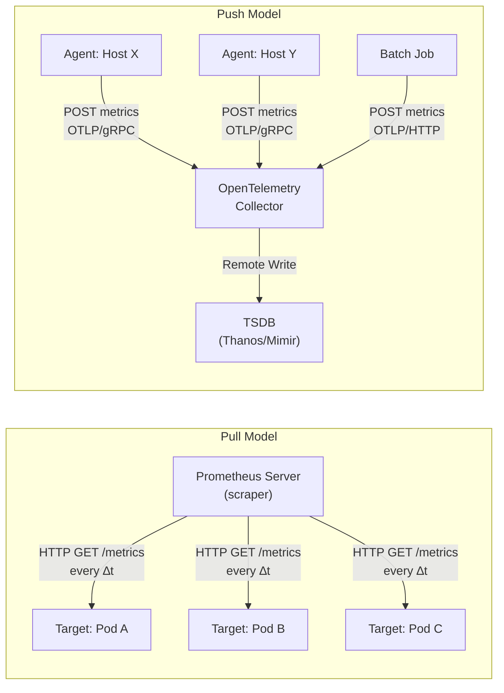
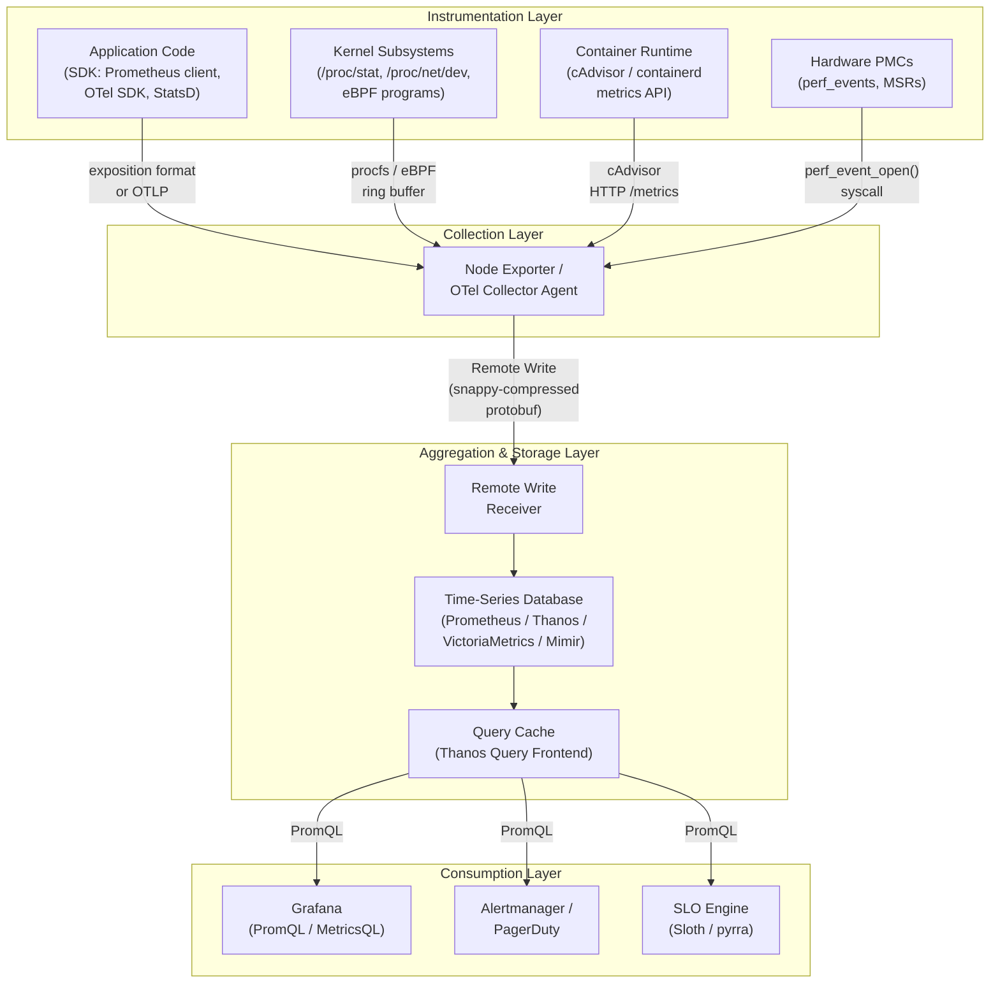
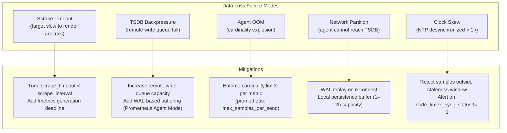
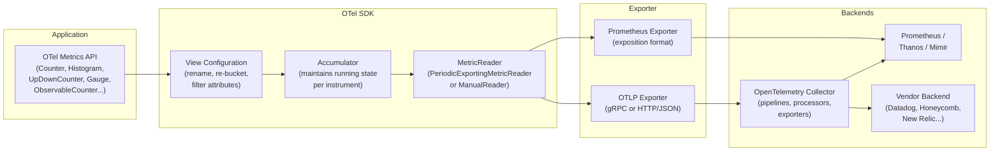

# Lesson 5: Metrics Collection

## 1. First-Principles Intuition & Invariants

Observability, in the information-theoretic sense, asks whether the internal state of a system can be inferred from its external outputs. For distributed systems, that inference rests almost entirely on three signal types: logs, traces, and **metrics**. Of these three, metrics are the most computationally tractable: they are fixed-width numerical samples that can be stored, aggregated, and queried at scale without the blowup associated with structured log payloads or distributed trace graphs.

A metric is a **named, time-stamped, dimensioned scalar**. Formally, a single sample can be expressed as:

```text
(name, {label_key: label_value, ...}, value, timestamp_unix_ms)
```

That four-tuple is the irreducible atom. Everything else—aggregation windows, rollup tiers, alerting rules—is built from sequences of these atoms.

### Why Numerical Sampling Works

Modern operating systems and language runtimes expose system state through a set of hardware performance counters (PMCs), kernel data structures (`/proc`, `kstat`, `sysctl`), and application-level instrumentation hooks. These surfaces are sampled at a chosen **scrape interval** ∆t. The Nyquist–Shannon sampling theorem applies conceptually: to faithfully reconstruct a signal changing at frequency *f*, you must sample at ≥ 2*f*. For latency spikes that last ~100 ms, a 10-second scrape interval *cannot* capture individual spikes—it can only observe their aggregate footprint on a histogram bucket. This is not a defect; it is the fundamental trade-off that makes metrics cheap enough to retain for months.

### The Three Primitive Metric Types

Understanding why each type exists requires understanding *what invariant it preserves* across aggregation.

**Counter** — A monotonically non-decreasing integer that resets only on process restart. Because it only ever increases, the meaningful derived quantity is `rate(counter[window])` — the per-second increment. Rate is *aggregation-safe*: `sum(rate(requests_total[5m]))` across replicas gives the correct fleet-wide request rate. Raw counter values, by contrast, are meaningless in isolation.

**Gauge** — An arbitrarily signed float representing a point-in-time measurement (memory bytes in use, queue depth, temperature). Gauges are *not* aggregation-safe over time: `avg(memory_bytes[5m])` gives the average over the window, not the current value. Alerting on a gauge requires careful choice of aggregation function (`max`, `last`, `avg`) depending on the semantic intent.

**Histogram** — A pre-aggregated distribution. The client maintains a fixed set of *le* (less-than-or-equal) buckets and a running sum and count. At scrape time, the agent reads cumulative bucket counts. Histograms enable quantile estimation via `histogram_quantile()` without storing every individual sample. The accuracy of the estimate depends on bucket placement relative to the actual distribution—a misconfigured bucket layout (e.g., all latency buckets above 1 s for a service with p99 = 50 ms) degrades quantile accuracy to uselessness.

**Summary** — A client-side quantile computation that emits pre-calculated φ-quantiles. Summaries are accurate but *not aggregatable* across instances: you cannot add two p99 values and divide by two to get the fleet p99. For this reason, Prometheus and most modern systems prefer histograms over summaries for multi-instance deployments.

The table below summarizes the invariants:

| Type | Aggregation over instances | Aggregation over time | Storage cost per series |
|---|---|---|---|
| Counter | `sum()` ✓ | `rate()` required | Low (monotone delta) |
| Gauge | `sum()`, `avg()`, `max()` ✓ | `avg()`, `max()` with care | Low |
| Histogram | `sum()` per bucket ✓ | Cumulative by design | Medium (N buckets + 2) |
| Summary | ✗ — φ-quantiles not additive | N/A | Low (K quantiles) |

### The Cardinality Constraint

Every unique combination of label values creates a distinct **time series**. A metric `http_requests_total` with labels `{method, status, endpoint}` explodes combinatorially: 5 methods × 20 status codes × 500 endpoints = 50,000 series. Multiply by the number of replicas, and a single metric can generate millions of active series. Time-series databases impose a *cardinality budget* because high-cardinality metrics dominate both ingestion CPU and index memory. The invariant to preserve is: **labels must have bounded, low-cardinality value sets**. User IDs, request IDs, and email addresses are categorically forbidden as label values.

---

## 2. Core Architecture & Mechanics

### The Pull vs. Push Dichotomy

Two fundamental collection models exist, and each embeds different assumptions about network topology, security, and reliability.

**Pull (scrape-based)**: The metrics server initiates HTTP GET requests to each monitored target on a known endpoint (conventionally `/metrics`). Prometheus pioneered this model. Advantages: the server controls scrape timing (eliminating clock skew between agents), failed targets are immediately detectable (the scrape fails), and there is no need for targets to know the address of the metrics server. Disadvantages: requires the server to be able to reach every target directly, which is problematic for ephemeral jobs or targets behind NAT.

**Push**: Agents emit metrics to a receiver endpoint. StatsD, Graphite's Carbon, and OpenTelemetry Collector's OTLP ingestion all use push. Advantages: works across network boundaries; short-lived batch jobs can emit metrics before they exit (Prometheus's Pushgateway provides a push-to-pull bridge for this case). Disadvantages: the server cannot distinguish between a silent target and a dead one without a heartbeat metric; multiple pushers can overwrite each other's data on a shared Pushgateway.



### The Full Collection Pipeline



### Kernel-Level Metric Sources

The `/proc` virtual filesystem is the primary interface for kernel-exported metrics on Linux. It is not a real filesystem: reads from `/proc` trigger kernel functions that fill a kernel-allocated buffer and copy it to userspace. This is cheap but not free—`/proc/net/dev` on a host with hundreds of network interfaces can require non-trivial kernel time to render.

Key files and their semantic content:

| File | Key Metrics |
|---|---|
| `/proc/stat` | CPU time per mode (user, nice, system, idle, iowait, irq, softirq, steal) per CPU |
| `/proc/meminfo` | Total, free, available, buffers, cached, SwapTotal, SwapFree, HugePages |
| `/proc/net/dev` | Per-interface byte/packet/error/drop counters (cumulative) |
| `/proc/diskstats` | Per-device I/O operations, sectors, time in queue (see `iostat` semantics) |
| `/proc/[pid]/status` | Per-process VmRSS, VmSize, voluntary/nonvoluntary context switches |
| `/proc/[pid]/io` | Per-process read_bytes, write_bytes (accounting I/O) |
| `/sys/class/net/[iface]/statistics/` | Same as `/proc/net/dev` but sysfs-structured |

**eBPF** has become the preferred mechanism for metrics that cannot be expressed through procfs—per-connection TCP RTT, kernel function latency, syscall argument inspection. An eBPF program is verified and JIT-compiled by the kernel, then attached to a kprobe, tracepoint, or XDP hook. Data flows to userspace via **perf ring buffers** or **BPF maps** (hash maps, arrays, histograms). Tools like `bpftrace`, Cilium's Hubble, and the OpenTelemetry eBPF receiver use this pathway.

### The Prometheus Exposition Format

The de facto standard for the pull model is the Prometheus text exposition format (and its binary successor, OpenMetrics). An agent at `/metrics` emits UTF-8 text:

```bash
# HELP http_requests_total Total number of HTTP requests
# TYPE http_requests_total counter
http_requests_total{method="GET",status="200",handler="/api/v1/users"} 142756 1710000000000
http_requests_total{method="POST",status="201",handler="/api/v1/users"} 3821 1710000000000
http_requests_total{method="GET",status="500",handler="/api/v1/users"} 47 1710000000000

# HELP http_request_duration_seconds Histogram of HTTP request durations
# TYPE http_request_duration_seconds histogram
http_request_duration_seconds_bucket{handler="/api/v1/users",le="0.005"} 98432
http_request_duration_seconds_bucket{handler="/api/v1/users",le="0.01"}  112300
http_request_duration_seconds_bucket{handler="/api/v1/users",le="0.025"} 134200
http_request_duration_seconds_bucket{handler="/api/v1/users",le="0.05"}  139800
http_request_duration_seconds_bucket{handler="/api/v1/users",le="0.1"}   141900
http_request_duration_seconds_bucket{handler="/api/v1/users",le="0.25"}  142400
http_request_duration_seconds_bucket{handler="/api/v1/users",le="0.5"}   142650
http_request_duration_seconds_bucket{handler="/api/v1/users",le="1.0"}   142720
http_request_duration_seconds_bucket{handler="/api/v1/users",le="+Inf"} 142756
http_request_duration_seconds_sum{handler="/api/v1/users"}   4312.7
http_request_duration_seconds_count{handler="/api/v1/users"} 142756

# HELP process_resident_memory_bytes Resident set size in bytes
# TYPE process_resident_memory_bytes gauge
process_resident_memory_bytes 52428800
```

The histogram's `+Inf` bucket must equal the `_count` value—this is a hard invariant. The `_sum` field is a float and can overflow for long-lived processes counting latency in seconds; this is a known limitation of the exposition format.

### Time-Series Database Internals

Prometheus's local storage engine (TSDB, introduced in Prometheus 2.0, also used standalone) organizes data into two-hour **blocks** on disk. Each block is immutable and contains:

- `chunks/`: Raw sample data, compressed with Gorilla encoding (XOR delta-of-delta for timestamps, XOR for values). A typical chunk stores ~120 samples in ~1.5 bytes/sample.
- `index/`: An inverted index mapping label name→value→series IDs, plus a posting list for each series ID. This enables label matcher queries without full table scans.
- `meta.json`: Block metadata (min/max time, series count, checksum).
- `tombstones`: Soft-delete records; physically removed on compaction.

The in-memory **head block** (the current, mutable block) maintains a WAL (Write-Ahead Log) for crash recovery. Samples land in the WAL first, then in the in-memory chunk. On a 2-hour boundary, the head block is compacted to disk.

Compaction merges blocks, removes tombstones, and enforces retention. Thanos and Cortex/Mimir extend this by **shipping blocks to object storage** (S3, GCS) and providing a horizontally scalable query layer over them, decoupling retention duration from local disk capacity.

---

## 3. Production Instrumentation

### Instrumenting a Go Service with the Prometheus Client

The following is a production-representative HTTP service instrumented with the official `prometheus/client_golang` library. It demonstrates the use of a histogram for latency, a counter for requests, and a gauge for a business-level metric (active sessions), all registered against a non-global registry to avoid test-time panics from duplicate registration.

```go
package main

import (
	"context"
	"log/slog"
	"net/http"
	"os"
	"os/signal"
	"syscall"
	"time"

	"github.com/prometheus/client_golang/prometheus"
	"github.com/prometheus/client_golang/prometheus/promhttp"
)

// Metrics is a dependency-injectable struct that holds all metric descriptors
// for a single service. Using a struct avoids global state and makes testing
// straightforward: instantiate a new Metrics with a fresh Registry per test.
type Metrics struct {
	requestsTotal    *prometheus.CounterVec
	requestDuration  *prometheus.HistogramVec
	activeSessions   prometheus.Gauge
	inFlightRequests prometheus.Gauge
}

// NewMetrics registers all metrics against the provided Registerer and returns
// the populated struct. Panics on duplicate registration—this is intentional
// and surfaces misconfiguration at startup rather than silently losing data.
func NewMetrics(reg prometheus.Registerer, subsystem string) *Metrics {
	m := &Metrics{
		requestsTotal: prometheus.NewCounterVec(prometheus.CounterOpts{
			Namespace: "myapp",
			Subsystem: subsystem,
			Name:      "http_requests_total",
			Help:      "Total HTTP requests partitioned by method, handler, and status code.",
		}, []string{"method", "handler", "status_code"}),

		// Bucket boundaries chosen to cover the expected SLO range (p50 ~5ms,
		// p99 SLO ~200ms) with high resolution in the 1–100ms band.
		requestDuration: prometheus.NewHistogramVec(prometheus.HistogramOpts{
			Namespace: "myapp",
			Subsystem: subsystem,
			Name:      "http_request_duration_seconds",
			Help:      "HTTP request latency distribution.",
			Buckets: []float64{
				0.001, 0.0025, 0.005, 0.01, 0.025,
				0.05, 0.075, 0.1, 0.15, 0.2,
				0.3, 0.5, 1.0, 2.0, 5.0,
			},
		}, []string{"method", "handler"}),

		activeSessions: prometheus.NewGauge(prometheus.GaugeOpts{
			Namespace: "myapp",
			Subsystem: subsystem,
			Name:      "active_sessions",
			Help:      "Number of currently authenticated sessions.",
		}),

		inFlightRequests: prometheus.NewGauge(prometheus.GaugeOpts{
			Namespace: "myapp",
			Subsystem: subsystem,
			Name:      "http_in_flight_requests",
			Help:      "Current number of HTTP requests being processed.",
		}),
	}

	reg.MustRegister(
		m.requestsTotal,
		m.requestDuration,
		m.activeSessions,
		m.inFlightRequests,
	)
	return m
}

// InstrumentHandler wraps an http.Handler with RED (Rate, Errors, Duration)
// instrumentation. It records start time before the handler executes and
// observes duration and status after the ResponseWriter has been written to.
func (m *Metrics) InstrumentHandler(handler, next http.Handler) http.Handler {
	return http.HandlerFunc(func(w http.ResponseWriter, r *http.Request) {
		rw := &statusRecorder{ResponseWriter: w, status: http.StatusOK}
		m.inFlightRequests.Inc()
		start := time.Now()

		next.ServeHTTP(rw, r)

		duration := time.Since(start).Seconds()
		statusStr := http.StatusText(rw.status)
		if statusStr == "" {
			statusStr = "unknown"
		}

		m.inFlightRequests.Dec()
		m.requestDuration.WithLabelValues(r.Method, r.Pattern).Observe(duration)
		m.requestsTotal.WithLabelValues(
			r.Method,
			r.Pattern,
			http.StatusText(rw.status),
		).Inc()
	})
}

// statusRecorder captures the HTTP status code written by a handler,
// since http.ResponseWriter does not expose it after the fact.
type statusRecorder struct {
	http.ResponseWriter
	status int
}

func (sr *statusRecorder) WriteHeader(status int) {
	sr.status = status
	sr.ResponseWriter.WriteHeader(status)
}

func main() {
	logger := slog.New(slog.NewJSONHandler(os.Stdout, nil))

	// Use a non-global registry. prometheus.DefaultRegisterer is global and
	// collects Go runtime and process metrics automatically; we wrap it here
	// to also expose those via the same /metrics endpoint.
	reg := prometheus.NewRegistry()
	reg.MustRegister(
		prometheus.NewGoCollector(),
		prometheus.NewProcessCollector(prometheus.ProcessCollectorOpts{}),
	)

	m := NewMetrics(reg, "api")

	mux := http.NewServeMux()

	usersHandler := http.HandlerFunc(func(w http.ResponseWriter, r *http.Request) {
		// Simulate variable latency for demonstration.
		time.Sleep(5 * time.Millisecond)
		w.WriteHeader(http.StatusOK)
	})
	mux.Handle("/api/v1/users", m.InstrumentHandler(
		http.HandlerFunc(func(_ http.ResponseWriter, _ *http.Request) {}), // pattern sentinel
		usersHandler,
	))

	// Expose metrics on a separate port to avoid mixing with application traffic.
	// This is a production best practice: metrics endpoints should not be
	// reachable from public-facing load balancers.
	metricsMux := http.NewServeMux()
	metricsMux.Handle("/metrics", promhttp.HandlerFor(reg, promhttp.HandlerOpts{
		EnableOpenMetrics: true, // Emit OpenMetrics format when Accept header requests it.
	}))

	appSrv := &http.Server{Addr: ":8080", Handler: mux}
	metricsSrv := &http.Server{Addr: ":9090", Handler: metricsMux}

	go func() {
		logger.Info("application server listening", "addr", appSrv.Addr)
		if err := appSrv.ListenAndServe(); err != nil && err != http.ErrServerClosed {
			logger.Error("app server error", "err", err)
			os.Exit(1)
		}
	}()
	go func() {
		logger.Info("metrics server listening", "addr", metricsSrv.Addr)
		if err := metricsSrv.ListenAndServe(); err != nil && err != http.ErrServerClosed {
			logger.Error("metrics server error", "err", err)
			os.Exit(1)
		}
	}()

	quit := make(chan os.Signal, 1)
	signal.Notify(quit, syscall.SIGTERM, syscall.SIGINT)
	<-quit

	ctx, cancel := context.WithTimeout(context.Background(), 10*time.Second)
	defer cancel()
	_ = appSrv.Shutdown(ctx)
	_ = metricsSrv.Shutdown(ctx)
	logger.Info("servers shut down cleanly")
}
```

### Instrumenting a Rust Service with `metrics` and `metrics-exporter-prometheus`

The Rust ecosystem uses the `metrics` facade crate, which decouples instrumentation from the exporter backend—the same `counter!`, `gauge!`, `histogram!` macros work whether the backend is Prometheus, StatsD, or an in-memory recorder for tests.

```rust
use axum::{extract::MatchedPath, middleware, routing::get, Extension, Router};
use metrics::{counter, histogram};
use metrics_exporter_prometheus::{Matcher, PrometheusBuilder, PrometheusHandle};
use std::{future::ready, net::SocketAddr, time::Instant};
use tokio::net::TcpListener;

/// Install the Prometheus recorder globally and return its scrape handle.
/// Must be called once at startup before any metric macros are invoked.
fn install_prometheus_recorder() -> PrometheusHandle {
    const EXPONENTIAL_SECONDS: &[f64] = &[
        0.005, 0.01, 0.025, 0.05, 0.1, 0.25, 0.5, 1.0, 2.5,
    ];

    PrometheusBuilder::new()
        // Apply explicit bucket boundaries only to request duration metrics;
        // all other histograms use the default buckets.
        .set_buckets_for_metric(
            Matcher::Prefix("http_request_duration_seconds".to_string()),
            EXPONENTIAL_SECONDS,
        )
        .expect("failed to configure histogram buckets")
        .install_recorder()
        .expect("failed to install Prometheus recorder")
}

/// Axum middleware that records RED metrics for every routed request.
async fn track_metrics(
    req: axum::http::Request<axum::body::Body>,
    next: axum::middleware::Next,
) -> axum::response::Response {
    // MatchedPath gives us the route pattern ("/users/:id"), not the
    // instantiated path ("/users/42"), keeping label cardinality bounded.
    let path = req
        .extensions()
        .get::<MatchedPath>()
        .map(|p| p.as_str().to_owned())
        .unwrap_or_else(|| req.uri().path().to_owned());
    let method = req.method().clone();

    let start = Instant::now();
    let response = next.run(req).await;
    let latency = start.elapsed().as_secs_f64();
    let status = response.status().as_u16().to_string();

    let labels = [
        ("method", method.to_string()),
        ("path", path),
        ("status", status),
    ];

    counter!("http_requests_total", &labels).increment(1);
    histogram!("http_request_duration_seconds", &labels).record(latency);

    response
}

#[tokio::main]
async fn main() {
    let recorder_handle = install_prometheus_recorder();

    let app = Router::new()
        .route("/api/v1/users", get(|| async { "ok" }))
        .layer(middleware::from_fn(track_metrics));

    // Metrics on a separate listener, isolated from the application router.
    let metrics_app = Router::new().route(
        "/metrics",
        get(move || ready(recorder_handle.render())),
    );

    let app_addr: SocketAddr = "0.0.0.0:8080".parse().unwrap();
    let metrics_addr: SocketAddr = "0.0.0.0:9090".parse().unwrap();

    let app_listener = TcpListener::bind(app_addr).await.unwrap();
    let metrics_listener = TcpListener::bind(metrics_addr).await.unwrap();

    tokio::join!(
        axum::serve(app_listener, app),
        axum::serve(metrics_listener, metrics_app),
    );
}
```

### Reading `/proc` Directly in C

Node exporters and system agents ultimately read kernel metrics from procfs. The following C snippet illustrates how to parse `/proc/stat` to compute per-CPU idle percentages—the kernel-level foundation of `cpu_idle_seconds_total` in the Node Exporter.

```c
#include <stdio.h>
#include <stdlib.h>
#include <string.h>
#include <stdint.h>

/*
 * /proc/stat CPU line format (kernel 2.6.33+):
 * cpu<N> user nice system idle iowait irq softirq steal guest guest_nice
 * All values are in USER_HZ (typically 100 Hz, i.e., jiffies).
 * The cumulative nature means we must diff two samples to get a rate.
 */

#define MAX_CPUS 512

typedef struct {
    int     cpu_id;      /* -1 for the aggregate "cpu" line */
    uint64_t user;
    uint64_t nice;
    uint64_t system;
    uint64_t idle;
    uint64_t iowait;
    uint64_t irq;
    uint64_t softirq;
    uint64_t steal;
    uint64_t total;      /* sum of all fields — derived */
} cpu_stat_t;

static int parse_proc_stat(cpu_stat_t stats[], int max_cpus) {
    FILE *f = fopen("/proc/stat", "r");
    if (!f) {
        perror("fopen /proc/stat");
        return -1;
    }

    char line[256];
    int count = 0;
    while (fgets(line, sizeof(line), f) && count < max_cpus) {
        if (strncmp(line, "cpu", 3) != 0) continue;

        cpu_stat_t *s = &stats[count];
        char cpu_label[16];

        int n = sscanf(line, "%15s %lu %lu %lu %lu %lu %lu %lu %lu",
                       cpu_label,
                       &s->user, &s->nice, &s->system, &s->idle,
                       &s->iowait, &s->irq, &s->softirq, &s->steal);
        if (n < 5) continue;

        s->cpu_id = (strcmp(cpu_label, "cpu") == 0) ? -1 : atoi(cpu_label + 3);
        s->total  = s->user + s->nice + s->system + s->idle
                  + s->iowait + s->irq + s->softirq + s->steal;
        count++;
    }
    fclose(f);
    return count;
}

/*
 * Compute idle % between two samples for a single CPU.
 * delta_total must be > 0 to avoid division by zero.
 */
static double cpu_idle_pct(const cpu_stat_t *prev, const cpu_stat_t *curr) {
    uint64_t delta_idle  = curr->idle  - prev->idle;
    uint64_t delta_total = curr->total - prev->total;
    if (delta_total == 0) return 100.0;
    return 100.0 * (double)delta_idle / (double)delta_total;
}

int main(void) {
    cpu_stat_t sample_a[MAX_CPUS], sample_b[MAX_CPUS];

    int na = parse_proc_stat(sample_a, MAX_CPUS);
    if (na < 0) return EXIT_FAILURE;

    /* Sleep one second to accumulate a meaningful delta. */
    struct timespec ts = {.tv_sec = 1, .tv_nsec = 0};
    nanosleep(&ts, NULL);

    int nb = parse_proc_stat(sample_b, MAX_CPUS);
    if (nb < 0) return EXIT_FAILURE;

    int n = na < nb ? na : nb;
    for (int i = 0; i < n; i++) {
        const char *label = (sample_a[i].cpu_id == -1)
                            ? "aggregate" : "";
        if (sample_a[i].cpu_id == -1) {
            printf("cpu %-10s idle: %.2f%%\n", label,
                   cpu_idle_pct(&sample_a[i], &sample_b[i]));
        } else {
            printf("cpu%-3d      idle: %.2f%%\n",
                   sample_a[i].cpu_id,
                   cpu_idle_pct(&sample_a[i], &sample_b[i]));
        }
    }
    return EXIT_SUCCESS;
}
```

### PromQL: From Raw Metrics to Actionable Signals

PromQL is a functional, label-aware query language. Its grammar is built around **instant vectors** (all samples at time T matching a selector), **range vectors** (all samples in [T-∆, T] matching a selector), and **aggregation operators**. Understanding which operations are allowed on which vector type prevents the most common errors.

```promql
# --- Counter rates ---
# Rate of HTTP 5xx errors per second, averaged over a 5m window,
# aggregated across all pods in the "api" namespace.
sum by (handler) (
  rate(myapp_api_http_requests_total{
    namespace="production",
    status_code=~"5.."
  }[5m])
)

# --- Error ratio for SLO alerting ---
# Ratio of 5xx responses to total responses per handler.
# Alert when this exceeds 0.01 (1%) for > 5 minutes.
(
  sum by (handler) (
    rate(myapp_api_http_requests_total{status_code=~"5.."}[5m])
  )
  /
  sum by (handler) (
    rate(myapp_api_http_requests_total[5m])
  )
) > 0.01

# --- Latency quantiles from a histogram ---
# p99 request duration per handler. histogram_quantile interpolates
# within the bucket that straddles the target quantile.
histogram_quantile(
  0.99,
  sum by (handler, le) (
    rate(myapp_api_http_request_duration_seconds_bucket[5m])
  )
)

# --- Saturation: CPU usage ---
# 1 - idle fraction gives utilisation. Clamp to [0, 1] using clamp_max/min.
clamp_max(
  1 - avg by (instance) (
    rate(node_cpu_seconds_total{mode="idle"}[5m])
  ),
  1.0
)

# --- Apdex score ---
# Fraction of requests that are "satisfactory" (< 100ms) plus half of
# "tolerating" (100ms–500ms). Requires specific histogram bucket boundaries.
(
  sum(rate(myapp_api_http_request_duration_seconds_bucket{le="0.1"}[5m]))
  +
  sum(rate(myapp_api_http_request_duration_seconds_bucket{le="0.5"}[5m]))
) / 2
/
sum(rate(myapp_api_http_request_duration_seconds_count[5m]))
```

---

## 4. High-Performance Implementation & Failure Modes

### Lock-Free Counter Implementation

Application-level counters must be both correct under concurrent access and cheap to read from. The standard approach in C/C++ is processor-native atomic operations. In Go, `sync/atomic`. In Rust, `AtomicU64`. The key architectural insight is that **counters should live in a single cache line** (64 bytes on x86-64) to prevent false sharing when multiple threads increment different counters that happen to be adjacent in memory.

```c
#include <stdatomic.h>
#include <stdint.h>
#include <string.h>

/*
 * Cache-line-aligned counter to prevent false sharing.
 * sizeof(counter_t) == 64 bytes: 8 bytes for value, 56 bytes padding.
 */
#define CACHE_LINE_SIZE 64

typedef struct {
    _Alignas(CACHE_LINE_SIZE) _Atomic uint64_t value;
    char _pad[CACHE_LINE_SIZE - sizeof(_Atomic uint64_t)];
} counter_t;

static_assert(sizeof(counter_t) == CACHE_LINE_SIZE,
              "counter_t must be exactly one cache line");

static inline void counter_inc(counter_t *c) {
    atomic_fetch_add_explicit(&c->value, 1, memory_order_relaxed);
}

static inline void counter_add(counter_t *c, uint64_t delta) {
    atomic_fetch_add_explicit(&c->value, delta, memory_order_relaxed);
}

/*
 * Reading uses memory_order_seq_cst to ensure the scraper sees a
 * consistent snapshot. The cost is a full memory fence on x86-64,
 * but reads are rare (every scrape interval) compared to writes.
 */
static inline uint64_t counter_read(const counter_t *c) {
    return atomic_load_explicit(&c->value, memory_order_seq_cst);
}
```

`memory_order_relaxed` for increments is safe for counters because there is no ordering dependency between the counter update and other memory operations—the scraper only needs eventual visibility of the latest value, not strict ordering with respect to surrounding operations.

### Histogram Implementation: HDR vs. Fixed Buckets

Fixed-bucket histograms (as used by Prometheus) have O(1) insert time and O(n) space proportional to bucket count, but their accuracy is bounded by bucket granularity. HdrHistogram (High Dynamic Range) uses a two-dimensional array indexed by (exponent, mantissa) of an integer value, achieving configurable sub-5% relative accuracy across 12+ orders of magnitude in O(1) time and ~40 KB of memory. It is the basis for latency recording in `hdrhistogram-go`, the Java HdrHistogram library, and InfluxDB's internal storage.

```python
"""
Minimal fixed-bucket histogram in Python to illustrate the invariants.
Production code should use the prometheus_client library which implements
this in C extensions for performance.
"""

import bisect
import threading
from typing import List


class Histogram:
    """
    Thread-safe fixed-bucket histogram.

    Bucket boundaries are upper-inclusive ('le' semantics, matching Prometheus).
    +Inf is always appended as the final boundary to capture all observations.
    """

    def __init__(self, buckets: List[float]) -> None:
        if buckets != sorted(buckets):
            raise ValueError("bucket boundaries must be in strictly ascending order")
        # Store boundaries without +Inf for indexing; +Inf bucket is implicit.
        self._boundaries: List[float] = buckets
        # counts[i] is the number of observations <= boundaries[i].
        # counts[-1] (the +Inf bucket) equals total count.
        self._counts: List[int] = [0] * (len(buckets) + 1)
        self._sum: float = 0.0
        self._lock = threading.Lock()

    def observe(self, value: float) -> None:
        """Record a single observation. Thread-safe via a mutex."""
        # bisect_right finds the leftmost bucket boundary strictly greater than
        # value, giving us the 'le' (less-than-or-equal) bucket index.
        idx = bisect.bisect_left(self._boundaries, value)
        # All boundaries >= value need their cumulative count incremented.
        # This keeps buckets cumulative as required by the exposition format.
        with self._lock:
            for i in range(idx, len(self._counts)):
                self._counts[i] += 1
            self._sum += value

    def snapshot(self) -> dict:
        """Return a point-in-time snapshot suitable for exposition."""
        with self._lock:
            boundaries = self._boundaries + [float("inf")]
            counts = list(self._counts)
            total_sum = self._sum
        return {
            "buckets": list(zip(boundaries, counts)),
            "sum": total_sum,
            "count": counts[-1],
        }


if __name__ == "__main__":
    import random

    h = Histogram([0.005, 0.01, 0.025, 0.05, 0.1, 0.25, 0.5, 1.0])
    # Simulate 10,000 request durations drawn from a log-normal distribution.
    for _ in range(10_000):
        h.observe(random.lognormvariate(mu=-3.5, sigma=0.8))  # ~p50 ≈ 30ms

    snap = h.snapshot()
    print(f"count={snap['count']}, sum={snap['sum']:.3f}s")
    for le, count in snap["buckets"]:
        print(f"  le={le:.3f}: {count} ({100*count/snap['count']:.1f}%)")
```

Note that the loop over all higher buckets in `observe` is O(n) in bucket count. For large bucket arrays under high throughput, this matters. The Prometheus C client avoids this by storing non-cumulative counts and only converting to cumulative format at exposition time—trading scrape complexity for insert throughput.

### Failure Mode Taxonomy



**Cardinality explosion** deserves special attention because it is the most common production failure mode and the hardest to debug post-facto. When a developer adds a label with unbounded values (a session ID, a user email, a full URL path), the number of active time series can grow by orders of magnitude within minutes. Prometheus will begin rejecting new series once it reaches `storage.tsdb.max-block-chunk-segment-size` or memory limits, surfacing as `err="out of order sample"` in logs—a confusing error that actually means "series limit exceeded." Detection requires monitoring `prometheus_tsdb_head_series` against a threshold and alerting before the limit is reached.

**Remote write backpressure** manifests when the TSDB receiver is slower than the agent's scrape rate. Prometheus maintains an in-memory queue (default 2500 shards × 500 samples each) and a WAL-backed replay buffer. If the queue fills, Prometheus drops samples with a warning—it does *not* block the scrape loop, by design, to prevent the collection process from impacting the monitored application. Prometheus Agent Mode (introduced in 2.32) is a minimal deployment mode that only writes to remote storage and maintains no local queryable TSDB, reducing memory footprint by ~40% for pure forwarding use cases.

**Stale series** arise when a pod or container is terminated. Prometheus emits a *stale marker* (a special NaN value with a stale bit set in the Gorilla encoding) on the next scrape that fails to reach the target. This tells the query engine to stop interpolating across the gap rather than falsely extending the last known value. If the stale marker is not received (e.g., because the scrape interval and target liveness window overlap poorly), functions like `rate()` will silently compute incorrect results for up to `5 × scrape_interval`.

### Cardinality Control in Practice

```yaml
# prometheus.yml — illustrative scrape configuration with relabeling
# to drop high-cardinality labels before ingestion.

scrape_configs:
  - job_name: "my-api"
    scrape_interval: 15s
    scrape_timeout: 10s
    static_configs:
      - targets: ["api-service:9090"]
    metric_relabel_configs:
      # Drop the 'trace_id' label that a misconfigured library emits.
      # This prevents one developer's error from causing a cardinality explosion.
      - source_labels: [__name__]
        regex: ".*"
        target_label: "trace_id"
        replacement: ""
        action: replace

      # Drop internal implementation metrics that are not operationally useful.
      - source_labels: [__name__]
        regex: "go_gc_heap_.*_by_size_class_bytes_.*"
        action: drop

      # Normalize URL path parameters to prevent unbounded label values.
      # e.g., /api/v1/users/12345 → /api/v1/users/:id
      - source_labels: [handler]
        regex: "/api/v1/users/[0-9]+"
        replacement: "/api/v1/users/:id"
        target_label: handler
        action: replace
```

---

## 5. The OpenTelemetry Metrics Pipeline

OpenTelemetry (OTel) is the CNCF standard for vendor-neutral instrumentation. Its metrics specification introduces a richer data model than Prometheus's: **instruments** (the API objects developers use) are distinct from **data points** (the wire format), and an **SDK pipeline** mediates between them through configurable **Views**.



The OTel distinction between **cumulative** and **delta** temporality is critical for interoperability. Prometheus expects cumulative counters; StatsD and some vendor backends expect delta (the increment since last report). The OTel SDK handles conversion, but the choice of temporality affects memory consumption: cumulative temporality requires the SDK to maintain the running total since process start; delta temporality can discard state after each export interval, which is preferable for horizontally-scaled stateless functions.

---

## 6. Alerting on Metrics: From Data to Decision

Metrics only create value when they drive decisions. The industry-standard framework for structuring metric-based alerting is the **USE method** (Utilization, Saturation, Errors) for resource-oriented metrics and the **RED method** (Rate, Errors, Duration) for service-oriented metrics, as described by Brendan Gregg and Tom Wilkie respectively.

**Alertmanager rule example** implementing multi-window, multi-burn-rate SLO alerting (the technique described in the Google SRE Workbook):

```yaml
# Recording rules: pre-aggregate expensive queries to reduce Alertmanager eval cost.
groups:
  - name: slo_precompute
    interval: 30s
    rules:
      - record: job:http_requests:rate5m
        expr: >
          sum by (job) (
            rate(myapp_api_http_requests_total[5m])
          )

      - record: job:http_errors:rate5m
        expr: >
          sum by (job) (
            rate(myapp_api_http_requests_total{status_code=~"5.."}[5m])
          )

      - record: job:http_error_ratio:rate5m
        expr: >
          job:http_errors:rate5m / job:http_requests:rate5m

  - name: slo_alerts
    rules:
      # Page immediately: consuming 2% of monthly error budget in 1h
      # (burn rate = 14.4× at 99.9% SLO with 30-day window).
      - alert: SLOErrorBudgetBurnRateHigh
        expr: >
          (
            job:http_error_ratio:rate5m > (14.4 * (1 - 0.999))
            and
            job:http_error_ratio:rate1h > (14.4 * (1 - 0.999))
          )
        for: 2m
        labels:
          severity: critical
          slo: "api-availability-99.9"
        annotations:
          summary: "API error budget burning at {{ $value | humanizePercentage }} error rate"
          description: >
            At current burn rate, the monthly error budget will be exhausted in
            approximately {{ (1 - 0.999) / $value * 24 * 30 | humanizeDuration }}.

      # Warn: consuming 5% of monthly error budget in 6h (burn rate = 6×).
      - alert: SLOErrorBudgetBurnRateElevated
        expr: >
          (
            job:http_error_ratio:rate30m > (6 * (1 - 0.999))
            and
            job:http_error_ratio:rate6h  > (6 * (1 - 0.999))
          )
        for: 15m
        labels:
          severity: warning
          slo: "api-availability-99.9"
        annotations:
          summary: "API error rate elevated at {{ $value | humanizePercentage }}"
```

The dual-window condition (`rate5m > threshold AND rate1h > threshold`) is essential to avoid false positives from transient spikes: a brief burst of errors passes the short window but not the long window, so no alert fires. Only a sustained elevated error rate trips both windows simultaneously.

---

## Summary of Architectural Invariants

The following invariants govern correct metrics collection and are invariant under any technology choice—Prometheus, OTel, StatsD, or bespoke systems:

1. **Counters must be monotone.** A counter reset (process restart) is signaled to the query layer, which uses `increase()` / `rate()` to handle it. Any counter that decreases mid-run indicates an instrumentation bug.

2. **Label values must have bounded cardinality.** The number of active time series is the product of cardinality across all label dimensions. Exceeding the TSDB's series budget causes data loss with minimal warning.

3. **Scrape interval governs the minimum observable event duration.** Events shorter than ∆t are only observable through histograms (pre-aggregated client-side), not through gauge or counter samples alone.

4. **Aggregation must be semantically valid.** Summing counter rates is correct. Averaging quantiles across instances is not. Histograms are the only metric type that supports accurate quantile aggregation across instances.

5. **The metrics plane must be isolated from the data plane.** Metrics endpoints on the same port and listener as application traffic create a failure correlation: an overloaded application degrades the metrics signal at precisely the moment it is most needed.

6. **The collection overhead budget is ~1% of target CPU.** An agent that consumes more than this under normal load is pathological. eBPF-based agents achieve sub-0.1% overhead for most workloads; polling-based agents consuming >2% CPU are over-instrumented.
