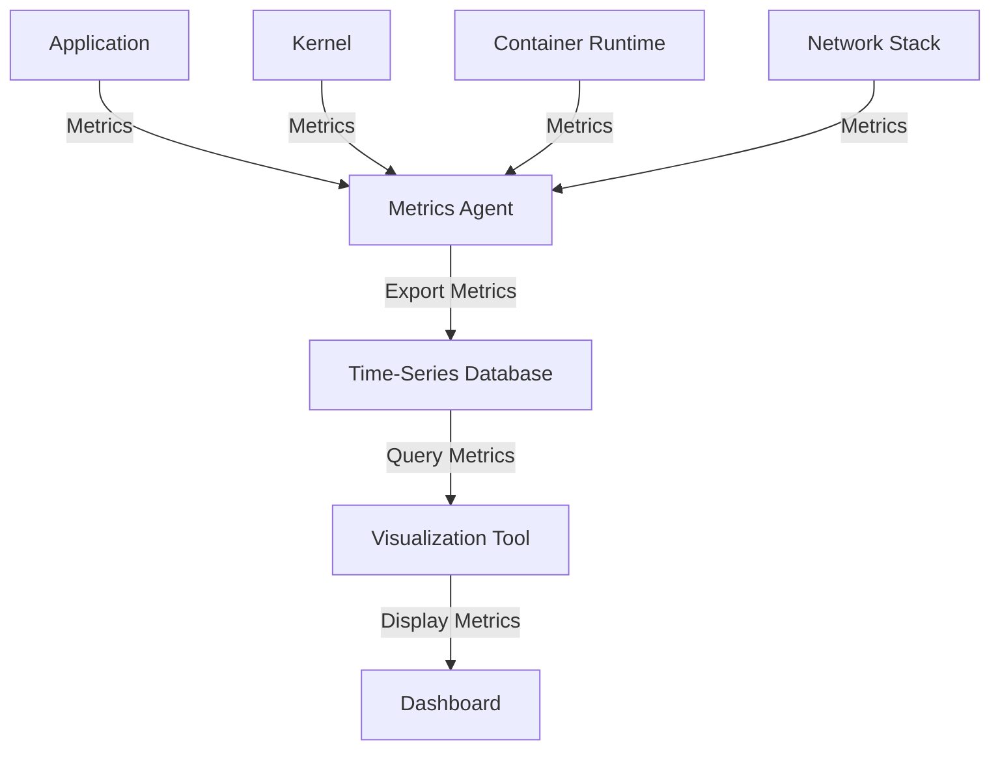

# Lesson 5: Metrics Collection

## 1. First-Principles Intuition & Invariants

Metrics collection is a cornerstone of observability in modern distributed systems, providing the quantitative data necessary to understand system behavior, performance, and health. At its core, metrics collection involves the systematic gathering of numerical data points that reflect the state of a system over time. These data points can range from simple counters (e.g., the number of HTTP requests processed) to more complex gauges (e.g., the current memory usage of a service).

The problem space of metrics collection is inherently multidimensional, encompassing the need to capture data at various levels of granularity—from individual processes to entire clusters. The challenge lies in ensuring that the collected metrics are both accurate and timely, while also being efficient in terms of resource consumption. This requires a deep understanding of the underlying system architecture, including the operating system's kernel, the container runtime, and the network stack.

From a theoretical standpoint, metrics collection can be framed as a continuous process of sampling and aggregation. The sampling process involves periodically querying the system for specific data points, while the aggregation process involves combining these data points into meaningful summaries that can be analyzed over time. The invariants that govern this process include the need for consistency (ensuring that the same metric is measured in the same way across different instances), accuracy (ensuring that the collected data reflects the true state of the system), and reliability (ensuring that the metrics collection process itself does not introduce significant overhead or instability).

Mathematically, metrics can be categorized into three primary types: counters, gauges, and histograms. Counters are used to measure the number of times an event occurs, such as the number of requests processed by a web server. Gauges, on the other hand, measure the current value of a particular metric, such as the current memory usage of a process. Histograms provide a distribution of values over a specified range, allowing for the analysis of latency distributions, for example. Each of these metric types serves a distinct purpose and requires different strategies for collection and analysis.

## 2. Core Architecture & Mechanics

The architecture of a metrics collection system is designed to support the efficient and reliable gathering of data from a wide range of sources. At the heart of this architecture is the metrics agent, a lightweight process that runs on each node in the system and is responsible for collecting and exporting metrics to a central storage backend.

The metrics agent operates by periodically querying the system for specific data points, using a variety of mechanisms depending on the type of metric being collected. For example, counters can be incremented directly by the application code, while gauges can be queried using system calls or by reading from specific files in the filesystem. Histograms, which require more complex data structures, can be implemented using in-memory data structures that are periodically flushed to the metrics agent.

Once the metrics agent has collected a set of data points, it packages them into a format that can be transmitted to the central storage backend. This format typically includes metadata about the metrics, such as their names, labels, and timestamps, as well as the actual data points themselves. The metrics agent then sends this data to the storage backend using a protocol such as HTTP, gRPC, or a custom binary format.

The central storage backend is responsible for storing the collected metrics in a way that allows for efficient querying and analysis. This typically involves using a time-series database, which is optimized for storing and querying large volumes of time-stamped data. Time-series databases use specialized data structures, such as columnar storage and compression algorithms, to optimize for both storage efficiency and query performance.

To illustrate the architecture of a metrics collection system, consider the following diagram:

In this diagram, the application, kernel, container runtime, and network stack all export metrics to the metrics agent, which then exports these metrics to a time-series database. The visualization tool queries the time-series database and displays the metrics on a dashboard, allowing for real-time monitoring and analysis.

The metrics agent plays a critical role in the architecture, serving as the bridge between the various sources of metrics and the central storage backend. To ensure that the metrics agent is efficient and reliable, it must be designed with several key considerations in mind. First, it must be able to handle high volumes of data without introducing significant overhead or instability. This requires careful optimization of the data collection and export processes, as well as the use of efficient data structures and algorithms.

Second, the metrics agent must be able to handle a wide range of metric types and sources, while still maintaining consistency and accuracy. This requires a flexible and extensible architecture that can be easily adapted to new types of metrics and data sources. Finally, the metrics agent must be able to operate in a distributed environment, where it may be running on multiple nodes and communicating with a central storage backend over a network.

## 3. High-Performance Optimization & Failure Modes

The performance of a metrics collection system is critical to its overall effectiveness, as any delay or overhead introduced by the metrics collection process can have a significant impact on the system's performance and stability. To ensure that the metrics collection system is both efficient and reliable, several key optimizations and failure modes must be considered.

One of the most important optimizations is the use of batching and compression to reduce the amount of data that needs to be transmitted to the central storage backend. By batching multiple data points together and compressing them using a lossless compression algorithm, the metrics agent can significantly reduce the amount of network bandwidth required to export the metrics. This, in turn, can help to minimize the impact of the metrics collection process on the overall performance of the system.

Another important optimization is the use of efficient data structures and algorithms to minimize the overhead of data collection and export. For example, the metrics agent can use in-memory data structures, such as hash tables or ring buffers, to store and aggregate data points before exporting them to the central storage backend. By using these data structures, the metrics agent can minimize the number of system calls and memory allocations required to collect and export the metrics, which can help to reduce the overall overhead of the metrics collection process.

In addition to these optimizations, it is also important to consider the potential failure modes of the metrics collection system. One of the most common failure modes is the loss of data due to network failures or other issues. To mitigate this risk, the metrics agent can use a reliable transport protocol, such as HTTP/2 or gRPC, to export the metrics to the central storage backend. These protocols provide built-in mechanisms for handling network failures and ensuring that the metrics are delivered reliably.

Another potential failure mode is the introduction of latency or instability due to the metrics collection process. To mitigate this risk, the metrics agent can be designed to operate asynchronously, using non-blocking I/O and other techniques to minimize the impact of the metrics collection process on the overall performance of the system. Additionally, the metrics agent can be configured to use a separate thread or process to handle the export of metrics, which can help to isolate the metrics collection process from other parts of the system.

In conclusion, metrics collection is a critical component of observability in modern distributed systems, providing the quantitative data necessary to understand system behavior, performance, and health. The architecture of a metrics collection system is designed to support the efficient and reliable gathering of data from a wide range of sources, using a combination of metrics agents, time-series databases, and visualization tools. By optimizing for performance and reliability, and by considering potential failure modes, it is possible to build a metrics collection system that is both efficient and effective.
