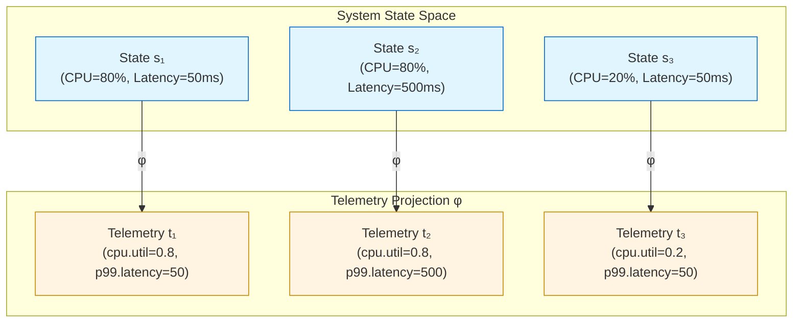
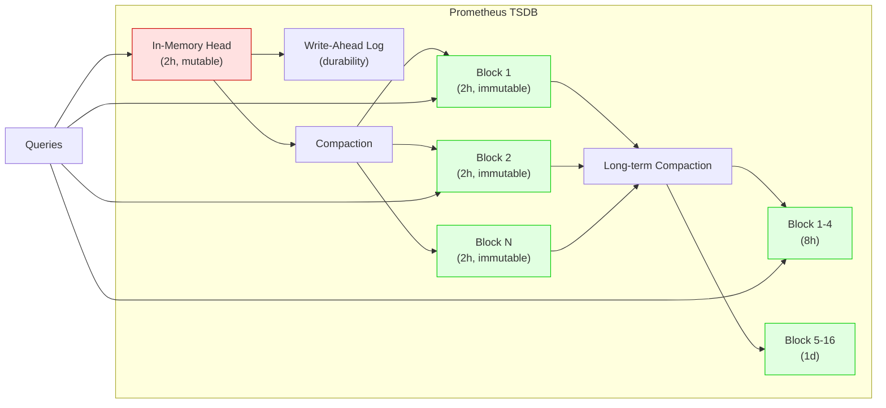
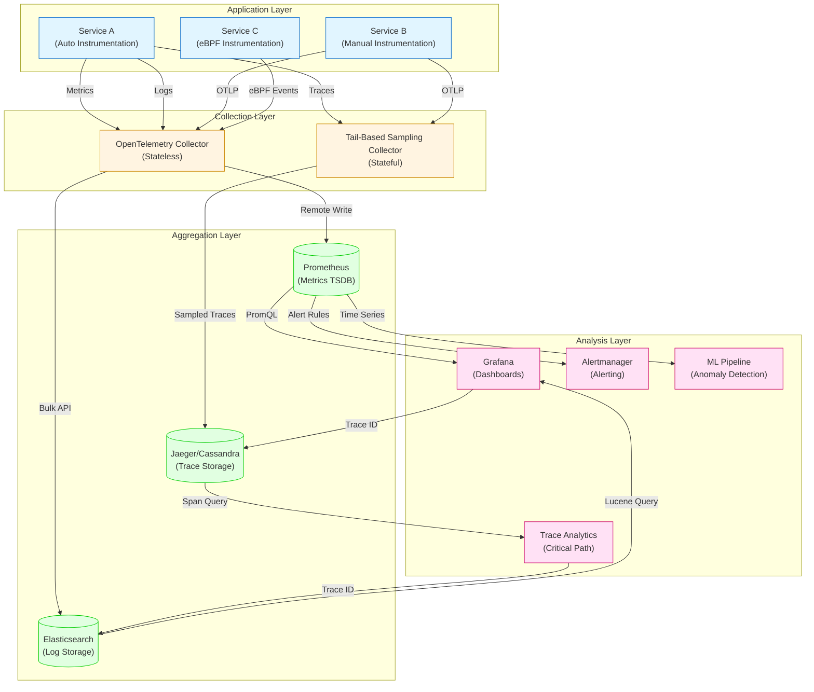

# Lesson 6: Observability Patterns

## 1. First-Principles Intuition & Invariants

Observability emerges from control theory, where a system is deemed observable if its internal state can be determined from knowledge of its external outputs over a finite time interval. For a linear time-invariant system with state vector **x**, output vector **y**, and matrices **A** (state transition) and **C** (output), the system is observable if and only if the observability matrix **O** has full rank:

```
O = [C; CA; CA²; ...; CA^(n-1)]
```

In distributed software systems, this translates to a fundamental requirement: the system must emit sufficient telemetry signals such that any internal state or behavior can be reconstructed or inferred from these signals without requiring source code inspection or binary instrumentation post-deployment.

Observability is not monitoring. Monitoring answers known questions through predefined dashboards and alerts based on anticipated failure modes. Observability answers unknown questions—it provides the raw materials to debug novel, emergent failures in high-cardinality, high-dimensionality systems where the failure space is unbounded. The shift from monolithic to distributed architectures exponentially increased the state space: a request traversing twenty microservices with varying latencies, partial failures, and concurrent executions creates combinatorial complexity that cannot be anticipated through finite alerts.

The three pillars—logs, metrics, and traces—are not independent. They represent different projections of system behavior onto observational manifolds:

- **Logs**: Discrete event streams with arbitrary structure, high cardinality, representing state transitions or anomalous conditions. Logs are the most flexible but least aggregatable signal.
- **Metrics**: Time-series aggregations of numeric values, low cardinality, representing system health and resource utilization. Metrics sacrifice detail for compactness and queryability.
- **Traces**: Directed acyclic graphs (DAGs) of causal relationships between requests across service boundaries, representing the execution context of a single logical operation through a distributed system.

### System Invariants and Observability

Observability systems must maintain their own invariants to provide trustworthy signals:

1. **Causality preservation**: Traces must respect happens-before relationships. If event A causes event B, the trace must reflect this ordering. This requires synchronized or logically ordered timestamps (Lamport clocks, vector clocks, or hybrid logical clocks).

2. **Completeness under sampling**: When sampling is necessary for performance, the sampling strategy must preserve statistical properties. Tail-based sampling must not systematically exclude rare errors or high-latency outliers.

3. **Non-invasiveness**: Instrumentation overhead must not alter system behavior significantly. The observer effect—where measurement perturbs the measured system—must be bounded. Typical targets: <1% CPU overhead, <5% memory overhead.

4. **Schema stability with evolution**: Telemetry schemas must evolve backward-compatibly. Versioned schemas or schemaless formats with semantic conventions prevent data loss during schema changes.

Mathematically, we can model the information loss from a system state **s** to observed telemetry **t** as a lossy encoding function φ: **S** → **T**. The observability problem is to construct φ such that for any two distinguishable failure states **s₁** and **s₂**, their telemetry projections **t₁** = φ(**s₁**) and **t₂** = φ(**s₂**) remain distinguishable. This is equivalent to requiring that φ preserves sufficient information content (Shannon entropy) about failure modes.



## 2. Core Architecture & Mechanics

### 2.1 Data Collection Layer

The collection layer transforms application state into structured telemetry signals. This layer operates in-process, making it the most performance-critical component. Three fundamental approaches exist:

**Push-based collection**: Agents or libraries within each service actively send telemetry to collectors. This provides low-latency signal delivery but creates backpressure risks when collectors are slow or unavailable.

**Pull-based collection**: Centralized collectors periodically scrape exposed endpoints (e.g., Prometheus `/metrics`). This simplifies client libraries and provides natural backpressure control but introduces sampling intervals and discovery complexity.

**Hybrid collection**: Traces and logs are pushed for low latency, while metrics are pulled for simplicity and natural rate limiting.

#### Instrumentation Strategies

**Automatic instrumentation** uses bytecode manipulation (Java agents), LD_PRELOAD hooks (C/C++), or runtime reflection (Python, Node.js) to inject telemetry without code changes. This is achieved through:

- **eBPF (extended Berkeley Packet Filter)**: Linux kernel-space probes that can trace system calls, network packets, and function entries without modifying binaries. Tools like `bpftrace` and `Pixie` use eBPF for zero-instrumentation observability.

```c
// eBPF program to trace TCP connect latency
#include <uapi/linux/ptrace.h>
#include <net/sock.h>
#include <bcc/proto.h>

BPF_HASH(start, u64, u64);
BPF_HISTOGRAM(latency_dist);

int trace_connect_entry(struct pt_regs *ctx, struct sock *sk) {
    u64 pid_tgid = bpf_get_current_pid_tgid();
    u64 ts = bpf_ktime_get_ns();
    start.update(&pid_tgid, &ts);
    return 0;
}

int trace_connect_return(struct pt_regs *ctx) {
    u64 pid_tgid = bpf_get_current_pid_tgid();
    u64 *tsp = start.lookup(&pid_tgid);
    if (tsp == 0) {
        return 0;
    }
    
    u64 delta = bpf_ktime_get_ns() - *tsp;
    latency_dist.increment(bpf_log2l(delta / 1000000)); // Convert to ms
    start.delete(&pid_tgid);
    return 0;
}
```

**Manual instrumentation** provides fine-grained control and context propagation. OpenTelemetry provides vendor-neutral APIs:

```rust
use opentelemetry::{global, trace::Tracer, KeyValue};
use opentelemetry::sdk::trace::{self, Sampler};
use opentelemetry::sdk::Resource;

fn init_tracer() -> Result<trace::Tracer, Box<dyn std::error::Error>> {
    let tracer = opentelemetry_jaeger::new_agent_pipeline()
        .with_service_name("payment-service")
        .with_trace_config(
            trace::config()
                .with_sampler(Sampler::ParentBased(Box::new(Sampler::TraceIdRatioBased(0.1))))
                .with_resource(Resource::new(vec![
                    KeyValue::new("service.version", "1.2.3"),
                    KeyValue::new("deployment.environment", "production"),
                ]))
        )
        .install_batch(opentelemetry::runtime::Tokio)?;
    
    Ok(tracer)
}

async fn process_payment(
    tracer: &trace::Tracer,
    amount: f64,
    user_id: &str,
) -> Result<String, PaymentError> {
    let mut span = tracer
        .span_builder("process_payment")
        .with_attributes(vec![
            KeyValue::new("payment.amount", amount),
            KeyValue::new("user.id", user_id.to_string()),
        ])
        .start(tracer);
    
    // Inject context for downstream services
    let cx = opentelemetry::Context::current_with_span(span.clone());
    
    match validate_funds(&cx, user_id, amount).await {
        Ok(_) => {
            span.set_attribute(KeyValue::new("payment.status", "approved"));
            Ok(format!("txn_{}", uuid::Uuid::new_v4()))
        }
        Err(e) => {
            span.record_error(&e);
            span.set_attribute(KeyValue::new("payment.status", "declined"));
            Err(e)
        }
    }
}
```

#### Context Propagation

Distributed tracing requires propagating trace context across process boundaries. The W3C Trace Context standard defines HTTP headers:

```
traceparent: 00-4bf92f3577b34da6a3ce929d0e0e4736-00f067aa0ba902b7-01
             |  |                                |                | 
             |  trace-id (16 bytes)              span-id (8 bytes) flags
             version
```

Context propagation must handle:

- **Out-of-band propagation**: Message queues (Kafka, RabbitMQ) require metadata fields for trace context since messages are asynchronous.
- **Sampling decisions**: Parent-based sampling ensures complete traces—once a trace is sampled, all child spans are included.
- **Baggage**: Key-value pairs propagated alongside trace context for cross-cutting concerns (customer tier, feature flags).

### 2.2 Data Aggregation Layer

The aggregation layer provides durable storage, indexing, and queryability for massive telemetry volumes. Different signal types demand different storage models:

#### Metrics Storage: Time-Series Databases

Metrics exhibit temporal locality and are amenable to aggressive compression. Prometheus uses a custom time-series database with the following architecture:



Time-series compression exploits temporal and value locality:

- **Delta-of-delta encoding**: Store the delta between consecutive deltas rather than absolute timestamps.
- **XOR-based value compression**: For floating-point metrics, XOR consecutive values—most bits remain unchanged for slowly varying metrics.

Prometheus achieves 1.3 bytes per sample on average. For 10,000 time series at 15-second resolution, this yields ~2GB per day.

**PromQL** (Prometheus Query Language) provides a functional query language:

```promql
# 99th percentile latency by service, averaged over 5 minutes
histogram_quantile(
    0.99,
    sum by (service, le) (
        rate(http_request_duration_seconds_bucket[5m])
    )
)

# Alert when error rate exceeds 5% for 2 minutes
ALERT HighErrorRate
IF (
    sum(rate(http_requests_total{status=~"5.."}[1m])) 
    / 
    sum(rate(http_requests_total[1m]))
) > 0.05
FOR 2m
```

#### Log Storage: Inverted Indices

Logs are unstructured or semi-structured text with high cardinality. Efficient log storage requires inverted indices mapping terms to document identifiers. Elasticsearch uses Lucene's inverted index with the following structure:

```
Term Dictionary:
  "error"     -> [doc1, doc5, doc7, doc23, ...]
  "timeout"   -> [doc5, doc12, doc23, ...]
  "database"  -> [doc7, doc12, doc23, ...]

Posting Lists (with term frequencies and positions):
  doc5: "error"@[12], "timeout"@[45]
  doc23: "error"@[3], "timeout"@[67], "database"@[89]
```

Write optimization for log ingestion uses:

- **Bulk indexing**: Batch documents into bulk requests to amortize network and indexing overhead.
- **Index lifecycle management**: Hot indices on SSD for recent data, warm indices on HDD for historical data, cold indices in object storage.
- **Schema-on-read**: JSON documents without predefined schemas, with field types inferred at query time.

```python
from elasticsearch import Elasticsearch, helpers
from datetime import datetime
import json

es = Elasticsearch(['http://localhost:9200'])

def stream_logs_from_file(filepath):
    """Generator for bulk indexing logs."""
    with open(filepath, 'r') as f:
        for line in f:
            log_entry = json.loads(line)
            yield {
                '_index': f"logs-{datetime.now().strftime('%Y.%m.%d')}",
                '_source': {
                    'timestamp': log_entry['timestamp'],
                    'level': log_entry['level'],
                    'service': log_entry['service'],
                    'message': log_entry['message'],
                    'trace_id': log_entry.get('trace_id'),
                    'span_id': log_entry.get('span_id'),
                    'attributes': log_entry.get('attributes', {}),
                }
            }

# Bulk index with automatic retry and error handling
success, failed = helpers.bulk(
    es,
    stream_logs_from_file('/var/log/app.log'),
    chunk_size=5000,
    request_timeout=30,
    raise_on_error=False,
)

print(f"Indexed {success} documents, {len(failed)} failed")

# Query with aggregations for error rate by service
response = es.search(
    index="logs-*",
    body={
        "query": {
            "bool": {
                "must": [
                    {"range": {"timestamp": {"gte": "now-1h"}}},
                    {"term": {"level": "ERROR"}}
                ]
            }
        },
        "aggs": {
            "errors_by_service": {
                "terms": {"field": "service.keyword", "size": 100}
            }
        },
        "size": 0
    }
)
```

#### Trace Storage: Adjacency Lists and Span Indexing

Traces are DAGs of spans. Efficient trace storage requires two indices:

1. **Trace index**: Maps trace ID to all constituent span IDs, enabling trace reconstruction.
2. **Span index**: Maps span attributes (service, operation, duration, tags) to span IDs, enabling attribute-based queries.

Jaeger uses Cassandra or Elasticsearch for trace storage. The schema for Cassandra:

```sql
-- Trace index: partition by trace_id, cluster by span_id
CREATE TABLE jaeger_v1_dc1.traces (
    trace_id blob,
    span_id bigint,
    span_hash bigint,
    parent_id bigint,
    operation_name text,
    flags int,
    start_time bigint,
    duration bigint,
    tags blob,
    logs blob,
    refs blob,
    process blob,
    PRIMARY KEY (trace_id, span_id, span_hash)
);

-- Service name index for trace discovery
CREATE TABLE jaeger_v1_dc1.service_name_index (
    service_name text,
    bucket_time timestamp,
    trace_id blob,
    PRIMARY KEY ((service_name, bucket_time), trace_id)
) WITH CLUSTERING ORDER BY (trace_id ASC);

-- Operation name index
CREATE TABLE jaeger_v1_dc1.operation_name_index (
    service_name text,
    operation_name text,
    bucket_time timestamp,
    trace_id blob,
    PRIMARY KEY ((service_name, operation_name, bucket_time), trace_id)
);

-- Duration index for slow trace queries
CREATE TABLE jaeger_v1_dc1.duration_index (
    service_name text,
    operation_name text,
    bucket_time timestamp,
    duration bigint,
    trace_id blob,
    PRIMARY KEY ((service_name, operation_name, bucket_time), duration, trace_id)
) WITH CLUSTERING ORDER BY (duration DESC, trace_id ASC);
```

Queries for "all traces for service X with duration > 1s in the last hour" use the duration index, retrieving trace IDs sorted by duration descending, then fetch full trace details from the trace table.

### 2.3 Data Analysis Layer

Analysis transforms raw telemetry into actionable insights. Three primary modes:

#### Real-Time Dashboards

Dashboards provide continuous visibility into system health through aggregated metrics and log queries. Grafana queries Prometheus, Elasticsearch, or other data sources:

```json
{
  "dashboard": {
    "title": "Service Health Dashboard",
    "panels": [
      {
        "title": "Request Rate (req/s)",
        "targets": [
          {
            "expr": "sum(rate(http_requests_total[1m])) by (service)",
            "legendFormat": "{{service}}"
          }
        ]
      },
      {
        "title": "P99 Latency (ms)",
        "targets": [
          {
            "expr": "histogram_quantile(0.99, sum by (service, le) (rate(http_request_duration_seconds_bucket[5m]))) * 1000"
          }
        ]
      },
      {
        "title": "Error Rate (%)",
        "targets": [
          {
            "expr": "(sum(rate(http_requests_total{status=~\"5..\"}[1m])) by (service) / sum(rate(http_requests_total[1m])) by (service)) * 100"
          }
        ]
      }
    ]
  }
}
```

Dashboards must balance information density with cognitive load. The USE (Utilization, Saturation, Errors) and RED (Rate, Errors, Duration) methods provide structured frameworks for metric selection.

#### Anomaly Detection

Machine learning detects deviations from expected behavior. Effective algorithms for time-series anomaly detection:

**Seasonal Decomposition**: Separate time series into trend, seasonal, and residual components using STL (Seasonal and Trend decomposition using Loess). Anomalies are outliers in the residual component.

```python
import numpy as np
from statsmodels.tsa.seasonal import STL
from scipy import stats

def detect_anomalies_stl(time_series, period=24, threshold=3.5):
    """
    Detect anomalies using seasonal decomposition.
    
    Args:
        time_series: 1D array of metric values
        period: Seasonal period (e.g., 24 for hourly data with daily seasonality)
        threshold: Z-score threshold for anomaly detection
    
    Returns:
        Boolean array where True indicates anomaly
    """
    stl = STL(time_series, seasonal=period, robust=True)
    result = stl.fit()
    
    residuals = result.resid
    z_scores = np.abs(stats.zscore(residuals, nan_policy='omit'))
    
    return z_scores > threshold

# Example: Detect anomalies in request latency
timestamps = np.arange(168)  # One week of hourly data
latencies = 50 + 10 * np.sin(2 * np.pi * timestamps / 24)  # Daily pattern
latencies[100] = 200  # Inject anomaly

anomalies = detect_anomalies_stl(latencies, period=24)
print(f"Detected anomalies at indices: {np.where(anomalies)[0]}")
```

**Forecasting with Prediction Intervals**: Use ARIMA, Prophet, or LSTMs to forecast expected values with confidence intervals. Values outside prediction intervals are anomalies.

```python
from prophet import Prophet
import pandas as pd

def forecast_with_prophet(df, forecast_periods=24):
    """
    Forecast time series and detect anomalies.
    
    Args:
        df: DataFrame with 'ds' (timestamp) and 'y' (value) columns
        forecast_periods: Number of periods to forecast ahead
    
    Returns:
        DataFrame with forecasts and anomaly flags
    """
    model = Prophet(
        interval_width=0.95,
        changepoint_prior_scale=0.05,
        daily_seasonality=True,
        weekly_seasonality=True,
    )
    model.fit(df)
    
    future = model.make_future_dataframe(periods=forecast_periods, freq='H')
    forecast = model.predict(future)
    
    # Merge actual values with forecast
    result = forecast[['ds', 'yhat', 'yhat_lower', 'yhat_upper']].merge(
        df, on='ds', how='left'
    )
    
    # Flag anomalies where actual value is outside prediction interval
    result['is_anomaly'] = (
        (result['y'] < result['yhat_lower']) | 
        (result['y'] > result['yhat_upper'])
    )
    
    return result
```

**Multivariate Anomaly Detection**: Autoencoders or Isolation Forests detect anomalies in high-dimensional metric spaces where multiple correlated metrics exhibit simultaneous deviations.

#### Distributed Trace Analysis

Traces reveal causal relationships and performance bottlenecks. Critical path analysis identifies the longest path through a trace DAG:

```go
package tracing

import (
    "sort"
    "time"
)

// Span represents a single unit of work in a distributed trace
type Span struct {
    SpanID        string
    ParentSpanID  string
    OperationName string
    StartTime     time.Time
    Duration      time.Duration
    Tags          map[string]string
}

// Trace represents a complete request flow
type Trace struct {
    TraceID string
    Spans   []Span
}

// CriticalPath computes the longest path through the trace DAG
func (t *Trace) CriticalPath() []Span {
    // Build adjacency list
    children := make(map[string][]Span)
    spanMap := make(map[string]Span)
    var root Span
    
    for _, span := range t.Spans {
        spanMap[span.SpanID] = span
        if span.ParentSpanID == "" {
            root = span
        } else {
            children[span.ParentSpanID] = append(children[span.ParentSpanID], span)
        }
    }
    
    // DFS to find longest path
    var dfs func(span Span) (time.Duration, []Span)
    dfs = func(span Span) (time.Duration, []Span) {
        childSpans := children[span.SpanID]
        if len(childSpans) == 0 {
            return span.Duration, []Span{span}
        }
        
        // Find child with longest path
        var maxDuration time.Duration
        var maxPath []Span
        
        for _, child := range childSpans {
            childDuration, childPath := dfs(child)
            if childDuration > maxDuration {
                maxDuration = childDuration
                maxPath = childPath
            }
        }
        
        // Add current span's exclusive duration
        exclusiveDuration := span.Duration - maxDuration
        totalDuration := span.Duration + maxDuration
        
        return totalDuration, append([]Span{span}, maxPath...)
    }
    
    _, path := dfs(root)
    return path
}

// AnalyzeBottlenecks identifies spans contributing most to total latency
func (t *Trace) AnalyzeBottlenecks(threshold float64) []Span {
    criticalPath := t.CriticalPath()
    totalDuration := criticalPath[0].Duration
    
    var bottlenecks []Span
    for _, span := range criticalPath {
        contribution := float64(span.Duration) / float64(totalDuration)
        if contribution > threshold {
            bottlenecks = append(bottlenecks, span)
        }
    }
    
    return bottlenecks
}
```

## 3. High-Performance Optimization & Failure Modes

### 3.1 Instrumentation Overhead

Telemetry collection imposes CPU, memory, and network overhead. Optimization strategies:

#### Zero-Copy Serialization

Avoid memory allocations during serialization. FlatBuffers and Cap'n Proto provide zero-copy deserialization:

```rust
// FlatBuffers schema for span
table Span {
    trace_id: [ubyte];
    span_id: [ubyte];
    parent_span_id: [ubyte];
    operation_name: string;
    start_time_unix_nano: uint64;
    end_time_unix_nano: uint64;
    attributes: [KeyValue];
}

table KeyValue {
    key: string;
    value: Value;
}

union Value {
    string_value: string,
    int_value: int64,
    double_value: double,
    bool_value: bool,
}
```

Accessing fields does not require deserialization into native structs—fields are accessed directly from the buffer via offset calculations.

#### Sampling Strategies

**Head-based sampling**: Decide at trace creation whether to sample. Simple but cannot sample based on trace characteristics (e.g., errors or high latency).

```go
func shouldSample(traceID string, sampleRate float64) bool {
    // Deterministic sampling based on trace ID
    hash := fnv.New64a()
    hash.Write([]byte(traceID))
    return float64(hash.Sum64())/float64(math.MaxUint64) < sampleRate
}
```

**Tail-based sampling**: Buffer spans and decide sampling after trace completion. Can sample all errors or high-latency traces but requires stateful collectors.

```go
type TailSampler struct {
    buffer      map[string][]*Span
    mutex       sync.RWMutex
    flushAfter  time.Duration
    sampleRate  float64
}

func (ts *TailSampler) AddSpan(span *Span) {
    ts.mutex.Lock()
    defer ts.mutex.Unlock()
    
    ts.buffer[span.TraceID] = append(ts.buffer[span.TraceID], span)
}

func (ts *TailSampler) Flush() []*Span {
    ts.mutex.Lock()
    defer ts.mutex.Unlock()
    
    var sampled []*Span
    for traceID, spans := range ts.buffer {
        // Always sample traces with errors or high latency
        hasError := false
        var maxDuration time.Duration
        
        for _, span := range spans {
            if span.Tags["error"] == "true" {
                hasError = true
            }
            if span.Duration > maxDuration {
                maxDuration = span.Duration
            }
        }
        
        if hasError || maxDuration > 1*time.Second || shouldSample(traceID, ts.sampleRate) {
            sampled = append(sampled, spans...)
        }
    }
    
    ts.buffer = make(map[string][]*Span)
    return sampled
}
```

#### Adaptive Sampling

Adjust sample rates dynamically based on traffic volume and error rates to maintain constant telemetry volume:

```python
class AdaptiveSampler:
    def __init__(self, target_samples_per_second=100):
        self.target_samples_per_second = target_samples_per_second
        self.current_rate = 1.0
        self.window_size = 60  # seconds
        self.recent_counts = []
        self.recent_sampled = []
    
    def should_sample(self, trace_id: str) -> bool:
        # Update sample rate based on recent traffic
        now = time.time()
        self.recent_counts.append((now, 1))
        
        # Remove old samples outside window
        cutoff = now - self.window_size
        self.recent_counts = [(t, c) for t, c in self.recent_counts if t > cutoff]
        
        # Calculate current throughput
        total_count = sum(c for _, c in self.recent_counts)
        requests_per_second = total_count / self.window_size
        
        # Adjust sample rate to hit target
        if requests_per_second > 0:
            self.current_rate = min(1.0, self.target_samples_per_second / requests_per_second)
        
        # Deterministic sampling
        return hash(trace_id) % 10000 < (self.current_rate * 10000)
```

### 3.2 Cardinality Explosion

High-cardinality dimensions (user IDs, trace IDs) in metrics create unbounded time series, overwhelming storage and query systems.

**Problem**: A metric `http_requests_total{user_id="...", endpoint="..."}` with 1M users and 100 endpoints creates 100M time series.

**Solutions**:

1. **Exemplars**: Store only aggregated metrics, but attach exemplar trace IDs for sampled requests:

```promql
# Metric without high cardinality
http_request_duration_seconds_bucket{le="0.1", endpoint="/api/users"} 1000

# Exemplar: single trace ID as example
# Querying this bucket returns associated trace IDs for drill-down
```

2. **Pre-aggregation**: Aggregate high-cardinality dimensions before storage:

```python
from collections import defaultdict
import time

class MetricAggregator:
    def __init__(self, flush_interval=60):
        self.counters = defaultdict(int)
        self.histograms = defaultdict(list)
        self.flush_interval = flush_interval
        self.last_flush = time.time()
    
    def increment_counter(self, name: str, labels: dict, value: int = 1):
        # Remove high-cardinality labels
        safe_labels = {k: v for k, v in labels.items() if k not in ['user_id', 'trace_id']}
        key = (name, tuple(sorted(safe_labels.items())))
        self.counters[key] += value
    
    def observe_histogram(self, name: str, labels: dict, value: float):
        safe_labels = {k: v for k, v in labels.items() if k not in ['user_id', 'trace_id']}
        key = (name, tuple(sorted(safe_labels.items())))
        self.histograms[key].append(value)
    
    def flush(self):
        if time.time() - self.last_flush < self.flush_interval:
            return
        
        # Emit aggregated metrics
        for (name, labels), count in self.counters.items():
            emit_metric(name, dict(labels), count)
        
        for (name, labels), values in self.histograms.items():
            emit_histogram(name, dict(labels), values)
        
        self.counters.clear()
        self.histograms.clear()
        self.last_flush = time.time()
```

3. **Hashed dimensions**: Hash high-cardinality values to bounded sets:

```go
func hashUserID(userID string) string {
    hash := fnv.New32a()
    hash.Write([]byte(userID))
    return fmt.Sprintf("user_bucket_%d", hash.Sum32() % 100)
}
```

### 3.3 Clock Skew and Distributed Ordering

In distributed systems, clock skew between nodes can violate causality in traces and logs. NTP provides ~10ms synchronization, but request latencies can be sub-millisecond.

#### Hybrid Logical Clocks (HLC)

HLCs combine physical timestamps with logical counters to preserve causality without perfect synchronization:

```rust
use std::sync::Mutex;
use std::time::{SystemTime, UNIX_EPOCH};

pub struct HybridLogicalClock {
    latest_time: Mutex<u64>,
    counter: Mutex<u32>,
}

impl HybridLogicalClock {
    pub fn new() -> Self {
        HybridLogicalClock {
            latest_time: Mutex::new(0),
            counter: Mutex::new(0),
        }
    }
    
    fn physical_time() -> u64 {
        SystemTime::now()
            .duration_since(UNIX_EPOCH)
            .unwrap()
            .as_nanos() as u64
    }
    
    pub fn now(&self) -> (u64, u32) {
        let mut latest = self.latest_time.lock().unwrap();
        let mut counter = self.counter.lock().unwrap();
        
        let physical = Self::physical_time();
        
        if physical > *latest {
            *latest = physical;
            *counter = 0;
        } else {
            *counter += 1;
        }
        
        (*latest, *counter)
    }
    
    pub fn update(&self, remote_time: u64, remote_counter: u32) -> (u64, u32) {
        let mut latest = self.latest_time.lock().unwrap();
        let mut counter = self.counter.lock().unwrap();
        
        let physical = Self::physical_time();
        let max_time = physical.max(remote_time).max(*latest);
        
        if max_time == *latest && max_time == remote_time {
            *counter = (*counter).max(remote_counter) + 1;
        } else if max_time == *latest {
            *counter += 1;
        } else if max_time == remote_time {
            *counter = remote_counter + 1;
        } else {
            *counter = 0;
        }
        
        *latest = max_time;
        (*latest, *counter)
    }
}
```

Spans include HLC timestamps to ensure correct ordering even with clock skew.

### 3.4 Backpressure and Flow Control

When telemetry volume exceeds collector capacity, backpressure propagates to application processes, potentially degrading request serving.

#### Buffering with Bounded Queues

```go
type BoundedBuffer struct {
    queue   chan *Span
    dropped uint64
}

func NewBoundedBuffer(capacity int) *BoundedBuffer {
    return &BoundedBuffer{
        queue: make(chan *Span, capacity),
    }
}

func (b *BoundedBuffer) Enqueue(span *Span) bool {
    select {
    case b.queue <- span:
        return true
    default:
        // Queue full, drop span and increment counter
        atomic.AddUint64(&b.dropped, 1)
        return false
    }
}

func (b *BoundedBuffer) Dequeue() *Span {
    return <-b.queue
}

func (b *BoundedBuffer) DroppedCount() uint64 {
    return atomic.LoadUint64(&b.dropped)
}
```

Emit `telemetry.spans.dropped` as a metric to alert when backpressure occurs.

#### Load Shedding

Prioritize critical telemetry (errors, high-latency traces) during overload:

```python
import queue
import heapq
from enum import IntEnum

class Priority(IntEnum):
    ERROR = 0      # Highest priority
    SLOW = 1       # High latency
    SAMPLED = 2    # Regular sampled
    DEBUG = 3      # Lowest priority

class PriorityBuffer:
    def __init__(self, capacity=10000):
        self.capacity = capacity
        self.heap = []
        self.counter = 0  # Tie-breaker for same priority
    
    def enqueue(self, span, priority: Priority):
        if len(self.heap) >= self.capacity:
            # Heap is full, check if new span has higher priority
            lowest_priority = self.heap[0][0]
            if priority >= lowest_priority:
                # Drop new span
                return False
            # Replace lowest priority span
            heapq.heapreplace(self.heap, (priority, self.counter, span))
        else:
            heapq.heappush(self.heap, (priority, self.counter, span))
        
        self.counter += 1
        return True
    
    def dequeue(self):
        if not self.heap:
            return None
        _, _, span = heapq.heappop(self.heap)
        return span
```

### 3.5 Storage Failure Modes

#### Retention and Rollover

Time-series databases must delete old data to maintain bounded storage. Retention policies define data lifetime:

```yaml
# Prometheus retention configuration
storage:
  tsdb:
    path: /prometheus/data
    retention.time: 15d
    retention.size: 500GB
```

Elasticsearch uses Index Lifecycle Management (ILM):

```json
{
  "policy": {
    "phases": {
      "hot": {
        "actions": {
          "rollover": {
            "max_size": "50GB",
            "max_age": "1d"
          }
        }
      },
      "warm": {
        "min_age": "3d",
        "actions": {
          "forcemerge": {
            "max_num_segments": 1
          },
          "shrink": {
            "number_of_shards": 1
          }
        }
      },
      "cold": {
        "min_age": "7d",
        "actions": {
          "freeze": {}
        }
      },
      "delete": {
        "min_age": "30d",
        "actions": {
          "delete": {}
        }
      }
    }
  }
}
```

#### Query Timeout and Resource Limits

Unbounded queries can overwhelm storage backends. Enforce query timeouts and cardinality limits:

```python
# Elasticsearch query with timeout and size limit
query = {
    "query": {
        "bool": {
            "must": [
                {"range": {"timestamp": {"gte": "now-1h"}}},
                {"term": {"level": "ERROR"}}
            ]
        }
    },
    "size": 10000,  # Maximum results
    "timeout": "30s",  # Query timeout
    "terminate_after": 10000  # Stop after N documents
}
```

Prometheus enforces query complexity limits via `query.max-samples` (default: 50M samples per query).

### 3.6 Cascading Failures

Observability systems are vulnerable to cascading failures when telemetry volume spikes during incidents:

1. **Incident occurs** → error rates increase
2. **Error logs/traces surge** → telemetry volume increases 10-100x
3. **Collectors overwhelmed** → backpressure to applications
4. **Applications slow down** → more errors, more telemetry
5. **Complete system failure**

**Mitigation strategies**:

- **Circuit breakers**: Stop sending telemetry if collectors are unavailable, preventing application degradation.
- **Adaptive sampling**: Increase sampling rates during incidents to reduce volume while preserving error traces.
- **Separate telemetry network**: Isolate telemetry traffic to prevent it from competing with application traffic.
- **Self-monitoring**: Observability systems must monitor their own health and alert when telemetry pipelines degrade.

```go
type CircuitBreaker struct {
    failureCount    uint32
    threshold       uint32
    state           uint32  // 0: closed, 1: open, 2: half-open
    lastFailureTime time.Time
    timeout         time.Duration
}

const (
    StateClosed   = 0
    StateOpen     = 1
    StateHalfOpen = 2
)

func (cb *CircuitBreaker) Call(fn func() error) error {
    state := atomic.LoadUint32(&cb.state)
    
    if state == StateOpen {
        if time.Since(cb.lastFailureTime) > cb.timeout {
            // Transition to half-open
            atomic.StoreUint32(&cb.state, StateHalfOpen)
        } else {
            return fmt.Errorf("circuit breaker open")
        }
    }
    
    err := fn()
    
    if err != nil {
        failures := atomic.AddUint32(&cb.failureCount, 1)
        cb.lastFailureTime = time.Now()
        
        if failures >= cb.threshold {
            atomic.StoreUint32(&cb.state, StateOpen)
        }
        
        return err
    }
    
    // Success - reset circuit breaker
    atomic.StoreUint32(&cb.failureCount, 0)
    atomic.StoreUint32(&cb.state, StateClosed)
    
    return nil
}
```

## 4. Complete System Architecture



## 5. Production Patterns and Anti-Patterns

### Patterns

**Correlation via Trace Context**: Logs, metrics, and traces must be correlated. Include trace ID and span ID in structured logs:

```json
{
  "timestamp": "2026-01-15T10:23:45.123Z",
  "level": "ERROR",
  "service": "payment-service",
  "message": "Payment processing failed",
  "trace_id": "4bf92f3577b34da6a3ce929d0e0e4736",
  "span_id": "00f067aa0ba902b7",
  "error": {
    "type": "TimeoutException",
    "message": "Database connection timeout after 5s"
  },
  "user_id_hash": "a3f5b8c9",
  "payment_amount": 129.99
}
```

Grafana can link from log entries to traces using `trace_id`, enabling seamless navigation between telemetry types.

**Service Level Objectives (SLOs)**: Define target reliability levels using SLIs (Service Level Indicators):

```yaml
slos:
  - name: "API Availability"
    sli: "sum(rate(http_requests_total{status!~\"5..\"}[5m])) / sum(rate(http_requests_total[5m]))"
    target: 0.999  # 99.9% success rate
    window: "30d"
  
  - name: "API Latency"
    sli: "histogram_quantile(0.99, sum(rate(http_request_duration_seconds_bucket[5m])) by (le))"
    target: 0.500  # p99 < 500ms
    window: "30d"
```

Error budgets track SLO violations:

```
Error Budget = (1 - SLO) × Total Requests
Remaining Budget = Error Budget - Actual Errors
```

**Observability as Code**: Version control dashboards, alerts, and SLOs:

```hcl
# Terraform for Grafana dashboards
resource "grafana_dashboard" "service_health" {
  config_json = file("${path.module}/dashboards/service_health.json")
}

resource "grafana_alert_rule" "high_error_rate" {
  name        = "High Error Rate"
  folder_uid  = grafana_folder.alerts.uid
  
  condition {
    query {
      datasource_uid = grafana_datasource.prometheus.uid
      model = jsonencode({
        expr = "rate(http_requests_total{status=~\"5..\"}[1m]) > 0.05"
      })
    }
  }
  
  for         = "2m"
  annotations = {
    description = "Error rate exceeds 5% for 2 minutes"
    runbook_url = "https://wiki.example.com/runbooks/high-error-rate"
  }
}
```

### Anti-Patterns

**Logging Inside Loops**: High-frequency logging inside tight loops creates unsustainable telemetry volume:

```python
# Anti-pattern
for item in large_dataset:
    logger.info(f"Processing item {item.id}")  # 1M log entries
    process(item)

# Pattern: Log at coarser granularity
logger.info(f"Processing {len(large_dataset)} items")
for item in large_dataset:
    process(item)
logger.info(f"Completed processing {len(large_dataset)} items")
```

**Unbounded Cardinality**: Including user IDs, IP addresses, or trace IDs as metric labels:

```python
# Anti-pattern
request_counter.labels(user_id=user_id, endpoint=endpoint).inc()

# Pattern: Use aggregated labels only
request_counter.labels(endpoint=endpoint).inc()
# Attach user_id as trace attribute instead
```

**Synchronous Telemetry Emission**: Blocking request processing to send telemetry introduces latency:

```go
// Anti-pattern
func HandleRequest(w http.ResponseWriter, r *http.Request) {
    start := time.Now()
    response := processRequest(r)
    
    // Synchronous metric emission blocks response
    sendMetric("request_duration", time.Since(start))
    
    w.Write(response)
}

// Pattern: Asynchronous emission
func HandleRequest(w http.ResponseWriter, r *http.Request) {
    start := time.Now()
    response := processRequest(r)
    
    // Non-blocking
    go sendMetric("request_duration", time.Since(start))
    
    w.Write(response)
}
```

**Alert Fatigue**: Too many alerts with low signal-to-noise ratio desensitize operators:

```yaml
# Anti-pattern: Alert on every error
- alert: AnyError
  expr: rate(http_requests_total{status="500"}[1m]) > 0
  
# Pattern: Alert on sustained elevated error rates
- alert: SustainedHighErrorRate
  expr: rate(http_requests_total{status=~"5.."}[5m]) / rate(http_requests_total[5m]) > 0.05
  for: 2m
  annotations:
    summary: "Error rate {{ $value | humanizePercentage }} exceeds 5% threshold"
```

## 6. Emerging Directions

**Continuous Profiling**: Extend observability to CPU, memory, and I/O profiles collected continuously in production. Tools like Parca and Pyroscope provide always-on profiling with <1% overhead, enabling performance optimization based on production workloads rather than synthetic benchmarks.

**eBPF-Based Observability**: Kernel-level instrumentation without agent deployment. eBPF programs instrument system calls, network packets, and function entries, providing observability for unmodified binaries and polyglot environments.

**OpenTelemetry Protocol (OTLP)**: Vendor-neutral standard for telemetry export, replacing proprietary protocols. OTLP uses gRPC or HTTP/protobuf for efficient, standardized telemetry transmission.

**Observability Pipelines**: Dedicated infrastructure for telemetry routing, transformation, and enrichment (e.g., Vector, Fluentd). Pipelines parse, filter, aggregate, and route telemetry before storage, reducing storage costs and improving signal quality.

**Chaos Engineering Integration**: Inject failures while observing system behavior to validate observability coverage and runbook effectiveness. If a failure mode isn't visible in telemetry, it cannot be diagnosed in production.

Observability transforms opaque distributed systems into transparent, debuggable architectures. By understanding the first principles—from control theory's observability matrix to the information-theoretic constraints of sampling—engineers can design systems that provide actionable insights into arbitrary failure modes. The architecture, optimization strategies, and failure mode analysis presented here provide a foundation for building and operating observable systems at scale.
