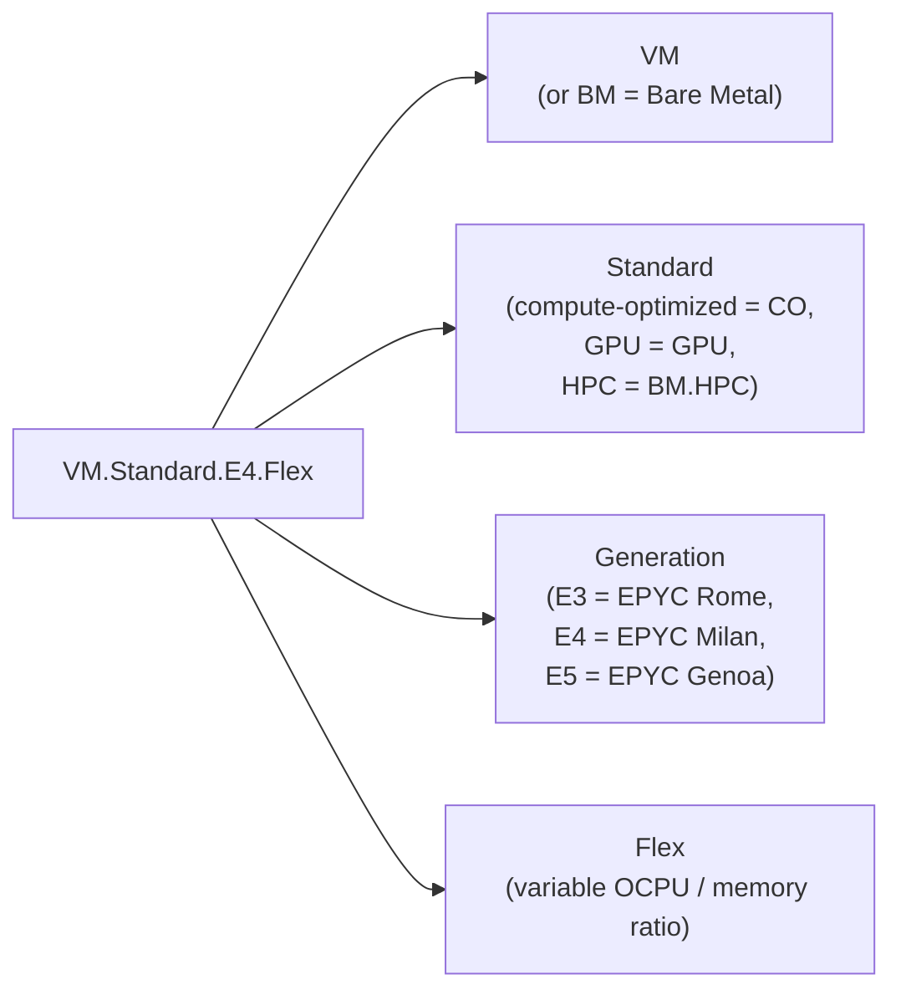
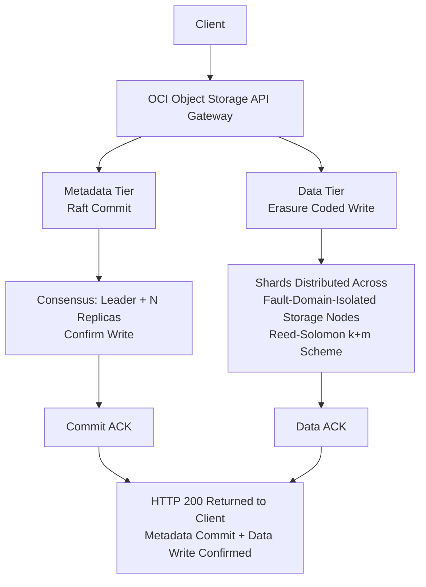

# Lesson 2: Compute Shapes, Block Volume Architecture, Object Storage Consistency

## 1. First-Principles Intuition & Invariants

Every cloud provider makes a foundational architectural bet about how hardware should be exposed to tenants. Amazon's bet, made in 2006, was that virtualizing commodity x86 servers through a modified Xen hypervisor and hiding the hardware underneath an abstraction layer was good enough for the workloads of the time. Oracle Cloud Infrastructure made a different bet, one informed by running some of the world's most demanding database and enterprise workloads, and that bet produced an architecture where the distance between the tenant's workload and the physical silicon is intentionally, aggressively minimized.

Understanding OCI compute begins with understanding why that distance matters. When a hypervisor manages CPU time, it multiplexes physical cores across virtual machines using a scheduler. That scheduler introduces jitter: the latency variance that makes a database transaction take 1 ms on one call and 11 ms on the next. When a hypervisor manages memory, it maintains an extra layer of address translation, the extended page table (EPT) or AMD's nested page tables (NPT), so every memory access that misses in the TLB requires a two-dimensional page-table walk, up to 24 memory accesses instead of four. When a hypervisor manages I/O, network packets and storage commands traverse a software switch and an emulated device queue before they reach real hardware. These overheads are not theoretical; they are measurable, and for latency-sensitive workloads like OLTP databases, Exadata-style storage, or high-frequency trading systems, they translate directly into degraded throughput and broken SLAs.

OCI's response was to build two distinct isolation primitives and make both of them first-class citizens: the **bare metal instance** and the **virtual machine instance**. The bare metal instance gives a tenant exclusive, unmediated access to a physical server. There is no hypervisor interposed between the tenant's operating system and the CPU. The tenant's kernel runs in ring 0, talks directly to DRAM via the physical memory controller, and drives PCIe devices through native drivers. OCI achieves multi-tenancy at the network layer rather than the compute layer: each bare metal server connects to the OCI network fabric through a hardware-accelerated SmartNIC (Oracle calls this the RDMA Network Fabric card, or RNF), which enforces tenant isolation, implements security group rules, and handles VXLAN encapsulation entirely in firmware, leaving the host CPU free for tenant workloads. The host kernel never touches a network packet destined for or arriving from the VCN; the firmware does.

The virtual machine instance sits on top of a thin Type-1 hypervisor called the **Oracle Bare Metal Hypervisor** (internally based on KVM with Oracle-specific modifications). Unlike traditional KVM deployments where the host OS is a full Linux distribution with all its attendant services and attack surface, OCI strips the host to a minimal firmware-like environment. The KVM module, a small set of kernel drivers, and the SmartNIC firmware constitute almost the entire host-side software stack. This architecture has two important consequences. First, the attack surface for VM escape is dramatically reduced compared to a conventional KVM host running a full Ubuntu or CentOS userspace. Second, because the host CPU is not running management daemons, container orchestrators, or logging pipelines for the cloud control plane, more physical CPU cycles are available to tenant VMs.

The concept of **flexible shapes** sits on top of this physical reality and deserves careful examination because it is not simply a marketing abstraction. Traditional instance types couple OCPU count, memory, network bandwidth, and storage throughput into a fixed bundle. This coupling originated in bare-metal economics: a single physical server has a fixed number of cores and a fixed amount of DRAM, so the simplest model is to partition it into equal slices. Flexible shapes break this coupling. A `VM.Standard.E4.Flex` instance lets the tenant specify OCPU count from 1 to 64 and memory from 1 GB per OCPU up to 1024 GB, independent of one another. OCI implements this by over-provisioning NUMA nodes and using CPU pinning combined with memory balloon drivers to allocate precisely the topology the tenant requests. The practical implication is that a compute-bound workload like a CI/CD build farm can claim 32 OCPUs with 32 GB of RAM, while a memory-bound in-process cache can claim 4 OCPUs with 512 GB of RAM, each paying only for what it uses.

The invariant underlying all of this is **performance isolation**. Whether a tenant chooses bare metal, a standard VM, or a flexible VM, OCI's architecture guarantees that a noisy neighbor cannot steal CPU time from another tenant's workload, cannot saturate the shared network link, and cannot exhaust the storage I/O bandwidth allocated to another instance's block volumes. The SmartNIC enforces network bandwidth caps per-tenant in hardware. CPU scheduler priorities ensure that VM vCPUs are not evicted from their physical core pinnings arbitrarily. These are not soft guarantees implemented in software that an adversarial or inadvertently misbehaving tenant can break; they are hardware-enforced limits.

---

## 2. Core Architecture & Mechanics

### Compute Shape Taxonomy and Physical Mapping

OCI's shape catalog follows a systematic naming convention that encodes the hardware generation, instance family, and flexibility:



A `BM.Standard.E4.128` gives the tenant 128 physical AMD EPYC Milan cores, 2 TB of DDR4-3200 ECC DRAM across 8 NUMA nodes, and 2x 25 Gbps network via the SmartNIC. The corresponding `VM.Standard.E4.Flex` slices that same physical server across multiple tenant VMs, each pinned to a subset of NUMA-local cores with their memory allocated from the same NUMA node to preserve memory access locality. This NUMA-aware placement is critical: a VM that crosses a NUMA boundary for memory access pays a 30–40 ns latency penalty on each cache miss compared to a NUMA-local access.

For HPC workloads, the `BM.HPC2.36` shape introduces RDMA over Converged Ethernet (RoCE v2) with 100 Gbps HDR InfiniBand-compatible fabric latencies. The SmartNIC on HPC shapes exposes the RDMA verbs interface directly to the tenant, allowing MPI processes to bypass the kernel network stack entirely and communicate with sub-microsecond latency across rack boundaries. This is not a software RDMA emulation layer; it is genuine kernel-bypass I/O where the application posts work requests directly to the NIC hardware queue pair.

### Boot Volume Architecture

When a compute instance starts, the first storage surface it touches is the **boot volume**, and the mechanics of how that volume is attached, presented, and kept consistent under failure are worth dissecting in detail.

The boot volume is not local disk. OCI separates compute from storage at the physical layer. Every boot volume resides on the OCI Block Volume service, which is a distributed, replicated storage system running on dedicated storage servers connected to compute nodes through the OCI storage network, a physically separate fabric from the VXLAN tenant network. This separation means a bare metal or VM instance can be terminated and relaunched on a different physical host while the boot volume, containing the OS, binaries, and configuration, persists and reattaches to the new host.

The block volume service presents storage to instances via iSCSI over the storage network. For para-virtualized VM instances, OCI's hypervisor intercepts iSCSI commands and presents them to the guest through a paravirtualized virtio-scsi interface, which the guest OS sees as a standard SCSI block device (typically `/dev/sda` on Linux). For bare metal instances and for high-performance VMs using the **iSCSI attachment** mode, the host OS or VM runs a full iSCSI initiator and talks directly to the OCI storage targets. The attachment mode choice has measurable performance implications:

```
Paravirtual attachment (VM default):
  Guest OS → virtio-scsi driver → KVM hypervisor → iSCSI → Storage network → Block volume server

iSCSI attachment (BM or explicit VM config):
  Host/Guest OS → iscsid → iSCSI → Storage network → Block volume server
```

The paravirtual path adds roughly one context switch per I/O, introducing 10–20 µs of additional latency. For throughput-bound workloads like sequential database scans, this is negligible. For latency-sensitive workloads like OLTP transaction commit (where the critical path includes a synchronous `fsync` to the redo log), the difference between 100 µs and 120 µs round-trip latency compounds across thousands of transactions per second.

Internally, the block volume service replicates every write to multiple storage nodes before acknowledging the write to the host. OCI does not publish the exact replication factor, but the durability guarantee of "multiple copies across multiple fault domains" implies a minimum replication factor of 3 across at least 3 distinct failure domains within an Availability Domain. The replication protocol is a synchronous quorum write: the storage front-end does not return a successful write acknowledgment until a quorum of replica nodes have confirmed the write to their local storage. This means the effective write latency is bounded by the slowest node in the write quorum, which is why block volume baseline latency is specified in terms of a 99th percentile rather than a mean.

```
                    ┌─────────────────────────────────────────┐
                    │          OCI Block Volume Service        │
                    │                                          │
  Compute Host      │   ┌──────────┐     ┌──────────────────┐ │
  ┌──────────┐      │   │  Front   │     │  Replica Node 1  │ │
  │ Instance ├──────┼──►│  End     ├────►│  (Fault Domain 1)│ │
  │  iscsid  │      │   │  (iscsi  │     └──────────────────┘ │
  └──────────┘      │   │  target) │     ┌──────────────────┐ │
                    │   │          ├────►│  Replica Node 2  │ │
                    │   │          │     │  (Fault Domain 2)│ │
                    │   │          │     └──────────────────┘ │
                    │   │          │     ┌──────────────────┐ │
                    │   │          ├────►│  Replica Node 3  │ │
                    │   │   ACK ◄──┤     │  (Fault Domain 3)│ │
                    │   │  (quorum)│     └──────────────────┘ │
                    │   └──────────┘                          │
                    └─────────────────────────────────────────┘
```

### Block Volume Performance Tiers

OCI structures block volume performance as a function of **Volume Performance Units (VPUs)** per gigabyte of provisioned storage. This model decouples capacity from IOPS in a way that the old paradigm of provisioned IOPS (as AWS io1 implemented) did not fully achieve.

The **Lower Cost** tier (0 VPU/GB) targets archival volumes, development instances, and workloads where cost per gigabyte dominates over throughput. It delivers approximately 2 IOPS/GB and 240 KB/s/GB throughput up to its per-volume maximums. The **Balanced** tier (10 VPU/GB, the default for boot volumes) delivers 60 IOPS/GB and 480 KB/s/GB, appropriate for general-purpose operating system volumes and lightly loaded application workloads. The **Higher Performance** tier (20 VPU/GB) delivers 75 IOPS/GB and 600 KB/s/GB, targeting production databases, analytics query engines, and block-level replication. The **Ultra High Performance** tier (30–120 VPU/GB) can deliver up to 300,000 IOPS and 2,680 MB/s for a single volume, appropriate for Exadata-class storage latency requirements.

The VPU model is physically implemented by tiering volumes across different storage media and I/O paths within the block volume cluster. Lower Cost volumes reside on high-density NVMe arrays with shared I/O queues; Ultra High Performance volumes are pinned to dedicated NVMe flash with exclusive queue depths and lower-latency storage network paths.

### Object Storage Internals and Consistency Model

OCI Object Storage is a fundamentally different beast from block storage. Where block storage emulates a synchronous, random-access device with strict per-volume ordering, object storage is a distributed, eventually-consistent key-value store optimized for durability and massive parallelism at scale. Except OCI made an architectural choice that distinguishes it sharply from Amazon S3's original design: **strong read-after-write consistency for all operations, including overwrites and deletes**.

Amazon S3 spent thirteen years as an eventually-consistent store before achieving strong consistency in December 2020. OCI Object Storage launched with strong consistency as a first-class guarantee. Understanding what this means mechanically requires understanding what consistency is being guaranteed over.

An object store maintains two logical data structures for each bucket: the **object namespace**, which maps object names (UTF-8 keys) to object metadata and storage locations, and the **object data store**, which holds the actual byte content of objects. Strong consistency means that after any mutating operation (PUT, DELETE, overwrite) completes and returns HTTP 200 to the client, any subsequent GET or HEAD for that object from any OCI endpoint, including geographically distant read replicas, returns the new state. There is no window where a stale replica serves a read.

OCI achieves this through a consensus-based metadata tier. Object metadata updates are committed through a Raft-like distributed log before the PUT acknowledgment is returned to the client. Object data is written to a distributed erasure-coded storage layer. The metadata commit gate-keeps read visibility: a GET request for an object cannot be served until the metadata tier confirms that the write's log entry has been durably committed. This coordination adds measurable latency to object PUT operations (typically 20–50 ms for small objects) compared to an eventually-consistent store that could return 200 as soon as one replica confirms the write, but it eliminates an entire class of application-level bugs that developers building on eventually-consistent stores must otherwise handle through conditional puts, versioning checks, and read-your-writes session tokens.

Durability is distinct from consistency. OCI Object Storage guarantees eleven nines (99.999999999%) of annual durability per object. This is not a probabilistic estimate in the marketing sense; it corresponds to an engineered erasure coding scheme. The service applies **Reed-Solomon erasure coding** across object data, distributing shards across multiple fault-independent storage nodes within an Availability Domain such that the loss of any single storage node (or even multiple nodes, depending on the coding ratio) does not result in data loss. For cross-region durability, Object Storage Replication can be configured to asynchronously replicate a bucket to a paired region, reducing the recovery point objective to near-zero for regional failure scenarios.



Bucket policies in OCI are expressed as **IAM policies** rather than S3-style bucket-attached JSON ACL documents, and this design decision has architectural implications for multi-tenancy. In AWS, a bucket policy is an authorization artifact attached to the bucket resource itself, evaluated separately from IAM policies and capable of granting cross-account access independently. In OCI, all authorization flows through the centralized IAM service. A bucket policy is an IAM policy statement that grants a principal (a group, a dynamic group matching instance metadata, or a federated identity) specific verbs (`OBJECT_READ`, `OBJECT_CREATE`, `OBJECT_DELETE`, `BUCKET_INSPECT`) over a resource (all buckets in a compartment, or a specific bucket by name). This centralization means there is a single authorization plane with a single audit trail, rather than the fragmented model where bucket-level and IAM-level policies can conflict or shadow each other.

---

## 3. High-Performance Optimization & Failure Modes

### Sizing Flexible Shapes for NUMA-Sensitive Workloads

The most common performance trap with flexible shapes is misconfiguring the OCPU-to-memory ratio in a way that forces the hypervisor to allocate memory from a remote NUMA node. On AMD EPYC Milan (E4 generation), each physical socket contains 8 NUMA nodes (one per CCD, or Core Complex Die), each with 8 physical cores and local DDR4 channels. When a flex VM is sized to 16 OCPUs and 512 GB of RAM, and the host has 2 TB of total DRAM, the hypervisor must decide which NUMA nodes to satisfy the memory request from.

If the VM's 16 OCPUs are pinned to NUMA nodes 0 and 1 (CCD 0 and CCD 1) but the memory allocation spills into NUMA nodes 4 through 7 to satisfy the 512 GB request, the VM's workloads will pay the NUMA crossing penalty on a large fraction of LLC (Last Level Cache) misses. The diagnostic to confirm this condition from inside a Linux guest is `numactl --hardware` combined with `numastat -m`. If `numastat` shows a high `numa_miss` count on a flex VM, it indicates that memory pages are being satisfied from a remote NUMA node.

The mitigation is twofold: first, size the VM so that memory fits within the NUMA nodes covering the allocated OCPUs. On E4 generation, each CCD has approximately 256 GB of local memory on a fully populated server, so a 16-OCPU (2-CCD) VM should target no more than ~400 GB to stay safely within local NUMA. Second, for workloads that cannot fit within a single NUMA envelope, prefer bare metal shapes, which give the tenant OS direct control over `numactl` memory binding for individual processes.

```bash
# Check NUMA topology inside a flex VM
numactl --hardware

# Check active NUMA miss rate
numastat -m 2>/dev/null | grep -E "numa_miss|numa_hit"

# Pin a database process to NUMA-local CPUs and memory
numactl --cpunodebind=0,1 --membind=0,1 -- /u01/app/oracle/product/19c/dbhome_1/bin/oracle
```

### Boot Volume Performance Benchmarking and Tier Selection

Before committing a production database or application to a specific block volume tier, engineers should benchmark the volume's actual delivered latency and IOPS under the access pattern of their workload, not just the specified maximum. The OCI-idiomatic tool for this is `fio` with a carefully constructed job file that reflects the production workload's I/O profile. Latency-sensitive OLTP workloads have a characteristic access pattern: small (8–16 KB), random, synchronous writes with queue depth 1 on the redo log path, combined with larger, sequential reads for undo and tablespace scans.

```ini
# fio job: OLTP redo log simulation (Higher Performance or Ultra High Performance tier)
[global]
ioengine=libaio
direct=1
runtime=120
time_based=1
group_reporting=1
numjobs=1

[redo_log_write]
rw=randwrite
bs=8k
iodepth=1
filename=/dev/sdb
stonewall

[tablespace_read]
rw=randread
bs=16k
iodepth=16
filename=/dev/sdc
stonewall
```

Run this against a volume before provisioning VPUs and after, and compare the p99 write latency reported by `fio`'s `lat_ns` histogram. For an Ultra High Performance volume at 120 VPU/GB, p99 write latency for 8K synchronous writes should be under 500 µs. For a Balanced tier volume at the same workload, p99 will typically exceed 2 ms, which translates directly into reduced database TPS because redo log commits are on the critical path of every COMMIT statement.

Volume attachment mode also becomes important at high throughput. Use OCI's CLI to verify and control attachment mode:

```bash
# List current volume attachments for an instance
oci compute volume-attachment list \
  --compartment-id <compartment_ocid> \
  --instance-id <instance_ocid> \
  --query "data[*].{id:id, type:\"attachment-type\", device:device}" \
  --output table

# Attach a block volume in iSCSI mode (for BM or latency-critical VMs)
oci compute volume-attachment attach \
  --instance-id <instance_ocid> \
  --type iscsi \
  --volume-id <volume_ocid> \
  --is-read-only false

# Retrieve iSCSI connect commands after attachment
oci compute volume-attachment get \
  --volume-attachment-id <attachment_ocid> \
  --query "data.{iqn:iqn, ipv4:ipv4, port:port, \"chap-username\":\"chap-username\"}"
```

After retrieving the iSCSI target parameters, connect the initiator on the host:

```bash
sudo iscsiadm -m node \
  -o new \
  -T <iqn_from_above> \
  -p <ipv4>:3260

sudo iscsiadm -m node \
  -T <iqn_from_above> \
  -p <ipv4>:3260 \
  --op update \
  -n node.startup \
  -v automatic

sudo iscsiadm -m node \
  -T <iqn_from_above> \
  -p <ipv4>:3260 \
  -l
```

At this point the kernel iSCSI initiator establishes a TCP session to the OCI storage network target, and the volume appears as a block device under `/dev/sd*` or `/dev/disk/by-id/`. Use `lsblk -o NAME,SIZE,TRAN,TYPE` to confirm the device is visible and its transport is listed as `iscsi`.

### Object Storage: Multipart Upload for Large Objects

For objects larger than 100 MB, single-part PUTs are both inefficient and unreliable. A network interruption after uploading 2 GB of a 10 GB object wastes the entire transfer. OCI Object Storage's multipart upload API decomposes a large object into independently uploaded parts, each committed to the metadata tier separately, and assembles them into a single logical object via a final commit operation. The minimum part size is 10 MB (except for the last part), and the maximum number of parts per upload is 10,000.

The practical workflow using the OCI CLI's built-in multipart support is straightforward:

```bash
# Upload a large file using multipart (OCI CLI handles part splitting automatically)
oci os object put \
  --namespace <object_storage_namespace> \
  --bucket-name production-data \
  --name "datasets/training-corpus-2024.tar.gz" \
  --file /data/training-corpus-2024.tar.gz \
  --part-size 128 \
  --parallel-upload-count 8

# Verify the uploaded object's metadata and ETag
oci os object head \
  --namespace <object_storage_namespace> \
  --bucket-name production-data \
  --name "datasets/training-corpus-2024.tar.gz"
```

The `--parallel-upload-count 8` flag instructs the CLI to upload 8 parts concurrently over separate TCP connections, saturating available bandwidth from a compute instance with an 8–25 Gbps network link. For a 100 GB object over a 25 Gbps link, this reduces total upload time from roughly 32 seconds (single-stream) to under 5 seconds (8 parallel streams), assuming the storage backend is not the bottleneck.

### Bucket Policy Hardening and Common Misconfigurations

The most dangerous misconfiguration in OCI Object Storage is a bucket configured for **public access** where the intent was authenticated access only. Public buckets serve GET requests for any object without an Authorization header, which is appropriate for static website hosting but catastrophic for buckets containing application logs, database exports, or customer data. Auditing all buckets in a tenancy for public access requires querying the Object Storage API's bucket summary:

```bash
# List all buckets in a namespace and check public access status
oci os bucket list \
  --namespace <object_storage_namespace> \
  --compartment-id <compartment_ocid> \
  --fields publicAccessType \
  --query "data[?\"public-access-type\" != 'NoPublicAccess'].{name:name, access:\"public-access-type\"}" \
  --output table
```

Any bucket returned by this query should be immediately reviewed. To revoke public access:

```bash
oci os bucket update \
  --namespace <object_storage_namespace> \
  --name <bucket_name> \
  --public-access-type NoPublicAccess
```

For IAM-controlled bucket access, the principle of least privilege means granting only the verbs a given principal actually requires. A data pipeline that reads from a bucket but never writes should receive a policy granting `OBJECT_READ` and `OBJECT_INSPECT` but not `OBJECT_CREATE` or `OBJECT_DELETE`. A CI/CD system that writes build artifacts should receive `OBJECT_CREATE` but not `OBJECT_DELETE`. Separating these verbs prevents a compromised pipeline credential from being weaponized to destroy an entire artifact repository. The policy syntax in OCI IAM expresses this granularity directly:

```
Allow group DataPipelineReaders to read objects in compartment production
  where target.bucket.name = 'ml-training-data'

Allow dynamic-group CIBuildAgents to manage objects in compartment production
  where all {target.bucket.name = 'ci-artifacts', request.operation = 'PutObject'}
```

The `dynamic-group` construct deserves emphasis: it matches compute instances by their metadata attributes (compartment, defined tags, free-form tags) rather than by static group membership. A CI/CD agent running on an OCI compute instance whose defined tag `{"CIRole": "BuildAgent"}` matches the dynamic group rule acquires the policy's permissions via the **Instance Principal** authentication mechanism, without any long-lived API keys or passwords embedded in the application. The instance metadata service provides a short-lived, automatically-rotating JWT that the OCI SDK exchanges for temporary credentials. This eliminates the entire class of credential exfiltration attacks where static API keys stored in environment variables or configuration files are leaked through application vulnerabilities.

### Block Volume Failure Modes and Recovery Procedures

The OCI block volume service is designed to mask storage node failures transparently. When a replica node fails during a write quorum, the front-end storage service routes subsequent writes to a replacement replica and initiates background resynchronization. From the guest OS's perspective, an I/O request that was in flight during the node failure will either complete successfully (if the quorum was satisfied before the node failed) or return an I/O error after the iSCSI session timeout expires.

The iSCSI session timeout is the critical tuning parameter for resilience. By default, the Linux iSCSI initiator retries commands for `node.session.timeo.replacement_timeout` seconds (default: 120 seconds) before marking the device as failed and returning errors to the filesystem. For high-availability applications that can tolerate short I/O pauses but cannot tolerate I/O errors (Oracle RAC, for example), this timeout should be increased. For applications with their own retries that cannot tolerate long hangs (microservices with strict request deadlines), the timeout should be reduced and the application should be designed to handle transient I/O errors gracefully.

```bash
# Check current iSCSI session timeouts
sudo iscsiadm -m session -P 3 | grep -E "Timeout|State|Target"

# Increase replacement timeout for HA-critical volumes
sudo iscsiadm -m node \
  -T <iqn> \
  --op update \
  -n node.session.timeo.replacement_timeout \
  -v 300

# Persist iSCSI configuration across reboots
sudo systemctl enable iscsid
sudo systemctl enable iscsi
```

Volume reattachment after a compute instance stop/start cycle is a subtler failure mode. When an instance is hard-stopped and relaunched on a different physical host, the iSCSI session terminates ungracefully from the storage network's perspective. The new host must re-establish the iSCSI session before the filesystem can mount. OCI's `cloud-init` and the OCI instance configuration service handle this automatically for boot volumes, but for data volumes attached as secondary block devices, the mounting sequence in `/etc/fstab` must include the `_netdev` mount option and the `iscsi` systemd target as a dependency:

```fstab
/dev/disk/by-id/scsi-<volume_id>  /data  xfs  defaults,_netdev,nofail  0  2
```

The `_netdev` flag tells `systemd` that this device requires network connectivity before mounting, ensuring the iSCSI session is established before the filesystem mount is attempted. Without it, the boot sequence may attempt the `mount` before `iscsid` has completed session negotiation, resulting in a failed boot requiring console recovery.

The relationship between compute shape selection, volume attachment mode, VPU tier, and object storage access patterns is not a set of independent choices but an integrated architecture decision. A database workload on `BM.Standard.E4.128` using iSCSI-attached Ultra High Performance block volumes for redo logs and tablespaces, combined with Object Storage for logical backups via `expdp` and RMAN, represents each layer operating at its appropriate abstraction: bare metal for latency-critical compute, synchronous block I/O for durability-critical database files, and highly parallel object storage for archival and recovery workflows. Each layer's characteristics, the NUMA topology of the bare metal host, the quorum write path of the block volume service, the erasure-coded durability of the object namespace, compounds into a system whose behavior under load and under failure is predictable and engineerable, which is the fundamental objective of infrastructure architecture at this level.
