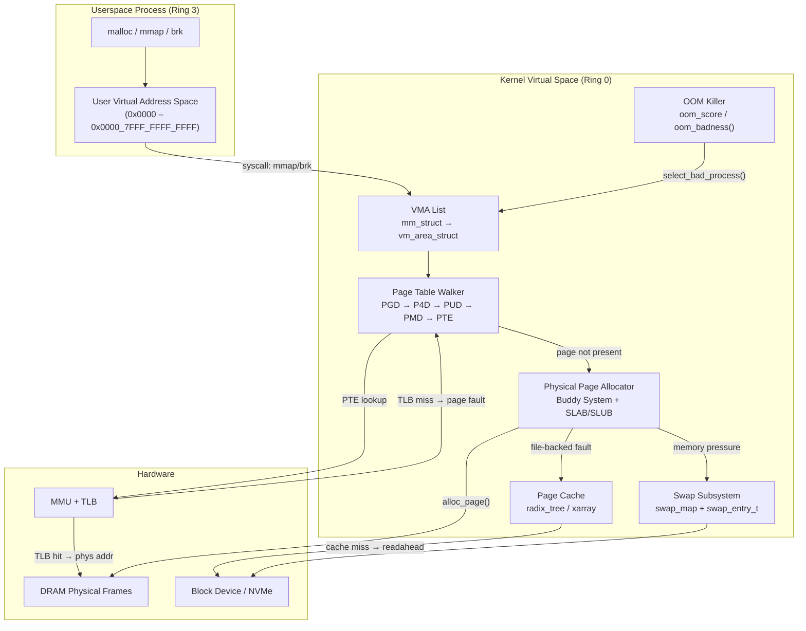
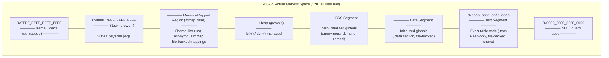

# Operating System Theory & Kernel Subsystems: Operational Verification Lab

## Preface: Architectural Context

This lab is not a surface-level survey of shell commands. Each exercise is grounded in kernel source-level mechanics. Before touching a tool, understand *why* the abstraction exists and what invariants the kernel enforces.

The Linux kernel enforces the following memory isolation model: every process operates against a private virtual address space backed by a multi-level page table (four levels on x86-64: PGD → P4D → PUD → PMD → PTE). The CPU's Memory Management Unit (MMU) translates virtual addresses to physical frame numbers on every load/store. The Translation Lookaside Buffer (TLB) caches recent translations; a TLB miss triggers a page-table walk by the hardware page-table walker (or a software handler on architectures like RISC-V). A page fault is raised when the PTE is absent, permission bits are violated, or the page has been swapped out.

The kernel VFS layer inserts an indirection between file descriptors and on-disk inodes, permitting page-cache sharing, copy-on-write fork semantics, demand paging, and memory-mapped I/O all within a unified object model. Understanding this unified model is the prerequisite for every exercise below.

---

## Environment Setup

### Required Tooling

```bash
# Debian/Ubuntu
sudo apt-get install -y \
    procps \
    linux-tools-$(uname -r) \
    strace \
    gcc \
    make \
    sysstat \
    valgrind \
    bpftrace \
    util-linux

# RHEL/Fedora
sudo dnf install -y \
    procps-ng \
    perf \
    strace \
    gcc \
    make \
    sysstat \
    valgrind \
    bpftrace \
    util-linux
```

Verify kernel version and feature availability:

```bash
uname -r
# Confirm CONFIG_PERF_EVENTS, CONFIG_FTRACE, CONFIG_PROC_FS are enabled
zcat /proc/config.gz 2>/dev/null | grep -E "CONFIG_PERF_EVENTS|CONFIG_FTRACE|CONFIG_PROC_FS" \
    || grep -E "CONFIG_PERF_EVENTS|CONFIG_FTRACE|CONFIG_PROC_FS" /boot/config-$(uname -r)
```

---

## Architectural Map: Kernel Memory Subsystems



---

## Exercise 1: Process Virtual Address Space & Page Table Inspection

### Theory: Virtual Memory Areas and the `mm_struct`

Every Linux process carries an `mm_struct` (defined in `include/linux/mm_types.h`). This structure holds:

- `pgd`: pointer to the process's Page Global Directory (the root of the hardware page table).
- A red-black tree and linked list of `vm_area_struct` nodes, each representing a contiguous VMA with uniform permissions and a backing object (anonymous memory, a file, or a device mapping).
- `brk`/`start_brk`: current heap boundary managed by the `brk(2)` syscall.
- `start_stack`: stack base address, growing downward on x86.

The kernel never pre-populates PTEs for a newly allocated VMA. Memory is **demand-paged**: the first access raises a `#PF` exception (page fault), the kernel's `handle_mm_fault()` determines whether to allocate a new anonymous page, fetch a page from the page cache, or trigger a COW split, then installs the PTE and returns to userspace. This model is why `malloc(1 GB)` returns instantly — no physical RAM is consumed until writes occur.

### 1.1 Process VMA Layout Inspection

```bash
# Spawn a long-lived process
sleep 300 &
PID=$!

# Dump all VMAs with permissions, offsets, and backing paths
pmap -X $PID
```

The columns produced by `pmap -X` map directly to `/proc/$PID/smaps` fields:

| pmap Column | smaps Field | Meaning |
| :--- | :--- | :--- |
| `RSS` | `Rss` | Resident Set Size — pages currently in RAM |
| `PSS` | `Pss` | Proportional Set Size — RSS divided by share count |
| `Dirty` | `Private_Dirty` | Modified pages not yet written back; COW copies |
| `Swap` | `Swap` | Pages evicted to swap device |
| `Flags` | `VmFlags` | Kernel VMA permission and hint flags (`rd`, `wr`, `ex`, `sh`, `mg`, `hg`) |

```bash
# Structured smaps inspection: filter the most diagnostic fields
cat /proc/$PID/smaps | awk '
/^[0-9a-f]/ { region = $0 }
/^(Size|Rss|Pss|Shared_Clean|Shared_Dirty|Private_Clean|Private_Dirty|Referenced|Anonymous|Swap):/ {
    printf "%-60s %s\n", region, $0
    region = ""
}' | head -60
```

Faster rollup for a quick summary (Linux ≥ 4.14):

```bash
cat /proc/$PID/smaps_rollup
```

The `smaps_rollup` interface aggregates all VMAs into a single synthetic entry, avoiding the O(n) scan cost of reading the full `smaps` file for large processes with thousands of VMAs (JVM, V8, etc.).

### 1.2 Address Space Layout Visualization

The canonical x86-64 Linux process address space layout (kernel 5.x, non-PIE vs. PIE):



Verify these regions experimentally:

```bash
cat /proc/$PID/maps
```

Each line format is: `address_range perms offset dev inode pathname`

Permissions encode: `r` read, `w` write, `x` execute, `p` private (COW), `s` shared.

### 1.3 Copy-On-Write (COW) Verification

**Mechanism:** When `fork(2)` is called, the kernel clones the parent's `mm_struct` and page tables but marks all writable PTEs as read-only in *both* parent and child. The physical page frame is shared. When either process writes to a shared page, the MMU raises a protection fault. `handle_mm_fault()` → `do_wp_page()` detects the COW condition, allocates a new physical frame, copies the content, installs a writable PTE in the faulting process, and decrements the reference count on the original frame. If the original frame's reference count drops to 1, the remaining process's PTE is upgraded to writable in-place (no copy needed) — an optimization called *COW break*.

```c
/* cow_test.c — demonstrates COW page splitting across fork */
#define _GNU_SOURCE
#include <stdio.h>
#include <stdlib.h>
#include <unistd.h>
#include <string.h>
#include <sys/wait.h>
#include <sys/types.h>
#include <fcntl.h>

static void print_smaps_rollup(pid_t pid, const char *label) {
    char path[64];
    char line[256];
    snprintf(path, sizeof(path), "/proc/%d/smaps_rollup", pid);
    FILE *f = fopen(path, "r");
    if (!f) { perror("fopen smaps_rollup"); return; }
    printf("\n=== %s (PID %d) ===\n", label, pid);
    while (fgets(line, sizeof(line), f)) {
        if (strstr(line, "Rss:")          ||
            strstr(line, "Pss:")          ||
            strstr(line, "Private_Dirty:") ||
            strstr(line, "Shared_Clean:") ||
            strstr(line, "Swap:")) {
            printf("  %s", line);
        }
    }
    fclose(f);
}

int main(void) {
    const size_t SIZE = 64UL * 1024 * 1024; /* 64 MiB */
    char *buf = mmap(NULL, SIZE,
                     PROT_READ | PROT_WRITE,
                     MAP_PRIVATE | MAP_ANONYMOUS,
                     -1, 0);
    if (buf == MAP_FAILED) { perror("mmap"); return 1; }

    /* Touch every page to bring them resident (defeat demand-zero) */
    memset(buf, 'A', SIZE);
    printf("[parent %d] Allocated and dirtied 64 MiB\n", getpid());
    print_smaps_rollup(getpid(), "Parent before fork");

    pid_t child = fork();
    if (child < 0) { perror("fork"); return 1; }

    if (child == 0) {
        /* Child: pages are still physically shared with parent */
        printf("[child  %d] Just forked — pages are COW-shared\n", getpid());
        print_smaps_rollup(getpid(), "Child before write (COW shared)");

        /* Writing triggers page faults → COW splits → Private_Dirty rises */
        memset(buf, 'B', SIZE);
        printf("[child  %d] Dirtied all pages — COW split complete\n", getpid());
        print_smaps_rollup(getpid(), "Child after write (Private_Dirty)");
        exit(0);
    }

    /* Parent: wait for child to write, then inspect */
    sleep(1); /* give child time to fault in pages */
    print_smaps_rollup(getpid(), "Parent after child write");
    waitpid(child, NULL, 0);
    return 0;
}
```

```bash
gcc -O2 -Wall -o cow_test cow_test.c
./cow_test
```

Expected observation: immediately after `fork`, both parent and child show high `Shared_Clean` and near-zero `Private_Dirty`.

After the child writes to its copy of the mapping, `Private_Dirty` in the child jumps to ~64 MiB while `Shared_Clean` drops to near zero, confirming that each written page triggered a page fault, copied the frame, and remapped the child's PTE to the new private frame. The parent's memory map remains unchanged—its `Shared_Clean` drops only if reference counts fall to one, but more commonly it will show a mix of shared and private pages depending on which pages the child has faulted. This asymmetry is the hallmark of copy-on-write: the writing process pays the fault and allocation cost, while the non-writing process continues referencing the original frames. By comparing `Private_Dirty` before and after the write, you directly measure the cost of COW splits. By examining both processes' `smaps` concurrently, you verify that physical sharing persists until write, that faults occur lazily and independently per page, and that RSS accounting correctly attributes private and shared components. These /proc interfaces expose the kernel's internal mm_struct and vm_area_struct state, making COW semantics observable and quantifiable in real time.

---

## Summary & Verification Matrix

| **Invariant / Mechanism**                  | **Governing Rule**                                                                                                  | **Diagnostic Criterion**                                                                                 | **Verification Command / Technique**                          |
|--------------------------------------------|---------------------------------------------------------------------------------------------------------------------|----------------------------------------------------------------------------------------------------------|---------------------------------------------------------------|
| **Copy-on-Write Semantics**                | `fork()` duplicates VMAs with `VM_SHARED` cleared; PTEs marked read-only; write faults copy frame                  | Child `Private_Dirty` = 0 immediately post-fork; jumps to ~allocation size after `memset`                | Compare `/proc/<pid>/smaps_rollup` before/after write         |
| **Demand Paging (Lazy Allocation)**        | Anonymous mappings initially map zero page; first write allocates real frame; no upfront physical commit            | RSS = 0 after `mmap`; RSS = touched pages × 4 KiB after `memset`                                         | `ps -o pid,rss,vsz` or `/proc/<pid>/status` RSS field        |
| **Page Fault Path**                        | Minor fault: PTE invalid but VMA valid → `handle_mm_fault` → `do_anonymous_page` or `do_wp_page` (COW)             | `perf stat -e page-faults` shows fault count proportional to touched pages                               | `perf stat -e page-faults,minor-faults ./cow_test`            |
| **Shared vs. Private Accounting**          | Shared frames: `mapcount > 1`, contribute to `Shared_Clean`; Private frames: `mapcount == 1`, contribute to `Private_Dirty` | Parent retains high `Shared_Clean` if child hasn't written; child `Shared_Clean` → 0 after full write   | Diff `Shared_Clean` and `Private_Dirty` in parent vs. child   |
| **Physical Frame Reference Counting**      | `page->_refcount` tracks total refs; `page->_mapcount` tracks PTE mappings; page freed when `_refcount` → 0        | `slabtop -o | grep anon_vma` or `/proc/meminfo` `AnonPages` decreases only after both processes unmap  | Monitor `AnonPages` in `/proc/meminfo` across fork/exit cycle |
| **TLB Coherency on COW Split**             | Writing process takes page fault → kernel copies frame → updates PTE → `flush_tlb_page` invalidates stale TLB entry | No observable stale data; write is immediately visible in child's address space                          | Functional correctness of `memset` result; no TLB shootdown trace in `ftrace` unless SMP |
