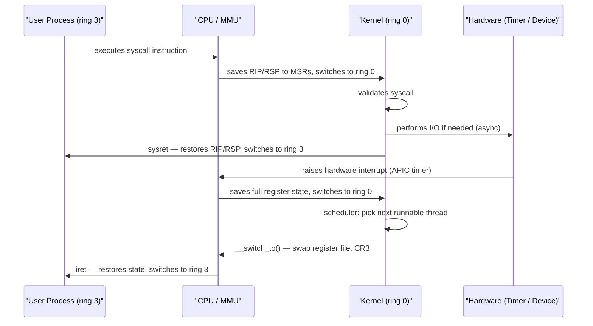
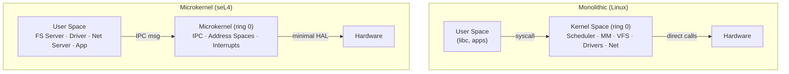
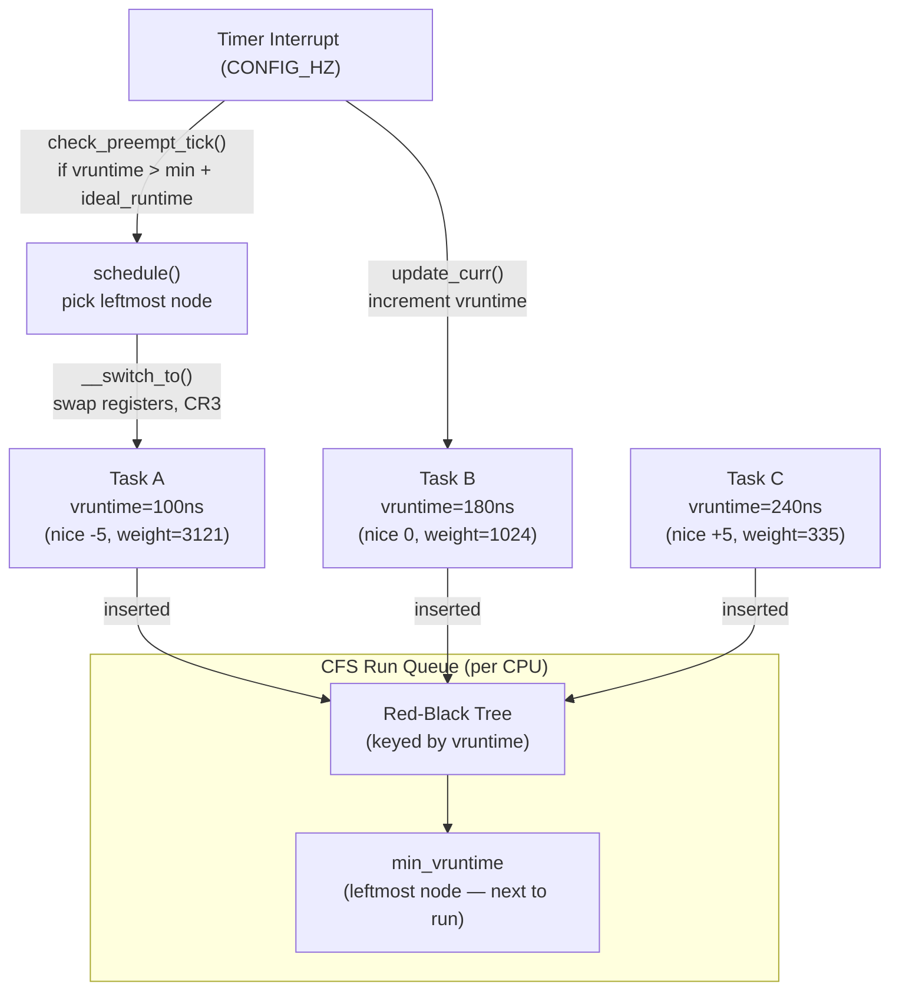
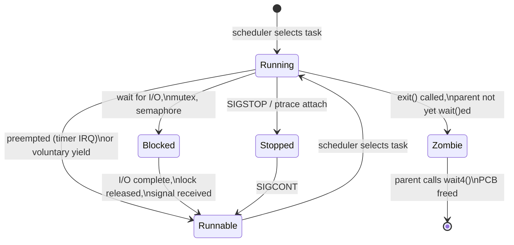
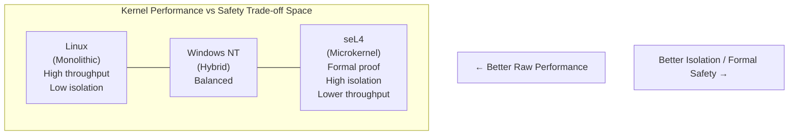

# Lesson 1: Operating System Kernels

## 1. First-Principles Intuition & Invariants

The operating system kernel is not merely a software layer—it is the enforcer of a contract between hardware capability and programmer abstraction. Every design decision in a kernel can be traced back to a small number of immutable physical realities: CPUs execute instructions sequentially in a single stream unless explicitly parallelized; memory is a flat, finite array of addressable bytes with no inherent concept of ownership; and I/O devices operate asynchronously relative to the CPU. The kernel exists to impose structure on these realities in a way that is safe, fair, and efficient for concurrent, mutually untrusting programs.

### The Privilege Separation Invariant

Modern CPU architectures implement hardware-enforced privilege levels. On x86-64, these are four rings (0–3), though mainstream operating systems use only two: ring 0 (kernel mode) and ring 3 (user mode). ARM AArch64 uses Exception Levels (EL0–EL3), where the OS kernel runs at EL1 and user processes at EL0. RISC-V uses Machine (M), Supervisor (S), and User (U) modes with analogous semantics.

The invariant is this: **certain instructions and register accesses are architecturally illegal from lower privilege levels.** On x86-64, instructions like `lgdt` (load global descriptor table), `lidt` (load interrupt descriptor table), `wrmsr` (write model-specific register), and direct I/O port access via `in`/`out` will raise a General Protection Fault (#GP) if executed in ring 3. The hardware itself—not the kernel software—enforces this boundary. This is why the kernel's security guarantees are not purely a matter of careful coding; they are grounded in CPU microarchitecture.

When a user-mode process needs a privileged service (allocating memory, writing a file, creating a socket), it executes a **system call**. On x86-64 Linux, this is the `syscall` instruction. It atomically saves the return address and stack pointer into MSRs (`IA32_LSTAR`, `IA32_FMASK`), switches the CPU to ring 0, and jumps to the kernel's syscall entry point. The kernel inspects the syscall number in `%rax`, validates all arguments, performs the requested operation, and returns via `sysret`. This round-trip is the fundamental unit of kernel-user interaction—on modern hardware with Spectre/Meltdown mitigations (KPTI), a syscall round-trip costs roughly 100–300 ns due to TLB flushes and cache pollution.

### The Virtual Memory Invariant

Every process believes it owns the entire address space. On a 64-bit system, Linux grants each process a 128 TiB virtual address space in the lower half of the 64-bit range (addresses `0x0000000000000000`–`0x00007fffffffffff`), with the kernel mapped into the upper half (starting at `0xffff800000000000`). This illusion is maintained by the Memory Management Unit (MMU), a hardware component that translates every memory access from a virtual address to a physical address using a structure called the **page table**.

The x86-64 page table is a four-level (and optionally five-level with LA57) radix tree. Each level—PML4, PDPT, PD, PT—contains 512 entries of 8 bytes, covering 9 bits of the 48-bit virtual address. The bottom 12 bits are the page offset within a 4 KiB page. The CPU caches recent translations in the **Translation Lookaside Buffer (TLB)**. When the kernel modifies a page table entry—for example, to handle a page fault or unmap a region—it must issue `INVLPG` instructions or a full TLB flush (`MOV CR3`) and, on multi-core systems, send **TLB shootdown IPIs** to all other cores that may have stale translations.

This architecture means that **memory protection is not a software check but a hardware access control.** Each page table entry carries protection bits: present, writable, user-accessible, execute-disable (NX/XD). An attempt to write to a read-only page, execute a non-executable page, or access a kernel page from user mode generates a **page fault** (exception vector 14 on x86), which the kernel's fault handler dispatches. This is the foundation of process isolation, copy-on-write fork semantics, demand paging, and memory-mapped file I/O.

### The Scheduling Invariant

The CPU is a single resource (per core). The kernel must multiplex it among potentially thousands of runnable threads. The scheduling invariant is that **no thread runs forever**; the kernel must preempt execution periodically to maintain system responsiveness and fairness. This preemption is triggered by the programmable interval timer (PIT) or APIC timer generating a hardware interrupt at a configured frequency (typically 250 Hz on Linux, controlled by `CONFIG_HZ`). The interrupt fires, the CPU transfers control to the kernel's interrupt handler in ring 0, and the scheduler decides whether to continue the current thread or switch to another.

The act of switching execution context between two threads—saving the outgoing thread's register state and loading the incoming thread's—is called a **context switch**. On Linux, this is implemented in `arch/x86/kernel/process_64.c` via `__switch_to()`. A context switch on modern hardware costs roughly 1–10 µs depending on cache state, TLB pressure, and whether a full address space switch (and thus CR3 reload) is needed.



---

## 2. Core Architecture & Mechanics

### Kernel Taxonomy

Before dissecting internals, it is essential to understand that "the kernel" is not a single architectural pattern. The three dominant designs represent fundamentally different answers to the question of *which code runs in ring 0*:

**Monolithic kernels** (Linux, FreeBSD, traditional UNIX) run all core OS services—schedulers, memory managers, file systems, device drivers, networking stacks—in kernel space. This maximizes performance through direct function calls between subsystems but means a buggy driver can corrupt kernel state and panic the system.

**Microkernels** (seL4, QNX, Mach) run only the absolute minimum in ring 0: interrupt dispatch, basic IPC, address space management. Everything else—file systems, drivers, networking—runs as user-space servers communicating via IPC. This dramatically reduces the trusted computing base (the seL4 microkernel has a formally verified implementation of ~10,000 lines of C), at the cost of IPC overhead on every cross-component call.

**Hybrid kernels** (Windows NT, macOS XNU) place a microkernel or object manager core in ring 0 but also include performance-critical services (like the I/O manager or VM subsystem) in the kernel to avoid IPC overhead. XNU is built on the Mach 3.0 microkernel fused with BSD subsystems.



### The Process Control Block

The kernel represents each schedulable entity with a descriptor structure. In Linux, this is `struct task_struct`, defined in `include/linux/sched.h`. It is not a small structure—a full `task_struct` on a recent kernel is over 9 KiB and contains more than 300 fields. The critical fields include:

- `pid_t pid` / `pid_t tgid`: process ID and thread group ID (threads in the same process share `tgid`)
- `volatile long state`: current scheduling state (`TASK_RUNNING`, `TASK_INTERRUPTIBLE`, `TASK_UNINTERRUPTIBLE`, `TASK_DEAD`, etc.)
- `int prio` / `int static_prio` / `int normal_prio`: dynamic priority, nice-value-derived static priority, and normalized priority
- `struct sched_entity se`: the CFS scheduler entity embedding `vruntime`
- `struct mm_struct *mm`: pointer to the address space descriptor (NULL for kernel threads)
- `struct files_struct *files`: open file descriptor table
- `struct signal_struct *signal`: signal handling state
- `struct thread_struct thread`: architecture-specific register save area (on x86-64, stores `%rsp`, `%rip` for context switches)

The following C snippet shows a simplified PCB creation path in the Linux kernel, illustrating what `fork()` triggers through `copy_process()`:

```c
/*
 * Simplified sketch of Linux's copy_process() flow.
 * Real implementation: kernel/fork.c
 *
 * On fork(2), the kernel:
 *  1. Allocates a new task_struct via dup_task_struct()
 *  2. Copies or shares subsystem state depending on clone flags
 *  3. Initializes the CFS scheduler entity
 *  4. Assigns a new PID
 */
#include <linux/sched.h>
#include <linux/pid.h>
#include <linux/mm.h>

static struct task_struct *copy_process(
        struct pid *pid,
        int trace,
        int node,
        struct kernel_clone_args *args)
{
    struct task_struct *p;
    int retval;

    /* Step 1: deep-copy the parent task_struct onto a new kernel stack */
    p = dup_task_struct(current, node);
    if (!p)
        return ERR_PTR(-ENOMEM);

    /* Step 2: copy or share the virtual address space.
     * fork() uses CLONE_CHILD_SETTID; vfork() sets CLONE_VFORK.
     * clone() for threads passes CLONE_VM (share mm_struct).
     */
    if (!(args->flags & CLONE_VM)) {
        retval = copy_mm(args->flags, p);  /* copy-on-write fork */
        if (retval) goto bad_fork_cleanup_signal;
    }

    /* Step 3: copy file descriptors (or share on CLONE_FILES) */
    retval = copy_files(args->flags, p);
    if (retval) goto bad_fork_cleanup_mm;

    /* Step 4: initialize the CFS scheduler entity */
    sched_fork(args->flags, p);  /* sets p->se.vruntime, p->prio */

    /* Step 5: attach a new PID */
    p->pid = pid_nr(pid);
    p->tgid = (args->flags & CLONE_THREAD) ? current->tgid : p->pid;

    return p;

bad_fork_cleanup_mm:
    exit_mm(p);
bad_fork_cleanup_signal:
    free_task(p);
    return ERR_PTR(retval);
}
```

### The CFS Scheduler in Depth

The Completely Fair Scheduler (CFS), introduced in Linux 2.6.23 (2007) by Ingo Molnár, replaced the O(1) scheduler. Its central abstraction is **virtual runtime (`vruntime`)**: a monotonically increasing counter, in nanoseconds, that tracks how much CPU time a task has consumed, weighted by its priority. A task with a lower nice value (higher priority) has its `vruntime` incremented more slowly, so it appears to have used less CPU time and is selected to run more often. The weight scaling uses a precomputed table `sched_prio_to_weight[]` where nice 0 maps to weight 1024 and each step of ±1 changes the weight by approximately 25%.

The formula for `vruntime` increment per real-time delta `Δt` is:

```
vruntime_delta = Δt × (NICE_0_WEIGHT / task_weight)
```

CFS stores all runnable tasks in a **per-CPU red-black tree** (`struct rb_root_cached` in `kernel/sched/fair.c`), keyed by `vruntime`. The leftmost node (minimum `vruntime`) is the next task to run. Insertion and deletion are O(log n). The `min_vruntime` of the tree is tracked to handle tasks waking from sleep—their `vruntime` is set to `max(their_vruntime, min_vruntime)` to prevent them from monopolizing the CPU upon wakeup.



### Four-Level Page Table Walk

Understanding how the MMU translates a virtual address is essential to reasoning about memory performance and security. On x86-64 with 4-level paging (48-bit virtual addresses), a linear address is decomposed as:

```
Bits [47:39] → PML4 index  (9 bits, 512 entries)
Bits [38:30] → PDPT index  (9 bits, 512 entries)
Bits [29:21] → PD index    (9 bits, 512 entries)
Bits [20:12] → PT index    (9 bits, 512 entries)
Bits [11:0]  → Page offset (12 bits, 4096 bytes)
```

Each level is a page-sized array of 8-byte entries. The CPU's `CR3` register holds the physical address of the PML4. A TLB miss triggers a hardware page table walk: four sequential memory reads before the physical address is known. With a cache-cold page table, that is four potential L3 cache misses (~40 ns each = ~160 ns total) before the actual memory access. This is the performance motivation for huge pages (2 MiB, using only 3 levels) and transparent huge pages (THP) in Linux.

```mermaid
graph LR
    VA["Virtual Address\n0x0000_7fff_1234_5678"]
    CR3["CR3\n(phys addr of PML4)"]
    PML4["PML4\nindex = bits[47:39]"]
    PDPT["PDPT\nindex = bits[38:30]"]
    PD["Page Directory\nindex = bits[29:21]"]
    PT["Page Table\nindex = bits[20:12]"]
    PA["Physical Page\n+ offset bits[11:0]"]

    VA -->|"decompose"| CR3
    CR3 -->|"load entry"| PML4
    PML4 -->|"→ PDPT base phys"| PDPT
    PDPT -->|"→ PD base phys"| PD
    PD -->|"→ PT base phys"| PT
    PT -->|"→ page frame number"| PA
```



### The Virtual File System Layer

Linux's VFS is a classic example of an **object-oriented interface implemented in C through function pointer tables**. Every file system (ext4, XFS, btrfs, tmpfs, procfs) registers implementations of a small set of abstract operations. The kernel's core code calls only through these interfaces, never directly into a specific file system.

The four key VFS objects are:
- `struct super_block`: represents a mounted file system instance
- `struct inode`: represents a file's metadata (permissions, size, timestamps, block locations)—analogous to a stat(2) result
- `struct dentry`: represents a directory entry (a name-to-inode mapping, cached in the dentry cache)
- `struct file`: represents an open file descriptor in a process, embedding `struct file_operations *f_op`

The key insight is that `file_operations.read`, `file_operations.write`, `file_operations.mmap`, etc., are function pointers set at mount time. A `read(2)` syscall reaches `vfs_read()` → `file->f_op->read_iter()` → ext4's `ext4_file_read_iter()` → the page cache → block layer. The same `read(2)` on a socket reaches the socket's `sock_read_iter()`. The syscall interface is uniform; the dispatch is polymorphic.

```c
/*
 * Demonstrating how a device driver registers with the VFS.
 * This is a minimal character device — a canonical kernel module pattern.
 */
#include <linux/module.h>
#include <linux/fs.h>
#include <linux/uaccess.h>
#include <linux/cdev.h>

#define DEVICE_NAME "example"
#define BUF_LEN     256

static char   device_buffer[BUF_LEN];
static size_t data_size = 0;
static dev_t  dev_number;
static struct cdev example_cdev;

static ssize_t example_read(struct file *filp,
                             char __user *user_buf,
                             size_t count,
                             loff_t *ppos)
{
    size_t to_copy = min(count, data_size - (size_t)*ppos);

    if (to_copy == 0)
        return 0;  /* EOF */

    /*
     * copy_to_user() handles the ring-3 / ring-0 boundary safely.
     * It validates the user pointer and copies with fault handling.
     * Returns bytes NOT copied (should be 0 on success).
     */
    if (copy_to_user(user_buf, device_buffer + *ppos, to_copy))
        return -EFAULT;

    *ppos += to_copy;
    return (ssize_t)to_copy;
}

static ssize_t example_write(struct file *filp,
                              const char __user *user_buf,
                              size_t count,
                              loff_t *ppos)
{
    size_t to_copy = min(count, (size_t)(BUF_LEN - 1));

    if (copy_from_user(device_buffer, user_buf, to_copy))
        return -EFAULT;

    device_buffer[to_copy] = '\0';
    data_size = to_copy;
    *ppos = 0;
    return (ssize_t)to_copy;
}

/*
 * The file_operations struct is the VFS dispatch table for this device.
 * The kernel stores a pointer to this in the inode at open() time.
 */
static const struct file_operations example_fops = {
    .owner   = THIS_MODULE,
    .read    = example_read,
    .write   = example_write,
};

static int __init example_init(void)
{
    int ret;

    /* Dynamically allocate a major:minor pair */
    ret = alloc_chrdev_region(&dev_number, 0, 1, DEVICE_NAME);
    if (ret < 0)
        return ret;

    cdev_init(&example_cdev, &example_fops);
    example_cdev.owner = THIS_MODULE;

    ret = cdev_add(&example_cdev, dev_number, 1);
    if (ret < 0) {
        unregister_chrdev_region(dev_number, 1);
        return ret;
    }

    pr_info("example: registered %s major=%d\n",
            DEVICE_NAME, MAJOR(dev_number));
    return 0;
}

static void __exit example_exit(void)
{
    cdev_del(&example_cdev);
    unregister_chrdev_region(dev_number, 1);
    pr_info("example: unregistered\n");
}

module_init(example_init);
module_exit(example_exit);
MODULE_LICENSE("GPL");
```

---

## 3. High-Performance Optimization & Failure Modes

### Concurrency Primitives: From Spinlocks to RCU

The kernel must protect shared data structures from concurrent modification by multiple CPUs. The choice of primitive is not arbitrary—each has a specific use case determined by the duration of the critical section, whether the caller can sleep, and the read/write ratio.

**Spinlocks** (`spinlock_t` in Linux, `spin_lock()`/`spin_unlock()`) busy-wait on a cache line. They are appropriate only when the critical section is very short (tens of instructions) and the holder will never sleep. On a uniprocessor, spinlocks are compiled away entirely; on SMP, they use an atomic `LOCK XCHG` or `LOCK CMPXCHG` instruction. The critical failure mode is **deadlock**: acquiring a spinlock while interrupts are enabled, then having an interrupt handler on the same CPU attempt to acquire the same lock. The fix is `spin_lock_irqsave()`/`spin_unlock_irqrestore()`, which disable local interrupts before acquiring.

**Read-Copy-Update (RCU)** is a synchronization mechanism optimized for read-mostly data structures (routing tables, `task_struct` lookups, security policy tables). Its invariant: readers execute in an **RCU read-side critical section** (`rcu_read_lock()`/`rcu_read_unlock()`) with zero overhead on non-preemptible kernels (they simply disable preemption). Writers never block readers—instead, they create a new version of the data structure, atomically update the pointer, then wait for a **grace period** (all pre-existing readers to complete) before freeing the old version. This is implemented via `synchronize_rcu()` or the callback-based `call_rcu()`.

The correctness argument rests on a hardware guarantee: on all architectures Linux supports, pointer reads and writes are atomic at the machine level (no torn reads of a pointer-sized value that is naturally aligned). RCU exploits this to publish new structure versions lock-free.

```c
/*
 * RCU usage pattern: a global pointer to a config structure
 * updated rarely, read on every packet receive.
 *
 * Writer path (slow, can sleep):
 */
struct net_config {
    u32 mtu;
    u32 flags;
    struct rcu_head rcu;  /* embedded for call_rcu() */
};

static struct net_config __rcu *global_config;

/* Called when configuration changes */
void update_config(u32 new_mtu, u32 new_flags)
{
    struct net_config *new_cfg, *old_cfg;

    new_cfg = kmalloc(sizeof(*new_cfg), GFP_KERNEL);
    if (!new_cfg)
        return;

    new_cfg->mtu   = new_mtu;
    new_cfg->flags = new_flags;

    /* Atomically replace the pointer; prior readers see the old struct */
    old_cfg = rcu_replace_pointer(global_config, new_cfg,
                                   lockdep_is_held(&config_mutex));

    /*
     * Wait for all pre-existing RCU read-side critical sections to complete
     * before freeing. No reader will see old_cfg after this returns.
     */
    synchronize_rcu();
    kfree(old_cfg);
}

/*
 * Reader path (fast, runs on every packet, zero lock overhead):
 */
u32 get_current_mtu(void)
{
    struct net_config *cfg;
    u32 mtu;

    rcu_read_lock();              /* disables preemption */
    cfg = rcu_dereference(global_config);  /* memory barrier + pointer load */
    mtu = cfg ? cfg->mtu : 1500;
    rcu_read_unlock();            /* re-enables preemption; grace period can now advance */

    return mtu;
}
```

### NUMA-Aware Memory Allocation

Non-Uniform Memory Access (NUMA) architectures, standard in any multi-socket server, mean that memory access latency depends on which NUMA node the memory is allocated from relative to the CPU executing the access. A memory access to a remote NUMA node can be 2–4× slower than a local access (on AMD EPYC, remote access adds ~80–120 ns vs. ~40 ns local).

Linux's physical memory allocator (`mm/page_alloc.c`) is NUMA-aware through the zone/node hierarchy: each node has its own `struct pglist_data`, zones (DMA, DMA32, Normal, Movable), and free lists (the buddy allocator). The `kmalloc()` / `get_free_pages()` family defaults to `GFP_KERNEL` which triggers `NUMA_NO_NODE` → allocates from the current CPU's local node via per-CPU page sets (PCP) for order-0 pages.

For performance-sensitive kernel paths (e.g., per-connection socket buffers in the networking stack), NUMA locality matters enormously. The standard mitigation is **per-CPU data** (`DEFINE_PER_CPU`, `this_cpu_ptr()`), which eliminates both locking and remote NUMA access simultaneously since each CPU reads and writes only its own copy.

The userspace-visible interface for NUMA policy is `mbind(2)`, `set_mempolicy(2)`, and `numactl(8)`. High-performance applications—databases, in-memory data stores, HPC codes—should bind both memory and CPU affinity:

```c
/*
 * Production NUMA binding for a latency-sensitive server thread.
 * Uses Linux's mbind(2) + sched_setaffinity(2).
 *
 * Compile with: gcc -O2 -o numa_bind numa_bind.c -lnuma
 */
#define _GNU_SOURCE
#include <numa.h>
#include <numaif.h>
#include <sched.h>
#include <stdio.h>
#include <stdlib.h>
#include <string.h>
#include <errno.h>
#include <sys/mman.h>

#define BUFFER_SIZE (64 * 1024 * 1024)  /* 64 MiB */
#define TARGET_NODE 0

void *alloc_numa_local(size_t size, int node)
{
    void   *ptr;
    struct  bitmask *nodemask;

    /* Anonymous mmap — not yet backed by physical pages */
    ptr = mmap(NULL, size,
               PROT_READ | PROT_WRITE,
               MAP_PRIVATE | MAP_ANONYMOUS | MAP_POPULATE,
               -1, 0);
    if (ptr == MAP_FAILED) {
        perror("mmap");
        return NULL;
    }

    /* Bind physical page allocation to a specific NUMA node */
    nodemask = numa_bitmask_alloc(numa_num_possible_nodes());
    numa_bitmask_setbit(nodemask, node);

    if (mbind(ptr, size,
              MPOL_BIND,
              nodemask->maskp, nodemask->size + 1,
              MPOL_MF_STRICT | MPOL_MF_MOVE) != 0) {
        perror("mbind");
        munmap(ptr, size);
        numa_bitmask_free(nodemask);
        return NULL;
    }

    numa_bitmask_free(nodemask);
    return ptr;
}

int pin_thread_to_node(int node)
{
    cpu_set_t cpuset;
    struct bitmask *cpumask;
    int cpu, ret = -1;

    CPU_ZERO(&cpuset);
    cpumask = numa_allocate_cpumask();
    numa_node_to_cpus(node, cpumask);

    for (cpu = 0; cpu < numa_num_configured_cpus(); cpu++) {
        if (numa_bitmask_isbitset(cpumask, cpu))
            CPU_SET(cpu, &cpuset);
    }

    ret = sched_setaffinity(0, sizeof(cpuset), &cpuset);
    if (ret != 0)
        perror("sched_setaffinity");

    numa_free_cpumask(cpumask);
    return ret;
}

int main(void)
{
    void *buffer;

    if (numa_available() < 0) {
        fprintf(stderr, "NUMA not available\n");
        return 1;
    }

    printf("NUMA nodes: %d, CPUs: %d\n",
           numa_num_configured_nodes(),
           numa_num_configured_cpus());

    if (pin_thread_to_node(TARGET_NODE) != 0)
        return 1;

    buffer = alloc_numa_local(BUFFER_SIZE, TARGET_NODE);
    if (!buffer)
        return 1;

    /* buffer is now physically allocated on node 0 and accessed
       by a CPU affine to node 0 — zero remote NUMA traffic */
    memset(buffer, 0xAB, BUFFER_SIZE);

    printf("Allocated %zu MiB on NUMA node %d, thread pinned.\n",
           BUFFER_SIZE / (1024 * 1024), TARGET_NODE);

    munmap(buffer, BUFFER_SIZE);
    return 0;
}
```

### Kernel Lock Hierarchy and Deadlock Prevention

The Linux kernel uses hundreds of distinct locks. Maintaining a consistent lock acquisition order is mandatory to prevent deadlock. The kernel's runtime deadlock detector, **lockdep** (enabled by `CONFIG_PROVE_LOCKING`), maintains a directed graph of lock acquisition sequences. When a new acquisition would create a cycle in this graph, lockdep reports a lockdep warning and dumps the cycle, even if no actual deadlock has occurred at runtime. This is a form of static analysis running at runtime in a debug kernel.

The rule is: if lock A is ever acquired while lock B is held, then lock B must never be acquired while lock A is held, across any execution path in the entire kernel. Violations are caught by lockdep at the first observed violation, long before the actual deadlock manifests under production load.

### Failure Modes: OOM, Panics, and Livelock

**Out-of-Memory (OOM) Killer**: When the system cannot satisfy a memory allocation (`GFP_KERNEL` allocation fails after trying all reclaim paths—shrinking caches, swapping, compacting), the kernel invokes `out_of_memory()` in `mm/oom_kill.c`. The OOM killer scores processes using `oom_score`, computed from resident set size, swap usage, and adjusted by `/proc/<pid>/oom_score_adj` (range -1000 to +1000). The process with the highest score is selected and sent `SIGKILL`. Critical system processes set `oom_score_adj = -1000` to be OOM-immune. The failure mode here is a cascade: if the OOM kill target was holding locks or performing I/O on behalf of other processes, killing it without cleanup can corrupt kernel state or cause dependent processes to deadlock.

**Kernel Panic**: Triggered by `BUG()`, `BUG_ON(condition)`, null pointer dereferences in kernel context, stack overflows (detected by guard pages at the bottom of the kernel stack since kernel 4.9 via `CONFIG_VMAP_STACK`), or explicit `panic()` calls. A panic halts all CPUs via NMI (Non-Maskable Interrupt) broadcasts, dumps a stack trace and register state to the console (and optionally to a kdump crash kernel for post-mortem analysis), and either hangs or reboots after `kernel.panic_timeout` seconds. The kdump mechanism (`CONFIG_KEXEC`, `kexec-tools`) pre-loads a second kernel into reserved memory; on panic, it boots this capture kernel which can access the crashed kernel's memory and produce a vmcore file for analysis with `crash(8)`.

**Livelock and Priority Inversion**: Distinct from deadlock (where progress is impossible), livelock occurs when threads continuously yield to each other without making progress—common in adaptive spinlock implementations. Priority inversion is a failure mode where a high-priority thread blocks waiting for a resource held by a low-priority thread, while medium-priority threads starve the low-priority thread. The classic fix is **priority inheritance**: the holder of a contested mutex temporarily inherits the priority of the highest-priority waiter. Linux implements this via `PI mutexes` (`CONFIG_RT_MUTEXES`, `struct rt_mutex`), used extensively in the PREEMPT_RT realtime kernel patch.



### The Kernel's Self-Measurement: perf and eBPF

Understanding kernel performance problems requires instrumentation. The two dominant kernel-native tools are `perf` and eBPF.

`perf stat` uses hardware performance counters (Intel PMU, ARM PMU) via `perf_event_open(2)` to measure cache misses, branch mispredictions, IPC, and TLB miss rates with zero software overhead. `perf record` / `perf report` samples the instruction pointer at a configurable rate, producing a statistical call graph without modifying the program.

eBPF (extended Berkeley Packet Filter) is an in-kernel virtual machine that allows safe, JIT-compiled programs to be attached to virtually any kernel hook point—kprobes, tracepoints, XDP (packet processing), syscall entry/exit, scheduler events—without modifying kernel source or loading a module. The eBPF verifier enforces termination (no unbounded loops in older kernels), memory safety (no arbitrary memory access), and privilege (requires `CAP_BPF` or `CAP_SYS_ADMIN`).

The following eBPF/Python program (using BCC) measures `sys_enter` latency per syscall:

```python
#!/usr/bin/env python3
"""
Measure per-syscall latency distribution using eBPF + BCC.
Requires: apt install bpfcc-tools python3-bpfcc  (or equivalent)
Run as root: python3 syscall_lat.py

This attaches kprobes at the syscall entry and exit boundaries,
records timestamps in a per-CPU eBPF hash map keyed by (pid, syscall_nr),
and computes the latency histogram entirely in kernel space.
"""

from bcc import BPF
import ctypes, time, signal, sys

bpf_program = r"""
#include <uapi/linux/ptrace.h>

/* Per-call entry timestamp: keyed by (pid << 32 | syscall_nr) */
BPF_HASH(start_ts, u64, u64);

/* Latency histogram per syscall number (0 to 512) */
BPF_HISTOGRAM(dist, u64);

TRACEPOINT_PROBE(raw_syscalls, sys_enter) {
    u64 pid_nr  = bpf_get_current_pid_tgid();
    u64 key     = (pid_nr << 32) | (u64)args->id;
    u64 ts      = bpf_ktime_get_ns();
    start_ts.update(&key, &ts);
    return 0;
}

TRACEPOINT_PROBE(raw_syscalls, sys_exit) {
    u64 pid_nr  = bpf_get_current_pid_tgid();
    u64 key     = (pid_nr << 32) | (u64)args->id;
    u64 *tsp    = start_ts.lookup(&key);
    if (!tsp) return 0;

    u64 delta_ns = bpf_ktime_get_ns() - *tsp;
    start_ts.delete(&key);

    /* Log2 histogram bucket; value stored as nanoseconds */
    dist.increment(bpf_log2l(delta_ns));
    return 0;
}
"""

b = BPF(text=bpf_program)
print("Tracing syscall latency... Ctrl-C to dump histogram.")

def sig_handler(sig, frame):
    print("\nSyscall latency distribution (log2 ns buckets):")
    b["dist"].print_log2_hist("nsecs")
    sys.exit(0)

signal.signal(signal.SIGINT, sig_handler)

while True:
    time.sleep(1)
```

---

## 4. Kernel Design Trade-offs: A Synthesis

No kernel design is universally optimal. The choices made in Linux, Windows NT, and seL4 reflect deliberate trade-offs across four axes:

| Axis | Monolithic (Linux) | Microkernel (seL4) | Hybrid (Windows NT) |
|---|---|---|---|
| **Trusted Computing Base** | ~20M LoC in ring 0 | ~10K LoC verified in ring 0 | ~5M LoC in ring 0 |
| **IPC overhead** | Direct function call (~2–10 ns) | Kernel IPC message (~1–5 µs) | Mixed: direct + LPC |
| **Driver fault isolation** | No — driver panic = kernel panic | Yes — driver in user space | Partial (via miniport model) |
| **Realtime latency** | PREEMPT_RT patch: ~10–50 µs | Deterministic, formally verified | Not a design goal |
| **Formal verification** | No | Full functional correctness proof (C + Isabelle/HOL) | No |

The seL4 microkernel deserves special mention: it is the only general-purpose OS kernel with a machine-checked proof of functional correctness—every execution of the C implementation refines the abstract specification, and there are no implementation bugs by construction. This is achievable because the trusted kernel is ~10K lines. Linux, with 20+ million lines of kernel code, is not a tractable verification target.

The practical implication for systems engineers is straightforward: **monolithic kernels win on throughput workloads where the driver-to-application communication is high-frequency**; microkernels win where the security boundary between components is the dominant design constraint (automotive safety systems, aerospace, medical devices certified under DO-178C or IEC 62443).



---

## 5. Lab Exercise: Tracing the syscall → scheduler → context-switch Path

The following exercise uses standard Linux tools to observe the full path from a user-space `read(2)` call through the scheduler to a context switch, using only production-grade, in-kernel instrumentation.

### Step 1: Measure raw syscall overhead

```bash
# strace counts syscalls and measures time per call.
# -c: summary mode; -p PID or command follows
strace -c -e trace=read dd if=/dev/urandom of=/dev/null bs=4096 count=10000

# perf stat shows CPU-level metrics for the same workload
perf stat -e cycles,instructions,cache-misses,context-switches \
    dd if=/dev/urandom of=/dev/null bs=4096 count=10000
```

### Step 2: Visualize scheduler latency with perf sched

```bash
# Record all scheduler events for 5 seconds
sudo perf sched record -- sleep 5

# Display per-task scheduling latency statistics
sudo perf sched latency | head -30

# Generate a timeline visualization
sudo perf sched timehist | head -50
```

### Step 3: Instrument context switches with eBPF (bpftrace)

```bash
# Count context switches per process name, live
sudo bpftrace -e '
tracepoint:sched:sched_switch {
    @[args->prev_comm, args->next_comm] = count();
}
interval:s:5 {
    print(@);
    clear(@);
}'

# Measure scheduler wakeup-to-run latency (runqueue latency)
sudo bpftrace -e '
tracepoint:sched:sched_wakeup,
tracepoint:sched:sched_wakeup_new {
    @start[args->pid] = nsecs;
}
tracepoint:sched:sched_switch {
    $ns = @start[args->next_pid];
    if ($ns) {
        @run_lat_us = hist((nsecs - $ns) / 1000);
        delete(@start[args->next_pid]);
    }
}'
```

### Step 4: Page fault tracing

```bash
# Trace major (disk-backed) page faults system-wide
sudo bpftrace -e '
tracepoint:exceptions:page_fault_user {
    @[comm, ustack] = count();
}'

# Alternatively, use /proc/<pid>/smaps to inspect a process's
# memory mapping breakdown: RSS, PSS, anonymous vs file-backed pages.
cat /proc/self/smaps | grep -A 10 "heap"
```

---

## Summary

The operating system kernel is a hardware contract enforcer: it translates the physical realities of CPUs (privilege rings, cache hierarchies, memory buses) into the abstractions that programs consume (processes, files, sockets). Its correctness invariants—privilege separation, virtual memory isolation, fair scheduling—are not conventions; they are enforced at the microarchitectural level by the CPU itself.

The key performance-sensitive paths—TLB miss handling, context switches, lock contention, NUMA-remote memory access—are measurable, diagnosable, and optimizable using the kernel's own instrumentation infrastructure (perf, eBPF/bpftrace, lockdep). An engineer who understands why these paths are expensive—four sequential cache-miss-prone memory loads for a TLB miss, 100–300 ns of cache pollution per syscall under KPTI, microseconds of spinlock contention on a hot lock—can make architectural decisions (huge pages, io_uring, lock-free RCU, NUMA binding) that eliminate the bottleneck rather than papering over it.

The design space—monolithic vs. microkernel vs. hybrid—is not settled. Each represents a different answer to the fundamental tension between performance (direct calls, shared address space) and safety (isolation, formal verification). Understanding where each design sits on that spectrum is essential for selecting or contributing to the right kernel for a given deployment context.
