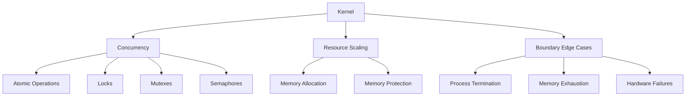

# Lesson 1: Operating System Kernels

## 1. First-Principles Intuition & Invariants

The operating system kernel is the heart of any computing system, serving as the bridge between hardware and software. It is responsible for managing system resources, providing abstractions for processes, and ensuring efficient execution of applications. At its core, the kernel embodies a set of fundamental principles and invariants that define its architecture and behavior. These principles are rooted in the need to provide a secure, efficient, and reliable environment for executing programs.

To understand the kernel's architecture, we must first delve into the problem space it addresses. In a modern computing system, multiple processes compete for limited resources such as CPU time, memory, and I/O bandwidth. The kernel must ensure that these resources are allocated fairly and efficiently, while also providing mechanisms for inter-process communication and synchronization. This requires a deep understanding of the underlying hardware architecture, particularly the CPU, memory, and I/O subsystems.

One of the key invariants of the kernel is its role as a privileged entity that manages system resources. This privilege is necessary to ensure that processes do not interfere with each other or the system's stability. The kernel achieves this through a combination of hardware and software mechanisms. At the hardware level, the CPU provides a set of protection rings (or modes) that separate user-mode code from kernel-mode code. The kernel runs in the most privileged mode, while user-mode processes run in less privileged modes. This separation ensures that user-mode processes cannot directly access kernel data or execute privileged instructions.

Another critical invariant is the kernel's responsibility for managing virtual memory. In a modern operating system, each process operates in its own virtual address space, which is isolated from the address spaces of other processes. This isolation is achieved through the use of page tables, which map virtual addresses to physical addresses. The kernel is responsible for maintaining these page tables and ensuring that processes do not access memory outside their allocated address spaces. This mechanism, known as memory protection, is essential for maintaining system security and stability.

The kernel must also provide mechanisms for scheduling processes, ensuring that they receive a fair share of CPU time. This is achieved through a scheduling algorithm that determines the order in which processes are executed. The choice of scheduling algorithm can have a significant impact on system performance, and the kernel must be designed to support a variety of algorithms to accommodate different workloads.

## 2. Core Architecture & Mechanics

The architecture of an operating system kernel is a complex and intricate system of data structures, algorithms, and execution models. At its core, the kernel is responsible for managing system resources, providing abstractions for processes, and ensuring efficient execution of applications. To understand the kernel's architecture, we must examine its internal data structures and algorithms in detail.

One of the key data structures in the kernel is the process control block (PCB). The PCB is a data structure that contains information about a process, including its state, priority, scheduling information, and resource usage. The kernel maintains a list of PCBs, one for each process, and uses this list to manage process scheduling and resource allocation.

Another critical data structure is the page table, which is used to manage virtual memory. In a modern operating system, each process operates in its own virtual address space, which is isolated from the address spaces of other processes. The page table maps virtual addresses to physical addresses, allowing the kernel to manage memory allocation and protection. The kernel uses a hierarchical page table structure, consisting of multiple levels of page tables, to efficiently manage large address spaces.

The scheduling algorithm is another critical component of the kernel's architecture. The scheduling algorithm determines the order in which processes are executed, ensuring that each process receives a fair share of CPU time. The choice of scheduling algorithm can have a significant impact on system performance, and the kernel must be designed to support a variety of algorithms to accommodate different workloads. One of the most commonly used scheduling algorithms is the Completely Fair Scheduler (CFS), which is used in the Linux kernel. The CFS uses a red-black tree data structure to maintain a list of runnable processes, and it uses a concept called `vruntime` to determine the order in which processes are executed.

To illustrate the architecture of the kernel, we can use a simple Mermaid diagram to depict the relationship between the key data structures and algorithms:

```mermaid
graph TD;
    A[Kernel] --> B[Process Control Block (PCB)]
    A --> C[Page Table]
    A --> D[Scheduling Algorithm]
    B --> E[Process State]
    B --> F[Priority]
    B --> G[Scheduling Information]
    B --> H[Resource Usage]
    C --> I[Virtual Addresses]
    C --> J[Physical Addresses]
    D --> K[Red-Black Tree]
    D --> L[vruntime]
```

In this diagram, the kernel is shown as a central entity that manages the process control block, page table, and scheduling algorithm. The process control block contains information about each process, including its state, priority, scheduling information, and resource usage. The page table maps virtual addresses to physical addresses, allowing the kernel to manage memory allocation and protection. The scheduling algorithm determines the order in which processes are executed, using a red-black tree data structure and the `vruntime` concept to ensure fairness.

## 3. High-Performance Optimization & Failure Modes

The performance and reliability of an operating system kernel are critical factors that determine the overall performance and stability of the system. To achieve high performance, the kernel must be optimized for concurrency, resource scaling, and boundary edge cases. This requires a deep understanding of the underlying hardware architecture and the ability to design efficient algorithms and data structures.

Concurrency is a critical factor in the performance of the kernel, as it must manage multiple processes simultaneously. The kernel must be designed to support concurrent execution of processes, while also ensuring that processes do not interfere with each other or the system's stability. This is achieved through a combination of hardware and software mechanisms. At the hardware level, the CPU provides a set of instructions for atomic operations, which can be used to implement locks and other synchronization primitives. At the software level, the kernel uses a variety of algorithms and data structures to manage concurrency, including spinlocks, mutexes, and semaphores.

Resource scaling is another critical factor in the performance of the kernel. The kernel must be designed to efficiently manage system resources, such as CPU time, memory, and I/O bandwidth, as the number of processes and the size of the system increase. This requires a deep understanding of the underlying hardware architecture and the ability to design efficient algorithms and data structures. One of the key challenges in resource scaling is the management of memory allocation and protection. The kernel must be designed to efficiently manage large address spaces, while also ensuring that processes do not access memory outside their allocated address spaces.

Boundary edge cases are another critical factor in the performance and reliability of the kernel. The kernel must be designed to handle a wide range of edge cases, such as process termination, memory exhaustion, and hardware failures. This requires a deep understanding of the underlying hardware architecture and the ability to design robust algorithms and data structures. One of the key challenges in handling boundary edge cases is the management of process termination. The kernel must be designed to cleanly terminate processes, releasing all resources and ensuring that the system remains stable.

In addition to high-performance optimization, the kernel must also be designed to handle failure modes gracefully. This requires a deep understanding of the underlying hardware architecture and the ability to design robust algorithms and data structures. One of the key challenges in handling failure modes is the management of hardware failures. The kernel must be designed to detect and recover from hardware failures, ensuring that the system remains stable and reliable.

To illustrate the high-performance optimization and failure modes of the kernel, we can use a simple Mermaid diagram to depict the relationship between the key components:



In this diagram, the kernel is shown as a central entity that manages concurrency, resource scaling, and boundary edge cases. Concurrency is managed through a combination of atomic operations, locks, mutexes, and semaphores. Resource scaling is managed through memory allocation and protection. Boundary edge cases are managed through process termination, memory exhaustion, and hardware failures.

In conclusion, the operating system kernel is a complex and intricate system of data structures, algorithms, and execution models. It is responsible for managing system resources, providing abstractions for processes, and ensuring efficient execution of applications. To understand the kernel's architecture, we must examine its internal data structures and algorithms in detail, and we must be aware of the key invariants that define its behavior. To achieve high performance and reliability, the kernel must be optimized for concurrency, resource scaling, and boundary edge cases, and it must be designed to handle failure modes gracefully.
