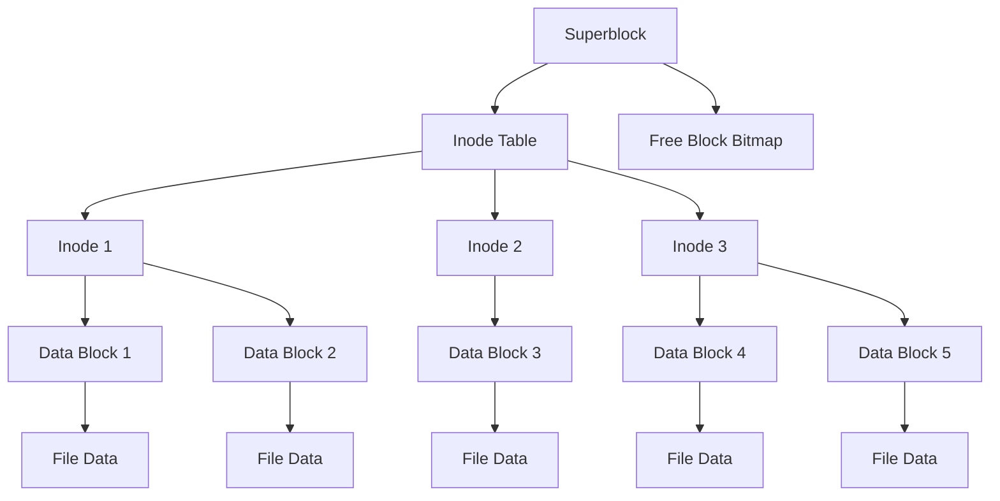

# Lesson 2: File Systems

## 1. First-Principles Intuition & Invariants

File systems are the fundamental abstractions that enable the organization, storage, and retrieval of data on digital storage devices. They provide a structured interface for users and applications to interact with raw storage media, translating high-level file operations into low-level disk commands. At their core, file systems must address several critical invariants: data integrity, consistency, performance, and reliability. These invariants are grounded in the underlying hardware and operating system mechanisms, particularly the virtual memory subsystem and the disk I/O scheduler.

Data integrity is paramount in file systems, ensuring that data is stored and retrieved accurately without corruption. This is achieved through various mechanisms, such as checksums, error detection and correction codes, and journaling. Consistency is another critical invariant, ensuring that the file system's metadata and data structures remain coherent even in the face of system crashes or power failures. This is often achieved through atomic operations and transactional semantics, where changes to the file system are committed in a single, indivisible step.

Performance is a key consideration in file system design, as it directly impacts the responsiveness and efficiency of applications that rely on file I/O. This involves optimizing data layout on the storage medium to minimize seek times and maximize throughput, as well as employing caching strategies to reduce disk access latency. Reliability is also a critical concern, ensuring that the file system remains functional and accessible even in the presence of hardware failures or other disruptions. This is achieved through redundancy, fault tolerance mechanisms, and robust error handling.

The Virtual File System (VFS) in Linux serves as a unifying abstraction layer that allows different file system implementations to coexist and be accessed through a common interface. The VFS provides a set of generic operations that are implemented by individual file system drivers, such as `open`, `read`, `write`, `close`, and `ioctl`. This abstraction layer decouples the file system interface from its implementation, enabling the addition of new file systems without modifying the core kernel code. The VFS also supports the concept of mount points, allowing different file systems to be mounted on a single hierarchical namespace, providing a unified view of the file system hierarchy.

## 2. Core Architecture & Mechanics

The architecture of a file system is intricately tied to its underlying data structures and algorithms, which are designed to efficiently manage data storage and retrieval. At a high level, a file system consists of several key components: the superblock, inodes, directories, and data blocks.

The superblock is a critical data structure that contains metadata about the file system, such as the total number of blocks, the number of free blocks, the block size, and the file system type. The superblock is typically located at a fixed position on the storage medium, making it easy to locate and read during file system initialization. The superblock also contains pointers to other critical data structures, such as the inode table and the free block bitmap.

Inodes (Index Nodes) are data structures that store metadata about individual files and directories, such as the file size, permissions, ownership, timestamps, and pointers to the data blocks that contain the file's contents. Each file and directory in the file system is assigned a unique inode number, which serves as a reference to its inode. Inodes are typically stored in a contiguous block of memory called the inode table, which is referenced by the superblock.

Directories are special files that store mappings between file names and inode numbers. Each directory entry consists of a file name and the corresponding inode number, allowing the file system to locate the inode for a given file name. Directories are also represented as inodes, with their data blocks containing the directory entries. This allows directories to be treated as regular files, enabling operations such as reading, writing, and renaming directories.

Data blocks are the smallest units of storage in a file system, containing the actual data for files and directories. The size of a data block is typically a power of two, such as 512 bytes or 4 kilobytes, and is specified in the superblock. Data blocks are allocated and deallocated dynamically as files are created and deleted, with the free block bitmap in the superblock keeping track of which blocks are available for use.

The process of reading a file from a file system involves several steps. First, the file system locates the inode for the file using the directory structure. The inode contains pointers to the data blocks that contain the file's contents. The file system then reads the data blocks into memory, using the disk I/O scheduler to optimize the order and timing of disk accesses. The data blocks are then combined to form the file's contents, which are returned to the user or application.

Writing a file to a file system involves a similar process, but in reverse. The file system first allocates data blocks to store the file's contents, updating the free block bitmap and the inode's pointers accordingly. The file's data is then written to the allocated data blocks, using the disk I/O scheduler to optimize the order and timing of disk writes. The inode is updated to reflect the new file size and other metadata, ensuring that the file system remains consistent.

To illustrate the internal data structures and algorithms of a file system, consider the following simplified diagram of an ext4 file system:

In this diagram, the superblock contains metadata about the file system, including pointers to the inode table and the free block bitmap. The inode table contains inodes for individual files and directories, with each inode containing pointers to the data blocks that store the file's contents. The free block bitmap keeps track of which data blocks are available for use, allowing the file system to allocate and deallocate blocks dynamically.

## 3. High-Performance Optimization & Failure Modes

High-performance optimization is a critical aspect of file system design, as it directly impacts the responsiveness and efficiency of applications that rely on file I/O. One key optimization technique is data layout optimization, which involves organizing data on the storage medium to minimize seek times and maximize throughput. This can be achieved through various strategies, such as contiguous allocation, which stores a file's data blocks in a contiguous region of the storage medium, reducing the number of seeks required to read or write the file.

Another important optimization technique is caching, which involves storing frequently accessed data in memory to reduce disk access latency. The VFS in Linux provides a caching mechanism called the page cache, which stores file data in memory pages that can be quickly accessed by applications. The page cache is managed by the virtual memory subsystem, which uses a least recently used (LRU) algorithm to evict pages from memory when necessary.

Concurrency is another critical consideration in file system design, as it impacts the ability of multiple processes to access and modify files simultaneously. The VFS in Linux provides a locking mechanism to ensure that file operations are performed atomically and consistently, even in the presence of concurrent access. The VFS uses a combination of locks and reference counts to manage access to inodes and data blocks, ensuring that file operations are performed safely and efficiently.

Resource scaling is also a critical consideration in file system design, as it impacts the ability of the file system to handle large numbers of files and directories. The VFS in Linux provides a scalable architecture that can handle large file systems with millions of files and directories. The VFS uses a hierarchical namespace to organize files and directories, allowing the file system to be partitioned into smaller, more manageable regions. The VFS also provides a mechanism for mounting multiple file systems on a single hierarchical namespace, allowing the file system to be extended and scaled as needed.

Failure modes are an inevitable aspect of file system design, as they can arise from a variety of sources, such as hardware failures, software bugs, and user errors. The VFS in Linux provides several mechanisms for detecting and recovering from failures, ensuring that the file system remains functional and reliable. The VFS uses journaling to ensure data integrity, allowing the file system to recover from crashes and other disruptions without losing data. The VFS also provides a mechanism for detecting and repairing file system corruption, using checksums and other error detection techniques to ensure data consistency.

In conclusion, file systems are critical abstractions that enable the organization, storage, and retrieval of data on digital storage devices. They provide a structured interface for users and applications to interact with raw storage media, translating high-level file operations into low-level disk commands. The architecture of a file system is intricately tied to its underlying data structures and algorithms, which are designed to efficiently manage data storage and retrieval. High-performance optimization and failure modes are critical considerations in file system design, as they impact the responsiveness, efficiency, and reliability of the file system. The VFS in Linux serves as a unifying abstraction layer that allows different file system implementations to coexist and be accessed through a common interface, providing a scalable and reliable file system architecture.
