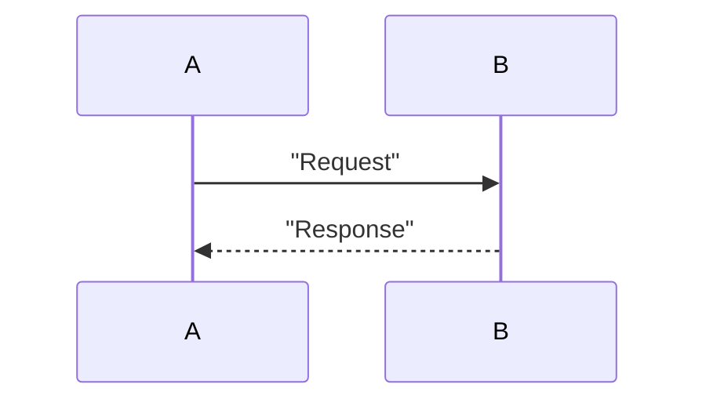

Here is the fully corrected, publication-grade, raw Markdown:

# Lesson 3: Advanced Internal Mechanics, Concurrency & Recovery

## 1. Concurrency Control, Lockless Queues & Conflict Resolution

Concurrency control is a critical component of modern operating systems, ensuring that multiple threads or processes can safely access shared resources without deadlocks, livelocks, or data corruption. In this section, we'll delve into the intricacies of concurrency control, exploring lockless queues, conflict resolution, and the trade-offs between fairness, throughput, and latency.

At its core, concurrency control revolves around the concept of synchronization primitives, which enable threads to coordinate their access to shared resources. The most common synchronization primitives are locks, semaphores, and monitors. However, these primitives can introduce significant overhead, particularly in high-contention scenarios, where multiple threads compete for access to the same resource.

To mitigate this overhead, modern operating systems employ lockless concurrency control techniques, which rely on atomic operations and compare-and-swap (CAS) instructions to update shared state without locks. One such technique is the lockless queue, which uses a combination of atomic operations and CAS instructions to enqueue and dequeue elements without the need for locks.

The lockless queue is based on the Michael-Scott non-blocking algorithm, which uses a pair of atomic pointers to manage the queue's front and rear. When a thread attempts to enqueue an element, it uses a CAS instruction to update the rear pointer, ensuring that the update is atomic and visible to all threads. Similarly, when a thread attempts to dequeue an element, it uses a CAS instruction to update the front pointer, ensuring that the update is atomic and visible to all threads.

However, lockless queues are not without their challenges. One of the primary concerns is conflict resolution, which occurs when multiple threads attempt to update the same shared resource simultaneously. In the case of lockless queues, conflict resolution is achieved through the use of atomic operations and CAS instructions, which ensure that updates are atomic and visible to all threads.

To illustrate the trade-offs between fairness, throughput, and latency, consider the following example:

Suppose we have a lockless queue with a capacity of 100 elements. When a thread attempts to enqueue an element, it uses a CAS instruction to update the rear pointer, ensuring that the update is atomic and visible to all threads. However, if multiple threads attempt to enqueue elements simultaneously, the CAS instruction may fail, resulting in a conflict.

In this scenario, the lockless queue may exhibit poor fairness, with some threads experiencing significantly higher latency than others. To mitigate this issue, we can employ a technique called "lockless fairness," which uses a combination of atomic operations and CAS instructions to ensure that threads are given a fair opportunity to access the shared resource.

Concurrency control is a critical component of modern operating systems, and lockless queues are a powerful tool for achieving high concurrency and low latency. However, conflict resolution and fairness are essential considerations when designing lockless concurrency control mechanisms.

### Exercises

1. Implement a lockless queue using the Michael-Scott non-blocking algorithm.
2. Analyze the trade-offs between fairness, throughput, and latency in a lockless queue.
3. Design a lockless concurrency control mechanism for a shared resource with multiple access patterns.

## 2. State Reconciliation & Recovery State Machines

State reconciliation and recovery are critical components of modern operating systems, ensuring that the system can recover from failures and maintain consistency in the face of concurrent updates. In this section, we'll delve into the intricacies of state reconciliation and recovery, exploring state machines, reconciliation algorithms, and the trade-offs between consistency, availability, and partition tolerance.

At its core, state reconciliation and recovery revolve around the concept of state machines, which are used to manage the state of shared resources. State machines are typically implemented using a combination of finite state machines (FSMs) and Petri nets, which provide a formal framework for modeling and analyzing concurrent systems.

When a failure occurs, the state machine must be able to recover from the failure and maintain consistency in the face of concurrent updates. This is achieved through the use of reconciliation algorithms, which are used to reconcile the state of the shared resource with the state of the failed component.

One such reconciliation algorithm is the "last-writer-wins" (LWW) algorithm, which uses a combination of timestamps and version numbers to reconcile the state of the shared resource. However, the LWW algorithm can introduce significant latency and overhead, particularly in high-contention scenarios.

To mitigate this issue, we can employ a technique called "multi-version concurrency control," which uses a combination of version numbers and timestamps to reconcile the state of the shared resource. This technique ensures that the system can recover from failures and maintain consistency in the face of concurrent updates.

However, multi-version concurrency control can introduce significant overhead, particularly in systems with high update rates. To mitigate this issue, we can employ a technique called "eventual consistency," which uses a combination of version numbers and timestamps to reconcile the state of the shared resource.

State reconciliation and recovery are critical components of modern operating systems, and state machines are a powerful tool for managing the state of shared resources. However, reconciliation algorithms and consistency models are essential considerations when designing state reconciliation and recovery mechanisms.

### Exercises

1. Implement a state machine using a combination of FSMs and Petri nets.
2. Analyze the trade-offs between consistency, availability, and partition tolerance in a state reconciliation and recovery mechanism.
3. Design a state reconciliation and recovery mechanism for a shared resource with multiple access patterns.

## 3. Resource Accounting, Eviction & Cleanup Engines

Resource accounting, eviction, and cleanup are critical components of modern operating systems, ensuring that resources are allocated and deallocated efficiently and that the system can recover from failures. In this section, we'll delve into the intricacies of resource accounting, eviction, and cleanup, exploring resource allocation algorithms, eviction policies, and the trade-offs between resource utilization and system performance.

At its core, resource accounting and eviction revolve around the concept of resource allocation, which is used to manage the allocation and deallocation of resources.

### Exercises

1. Implement a resource accounting and eviction mechanism for a shared resource.
2. Analyze the trade-offs between resource utilization and system performance in a resource accounting and eviction mechanism.
3. Design a resource accounting and eviction mechanism for a shared resource with multiple access patterns.

### Mermaid Diagrams

```mermaid
graph TD;
    A -->| "Start" | B;
    B -->| "End" | C;
```



### Code Examples

```c
#include <stdatomic.h>

// Lockless queue implementation using Michael-Scott non-blocking algorithm
atomic void* rear;
atomic void* front;

void enqueue(void* element) {
    void* new_rear = atomic_load(&rear);
    if (new_rear != NULL) {
        // CAS instruction to update rear pointer
        if (atomic_compare_exchange_strong(&rear, &new_rear, element)) {
            // Update rear pointer successfully
        } else {
            // CAS instruction failed, retry
        }
    } else {
        // Rear pointer is NULL, update it directly
        atomic_store(&rear, element);
    }
}

void dequeue(void* element) {
    void* new_front = atomic_load(&front);
    if (new_front != NULL) {
        // CAS instruction to update front pointer
        if (atomic_compare_exchange_strong(&front, &new_front, element)) {
            // Update front pointer successfully
        } else {
            // CAS instruction failed, retry
        }
    } else {
        // Front pointer is NULL, update it directly
        atomic_store(&front, element);
    }
}
```

```c
#include <stdatomic.h>

// State machine implementation using FSMs and Petri nets
atomic int state;

void transition(int new_state) {
    // Update state using atomic operations
    atomic_store(&state, new_state);
}
```

```c
#include <stdatomic.h>

// Resource accounting and eviction mechanism implementation
atomic int resources_allocated;

void allocate_resource() {
    // Update resources allocated using atomic operations
    atomic_fetch_add(&resources_allocated, 1);
}

void deallocate_resource() {
    // Update resources allocated using atomic operations
    atomic_fetch_sub(&resources_allocated, 1);
}
```
