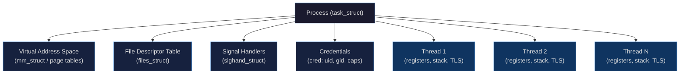

# Lesson 3: Operating System Theory

## 1. First-Principles Intuition & Invariants

An operating system exists to solve a fundamental resource arbitration problem: multiple programs, running concurrently on shared hardware, must be isolated from one another while each believing it has exclusive access to the machine. This illusion—the central achievement of modern OS design—is maintained through hardware-software cooperation that enforces three invariants simultaneously:

1. **Safety**: a process must never read or write memory it does not own, execute privileged instructions without authorization, or access I/O devices arbitrarily.
2. **Liveness**: the scheduler must guarantee forward progress—no process starves indefinitely, and the system itself cannot deadlock.
3. **Transparency**: the abstractions exposed to applications (virtual addresses, file descriptors, process IDs) must behave consistently regardless of physical resource availability.

These invariants are not soft engineering goals. They are contractual properties enforced at the hardware boundary. The x86-64 architecture enforces the safety invariant through **privilege rings** (ring 0 for the kernel, ring 3 for user space), **page-table walk hardware** (the MMU), and **I/O permission bitmaps** in the Task State Segment (TSS). ARM enforces equivalent separation through **Exception Levels** (EL0–EL3). Any OS running on these architectures inherits the hardware's enforcement; the OS designer's job is to configure that hardware correctly and present coherent abstractions above it.

The deeper principle is **policy–mechanism separation**, articulated clearly in the original UNIX philosophy: the kernel provides mechanisms (virtual memory, scheduling queues, system call dispatch), while policy (which process gets CPU time, how memory is partitioned, what files a user may open) lives either in user space or in configurable kernel parameters. This separation is what allows Linux to support both a soft-realtime `SCHED_FIFO` policy for audio workloads and a throughput-oriented `SCHED_BATCH` policy for compile farms—same mechanism, different policy.

A second foundational concept is **the kernel as a trusted intermediary**. No user-space code ever directly manipulates hardware state. Every interaction traverses a **trap**—a synchronous, hardware-mediated transfer of control from ring 3 to ring 0. The trap installs the kernel's page table, switches to the kernel stack, saves user-space registers in a `pt_regs` structure, and dispatches to the appropriate system call handler. When the handler returns, the CPU performs the inverse: restores user registers, reinstalls the user page table, and resumes execution at the instruction following the trap. This round-trip is the atomic unit of OS–application interaction.

Understanding *why* traps exist at the hardware level—not merely *that* they exist—is essential. Without a hardware-enforced privilege boundary, any program could `MOV CR3, rax` to replace the page table, rendering all memory protection meaningless. The CPU's current privilege level (CPL, stored in the low two bits of the `CS` register on x86-64) is checked on every memory access and every privileged instruction. The OS does not ask user programs to behave; the hardware forces them to.

---

## 2. Core Architecture & Mechanics

### 2.1 The Kernel Taxonomy

Operating system kernels fall along a spectrum defined by how much code runs in ring 0:

```
Monolithic  ←————————————————————————————→  Microkernel
 (Linux)                                      (seL4, Mach)

Ring 0: kernel, all drivers,     Ring 0: IPC, scheduling, VM only
        filesystems, network     Ring 3: drivers, filesystems, VFS
        stack                    (communicate via synchronous IPC)
```

**Monolithic kernels** (Linux, FreeBSD, XNU) colocate all subsystems in kernel space. A bug in the ext4 filesystem driver can corrupt kernel memory and crash the system—but the tradeoff is performance: subsystem calls are ordinary function calls, not context switches. Linux's loadable kernel module system is a pragmatic hybrid: modules load into ring 0 but can be developed and replaced independently.

**Microkernels** (seL4, QNX, L4) reduce the trusted computing base (TCB) to a minimal set: IPC, address-space management, and thread scheduling. Everything else—device drivers, filesystems, network stacks—runs in isolated user-space servers. A crashing NIC driver cannot corrupt the kernel. The cost is IPC overhead: a simple read(2) in a microkernel system may cross two or three context switches. Modern L4 variants reduce this to single-digit microseconds through careful IPC path optimization, but monolithic kernels still win on raw throughput.

**Hybrid kernels** (Windows NT, XNU/macOS) run a microkernel-derived core (the Mach-derived executive in XNU, the NT Executive in Windows) but move performance-critical subsystems back into ring 0. macOS's XNU runs the BSD personality and I/O Kit drivers in kernel space atop the Mach microkernel primitives.

**Unikernels** (MirageOS, Unikraft) are a modern extreme: the entire application and OS are compiled together into a single-address-space binary with no user/kernel separation. They eliminate trap overhead entirely, trading isolation for raw performance and reduced attack surface. Used in hypervisor guest roles where VM-level isolation replaces OS-level isolation.

### 2.2 Process and Thread Model

A **process** is the OS's unit of resource ownership. It encapsulates:
- A virtual address space (defined by a page table hierarchy)
- A set of open file descriptors
- Signal handlers and signal masks
- A set of credentials (UID, GID, capabilities)
- One or more **threads** of execution

A **thread** is the unit of CPU scheduling. It owns a register file, a stack, and thread-local storage (TLS). All threads within a process share the same address space—modifying a global variable in one thread is immediately visible to all others, which is both the utility and the hazard of shared-memory concurrency.

On Linux, both processes and threads are represented by `struct task_struct`, and the distinction is entirely in how `clone(2)` is called. `fork(2)` creates a new process by calling `clone` with no sharing flags; `pthread_create(3)` calls `clone` with `CLONE_VM | CLONE_FS | CLONE_FILES | CLONE_SIGHAND`, sharing the address space, filesystem namespace, file descriptors, and signal handlers. The kernel does not have separate "process" and "thread" abstractions internally—it has tasks with configurable sharing.



#### Process Creation: `fork` and `exec`

`fork(2)` creates a child process that is an exact copy of the parent. Naively this requires duplicating the entire address space—potentially gigabytes of data. Linux uses **copy-on-write (COW)**: both parent and child initially share the same physical pages, marked read-only. The first write to a shared page triggers a page fault; the kernel then allocates a new physical page, copies the content, remaps the faulting address to the new page in the writer's page table, and marks it writable. Unmodified pages are never copied.

`exec(2)` replaces the calling process's address space with a new program image. The kernel:
1. Opens and validates the ELF binary
2. Maps the ELF segments (`.text`, `.rodata`, `.data`, `.bss`) into the new address space using `mmap`
3. Sets up the stack with `argc`, `argv`, and `envp`
4. Jumps to the ELF entry point (usually the dynamic linker `ld.so`, which resolves shared libraries before transferring control to `main`)

The combination of `fork` + `exec` is the UNIX process creation model. Its elegance is that `fork` gives the child an opportunity to manipulate its environment (redirect file descriptors, set resource limits, change credentials) between the two calls, before the new program image even loads.

#### The Kernel Data Structures for Process Management

```c
// Simplified sketch
```
