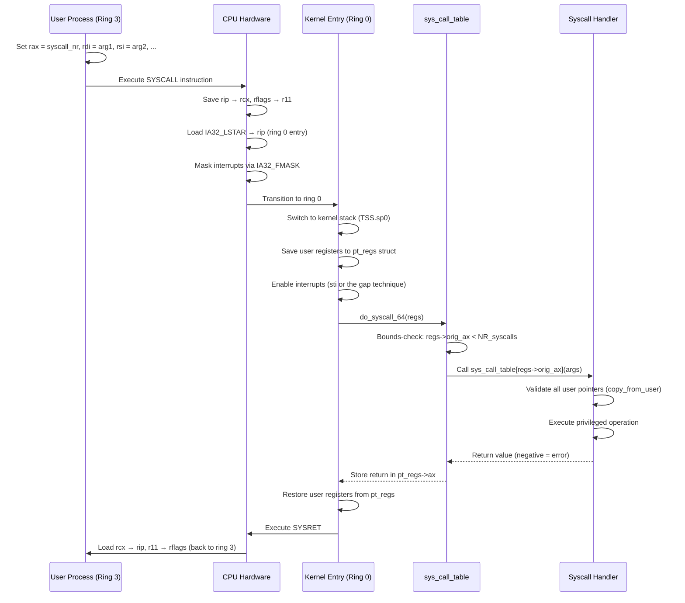
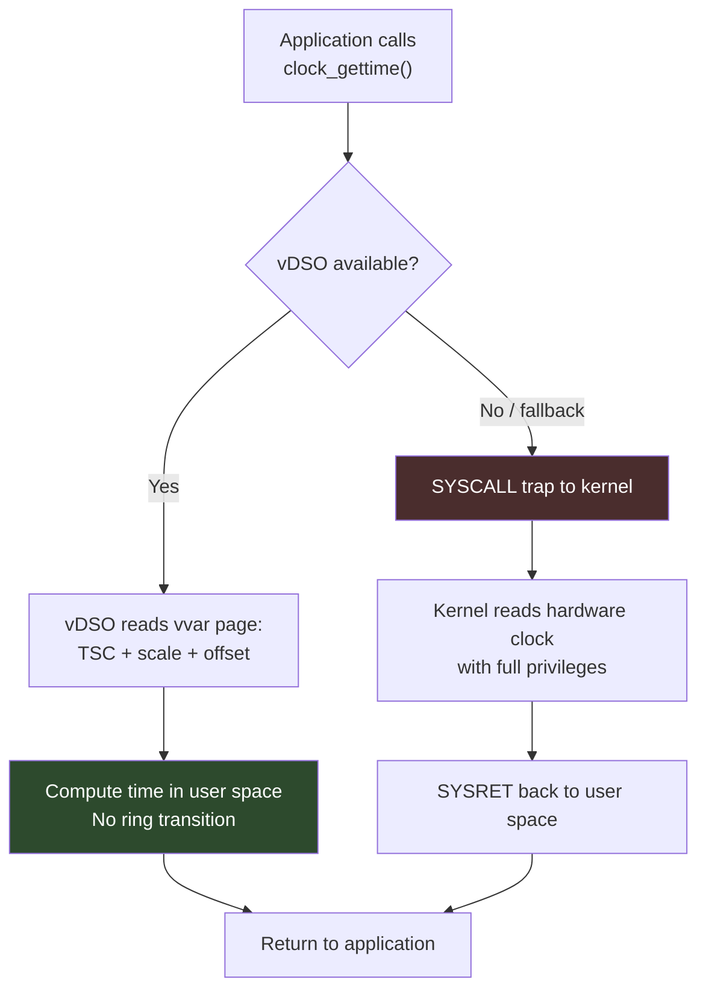
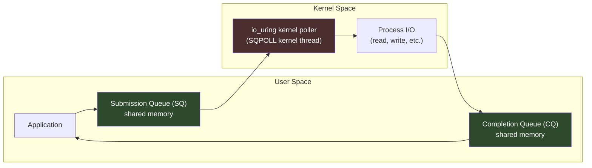
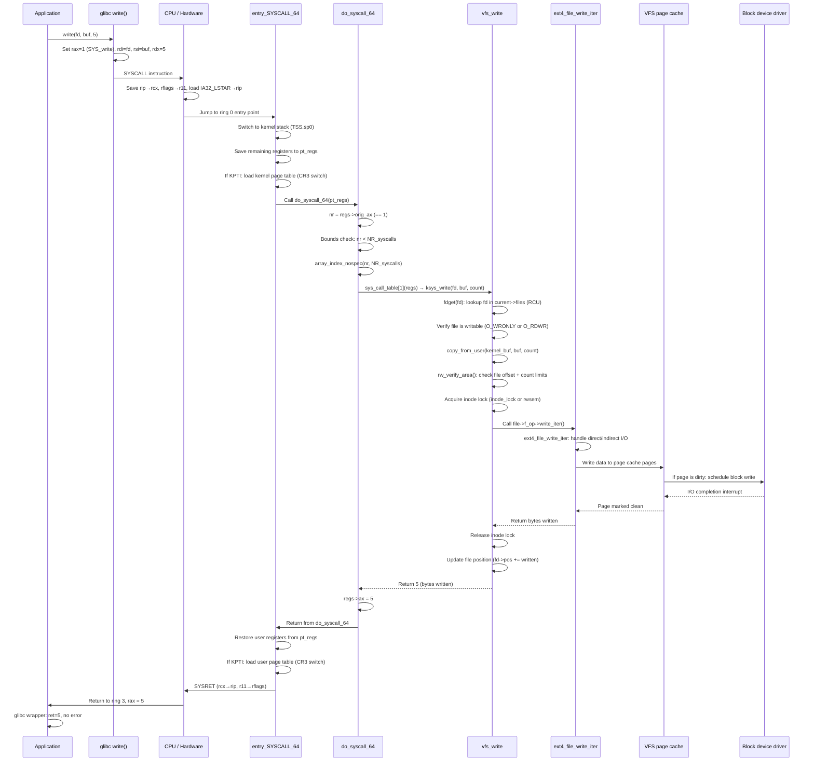

# Lesson 4: System Calls and Interfaces

## 1. First-Principles Intuition & Invariants

Modern operating systems enforce a hardware-mediated privilege boundary between user space and kernel space. On x86-64, this boundary is implemented through CPU protection rings: user applications execute in ring 3 (least privileged), while the kernel executes in ring 0 (most privileged). The hardware enforces that ring-3 code cannot directly execute privileged instructions (e.g., `MOV CR3`, `IN`/`OUT` port I/O, `HLT`) or access kernel-reserved memory regions. The page tables themselves carry a `U/S` (User/Supervisor) bit in each page-table entry; when set, the page is accessible from ring 3. When clear, any ring-3 access triggers a page fault.

System calls are the **controlled exception mechanism** that bridges this boundary. A user-space program cannot simply call a kernel function pointer — the MMU would block the access. Instead, the program executes a special trap instruction (`SYSCALL` on x86-64, `SVC` on ARM64, `ECALL` on RISC-V) that the CPU treats as a synchronous exception. The hardware transitions from ring 3 to ring 0, saves a minimal execution context, and jumps to a kernel-defined entry point. The kernel then validates all arguments, executes the requested operation with full privileges, and returns control to user space via a companion return instruction (`SYSRET`, `ERET`, `SRET`).

This architecture establishes several hard invariants:

- **Monopoly on privilege escalation**: The only legitimate path from ring 3 to ring 0 is through a system call trap or a hardware interrupt. There is no "side channel" for privilege. The `IDT` (Interrupt Descriptor Table) or `MSR` (Model-Specific Register) entry points are written exclusively by the kernel at boot and are not writable from user space.
- **Caller-agnostic kernel execution**: The kernel does not trust the caller. Every system call handler treats all pointer arguments, file descriptors, and IDs as potentially hostile. The kernel must copy all data from user-space buffers into kernel-space buffers (via `copy_from_user` / `copy_to_user` on Linux) before acting on it, because the user-space mapping could change between the validity check and the actual dereference (TOCTOU race).
- **Synchronous, blocking semantics by default**: A system call is a synchronous request-response transaction from the caller's perspective. The calling thread is descheduled and enters an uninterruptible or interruptible wait state (`TASK_INTERRUPTIBLE` / `TASK_UNINTERRUPTIBLE` in Linux) until the kernel completes the operation or an exception occurs. Asynchronous variants (`io_uring`, `aio`, signals) exist but are layered abstractions built on top of the same fundamental trap mechanism.
- **Atomicity boundary**: The system call is the atomic unit of kernel-user interaction. Either the call completes and returns a well-defined result, or it fails and returns a well-defined error code (`-EINVAL`, `-ENOMEM`, `-EPERM`, etc.). There is no "partial success" at the syscall ABI level, though internally the kernel may make partial progress (e.g., `read()` returning fewer bytes than requested).

## 2. Core Architecture & Mechanics

### 2.1 The Trap Mechanism on x86-64

On x86-64 Linux, the `SYSCALL` instruction is the standard entry path. Unlike the legacy `int 0x80` software interrupt (which dispatches through the IDT), `SYSCALL` is a fast-path instruction that reads target addresses directly from MSRs, avoiding the overhead of IDT lookup and privilege-level stack switching.

The mechanism works as follows:

1. **User space sets up registers**: The system call number is placed in `rax`. Arguments are placed in `rdi`, `rsi`, `rdx`, `r10`, `r8`, `r9` (the kernel uses `r10` instead of `rcx` because `SYSCALL` clobbers `rcx` to save the return address). The user executes `SYSCALL`.

2. **Hardware transition**: The CPU saves the return address in `rcx`, saves `rflags` in `r11`, loads `IA32_LSTAR` (MSR `0xC0000082`) into `rip`, and loads `IA32_FMASK` (MSR `0xC0000084`) into `rflags` (masking interrupts and clearing the trap flag). The privilege level transitions to ring 0. Critically, `SYSCALL` does **not** switch stacks — the kernel's `entry_SYSCALL_64` function is responsible for switching from the user stack to the kernel stack by reading the per-CPU `TSS.sp0` value.

3. **Kernel entry path**: The kernel's `entry_SYSCALL_64` (in `arch/x86/entry/entry_64.S`) saves the remaining user-space registers to the kernel stack, constructs a `pt_regs` struct, switches to the kernel address space (if KPTI is enabled), and calls `do_syscall_64()`.

4. **Dispatch**: `do_syscall_64()` reads the syscall number from `pt_regs->orig_ax`, bounds-checks it against `NR_syscalls`, and indexes into the `sys_call_table` — an array of function pointers. The matching handler is invoked with the arguments extracted from `pt_regs`.

5. **Return path**: The handler returns an integer (negative for error, non-negative for success). The kernel restores user-space registers from `pt_regs`, writes the return value to `rax`, executes `SYSRET`, which loads `rcx` into `rip` and `r11` into `rflags`, returning control to ring 3.



### 2.2 The System Call Table

The system call table is a static array of function pointers, one per syscall number. On Linux x86-64, this is defined in `arch/x86/entry/syscalls/syscall_64.tbl` and compiled into `sys_call_table` in `arch/x86/entry/syscall_64.c`. Each entry points to either a `SYSCALL_DEFINE`-wrapped handler or a stub.

The syscall number assignment is ABI-stable — once assigned, a number never changes. New syscalls are appended; deprecated ones remain as stubs returning `-ENOSYS`. This stability is what allows old binaries to continue running across kernel versions.

```c
// Simplified representation of the dispatch mechanism in the Linux kernel
// (arch/x86/entry/common.c, simplified for illustration)

#include <linux/syscalls.h>
#include <linux/ptrace.h>

// The table is generated from syscall_64.tbl at build time
// Each entry is a function pointer matching the signature:
//   long sys_xxx(struct pt_regs *regs)  [modern convention]
// or the older direct-argument convention.

void do_syscall_64(struct pt_regs *regs, int nr)
{
    // The syscall number is stored in regs->orig_ax.
    // On entry, regs->ax already holds the same value.
    nr = regs->orig_ax;

    // Harden against Spectre v1 (indirect call restriction).
    // The actual kernel uses __x86_indirect_thunk_rax or retpoline.
    if (likely(nr < NR_syscalls)) {
        nr = array_index_nospec(nr, NR_syscalls);
        regs->ax = sys_call_table[nr](regs);
    } else {
        regs->ax = -ENOSYS;
    }

    // Exit path: check for pending work (signals, rescheduling,
    // task migration, cgroup accounting) before returning to user space.
    syscall_exit_to_user_mode(regs);
}
```

### 2.3 Parameter Passing and Validation

Arguments are passed in registers (six on x86-64), which is sufficient for the vast majority of syscalls. For more complex interfaces, a pointer to a struct is passed instead, and the kernel copies the struct into kernel space before use.

The kernel's validation responsibilities are non-negotiable:

- **Pointer validation**: Every user-space pointer passed to a syscall must be checked for accessibility using `access_ok()`, which verifies the address range falls within the user-space segment limit. However, `access_ok()` only checks the address range — it does **not** guarantee the pages are mapped or writable. Actual access can still fault, which is why the kernel uses `copy_from_user()` / `copy_to_user()` with fault handlers rather than direct dereferences.

- **File descriptor validation**: Every file descriptor must be looked up in the calling task's file descriptor table, which requires acquiring `current->files->file_lock` or using RCU-protected lookups.

- **Length validation**: Buffer sizes must be checked for overflow. For example, `read(fd, buf, count)` must verify that `buf + count` does not wrap around or exceed the user-space address limit.

```c
// Illustrative: how the kernel safely copies data from user space.
// The real implementation is in Linux's lib/iov_iter.c and
// arch/x86/lib/copy_user_64.S with page-fault fixup tables.

/**
 * copy_from_user - Safely copy data from user-space to kernel-space.
 * @to:   Destination kernel buffer
 * @from: Source user-space address
 * @n:    Number of bytes to copy
 *
 * Returns the number of bytes that could NOT be copied (0 = success).
 * If a page fault occurs on the user address, the page fault handler
 * runs; if the fault cannot be resolved, the fault handler jumps to
 * a fixup entry in the __ex_table section instead of oopsing.
 */
static inline unsigned long
copy_from_user(void *to, const void __user *from, unsigned long n)
{
    // access_ok verifies the address range is within user space limits.
    // On x86-64 with 5-level paging, the user address limit is TASK_SIZE_MAX.
    if (access_ok(from, n)) {
        // The actual copy is done in assembly with exception tables.
        // If a page fault occurs, the fault handler looks up the
        // faulting RIP in __ex_table; if found, it jumps to the
        // fixup label which returns the uncopied count.
        n = raw_copy_from_user(to, from, n);
    }
    return n;
}
```

### 2.4 Architecture Comparison

The trap mechanism differs across architectures but the conceptual model is identical:

| Architecture | Trap Instruction | Return Instruction | Entry Register | Syscall # Register | Arg Registers |
|---|---|---|---|---|---|
| x86-64 | `SYSCALL` | `SYSRET` | `IA32_LSTAR` MSR | `rax` | `rdi, rsi, rdx, r10, r8, r9` |
| x86-32 (legacy) | `int 0x80` | `IRET` | IDT vector 0x80 | `eax` | `ebx, ecx, edx, esi, edi, ebp` |
| ARM64 | `SVC #0` | `ERET` | `VBAR_EL1` + offset | `x8` | `x0-x5` |
| RISC-V | `ECALL` | `SRET` | `STVEC` CSR | `a7` | `a0-a6` |
| Linux generic | `SVC 0` | `ERET` | `VBAR_EL1` | `x8` | `x0-x5` |

### 2.5 C Library Wrappers and the vDSO

Application code rarely invokes syscalls directly. The C library (glibc, musl, bionic) provides wrapper functions that handle argument marshaling, error code translation, and ABI differences. The glibc wrapper for `write()` looks roughly like this:

```c
// Simplified glibc syscall wrapper for write(2)
// Real implementation in glibc's sysdeps/unix/sysv/linux/write.c
// uses INTERNAL_SYSCALL / INLINE_SYSCALL macros.

#include <unistd.h>
#include <errno.h>
#include <sys/syscall.h>

// The glibc wrapper:
// 1. Places syscall number in rax
// 2. Places args in argument registers
// 3. Executes SYSCALL
// 4. Checks return value for error
// 5. Translates negative kernel errno to positive errno + -1 return

long write(int fd, const void *buf, size_t count)
{
    long ret = syscall(SYS_write, fd, buf, count);

    if (ret < 0) {
        // Kernel returns -errno; glibc converts to positive errno
        errno = -ret;
        return -1;
    }
    return ret;
}
```

Some "syscalls" never actually trap. The **vDSO** (virtual Dynamic Shared Object) is a kernel-provided shared library mapped into every process's address space at a fixed page. It contains implementations of time-related functions (`clock_gettime`, `gettimeofday`, `getcpu`) that read kernel-maintained data structures directly from user space, avoiding the trap overhead entirely. The kernel updates these data structures (e.g., `gtod` — global time-of-day data, and the vvar page) during timer interrupts and context switches. This is possible because the hardware clock counter (`RDTSC` on x86, `CNTVCT_EL0` on ARM64) is readable from user space, and the kernel exposes the necessary scaling/offset factors in the vDSO's data page.



## 3. Direct System Call Invocation in Practice

### 3.1 Raw Syscall in C (Linux x86-64)

Without libc wrappers, a program can issue syscalls directly via inline assembly:

```c
// Direct syscall invocation on x86-64 Linux without libc.
// This program writes "Hello, syscall!\n" to stdout and exits.
// Compile: gcc -nostdlib -o raw_syscall raw_syscall.c

#include <sys/syscall.h>

// write(1, msg, 15) -> rax=1, rdi=1, rsi=msg, rdx=15
// exit(0)          -> rax=60, rdi=0

static long syscall1(long nr, long arg1) {
    long ret;
    __asm__ volatile (
        "syscall"
        : "=a" (ret)           // output: rax
        : "a" (nr),            // input:  rax = syscall number
          "D" (arg1)           // input:  rdi = first argument
        : "rcx", "r11", "memory"  // clobbers: SYSCALL destroys rcx and r11
    );
    return ret;
}

static long syscall3(long nr, long arg1, long arg2, long arg3) {
    long ret;
    __asm__ volatile (
        "syscall"
        : "=a" (ret)
        : "a" (nr),
          "D" (arg1),
          "S" (arg2),
          "d" (arg3)
        : "rcx", "r11", "memory"
    );
    return ret;
}

void _start(void) {
    const char msg[] = "Hello, syscall!\n";
    syscall3(SYS_write, 1, (long)msg, sizeof(msg) - 1);
    syscall1(SYS_exit, 0);
    __builtin_unreachable();
}
```

### 3.2 Tracing System Calls with strace

`strace` uses `ptrace` (itself a syscall, `SYS_ptrace`) to intercept system calls. It sets `PTRACE_O_TRACESYSGOOD` and toggles the `PTRACE_SYSCALL` stop between entry and exit to log arguments and return values:

```bash
# Trace all syscalls made by ls
$ strace ls -la /dev/null 2>&1 | head -20

# Key output lines (simplified):
# openat(AT_FDCWD, "/etc/ld.so.cache", O_RDONLY|O_CLOEXEC) = 3
# fstat(3, {st_mode=S_IFREG|0644, st_size=89152, ...}) = 0
# mmap(NULL, 89152, PROT_READ, MAP_PRIVATE, 3, 0) = 0x7f...
# read(3, "\177ELF\2\1\1\3\0\0\0\0\0\0\0\0\3\0>\0\1\0\0\0"..., 832) = 832
# write(1, "crw-rw-rw- 1 root root 1, 3 May 1"..., 52) = 52
# close(3) = 0
# exit_group(0) = ?

# Count syscalls by type
$ strace -c ls -la /dev/null 2>&1 | tail -15
```

The `ptrace` mechanism works by the tracer setting the traced process's `PTRACE_SYSCALL` flag. On each syscall entry and exit, the kernel delivers a `SIGTRAP` to the tracer and deschedules the tracee. This interception adds significant overhead (typically 2-5x slowdown), which is why production profiling tools often use lighter mechanisms like `eBPF` via `perf trace` or `bcc`.

## 4. Performance Characteristics and Optimization

### 4.1 Syscall Overhead Measurement

A bare `SYSCALL`/`SYSRET` pair on a modern x86-64 CPU (e.g., Skylake, Zen 3) costs approximately 100-200 nanoseconds under nominal conditions. This includes:

- The `SYSCALL` instruction itself (~10-20 cycles)
- Kernel entry code (register saving, stack switching, KPTI page table switch if enabled: ~100-200 cycles)
- The dispatch through `do_syscall_64` and table lookup (~20-50 cycles)
- The handler execution (varies by syscall)
- The exit path (register restoration, KPTI switch back: ~100-200 cycles)
- The `SYSRET` instruction (~10-20 cycles)

With Kernel Page Table Isolation (KPTI) enabled (the default on Intel CPUs post-Meltdown), an additional page table switch occurs on every entry and exit, roughly doubling the overhead. The kernel maintains a separate "user" page table that maps only a minimal kernel entry trampoline; the full kernel page table is only loaded during kernel execution. This prevents Meltdown-style speculative side-channel attacks but costs ~30% more per syscall on affected Intel microarchitectures.

### 4.2 Reducing Syscall Frequency: Batching and Asynchronous I/O

The dominant strategy for I/O-intensive applications is to reduce the number of ring transitions by batching operations. Three approaches span the modern landscape:

**`io_uring`** (Linux 5.1+, the modern standard) sets up a pair of shared-memory ring buffers between user space and the kernel. Submissions go into the SQ (submission queue) and completions arrive in the CQ (completion queue). Neither requires a syscall per operation — the kernel polls the SQ via a kernel thread (`io_uring` with `IORING_SETUP_SQPOLL`) or wakes on `io_uring_enter`. This can achieve sub-microsecond I/O latency with zero syscalls in the steady state:

```c
// io_uring minimal example: submit a read and wait for completion.
// Requires liburing (or raw mmap'd ring setup).
// Compile: gcc -O2 -o iouring iouring.c -luring

#include <liburing.h>
#include <stdio.h>
#include <string.h>
#include <unistd.h>

int main(void) {
    struct io_uring ring;
    struct io_uring_sqe *sqe;
    struct io_uring_cqe *cqe;
    char buf[4096];
    int fd, ret;

    // Initialize the ring with 8 entries.
    // io_uring_queue_init sets up the shared-memory rings and
    // registers them with the kernel via io_uring_setup(2).
    ret = io_uring_queue_init(8, &ring, 0);
    if (ret < 0) {
        fprintf(stderr, "ring init failed: %s\n", strerror(-ret));
        return 1;
    }

    fd = open("/etc/hostname", O_RDONLY);
    if (fd < 0) { perror("open"); return 1; }

    // Get the next submission queue entry (no syscall needed).
    sqe = io_uring_get_sqe(&ring);

    // Prepare a readv operation into buf.
    // This populates the SQE in shared memory; the kernel
    // will pick it up when we call io_uring_submit().
    struct iovec iov = { .iov_base = buf, .iov_len = sizeof(buf) };
    io_uring_prep_readv(sqe, fd, &iov, 1, 0);

    // Submit the SQE. This calls io_uring_enter(2) once.
    // With SQPOLL mode, even this syscall is avoided.
    io_uring_submit(&ring);

    // Wait for completion (blocks via io_uring_enter).
    io_uring_wait_cqe(&ring, &cqe);

    // cqe->res holds the number of bytes read (or -errno).
    if (cqe->res >= 0) {
        buf[cqe->res] = '\0';
        printf("Read %d bytes: %s", cqe->res, buf);
    }

    io_uring_cqe_seen(&ring, cqe);
    io_uring_queue_exit(&ring);
    close(fd);
    return 0;
}
```



### 4.3 Failure Modes and Error Semantics

System calls report errors by returning a negative value whose absolute value is a POSIX `errno` code (defined in `include/uapi/asm-generic/errno-base.h` and `errno.h`). The C library wrapper translates this to the conventional `-1` return with `errno` set. Understanding the error taxonomy is essential:

- **`-EFAULT`**: A user-space pointer argument was invalid or unmapped. This is a programming bug, not a transient error. The kernel detected the bad address during `copy_from_user` / `copy_to_user`.

- **`-EINVAL`**: An argument value was semantically invalid (e.g., `epoll_ctl` with an unrecognized op). This is also a programming bug.

- **`-ENOMEM`**: The kernel could not allocate memory. Transient; retryable, though it may indicate a system-wide memory pressure situation.

- **`-EINTR`**: The syscall was interrupted by a signal while blocked in an interruptible wait state. The caller must decide whether to retry. The C library wrappers for `read`, `write`, and others typically automatically retry on `EINTR` by default (`SA_RESTART` signal flag), but `epoll_wait`, `select`, and `poll` may still return `-EINTR`.

- **`-EAGAIN` / `-EWOULDBYTE`**: The operation would block in non-blocking mode (`O_NONBLOCK` set). These are the same value on Linux (`EAGAIN == EWOULDBYTE == 11`), though POSIX permits them to differ.

- **`-EBADF`**: The file descriptor does not refer to an open file. A programming bug or a race condition where another thread closed the fd.

A critical failure mode is the **TOCTOU race** (Time-of-Check to Time-of-Use). If a syscall validates a user pointer with `access_ok()` and then later dereferences it, the mapping could have changed in between (via `mmap`, `mremap`, or `munmap` from another thread). The kernel mitigates this by copying data into kernel space in one atomic operation (`copy_from_user`), not by checking-then-dereferencing. Applications that check file properties via `stat()` and then `open()` the same path are vulnerable to a similar TOCTOU race at the filesystem level; the correct approach is to `open()` first and then `fstat()` the resulting file descriptor.

## 5. Security Boundaries and Attack Surface

The system call interface is the primary attack surface of the kernel. Every syscall handler is a parsing boundary that receives untrusted input from user space. Historical kernel vulnerabilities cluster around:

- **Integer overflow in length calculations**: A size argument computed as `a + b` in user space could wrap to a small value, causing the kernel to allocate a small buffer but copy more data (buffer overflow). The kernel must use checked arithmetic (`check_add_overflow` in Linux).

- **Uninitialized structure padding**: If the kernel copies a struct from user space and only validates specific fields, the padding bytes could contain kernel stack data leaked back to user space via `copy_to_user` of a larger struct than was initialized.

- **`ptrace` and `process_vm_readv` abuse**: These debugging syscalls can be used to inspect or modify another process's memory. The kernel restricts them via the `YAMA` LSM (Linux Security Module), which requires that the tracer be an ancestor of the tracee or have `CAP_SYS_PTRACE`.

- **Spectre v1 gadget at dispatch**: The indirect call through `sys_call_table[nr]` is a branch-target prediction source. The kernel mitigates this with `array_index_nospec()`, which clamps the index using a conditional-move-based mask that is not subject to speculative bypass, and with retpolines for the indirect call itself.

The Linux `seccomp` (secure computing mode) facility allows a process to irrevocably restrict which syscalls it can invoke. `seccomp-bpf` extends this with a BPF program that can inspect syscall arguments:

```c
// seccomp-bpf example: restrict a process to only read, write, exit, exit_group.
// This is the basis of sandboxing in Docker, systemd, and Chrome's renderer.
// Compile: gcc -O2 -o seccomp seccomp.c

#include <linux/seccomp.h>
#include <linux/filter.h>
#include <linux/audit.h>
#include <sys/prctl.h>
#include <unistd.h>
#include <stddef.h>
#include <stdio.h>

// BPF program that checks the syscall number against an allowlist.
// Each instruction filters on the seccomp_data structure, which
// contains: nr (syscall number), arch, instruction_pointer, and args[6].
static struct sock_filter filter[] = {
    // Load architecture.
    BPF_STMT(BPF_LD | BPF_W | BPF_ABS,
             offsetof(struct seccomp_data, arch)),
    // Must be AUDIT_ARCH_X86_64.
    BPF_JUMP(BPF_JMP | BPF_JEQ | BPF_K, AUDIT_ARCH_X86_64, 1, 0),
    // Wrong arch: kill.
    BPF_STMT(BPF_RET | BPF_K, SECCOMP_RET_KILL_PROCESS),

    // Load syscall number.
    BPF_STMT(BPF_LD | BPF_W | BPF_ABS,
             offsetof(struct seccomp_data, nr)),

    // Allow: read (0), write (1), exit (60), exit_group (231).
    BPF_JUMP(BPF_JMP | BPF_JEQ | BPF_K, __NR_read,      4, 0),
    BPF_JUMP(BPF_JMP | BPF_JEQ | BPF_K, __NR_write,     3, 0),
    BPF_JUMP(BPF_JMP | BPF_JEQ | BPF_K, __NR_exit,      2, 0),
    BPF_JUMP(BPF_JMP | BPF_JEQ | BPF_K, __NR_exit_group, 1, 0),

    // Default: kill.
    BPF_STMT(BPF_RET | BPF_K, SECCOMP_RET_KILL_PROCESS),

    // Allow.
    BPF_STMT(BPF_RET | BPF_K, SECCOMP_RET_ALLOW),
};

static struct sock_fprog prog = {
    .len = sizeof(filter) / sizeof(filter[0]),
    .filter = filter,
};

int main(void) {
    // Enable no_new_privs so that seccomp cannot be disabled by
    // setuid binaries.
    if (prctl(PR_SET_NO_NEW_PRIVS, 1, 0, 0, 0)) {
        perror("prctl");
        return 1;
    }

    // Install the filter.
    if (prctl(PR_SET_SECCOMP, SECCOMP_MODE_FILTER, &prog)) {
        perror("seccomp");
        return 1;
    }

    // This will succeed.
    write(1, "Allowed write\n", 15);

    // This would trigger SECCOMP_RET_KILL_PROCESS (SIGSYS).
    // Uncomment to test:
    // open("/etc/passwd", O_RDONLY);

    return 0;
}
```

## 6. Full System Call Lifecycle: write() as a Case Study

To consolidate the concepts, here is the complete lifecycle of a `write(fd, buf, count)` call, tracing from the C library through the kernel to the device driver:



Key observations from this trace:

- The `SYSCALL` instruction is the only hardware privilege transition. Everything after it is kernel-to-kernel function calls within ring 0.
- The page cache acts as a buffer between the syscall handler and the actual device. `write()` returns to user space as soon as the data is in the page cache, **not** when it reaches the storage device. If the application needs durability, it must call `fsync(fd)`, which triggers a flush of dirty pages through the journal and issues a cache flush command to the device.
- The `fd` lookup uses RCU to avoid holding a global lock. The file descriptor table is an `rcu`-protected array; `fdget` takes a lightweight per-task reference and reads the file pointer under RCU.
- `copy_from_user` is the single trust boundary: once the data is in `kernel_buf`, the kernel can operate on it without fear of the user mapping changing.

## 7. Summary

System calls are the controlled exception mechanism that bridges the hardware-enforced privilege boundary between ring 3 and ring 0. The `SYSCALL` instruction triggers a synchronous CPU exception that transitions to kernel code, saves minimal context, and dispatches through a function-pointer table. The kernel validates every argument as untrusted input, copies data across the boundary atomically, executes the requested operation with full privileges, and returns via `SYSRET`. The per-call overhead of 100-200 nanoseconds (amplified by KPTI) makes batching strategies like `io_uring` essential for high-throughput I/O workloads. The syscall surface is the kernel's primary attack surface, mitigated by `seccomp-bpf` sandboxing, `array_index_nospec` Spectre hardening, and strict argument validation at every handler boundary.
