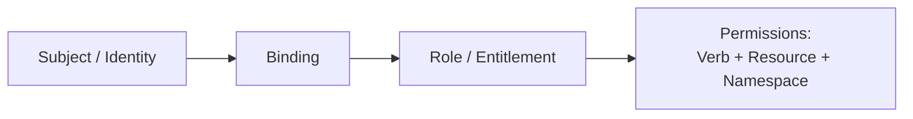
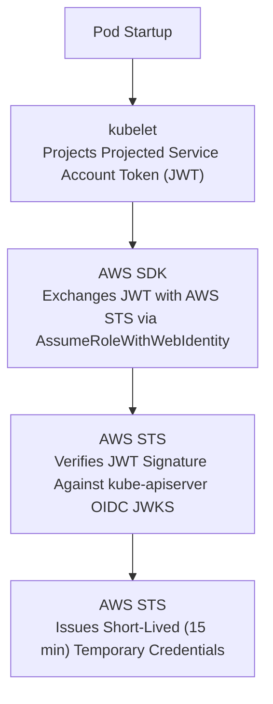

# Lesson 3: RBAC in Distributed Infrastructure: Kubernetes, IAM, Service Meshes

## 1. First-Principles Intuition & Invariants

Authorization in distributed systems is fundamentally a problem of distributed state verification: does an attested cryptographic identity have a sanctioned relationship to a discrete resource action across heterogeneous trust domains? In a monolithic application running on a single host, authorization logic can be resolved with local database lookups and in-memory session checks. In a modern cloud-native architecture spanning thousands of ephemeral containers, multiple cloud provider accounts, and zero-trust service meshes, authorization must be decentralized, deterministic, and verifiable at every network hop and API boundary.

Role-Based Access Control (RBAC) manages complexity through structured indirection:



The mathematical invariant of distributed RBAC is **the monotonicity of least privilege**:

$$\text{Authorized}(s, v, r, c) = \bigvee_{b \in B(s)} \left( (v \in \text{Verbs}(b.\text{Role})) \land (r \in \text{Resources}(b.\text{Role})) \land \text{ScopeMatch}(b, c) \right)$$

Where $s$ is the authenticated subject (service account or human), $v$ is the API verb (GET, POST, LIST), $r$ is the target resource, and $c$ is the execution context. Any request not explicitly satisfied by at least one active binding evaluates to a strict default deny.

In distributed infrastructure, three distinct authorization tiers operate simultaneously:
1. **Control Plane RBAC (Kubernetes API)**: Authorizes operations against the orchestrator's state store (etcd) through declarative `ClusterRole` and `RoleBinding` objects.
2. **Infrastructure Plane IAM (Cloud Provider)**: Authorizes cloud resource provisioning and API access using token exchange mechanisms (OIDC / OAuth2) and trust delegation chains.
3. **Data Plane Authorization (Service Mesh)**: Enforces zero-trust layer 7 authorization policies at the Envoy sidecar proxy level using cryptographic workload identities (SPIFFE IDs).


---

## 2. Core Architecture & Kinematic Mechanics

### 2.1 Kubernetes API Server RBAC State Machine

The Kubernetes API server evaluates requests through a sequential pipeline of authentication, authorization, and admission control. Once a client identity is authenticated, the RBAC authorizer evaluates all active `Roles` and `ClusterRoles` bound to the subject:

```yaml
# /manifests/rbac/data-engineer-role.yaml
apiVersion: rbac.authorization.k8s.io/v1
kind: ClusterRole
metadata:
  name: data-pipeline-operator
rules:
  - apiGroups: ["apps"]
    resources: ["deployments", "statefulsets"]
    verbs: ["get", "list", "watch", "update", "patch"]
  - apiGroups: ["batch"]
    resources: ["jobs", "cronjobs"]
    verbs: ["*"]
  - apiGroups: [""]
    resources: ["pods", "pods/log"]
    verbs: ["get", "list", "watch"]
  - apiGroups: [""]
    resources: ["secrets"]
    verbs: ["get"] # Principle of least privilege: deny list/watch on secrets
---
apiVersion: rbac.authorization.k8s.io/v1
kind: RoleBinding
metadata:
  name: bind-data-pipeline
  namespace: analytics-production
subjects:
  - kind: ServiceAccount
    name: pipeline-worker-sa
    namespace: analytics-production
roleRef:
  kind: ClusterRole
  name: data-pipeline-operator
  apiGroup: rbac.authorization.k8s.io
```

#### Evaluation Rules:
1. **Namespace Boundary Enforcement**: A `RoleBinding` grants permissions only within its defined namespace, even when referencing a `ClusterRole`. A `ClusterRoleBinding` grants cluster-wide permissions across all namespaces.
2. **Subresource Scoping**: Permissions for `pods/log`, `pods/exec`, and `pods/portforward` are discrete subresources. Granting `get` on `pods` does NOT permit viewing container logs.
3. **Escalation Prevention**: A user cannot bind a role that grants permissions they do not personally possess, preventing privilege escalation loops.

### 2.2 Workload Identity Federation (IRSA / Workload Identity)

Long-lived static credentials (e.g., AWS access key pairs or service account JSON keys) stored inside container secrets represent catastrophic security vulnerabilities. Modern distributed RBAC binds orchestrator service accounts directly to cloud provider IAM roles via OpenID Connect (OIDC) federation:



```json
{
  "Version": "2012-10-17",
  "Statement": [
    {
      "Effect": "Allow",
      "Principal": {
        "Federated": "arn:aws:iam::123456789012:oidc-provider/oidc.eks.us-east-1.amazonaws.com/id/CLUSTER123"
      },
      "Action": "sts:AssumeRoleWithWebIdentity",
      "Condition": {
        "StringEquals": {
          "oidc.eks.us-east-1.amazonaws.com/id/CLUSTER123:sub": "system:serviceaccount:analytics-production:pipeline-worker-sa",
          "oidc.eks.us-east-1.amazonaws.com/id/CLUSTER123:aud": "sts.amazonaws.com"
        }
      }
    }
  ]
}
```

### 2.3 Layer 7 Zero-Trust Authorization with Istio and SPIFFE

At the network edge and inter-service transit plane, transport-level firewalls (IP/port) are insufficient because modern microservices share dynamic overlay networks. Service mesh authorization enforces granular HTTP method and path policies based on verified cryptographically bound SPIFFE identities:

```yaml
# /manifests/mesh/billing-authz.yaml
apiVersion: security.istio.io/v1beta1
kind: AuthorizationPolicy
metadata:
  name: strict-payment-access
  namespace: finance
spec:
  selector:
    matchLabels:
      app: payment-gateway
  action: ALLOW
  rules:
    - from:
        - source:
            principals: ["cluster.local/ns/checkout/sa/checkout-service-sa"]
      to:
        - operation:
            methods: ["POST"]
            paths: ["/v2/transactions/charge"]
    - from:
        - source:
            principals: ["cluster.local/ns/monitoring/sa/prometheus-sa"]
      to:
        - operation:
            methods: ["GET"]
            paths: ["/metrics"]
```

---

## 3. Auditing & Policy as Code (OPA / Gatekeeper)

Static RBAC models lack attribute awareness (e.g., verifying whether an image comes from an internal registry or restricting API requests to business hours). Open Policy Agent (OPA) Gatekeeper enforces external admission control invariants in declarative Rego code:

```rego
package k8sazureprohibitedroles

violation[{"msg": msg}] {
    input.review.object.kind == "ClusterRoleBinding"
    role_name := input.review.object.roleRef.name
    role_name == "cluster-admin"
    subject := input.review.object.subjects[_]
    subject.kind == "ServiceAccount"
    not startswith(subject.name, "system-admin-")
    msg := sprintf("Security Violation: ServiceAccount '%v' prohibited from binding to cluster-admin", [subject.name])
}
```

---

## 4. Summary & Verification Matrix

| Authorization Plane | Policy Format | Primary Enforcement Point | Identity Mechanism |
|:---|:---|:---|:---|
| **K8s API Server** | `ClusterRole` / `RoleBinding` | `kube-apiserver` daemon | X.509 Client Cert / OIDC JWT |
| **Cloud Infrastructure** | AWS IAM / GCP Workload Policy | Cloud Provider STS Gateways | OIDC Web Identity Federation |
| **Service Mesh (L7)** | Istio `AuthorizationPolicy` | Envoy Sidecar Proxy | SPIFFE mTLS X.509 SAN |
| **Admission Guardrails** | OPA Gatekeeper Constraint | Validating Webhook Controller | Kubernetes Dynamic Admission Review |
