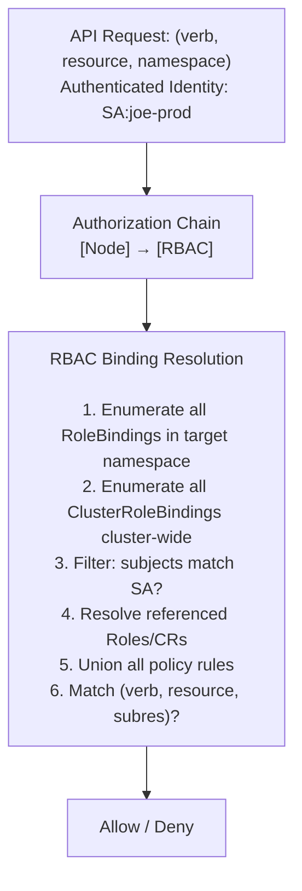

# Lesson 4: Operations, Least Privilege, Audit: Governance at Scale

## 1. First-Principles Intuition & Invariants

Governance in a distributed system is not a policy document. It is a runtime enforcement mechanism that intersects every API call, every token validation, and every admission decision. In a Kubernetes-native infrastructure, governance lives in the junction between the API server's authorization layer (RBAC), the admission controller chain (ValidatingAdmissionPolicies, OPA Gatekeeper, Kyverno), and the audit subsystem that records the outcome of every request hitting the API. When these three subsystems operate in concert, a cluster achieves what compliance frameworks call "verifiable least privilege." When they drift, you get a cluster where every service account carries `cluster-admin` and no one notices until the incident review.

The principle of least privilege is the simplest invariant to state and the hardest to enforce mechanically. It demands that every identity—human or workload—holds exactly the set of permissions required to perform its function, and nothing more. The operational challenge is not philosophical; it is combinatorial. A mid-sized cluster accumulates hundreds of RoleBindings across namespaces, each referencing Roles that aggregate dozens of policy rules, each rule granting verbs over resources with wildcard implications. A single `verbs: ["*"] resources: ["*"]` rule in a namespace-scoped Role collapses the entire namespace boundary. A `ClusterRole` with `resources: ["pods/exec"]` grants interactive shell access to every container in the cluster, which is functionally root on every node.

The invariant that makes least privilege tractable is that Kubernetes RBAC is a closed, additive system. There is no deny rule. Permissions are the union of all grants across all bindings for a given identity. This means privilege is monotonic within a scope: it can only grow by adding bindings, and it can only shrink by removing them. The operational consequence is that drift detection becomes a graph traversal problem. Given an identity, enumerate every binding that references it (directly or via group membership), resolve every Role or ClusterRole each binding references, and compute the permission union. If that union exceeds the expected baseline, the identity is over-privileged. This computation must be continuous, not periodic, because bindings change every deployment cycle.

Privilege escalation prevention builds on the same additive model. The API server enforces an escalation guard at authorization time: an identity cannot create or bind a Role or ClusterRole that grants permissions the identity itself does not possess. This is the `--authorization-mode=Node,RBAC` escalation check, and it is the single most important guardrail against lateral movement. However, it has a critical bypass: any identity holding the `escalate` verb on `roles` or `clusterroles` can create bindings granting permissions it does not hold. This verb must never appear in a general-purpose Role. It should be restricted to a break-glass ClusterRole bound to a single dedicated service account used only during bootstrap and disaster recovery.

The audit requirement emerges from the failure of prevention. No authorization model is perfectly maintained. Configurations drift, temporary bindings are forgotten, upstream Helm charts ship permissive templates, and Kubernetes itself evolves new subresources that existing Roles do not anticipate. Audit is the retrospective control that makes these failures discoverable. A properly configured audit pipeline records the request identity, the impersonated identity (if any), the resource, the verb, the admission decision, the authorization decision, and a correlation trace ID for every API call. This data feeds two consumers: real-time alerting on anomalous access patterns, and retrospective forensic reconstruction after an incident.

The compliance frameworks—SOC 2 Type II, ISO 27001, PCI DSS—do not mandate specific technologies. They mandate control objectives. SOC 2 CC6.1 requires logical access controls on a least-privilege basis. CC6.2 requires pre-termination review of access. CC7.2 requires anomaly detection on system events. ISO 27001 A.9.2.3 requires privilege management, A.12.4 requires logging and monitoring. The mapping from these abstract objectives to Kubernetes infrastructure is mechanical but only if the cluster operator understands that the control evidence is the audit log, not the policy manifest. An auditor does not accept `kind: Role` as evidence of least privilege. They accept a 90-day audit log showing that no identity exercised a permission outside its documented scope.

The final invariant is multi-tenancy isolation. In a shared cluster, namespace boundaries are the primary tenant isolation primitive, but RBAC does not enforce namespace isolation by default. A service account in tenant-A's namespace can be bound to a ClusterRole granting cluster-wide `pods/exec`. The namespace boundary is only as strong as the intersection of network policies, RBAC scope, and admission controls. Forensic capability in this environment requires that every audit event carries its namespace context, so that an investigator can reconstruct which tenant's workload touched which resource, and whether the access crossed a namespace boundary that should have been impermeable.

## 2. Core Architecture & Mechanics

The authorization pipeline in Kubernetes is a linear chain evaluated on every API request after authentication but before admission. The API server extracts the authenticated user identity and group memberships from the request's bearer token or client certificate, then passes the request through each configured authorization module in order. With `--authorization-mode=Node,RBAC`, the Node authorizer evaluates first for requests from kubelets and node-level components, and RBAC evaluates for everything else. The first module to return `Allow` short-circuits the chain. If all modules return `Deny` or `NoOpinion`, the request is rejected with 403 Forbidden.

RBAC evaluation itself is a multi-stage resolution. The authorizer takes the request's (verb, group, resource, subresource, namespace) tuple and computes the set of all bindings that apply to the requesting identity. A binding applies if the identity matches the binding's `subjects` array, which can match by user name, service account name, or group membership. For service accounts, the match is on the fully-qualified name `system:serviceaccount:<namespace>:<name>`. For groups, the match is on the group string, which includes the implicit `system:serviceaccounts:<namespace>` and `system:authenticated` groups.



For each matching binding, the authorizer resolves the referenced Role or ClusterRole and iterates its `policyRules` array. Each rule is a match if the request verb appears in `verbs`, the resource appears in `resources`, the API group appears in `apiGroups`, and (for namespaced resources) the namespace matches. Wildcards (`"*"`) match any value. The `resources` field also supports subresource syntax like `pods/log` or `pods/exec`, which are distinct resources for authorization purposes. A rule granting `resources: ["pods"]` does not grant access to `pods/exec`. This distinction is the most common source of accidental over-privilege, because operators assume "pod access" includes exec when it does not, then add `pods/exec` broadly to fix the breakage.

The escalation guard operates at the intersection of the authorizer and the admission chain. When a request creates or updates a Role, ClusterRole, RoleBinding, or ClusterRoleBinding, the authorizer performs an additional check: does the requesting identity hold the permissions being granted? If the binding grants `get pods` and the requester has `get pods`, the binding creation is allowed. If the binding grants `delete nodes` and the requester does not have `delete nodes`, the creation is denied. The `escalate` verb on the roles resource bypasses this check, and the `bind` verb on the roles resource bypasses the check for binding creation specifically. These two verbs are the entire surface area for authorized privilege escalation, and their use must be audited as aggressively as `cluster-admin`.

The audit subsystem is configured through the API server's `--audit-policy-file` flag, pointing to a YAML policy that classifies events into four levels: `None` (no logging), `Metadata` (log request metadata only, no body), `Request` (log metadata and request body), and `RequestResponse` (log metadata, request body, and response body). The policy is evaluated top-down, first match wins, with a catch-all at the bottom.

```yaml
apiVersion: audit.k8s.io/v1
kind: Policy
rules:
  # Log every authentication attempt at Metadata level
  - level: Metadata
    verbs: ["create"]
    resources:
      - group: "authentication.k8s.io"
        resources: ["tokenreviews"]
    omitStages:
      - "ResponseStarted"

  # Log all secret access with request and response bodies for forensic
  # reconstruction. Secrets are high-value; log the full payload.
  - level: RequestResponse
    resources:
      - group: ""
        resources: ["secrets"]
    omitStages:
      - "ResponseStarted"

  # Log RBAC object mutations at Request level (body shows the exact
  # permissions being granted and who is granting them)
  - level: Request
    verbs: ["create", "update", "patch", "delete"]
    resources:
      - group: "rbac.authorization.k8s.io"
        resources: ["roles", "clusterroles", "rolebindings", "clusterrolebindings"]

  # Log all exec and attach requests at Request level
  - level: Request
    verbs: ["create"]
    resources:
      - group: ""
        resources: ["pods/exec", "pods/attach", "pods/portforward"]

  # Log all impersonation attempts at RequestResponse level
  - level: RequestResponse
    verbs: ["create"]
    resources:
      - group: ""
        resources: ["pods", "pods/exec"]
    userGroups: ["system:nodes"]
    omitStages:
      - "ResponseStarted"

  # Log certificate signing requests
  - level: Request
    verbs: ["create", "update"]
    resources:
      - group: "certificates.k8s.io"
        resources: ["certificatesigningrequests"]

  # Catch-all: Metadata for everything not explicitly excluded
  - level: Metadata
    omitStages:
      - "ResponseStarted"
```

The `omitStages` field with `ResponseStarted` is a critical production tuning choice. Kubernetes audit events fire at two stages: `RequestReceived` (before the request is processed) and `ResponseStarted` (after the response begins streaming) and `ResponseComplete` (after the response is fully sent). For `GET` requests with large response bodies, logging at `ResponseComplete` means the audit backend holds the full response body in memory until the client finishes reading. Omitting `ResponseStarted` and logging only at `RequestReceived` and `ResponseComplete` reduces memory pressure while still capturing the event.

The audit backend configuration lives in the API server flags. A production cluster should use a webhook backend that sends events to a collector, not the log backend that writes to the API server's local filesystem:

```yaml
apiVersion: apiserver.config.k8s.io/v1
kind: AdmissionConfiguration
plugins:
  - name: AuditWebhook
    configuration:
      apiVersion: audit.k8s.io/v1
      kind: WebhookConfiguration
      mode: Batch
      batch:
        maxBatchSize: 400
        maxBatchWait: 10s
        throttle:
          enabled: true
          burst: 15
          qps: 10
      clientConfig:
        url: "https://audit-collector.audit-system.svc.cluster.local:9090/audit/events"
        caBundle: |
          -----BEGIN CERTIFICATE-----
          MIIBszCCAVmgAwIBAgIUQ9K8m2p3Nv7LxQwK8R5tYn2Hk0AwCgYIKoZIzj0E
          AwUwDzENMAsGA1UEAwwEYXVkaXQwIBcNMjQwMTAxMDAwMDAwWhgPMjA1MDAx
          MDEwMDAwMDBaMA8xDTALBgNVBAMMBGF1ZGl0MIGbMBAGByqGSM49AgEGBSuB
          BAAjA4GGAAQBM8dR7K1y6v7LxQwK8R5tYn2Hk0AwCgYIKoZIzj0EAwUwDzEN
          MAsGA1UEAwwEYXVkaXQwIBcNMjQwMTAxMDAwMDAwWhgPMjA1MDAxMDEwMDAw
          MDBaMA8xDTALBgNVBAMMBGF1ZGl0MA0GCSqGSIb3DQEBCwUAA4IBAQA7K9Nf
          -----END CERTIFICATE-----
      initialBackoff: 2s
      maxRetries: 5
```

The webhook backend batches events in memory and flushes them asynchronously. The `maxBatchSize` of 400 is tuned for a cluster generating approximately 500 audit events per second under normal load. The `maxBatchWait` of 10 seconds ensures latency-bound delivery even under low event volume. The throttle configuration prevents the audit backend from overwhelming the collector under burst conditions: at 10 QPS with a burst of 15, the API server sends at most 10 batches per second sustained, queuing the remainder internally.

The audit collector itself is typically a Fluent Bit or Vector deployment that receives webhook events, enriches them with cluster context, and forwards to a SIEM or object storage backend. The collector runs as a dedicated Deployment with its own ServiceAccount bound to a minimal Role granting only `get` on `configmaps` in its own namespace (for runtime configuration updates):

```yaml
apiVersion: v1
kind: ServiceAccount
metadata:
  name: audit-collector
  namespace: audit-system
---
apiVersion: rbac.authorization.k8s.io/v1
kind: Role
metadata:
  name: audit-collector-config-reader
  namespace: audit-system
rules:
  - apiGroups: [""]
    resources: ["configmaps"]
    resourceNames: ["audit-collector-config"]
    verbs: ["get", "watch"]
---
apiVersion: rbac.authorization.k8s.io/v1
kind: RoleBinding
metadata:
  name: audit-collector-config-reader
  namespace: audit-system
subjects:
  - kind: ServiceAccount
    name: audit-collector
    namespace: audit-system
roleRef:
  kind: Role
  name: audit-collector-config-reader
  apiGroup: rbac.authorization.k8s.io
```

The escalation prevention model requires more than the built-in RBAC guard. Admission controllers provide a second layer that can enforce policies the RBAC system cannot express. A ValidatingAdmissionPolicy using the CEL expression language can reject any Role or ClusterRole that contains wildcard verbs or resources:

```yaml
apiVersion: admissionregistration.k8s.io/v1
kind: ValidatingAdmissionPolicy
metadata:
  name: rbac-no-wildcards
spec:
  failurePolicy: Fail
  matchConstraints:
    resourceRules:
      - apiGroups: ["rbac.authorization.k8s.io"]
        resources: ["roles", "clusterroles"]
        operations: ["CREATE", "UPDATE"]
  validations:
    - expression: |
        !has(object.rules) || object.rules.all(rule,
          !rule.verbs.exists(v, v == "*") &&
          !rule.resources.exists(r, r == "*") &&
          !rule.apiGroups.exists(g, g == "*")
        )
      message: "Wildcard verbs, resources, or apiGroups are prohibited in Roles and ClusterRoles."
---
apiVersion: admissionregistration.k8s.io/v1
kind: ValidatingAdmissionPolicyBinding
metadata:
  name: rbac-no-wildcards-binding
spec:
  policyName: rbac-no-wildcards
  validationActions:
    - Deny
  matchResources:
    namespaceSelector:
      matchExpressions:
        - key: kubernetes.io/metadata.name
          operator: Exists
```

This policy uses the CEL `all()` and `exists()` macros to iterate every rule in every Role or ClusterRole submitted for creation or update. If any rule contains `"*"` in `verbs`, `resources`, or `apiGroups`, the admission controller rejects the request before it reaches etcd. The binding targets all namespaces via the `namespaceSelector` that matches any namespace with its metadata name set, which is all namespaces in a compliant cluster.

A second critical admission policy prevents binding to high-privilege ClusterRoles. The `cluster-admin` ClusterRole is bound by default to the `system:masters` group, and any additional binding to it represents an unacceptable privilege grant. A ValidatingAdmissionPolicy can enforce this:

```yaml
apiVersion: admissionregistration.k8s.io/v1
kind: ValidatingAdmissionPolicy
metadata:
  name: rbac-no-cluster-admin-binding
spec:
  failurePolicy: Fail
  matchConstraints:
    resourceRules:
      - apiGroups: ["rbac.authorization.k8s.io"]
        resources: ["rolebindings", "clusterrolebindings"]
        operations: ["CREATE", "UPDATE"]
  validations:
    - expression: |
        !has(object.roleRef) ||
        !object.roleRef.name == "cluster-admin" ||
        object.roleRef.kind != "ClusterRole"
      message: "Binding to the cluster-admin ClusterRole is prohibited. Use scoped Roles instead."
    - expression: |
        !has(object.roleRef) ||
        !object.roleRef.name.startsWith("system:")
      message: "Binding to system:* ClusterRoles is prohibited outside of bootstrap manifests."
---
apiVersion: admissionregistration.k8s.io/v1
kind: ValidatingAdmissionPolicyBinding
metadata:
  name: rbac-no-cluster-admin-binding-binding
spec:
  policyName: rbac-no-cluster-admin-binding
  validationActions:
    - Deny
  matchResources:
    namespaceSelector:
      matchExpressions:
        - key: kubernetes.io/metadata.name
          operator: Exists
```

## 3. High-Performance Optimization & Failure Modes

The first operational failure mode is binding accumulation. Every Helm chart deployment, every operator install, every temporary troubleshooting session creates RoleBindings. Teams delete the Helm release but the namespace-scoped bindings remain because the cleanup finalizer never ran, or because the bindings were created manually outside the Helm release. Over months, a namespace accumulates dozens of bindings referencing Roles that grant overlapping and excessive permissions, and the effective permission set for every service account in that namespace grows monotonically.

The remediation is a continuous reconciliation loop that compares the actual binding state against a declared baseline. The following controller, deployable as a CronJob, enumerates every RoleBinding and ClusterRoleBinding in the cluster, resolves the effective permissions for each subject, and emits a report of bindings that exceed the baseline:

```yaml
apiVersion: batch/v1
kind: CronJob
metadata:
  name: rbac-drift-scanner
  namespace: audit-system
spec:
  schedule: "0 */6 * * *"
  jobTemplate:
    spec:
      template:
        spec:
          serviceAccountName: rbac-drift-scanner
          containers:
            - name: scanner
              image: registry.internal.corp/infra/rbac-auditor:v2.4.1
              command:
                - /rbac-auditor
                - --baseline=/etc/rbac-baseline/rules.yaml
                - --output=/reports/drift-$(date +%Y%m%d-%H%M%S).json
                - --kubeconfig=/etc/kubernetes/kubeconfig
              volumeMounts:
                - name: baseline
                  mountPath: /etc/rbac-baseline
                - name: reports
                  mountPath: /reports
          volumes:
            - name: baseline
              configMap:
                name: rbac-baseline
            - name: reports
              persistentVolumeClaim:
                claimName: audit-reports-pvc
          restartPolicy: OnFailure
---
apiVersion: v1
kind: ConfigMap
metadata:
  name: rbac-baseline
  namespace: audit-system
data:
  rules.yaml: |
    allowedClusterRoles:
      - system:basic-user
      - system:discovery
      - system:public-info-viewer
    allowedNamespacedRoles:
      default:
        - verbs: ["get", "list", "watch"]
          resources: ["pods", "services", "endpoints", "configmaps"]
        - verbs: ["get"]
          resources: ["secrets"]
    prohibitedVerbs:
      - "*"
      - "escalate"
      - "bind"
      - "impersonate"
    prohibitedResources:
      - "*"
      - "nodes"
      - "clusterroles"
      - "persistentvolumes"
      - "certificatesigningrequests"
```

The scanner service account needs read access to RBAC objects across the cluster. This is itself a privilege grant that must be scoped as tightly as possible. The scanner should never have write access to any resource:

```yaml
apiVersion: v1
kind: ServiceAccount
metadata:
  name: rbac-drift-scanner
  namespace: audit-system
---
apiVersion: rbac.authorization.k8s.io/v1
kind: ClusterRole
metadata:
  name: rbac-read-only-auditor
rules:
  - apiGroups: ["rbac.authorization.k8s.io"]
    resources: ["roles", "clusterroles", "rolebindings", "clusterrolebindings"]
    verbs: ["get", "list", "watch"]
  - apiGroups: [""]
    resources: ["namespaces", "serviceaccounts"]
    verbs: ["get", "list", "watch"]
---
apiVersion: rbac.authorization.k8s.io/v1
kind: ClusterRoleBinding
metadata:
  name: rbac-read-only-auditor
subjects:
  - kind: ServiceAccount
    name: rbac-drift-scanner
    namespace: audit-system
roleRef:
  kind: ClusterRole
  name: rbac-read-only-auditor
  apiGroup: rbac.authorization.k8s.io
```

The scanner's Go implementation performs the effective permission computation. The core algorithm resolves every binding for each subject, loads the referenced Role or ClusterRole, and computes the union of all policy rules. The following is a complete, compilable implementation:

```go
package main

import (
	"context"
	"encoding/json"
	"flag"
	"fmt"
	"os"
	"path/filepath"
	"time"

	rbacv1 "k8s.io/api/rbac/v1"
	metav1 "k8s.io/apimachinery/pkg/apis/meta/v1"
	"k8s.io/client-go/kubernetes"
	"k8s.io/client-go/tools/clientcmd"
)

type Baseline struct {
	AllowedClusterRoles   []string                 `json:"allowedClusterRoles" yaml:"allowedClusterRoles"`
	AllowedNamespacedRoles map[string][]PolicyRule  `json:"allowedNamespacedRoles" yaml:"allowedNamespacedRoles"`
	ProhibitedVerbs       []string                 `json:"prohibitedVerbs" yaml:"prohibitedVerbs"`
	ProhibitedResources   []string                 `json:"prohibitedResources" yaml:"prohibitedResources"`
}

type PolicyRule struct {
	Verbs     []string `json:"verbs" yaml:"verbs"`
	Resources []string `json:"resources" yaml:"resources"`
	APIGroups []string `json:"apiGroups" yaml:"apiGroups"`
}

type DriftReport struct {
	Timestamp   string         `json:"timestamp"`
	ClusterName string         `json:"clusterName"`
	Violations  []Violation    `json:"violations"`
	Summary     Summary        `json:"summary"`
}

type Violation struct {
	Kind        string   `json:"kind"`
	Namespace   string   `json:"namespace"`
	Name        string   `json:"name"`
	Subject     string   `json:"subject"`
	RoleRef     string   `json:"roleRef"`
	ViolationType string `json:"violationType"`
	Detail      string   `json:"detail"`
}

type Summary struct {
	TotalBindings     int `json:"totalBindings"`
	TotalViolations   int `json:"totalViolations"`
	WildcardViolations int `json:"wildcardViolations"`
	ProhibitedVerbViolations int `json:"prohibitedVerbViolations"`
}

func contains(slice []string, item string) bool {
	for _, s := range slice {
		if s == item {
			return true
		}
	}
	return false
}

func isWildcardRule(rule rbacv1.PolicyRule, prohibitedVerbs, prohibitedResources []string) (bool, string) {
	for _, v := range rule.Verbs {
		if v == "*" {
			return true, "wildcard verb"
		}
		if contains(prohibitedVerbs, v) {
			return true, fmt.Sprintf("prohibited verb: %s", v)
		}
	}
	for _, r := range rule.Resources {
		if r == "*" {
			return true, "wildcard resource"
		}
		if contains(prohibitedResources, r) {
			return true, fmt.Sprintf("prohibited resource: %s", r)
		}
	}
	for _, g := range rule.APIGroups {
		if g == "*" {
			return true, "wildcard apiGroup"
		}
	}
	return false, ""
}

func loadBaseline(path string) (*Baseline, error) {
	data, err := os.ReadFile(path)
	if err != nil {
		return nil, fmt.Errorf("read baseline: %w", err)
	}
	var b Baseline
	if err := json.Unmarshal(data, &b); err != nil {
		return nil, fmt.Errorf("unmarshal baseline: %w", err)
	}
	return &b, nil
}

func main() {
	var baselinePath, outputPath, kubeconfigPath string
	flag.StringVar(&baselinePath, "baseline", "/etc/rbac-baseline/rules.yaml", "Path to baseline rules")
	flag.StringVar(&outputPath, "output", "/reports/drift.json", "Path to output report")
	flag.StringVar(&kubeconfigPath, "kubeconfig", "", "Path to kubeconfig")
	flag.Parse()

	config, err := clientcmd.BuildConfigFromFlags("", kubeconfigPath)
	if err != nil {
		fmt.Fprintf(os.Stderr, "build config: %v\n", err)
		os.Exit(1)
	}

	clientset, err := kubernetes.NewForConfig(config)
	if err != nil {
		fmt.Fprintf(os.Stderr, "create clientset: %v\n", err)
		os.Exit(1)
	}

	baseline, err := loadBaseline(baselinePath)
	if err != nil {
		fmt.Fprintf(os.Stderr, "load baseline: %v\n", err)
		os.Exit(1)
	}

	ctx := context.Background()
	report := DriftReport{
		Timestamp: time.Now().UTC().Format(time.RFC3339),
		Summary:   Summary{},
	}

	clusterRoles := make(map[string]*rbacv1.ClusterRole)
	crList, err := clientset.RbacV1().ClusterRoles().List(ctx, metav1.ListOptions{})
	if err != nil {
		fmt.Fprintf(os.Stderr, "list clusterroles: %v\n", err)
		os.Exit(1)
	}
	for i := range crList.Items {
		cr := &crList.Items[i]
		clusterRoles[cr.Name] = cr
	}

	crbList, err := clientset.RbacV1().ClusterRoleBindings().List(ctx, metav1.ListOptions{})
	if err != nil {
		fmt.Fprintf(os.Stderr, "list clusterrolebindings: %v\n", err)
		os.Exit(1)
	}
	report.Summary.TotalBindings += len(crbList.Items)

	for i := range crbList.Items {
		crb := &crbList.Items[i]
		cr, ok := clusterRoles[crb.RoleRef.Name]
		if !ok {
			continue
		}
		if crb.RoleRef.Name == "cluster-admin" {
			for _, subj := range crb.Subjects {
				report.Violations = append(report.Violations, Violation{
					Kind:          "ClusterRoleBinding",
					Name:          crb.Name,
					Subject:       fmt.Sprintf("%s/%s", subj.Kind, subj.Name),
					RoleRef:       crb.RoleRef.Name,
					ViolationType: "cluster-admin-binding",
					Detail:        "Binding to cluster-admin is prohibited",
				})
			}
			continue
		}
		for _, rule := range cr.Rules {
			bad, reason := isWildcardRule(rule, baseline.ProhibitedVerbs, baseline.ProhibitedResources)
			if bad {
				report.Violations = append(report.Violations, Violation{
					Kind:          "ClusterRoleBinding",
					Name:          crb.Name,
					RoleRef:       crb.RoleRef.Name,
					ViolationType: reason,
					Detail:        fmt.Sprintf("Rule: verbs=%v resources=%v apiGroups=%v", rule.Verbs, rule.Resources, rule.APIGroups),
				})
				if reason == "wildcard verb" || reason == "wildcard resource" {
					report.Summary.WildcardViolations++
				} else {
					report.Summary.ProhibitedVerbViolations++
				}
			}
		}
	}

	namespaces, err := clientset.CoreV1().Namespaces().List(ctx, metav1.ListOptions{})
	if err != nil {
		fmt.Fprintf(os.Stderr, "list namespaces: %v\n", err)
		os.Exit(1)
	}

	for _, ns := range namespaces.Items {
		rolesList, err := clientset.RbacV1().Roles(ns.Name).List(ctx, metav1.ListOptions{})
		if err != nil {
			continue
		}
		rolesMap := make(map[string]*rbacv1.Role)
		for i := range rolesList.Items {
			rolesMap[rolesList.Items[i].Name] = &rolesList.Items[i]
		}

		rbList, err := clientset.RbacV1().RoleBindings(ns.Name).List(ctx, metav1.ListOptions{})
		if err != nil {
			continue
		}
		report.Summary.TotalBindings += len(rbList.Items)

		for i := range rbList.Items {
			rb := &rbList.Items[i]
			var roleRules []rbacv1.PolicyRule
			if rb.RoleRef.Kind == "Role" {
				if role, ok := rolesMap[rb.RoleRef.Name]; ok {
					roleRules = role.Rules
				}
			} else if rb.RoleRef.Kind == "ClusterRole" {
				if cr, ok := clusterRoles[rb.RoleRef.Name]; ok {
					roleRules = cr.Rules
				}
			}
			for _, rule := range roleRules {
				bad, reason := isWildcardRule(rule, baseline.ProhibitedVerbs, baseline.ProhibitedResources)
				if bad {
					report.Violations = append(report.Violations, Violation{
						Kind:          "RoleBinding",
						Namespace:     ns.Name,
						Name:          rb.Name,
						RoleRef:       rb.RoleRef.Name,
						ViolationType: reason,
						Detail:        fmt.Sprintf("Rule: verbs=%v resources=%v apiGroups=%v", rule.Verbs, rule.Resources, rule.APIGroups),
					})
					if reason == "wildcard verb" || reason == "wildcard resource" {
						report.Summary.WildcardViolations++
					} else {
						report.Summary.ProhibitedVerbViolations++
					}
				}
			}
		}
	}

	report.Summary.TotalViolations = len(report.Violations)
	outputDir := filepath.Dir(outputPath)
	if err := os.MkdirAll(outputDir, 0755); err != nil {
		fmt.Fprintf(os.Stderr, "create output dir: %v\n", err)
		os.Exit(1)
	}
	out, err := json.MarshalIndent(report, "", "  ")
	if err != nil {
		fmt.Fprintf(os.Stderr, "marshal report: %v\n", err)
		os.Exit(1)
	}
	if err := os.WriteFile(outputPath, out, 0644); err != nil {
		fmt.Fprintf(os.Stderr, "write report: %v\n", err)
		os.Exit(1)
	}
	fmt.Printf("Drift report written to %s: %d violations found across %d bindings\n",
		outputPath, report.Summary.TotalViolations, report.Summary.TotalBindings)
}
```

The scanner's `go.mod` pins the Kubernetes client library to a version matching the cluster's API server to avoid compatibility drift:

```text
module internal.corp/infra/rbac-auditor

go 1.22

require (
	k8s.io/api v0.29.2
	k8s.io/apimachinery v0.29.2
	k8s.io/client-go v0.29.2
)
```

The second failure mode is audit pipeline saturation. Under heavy load, the API server generates audit events faster than the webhook backend can deliver them. The API server's audit buffer has a fixed size, and when it fills, the API server drops events. This is a silent failure: no alert fires, and the audit log has gaps that an investigator will not discover until they try to reconstruct a timeline and find missing minutes.

The mitigation is a health check on the audit collector that the API server can probe. The webhook configuration supports a `timeout` field, and the API server reports dropped events in its `/metrics` endpoint under `apiserver_audit_event_total` and `apiserver_audit_drop_total`. A Prometheus alert rule catches this:

```yaml
apiVersion: monitoring.coreos.com/v1
kind: PrometheusRule
metadata:
  name: audit-pipeline-health
  namespace: audit-system
spec:
  groups:
    - name: audit.health
      rules:
        - alert: AuditEventsDropped
          expr: rate(apiserver_audit_drop_total[5m]) > 0
          for: 2m
          labels:
            severity: critical
            compliance: soc2-cc72
          annotations:
            summary: "Audit events are being dropped by the API server"
            description: "The audit webhook backend cannot keep up with event volume. Check collector health and increase batch capacity."

        - alert: AuditWebhookLatencyHigh
          expr: histogram_quantile(0.95, rate(apiserver_request_duration_seconds_bucket{subresource="audit"}[5m])) > 2
          for: 5m
          labels:
            severity: warning
          annotations:
            summary: "Audit webhook delivery latency exceeds 2 seconds at p95"
            description: "Collector may be overloaded or network path degraded."
```

The third failure mode is service account token persistence. Kubernetes 1.24 introduced bound service account tokens that are mounted as projected volumes and expire automatically. However, long-lived tokens created via `kubectl create token` or embedded in CI secrets persist until explicitly revoked. A binding grant to a service account with a leaked token represents a persistent access path that survives binding deletion if the token was extracted and stored externally. The operational response is token rotation tracking, which requires enumerating all `ServiceAccount` objects and their associated `Secret` objects (for legacy tokens) and all `TokenRequest`-issued tokens visible in audit logs.

The following ValidatingAdmissionPolicy enforces that no service account token secret is created outside a controlled namespace:

```yaml
apiVersion: admissionregistration.k8s.io/v1
kind: ValidatingAdmissionPolicy
metadata:
  name: restrict-sa-token-secrets
spec:
  failurePolicy: Fail
  matchConstraints:
    resourceRules:
      - apiGroups: [""]
        resources: ["secrets"]
        operations: ["CREATE"]
  matchConditions:
    - name: is-sa-token
      expression: "has(object.type) && object.type == 'kubernetes.io/service-account-token'"
  validations:
    - expression: "'kube-system' in request.namespace || 'audit-system' in request.namespace"
      message: "Service account token secrets may only be created in kube-system or audit-system namespaces."
---
apiVersion: admissionregistration.k8s.io/v1
kind: ValidatingAdmissionPolicyBinding
metadata:
  name: restrict-sa-token-secrets-binding
spec:
  policyName: restrict-sa-token-secrets
  validationActions:
    - Deny
  matchResources:
    namespaceSelector:
      matchExpressions:
        - key: kubernetes.io/metadata.name
          operator: Exists
```

The fourth failure mode is namespace tenant boundary violation through ClusterRoleBindings. A ClusterRoleBinding grants a permission cluster-wide, bypassing namespace isolation entirely. In a multi-tenant cluster, the only acceptable ClusterRoleBindings are those binding system service accounts (kube-system components, controllers, the audit scanner) and the `system:authenticated` group to discovery-level ClusterRoles. Every other ClusterRoleBinding represents a tenant boundary leak. The following admission policy blocks ClusterRoleBindings that target non-system service accounts:

```yaml
apiVersion: admissionregistration.k8s.io/v1
kind: ValidatingAdmissionPolicy
metadata:
  name: restrict-clusterrolebindings-non-system
spec:
  failurePolicy: Fail
  matchConstraints:
    resourceRules:
      - apiGroups: ["rbac.authorization.k8s.io"]
        resources: ["clusterrolebindings"]
        operations: ["CREATE", "UPDATE"]
  validations:
    - expression: |
        object.subjects.all(s,
          s.kind == "ServiceAccount" && s.namespace.startsWith("kube-") ||
          s.kind == "Group" && s.name.startsWith("system:")
        )
      message: "ClusterRoleBindings may only target service accounts in kube-* namespaces or system:* groups."
---
apiVersion: admissionregistration.k8s.io/v1
kind: ValidatingAdmissionPolicyBinding
metadata:
  name: restrict-clusterrolebindings-non-system-binding
spec:
  policyName: restrict-clusterrolebindings-non-system
  validationActions:
    - Deny
  matchResources:
    namespaceSelector:
      matchExpressions:
        - key: kubernetes.io/metadata.name
          operator: Exists
```

The fifth failure mode is audit log tampering. If an attacker gains `cluster-admin`, their first objective is to delete or alter the audit trail. The audit webhook sends events to a collector running in the same cluster, which an attacker with cluster-admin can delete. The defense is log forwarding to an external sink that the cluster's own credentials cannot reach. The collector forwards to an S3 bucket or a dedicated SIEM ingestion endpoint using credentials that exist only in the collector's environment, not in the Kubernetes cluster's secret store:

```yaml
apiVersion: apps/v1
kind: Deployment
metadata:
  name: audit-forwarder
  namespace: audit-system
spec:
  replicas: 2
  selector:
    matchLabels:
      app: audit-forwarder
  template:
    metadata:
      labels:
        app: audit-forwarder
    spec:
      serviceAccountName: audit-collector
      containers:
        - name: forwarder
          image: registry.internal.corp/infra/vector:0.36.1
          env:
            - name: AWS_REGION
              value: "us-east-1"
            - name: S3_BUCKET
              value: "corp-k8s-audit-immutable"
            - name: AWS_ACCESS_KEY_ID
              valueFrom:
                secretKeyRef:
                  name: audit-s3-creds
                  key: access-key-id
            - name: AWS_SECRET_ACCESS_KEY
              valueFrom:
                secretKeyRef:
                  name: audit-s3-creds
                  key: secret-access-key
          volumeMounts:
            - name: config
              mountPath: /etc/vector
          readinessProbe:
            httpGet:
              path: /health
              port: 8686
            initialDelaySeconds: 5
            periodSeconds: 10
          livenessProbe:
            httpGet:
              path: /health
              port: 8686
            initialDelaySeconds: 15
            periodSeconds: 20
      volumes:
        - name: config
          configMap:
            name: vector-config
```

The Vector configuration receives webhook events on port 9090, batches them, and writes to an S3 bucket with object lock enabled. The S3 bucket is configured with a write-once-read-many (WORM) policy that prevents deletion for 365 days:

```yaml
data:
  vector.yaml: |
    sources:
      k8s_audit:
        type: http_server
        address: 0.0.0.0:9090
        path: /audit/events
        encoding:
          codec: json
        framing:
          method: newline_delimited

    sinks:
      s3_immutable:
        type: aws_s3
        inputs:
          - k8s_audit
        bucket: ${S3_BUCKET}
        region: ${AWS_REGION}
        key_prefix: "audit/%Y/%m/%d/%H/"
        compression: gzip
        encoding:
          codec: json
        batch:
          max_events: 500
          timeout_secs: 30
        assume_role: arn:aws:iam::123456789012:role/k8s-audit-writer

      stdout_debug:
        type: console
        inputs:
          - k8s_audit
        encoding:
          codec: json
        level: warn
```

The S3 bucket policy enforces object lock in compliance mode with a 365-day retention period. The `k8s-audit-writer` IAM role has `s3:PutObject` permission only, no `s3:DeleteObject` and no `s3:PutBucketPolicy`. This is the immutability guarantee that satisfies SOC 2 CC7.3 (retention of system audit logs) and ISO 27001 A.12.4.1 (event logging). An attacker who compromises the cluster cannot delete the audit trail because the S3 credentials in the cluster grant only write access, and the retention policy prevents deletion even by the AWS account root user until the retention period expires.

The final operational pattern is the break-glass procedure. When a production incident requires `cluster-admin` access, the access must be time-bound, audited at `RequestResponse` level, and automatically revoked. The break-glass role is a ClusterRole that is created on demand and deleted by a TTL controller:

```yaml
apiVersion: rbac.authorization.k8s.io/v1
kind: ClusterRoleBinding
metadata:
  name: breakglass-incident-2024-0192
  annotations:
    breakglass.corp/ttl: "2024-03-15T14:00:00Z"
    breakglass.corp/incident: "INC-2024-0192"
    breakglass.corp/approver: "oncall-lead@corp.com"
    breakglass.corp/justification: "etcd quorum loss in prod-us-east-1"
subjects:
  - kind: User
    name: "oncall-engineer@corp.com"
    apiGroup: rbac.authorization.k8s.io
roleRef:
  kind: ClusterRole
  name: cluster-admin
  apiGroup: rbac.authorization.k8s.io
```

A TTL controller CronJob runs every minute, enumerates all ClusterRoleBindings with the `breakglass.corp/ttl` annotation, and deletes those whose TTL has expired:

```yaml
apiVersion: batch/v1
kind: CronJob
metadata:
  name: breakglass-ttl-controller
  namespace: audit-system
spec:
  schedule: "* * * * *"
  jobTemplate:
    spec:
      template:
        spec:
          serviceAccountName: breakglass-ttl
          containers:
            - name: ttl-controller
              image: registry.internal.corp/infra/kubectl-ttl:v1.29.2
              command:
                - /bin/sh
                - -c
                - |
                  set -euo pipefail
                  NOW=$(date -u +%Y-%m-%dT%H:%M:%SZ)
                  kubectl get clusterrolebindings -o json | \
                    jq -r --arg now "$NOW" '
                      .items[]
                      | select(.metadata.annotations["breakglass.corp/ttl"] != null)
                      | select(.metadata.annotations["breakglass.corp/ttl"] < $now)
                      | .metadata.name
                    ' | while read binding; do
                      echo "Expiring breakglass binding: $binding"
                      kubectl delete clusterrolebinding "$binding"
                      echo "{\"event\":\"breakglass_expired\",\"binding\":\"$binding\",\"timestamp\":\"$NOW\"}" >> /var/log/breakglass-events.log
                    done
          restartPolicy: OnFailure
---
apiVersion: v1
kind: ServiceAccount
metadata:
  name: breakglass-ttl
  namespace: audit-system
---
apiVersion: rbac.authorization.k8s.io/v1
kind: ClusterRole
metadata:
  name: breakglass-ttl-manager
rules:
  - apiGroups: ["rbac.authorization.k8s.io"]
    resources: ["clusterrolebindings"]
    verbs: ["get", "list", "watch", "delete"]
---
apiVersion: rbac.authorization.k8s.io/v1
kind: ClusterRoleBinding
metadata:
  name: breakglass-ttl-manager
subjects:
  - kind: ServiceAccount
    name: breakglass-ttl
    namespace: audit-system
roleRef:
  kind: ClusterRole
  name: breakglass-ttl-manager
  apiGroup: rbac.authorization.k8s.io
```

The TTL controller's ClusterRole grants `delete` on `clusterrolebindings`, which is a powerful permission. This is acceptable because the controller's service account is in a namespace with strict network policies, its token is bound and expires automatically, and its operation is fully audited. The `breakglass-ttl-manager` ClusterRole is itself subject to the drift scanner, which will flag it as a violation requiring manual review. This is intentional: every exception should be visible in the drift report, so that the security team can verify each one is justified.

The operational governance loop closes when these components run continuously: the drift scanner detects over-privilege, the admission policies prevent new over-privilege, the audit pipeline records every access, the forwarder ships logs to an immutable sink, the alert rules surface drops and latency, and the TTL controller expires break-glass access. Each component is a checkpoint that an auditor can map to a specific SOC 2 or ISO 27001 control objective, and each produces machine-readable evidence that survives cluster destruction.
