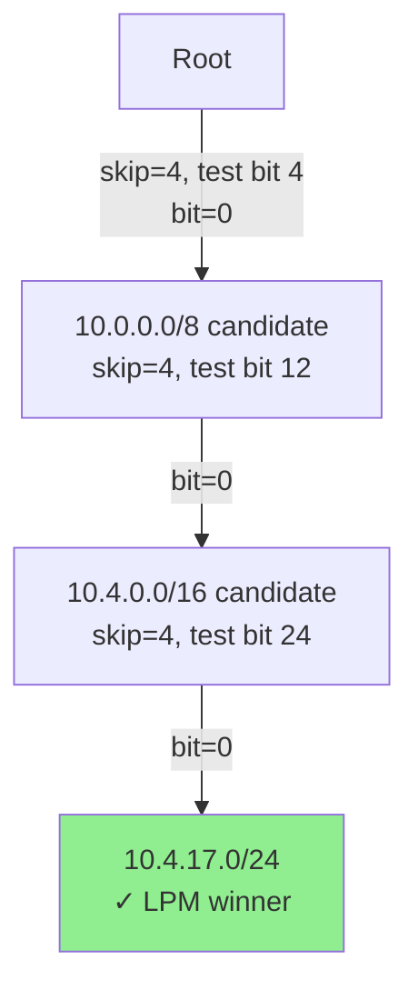
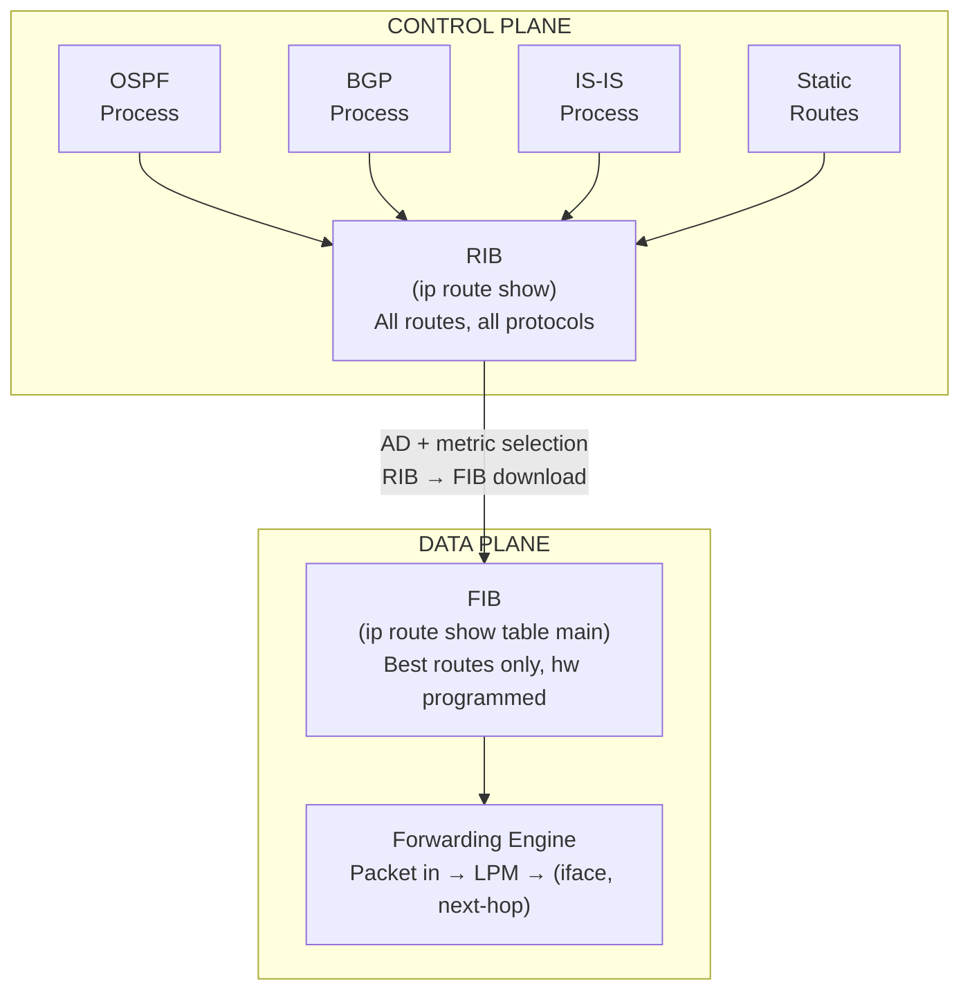

# Lesson 1: Routing Fundamentals — Forwarding Logic, Routing Tables, Path Selection

## 1. First-Principles Intuition & Invariants

Every network is, at its core, a problem of directed reachability under uncertainty. A packet arrives carrying a destination address and nothing else of navigational value. The router holding that packet knows only its own neighborhood: the interfaces it owns, the neighbors it has spoken to, and the prefixes those neighbors have advertised. From this strictly local knowledge, it must make a forwarding decision in microseconds, and that decision must compose correctly with every other router's local decision to produce globally coherent delivery. The elegance — and the difficulty — of routing is that there is no global oracle. Correctness emerges from the aggregate of autonomous, local choices.

To understand why routers work the way they do, you need to hold two separate problems in your mind simultaneously, because every routing architecture separates them even when they appear unified. The first problem is *control*: how does a router learn which prefixes exist in the network, via which neighbors they are reachable, and which path is preferred when multiple options exist? The second problem is *forwarding*: given a packet with a destination address, which outgoing interface and next-hop address should receive it? These are the control plane and the data plane respectively, and their separation is not merely an implementation convenience. It is a fundamental invariant that governs the design of every production router from a home gateway to a spine switch in a hyperscaler fabric.

The control plane operates on the timescale of topology change — seconds to minutes. It runs routing protocols (OSPF, IS-IS, BGP), floods link-state advertisements, computes shortest paths with Dijkstra or Bellman-Ford, selects among competing routes by policy and metric, and writes the results into the Routing Information Base (RIB). The data plane operates on the timescale of packets — nanoseconds to microseconds. It consults only the Forwarding Information Base (FIB), which is a distilled, hardware-optimized projection of the RIB containing exactly what the forwarding engine needs: a prefix, an output interface, and a next-hop MAC address. The RIB is the router's full knowledge of the network. The FIB is the router's action policy. Confusing them is the most common conceptual error made by engineers moving from application-layer to infrastructure work.

The fundamental invariant of packet forwarding is **longest prefix match (LPM)**. When a router receives a packet destined for 10.4.17.93, it may have entries for 10.0.0.0/8, 10.4.0.0/16, and 10.4.17.0/24 in its FIB. All three match the destination address when you apply their respective masks. The router selects the most specific match — the one with the longest prefix length — because specificity implies intentionality. The operator who entered 10.4.17.0/24 knows something specific about that subnet that the operator who entered 10.0.0.0/8 does not. LPM is not a heuristic; it is the normative definition of correct forwarding behavior as specified in RFC 1812. Everything interesting about FIB data structures, from hardware TCAM arrays to software LC-trie implementations, is an engineering effort to execute LPM at line rate.

Metrics encode the control plane's judgment about path quality. A metric can represent hop count (RIP), composite link cost derived from bandwidth and delay (EIGRP), or the dimensionless administrative weight of a link (OSPF cost, IS-IS metric). BGP, which governs inter-domain routing on the global Internet, does not use a single metric at all — it uses a prioritized sequence of attributes (Local Preference, AS Path length, MED, IGP cost, router ID) evaluated in order, stopping at the first attribute that discriminates between paths. This policy-driven selection is what allows network operators to enforce commercial and contractual relationships between autonomous systems rather than purely optimizing for latency or throughput.

The administrative distance (AD) is an often-misunderstood layer above metrics. It answers not "which path is best within a protocol?" but "which protocol's answer do I trust more?" When both OSPF and a static route describe how to reach 192.168.1.0/24, the router uses AD to arbitrate. Cisco IOS defaults: connected routes have AD 0, static routes AD 1, EIGRP internal AD 90, OSPF AD 110, RIP AD 120, external BGP AD 20, internal BGP AD 200. Only the winner installs into the RIB; the loser is remembered in the protocol's own database but invisible to forwarding. This two-level selection — metric within a protocol, AD across protocols — is what allows enterprises to run multiple routing protocols simultaneously during migrations without producing forwarding loops.

---

## 2. Core Architecture & Mechanics

### The Routing Table: Structure and Lookup

A router's RIB is a tree-structured database keyed on IP prefix and prefix length. In Linux, the kernel maintains two distinct structures for IPv4: the FIB trie (the main forwarding structure since kernel 3.x, replacing the older hash-based routing cache) and the netlink-exposed routing table visible to `ip route`. These are not the same view of the same data, and understanding the distinction matters for production debugging.

The FIB trie is a *level-compressed trie*, also called an LC-trie or Patricia trie. Each node encodes a bit position and two children, left for 0 and right for 1. A lookup traverses from the root toward the leaves, consuming one bit of the destination address per step. The critical optimization is *path compression*: runs of single-child nodes are collapsed into a single node annotated with a skip count, so a 32-bit address does not require 32 node accesses. The result is a structure where worst-case lookup depth is proportional to the logarithm of the prefix count, not the address length. For the global BGP table of roughly 900,000 IPv4 prefixes, a well-balanced trie reaches a forwarding decision in approximately 20 to 30 node comparisons.



The longest prefix match winner is not the first match found but the *deepest* match found during the traversal. The trie naturally produces this because prefix length is encoded in tree depth — a /24 node is always deeper than the /16 node that subsumes it. This is the structural reason LPM is efficient in a trie: you don't need to scan all matching entries; you just descend until no deeper match exists.

Hardware routers at the spine and edge implement LPM in TCAM (Ternary Content-Addressable Memory). Unlike SRAM or DRAM, which return a value for a given address, TCAM accepts a search key and returns the index of the matching entry in a single clock cycle. Each TCAM cell stores one of three values — 0, 1, or X (don't-care) — making it native to prefix matching, where the host bits of a prefix entry are all X. TCAM is expensive in both silicon area and power consumption (a 1Mbit TCAM block dissipates roughly 1W to 3W depending on process node and access rate), which is why hardware FIBs are capacity-constrained and operators must manage prefix aggregation carefully. The TCAM entries are ordered by prefix length, longest first, and the hardware returns the lowest-indexed match, implementing LPM as a hardware priority encoder.

The following diagram shows how the control and data planes interact to produce the FIB from routing protocol input:



### Examining the RIB and FIB on Linux

A Linux system acting as a router provides direct visibility into both planes. The `ip` command from the `iproute2` suite is the authoritative CLI for inspecting routing state. The following commands expose the full forwarding stack.

Inspect the main routing table (the Linux kernel FIB, protocol-agnostic):

```bash
ip route show table main
```

Inspect a specific prefix to see which route would actually be selected for a given destination (triggers an LPM lookup in the kernel FIB):

```bash
ip route get 10.4.17.93
```

Examine all routing tables including policy routing (Linux supports up to 252 user-defined tables):

```bash
ip route show table all
```

When running a dynamic routing daemon such as FRRouting (FRR), the daemon maintains its own RIB internally before pushing selected routes to the kernel via netlink. You can inspect FRR's RIB — including all protocol-learned routes, not just the installed best paths — through the FRR VTY shell:

```bash
# Connect to the FRR VTY
vtysh

# Show the full RIB including non-installed candidates
show ip route detail

# Show only OSPF-learned routes
show ip route ospf

# Show only BGP-learned routes including those not installed due to AD
show ip bgp
```

The distinction between `show ip route` (installed FIB entries) and `show ip bgp` (full BGP Adj-RIB-In) is operationally significant. BGP may have learned 50 paths to a prefix through route reflectors, but only one is installed in the FIB. When traffic is not flowing as expected, engineers inspect the BGP RIB to understand why a preferred path was not selected — not the kernel routing table, which shows only the winner.

### ECMP and Next-Hop Groups

Equal-Cost Multi-Path (ECMP) is the mechanism by which a router installs multiple next-hops for the same prefix when two or more paths share identical metrics. Rather than selecting one path, the forwarding engine distributes traffic across all equal-cost next-hops. The distribution is not round-robin at the packet level (which would reorder packets within a flow and devastate TCP performance) but rather per-flow hashing, where a hash of the 5-tuple (source IP, destination IP, protocol, source port, destination port) deterministically maps each flow to one next-hop for the duration of its lifetime.

In Linux, ECMP is expressed in the kernel FIB as a multipath route:

```bash
ip route add 10.0.0.0/8 \
    nexthop via 192.168.1.1 dev eth0 weight 1 \
    nexthop via 192.168.2.1 dev eth1 weight 1
```

The `weight` parameter enables weighted ECMP for unequal-cost load balancing, though this is distinct from ECMP proper. The kernel's default hash algorithm for ECMP flow selection uses a Jenkins hash over the 5-tuple, configurable via `net.ipv4.fib_multipath_hash_policy` sysctl. Setting this to `1` enables Layer 4 hashing (including transport ports); `0` uses only Layer 3 fields. For infrastructure carrying traffic from NAT devices or load balancers where the source IP collapses to a single address, Layer 4 hashing is essential to avoid all traffic being pinned to one path.

---

## 3. High-Performance Optimization & Failure Modes

### FIB Scale and Prefix Aggregation

The global Internet BGP table crossed 900,000 IPv4 prefixes in 2023 and continues growing. For software routers, FIB scale translates directly to lookup latency and memory consumption. The Linux kernel FIB trie allocates `fib_node` structures from the slab allocator; at 900,000 prefixes with roughly 300–400 bytes of overhead per trie node including internal nodes, a full-table FIB occupies 500MB to 800MB of kernel memory. For hardware routers, the constraint is TCAM capacity — a typical merchant-silicon switch ASIC (Broadcom Trident 4, Marvell Prestera) supports 128,000 to 512,000 FIB entries in TCAM, forcing operators to either aggregate prefixes before distribution or use a default route with more-specific overrides for critical destinations.

Prefix aggregation reduces FIB size by summarizing contiguous address space. 10.4.0.0/24 and 10.4.1.0/24 can be summarized to 10.4.0.0/23 if both subnets are reachable via the same next-hop. When they are reachable via different next-hops, aggregation is incorrect and must not be applied. The engineering discipline here is that aggressive aggregation trades reachability granularity for FIB scale. Operators running BGP at scale configure `aggregate-address` with the `summary-only` keyword to suppress component prefixes, then inject specifics only where policy requires them.

Measure the current FIB size on a Linux router:

```bash
# Count installed routes
ip route show table main | wc -l

# Show FIB trie memory statistics (Linux-specific, kernel instrumentation)
cat /proc/net/fib_triestat
```

The `/proc/net/fib_triestat` output includes leaf and internal node counts, allowing you to calculate trie efficiency. A well-aggregated trie has an internal-to-leaf node ratio below 2:1. A fragmented, unaggregated FIB with many /32 host routes can produce a ratio exceeding 4:1, nearly doubling memory consumption and increasing worst-case lookup depth.

### Convergence Timing and Black-Hole Windows

When a link fails, the forwarding plane continues forwarding packets toward the failed destination until the control plane detects the failure, recomputes paths, and downloads new FIB entries. This interval is the *convergence window*, and traffic forwarded into it is either black-holed or misdirected. Minimizing convergence time is one of the most consequential performance objectives in production network engineering.

OSPF detects link failure through Hello timer expiration (default 40 seconds: 10-second hello interval, 4x dead interval) or, when available, Bidirectional Forwarding Detection (BFD). BFD is a lightweight keep-alive protocol that runs in the forwarding plane (or on a dedicated fast path) with sub-second timers — typical production deployments use 300ms hello interval with a 3x multiplier, achieving 900ms failure detection. Once OSPF receives a BFD down notification, it marks the adjacency dead, generates an LSA, floods it, and triggers SPF. On a well-tuned deployment, the total time from physical failure to new FIB entries is under two seconds with BFD, compared to 40 seconds with default Hello timers.

Configure BFD alongside OSPF in FRRouting to demonstrate this in practice:

```text
router ospf
  ospf router-id 10.0.0.1
  network 10.0.0.0/8 area 0
  bfd
!
bfd
  peer 10.0.1.2
    detect-multiplier 3
    receive-interval 300
    transmit-interval 300
  no shutdown
!
```

BGP convergence is structurally slower due to the MRAI (Minimum Route Advertisement Interval), which rate-limits UPDATE messages to 30 seconds for eBGP by default (0 seconds for iBGP). Operators running BGP over datacenter fabrics where fast convergence matters set `advertisement-interval 0` and pair it with BFD to achieve sub-second convergence:

```text
router bgp 65001
  neighbor 10.0.1.2 remote-as 65002
  neighbor 10.0.1.2 advertisement-interval 0
  neighbor 10.0.1.2 bfd
```

### Route Flap Damping and Instability

A route that repeatedly withdraws and re-advertises — a *flapping route* — forces repeated SPF computations in link-state protocols and repeated BGP UPDATE processing across all peers. Without damping, a single flapping link can consume a significant fraction of a router's CPU budget on control-plane processing, degrading its ability to process stable routes and potentially causing cascading instability across the AS.

BGP route flap damping (RFC 2439) assigns a penalty to each route withdrawal, decays that penalty exponentially over time, and suppresses the route when the accumulated penalty exceeds a threshold. The suppression continues until the penalty decays below a reuse limit. The parameters — half-life (default 15 minutes), suppress threshold (default 2000), reuse threshold (default 750), maximum suppress time (default 60 minutes) — are configurable per peer or prefix. Damping fell out of favor for a period after research showed it could suppress legitimate prefixes for excessive durations following brief instability, but modern implementations with more conservative parameters remain common on IXP-facing edges.

For OSPF and IS-IS, the equivalent mechanism is SPF throttling. Rather than running SPF immediately on every topology change notification, the router waits for an initial delay (typically 50ms), then applies exponential backoff for subsequent changes: 200ms, 400ms, up to a maximum of 5 seconds. This prevents a flapping link from triggering hundreds of SPF computations per second while still ensuring rapid convergence on genuine topology changes.

Configure SPF throttling in FRRouting:

```text
router ospf
  timers throttle spf 50 200 5000
```

The three values are: initial delay in milliseconds, minimum hold between SPF computations, and maximum hold. This configuration converges in 50ms after the first topology change and backs off to a 5-second rate if changes continue arriving rapidly.

### Asymmetric Routing and Stateful Inspection Failures

When ECMP or unequal-cost multipath is active, forward and return paths for the same flow may traverse different routers. This *asymmetric routing* is fully correct from a pure forwarding standpoint — IP is a connectionless, stateless protocol and makes no requirement that forward and return paths be symmetric. The failure modes appear in devices that impose statefulness onto the forwarding path: firewalls performing stateful connection tracking, NAT devices, and load balancers that must see both directions of a TCP session to correctly manage connection tables.

A firewall that sees the SYN on its left interface but the SYN-ACK arrives via a different physical path, bypassing the firewall entirely, will drop the SYN-ACK because no corresponding connection state exists. The TCP handshake fails. The fix is architectural: either route all traffic through the stateful device symmetrically (by using it as the sole default gateway, eliminating ECMP across it) or deploy connection state synchronization between parallel stateful devices. The latter is operationally complex and prone to synchronization lag.

Detecting asymmetric routing during an incident requires tracing the path from both endpoints simultaneously:

```bash
# From host A (10.1.0.5), trace path to host B (10.2.0.5)
traceroute -n 10.2.0.5

# From host B, trace path back to host A
traceroute -n 10.1.0.5

# Compare hop sequences — any divergence indicates asymmetry
```

If the paths differ at any hop, you have confirmed asymmetric routing. The remediation depends on whether the asymmetry is intentional (ECMP load balancing) or accidental (misconfigured metric, missing return route). For accidental asymmetry in OSPF, verify that link costs are configured identically on both ends of each link — OSPF interface costs are unidirectional properties, and an operator who sets cost 100 on one end of a link but leaves the other end at the default cost 10 creates a topology where OSPF selects different paths in each direction.

```bash
# In FRR vtysh, verify interface cost from each router
show ip ospf interface eth0

# Confirm both ends of a link agree on their own cost
# and check neighbor-reported costs in the LSA database
show ip ospf database router
```

The final discipline is understanding that routing correctness is a distributed invariant, not a local property. A router's FIB can be internally consistent — every prefix resolves, every next-hop is reachable — and yet the network as a whole can produce forwarding loops if two routers disagree about which path is preferred. This happens when routing protocol adjacencies are partially formed, when route redistribution creates feedback loops between protocols, or when administrative distance mismatches cause one router to prefer a static route while its neighbor prefers a dynamic route pointing back. Validating routing correctness requires examining the topology holistically: not just `ip route show` on one box, but comparing RIB state across all routers in the affected segment, verifying that the graph of next-hop relationships forms a directed acyclic tree rooted at each destination, with no cycles.
