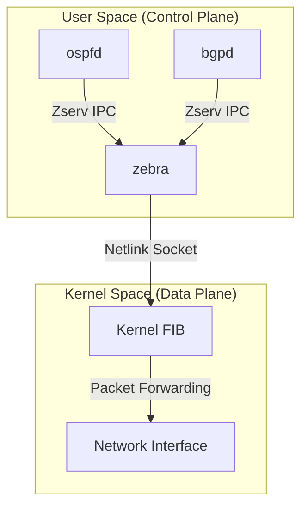

# Lesson 2: Distance-Vector and Link-State Protocols - RIP, OSPF, BGP Fundamentals

## 1. First-Principles Intuition & Invariants

The fundamental problem of network routing is distributed graph computation. Independent processing nodes must collaboratively construct a consistent forwarding state across a network without a centralized controller or shared memory. This requires consensus on topology and a deterministic algorithm to resolve shortest paths. Distance-vector protocols, such as RIP, solve this via the Bellman-Ford equation. A node's cost to reach a destination is simply the cost to reach a neighbor plus the neighbor's advertised cost to the destination. This "routing by rumor" approach minimizes memory and CPU requirements, as a router only needs to store the distance and vector for each destination. However, it introduces a severe failure mode: the count-to-infinity problem. When a network fault occurs, the erroneous state propagates backward through the network hop-by-hop, incrementing metrics until they reach a maximum threshold (15 in RIP), severely delaying convergence.

Link-state protocols invert this model entirely. Instead of computing on hearsay, every node floods its local adjacency state to the entire topology, constructing an identical Link-State Database (LSDB) on every router. This database represents a complete, synchronized graph. With global knowledge, each router can independently execute Dijkstra's Shortest Path First (SPF) algorithm to compute a loop-free tree rooted at itself. The trade-off is memory and CPU: maintaining a full graph and running SPF is computationally expensive, but it guarantees rapid, loop-free convergence. OSPF is the canonical link-state implementation, operating directly over IP protocol 89 and structuring the graph into hierarchical areas to bound SPF computation.

Path-vector protocols, embodied by BGP, abandon pure shortest-path logic for policy-based path selection. BGP tracks the sequence of Autonomous Systems (AS_PATH) a route has traversed, using this vector to prevent loops globally. Its mechanics are not about minimizing a scalar metric, but about applying a deterministic sequence of policy heuristics to choose the best path among competing alternatives. This makes BGP highly scalable for the internet, where administrative boundaries require policy enforcement over pure mathematical efficiency.

## 2. Core Architecture & Mechanics

The architectural separation between the control plane and the data plane is critical for understanding router mechanics. In a Linux-based router, the data plane is the kernel networking stack, forwarding packets via the Forwarding Information Base (FIB). The control plane consists of user-space routing daemons, such as FRRouting (FRR), which compute routes and install them into the kernel FIB via Netlink sockets. This decoupling allows the routing protocol to crash or restart without dropping established connections in the data plane.



Distance-vector mechanics in RIP operate over UDP port 520. By default, a RIP-enabled router broadcasts its entire routing table every 30 seconds. To implement this in a modern Linux environment using FRR, the configuration is minimal but highlights the protocol's stateless nature. The following `frr.conf` snippet configures RIP on two interfaces.

```text
frr version 8.4
frr defaults traditional
hostname rip-router-01
log syslog informational
service integrated-vtysh-config
!
interface eth0
 ip address 10.0.0.1/24
!
interface eth1
 ip address 172.16.0.1/24
!
router rip
 version 2
 network 10.0.0.0/24
 network 172.16.0.0/24
 no auto-summary
!
line vty
!
```

To verify the distance-vector exchange, the practitioner examines the RIP database using `vtysh -c "show ip rip"`. This command reveals the learned routes, their metrics, and the next-hop neighbor. Because RIP only exchanges full tables periodically, its convergence is bound by the update timer (30s), the invalid timer (180s), and the hold-down timer (180s). If a link fails silently, the router must wait for the invalid timer to expire before believing alternative paths, leading to minutes of blackholed traffic.

Link-state mechanics in OSPF are far more complex. OSPF bypasses TCP and UDP to ensure its packets are prioritized and do not get tangled in transport-layer congestion control. The core of OSPF is the Link-State Advertisement (LSA). A Router-LSA (Type 1) is generated by every router and flooded throughout the area, describing its local links, their costs, and adjacent neighbors. To build a multi-area OSPF network, we configure an Area Border Router (ABR). This router maintains two separate LSDBs, one for each area, and generates Network-Summary LSAs (Type 3) to leak prefix information between them.

```text
frr version 8.4
frr defaults traditional
hostname ospf-abr-01
log syslog informational
service integrated-vtysh-config
!
interface lo
 ip address 1.1.1.1/32
!
interface eth0
 ip address 10.0.12.1/30
 ip ospf area 0
!
interface eth1
 ip address 10.0.23.1/30
 ip ospf area 1
!
router ospf
 ospf router-id 1.1.1.1
 area 1 stub
!
line vty
!
```

In this configuration, `eth0` is in Area 0 (the backbone), and `eth1` is in Area 1. The ABR maintains two separate LSDBs, one for each area, and generates Network-Summary LSAs (Type 3) to leak prefix information between them. The practitioner inspects the topology graph using `vtysh -c "show ip ospf database"`. This output displays the raw graph data. To see the result of the Dijkstra computation, `vtysh -c "show ip ospf border-routers"` displays the shortest-path tree to all ABRs and ASBRs, and `vtysh -c "show ip route ospf"` shows the installed kernel FIB entries. The SPF algorithm constructs a tree rooted at the local router, iteratively selecting the lowest-cost paths.

Path-vector mechanics in BGP rely on TCP port 179 to establish a reliable session between peers. The protocol exchanges NLRIs (Network Layer Reachability Information) paired with path attributes. The critical attributes are `AS_PATH` (loop prevention), `NEXT_HOP` (forwarding directive), `LOCAL_PREF` (internal policy preference), and `MED` (external policy preference). A production edge router peering with a transit provider requires a complete BGP configuration. The following snippet demonstrates an eBGP peering with a transit provider, advertising a local prefix.

```text
frr version 8.4
frr defaults traditional
hostname bgp-edge-01
log syslog informational
service integrated-vtysh-config
!
interface eth0
 ip address 198.51.100.1/30
!
interface eth1
 ip address 10.0.0.1/24
!
router bgp 65001
 bgp router-id 198.51.100.1
 no bgp ebgp-requires-policy
 neighbor 198.51.100.2 remote-as 65002
 neighbor 198.51.100.2 description TRANSIT_PEER
 address-family ipv4 unicast
  network 10.0.0.0/24
  neighbor 198.51.100.2 activate
 exit-address-family
!
line vty
!
```

When BGP receives multiple paths to the same destination, it does not compute a shortest path based on a single scalar. It runs a deterministic finite state machine comparing attributes in a strict order. The practitioner views this decision process with `vtysh -c "show ip bgp"`. The output details each path's attributes and indicates which path won the selection. The selection process evaluates LOCAL_PREF first, then AS_PATH length, then ORIGIN code, then MED, then the route source (eBGP over iBGP), then the IGP metric to the NEXT_HOP, and finally the Router ID as a tie-breaker.

## 3. High-Performance Optimization & Failure Modes

The primary failure mode of distance-vector protocols is the count-to-infinity problem, mitigated in RIP via split-horizon and poison-reverse. However, these mitigations only slow the problem; they do not solve the fundamental convergence delay. In modern infrastructure, RIP is largely relegated to legacy environments or small, flat topologies where its simplicity outweighs its convergence penalties.

OSPF's primary scaling limitation is the SPF computation itself. Dijkstra's algorithm has a time complexity of O(n log n) with a priority queue, or O(n^2) without. In a large, flat OSPF domain, a single link flap triggers an SPF run on every router, consuming CPU and stalling the data plane. OSPF addresses this via hierarchical area design. By creating areas, we limit LSA flooding scope. A link flap in Area 1 does not trigger an SPF run in Area 0. The ABR merely updates its Type 3 Summary LSAs. This hierarchical isolation is critical for network stability. Furthermore, SPF execution can be throttled. In FRR, SPF delay and hold time are tunable. By default, FRR uses adaptive SPF throttling: the first SPF runs immediately, but subsequent runs are delayed, increasing the delay exponentially up to a maximum if the network remains unstable. This protects the control plane during route flaps.

Failure detection is another critical bottleneck. OSPF Hellos default to 10 seconds with a dead interval of 40 seconds. If a link fails silently (e.g., a switch port goes into err-disable without bringing the router interface down), OSPF will take 40 seconds to declare the neighbor dead. BGP's default hold time is 180 seconds. To achieve sub-second convergence, infrastructure engineers deploy BFD (Bidirectional Forwarding Detection). BFD is a lightweight protocol that operates independently of the routing protocol, exchanging fast hello packets over UDP port 3784 at millisecond intervals. When BFD detects a failure, it signals the routing protocol immediately.

```text
bfd
 profile TRANSIT_BFD
  transmit-interval 300
  receive-interval 300
  detect-multiplier 3
 !
 peer 198.51.100.2
  profile TRANSIT_BFD
 !
!
router ospf
 interface eth0
  bfd
 !
!
router bgp 65001
 neighbor 198.51.100.2 bfd
!
```

With a transmit interval of 300ms and a detect multiplier of 3, BFD will detect a failure in under 1 second. When the BFD session goes down, FRR immediately tears down the OSPF adjacency or BGP peer, flushing the routes and triggering SPF or BGP best-path re-evaluation without waiting for the protocol's native timers to expire. This decoupling of failure detection from routing protocol mechanics is the standard architecture for high-availability cloud and service provider networks. To observe the BFD state, the practitioner uses `vtysh -c "show bfd peers"`, which provides the real-time status, interval times, and diagnostic codes of the fast-keepalive session.
