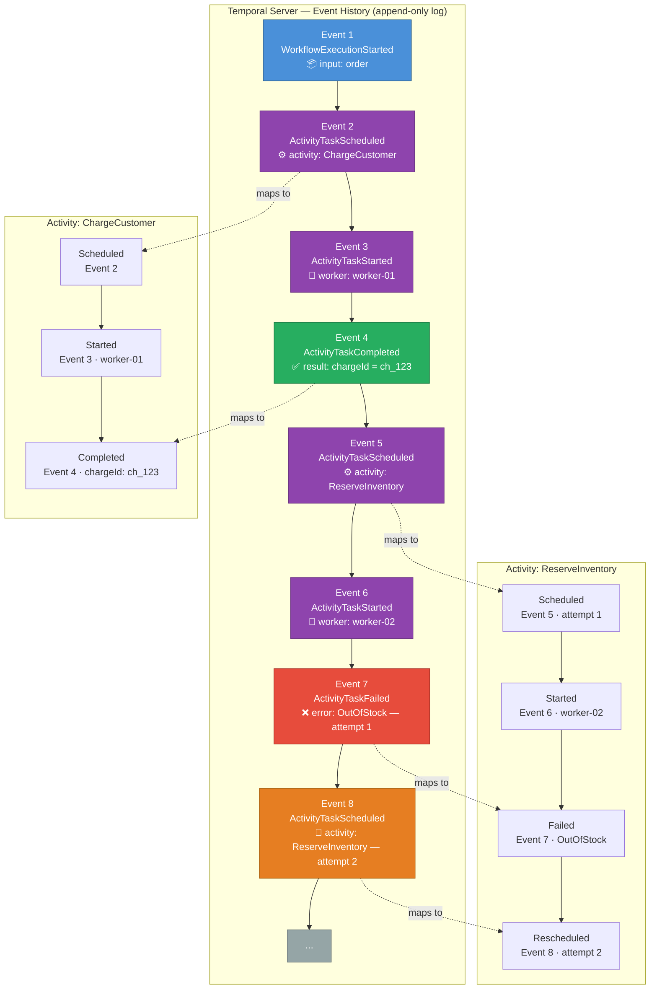
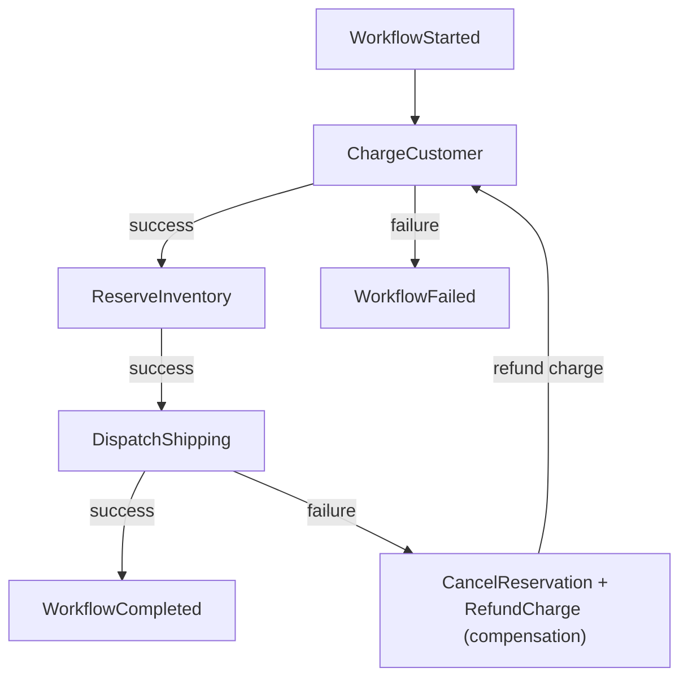

# Lesson 4: Workflow Orchestration, Composition, Durability

## 1. First-Principles Intuition & Invariants

The fundamental problem with distributed computation is not concurrency — it is time. Any sufficiently long-running process that spans multiple network hops, storage writes, and external service calls will eventually encounter a partial failure. A message is delivered but the acknowledgment is lost. A downstream service returns a 500 after performing half its work. A host reboots mid-saga. The classical solution in monolithic systems was the database transaction: a local, synchronous, all-or-nothing operation backed by a write-ahead log and a lock manager. That solution dissolves the moment your computation crosses a service boundary, because there is no global transaction coordinator that can hold a distributed lock across your payment processor, your inventory service, and your shipping provider without creating catastrophic coupling.

Workflow orchestration is the discipline that replaces the distributed transaction illusion with something more honest: an explicit, durable state machine whose execution history is itself a first-class persistent artifact. Rather than pretending that a multi-step cross-service operation is atomic, an orchestration engine acknowledges that each step is an independent, fallible unit of work, and it takes responsibility for recording every state transition so that execution can be resumed from any intermediate point without re-executing completed steps. This is the invariant that makes the entire discipline possible: the execution journal is immutable and append-only, and the current state of any workflow is always fully recoverable by replaying that journal from the beginning.

The theoretical foundation here is the saga pattern, introduced by Hector Garcia-Molina and Kenneth Salem in 1987 as a mechanism for decomposing long-lived transactions. A saga is a sequence of local transactions $T_1, T_2, \ldots, T_n$ where each $T_i$ has a corresponding compensating transaction $C_i$ that semantically undoes its effect. If $T_k$ fails, the saga executes $C_{k-1}, C_{k-2}, \ldots, C_1$ in reverse order to restore a consistent state. The critical distinction from a traditional rollback is that compensating transactions are not undos in the ACID sense — they are forward-moving corrective operations that account for the fact that $T_1$ through $T_{k-1}$ may already have produced observable side effects in external systems. When you refund a charge on Stripe, you are not undoing the original charge row; you are appending a new credit event. The world has moved forward, and compensation moves forward with it.

This distinction has profound implications for how systems programmers must reason about serverless workflows. In a serverless execution model, a function invocation is stateless and ephemeral by contract. The function process may be frozen, migrated, or terminated between any two logical steps. Workflow durability therefore cannot live inside the function's memory — it must live outside it, in a durable execution log maintained by the orchestration engine. The function becomes a pure step executor: given a specific input, it performs exactly one unit of work and returns a result. The engine records that result, advances the state machine, and schedules the next step. If the engine crashes and restarts, it replays the log to reconstruct the in-progress state and continues scheduling from the last confirmed checkpoint. The function itself never needs to know that this recovery happened.

Three invariants underpin every correctly designed workflow orchestration system. First, **exactly-once semantic delivery at the step level**: the engine must guarantee that each step's side effects occur at most once, even if the step function is invoked multiple times due to retries. This is typically implemented through idempotency keys, where the engine generates a stable key per step execution that the step function passes to downstream services. Second, **monotonic progress**: the execution history must be strictly append-only and ordered by logical time (a sequence number or revision counter), so that the engine can always determine the precise frontier of completed work. Third, **compensability by design**: every step that produces an observable external side effect must have a registered compensating action before it is allowed to proceed, because the saga cannot be safely aborted without it.

The practical manifestation of these invariants in the serverless cloud-native world takes three major forms. AWS Step Functions implements a fully managed state machine DSL (Amazon States Language) where state transitions are persisted in a proprietary journal backed by DynamoDB-class durability. Temporal.io implements a code-first workflow model where the developer writes ordinary Go, Java, Python, or TypeScript code, and the Temporal server intercepts all I/O and async operations, recording them into a persistent event history that the worker replays deterministically to reconstruct workflow state. Azure Durable Functions implements the same replay model on top of Azure Storage queues and table storage, using an orchestrator function programming model that is syntactically indistinguishable from linear async/await code. Despite their surface differences, all three systems are expressions of the same underlying theorem: durable execution is achievable by separating the execution log from the execution engine and by enforcing deterministic replay.

---

## 2. Core Architecture & Mechanics

### The Execution Log and State Machine Model

To understand how a workflow engine achieves durability without distributed transactions, it helps to trace the exact mechanical sequence of events for a single workflow execution. Consider a three-step order-fulfillment saga: charge the customer, reserve inventory, dispatch shipping. In Temporal's architecture, the workflow worker process hosts the orchestrator function in-memory but never actually performs I/O itself. When the orchestrator calls `activity.ExecuteActivity(ctx, ChargeCustomer, order)`, Temporal's SDK does not invoke the `ChargeCustomer` function directly. Instead, it records a `ScheduleActivityTask` command into the outbound command buffer, suspends the coroutine at that exact point, and yields back to the Temporal server. The server appends a `ActivityTaskScheduled` event to the workflow's event history, then dispatches the task to an activity worker. When the activity completes, the server appends `ActivityTaskCompleted` with the result. The next time the orchestrator coroutine runs, Temporal replays every event in the history, deterministically re-executing each line of the orchestrator code up to the suspension point and injecting the recorded results rather than re-executing the activities. The orchestrator's in-memory state is reconstructed entirely from this replay, and execution continues from the point of suspension.



This append-only event log is the single source of truth. The workflow's current state is not stored as a snapshot of fields in a database row — it is fully derivable by replaying the event sequence. This is the event sourcing pattern applied to workflow execution, and it carries all the same durability guarantees: as long as the event history is replicated and durable, the execution can be resumed on any worker anywhere.

### State Machine Topology

A workflow is a directed graph where nodes are states and edges are transitions triggered by events (activity completions, timer firings, external signals, child workflow results). Amazon States Language makes this graph explicit and declarative. Temporal makes it implicit in code but enforces the same state machine semantics through the SDK's coroutine model. The following diagram illustrates the state machine for the order-fulfillment saga with compensation paths:



The compensation path is not an error handler bolted onto the side of the happy path. It is a fully specified forward-moving execution branch that the workflow engine schedules just as it would any other activity sequence. The engine does not roll back time — it moves forward through the compensation sequence, recording each compensating activity's completion into the same append-only event history.

### Temporal Workflow Implementation

The following complete, production-grade Temporal workflow in Go implements the order-fulfillment saga with full compensation logic, configurable retry policies, and heartbeating for long-running activities.

**Workflow definition (`workflow/order_fulfillment.go`):**

```go
package workflow

import (
	"time"

	"go.temporal.io/sdk/temporal"
	"go.temporal.io/sdk/workflow"
)

type OrderInput struct {
	OrderID    string  `json:"order_id"`
	CustomerID string  `json:"customer_id"`
	Amount     float64 `json:"amount"`
	SKU        string  `json:"sku"`
	Quantity   int     `json:"quantity"`
}

type ChargeResult struct {
	ChargeID string `json:"charge_id"`
}

type ReservationResult struct {
	ReservationID string `json:"reservation_id"`
}

type ShipmentResult struct {
	TrackingNumber string `json:"tracking_number"`
}

var defaultActivityOptions = workflow.ActivityOptions{
	StartToCloseTimeout: 30 * time.Second,
	RetryPolicy: &temporal.RetryPolicy{
		InitialInterval:        time.Second,
		BackoffCoefficient:     2.0,
		MaximumInterval:        30 * time.Second,
		MaximumAttempts:        5,
		NonRetryableErrorTypes: []string{"InvalidPaymentMethod", "CustomerBlocked"},
	},
}

var longRunningActivityOptions = workflow.ActivityOptions{
	StartToCloseTimeout: 10 * time.Minute,
	HeartbeatTimeout:    30 * time.Second,
	RetryPolicy: &temporal.RetryPolicy{
		InitialInterval:    5 * time.Second,
		BackoffCoefficient: 1.5,
		MaximumInterval:    60 * time.Second,
		MaximumAttempts:    10,
	},
}

func OrderFulfillmentWorkflow(ctx workflow.Context, input OrderInput) error {
	logger := workflow.GetLogger(ctx)

	// Phase 1: Charge customer.
	chargeCtx := workflow.WithActivityOptions(ctx, defaultActivityOptions)
	var chargeResult ChargeResult
	if err := workflow.ExecuteActivity(chargeCtx, ChargeCustomerActivity, input).Get(chargeCtx, &chargeResult); err != nil {
		logger.Error("ChargeCustomer failed, no compensation needed", "error", err)
		return err
	}
	logger.Info("Charge succeeded", "chargeId", chargeResult.ChargeID)

	// Phase 2: Reserve inventory. On failure, compensate by refunding charge.
	reserveCtx := workflow.WithActivityOptions(ctx, defaultActivityOptions)
	var reservationResult ReservationResult
	if err := workflow.ExecuteActivity(reserveCtx, ReserveInventoryActivity, input).Get(reserveCtx, &reservationResult); err != nil {
		logger.Error("ReserveInventory failed, initiating compensation", "error", err)
		compensateCtx := workflow.WithActivityOptions(ctx, workflow.ActivityOptions{
			StartToCloseTimeout: 60 * time.Second,
			RetryPolicy: &temporal.RetryPolicy{
				MaximumAttempts: 20,
				InitialInterval: 2 * time.Second,
			},
		})
		if cErr := workflow.ExecuteActivity(compensateCtx, RefundChargeActivity, chargeResult.ChargeID).Get(compensateCtx, nil); cErr != nil {
			logger.Error("COMPENSATION FAILED: manual intervention required",
				"chargeId", chargeResult.ChargeID, "error", cErr)
			return temporal.NewApplicationError(
				"saga compensation failed",
				"CompensationFailure",
				map[string]string{
					"chargeId": chargeResult.ChargeID,
					"reason":   cErr.Error(),
				},
			)
		}
		return err
	}
	logger.Info("Reservation succeeded", "reservationId", reservationResult.ReservationID)

	// Phase 3: Dispatch shipping (long-running, heartbeating).
	// On failure, compensate by canceling reservation and refunding charge.
	shipCtx := workflow.WithActivityOptions(ctx, longRunningActivityOptions)
	var shipmentResult ShipmentResult
	if err := workflow.ExecuteActivity(shipCtx, DispatchShippingActivity, input, reservationResult).Get(shipCtx, &shipmentResult); err != nil {
		logger.Error("DispatchShipping failed, initiating full compensation", "error", err)
		compensateCtx := workflow.WithActivityOptions(ctx, workflow.ActivityOptions{
			StartToCloseTimeout: 60 * time.Second,
			RetryPolicy:         &temporal.RetryPolicy{MaximumAttempts: 20, InitialInterval: 2 * time.Second},
		})

		// Run compensation steps in parallel using workflow.Go.
		var cancelErr, refundErr error
		wg := workflow.NewWaitGroup(ctx)

		wg.Add(1)
		workflow.Go(ctx, func(gCtx workflow.Context) {
			defer wg.Done()
			cancelErr = workflow.ExecuteActivity(
				workflow.WithActivityOptions(gCtx, workflow.ActivityOptions{
					StartToCloseTimeout: 60 * time.Second,
					RetryPolicy:         &temporal.RetryPolicy{MaximumAttempts: 20},
				}),
				CancelReservationActivity,
				reservationResult.ReservationID,
			).Get(gCtx, nil)
		})

		wg.Add(1)
		workflow.Go(ctx, func(gCtx workflow.Context) {
			defer wg.Done()
			refundErr = workflow.ExecuteActivity(
				compensateCtx,
				RefundChargeActivity,
				chargeResult.ChargeID,
			).Get(gCtx, nil)
		})

		wg.Wait(ctx)

		if cancelErr != nil || refundErr != nil {
			logger.Error("COMPENSATION PARTIALLY FAILED",
				"cancelErr", cancelErr, "refundErr", refundErr,
				"reservationId", reservationResult.ReservationID,
				"chargeId", chargeResult.ChargeID)
			return temporal.NewApplicationError("partial compensation failure", "CompensationFailure")
		}
		return err
	}

	logger.Info("Order fulfilled successfully", "trackingNumber", shipmentResult.TrackingNumber)
	return nil
}
```

**Activity implementations (`activity/order_activities.go`):**

```go
package activity

import (
	"context"
	"fmt"
	"time"

	"go.temporal.io/sdk/activity"
	"go.temporal.io/sdk/temporal"
)

type ChargeCustomerInput struct {
	OrderID    string  `json:"order_id"`
	CustomerID string  `json:"customer_id"`
	Amount     float64 `json:"amount"`
}

// ChargeCustomerActivity is idempotent: it passes OrderID as the idempotency key
// to the payment provider, so duplicate invocations are safe.
func ChargeCustomerActivity(ctx context.Context, input ChargeCustomerInput) (ChargeResult, error) {
	logger := activity.GetLogger(ctx)
	info := activity.GetInfo(ctx)
	logger.Info("Charging customer", "orderID", input.OrderID, "attempt", info.Attempt)

	// Idempotency key is stable across retry attempts for the same workflow activity execution.
	idempotencyKey := fmt.Sprintf("charge-%s-%d", input.OrderID, info.Attempt)

	chargeID, err := paymentProviderCharge(ctx, idempotencyKey, input.CustomerID, input.Amount)
	if err != nil {
		if isInvalidPaymentError(err) {
			return ChargeResult{}, temporal.NewNonRetryableApplicationError(
				"payment method invalid", "InvalidPaymentMethod", err,
			)
		}
		return ChargeResult{}, fmt.Errorf("charge failed: %w", err)
	}

	return ChargeResult{ChargeID: chargeID}, nil
}

func ReserveInventoryActivity(ctx context.Context, input ReserveInventoryInput) (ReservationResult, error) {
	logger := activity.GetLogger(ctx)
	logger.Info("Reserving inventory", "sku", input.SKU, "quantity", input.Quantity)

	reservationID, err := inventoryService.Reserve(ctx, input.SKU, input.Quantity, input.OrderID)
	if err != nil {
		return ReservationResult{}, fmt.Errorf("reservation failed: %w", err)
	}

	return ReservationResult{ReservationID: reservationID}, nil
}

// DispatchShippingActivity is long-running and must heartbeat to signal liveness.
// Temporal will mark this activity as timed out if it does not heartbeat within
// the HeartbeatTimeout configured in the workflow's ActivityOptions.
func DispatchShippingActivity(ctx context.Context, input DispatchShippingInput, reservation ReservationResult) (ShipmentResult, error) {
	logger := activity.GetLogger(ctx)
	logger.Info("Dispatching shipment", "orderID", input.OrderID)

	shipmentID, err := shippingService.CreateShipment(ctx, input.OrderID, reservation.ReservationID)
	if err != nil {
		return ShipmentResult{}, fmt.Errorf("shipment creation failed: %w", err)
	}

	// Poll for label generation, heartbeating every 10 seconds.
	ticker := time.NewTicker(10 * time.Second)
	defer ticker.Stop()
	deadline := time.After(9 * time.Minute)

	for {
		select {
		case <-ctx.Done():
			return ShipmentResult{}, ctx.Err()
		case <-deadline:
			return ShipmentResult{}, temporal.NewApplicationError("shipment label timeout", "ShippingTimeout")
		case <-ticker.C:
			activity.RecordHeartbeat(ctx, fmt.Sprintf("polling shipment %s", shipmentID))

			status, trackingNumber, err := shippingService.GetLabelStatus(ctx, shipmentID)
			if err != nil {
				logger.Warn("Label status check failed, will retry", "error", err)
				continue
			}
			if status == "READY" {
				return ShipmentResult{TrackingNumber: trackingNumber}, nil
			}
			logger.Info("Shipment label not ready yet", "status", status)
		}
	}
}

func RefundChargeActivity(ctx context.Context, chargeID string) error {
	return paymentProviderRefund(ctx, chargeID)
}

func CancelReservationActivity(ctx context.Context, reservationID string) error {
	return inventoryService.CancelReservation(ctx, reservationID)
}

// Stub implementations representing real service clients.
func paymentProviderCharge(_ context.Context, idempotencyKey, customerID string, amount float64) (string, error) {
	return fmt.Sprintf("ch_%s", idempotencyKey[:8]), nil
}

func paymentProviderRefund(_ context.Context, chargeID string) error {
	return nil
}

func isInvalidPaymentError(err error) bool {
	return err != nil && err.Error() == "invalid_payment_method"
}

type ReserveInventoryInput struct {
	OrderID  string `json:"order_id"`
	SKU      string `json:"sku"`
	Quantity int    `json:"quantity"`
}

type DispatchShippingInput struct {
	OrderID string `json:"order_id"`
}

var inventoryService = &stubInventoryService{}
var shippingService = &stubShippingService{}

type stubInventoryService struct{}
func (s *stubInventoryService) Reserve(_ context.Context, sku string, qty int, orderID string) (string, error) {
	return fmt.Sprintf("res_%s_%s_%d", orderID, sku, qty), nil
}
func (s *stubInventoryService) CancelReservation(_ context.Context, reservationID string) error { return nil }

type stubShippingService struct{}
func (s *stubShippingService) CreateShipment(_ context.Context, orderID, reservationID string) (string, error) {
	return fmt.Sprintf("ship_%s", orderID), nil
}
func (s *stubShippingService) GetLabelStatus(_ context.Context, shipmentID string) (string, string, error) {
	return "READY", fmt.Sprintf("1Z%s", shipmentID[:8]), nil
}
```

**Worker registration and startup (`cmd/worker/main.go`):**

```go
package main

import (
	"log"

	"go.temporal.io/sdk/client"
	"go.temporal.io/sdk/worker"

	"github.com/example/serverless-workflows/activity"
	"github.com/example/serverless-workflows/workflow"
)

func main() {
	c, err := client.Dial(client.Options{
		HostPort:  "temporal-frontend.temporal.svc.cluster.local:7233",
		Namespace: "production",
	})
	if err != nil {
		log.Fatalln("Failed to connect to Temporal server", err)
	}
	defer c.Close()

	w := worker.New(c, "order-fulfillment", worker.Options{
		MaxConcurrentActivityExecutionSize:      100,
		MaxConcurrentWorkflowTaskExecutionSize:  50,
		MaxConcurrentLocalActivityExecutionSize: 20,
	})

	w.RegisterWorkflow(workflow.OrderFulfillmentWorkflow)
	w.RegisterActivity(activity.ChargeCustomerActivity)
	w.RegisterActivity(activity.ReserveInventoryActivity)
	w.RegisterActivity(activity.DispatchShippingActivity)
	w.RegisterActivity(activity.RefundChargeActivity)
	w.RegisterActivity(activity.CancelReservationActivity)

	if err = w.Run(worker.InterruptCh()); err != nil {
		log.Fatalln("Worker exited with error", err)
	}
}
```

### AWS Step Functions: Declarative Saga with Amazon States Language

For teams operating entirely within the AWS ecosystem, Step Functions Express Workflows provide sub-second state transition latency suitable for high-throughput workflows, while Standard Workflows provide exactly-once execution semantics and 90-day history retention for long-running sagas. The following complete Amazon States Language definition implements the same order-fulfillment saga, using `Catch` blocks at each state to trigger the compensation branch:

```json
{
  "Comment": "Order Fulfillment Saga with Compensation",
  "StartAt": "ChargeCustomer",
  "States": {
    "ChargeCustomer": {
      "Type": "Task",
      "Resource": "arn:aws:lambda:us-east-1:123456789012:function:ChargeCustomer",
      "ResultPath": "$.chargeResult",
      "Retry": [
        {
          "ErrorEquals": ["Lambda.ServiceException", "Lambda.AWSLambdaException", "Lambda.TooManyRequestsException"],
          "IntervalSeconds": 2,
          "MaxAttempts": 5,
          "BackoffRate": 2.0,
          "JitterStrategy": "FULL"
        }
      ],
      "Catch": [
        {
          "ErrorEquals": ["InvalidPaymentMethod", "CustomerBlocked"],
          "ResultPath": "$.error",
          "Next": "WorkflowFailed"
        },
        {
          "ErrorEquals": ["States.ALL"],
          "ResultPath": "$.error",
          "Next": "WorkflowFailed"
        }
      ],
      "Next": "ReserveInventory"
    },
    "ReserveInventory": {
      "Type": "Task",
      "Resource": "arn:aws:lambda:us-east-1:123456789012:function:ReserveInventory",
      "ResultPath": "$.reservationResult",
      "Retry": [
        {
          "ErrorEquals": ["States.TaskFailed"],
          "IntervalSeconds": 3,
          "MaxAttempts": 4,
          "BackoffRate": 1.5,
          "JitterStrategy": "FULL"
        }
      ],
      "Catch": [
        {
          "ErrorEquals": ["States.ALL"],
          "ResultPath": "$.error",
          "Next": "RefundCharge"
        }
      ],
      "Next": "DispatchShipping"
    },
    "DispatchShipping": {
      "Type": "Task",
      "Resource": "arn:aws:states:::lambda:invoke.waitForTaskToken",
      "Parameters": {
        "FunctionName": "arn:aws:lambda:us-east-1:123456789012:function:DispatchShipping",
        "Payload": {
          "orderInput.$": "$.orderInput",
          "reservationResult.$": "$.reservationResult",
          "taskToken.$": "$$.Task.Token"
        }
      },
      "HeartbeatSeconds": 60,
      "TimeoutSeconds": 600,
      "ResultPath": "$.shipmentResult",
      "Catch": [
        {
          "ErrorEquals": ["States.ALL"],
          "ResultPath": "$.error",
          "Next": "CompensateParallel"
        }
      ],
      "Next": "WorkflowSucceeded"
    },
    "CompensateParallel": {
      "Type": "Parallel",
      "Branches": [
        {
          "StartAt": "CancelReservation",
          "States": {
            "CancelReservation": {
              "Type": "Task",
              "Resource": "arn:aws:lambda:us-east-1:123456789012:function:CancelReservation",
              "Retry": [
                {
                  "ErrorEquals": ["States.ALL"],
                  "IntervalSeconds": 5,
                  "MaxAttempts": 20,
                  "BackoffRate": 2.0
                }
              ],
              "End": true
            }
          }
        },
        {
          "StartAt": "RefundChargeCompensation",
          "States": {
            "RefundChargeCompensation": {
              "Type": "Task",
              "Resource": "arn:aws:lambda:us-east-1:123456789012:function:RefundCharge",
              "Retry": [
                {
                  "ErrorEquals": ["States.ALL"],
                  "IntervalSeconds": 5,
                  "MaxAttempts": 20,
                  "BackoffRate": 2.0
                }
              ],
              "End": true
            }
          }
        }
      ],
      "Next": "WorkflowFailed"
    },
    "RefundCharge": {
      "Type": "Task",
      "Resource": "arn:aws:lambda:us-east-1:123456789012:function:RefundCharge",
      "Retry": [
        {
          "ErrorEquals": ["States.ALL"],
          "IntervalSeconds": 5,
          "MaxAttempts": 20,
          "BackoffRate": 2.0
        }
      ],
      "Next": "WorkflowFailed"
    },
    "WorkflowSucceeded": {
      "Type": "Succeed"
    },
    "WorkflowFailed": {
      "Type": "Fail",
      "Error": "OrderFulfillmentFailed",
      "Cause": "Saga compensation completed"
    }
  }
}
```

The `waitForTaskToken` integration pattern for `DispatchShipping` deserves specific attention. Rather than blocking the Lambda function in a polling loop — which would consume Lambda compute time and billing units at every interval — the function registers a task token with the external shipping service and returns immediately. Step Functions suspends the state machine and waits for a callback to `SendTaskSuccess` or `SendTaskFailure` with that token. The shipping service (or a webhook receiver) calls back when the label is ready, and Step Functions resumes the state machine. This is the asynchronous callback pattern, and it is the correct architectural choice any time a workflow step involves waiting for an external system to complete work over an unbounded duration.

### Kubernetes Deployment for Temporal Workers

Temporal workers are long-running Kubernetes Deployments, not Lambda functions. They maintain persistent gRPC connections to the Temporal frontend and long-poll for workflow and activity tasks. The following manifest configures a production-grade worker Deployment with appropriate resource limits, pod disruption budget, and horizontal autoscaling based on the Temporal task queue backlog depth (which is exposed as a custom metric via the Temporal metrics endpoint scraped by Prometheus):

```yaml
apiVersion: apps/v1
kind: Deployment
metadata:
  name: order-fulfillment-worker
```
